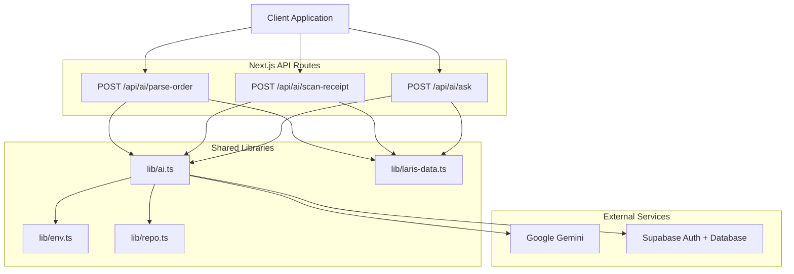
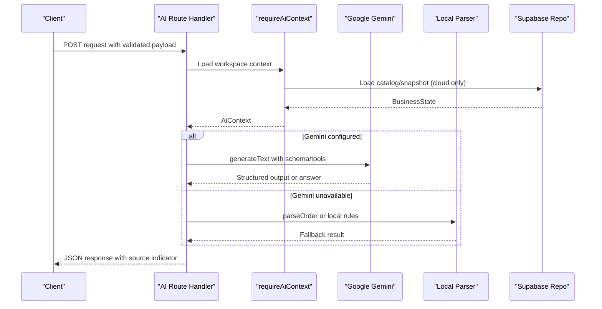
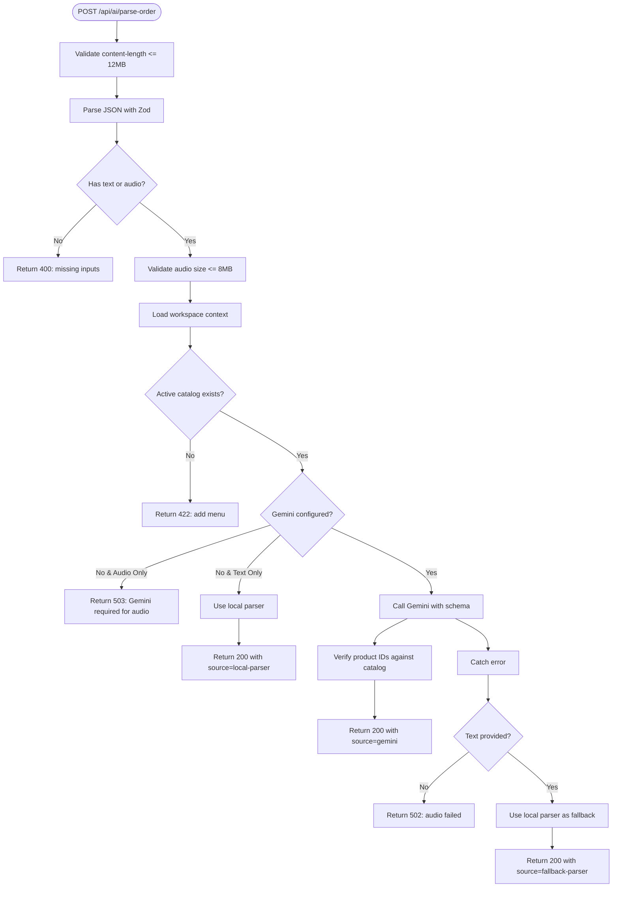
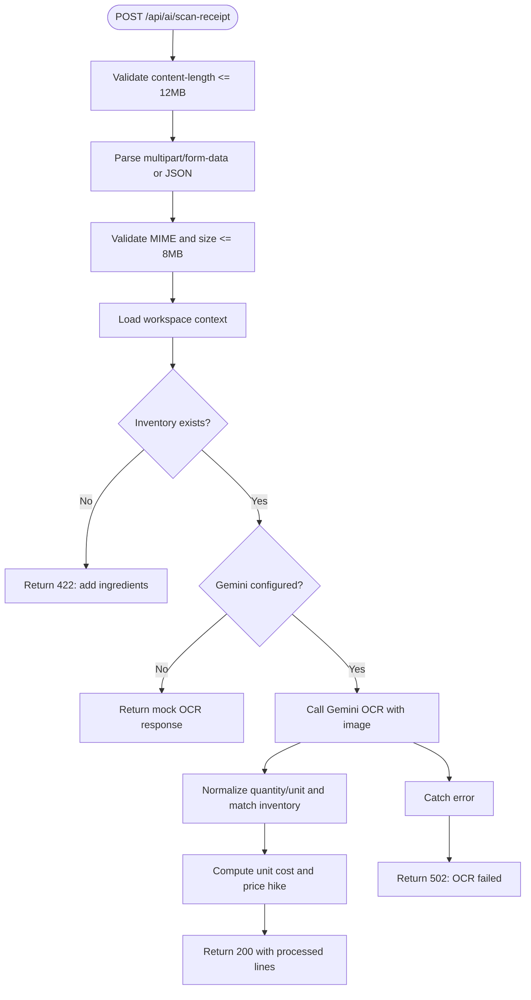
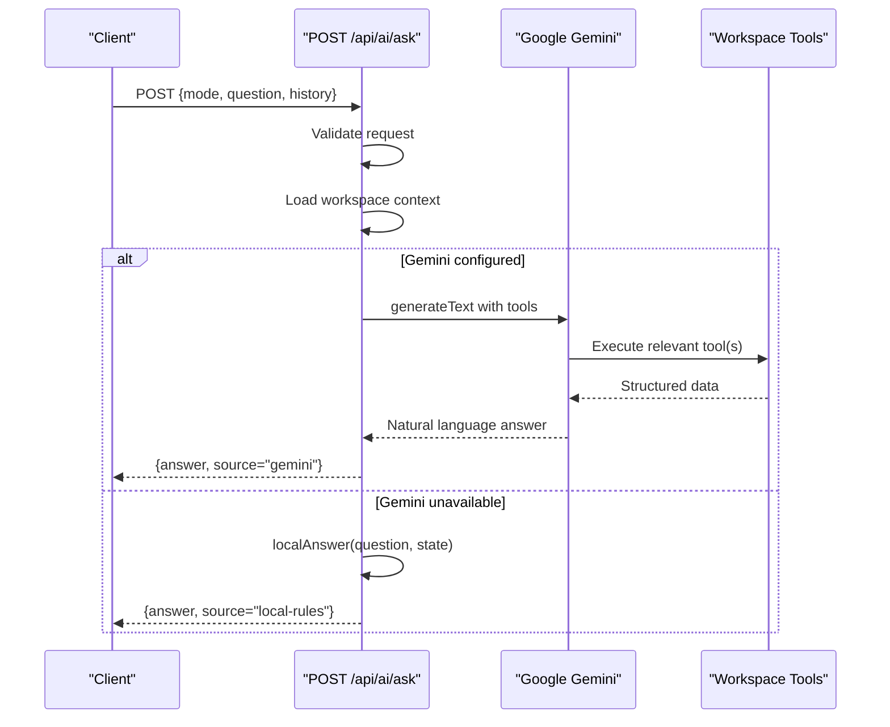
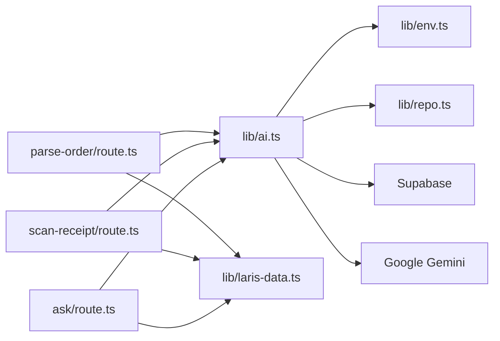

# AI Endpoints

<cite>
**Referenced Files in This Document**
- [parse-order/route.ts](file://src/app/api/ai/parse-order/route.ts)
- [scan-receipt/route.ts](file://src/app/api/ai/scan-receipt/route.ts)
- [ask/route.ts](file://src/app/api/ai/ask/route.ts)
- [ai.ts](file://src/lib/ai.ts)
- [laris-data.ts](file://src/lib/laris-data.ts)
- [env.ts](file://src/lib/env.ts)
- [repo.ts](file://src/lib/repo.ts)
- [middleware.ts](file://src/middleware.ts)
</cite>

## Table of Contents
1. [Introduction](#introduction)
2. [Project Structure](#project-structure)
3. [Core Components](#core-components)
4. [Architecture Overview](#architecture-overview)
5. [Detailed Component Analysis](#detailed-component-analysis)
6. [Dependency Analysis](#dependency-analysis)
7. [Performance Considerations](#performance-considerations)
8. [Troubleshooting Guide](#troubleshooting-guide)
9. [Conclusion](#conclusion)

## Introduction
This document describes the Laris AI API endpoints implemented as Next.js App Router routes. The endpoints provide:
- Voice or text order parsing with Gemini integration and a local fallback parser.
- Receipt OCR processing for supplier invoices, including image upload handling, OCR extraction, and fuzzy matching against inventory.
- Natural language business queries through Tanya Laris, exposing tools that read workspace sales, stock, expenses, and customer data.

The system supports two execution modes:
- Local mode: runs without cloud configuration, using deterministic local parsers and mock responses.
- Cloud mode: requires Supabase authentication and loads workspace catalog, inventory, sales, and other business state.

Authentication is handled by Supabase. In cloud mode, the API validates the current session claims and membership before accessing workspace data. Rate limiting is not enforced at the API layer; clients should implement retry and backoff strategies.

## Project Structure
The AI endpoints are located under `src/app/api/ai`:
- `parse-order/route.ts` handles voice/text order parsing.
- `scan-receipt/route.ts` handles receipt OCR and inventory matching.
- `ask/route.ts` handles natural language queries with tool-driven analytics.

Shared logic lives in:
- `lib/ai.ts` for Google model setup, context loading, error helpers, telemetry logging, and catalog context generation.
- `lib/laris-data.ts` for business data models, local order parsing, stock calculations, and demo data.
- `lib/env.ts` for environment variables and Jakarta timezone date utilities.
- `lib/repo.ts` for Supabase catalog and snapshot loading.
- `middleware.ts` for Supabase session refresh and route guards.



**Diagram sources**
- [parse-order/route.ts:1-128](file://src/app/api/ai/parse-order/route.ts#L1-L128)
- [scan-receipt/route.ts:1-216](file://src/app/api/ai/scan-receipt/route.ts#L1-L216)
- [ask/route.ts:1-218](file://src/app/api/ai/ask/route.ts#L1-L218)
- [ai.ts:1-126](file://src/lib/ai.ts#L1-L126)
- [laris-data.ts:1-494](file://src/lib/laris-data.ts#L1-L494)
- [env.ts:1-29](file://src/lib/env.ts#L1-L29)
- [repo.ts:1-202](file://src/lib/repo.ts#L1-L202)

**Section sources**
- [parse-order/route.ts:1-128](file://src/app/api/ai/parse-order/route.ts#L1-L128)
- [scan-receipt/route.ts:1-216](file://src/app/api/ai/scan-receipt/route.ts#L1-L216)
- [ask/route.ts:1-218](file://src/app/api/ai/ask/route.ts#L1-L218)
- [ai.ts:1-126](file://src/lib/ai.ts#L1-L126)
- [laris-data.ts:1-494](file://src/lib/laris-data.ts#L1-L494)
- [env.ts:1-29](file://src/lib/env.ts#L1-L29)
- [repo.ts:1-202](file://src/lib/repo.ts#L1-L202)
- [middleware.ts:1-12](file://src/middleware.ts#L1-L12)

## Core Components
- Order parsing endpoint: accepts text or audio, validates input size and MIME types, loads workspace catalog, calls Gemini when configured, and falls back to a local parser if Gemini is unavailable or fails.
- Receipt scanning endpoint: accepts multipart form or JSON with base64 image, validates image format and size, performs OCR via Gemini, normalizes units, matches inventory items, and returns price change analysis.
- Ask endpoint: accepts natural language questions with optional conversation history, uses Gemini tools to query workspace data (revenue, profit, top products, low stock, expenses, customers), and provides a local rule-based answer when Gemini is unavailable.

Key shared behaviors:
- Input validation uses Zod schemas.
- Workspace context is loaded via `requireAiContext`, which enforces cloud configuration, Supabase auth claims, and membership.
- Telemetry is logged to an `ai_event` table when a business ID exists.
- Error responses use consistent `{ error }` payloads with appropriate HTTP status codes.

**Section sources**
- [parse-order/route.ts:14-19](file://src/app/api/ai/parse-order/route.ts#L14-L19)
- [scan-receipt/route.ts:14-26](file://src/app/api/ai/scan-receipt/route.ts#L14-L26)
- [ask/route.ts:9-16](file://src/app/api/ai/ask/route.ts#L9-L16)
- [ai.ts:30-69](file://src/lib/ai.ts#L30-L69)
- [ai.ts:97-125](file://src/lib/ai.ts#L97-L125)

## Architecture Overview
The endpoints follow a layered architecture:
- Route handlers validate requests and enforce limits.
- Shared library functions load workspace context and configure Gemini.
- External services include Google Gemini for multimodal AI and Supabase for authentication and business data.
- Local fallbacks ensure functionality without external dependencies.



**Diagram sources**
- [parse-order/route.ts:52-68](file://src/app/api/ai/parse-order/route.ts#L52-L68)
- [scan-receipt/route.ts:98-134](file://src/app/api/ai/scan-receipt/route.ts#L98-L134)
- [ask/route.ts:86-95](file://src/app/api/ai/ask/route.ts#L86-L95)
- [ai.ts:30-69](file://src/lib/ai.ts#L30-L69)
- [repo.ts:82-112](file://src/lib/repo.ts#L82-L112)

## Detailed Component Analysis

### POST /api/ai/parse-order
Purpose: Parse customer orders from text or audio, mapping items to active product IDs and detecting payment method.

Request schema:
- `mode`: `"local"` or `"cloud"`.
- `text`: optional string up to 2000 characters.
- `audio`: optional base64-encoded audio string up to 12MB body limit.
- `mimeType`: optional audio MIME type; defaults to `"audio/webm"`.

Supported audio formats:
- `audio/webm`
- `audio/ogg`
- `audio/mp4`
- `audio/mpeg`
- `audio/wav`
- `audio/x-wav`

Size limits:
- Maximum request body: 12MB.
- Maximum decoded audio bytes: 8MB.

Validation and error handling:
- Missing or invalid JSON returns 400.
- Missing both text and audio returns 400.
- Empty or invalid audio returns 400.
- Audio exceeding 8MB returns 413.
- Body exceeding 12MB returns 413.
- Missing active catalog returns 422.
- Cloud mode without Gemini key and audio input returns 503.
- Gemini failure without text input returns 502.
- Gemini failure with text input falls back to local parser and returns 200 with `source: "fallback-parser"`.

Response schema:
- `items`: array of parsed items with `productId`, `quantity`, and optional `note`.
- `payment`: one of `"Tunai"`, `"QRIS"`, `"Transfer"`.
- `unknown`: unrecognized phrases or invalid product IDs.
- `source`: `"gemini"`, `"local-parser"`, or `"fallback-parser"`.
- `model`: Gemini model identifier when used.

Fallback behavior:
- If Gemini is not configured and input is text-only, the local parser is used immediately.
- If Gemini throws during processing and text was provided, the local parser is used as a fallback with a warning field.

Telemetry:
- Logs feature, model, input metadata, output summary, latency, and success flag.



**Diagram sources**
- [parse-order/route.ts:31-68](file://src/app/api/ai/parse-order/route.ts#L31-L68)
- [parse-order/route.ts:70-126](file://src/app/api/ai/parse-order/route.ts#L70-L126)

Example request (text):
```json
{
  "mode": "cloud",
  "text": "Saya mau kopi susu dua gelas kurang manis bayar QRIS"
}
```

Example response (Gemini):
```json
{
  "items": [
    {
      "productId": "kopi-susu",
      "quantity": 2,
      "note": "less sugar"
    }
  ],
  "payment": "QRIS",
  "unknown": [],
  "source": "gemini",
  "model": "gemini-2.5-flash"
}
```

Example response (local fallback):
```json
{
  "items": [
    {
      "productId": "kopi-susu",
      "quantity": 2,
      "note": "less sugar"
    }
  ],
  "payment": "QRIS",
  "unknown": [],
  "source": "local-parser"
}
```

**Section sources**
- [parse-order/route.ts:9-19](file://src/app/api/ai/parse-order/route.ts#L9-L19)
- [parse-order/route.ts:31-68](file://src/app/api/ai/parse-order/route.ts#L31-L68)
- [parse-order/route.ts:70-126](file://src/app/api/ai/parse-order/route.ts#L70-L126)
- [laris-data.ts:436-474](file://src/lib/laris-data.ts#L436-L474)

### POST /api/ai/scan-receipt
Purpose: Process supplier receipts or invoices via OCR, extract line items, normalize quantities and units, match against inventory, and report price changes.

Input methods:
- Multipart form-data with fields `mode` and `file`.
- JSON body with fields `mode`, `image` (base64 string), and optional `mimeType`.

Supported image formats:
- `image/jpeg`
- `image/png`
- `image/webp`

Size limits:
- Maximum request body: 12MB.
- Maximum image file size: 8MB.

Validation and error handling:
- Invalid JSON or form structure returns 400.
- Missing image returns 400.
- Unsupported MIME type returns 415.
- Empty or invalid image returns 400.
- Image exceeding 8MB returns 413.
- Missing inventory returns 422.
- Cloud mode without Gemini key returns 503 with mock OCR response.
- Gemini failure returns 502.

Response schema:
- `supplierName`: extracted supplier name or default.
- `receiptDate`: validated YYYY-MM-DD date or undefined.
- `lines`: processed lines with matched inventory details, normalized quantity/unit, unit cost, old cost, and optional price hike info.
- `skippedLines`: raw names skipped due to unit conversion issues.
- `total`: rounded total receipt amount.
- `source`: `"gemini"` or `"mock-ocr"`.
- `model`: Gemini model identifier when used.
- `notice`: informational notice when mock OCR or skipped lines exist.

Fuzzy matching behavior:
- OCR output includes `matchedInventoryCode`; only lines with valid inventory IDs are processed.
- Quantity normalization maps common units (g/kg, ml/liter, pcs/dozen) to inventory base units.
- Price hike detection compares new unit cost to existing inventory cost and flags differences above 3%.



**Diagram sources**
- [scan-receipt/route.ts:54-107](file://src/app/api/ai/scan-receipt/route.ts#L54-L107)
- [scan-receipt/route.ts:136-202](file://src/app/api/ai/scan-receipt/route.ts#L136-L202)

Example request (multipart form-data):
```
Content-Type: multipart/form-data; boundary=----WebKitFormBoundary

------WebKitFormBoundary
Content-Disposition: form-data; name="mode"

cloud
------WebKitFormBoundary
Content-Disposition: form-data; name="file"; filename="receipt.jpg"
Content-Type: image/jpeg

<binary image data>
------WebKitFormBoundary--
```

Example request (JSON):
```json
{
  "mode": "cloud",
  "image": "data:image/jpeg;base64,/9j/4AAQSkZJRgABAQEAYABgAAD...",
  "mimeType": "image/jpeg"
}
```

Example response (Gemini):
```json
{
  "supplierName": "Supplier ABC",
  "receiptDate": "2026-10-18",
  "lines": [
    {
      "rawName": "Susu segar — 1 liter",
      "matchedCode": "milk",
      "name": "Susu segar",
      "quantity": 1000,
      "unit": "ml",
      "total": 22000,
      "unitCost": 22,
      "oldCost": 22,
      "priceHike": null
    }
  ],
  "skippedLines": ["Unknown item"],
  "total": 22000,
  "source": "gemini",
  "model": "gemini-2.5-flash"
}
```

Example response (mock OCR):
```json
{
  "supplierName": "Supplier Simulasi Demo",
  "receiptDate": "2026-10-18",
  "lines": [
    {
      "rawName": "Susu segar — data simulasi",
      "matchedCode": "milk",
      "name": "Susu segar",
      "quantity": 1000,
      "unit": "ml",
      "total": 23760,
      "unitCost": 23.76,
      "oldCost": 22,
      "priceHike": {
        "oldPrice": 22,
        "newPrice": 23.76,
        "diffPercent": 8
      }
    }
  ],
  "total": 23760,
  "source": "mock-ocr",
  "notice": "Simulasi OCR demo lokal, bukan hasil pembacaan foto. Isi kunci Gemini untuk OCR sungguhan."
}
```

**Section sources**
- [scan-receipt/route.ts:9-26](file://src/app/api/ai/scan-receipt/route.ts#L9-L26)
- [scan-receipt/route.ts:54-107](file://src/app/api/ai/scan-receipt/route.ts#L54-L107)
- [scan-receipt/route.ts:136-202](file://src/app/api/ai/scan-receipt/route.ts#L136-L202)

### POST /api/ai/ask
Purpose: Answer natural language business questions using Tanya Laris. When Gemini is available, it uses tools to compute revenue, profit, top-selling products, low-stock alerts, customer segments, and expense breakdowns. Without Gemini, it returns deterministic local answers.

Request schema:
- `mode`: `"local"` or `"cloud"`.
- `question`: required string between 1 and 2000 characters.
- `history`: optional array of conversation messages with `role` (`"user"` or `"assistant"`) and `text`, max 12 entries.

Validation and error handling:
- Invalid JSON or question length/format returns 400.
- Workspace context loading errors return appropriate 401/403/503 via `aiErrorResponse`.
- Gemini failure returns 502.

Response schema:
- `answer`: natural language response in Indonesian.
- `source`: `"gemini"` or `"local-rules"`.
- `model`: Gemini model identifier when used.

Tools exposed to Gemini:
- `getRevenueSummary(days)`: period revenue, transaction count, average order value.
- `getProfitSummary(days)`: estimated gross profit based on recipe costs.
- `getTopSellingProducts(limit)`: ranked products by quantity sold.
- `getLowStockAlerts()`: inventory items at or below reorder point.
- `getCustomerSegmentsSummary()`: RFM segment counts.
- `getExpensesBreakdown()`: operational expenses by category.

Local answer rules:
- Detects keywords for best-selling products, stock levels, and revenue/profit topics.
- Returns actionable guidance when data is empty.



**Diagram sources**
- [ask/route.ts:77-95](file://src/app/api/ai/ask/route.ts#L77-L95)
- [ask/route.ts:97-174](file://src/app/api/ai/ask/route.ts#L97-L174)
- [ask/route.ts:176-216](file://src/app/api/ai/ask/route.ts#L176-L216)

Example request:
```json
{
  "mode": "cloud",
  "question": "Berapa omzet minggu ini dan produk terlarisnya?",
  "history": [
    {
      "role": "user",
      "text": "Apa kabar hari ini?"
    },
    {
      "role": "assistant",
      "text": "Baik! Ada yang bisa saya bantu terkait penjualan atau stok?"
    }
  ]
}
```

Example response (Gemini):
```json
{
  "answer": "Omzet tujuh hari terakhir adalah Rp12.500.000 dari 45 transaksi dengan rata-rata pesanan Rp277.778. Produk terlaris adalah Es Kopi Susu dengan 120 unit terjual.",
  "source": "gemini",
  "model": "gemini-2.5-flash"
}
```

Example response (local rules):
```json
{
  "answer": "Belum ada transaksi tercatat di Kopi Senja. Omzet dan laba akan muncul setelah transaksi pertama disimpan.",
  "source": "local-rules"
}
```

**Section sources**
- [ask/route.ts:9-16](file://src/app/api/ai/ask/route.ts#L9-L16)
- [ask/route.ts:46-75](file://src/app/api/ai/ask/route.ts#L46-L75)
- [ask/route.ts:77-95](file://src/app/api/ai/ask/route.ts#L77-L95)
- [ask/route.ts:97-174](file://src/app/api/ai/ask/route.ts#L97-L174)
- [ask/route.ts:176-216](file://src/app/api/ai/ask/route.ts#L176-L216)

## Dependency Analysis
The endpoints depend on shared libraries for context loading, Gemini configuration, and business data operations.



**Diagram sources**
- [parse-order/route.ts:1-5](file://src/app/api/ai/parse-order/route.ts#L1-L5)
- [scan-receipt/route.ts:1-5](file://src/app/api/ai/scan-receipt/route.ts#L1-L5)
- [ask/route.ts:1-5](file://src/app/api/ai/ask/route.ts#L1-L5)
- [ai.ts:1-126](file://src/lib/ai.ts#L1-L126)
- [env.ts:1-29](file://src/lib/env.ts#L1-L29)
- [repo.ts:1-202](file://src/lib/repo.ts#L1-L202)
- [laris-data.ts:1-494](file://src/lib/laris-data.ts#L1-L494)

Key dependency relationships:
- All endpoints import shared AI utilities for model setup, context loading, and telemetry.
- `requireAiContext` enforces cloud configuration and Supabase authentication.
- `loadCatalog` and `loadSnapshot` fetch workspace data from Supabase.
- Local parsers and mock responses reduce external dependencies in local mode.

**Section sources**
- [ai.ts:9-15](file://src/lib/ai.ts#L9-L15)
- [ai.ts:30-69](file://src/lib/ai.ts#L30-L69)
- [repo.ts:82-112](file://src/lib/repo.ts#L82-L112)
- [repo.ts:129-193](file://src/lib/repo.ts#L129-L193)

## Performance Considerations
- Request body limits protect against large payloads: 12MB for all endpoints, 8MB for audio/images.
- Gemini calls may be slow; telemetry records latency for monitoring.
- Local parsers and mock responses provide fast fallbacks when external services are unavailable.
- Tool execution in the ask endpoint is bounded by step count to prevent excessive iterations.
- No server-side rate limiting is implemented; clients should implement exponential backoff and retry logic.

[No sources needed since this section provides general guidance]

## Troubleshooting Guide
Common issues and resolutions:
- **400 Bad Request**: Invalid JSON, missing required fields, unsupported MIME types, or empty media. Validate input schema and ensure proper encoding.
- **413 Payload Too Large**: Exceeded 12MB body or 8MB audio/image limit. Compress media or split requests.
- **415 Unsupported Media Type**: Incorrect MIME type for audio or images. Use supported formats listed per endpoint.
- **422 Unprocessable Entity**: Missing active catalog or inventory. Add products or ingredients to workspace.
- **503 Service Unavailable**: Cloud mode without Gemini key or missing cloud configuration. Set `GOOGLE_GENERATIVE_AI_API_KEY` or switch to local mode.
- **502 Bad Gateway**: Gemini service failure. Retry with backoff or fall back to local parser where supported.

Security considerations:
- Input validation uses Zod schemas to prevent malformed data.
- Product IDs are verified against active catalog to avoid injection or fabrication.
- SQL injection prevention is handled by Supabase RLS and parameterized queries in repository functions.
- Authentication relies on Supabase session claims; unauthorized access returns 401/403.
- Telemetry logs do not expose sensitive user data and fail silently if logging fails.

**Section sources**
- [parse-order/route.ts:31-68](file://src/app/api/ai/parse-order/route.ts#L31-L68)
- [scan-receipt/route.ts:54-107](file://src/app/api/ai/scan-receipt/route.ts#L54-L107)
- [ask/route.ts:77-95](file://src/app/api/ai/ask/route.ts#L77-L95)
- [ai.ts:71-74](file://src/lib/ai.ts#L71-L74)
- [repo.ts:82-112](file://src/lib/repo.ts#L82-L112)

## Conclusion
The Laris AI endpoints provide robust order parsing, receipt OCR, and natural language business analytics with clear fallback mechanisms. They enforce strict input validation, size limits, and authentication requirements while supporting both cloud and local execution modes. Clients should handle error responses gracefully, respect size constraints, and implement retry strategies for external service failures.

[No sources needed since this section summarizes without analyzing specific files]