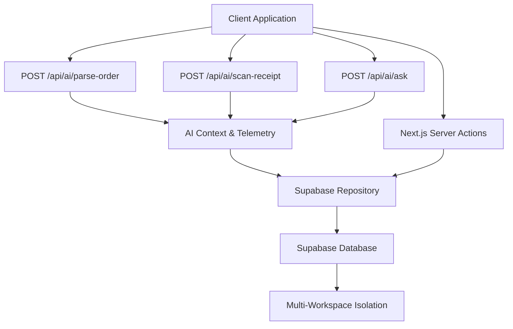
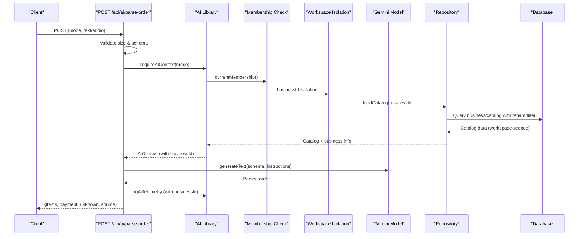
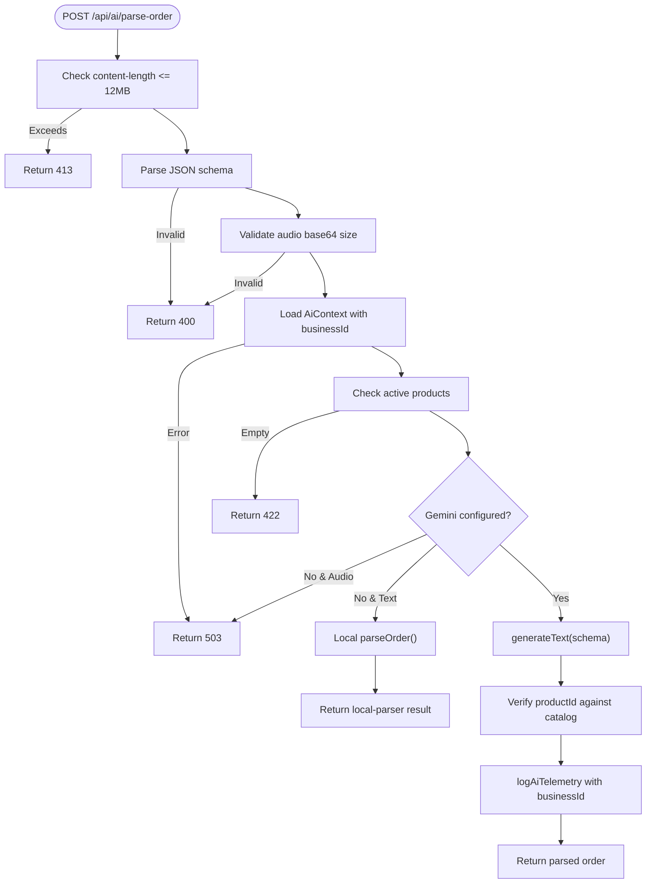
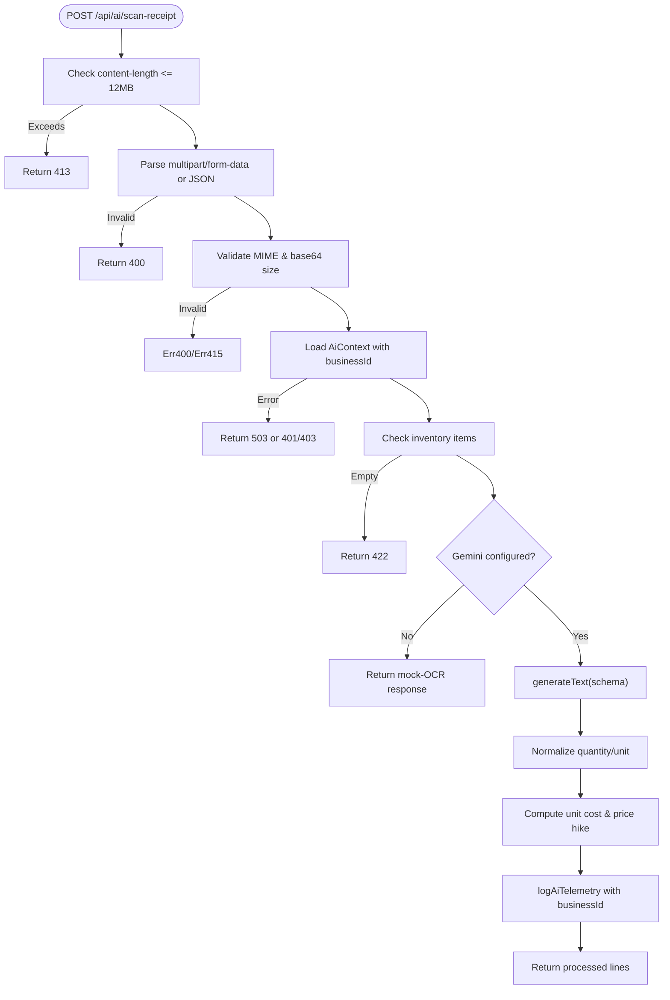
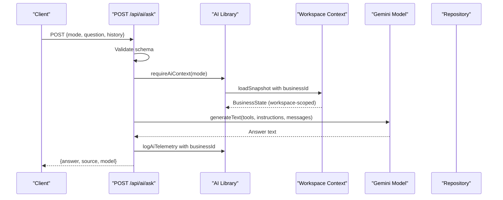
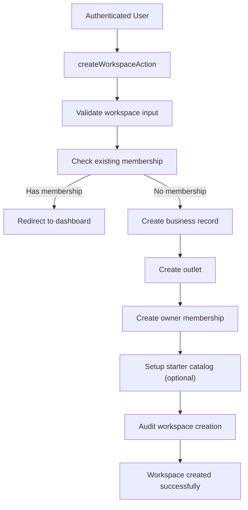
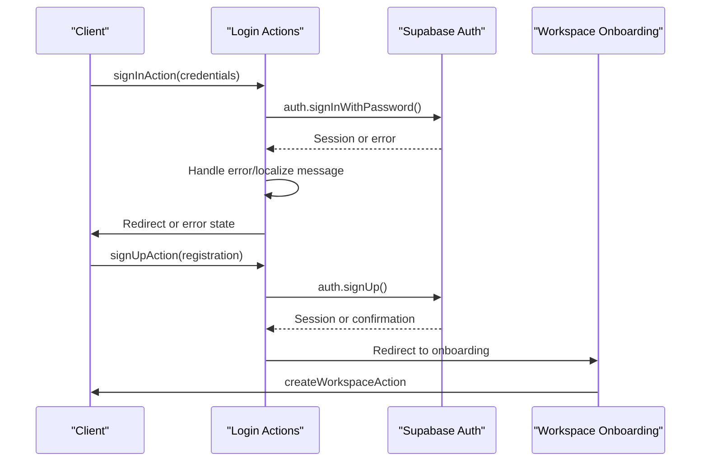
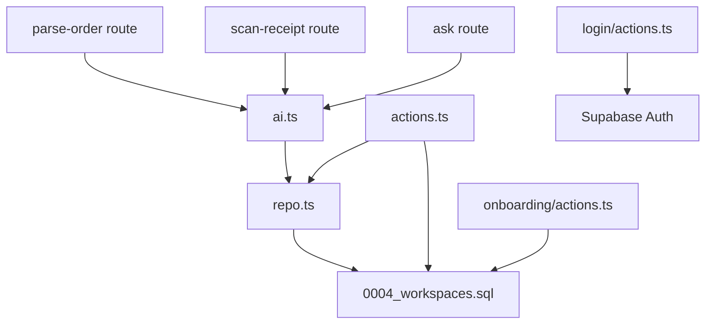

# API Reference

<cite>
**Referenced Files in This Document**
- [route.ts](file://src/app/api/ai/parse-order/route.ts)
- [route.ts](file://src/app/api/ai/scan-receipt/route.ts)
- [route.ts](file://src/app/api/ai/ask/route.ts)
- [ai.ts](file://src/lib/ai.ts)
- [env.ts](file://src/lib/env.ts)
- [actions.ts](file://src/app/actions.ts)
- [actions.ts](file://src/app/onboarding/actions.ts)
- [actions.ts](file://src/app/login/actions.ts)
- [laris-data.ts](file://src/lib/laris-data.ts)
- [repo.ts](file://src/lib/repo.ts)
- [0004_workspaces.sql](file://supabase/migrations/0004_workspaces.sql)
</cite>

## Update Summary
**Changes Made**
- Enhanced AI endpoints with multi-workspace support through businessId isolation
- Improved error handling with structured AiRequestError class and context-aware responses
- Added new server actions for workspace management (createWorkspaceAction)
- Added comprehensive authentication flow actions (signInAction, signUpAction, password reset)
- Updated repository functions for workspace-scoped data access
- Enhanced database schema with workspace creation and team management functions

## Table of Contents
1. [Introduction](#introduction)
2. [Project Structure](#project-structure)
3. [Core Components](#core-components)
4. [Architecture Overview](#architecture-overview)
5. [Detailed Component Analysis](#detailed-component-analysis)
6. [Multi-Workspace Support](#multi-workspace-support)
7. [Authentication Flows](#authentication-flows)
8. [Dependency Analysis](#dependency-analysis)
9. [Performance Considerations](#performance-considerations)
10. [Troubleshooting Guide](#troubleshooting-guide)
11. [Conclusion](#conclusion)
12. [Appendices](#appendices)

## Introduction
This document provides comprehensive API documentation for Laris endpoints and server actions. It covers:
- AI endpoints for order parsing, receipt scanning, and natural language queries with multi-workspace support.
- HTTP methods, URL patterns, request/response schemas, authentication requirements, structured output formats, error codes, and rate limiting behavior.
- Server action mutations with validation rules, parameter schemas, and return value structures.
- Authentication using Supabase session tokens and service role keys.
- Security considerations including input sanitization, SQL injection prevention, and API versioning strategies.
- Client implementation guidelines and common integration patterns for third-party systems.

Laris exposes Next.js App Router API routes under `/api/ai/*` for AI features and uses Next.js Server Actions for business mutations such as sales, purchases, expenses, inventory, products, settings, team management, and workspace administration.

## Project Structure
The relevant API surface is organized into:
- AI API routes:
  - `POST /api/ai/parse-order`
  - `POST /api/ai/scan-receipt`
  - `POST /api/ai/ask`
- Server Actions (invoked from the frontend, not direct HTTP endpoints):
  - Business operations: `completeSaleAction`, `recordPurchaseAction`, `addExpenseAction`, `addCustomerAction`, `updateSettingsAction`, `saveProductAction`, `saveInventoryItemAction`, `inviteTeamMemberAction`
  - Workspace management: `createWorkspaceAction`
  - Authentication flows: `signInAction`, `signUpAction`, `requestPasswordResetAction`, `updatePasswordAction`, `signOutAction`
- Supporting libraries:
  - AI context, Google model configuration, telemetry logging with workspace isolation.
  - Business state models, parsers, and helpers.
  - Supabase repository functions for catalog loading, membership checks, and snapshot construction with multi-workspace support.
  - Environment configuration for Supabase and Gemini keys.

**Diagram sources**
- [route.ts:31-127](file://src/app/api/ai/parse-order/route.ts#L31-L127)
- [route.ts:54-215](file://src/app/api/ai/scan-receipt/route.ts#L54-L215)
- [route.ts:77-217](file://src/app/api/ai/ask/route.ts#L77-L217)
- [ai.ts:30-69](file://src/lib/ai.ts#L30-L69)
- [repo.ts:82-112](file://src/lib/repo.ts#L82-L112)

**Section sources**
- [route.ts:1-128](file://src/app/api/ai/parse-order/route.ts#L1-L128)
- [route.ts:1-216](file://src/app/api/ai/scan-receipt/route.ts#L1-L216)
- [route.ts:1-218](file://src/app/api/ai/ask/route.ts#L1-L218)
- [ai.ts:1-126](file://src/lib/ai.ts#L1-L126)
- [actions.ts:1-310](file://src/app/actions.ts#L1-L310)
- [actions.ts:1-60](file://src/app/onboarding/actions.ts#L1-L60)
- [actions.ts:1-108](file://src/app/login/actions.ts#L1-L108)

## Core Components
- AI Route Handlers:
  - Parse Order: Accepts text or audio to extract menu items, quantities, notes, and payment method; validates against active product catalog; supports local fallback parser and Gemini-powered OCR/NLP with workspace isolation.
  - Scan Receipt: Accepts image files or base64-encoded images; extracts supplier, date, line items, unit conversions, and price changes; maps to inventory items; includes mock OCR fallback when Gemini is unavailable.
  - Ask: Natural language assistant that can answer questions about revenue, profit, top-selling products, low stock alerts, customer segments, and expenses; uses tools to query workspace data; falls back to rule-based answers locally.
- AI Library:
  - Provides Gemini model setup, workspace context loading with businessId isolation, catalog context generation, and telemetry logging.
  - Enhanced error handling with `AiRequestError` class for structured error responses.
- Server Actions:
  - Enforce role-based access, validate inputs with Zod, call database RPCs or direct inserts, map results to typed domain models, and revalidate paths.
  - New workspace management and authentication flow actions.

**Section sources**
- [route.ts:14-29](file://src/app/api/ai/parse-order/route.ts#L14-L29)
- [route.ts:14-26](file://src/app/api/ai/scan-receipt/route.ts#L14-L26)
- [route.ts:9-16](file://src/app/api/ai/ask/route.ts#L9-L16)
- [ai.ts:9-15](file://src/lib/ai.ts#L9-L15)
- [actions.ts:40-50](file://src/app/actions.ts#L40-L50)

## Architecture Overview
The AI endpoints follow a consistent flow with enhanced workspace support:
1. Validate request size and body schema.
2. Load workspace context via `requireAiContext`, which enforces authentication and membership with businessId isolation.
3. Build catalog context for Gemini instructions scoped to the workspace.
4. Call Gemini if configured; otherwise use local fallback logic.
5. Log telemetry events to `ai_event` with workspace attribution.
6. Return structured JSON responses with source metadata.

Server Actions follow a similar pattern with enhanced security:
1. Validate environment and user membership.
2. Enforce role-based authorization within workspace scope.
3. Validate input with Zod.
4. Execute database operations through RPCs or direct queries with tenant isolation.
5. Map results to typed domain models.
6. Revalidate UI paths.

**Diagram sources**
- [route.ts:31-127](file://src/app/api/ai/parse-order/route.ts#L31-L127)
- [ai.ts:30-69](file://src/lib/ai.ts#L30-L69)
- [repo.ts:114-124](file://src/lib/repo.ts#L114-L124)

## Detailed Component Analysis

### AI Endpoint: Parse Order
- Method: `POST`
- URL: `/api/ai/parse-order`
- Authentication:
  - Cloud mode requires an authenticated Supabase session token; workspace membership must exist with businessId isolation.
  - Local mode does not require authentication but still loads a minimal business state.
- Request Schema:
  - `mode`: `"local"` or `"cloud"`
  - `text`: optional string up to 2000 characters
  - `audio`: optional base64-encoded audio payload up to 8 MB
  - `mimeType`: optional MIME type among supported audio types
- Response Schema:
  - Success: `{ items: CartItem[], payment: "Tunai"|"QRIS"|"Transfer", unknown: string[], source: "gemini"|"local-parser"|"fallback-parser", model?: string }`
  - Error: `{ error: string }` with appropriate status code
- Validation Rules:
  - Content length capped at 12 MB.
  - Audio base64 decoded and validated for non-empty content and size limit.
  - Workspace must have active products; otherwise returns 422.
  - Gemini model required for audio; otherwise fallback to local parser.
- Error Codes:
  - 400: Invalid request or missing text/audio.
  - 413: Payload too large.
  - 422: No active products in catalog.
  - 503: Gemini not configured when audio is used.
  - 502: Gemini processing failure; fallback to local parser if text provided.
- Rate Limiting:
  - No explicit per-endpoint rate limiter implemented.
  - Gemini provider may apply its own limits; clients should implement retry/backoff.

**Diagram sources**
- [route.ts:31-127](file://src/app/api/ai/parse-order/route.ts#L31-L127)
- [laris-data.ts:436-474](file://src/lib/laris-data.ts#L436-L474)

**Section sources**
- [route.ts:14-29](file://src/app/api/ai/parse-order/route.ts#L14-L29)
- [route.ts:31-127](file://src/app/api/ai/parse-order/route.ts#L31-L127)
- [laris-data.ts:436-474](file://src/lib/laris-data.ts#L436-L474)

### AI Endpoint: Scan Receipt
- Method: `POST`
- URL: `/api/ai/scan-receipt`
- Authentication:
  - Cloud mode requires authenticated session and workspace membership with businessId isolation.
  - Local mode returns mock OCR data without Gemini.
- Request Schema:
  - Supports multipart form-data with `mode` and `file`, or JSON body with `mode`, `image` (base64), and optional `mimeType`.
  - Image MIME types: JPEG, PNG, WebP.
  - Image size limit: 8 MB; total body limit: 12 MB.
- Response Schema:
  - Success: `{ supplierName?, receiptDate?, lines: Line[], skippedLines?: string[], total: number, source: "gemini"|"mock-ocr", model?, notice? }`
  - Error: `{ error: string }` with appropriate status code
- Validation Rules:
  - Validates MIME type and base64 decoding.
  - Requires at least one inventory item in workspace; otherwise returns 422.
  - Normalizes units based on inventory base unit (g, ml, pcs).
  - Computes unit cost and price hike percentage; flags significant increases.
- Error Codes:
  - 400: Invalid request or missing image.
  - 413: Image too large.
  - 415: Unsupported MIME type.
  - 422: No inventory items configured.
  - 503: Gemini not configured in cloud mode.
  - 502: Gemini processing failure.

**Diagram sources**
- [route.ts:54-215](file://src/app/api/ai/scan-receipt/route.ts#L54-L215)

**Section sources**
- [route.ts:14-26](file://src/app/api/ai/scan-receipt/route.ts#L14-L26)
- [route.ts:54-215](file://src/app/api/ai/scan-receipt/route.ts#L54-L215)

### AI Endpoint: Ask
- Method: `POST`
- URL: `/api/ai/ask`
- Authentication:
  - Cloud mode requires authenticated session and workspace membership with businessId isolation.
  - Local mode returns rule-based answers without Gemini.
- Request Schema:
  - `mode`: `"local"` or `"cloud"`
  - `question`: string between 1 and 2000 characters
  - `history`: optional array of conversation turns with `role` and `text`
- Response Schema:
  - Success: `{ answer: string, source: "gemini"|"local-rules", model? }`
  - Error: `{ error: string }` with appropriate status code
- Tools Exposed to Gemini:
  - Revenue summary over N days
  - Profit summary (gross profit estimation)
  - Top-selling products ranking
  - Low stock alerts
  - Customer segments summary
  - Expenses breakdown
- Error Codes:
  - 400: Invalid question or history format.
  - 502: Gemini processing failure.

**Diagram sources**
- [route.ts:77-217](file://src/app/api/ai/ask/route.ts#L77-L217)
- [ai.ts:30-69](file://src/lib/ai.ts#L30-L69)

**Section sources**
- [route.ts:9-16](file://src/app/api/ai/ask/route.ts#L9-L16)
- [route.ts:77-217](file://src/app/api/ai/ask/route.ts#L77-L217)

### Server Actions
All server actions are invoked from the frontend and enforce:
- Cloud mode requirement.
- Authenticated session and valid membership with workspace isolation.
- Role-based authorization within workspace scope.
- Input validation via Zod.
- Database operations via RPCs or direct queries with tenant filtering.
- Typed mapping to domain models.

#### Complete Sale
- Action: `completeSaleAction`
- Authorization: owner, manager, kasir
- Input Schema:
  - `items`: array of `{ productId, quantity, note? }`
  - `payment`: `"Tunai" | "QRIS" | "Transfer"`
  - `cashReceived`: integer rupiah
  - `customerName?`: string up to 80 chars
  - `customerPhone?`: phone regex 8–15 digits, optional leading `+`
  - `discount?`: default 0
  - `taxEnabled?`: boolean default false
  - `channel?`: default `"Kasir"`
  - `idempotencyKey`: string 8–100 chars
- Return Value:
  - `{ ok: true, data: { sale, stockMovements, customer? } }`
  - `{ ok: false, error: string }`
- Notes:
  - Calls `complete_sale` RPC with businessId isolation.
  - Fetches order, stock movements, and optionally customer by phone.
  - Idempotency key encoded into sale ID for durability.

**Section sources**
- [actions.ts:40-89](file://src/app/actions.ts#L40-L89)
- [laris-data.ts:215-305](file://src/lib/laris-data.ts#L215-L305)

#### Record Purchase
- Action: `recordPurchaseAction`
- Authorization: owner, manager, kasir
- Input Schema:
  - `lines`: array of `{ itemId, quantity, total }`
  - `source?`: default `"manual"`
  - `idempotencyKey`: string 8–100 chars
- Return Value:
  - `{ ok: true, data: { purchases, stockMovements, products, inventory } }`
  - `{ ok: false, error: string }`
- Notes:
  - Calls `record_purchase` RPC with workspace isolation.
  - Loads catalog and maps purchase lines and movements.

**Section sources**
- [actions.ts:91-124](file://src/app/actions.ts#L91-L124)

#### Add Expense
- Action: `addExpenseAction`
- Authorization: owner, manager, kasir
- Input Schema:
  - `description`: string 1–150 chars
  - `category`: string 1–40 chars
  - `amount`: integer > 0
- Return Value:
  - `{ ok: true, data: Expense }`
  - `{ ok: false, error: string }`

**Section sources**
- [actions.ts:126-143](file://src/app/actions.ts#L126-L143)

#### Add Customer
- Action: `addCustomerAction`
- Authorization: owner, manager, kasir
- Input Schema:
  - `name`: string 1–80 chars
  - `phone`: regex 8–15 digits, optional leading `+`
- Return Value:
  - `{ ok: true, data: Customer }`
  - `{ ok: false, error: string }`
- Notes:
  - Handles duplicate phone constraint error.

**Section sources**
- [actions.ts:145-161](file://src/app/actions.ts#L145-L161)

#### Update Settings
- Action: `updateSettingsAction`
- Authorization: owner
- Input Schema:
  - `name`: string 1–80 chars
  - `owner`: string 1–80 chars
  - `outlet`: string 1–80 chars
  - `dayTarget`: integer >= 1
  - `kind?`: enum `"coffee" | "restaurant" | "bakery" | "bar" | "other"`
- Return Value:
  - `{ ok: true, data: settingsInput }`
  - `{ ok: false, error: string }`
- Notes:
  - Updates business and outlet records with workspace isolation; revalidates path.

**Section sources**
- [actions.ts:163-189](file://src/app/actions.ts#L163-L189)

#### Save Product
- Action: `saveProductAction`
- Authorization: owner, manager
- Input Schema:
  - `code?`: alphanumeric slug
  - `name`: string 1–80 chars
  - `category`: string 1–40 chars
  - `price`: integer rupiah
  - `image?`: allowed static image path pattern
  - `active`: boolean
  - `recipe`: array of `{ itemId, quantity }` up to 100
- Return Value:
  - `{ ok: true, data: { products, inventory } }`
  - `{ ok: false, error: string }`
- Notes:
  - Calls `save_product` RPC with workspace isolation; reloads catalog.

**Section sources**
- [actions.ts:191-215](file://src/app/actions.ts#L191-L215)

#### Save Inventory Item
- Action: `saveInventoryItemAction`
- Authorization: owner, manager
- Input Schema:
  - `code?`: alphanumeric slug
  - `name`: string 1–100 chars
  - `unit`: regex `[a-zA-Z][a-zA-Z0-9 ]{0,19}`
  - `cost`: number >= 0
  - `reorderPoint`: number >= 0
  - `supplier`: string <= 100 chars
  - `openingStock?`: default 0
  - `countedStock?`: nullable number
- Return Value:
  - `{ ok: true, data: { products, inventory, movement? } }`
  - `{ ok: false, error: string }`
- Notes:
  - Calls `save_inventory_item` RPC with workspace isolation; fetches movement if returned.

**Section sources**
- [actions.ts:217-251](file://src/app/actions.ts#L217-L251)

#### Invite Team Member
- Action: `inviteTeamMemberAction`
- Authorization: owner
- Input Schema:
  - `email`: email string <= 200 chars
  - `role`: enum `"manager" | "kasir" | "dapur"`
- Return Value:
  - `{ ok: true, data: { member, invited, alreadyMember } }`
  - `{ ok: false, error: string }`
- Notes:
  - Uses admin client to invite user if needed; then calls RPC to add membership with workspace isolation.

**Section sources**
- [actions.ts:253-290](file://src/app/actions.ts#L253-L290)

## Multi-Workspace Support

**Updated** Enhanced with complete multi-workspace architecture supporting business isolation, team management, and secure data separation.

### Workspace Creation
- Action: `createWorkspaceAction`
- Purpose: Creates a new business workspace with optional starter catalog
- Authorization: Authenticated users without existing membership
- Input Schema:
  - `name`: business name (2-80 chars)
  - `owner`: owner name (2-80 chars)
  - `outlet`: outlet name (2-80 chars)
  - `kind`: business type enum (`coffee`, `restaurant`, `bakery`, `bar`, `other`)
  - `dayTarget`: daily target amount (1,000 - 1,000,000,000,000)
  - `starter`: boolean for coffee starter catalog
- Return Value: Redirects to dashboard on success, error state on failure
- Features:
  - Automatic workspace slug generation
  - Optional starter catalog for coffee businesses
  - Initial supplier and inventory setup
  - Audit logging for workspace creation

### Workspace Isolation
- All database queries are scoped to `business_id` for data isolation
- Role-based access control enforced at both application and database levels
- Team member management with granular permissions
- Cross-tenant protection prevents data leakage between workspaces

### Database Schema Enhancements
- Workspace creation function with comprehensive validation
- Team member management with role-based permissions
- Tenant isolation triggers for product variants, recipes, and inventory
- Audit logging for all workspace operations

**Diagram sources**
- [actions.ts:27-59](file://src/app/onboarding/actions.ts#L27-L59)
- [0004_workspaces.sql:72-153](file://supabase/migrations/0004_workspaces.sql#L72-L153)

**Section sources**
- [actions.ts:27-59](file://src/app/onboarding/actions.ts#L27-L59)
- [0004_workspaces.sql:72-153](file://supabase/migrations/0004_workspaces.sql#L72-L153)

## Authentication Flows

**New** Comprehensive authentication system with secure password handling, email verification, and workspace onboarding.

### Sign In
- Action: `signInAction`
- Purpose: Authenticates users with email/password credentials
- Input Schema:
  - `email`: valid email address
  - `password`: minimum 6 characters
- Return Value: Redirects to dashboard on success, error state with localized messages on failure
- Features:
  - Rate limiting protection
  - Email confirmation validation
  - Weak password detection
  - Network error handling

### Sign Up
- Action: `signUpAction`
- Purpose: Registers new users and redirects to workspace onboarding
- Input Schema:
  - `name`: user display name (2-80 chars)
  - `email`: valid email address
  - `password`: minimum 8 characters
  - `confirmPassword`: must match password
- Return Value: Redirects to onboarding or shows confirmation notice
- Features:
  - Email verification workflow
  - User metadata storage
  - Automatic redirect to workspace setup

### Password Management
- Actions: `requestPasswordResetAction`, `updatePasswordAction`
- Purpose: Secure password reset and update functionality
- Features:
  - Token-based password reset links
  - Password strength validation
  - Secure session handling

### Sign Out
- Action: `signOutAction`
- Purpose: Clears authentication session and redirects to login
- Features:
  - Supabase session cleanup
  - Consistent redirect behavior

**Diagram sources**
- [actions.ts:35-65](file://src/app/login/actions.ts#L35-L65)
- [actions.ts:27-59](file://src/app/onboarding/actions.ts#L27-L59)

**Section sources**
- [actions.ts:35-65](file://src/app/login/actions.ts#L35-L65)
- [actions.ts:77-108](file://src/app/login/actions.ts#L77-L108)
- [actions.ts:27-59](file://src/app/onboarding/actions.ts#L27-L59)

## Dependency Analysis
- AI routes depend on:
  - `@/lib/ai` for Gemini model setup, context loading with workspace isolation, and telemetry.
  - `@/lib/laris-data` for local parsing and business state models.
  - `@/lib/repo` for catalog loading, membership checks, and snapshot construction with multi-workspace support.
  - `@/lib/env` for environment variables and Jakarta timezone utilities.
- Server actions depend on:
  - `@/lib/repo` for membership, catalog, and snapshot loading with workspace isolation.
  - `@/lib/supabase/server` and `@/lib/supabase/admin` for database access with tenant filtering.
  - Zod for input validation.
- Database schema defines tables for business, outlet, membership, inventory, products, recipes, customers, sales, payments, stock movements, purchases, expenses, audit logs, and AI telemetry with workspace isolation.

**Diagram sources**
- [route.ts:1-128](file://src/app/api/ai/parse-order/route.ts#L1-L128)
- [route.ts:1-216](file://src/app/api/ai/scan-receipt/route.ts#L1-L216)
- [route.ts:1-218](file://src/app/api/ai/ask/route.ts#L1-L218)
- [ai.ts:1-126](file://src/lib/ai.ts#L1-L126)
- [repo.ts:1-202](file://src/lib/repo.ts#L1-L202)
- [0004_workspaces.sql:1-346](file://supabase/migrations/0004_workspaces.sql#L1-L346)

**Section sources**
- [ai.ts:1-126](file://src/lib/ai.ts#L1-L126)
- [repo.ts:1-202](file://src/lib/repo.ts#L1-L202)
- [0004_workspaces.sql:1-346](file://supabase/migrations/0004_workspaces.sql#L1-L346)

## Performance Considerations
- AI endpoints perform heavy I/O:
  - Base64 decoding and size checks.
  - Gemini API calls with streaming or object outputs.
  - Telemetry writes to `ai_event` with workspace attribution.
- Multi-workspace considerations:
  - Workspace-scoped queries reduce data transfer by filtering at database level.
  - Membership checks are cached where possible to avoid repeated lookups.
  - Catalog loading is optimized with parallel queries for workspace data.
- Recommendations:
  - Implement client-side retries with exponential backoff for 5xx errors.
  - Cache catalog context where possible to reduce repeated loads.
  - Use pagination for large datasets when querying sales or movements.
  - Monitor latency metrics logged in telemetry with workspace attribution.

## Troubleshooting Guide
Common issues and resolutions:
- Missing Gemini configuration:
  - Set `GOOGLE_GENERATIVE_AI_API_KEY` and optionally `LARIS_AI_MODEL_FAST`.
  - For scan-receipt in cloud mode without Gemini, expect 503; use manual purchase entry.
- Workspace not configured:
  - Ensure Supabase is configured (`NEXT_PUBLIC_SUPABASE_URL` and `NEXT_PUBLIC_SUPABASE_PUBLISHABLE_KEY`).
  - Complete onboarding to create workspace and membership.
- Authentication failures:
  - Ensure Supabase session token is present for cloud mode.
  - Check membership exists for the current user in the correct workspace.
- Multi-workspace issues:
  - Verify businessId isolation is working correctly.
  - Check that team members have appropriate roles for their workspace.
  - Ensure cross-tenant protection is preventing data leakage.
- Input validation errors:
  - Validate request payloads against documented schemas.
  - Ensure phone numbers match regex and lengths are within limits.
- Database constraints:
  - Duplicate phone numbers for customers will fail with unique constraint error.
  - Ensure idempotency keys are unique per business for sales.
  - Workspace creation requires proper business type and target values.

**Section sources**
- [env.ts:13-23](file://src/lib/env.ts#L13-L23)
- [ai.ts:30-69](file://src/lib/ai.ts#L30-L69)
- [actions.ts:145-161](file://src/app/actions.ts#L145-L161)
- [actions.ts:27-59](file://src/app/onboarding/actions.ts#L27-L59)

## Conclusion
Laris provides robust AI-powered endpoints for order parsing, receipt scanning, and natural language queries with full multi-workspace support, backed by Supabase for data persistence and authentication. The enhanced architecture ensures complete data isolation between workspaces while maintaining secure team collaboration. Server actions offer secure, validated mutations for core business operations, workspace management, and comprehensive authentication flows. Clients should handle authentication, input validation, workspace context, retries, and error states carefully, and adopt best practices for security and performance across multiple business environments.

## Appendices

### Authentication Methods
- Supabase Session Tokens:
  - Used by AI endpoints and server actions in cloud mode with workspace isolation.
  - Retrieved via Supabase client; claims include user ID and metadata.
- Service Role Keys:
  - Used internally for administrative operations (e.g., inviting users).
  - Stored in environment variables and accessed via `serverEnv()`.

**Section sources**
- [env.ts:13-23](file://src/lib/env.ts#L13-L23)
- [ai.ts:30-69](file://src/lib/ai.ts#L30-L69)
- [actions.ts:253-290](file://src/app/actions.ts#L253-L290)

### Security Considerations
- Input Sanitization:
  - All inputs validated with Zod; strings trimmed and length-limited.
  - Phone numbers validated with regex.
  - Image MIME types restricted to safe formats.
- SQL Injection Prevention:
  - Database interactions use parameterized queries and RPCs with workspace isolation.
  - No raw SQL concatenation in application code.
- Multi-Workspace Security:
  - BusinessId isolation enforced at both application and database levels.
  - Cross-tenant protection prevents data leakage between workspaces.
  - Role-based access control with granular permissions.
- API Versioning Strategies:
  - Current API has no explicit version prefix; consider adding `/v1` prefix for future compatibility.
  - Maintain backward-compatible response schemas and deprecate fields gradually.

**Section sources**
- [actions.ts:40-50](file://src/app/actions.ts#L40-L50)
- [route.ts:14-29](file://src/app/api/ai/parse-order/route.ts#L14-L29)
- [route.ts:14-26](file://src/app/api/ai/scan-receipt/route.ts#L14-L26)
- [0004_workspaces.sql:14-56](file://supabase/migrations/0004_workspaces.sql#L14-L56)

### Client Implementation Guidelines
- AI Endpoints:
  - Send JSON payloads with `mode`, `text` or `audio`, and optional `mimeType`.
  - Handle 400, 413, 415, 422, 502, 503 responses gracefully.
  - Implement retry logic for 5xx errors with backoff.
  - Account for workspace context in error handling.
- Server Actions:
  - Invoke actions from React Server Components or client components using Next.js conventions.
  - Handle `{ ok: true, data }` or `{ ok: false, error }` return values.
  - Respect role-based restrictions and workspace isolation; prompt for login if unauthorized.
  - Handle workspace creation and authentication flows appropriately.