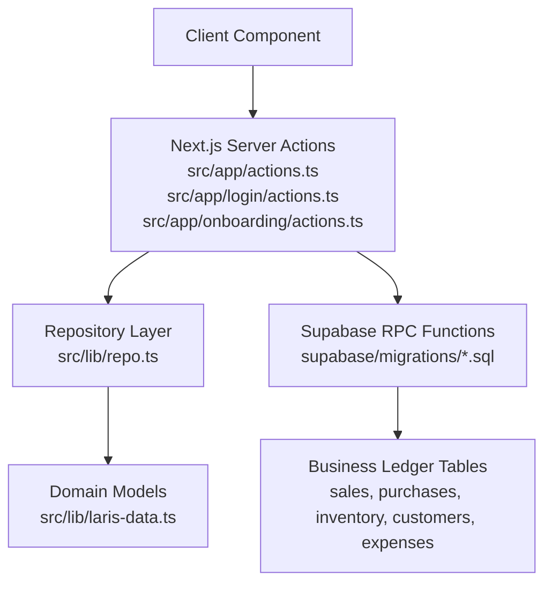
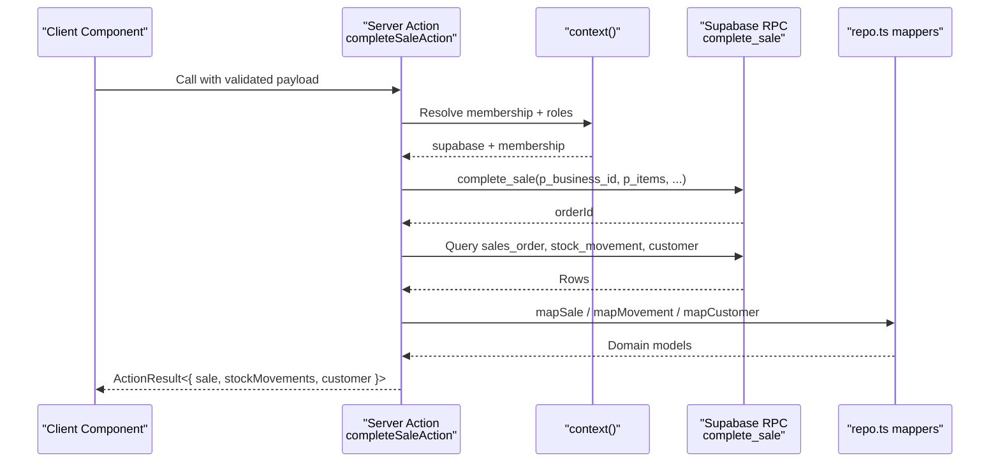
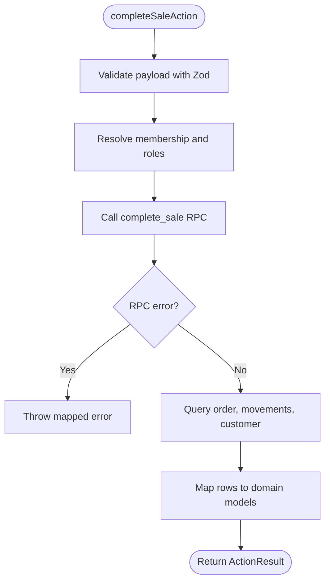
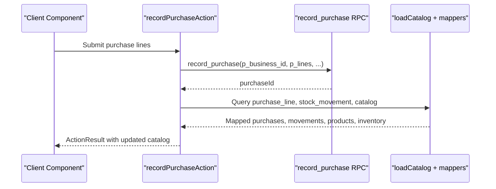
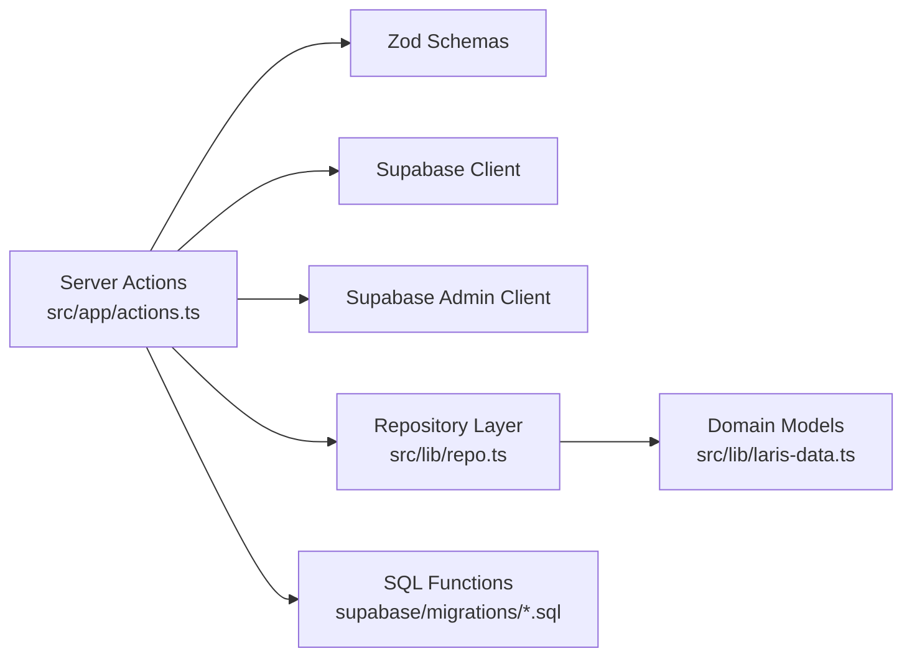

# Server Actions

<cite>
**Referenced Files in This Document**   
- [actions.ts](file://src/app/actions.ts)
- [login actions.ts](file://src/app/login/actions.ts)
- [onboarding actions.ts](file://src/app/onboarding/actions.ts)
- [repo.ts](file://src/lib/repo.ts)
- [laris-data.ts](file://src/lib/laris-data.ts)
- [0003_functions.sql](file://supabase/migrations/0003_functions.sql)
- [0004_workspaces.sql](file://supabase/migrations/0004_workspaces.sql)
- [0005_production_hardening.sql](file://supabase/migrations/0005_production_hardening.sql)
</cite>

## Table of Contents
1. [Introduction](#introduction)
2. [Project Structure](#project-structure)
3. [Core Components](#core-components)
4. [Architecture Overview](#architecture-overview)
5. [Detailed Component Analysis](#detailed-component-analysis)
6. [Dependency Analysis](#dependency-analysis)
7. [Performance Considerations](#performance-considerations)
8. [Troubleshooting Guide](#troubleshooting-guide)
9. [Conclusion](#conclusion)

## Introduction
This document explains the Laris server actions and mutation endpoints that power business operations such as sales, purchases, inventory management, customer handling, financial expenses, workspace onboarding, team invitations, and authentication flows. It focuses on:

- Server-side validation using Zod schemas.
- Return value structures and error handling patterns.
- Database mutations through Supabase RPC functions.
- Authentication context, workspace isolation, and role-based permission checks.
- Transactional guarantees, idempotency, and audit logging.
- Performance considerations including bulk operations, catalog loading, and caching strategies.
- Practical guidance for calling these actions from client components and debugging common issues.

The system is designed so that client components call Next.js server actions, which validate input, enforce permissions, invoke database functions, map results into typed domain models, and return a uniform result envelope.

## Project Structure
The server action layer lives primarily under `src/app`, with shared repository logic under `src/lib`. Database transactional logic is implemented as PostgreSQL functions in Supabase migrations.



**Diagram sources**
- [actions.ts:1-310](file://src/app/actions.ts#L1-L310)
- [login actions.ts:1-108](file://src/app/login/actions.ts#L1-L108)
- [onboarding actions.ts:1-60](file://src/app/onboarding/actions.ts#L1-L60)
- [repo.ts:1-202](file://src/lib/repo.ts#L1-L202)
- [laris-data.ts:1-494](file://src/lib/laris-data.ts#L1-L494)
- [0003_functions.sql:1-320](file://supabase/migrations/0003_functions.sql#L1-L320)
- [0004_workspaces.sql:1-346](file://supabase/migrations/0004_workspaces.sql#L1-L346)
- [0005_production_hardening.sql:1-395](file://supabase/migrations/0005_production_hardening.sql#L1-L395)

**Section sources**
- [actions.ts:1-310](file://src/app/actions.ts#L1-L310)
- [login actions.ts:1-108](file://src/app/login/actions.ts#L1-L108)
- [onboarding actions.ts:1-60](file://src/app/onboarding/actions.ts#L1-L60)
- [repo.ts:1-202](file://src/lib/repo.ts#L1-L202)
- [laris-data.ts:1-494](file://src/lib/laris-data.ts#L1-L494)

## Core Components
The core server action surface includes:

| Action | Purpose | Required Roles | Main Parameters | Return Value |
|---|---|---:|---|---|
| `completeSaleAction` | Complete a POS sale with stock deduction and optional customer creation | owner, manager, kasir | items, payment, cashReceived, discount, taxEnabled, channel, idempotencyKey, optional customerName/customerPhone | `{ ok: true; data: { sale, stockMovements, customer } }` or `{ ok: false; error }` |
| `recordPurchaseAction` | Record purchase lines, update average cost, refresh HPP | owner, manager, kasir | lines, source, idempotencyKey | `{ ok: true; data: { purchases, stockMovements, products, inventory } }` or `{ ok: false; error }` |
| `addExpenseAction` | Add an expense record | owner, manager, kasir | description, category, amount | `{ ok: true; data: Expense }` or `{ ok: false; error }` |
| `addCustomerAction` | Create a customer by name and phone | owner, manager, kasir | name, phone | `{ ok: true; data: Customer }` or `{ ok: false; error }` |
| `updateSettingsAction` | Update business settings and outlet name | owner | name, owner, outlet, dayTarget, kind | `{ ok: true; data: settings }` or `{ ok: false; error }` |
| `saveProductAction` | Save or update a product and its recipe | owner, manager | code, name, category, price, image, active, recipe | `{ ok: true; data: { products, inventory } }` or `{ ok: false; error }` |
| `uploadMenuImageAction` | Upload menu images to storage | owner, manager | FormData with file | `{ ok: true; data: { url } }` or `{ ok: false; error }` |
| `saveInventoryItemAction` | Save or update inventory item, optionally create opening/opname movement | owner, manager | code, name, unit, cost, reorderPoint, supplier, openingStock, countedStock | `{ ok: true; data: { products, inventory, movement } }` or `{ ok: false; error }` |
| `inviteTeamMemberAction` | Invite or add a team member by email | owner | email, role | `{ ok: true; data: { member, invited, alreadyMember } }` or `{ ok: false; error }` |
| `signInAction` | Sign in with email/password | none (requires configured cloud) | FormData with email/password | Login state with redirect or error notice |
| `signUpAction` | Register a new user | none (requires configured cloud) | FormData with name/email/password/confirmPassword | Login state with redirect or confirmation notice |
| `requestPasswordResetAction` | Request password reset link | none (requires configured cloud) | FormData with email | Login state with notice |
| `updatePasswordAction` | Update password after reset link | none (requires configured cloud) | FormData with password/confirmPassword | Redirect or error notice |
| `signOutAction` | Sign out | none (requires configured cloud) | none | Redirect to login |
| `createWorkspaceAction` | Onboard a new workspace with starter catalog option | authenticated user without existing membership | name, owner, outlet, kind, dayTarget, starter | Redirect or error notice |

All business mutations use a uniform result envelope:

```typescript
type ActionResult<T> = { ok: true; data: T } | { ok: false; error: string };
```

Authentication and authorization are handled centrally:

- The `context` helper checks cloud configuration, resolves current membership, and enforces allowed roles.
- The `run` helper wraps each action in try/catch, converts Zod errors and network errors into user-friendly messages, and returns the `ActionResult` envelope.

**Section sources**
- [actions.ts:15-38](file://src/app/actions.ts#L15-L38)
- [actions.ts:40-89](file://src/app/actions.ts#L40-L89)
- [actions.ts:91-124](file://src/app/actions.ts#L91-L124)
- [actions.ts:126-143](file://src/app/actions.ts#L126-L143)
- [actions.ts:145-161](file://src/app/actions.ts#L145-L161)
- [actions.ts:163-189](file://src/app/actions.ts#L163-L189)
- [actions.ts:191-215](file://src/app/actions.ts#L191-L215)
- [actions.ts:217-235](file://src/app/actions.ts#L217-L235)
- [actions.ts:237-271](file://src/app/actions.ts#L237-L271)
- [actions.ts:273-309](file://src/app/actions.ts#L273-L309)
- [login actions.ts:9-108](file://src/app/login/actions.ts#L9-L108)
- [onboarding actions.ts:12-59](file://src/app/onboarding/actions.ts#L12-L59)

## Architecture Overview
The architecture separates concerns across three layers:

1. **Server Actions**: Validate input, enforce permissions, orchestrate calls, and return typed results.
2. **Repository Layer**: Map database rows to domain models, load catalogs, and compute snapshots.
3. **Database Functions**: Enforce business rules, perform atomic transactions, check stock, update costs, and write audit logs.



**Diagram sources**
- [actions.ts:40-89](file://src/app/actions.ts#L40-L89)
- [repo.ts:20-62](file://src/lib/repo.ts#L20-L62)
- [0003_functions.sql:94-230](file://supabase/migrations/0003_functions.sql#L94-L230)
- [0005_production_hardening.sql:84-214](file://supabase/migrations/0005_production_hardening.sql#L84-L214)

## Detailed Component Analysis

### Sale Mutation: `completeSaleAction`
`completeSaleAction` implements a POS checkout flow:

- Validates items, payment method, cash received, discount, tax flag, channel, and idempotency key.
- Requires owner, manager, or cashier role.
- Calls `complete_sale` RPC with business-scoped parameters.
- Reads back the order, stock movements, and optional customer.
- Maps rows into `Sale`, `StockMovement`, and `Customer` models.



**Diagram sources**
- [actions.ts:40-89](file://src/app/actions.ts#L40-L89)
- [0003_functions.sql:94-230](file://supabase/migrations/0003_functions.sql#L94-L230)
- [0005_production_hardening.sql:84-214](file://supabase/migrations/0005_production_hardening.sql#L84-L214)

Key behaviors enforced by the database function:

- Membership and role checks.
- Idempotent retry via `idempotency_key`.
- Catalog line resolution against active products and default variants.
- Discount and tax validation.
- Cash tender validation for cash payments.
- Ingredient locking and stock verification.
- Order, order items, payment, stock movement, and audit log writes.

**Section sources**
- [actions.ts:40-89](file://src/app/actions.ts#L40-L89)
- [0003_functions.sql:94-230](file://supabase/migrations/0003_functions.sql#L94-L230)
- [0005_production_hardening.sql:84-214](file://supabase/migrations/0005_production_hardening.sql#L84-L214)

### Purchase Mutation: `recordPurchaseAction`
`recordPurchaseAction` records stock-in purchases:

- Validates purchase lines, source, and idempotency key.
- Requires owner, manager, or cashier role.
- Calls `record_purchase` RPC.
- Reads purchase lines, stock movements, and refreshed catalog.
- Returns purchases, movements, products, and inventory.



**Diagram sources**
- [actions.ts:91-124](file://src/app/actions.ts#L91-L124)
- [0003_functions.sql:236-303](file://supabase/migrations/0003_functions.sql#L236-L303)
- [0005_production_hardening.sql:216-306](file://supabase/migrations/0005_production_hardening.sql#L216-L306)
- [repo.ts:82-112](file://src/lib/repo.ts#L82-L112)

Database behavior:

- Validates source and line count.
- Resolves outlet and inventory items.
- Updates moving-average cost per unit.
- Inserts purchase lines and stock movements.
- Refreshes HPP for affected variants.
- Writes audit log.

**Section sources**
- [actions.ts:91-124](file://src/app/actions.ts#L91-L124)
- [0003_functions.sql:236-303](file://supabase/migrations/0003_functions.sql#L236-L303)
- [0005_production_hardening.sql:216-306](file://supabase/migrations/0005_production_hardening.sql#L216-L306)
- [repo.ts:82-112](file://src/lib/repo.ts#L82-L112)

### Expense Management: `addExpenseAction`
`addExpenseAction` adds an expense row:

- Validates description, category, and amount.
- Requires owner, manager, or cashier role.
- Inserts directly into the expense table with `created_by` from auth claims.
- Returns mapped `Expense`.

**Section sources**
- [actions.ts:126-143](file://src/app/actions.ts#L126-L143)
- [repo.ts:49-53](file://src/lib/repo.ts#L49-L53)

### Customer Management: `addCustomerAction`
`addCustomerAction` creates a customer:

- Validates name and phone format.
- Requires owner, manager, or cashier role.
- Normalizes phone by removing leading plus.
- Handles duplicate phone constraint with a friendly error.
- Returns mapped `Customer`.

**Section sources**
- [actions.ts:145-161](file://src/app/actions.ts#L145-L161)
- [repo.ts:40-47](file://src/lib/repo.ts#L40-L47)

### Business Settings: `updateSettingsAction`
`updateSettingsAction` updates business settings and outlet name:

- Validates business name, owner, outlet, day target, and optional kind.
- Requires owner role.
- Updates business and outlet tables.
- Revalidates the root path for cache refresh.
- Returns the validated settings object.

**Section sources**
- [actions.ts:163-189](file://src/app/actions.ts#L163-L189)

### Product Management: `saveProductAction`
`saveProductAction` saves or updates a product and its recipe:

- Validates code, name, category, price, image URL, active flag, and recipe lines.
- Requires owner or manager role.
- Calls `save_product` RPC.
- Reloads catalog and revalidates the root path.
- Returns updated products and inventory.

**Section sources**
- [actions.ts:191-215](file://src/app/actions.ts#L191-L215)
- [0004_workspaces.sql:155-221](file://supabase/migrations/0004_workspaces.sql#L155-L221)
- [repo.ts:82-112](file://src/lib/repo.ts#L82-L112)

### Menu Image Upload: `uploadMenuImageAction`
`uploadMenuImageAction` uploads menu images:

- Validates file presence, type, size, and extension mapping.
- Requires owner or manager role.
- Uses admin storage client to upload under business-scoped paths.
- Returns public URL.

**Section sources**
- [actions.ts:217-235](file://src/app/actions.ts#L217-L235)

### Inventory Management: `saveInventoryItemAction`
`saveInventoryItemAction` saves or updates inventory items:

- Validates code, name, unit, cost, reorder point, supplier, opening stock, and optional counted stock.
- Requires owner or manager role.
- Calls `save_inventory_item` RPC.
- Parses returned code and optional movement ID.
- Loads catalog and optional movement.
- Returns products, inventory, and movement.

**Section sources**
- [actions.ts:237-271](file://src/app/actions.ts#L237-L271)
- [0004_workspaces.sql:223-300](file://supabase/migrations/0004_workspaces.sql#L223-L300)
- [0005_production_hardening.sql:308-389](file://supabase/migrations/0005_production_hardening.sql#L308-L389)
- [repo.ts:82-112](file://src/lib/repo.ts#L82-L112)

### Team Invitation: `inviteTeamMemberAction`
`inviteTeamMemberAction` invites or adds team members:

- Validates email and role.
- Requires owner role.
- Calls `add_team_member_by_email` RPC.
- If user does not exist, sends an admin invite and retries membership addition.
- Parses and returns member info, invitation status, and whether the user was already a member.

**Section sources**
- [actions.ts:273-309](file://src/app/actions.ts#L273-L309)
- [0004_workspaces.sql:302-333](file://supabase/migrations/0004_workspaces.sql#L302-L333)

### Authentication Actions
Authentication actions handle sign-in, sign-up, password reset, password update, and sign-out:

- Use Zod to validate credentials and registration forms.
- Guard against missing cloud configuration.
- Use Supabase auth client for session management.
- Provide user-friendly error messages for invalid credentials, unconfirmed email, rate limits, weak passwords, and network failures.
- Redirect appropriately after successful operations.

**Section sources**
- [login actions.ts:9-108](file://src/app/login/actions.ts#L9-L108)

### Workspace Onboarding: `createWorkspaceAction`
`createWorkspaceAction` creates a new workspace:

- Validates workspace name, owner, outlet, kind, day target, and starter catalog flag.
- Guards against missing cloud configuration.
- Checks current membership and redirects if already onboarded.
- Optionally seeds starter inventory and products for coffee kind.
- Calls `create_workspace` RPC.
- Revalidates root path and redirects.

**Section sources**
- [onboarding actions.ts:12-59](file://src/app/onboarding/actions.ts#L12-L59)
- [0004_workspaces.sql:72-153](file://supabase/migrations/0004_workspaces.sql#L72-L153)

## Dependency Analysis
The server actions depend on:

- **Zod schemas** for parameter validation.
- **Supabase client** for RPC calls and direct table queries.
- **Admin client** for storage uploads and auth admin operations.
- **Repository layer** for catalog loading, row mapping, and snapshot construction.
- **Domain models** for consistent TypeScript types.
- **PostgreSQL functions** for transactional business logic.



**Diagram sources**
- [actions.ts:1-310](file://src/app/actions.ts#L1-L310)
- [repo.ts:1-202](file://src/lib/repo.ts#L1-L202)
- [laris-data.ts:1-494](file://src/lib/laris-data.ts#L1-L494)
- [0003_functions.sql:1-320](file://supabase/migrations/0003_functions.sql#L1-L320)
- [0004_workspaces.sql:1-346](file://supabase/migrations/0004_workspaces.sql#L1-L346)
- [0005_production_hardening.sql:1-395](file://supabase/migrations/0005_production_hardening.sql#L1-L395)

**Section sources**
- [actions.ts:1-310](file://src/app/actions.ts#L1-L310)
- [repo.ts:1-202](file://src/lib/repo.ts#L1-L202)
- [laris-data.ts:1-494](file://src/lib/laris-data.ts#L1-L494)

## Performance Considerations
Several patterns optimize performance and reliability:

- **Bulk operations**: 
  - `complete_sale` accepts up to 100 cart items.
  - `record_purchase` accepts up to 50 purchase lines.
  - `create_workspace` accepts up to 200 initial inventory and product entries.
- **Catalog loading**: 
  - `loadCatalog` uses parallel queries for inventory, products, variants, and recipes.
  - It paginates with a page size of 1000 to avoid large payloads.
- **Idempotency**:
  - Sales and purchases support idempotency keys to safely retry failed requests.
- **Transaction safety**:
  - All ledger mutations run inside `SECURITY DEFINER` functions with explicit membership checks and atomic writes.
- **Audit logging**:
  - Every major mutation writes an audit log entry for traceability.
- **Caching strategy**:
  - Server actions call `revalidatePath("/")` after mutating business-critical data to refresh cached pages.
  - Client components should rely on server actions rather than optimistic UI for critical ledger changes.
- **Storage optimization**:
  - Menu images are uploaded with strict type and size limits and stored under business-scoped paths.

Recommendations:

- Prefer passing idempotency keys for network-prone environments.
- Batch related mutations where possible, but keep within RPC array limits.
- Avoid excessive client-side calculations for totals; let database functions resolve prices and costs.
- Cache read-heavy pages and invalidate only after relevant mutations.
- Monitor audit logs for troubleshooting and compliance.

**Section sources**
- [actions.ts:40-89](file://src/app/actions.ts#L40-L89)
- [actions.ts:91-124](file://src/app/actions.ts#L91-L124)
- [actions.ts:163-189](file://src/app/actions.ts#L163-L189)
- [actions.ts:191-215](file://src/app/actions.ts#L191-L215)
- [actions.ts:237-271](file://src/app/actions.ts#L237-L271)
- [repo.ts:64-112](file://src/lib/repo.ts#L64-L112)
- [0003_functions.sql:1-320](file://supabase/migrations/0003_functions.sql#L1-L320)
- [0004_workspaces.sql:72-153](file://supabase/migrations/0004_workspaces.sql#L72-L153)
- [0005_production_hardening.sql:1-395](file://supabase/migrations/0005_production_hardening.sql#L1-L395)

## Troubleshooting Guide
Common server action errors and how to address them:

| Symptom | Likely Cause | Resolution |
|---|---|---|
| Validation error message from Zod | Invalid input shape, missing fields, or disallowed values | Inspect the Zod schema for the action and ensure client payload matches required types and constraints. |
| Network or fetch failure | Internet connectivity issue or server unreachable | Show user-friendly connection error; retry with exponential backoff; verify environment variables. |
| Session ended or unauthorized | Missing or expired session, or insufficient role | Reauthenticate; ensure user has required role for the action. |
| Cloud not configured | Supabase environment not set up | Configure cloud environment variables before running actions. |
| Duplicate phone number when adding customer | Unique constraint violation | Prompt user to use a different phone number or update existing customer. |
| Stock insufficient during sale | Recipe ingredients exceed available stock | Reduce quantity, adjust inventory, or defer sale until stock is replenished. |
| Payment total mismatch | Cash received less than total for cash payments | Increase cash received or adjust discount/tax. |
| Invalid product or ingredient code | Code not found in catalog | Verify product/inventory codes and ensure items are active and not deleted. |
| Image upload rejected | Unsupported format, missing file, or oversized file | Use JPG, PNG, WebP, or GIF under 5 MB. |
| Team member cannot be added | User not found or invalid role | Confirm user exists in auth and use valid role enum. |
| Workspace creation fails | Invalid kind, day target, or starter catalog payload | Validate workspace inputs and ensure starter catalog matches expected structure. |

Debugging techniques:

- Log the Zod parse result before invoking RPC to catch early validation failures.
- Wrap RPC calls in the provided `run` helper to normalize errors.
- Check audit logs for the most recent mutation attempts.
- Use the repository’s `loadSnapshot` to inspect the full business state after mutations.
- For production hardening issues, review database constraints and function error messages.

**Section sources**
- [actions.ts:21-38](file://src/app/actions.ts#L21-L38)
- [actions.ts:145-161](file://src/app/actions.ts#L145-L161)
- [login actions.ts:26-33](file://src/app/login/actions.ts#L26-L33)
- [0005_production_hardening.sql:11-33](file://supabase/migrations/0005_production_hardening.sql#L11-L33)

## Conclusion
Laris server actions provide a robust, secure, and well-typed interface for business operations. They combine client-facing validation with server-side enforcement, transactional database functions, and clear error handling. By following the documented parameter shapes, return structures, and permission requirements, client components can reliably perform sales, purchases, inventory updates, financial transactions, workspace onboarding, and team management. For best results, use idempotency keys, respect role restrictions, leverage bulk operation limits, and rely on server-side catalog resolution and auditing for consistency and traceability.