# Architecture Overview

<cite>
**Referenced Files in This Document**   
- [README.md](file://README.md)
- [package.json](file://package.json)
- [next.config.ts](file://next.config.ts)
- [src/app/layout.tsx](file://src/app/layout.tsx)
- [src/middleware.ts](file://src/middleware.ts)
- [src/app/page.tsx](file://src/app/page.tsx)
- [src/app/demo/page.tsx](file://src/app/demo/page.tsx)
- [src/components/laris-app.tsx](file://src/components/laris-app.tsx)
- [src/lib/env.ts](file://src/lib/env.ts)
- [src/lib/laris-data.ts](file://src/lib/laris-data.ts)
- [src/lib/repo.ts](file://src/lib/repo.ts)
- [src/lib/ai.ts](file://src/lib/ai.ts)
- [src/app/api/ai/parse-order/route.ts](file://src/app/api/ai/parse-order/route.ts)
- [src/app/api/ai/ask/route.ts](file://src/app/api/ai/ask/route.ts)
- [src/app/api/ai/scan-receipt/route.ts](file://src/app/api/ai/scan-receipt/route.ts)
- [supabase/migrations/0001_schema.sql](file://supabase/migrations/0001_schema.sql)
- [supabase/migrations/0002_rls.sql](file://supabase/migrations/0002_rls.sql)
- [supabase/migrations/0004_workspaces.sql](file://supabase/migrations/0004_workspaces.sql)
</cite>

## Table of Contents
1. [Introduction](#introduction)
2. [Project Structure](#project-structure)
3. [Core Components](#core-components)
4. [Architecture Overview](#architecture-overview)
5. [Detailed Component Analysis](#detailed-component-analysis)
6. [Dependency Analysis](#dependency-analysis)
7. [Performance Considerations](#performance-considerations)
8. [Troubleshooting Guide](#troubleshooting-guide)
9. [Conclusion](#conclusion)

## Introduction
Laris is a Next.js 15 full-stack application for Indonesian F&B micro and small businesses. It combines a React 19 client, Server Components, Supabase authentication and database, and Google Gemini AI integration. The system supports two operating modes:

- **Local demo mode:** runs entirely in the browser with deterministic parsing, simulated data, and no cloud connection.
- **Cloud production mode:** persists business accounts, workspace data, sales, inventory, purchases, customers, team members, and audit records through Supabase with Row-Level Security.

The product connects accounting, cashier operations, voice-to-cart ordering in Bahasa Indonesia, recipes and stock, purchasing, customers, financial reporting, team access, and an AI assistant. Voice input is processed either by a deterministic local parser or by Gemini; results are presented to the user before ledger updates.

**Section sources**
- [README.md:1-118](file://README.md#L1-L118)

## Project Structure
The repository follows a Next.js App Router layout:

- `src/app` contains pages, server actions, API routes, and shared layout.
- `src/components` holds the main LarisApp shell and visual components.
- `src/lib` contains domain models, environment configuration, Supabase snapshot mapping, and AI utilities.
- `supabase/migrations` defines schema, Row-Level Security, functions, workspaces, and hardening.
- `scripts` provides seed, evaluation, and RLS tests.
- `evals` stores benchmark utterances for voice parsing.

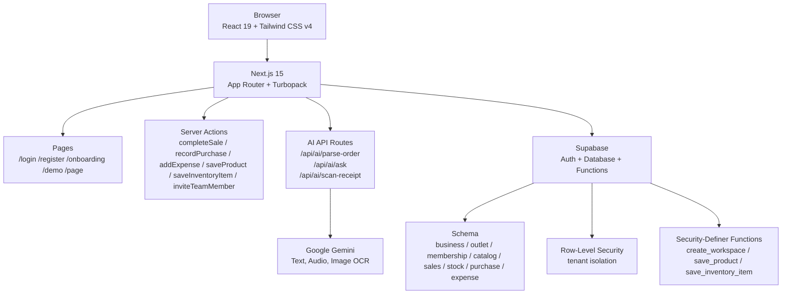

**Diagram sources**
- [src/app/layout.tsx:1-28](file://src/app/layout.tsx#L1-L28)
- [src/app/page.tsx:1-19](file://src/app/page.tsx#L1-L19)
- [src/app/demo/page.tsx:1-12](file://src/app/demo/page.tsx#L1-L12)
- [src/components/laris-app.tsx:1-133](file://src/components/laris-app.tsx#L1-L133)
- [src/app/api/ai/parse-order/route.ts:1-128](file://src/app/api/ai/parse-order/route.ts#L1-L128)
- [src/app/api/ai/ask/route.ts:1-218](file://src/app/api/ai/ask/route.ts#L1-L218)
- [src/app/api/ai/scan-receipt/route.ts:1-216](file://src/app/api/ai/scan-receipt/route.ts#L1-L216)
- [supabase/migrations/0001_schema.sql:1-294](file://supabase/migrations/0001_schema.sql#L1-L294)
- [supabase/migrations/0002_rls.sql:1-131](file://supabase/migrations/0002_rls.sql#L1-L131)
- [supabase/migrations/0004_workspaces.sql:1-346](file://supabase/migrations/0004_workspaces.sql#L1-L346)

**Section sources**
- [package.json:1-39](file://package.json#L1-L39)
- [next.config.ts:1-8](file://next.config.ts#L1-L8)
- [README.md:97-110](file://README.md#L97-L110)

## Core Components
The system is organized around four layers:

| Layer | Responsibility | Key Files |
|---|---|---|
| Client UI | React 19 interface, navigation, modals, voice input, checkout, reports, and AI chat | `src/components/laris-app.tsx` |
| Domain Logic | Business state, cart totals, sales completion, purchase recording, stock movement, CSV export, deterministic order parsing | `src/lib/laris-data.ts` |
| Cloud Data Layer | Supabase snapshot loading, catalog mapping, membership resolution, Jakarta time normalization | `src/lib/repo.ts` |
| AI Services | Google Gemini model setup, context validation, telemetry, structured output parsing | `src/lib/ai.ts` and API routes |

The main shell component `LarisApp` accepts `mode`, `initialState`, `today`, `user`, and optional notice. In local mode it loads and persists `BusinessState` to `localStorage`. In cloud mode it calls server actions that persist changes to Supabase and update the client state with returned snapshots.

**Section sources**
- [src/components/laris-app.tsx:27-133](file://src/components/laris-app.tsx#L27-L133)
- [src/lib/laris-data.ts:97-110](file://src/lib/laris-data.ts#L97-L110)
- [src/lib/repo.ts:1-202](file://src/lib/repo.ts#L1-L202)
- [src/lib/ai.ts:1-126](file://src/lib/ai.ts#L1-L126)

## Architecture Overview
Laris uses a dual-mode architecture controlled by environment configuration and page routing.

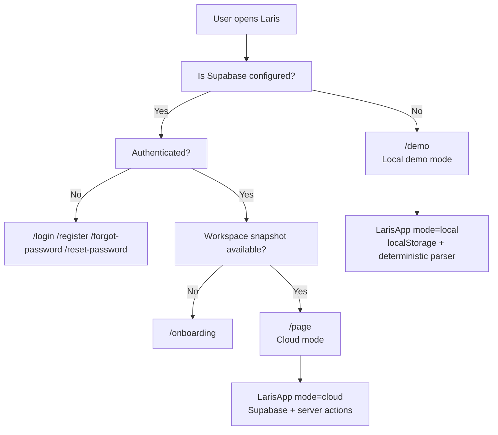

**Diagram sources**
- [src/lib/env.ts:1-29](file://src/lib/env.ts#L1-L29)
- [src/app/page.tsx:1-19](file://src/app/page.tsx#L1-L19)
- [src/app/demo/page.tsx:1-12](file://src/app/demo/page.tsx#L1-L12)
- [src/components/laris-app.tsx:81-168](file://src/components/laris-app.tsx#L81-L168)

### Technology Stack
| Area | Technology | Notes |
|---|---|---|
| Framework | Next.js 15 | App Router, server actions, dynamic routes |
| Runtime | Node.js 22+ | Required for native TypeScript scripts |
| Frontend | React 19 | Client components, hooks, forms, modals |
| Styling | Tailwind CSS v4 | PostCSS plugin and dependency declared |
| Language | TypeScript | Type-safe domain models and API contracts |
| Backend | Supabase | Auth, PostgreSQL, RLS, security-definer functions |
| AI | Google Gemini via Vercel AI SDK | Text, audio, image OCR, structured output |
| Speech | Web Speech API | Browser-based voice-to-text fallback |
| Validation | Zod | Request schemas and structured AI output |
| Build | Turbopack | Enabled in Next.js config and dev/build scripts |

**Section sources**
- [package.json:1-39](file://package.json#L1-L39)
- [next.config.ts:1-8](file://next.config.ts#L1-L8)
- [README.md:11-16](file://README.md#L11-L16)
- [README.md:59-74](file://README.md#L59-L74)

### Deployment Topology
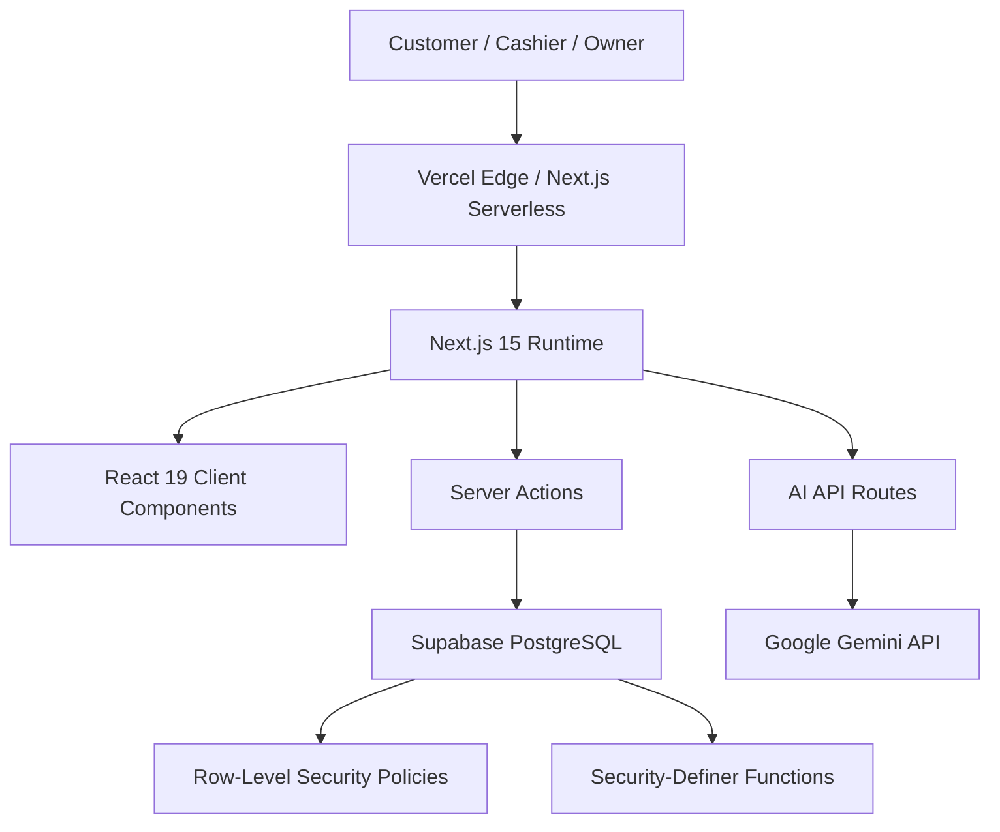

[No diagram sources needed since this diagram shows conceptual deployment topology rather than direct file mappings]

## Detailed Component Analysis

### Main Application Shell: `LarisApp`
`LarisApp` is the central React component managing workspace state, navigation, POS, inventory, purchases, customers, finance, team, and AI features. It branches behavior based on `mode`:

- **Local mode:** initializes from `createInitialState`, persists to `localStorage`, and uses deterministic `parseOrder`.
- **Cloud mode:** receives `initialState` from the server, calls server actions, and updates state with returned data.

Key responsibilities include:
- Cart management and checkout totals.
- Voice input using Web Speech API.
- Order parsing through local logic or `/api/ai/parse-order`.
- Receipt scanning through `/api/ai/scan-receipt`.
- Sales persistence through `completeSaleAction`.
- Purchase persistence through `recordPurchaseAction`.
- Expense, customer, product, inventory, settings, and team invitation flows.

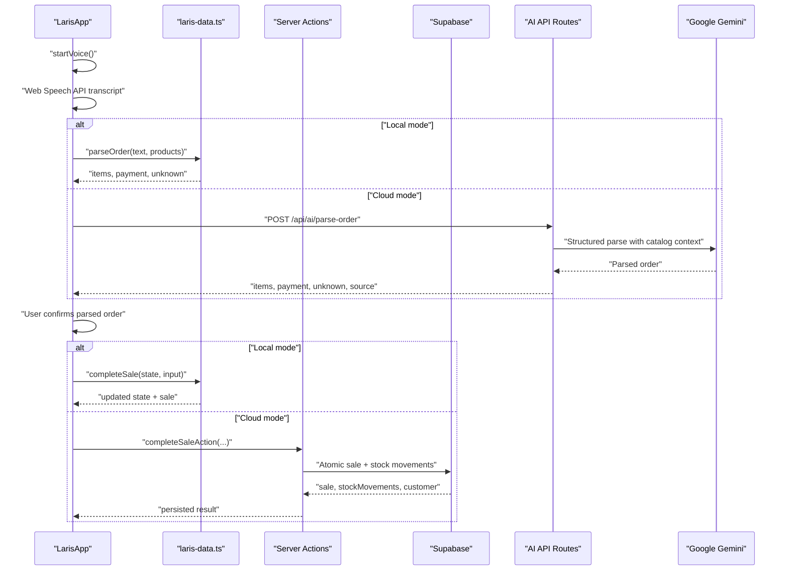

**Diagram sources**
- [src/components/laris-app.tsx:311-340](file://src/components/laris-app.tsx#L311-L340)
- [src/components/laris-app.tsx:213-267](file://src/components/laris-app.tsx#L213-L267)
- [src/lib/laris-data.ts:215-305](file://src/lib/laris-data.ts#L215-L305)
- [src/app/api/ai/parse-order/route.ts:31-128](file://src/app/api/ai/parse-order/route.ts#L31-L128)

**Section sources**
- [src/components/laris-app.tsx:81-133](file://src/components/laris-app.tsx#L81-L133)
- [src/components/laris-app.tsx:146-168](file://src/components/laris-app.tsx#L146-L168)
- [src/components/laris-app.tsx:213-267](file://src/components/laris-app.tsx#L213-L267)
- [src/components/laris-app.tsx:311-340](file://src/components/laris-app.tsx#L311-L340)
- [src/components/laris-app.tsx:342-359](file://src/components/laris-app.tsx#L342-L359)

### Domain Model and Business Logic: `laris-data.ts`
This module defines the core domain types and deterministic business rules used by both local and cloud modes.

Important structures:
- `Product`, `InventoryItem`, `StockMovement`, `CartItem`, `Sale`, `Customer`, `Expense`, `Purchase`, `BusinessState`.
- `getCartTotal` validates cart items, discount, tax, and total.
- `completeSale` validates inputs, aggregates recipe requirements, checks stock availability, creates a sale, updates customers, and appends stock movements.
- `recordPurchase` updates inventory cost using moving-average logic, recalculates product costs, and records purchase and stock movement.
- `parseOrder` implements deterministic Indonesian order parsing with aliases, quantity words, notes, and payment detection.
- `exportSalesCsv` safely exports sales data with formula-safe CSV cells.

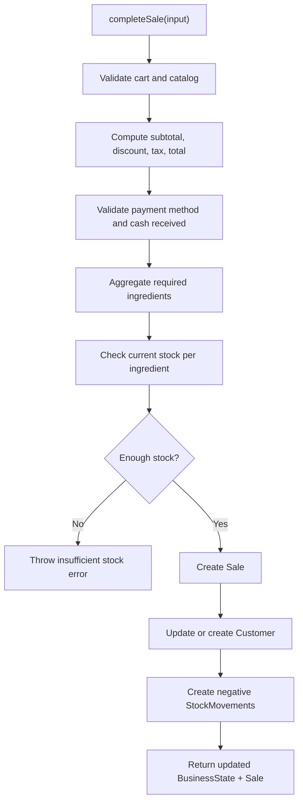

**Diagram sources**
- [src/lib/laris-data.ts:161-194](file://src/lib/laris-data.ts#L161-L194)
- [src/lib/laris-data.ts:215-305](file://src/lib/laris-data.ts#L215-L305)

**Section sources**
- [src/lib/laris-data.ts:1-110](file://src/lib/laris-data.ts#L1-L110)
- [src/lib/laris-data.ts:161-194](file://src/lib/laris-data.ts#L161-L194)
- [src/lib/laris-data.ts:215-334](file://src/lib/laris-data.ts#L215-L334)
- [src/lib/laris-data.ts:406-474](file://src/lib/laris-data.ts#L406-L474)
- [src/lib/laris-data.ts:476-494](file://src/lib/laris-data.ts#L476-L494)

### Cloud Snapshot and Tenancy: `repo.ts`
The repository layer maps Supabase rows into the same `BusinessState` shape used by the frontend. It ensures tenant isolation by querying only the authenticated user’s `business_id`.

Key responsibilities:
- Resolve current membership and role.
- Load catalog, sales, stock movements, customers, expenses, purchases, and team members.
- Normalize timestamps to Asia/Jakarta business day format.
- Map database tables such as `sales_order`, `order_item`, `payment`, `stock_movement`, `customer`, `expense`, `purchase_line`, `product`, `product_variant`, `recipe_line`, and `inventory_item`.

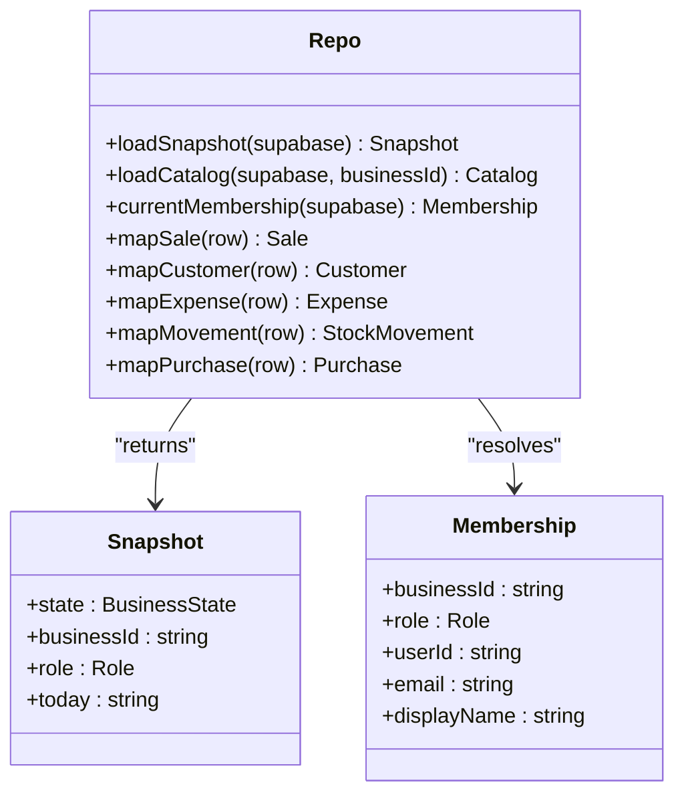

**Diagram sources**
- [src/lib/repo.ts:1-202](file://src/lib/repo.ts#L1-L202)

**Section sources**
- [src/lib/repo.ts:1-202](file://src/lib/repo.ts#L1-L202)

### AI Services and Context: `ai.ts` and API Routes
AI functionality is isolated behind server-only code. The `AiContext` object carries mode, business identity, today’s date, and business state. `requireAiContext` enforces:

- Local mode returns deterministic demo state.
- Cloud mode requires Supabase configuration, authentication, membership, and workspace access.
- Catalog-only mode is used for parse and scan endpoints so AI can reference the active menu without requiring full transactional history.

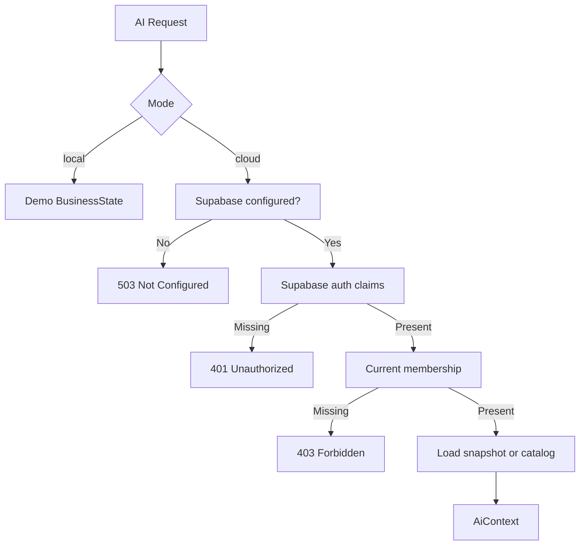

**Diagram sources**
- [src/lib/ai.ts:1-69](file://src/lib/ai.ts#L1-L69)

#### Parse Order Flow
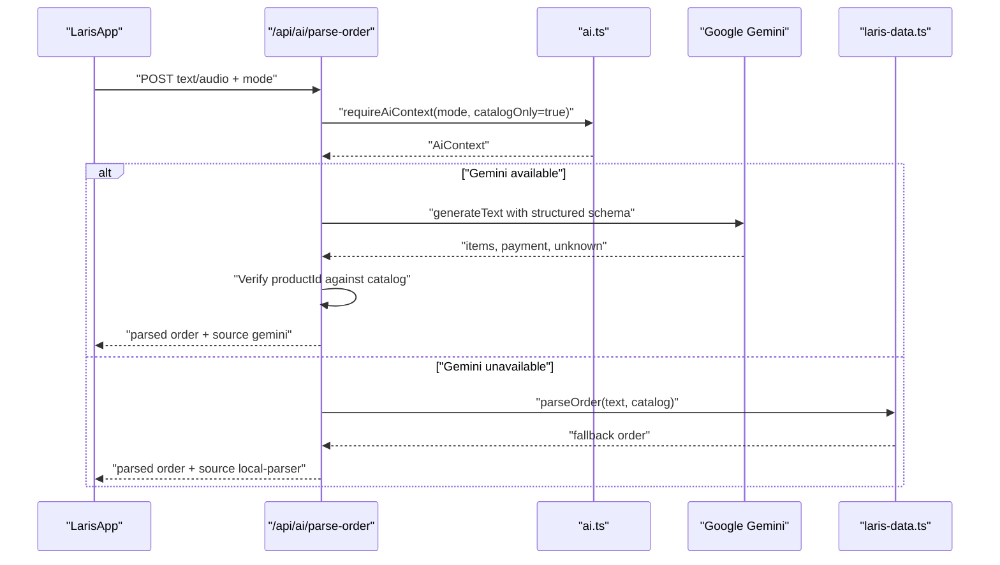

**Diagram sources**
- [src/app/api/ai/parse-order/route.ts:31-128](file://src/app/api/ai/parse-order/route.ts#L31-L128)
- [src/lib/ai.ts:1-69](file://src/lib/ai.ts#L1-L69)
- [src/lib/laris-data.ts:436-474](file://src/lib/laris-data.ts#L436-L474)

#### Ask Laris Flow
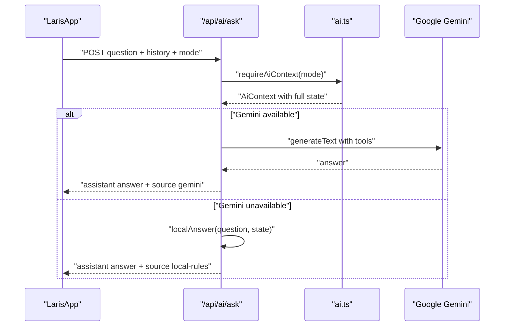

**Diagram sources**
- [src/app/api/ai/ask/route.ts:1-218](file://src/app/api/ai/ask/route.ts#L1-L218)
- [src/lib/ai.ts:1-69](file://src/lib/ai.ts#L1-L69)

#### Scan Receipt Flow
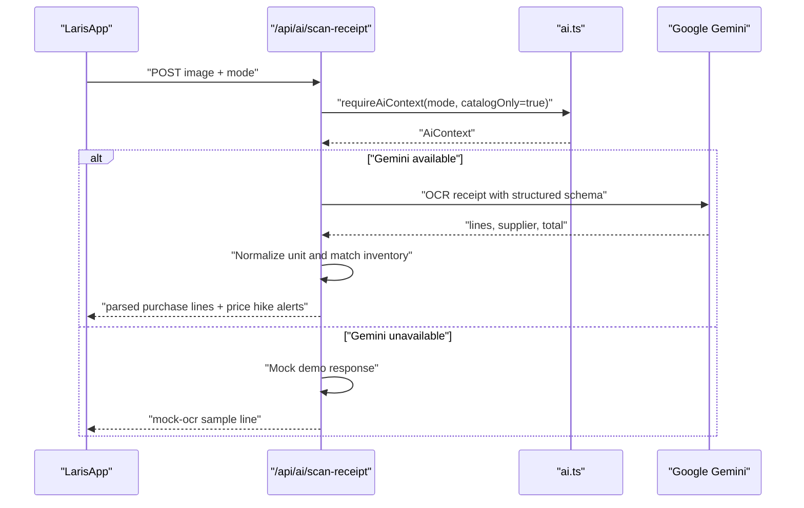

**Diagram sources**
- [src/app/api/ai/scan-receipt/route.ts:1-216](file://src/app/api/ai/scan-receipt/route.ts#L1-L216)
- [src/lib/ai.ts:1-69](file://src/lib/ai.ts#L1-L69)

**Section sources**
- [src/lib/ai.ts:1-126](file://src/lib/ai.ts#L1-L126)
- [src/app/api/ai/parse-order/route.ts:1-128](file://src/app/api/ai/parse-order/route.ts#L1-L128)
- [src/app/api/ai/ask/route.ts:1-218](file://src/app/api/ai/ask/route.ts#L1-L218)
- [src/app/api/ai/scan-receipt/route.ts:1-216](file://src/app/api/ai/scan-receipt/route.ts#L1-L216)

### System Context: Voice to Ledger
The complete flow from voice input to stock ledger update demonstrates how client-side interaction, AI parsing, and server-side persistence interact.

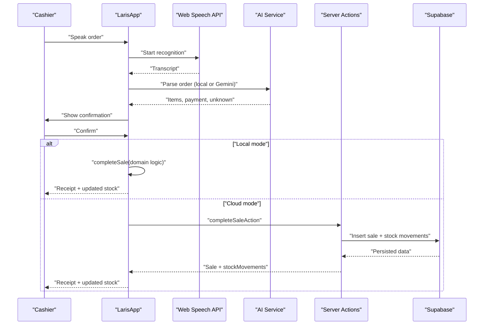

**Diagram sources**
- [src/components/laris-app.tsx:342-359](file://src/components/laris-app.tsx#L342-L359)
- [src/components/laris-app.tsx:311-340](file://src/components/laris-app.tsx#L311-L340)
- [src/components/laris-app.tsx:213-267](file://src/components/laris-app.tsx#L213-L267)
- [src/lib/laris-data.ts:215-305](file://src/lib/laris-data.ts#L215-L305)

## Dependency Analysis
The following diagram shows runtime dependencies between major modules.

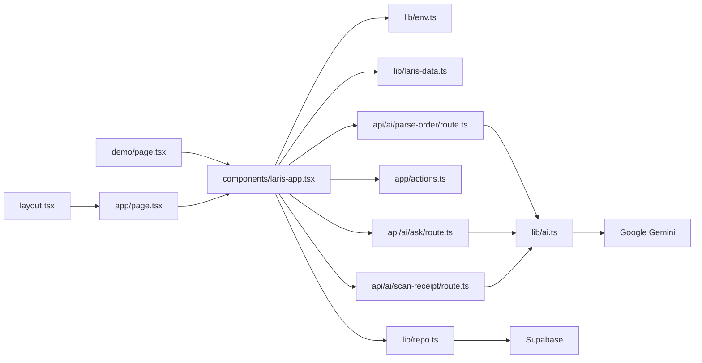

**Diagram sources**
- [src/app/layout.tsx:1-28](file://src/app/layout.tsx#L1-L28)
- [src/app/page.tsx:1-19](file://src/app/page.tsx#L1-L19)
- [src/app/demo/page.tsx:1-12](file://src/app/demo/page.tsx#L1-L12)
- [src/components/laris-app.tsx:1-133](file://src/components/laris-app.tsx#L1-L133)
- [src/lib/env.ts:1-29](file://src/lib/env.ts#L1-L29)
- [src/lib/laris-data.ts:1-110](file://src/lib/laris-data.ts#L1-L110)
- [src/lib/repo.ts:1-202](file://src/lib/repo.ts#L1-L202)
- [src/lib/ai.ts:1-126](file://src/lib/ai.ts#L1-L126)
- [src/app/api/ai/parse-order/route.ts:1-128](file://src/app/api/ai/parse-order/route.ts#L1-L128)
- [src/app/api/ai/ask/route.ts:1-218](file://src/app/api/ai/ask/route.ts#L1-L218)
- [src/app/api/ai/scan-receipt/route.ts:1-216](file://src/app/api/ai/scan-receipt/route.ts#L1-L216)

**Section sources**
- [src/app/layout.tsx:1-28](file://src/app/layout.tsx#L1-L28)
- [src/app/page.tsx:1-19](file://src/app/page.tsx#L1-L19)
- [src/app/demo/page.tsx:1-12](file://src/app/demo/page.tsx#L1-L12)
- [src/components/laris-app.tsx:1-133](file://src/components/laris-app.tsx#L1-L133)
- [src/lib/env.ts:1-29](file://src/lib/env.ts#L1-L29)
- [src/lib/laris-data.ts:1-110](file://src/lib/laris-data.ts#L1-L110)
- [src/lib/repo.ts:1-202](file://src/lib/repo.ts#L1-L202)
- [src/lib/ai.ts:1-126](file://src/lib/ai.ts#L1-L126)
- [src/app/api/ai/parse-order/route.ts:1-128](file://src/app/api/ai/parse-order/route.ts#L1-L128)
- [src/app/api/ai/ask/route.ts:1-218](file://src/app/api/ai/ask/route.ts#L1-L218)
- [src/app/api/ai/scan-receipt/route.ts:1-216](file://src/app/api/ai/scan-receipt/route.ts#L1-L216)

## Performance Considerations
- **Client-side rendering:** LarisApp is a client component because it manages interactive state, voice input, modals, and real-time UI feedback.
- **Server-side data loading:** Cloud mode loads a snapshot on the server page route, reducing client-side initialization complexity.
- **Pagination and batching:** Repository fetching uses a page size of 1000 rows and paginates large tables like sales, stock movements, and customers.
- **AI latency:** Gemini calls are asynchronous and logged with latency metrics. Fallback parsers ensure the UI remains usable when AI services are unavailable.
- **Local storage:** Local demo mode avoids network calls but depends on browser storage capacity and session persistence.
- **Turbopack:** Development and build scripts use Turbopack for faster iteration.

[No sources needed since this section provides general guidance]

## Troubleshooting Guide
Common operational issues and their architectural causes:

| Symptom | Likely Cause | Resolution |
|---|---|---|
| App redirects to login even though Supabase is configured | Missing or invalid `NEXT_PUBLIC_SUPABASE_URL` / publishable key | Configure environment variables and verify `isCloudConfigured` |
| Cloud page redirects to onboarding | No membership or workspace snapshot found | Complete registration, email confirmation, and onboarding |
| Voice parsing fails without Gemini | `GOOGLE_GENERATIVE_AI_API_KEY` not set | Set the key for Gemini or use deterministic local parser |
| Receipt scan returns mock data locally | No Gemini key in local demo mode | Use manual purchase or configure Gemini for real OCR |
| Checkout fails due to insufficient stock | Recipe requires more inventory than available | Record purchases or adjust opening stock before selling |
| Team invitation fails | Only owner can manage team roles | Verify role and membership |
| AI assistant returns local rules | Gemini unavailable or disabled | Check API key, model configuration, and network connectivity |

**Section sources**
- [src/lib/env.ts:1-29](file://src/lib/env.ts#L1-L29)
- [src/app/page.tsx:1-19](file://src/app/page.tsx#L1-L19)
- [src/components/laris-app.tsx:311-340](file://src/components/laris-app.tsx#L311-L340)
- [src/components/laris-app.tsx:361-391](file://src/components/laris-app.tsx#L361-L391)
- [src/lib/laris-data.ts:215-305](file://src/lib/laris-data.ts#L215-L305)
- [src/app/api/ai/scan-receipt/route.ts:109-134](file://src/app/api/ai/scan-receipt/route.ts#L109-L134)

## Conclusion
Laris is a secure, dual-mode Next.js application designed for practical F&B operations. Its architecture separates concerns clearly:

- The React UI handles user interaction and state.
- Domain logic encapsulates deterministic business rules.
- The repository layer maps Supabase data into a consistent client model.
- AI services provide flexible parsing, insights, and OCR while falling back to safe local behavior.
- Supabase enforces multi-tenant isolation through Row-Level Security and atomic security-definer functions.

For production, prioritize migration verification, RLS testing, HTTPS, service-role key protection, backup strategy, and graceful degradation when AI services are unavailable. For development, use `/demo` for quick exploration and `/login` for full cloud workflows.

[No sources needed since this section summarizes without analyzing specific files]