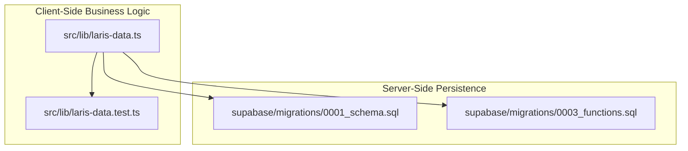
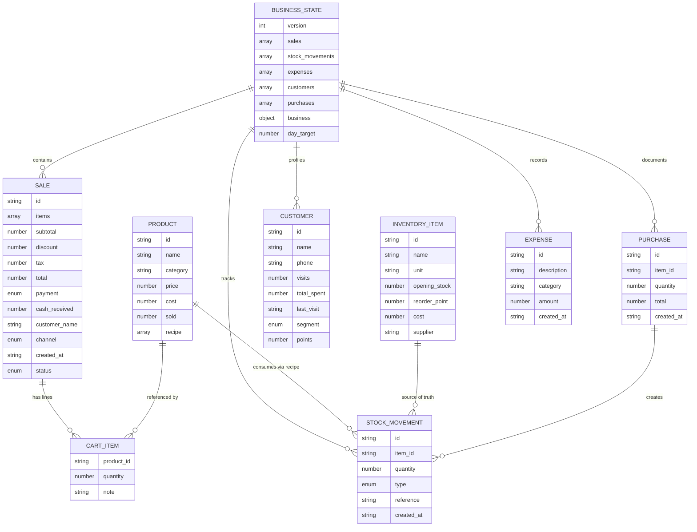
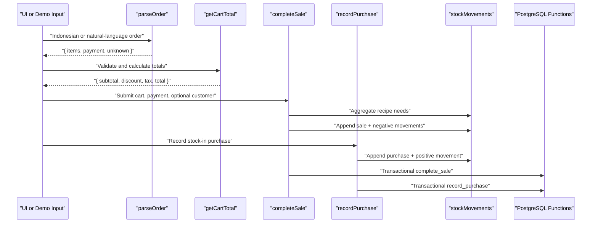
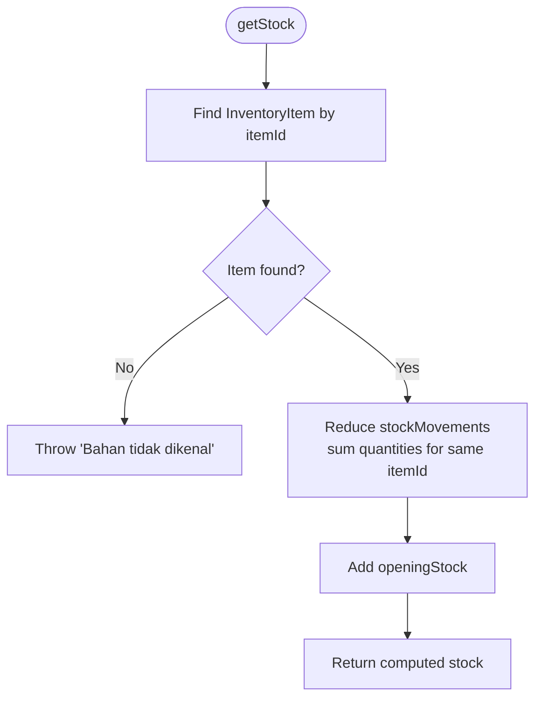
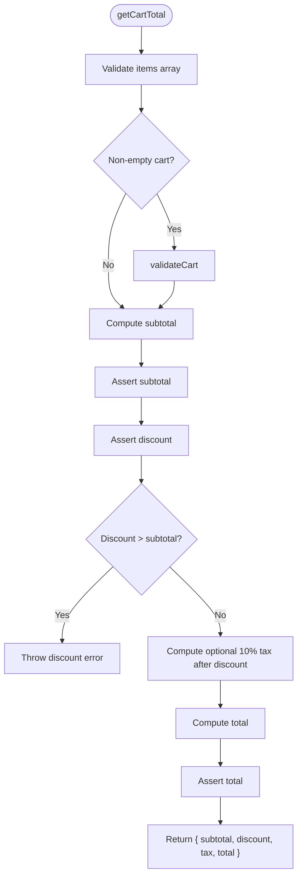
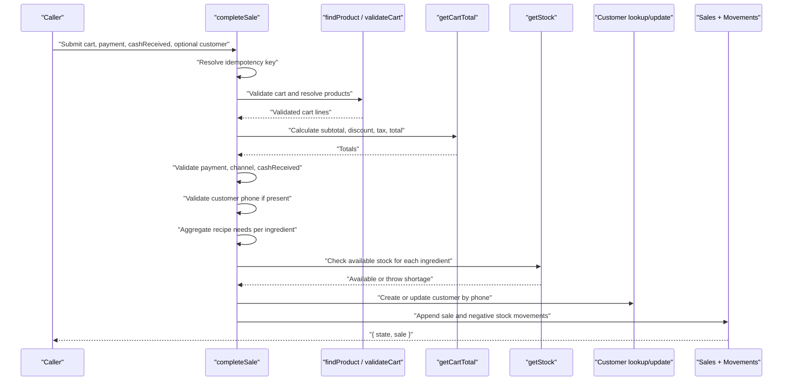
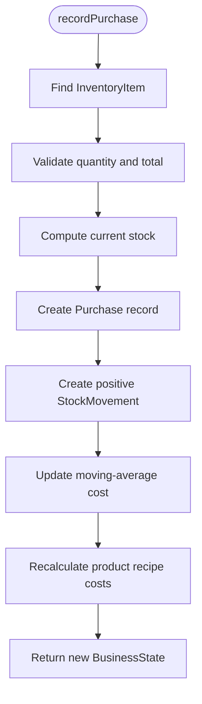
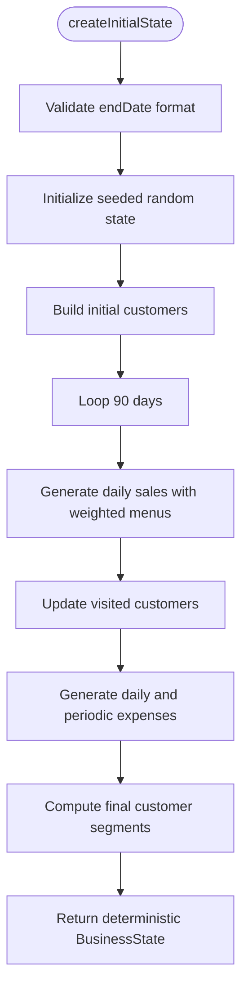
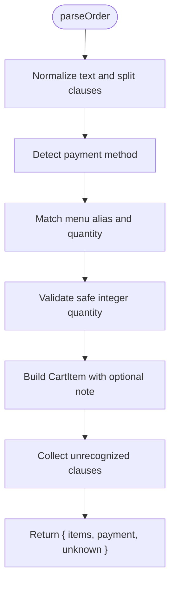
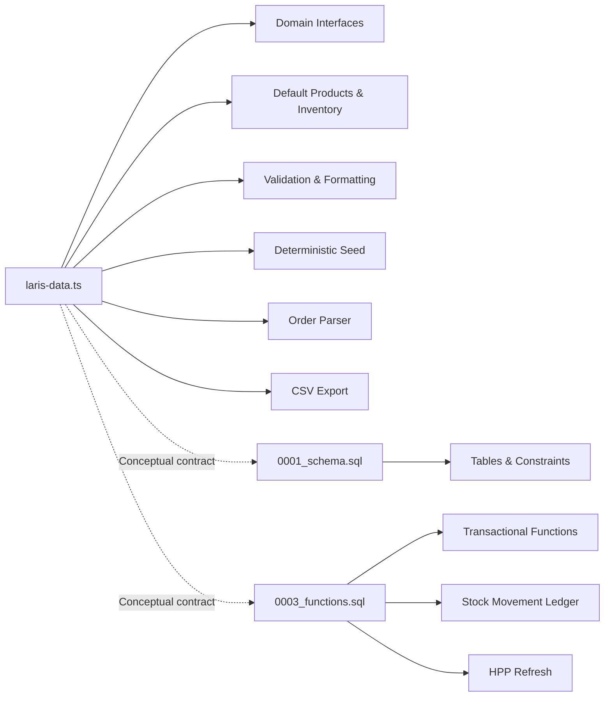

# Business Logic Layer

<cite>
**Referenced Files in This Document**
- [laris-data.ts](file://src/lib/laris-data.ts)
- [laris-data.test.ts](file://src/lib/laris-data.test.ts)
- [0001_schema.sql](file://supabase/migrations/0001_schema.sql)
- [0003_functions.sql](file://supabase/migrations/0003_functions.sql)
</cite>

## Table of Contents
1. [Introduction](#introduction)
2. [Project Structure](#project-structure)
3. [Core Components](#core-components)
4. [Architecture Overview](#architecture-overview)
5. [Detailed Component Analysis](#detailed-component-analysis)
6. [Dependency Analysis](#dependency-analysis)
7. [Performance Considerations](#performance-considerations)
8. [Troubleshooting Guide](#troubleshooting-guide)
9. [Conclusion](#conclusion)

## Introduction
This document explains the deterministic business logic layer that powers the demo point-of-sale and inventory system. The core is a pure, immutable state model centered on `BusinessState`, with explicit domain entities for products, inventory items, sales, customers, purchases, and stock movements. All mutations are expressed as new state objects rather than direct object updates, making the system predictable, testable, and easy to serialize or replay.

The implementation separates:
- Client-side calculations (cart totals, validation, stock queries, deterministic seed generation).
- Server-side persistence (PostgreSQL schema, transactional functions, ledger-based stock tracking).

## Project Structure
The business logic lives primarily in one TypeScript module, while the server-side contracts live in database migrations.

**Diagram sources**
- [laris-data.ts:1-494](file://src/lib/laris-data.ts#L1-L494)
- [laris-data.test.ts:1-519](file://src/lib/laris-data.test.ts#L1-L519)
- [0001_schema.sql:1-294](file://supabase/migrations/0001_schema.sql#L1-L294)
- [0003_functions.sql:1-320](file://supabase/migrations/0003_functions.sql#L1-L320)

**Section sources**
- [laris-data.ts:1-494](file://src/lib/laris-data.ts#L1-L494)
- [0001_schema.sql:1-294](file://supabase/migrations/0001_schema.sql#L1-L294)

## Core Components
The domain model defines the shape of the application’s data and the operations that transform it deterministically.

### Domain Entities and Relationships
| Entity | Purpose | Key Fields | Relationship Notes |
|---|---|---|---|
| `Product` | Sellable menu item | `id`, `name`, `category`, `price`, `cost`, `recipe` | Recipe references `InventoryItem` by `itemId`. |
| `InventoryItem` | Raw material or consumable | `id`, `name`, `unit`, `openingStock`, `reorderPoint`, `cost`, `supplier` | Stock is derived from `openingStock` plus signed `StockMovement` entries. |
| `StockMovement` | Immutable ledger entry | `id`, `itemId`, `quantity`, `type`, `reference`, `createdAt` | Positive for purchases/adjustments; negative for sales/waste. |
| `CartItem` | Line in a checkout cart | `productId`, `quantity`, optional `note` | Resolved against `Product` catalog before sale completion. |
| `Sale` | Completed order | `id`, `items`, `subtotal`, `discount`, `tax`, `total`, `payment`, `cashReceived`, `customerName`, `channel`, `createdAt`, `status` | Each sale creates negative stock movements per recipe ingredient. |
| `Customer` | Loyalty profile | `id`, `name`, `phone`, `visits`, `totalSpent`, `lastVisit`, `segment`, `points` | Updated only when a valid phone is provided. |
| `Purchase` | Purchase record | `id`, `itemId`, `quantity`, `total`, `createdAt` | Creates positive stock movement and updates moving-average cost. |
| `Expense` | Daily or periodic expense | `id`, `description`, `category`, `amount`, `createdAt` | Used in deterministic seed history. |
| `TeamMember` | Internal team role | `id`, `name`, `email`, `role` | Part of optional extended state. |
| `AuditActivity` | Audit trail entry | `id`, `action`, `entity`, `createdAt`, `actorName` | Optional audit metadata. |
| `BusinessState` | Root immutable state | `version`, `sales`, `stockMovements`, `expenses`, `customers`, `purchases`, `business`, `dayTarget`, optional catalogs | All mutations return a new `BusinessState`. |

**Diagram sources**
- [laris-data.ts:3-110](file://src/lib/laris-data.ts#L3-L110)

**Section sources**
- [laris-data.ts:3-110](file://src/lib/laris-data.ts#L3-L110)

## Architecture Overview
The architecture follows a deterministic state machine pattern:
- Pure functions read `BusinessState` and input values.
- They validate inputs and compute results without mutating existing objects.
- Mutating operations return a new state object containing appended immutable records.
- Stock is never stored as a single scalar; it is computed from `InventoryItem.openingStock` plus all matching `StockMovement.quantity` values.
- The server-side PostgreSQL schema mirrors this ledger approach, using `stock_movement` rows instead of mutable stock counters.

**Diagram sources**
- [laris-data.ts:172-334](file://src/lib/laris-data.ts#L172-L334)
- [0003_functions.sql:94-303](file://supabase/migrations/0003_functions.sql#L94-L303)

**Section sources**
- [laris-data.ts:172-334](file://src/lib/laris-data.ts#L172-L334)
- [0003_functions.sql:94-303](file://supabase/migrations/0003_functions.sql#L94-L303)

## Detailed Component Analysis

### Deterministic State Model
`BusinessState` is the single source of truth for the demo session. It includes:
- Versioned state (`version: 1`).
- Append-only ledgers: `sales` and `stockMovements`.
- Derived or auxiliary data: `expenses`, `customers`, `purchases`.
- Optional runtime catalogs: `products`, `inventory`, `members`, `activities`.

All public mutation functions accept the current state and return a new state object. Existing arrays and objects are copied or replaced rather than mutated.

**Section sources**
- [laris-data.ts:97-110](file://src/lib/laris-data.ts#L97-L110)

### Inventory Calculations and Stock Ledger
Stock is calculated by summing signed movements for an inventory item:
- `getStock(state, itemId)` returns `openingStock` plus the sum of all `StockMovement.quantity` entries for that item.
- Sales create negative movements.
- Purchases create positive movements.
- Adjustments can be used for waste, count corrections, or manual changes.

**Diagram sources**
- [laris-data.ts:149-176](file://src/lib/laris-data.ts#L149-L176)

**Section sources**
- [laris-data.ts:149-176](file://src/lib/laris-data.ts#L149-L176)
- [laris-data.test.ts:352-361](file://src/lib/laris-data.test.ts#L352-L361)

### Cart Operations: `getCartTotal`
`getCartTotal` is a pure function that computes:
- Subtotal from product prices and quantities.
- Rounded discount.
- Optional restaurant tax applied after discount.
- Final total.

Validation rules include:
- Items must be an array.
- Non-empty carts require validated cart lines.
- Product IDs must exist in the catalog.
- Quantities must be safe positive integers.
- Discount cannot exceed subtotal.
- Totals must remain finite and within safe numeric bounds.

**Diagram sources**
- [laris-data.ts:155-194](file://src/lib/laris-data.ts#L155-L194)

**Section sources**
- [laris-data.ts:155-194](file://src/lib/laris-data.ts#L155-L194)
- [laris-data.test.ts:146-168](file://src/lib/laris-data.test.ts#L146-L168)

### Sales Processing: `completeSale`
`completeSale` is the central business rule for POS checkout. It performs:
- Idempotency key handling.
- Catalog resolution.
- Cart validation.
- Payment and channel validation.
- Cash receipt validation.
- Customer phone validation and loyalty update.
- Recipe aggregation across multiple cart lines.
- Atomic stock availability check.
- Creation of one immutable `Sale` and one aggregated `StockMovement` per ingredient.

**Diagram sources**
- [laris-data.ts:215-305](file://src/lib/laris-data.ts#L215-L305)

Key behaviors verified by tests:
- Shared recipes are aggregated into one movement per ingredient.
- Duplicate pastry lines share one stock bucket.
- Exact remaining stock can be sold; further sales fail until restocked.
- Insufficient cash rejects without changing state.
- Idempotent retries return the same persisted sale and state.

**Section sources**
- [laris-data.ts:215-305](file://src/lib/laris-data.ts#L215-L305)
- [laris-data.test.ts:170-305](file://src/lib/laris-data.test.ts#L170-L305)

### Purchase Recording: `recordPurchase`
`recordPurchase` adds stock and recalculates costs:
- Validates inventory item existence.
- Validates positive quantity and total.
- Computes new stock level.
- Appends a `Purchase` record.
- Appends a positive `StockMovement`.
- Updates the inventory item’s moving-average cost.
- Recalculates every product’s recipe cost based on updated inventory costs.

**Diagram sources**
- [laris-data.ts:307-334](file://src/lib/laris-data.ts#L307-L334)

**Section sources**
- [laris-data.ts:307-334](file://src/lib/laris-data.ts#L307-L334)
- [laris-data.test.ts:307-350](file://src/lib/laris-data.test.ts#L307-L350)

### Deterministic Seed Data Generation
`createInitialState` generates a fixed 90-day history ending on `DEMO_DATE`:
- Uses a seeded pseudo-random generator so repeated calls produce identical output.
- Generates customers, sales, and expenses deterministically.
- Applies weighted menu selection to simulate realistic demand.
- Ensures sale totals reconcile with cart calculations.
- Leaves `stockMovements` empty for historical sales; opening stock represents the remaining snapshot at the end date.
- Copies product and inventory catalogs so mutations do not affect the default seed.

**Diagram sources**
- [laris-data.ts:336-404](file://src/lib/laris-data.ts#L336-L404)

**Section sources**
- [laris-data.ts:336-404](file://src/lib/laris-data.ts#L336-L404)
- [laris-data.test.ts:83-138](file://src/lib/laris-data.test.ts#L83-L138)

### Natural Language Order Parsing
`parseOrder` converts Indonesian-style orders into structured cart items:
- Recognizes aliases such as “kopi susu”, “matcha latte”, “croissant”.
- Supports number words from one to ten.
- Extracts optional notes like “less sugar” or “tanpa gula”.
- Detects payment method hints like QRIS, tunai, or transfer.
- Returns unknown clauses separately so callers can show parsing feedback.

**Diagram sources**
- [laris-data.ts:406-474](file://src/lib/laris-data.ts#L406-L474)

**Section sources**
- [laris-data.ts:406-474](file://src/lib/laris-data.ts#L406-L474)
- [laris-data.test.ts:412-477](file://src/lib/laris-data.test.ts#L412-L477)

### Export Utility
`exportSalesCsv` serializes sales into RFC 4180-compatible CSV:
- Escapes commas, quotes, newlines, and spreadsheet formula injection.
- Includes human-readable menu descriptions with notes.
- Is read-only over the passed state.

**Section sources**
- [laris-data.ts:476-494](file://src/lib/laris-data.ts#L476-L494)
- [laris-data.test.ts:479-518](file://src/lib/laris-data.test.ts#L479-L518)

## Dependency Analysis
The client-side business logic depends on:
- Domain interfaces for strong typing.
- Default catalog data for demo mode.
- Validation helpers for amounts, cart lines, and timestamps.
- Deterministic timestamp generation tied to `DEMO_DATE`.

The server-side persistence depends on:
- A relational schema with explicit foreign keys and constraints.
- Transactional PL/pgSQL functions that re-validate business rules.
- A ledger table for stock movements.
- Moving-average cost recalculation and HPP refresh for product variants.

**Diagram sources**
- [laris-data.ts:1-494](file://src/lib/laris-data.ts#L1-L494)
- [0001_schema.sql:1-294](file://supabase/migrations/0001_schema.sql#L1-L294)
- [0003_functions.sql:1-320](file://supabase/migrations/0003_functions.sql#L1-L320)

**Section sources**
- [laris-data.ts:1-494](file://src/lib/laris-data.ts#L1-L494)
- [0001_schema.sql:1-294](file://supabase/migrations/0001_schema.sql#L1-L294)
- [0003_functions.sql:1-320](file://supabase/migrations/0003_functions.sql#L1-L320)

## Performance Considerations
- Stock calculation is linear in the number of stock movements for the queried item. For large histories, consider indexing by `itemId` and outlet, which aligns with the server-side index strategy.
- `completeSale` aggregates recipe needs before checking stock, avoiding partial mutations and reducing redundant lookups.
- `recordPurchase` recomputes moving-average cost once per purchased item and then recalculates dependent product costs.
- Deterministic seed generation uses a simple seeded PRNG and avoids external randomness, ensuring reproducible demo runs.
- CSV export builds rows in memory; for very large datasets, streaming exports would reduce peak memory usage.

[No sources needed since this section provides general guidance]

## Troubleshooting Guide

### Common Validation Errors
| Symptom | Likely Cause | Resolution |
|---|---|---|
| “Keranjang tidak boleh kosong” | Empty cart submitted to `completeSale` | Ensure at least one valid cart line. |
| “Menu tidak dikenal” | Invalid `productId` in cart | Verify product exists in the active catalog. |
| “Bahan tidak dikenal” | Invalid `itemId` in purchase or recipe | Verify inventory item exists. |
| “Jumlah menu harus berupa bilangan bulat positif yang aman” | Quantity is zero, negative, fractional, unsafe integer, or invalid type | Use safe positive integers. |
| “Diskon tidak boleh melebihi subtotal” | Discount greater than subtotal | Cap discount at subtotal. |
| “Uang tunai tidak cukup” | Cash received less than total for cash payments | Increase `cashReceived` or use non-cash payment. |
| “Stok ... tidak cukup” | Aggregated recipe needs exceed available stock | Restock or reduce order size. |
| “Nomor telepon harus terdiri dari 8–15 digit” | Phone does not match allowed format | Remove leading `+` if needed and ensure 8–15 digits. |
| “Kunci transaksi tidak boleh kosong” | Empty or whitespace-only idempotency key | Provide a non-empty string key. |

**Section sources**
- [laris-data.ts:155-194](file://src/lib/laris-data.ts#L155-L194)
- [laris-data.ts:215-305](file://src/lib/laris-data.ts#L215-L305)
- [laris-data.test.ts:256-305](file://src/lib/laris-data.test.ts#L256-L305)

### Error Handling Strategy
- Pure functions throw descriptive errors early, preventing partial state mutation.
- Tests freeze state before calling mutating functions to verify immutability.
- Idempotency keys allow safe retries without duplicate sales.
- Server-side functions repeat validation and enforce constraints at the database boundary.

**Section sources**
- [laris-data.test.ts:21-27](file://src/lib/laris-data.test.ts#L21-L27)
- [laris-data.test.ts:289-305](file://src/lib/laris-data.test.ts#L289-L305)
- [0003_functions.sql:94-230](file://supabase/migrations/0003_functions.sql#L94-L230)

### Data Transformation Patterns
- Cart totals are recomputed from raw items and catalog prices rather than trusting client-provided totals.
- Customer profiles are updated immutably by replacing or appending entries.
- Stock movements are appended rather than modifying existing records.
- Product costs are recalculated from updated inventory costs.
- CSV export escapes sensitive and special characters safely.

**Section sources**
- [laris-data.ts:178-194](file://src/lib/laris-data.ts#L178-L194)
- [laris-data.ts:286-305](file://src/lib/laris-data.ts#L286-L305)
- [laris-data.ts:321-334](file://src/lib/laris-data.ts#L321-L334)
- [laris-data.ts:476-494](file://src/lib/laris-data.ts#L476-L494)

## Conclusion
The business logic layer implements a clean, deterministic state management pattern. Domain entities are clearly separated, mutations are expressed as immutable state transitions, and stock is tracked through an append-only ledger. Client-side functions provide pure calculations and validation, while server-side functions enforce the same rules transactionally in PostgreSQL. This separation makes the system robust against invalid input, concurrent retries, and serialization boundaries, while remaining understandable for both developers and non-technical stakeholders.