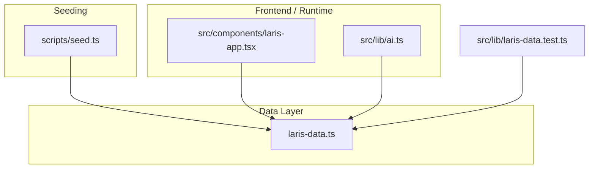
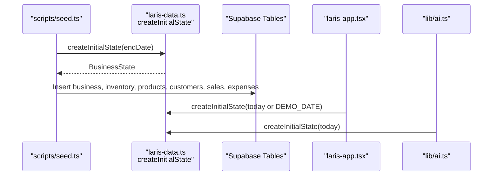
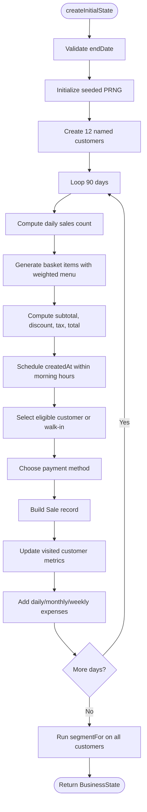
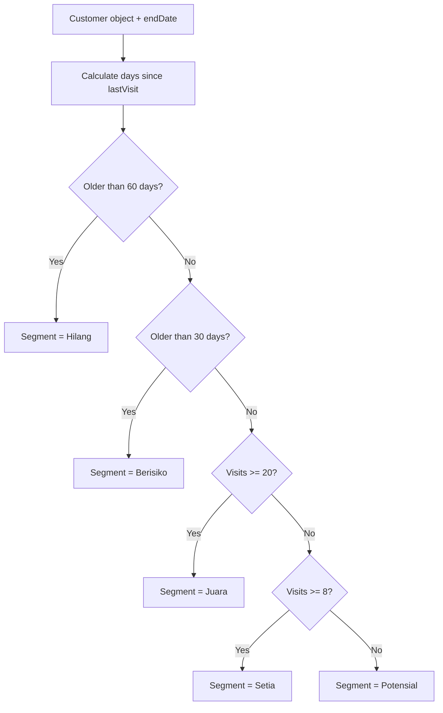
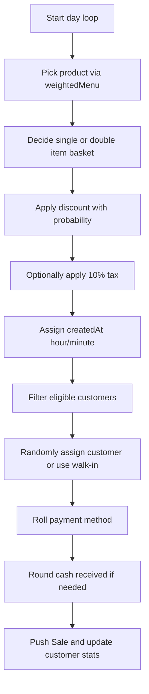
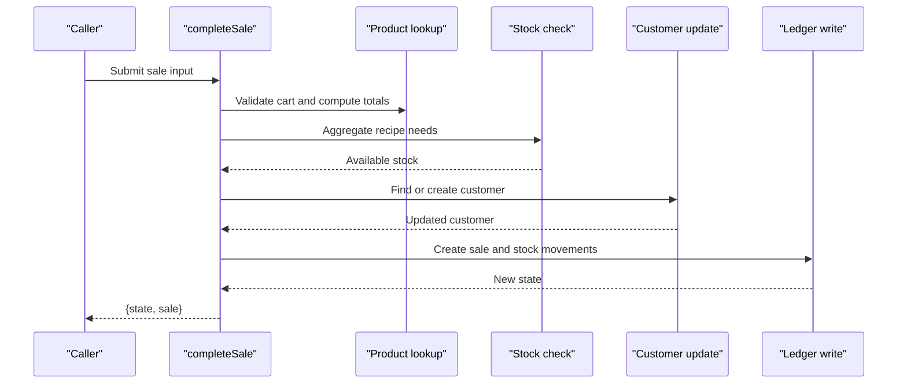
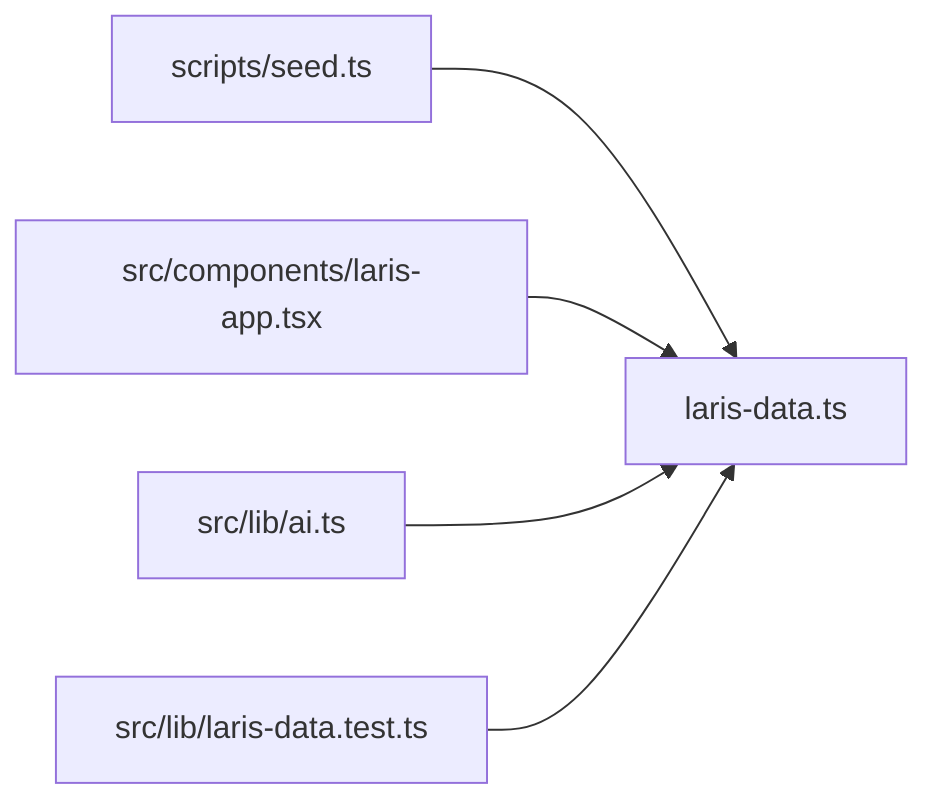

# Data Generation & Utilities

<cite>
**Referenced Files in This Document**
- [laris-data.ts](file://src/lib/laris-data.ts)
- [seed.ts](file://scripts/seed.ts)
- [laris-app.tsx](file://src/components/laris-app.tsx)
- [ai.ts](file://src/lib/ai.ts)
- [laris-data.test.ts](file://src/lib/laris-data.test.ts)
</cite>

## Table of Contents
1. [Introduction](#introduction)
2. [Project Structure](#project-structure)
3. [Core Components](#core-components)
4. [Architecture Overview](#architecture-overview)
5. [Detailed Component Analysis](#detailed-component-analysis)
6. [Dependency Analysis](#dependency-analysis)
7. [Performance Considerations](#performance-considerations)
8. [Troubleshooting Guide](#troubleshooting-guide)
9. [Conclusion](#conclusion)

## Introduction
This document explains the data generation utilities and helper functions that power the Kopi Senja coffee shop demo. The central entry point is `createInitialState`, which produces a deterministic 90-day history ending on a fixed demo date. It generates sales, customers, expenses, products, inventory, and business metadata so that demos, tests, and seed scripts always see the same data.

The system also provides:
- A seeded random number generator for reproducible behavior.
- A customer segmentation algorithm based on visit recency and frequency.
- Sales pattern simulation with realistic menu weights, payment methods, channels, discounts, taxes, and cash rounding.
- Utility helpers such as currency formatting, timestamp generation, ID generation, CSV export, order parsing, stock calculation, cart totals, sale completion, and purchase recording.

## Project Structure
The data generation logic lives primarily in one module, while the database seed script consumes it to populate Supabase tables. UI components and AI helpers import the same state factory so local mode and server-side seeding produce consistent results.

**Diagram sources**
- [laris-data.ts:1-494](file://src/lib/laris-data.ts#L1-L494)
- [seed.ts:1-152](file://scripts/seed.ts#L1-L152)
- [laris-app.tsx:15-84](file://src/components/laris-app.tsx#L15-L84)
- [ai.ts:1-32](file://src/lib/ai.ts#L1-L32)
- [laris-data.test.ts:1-107](file://src/lib/laris-data.test.ts#L1-L107)

**Section sources**
- [laris-data.ts:1-110](file://src/lib/laris-data.ts#L1-L110)
- [seed.ts:1-31](file://scripts/seed.ts#L1-L31)
- [laris-app.tsx:15-84](file://src/components/laris-app.tsx#L15-L84)
- [ai.ts:1-32](file://src/lib/ai.ts#L1-L32)

## Core Components
- `DEMO_DATE`: Fixed anchor date used by the demo and seed process.
- `BusinessState`: Immutable snapshot containing sales, stock movements, expenses, customers, purchases, business metadata, daily target, products, inventory, team members, and audit activities.
- `createInitialState(endDate)`: Generates the full 90-day deterministic dataset.
- `segmentFor(customer, endDate)`: Assigns RFM-style segments.
- `timestamp(date)` and `nextId(prefix, entries)`: Deterministic time and ID helpers.
- `currency(amount)`: Indonesian Rupiah formatter.
- `getCartTotal(items, discount, taxEnabled, catalog)`: Cart math with validation.
- `completeSale(state, input)`: Idempotent sale completion with stock checks and customer updates.
- `recordPurchase(state, input)`: Inventory purchase with moving average cost.
- `exportSalesCsv(state)`: Safe CSV export of sales.
- `parseOrder(text, catalog)`: Natural-language order parser for demo interactions.

**Section sources**
- [laris-data.ts:1-110](file://src/lib/laris-data.ts#L1-L110)
- [laris-data.ts:135-206](file://src/lib/laris-data.ts#L135-L206)
- [laris-data.ts:208-334](file://src/lib/laris-data.ts#L208-L334)
- [laris-data.ts:336-404](file://src/lib/laris-data.ts#L336-L404)
- [laris-data.ts:406-494](file://src/lib/laris-data.ts#L406-L494)

## Architecture Overview
`createInitialState` is the single source of truth for demo data. The seed script calls it once per run, then maps the generated state into database tables. Frontend components can initialize their local state from the same function, ensuring identical numbers across environments.

**Diagram sources**
- [seed.ts:30-31](file://scripts/seed.ts#L30-L31)
- [laris-data.ts:336-404](file://src/lib/laris-data.ts#L336-L404)
- [laris-app.tsx:84-84](file://src/components/laris-app.tsx#L84-L84)
- [ai.ts:32-32](file://src/lib/ai.ts#L32-L32)

## Detailed Component Analysis

### Deterministic 90-Day History Generator
`createInitialState` builds a reproducible dataset anchored at `DEMO_DATE`. It validates the end date, initializes a seeded PRNG, creates 12 named customers, and simulates 90 days of activity.

Key behaviors:
- Seeded PRNG: Uses a linear congruential generator initialized with a fixed integer. Every call to `random()` advances the internal state deterministically.
- Date window: Iterates exactly 90 days backward from the provided end date.
- Daily sales volume: Randomly selects between 15 and 30 sales per day, except the final day, which is fixed at 86 sales.
- Menu weighting: Uses a weighted index array so some products appear more often than others.
- Basket composition: Mostly single-item baskets; about 16% have two items, and accompaniments are chosen based on product category.
- Pricing and taxes: Discounts occur roughly 12% of the time; when enabled, a 10% restaurant tax is applied and rounded to whole rupiah.
- Time distribution: Sales are spread across morning hours using an index-based minute schedule.
- Customer assignment: About 40% of sales are attributed to eligible customers, with special rules for recent or returning customers.
- Payment mix: Approximately 66% QRIS, 26% cash, and 8% transfer.
- Cash rounding: Cash payments round up to the nearest 50,000 IDR.
- Channel mix: Most sales are through the cashier; about 18% are through the display counter.
- Expenses: Daily raw material costs plus monthly rent, salaries, utilities, and weekly cleaning supplies.
- Final segmentation: After generating all visits, each customer’s segment is computed using `segmentFor`.

**Diagram sources**
- [laris-data.ts:336-404](file://src/lib/laris-data.ts#L336-L404)

**Section sources**
- [laris-data.ts:336-404](file://src/lib/laris-data.ts#L336-L404)

### Seeded Random Number Generator
The generator uses a simple linear congruential algorithm:
- Internal state starts at a fixed integer.
- Each step multiplies the state by a constant, adds another constant, masks to 32 bits, and normalizes to a value between 0 and 1.
- Because the seed is constant, repeated runs produce identical sequences.

This guarantees that:
- Demo screens show the same sales every time.
- Tests can assert exact counts and dates.
- Database seeding remains stable across environments.

**Section sources**
- [laris-data.ts:339-343](file://src/lib/laris-data.ts#L339-L343)

### Customer Segmentation Algorithm
Segments are derived from visit recency and frequency relative to the end date:
- Hilang: Last visit older than 60 days.
- Berisiko: Last visit older than 30 days but not older than 60 days.
- Juara: At least 20 visits regardless of recency.
- Setia: At least 8 visits.
- Potensial: Fewer than 8 visits.

The algorithm first updates cumulative visit metrics during history generation, then assigns the final segment after all days are processed.

**Diagram sources**
- [laris-data.ts:208-213](file://src/lib/laris-data.ts#L208-L213)

**Section sources**
- [laris-data.ts:208-213](file://src/lib/laris-data.ts#L208-L213)

### Sales Pattern Simulation
The simulation models realistic coffee shop behavior:
- Weighted menu selection favors popular drinks and pastries.
- Baskets frequently include a main item, sometimes with an accompaniment.
- Discounts are occasional and proportional to subtotal.
- Taxes are optional and calculated after discount.
- Payment methods follow a realistic distribution.
- Channels reflect both counter service and display-counter pickup.
- Customer attribution is probabilistic but constrained by eligibility rules.

**Diagram sources**
- [laris-data.ts:351-383](file://src/lib/laris-data.ts#L351-L383)

**Section sources**
- [laris-data.ts:351-383](file://src/lib/laris-data.ts#L351-L383)

### Expense Categorization
Expenses are added deterministically alongside sales:
- Daily raw material expense with small random variation.
- Monthly rent, salaries, and utilities on the first day of each month.
- Weekly cleaning and supplies expense.

Categories include:
- Bahan baku
- Sewa
- Gaji
- Utilitas
- Operasional

**Section sources**
- [laris-data.ts:384-394](file://src/lib/laris-data.ts#L384-L394)

### Utility Functions

#### Currency Formatting
`currency(amount)` formats values as Indonesian Rupiah using `Intl.NumberFormat`. It ensures consistent display formatting without exposing locale-specific implementation details to consumers.

**Section sources**
- [laris-data.ts:135-141](file://src/lib/laris-data.ts#L135-L141)

#### Timestamp Generation
`timestamp(date)` returns ISO-like timestamps anchored to Jakarta timezone offset. For historical data, it combines the generated date with a simulated time string.

**Section sources**
- [laris-data.ts:196-199](file://src/lib/laris-data.ts#L196-L199)

#### ID Generation
`nextId(prefix, entries)` generates unique IDs by scanning existing entries and incrementing a sequence until it finds an unused identifier. This keeps IDs predictable and collision-free within a given prefix and collection.

**Section sources**
- [laris-data.ts:201-206](file://src/lib/laris-data.ts#L201-L206)

#### CSV Export
`exportSalesCsv(state)` exports sales rows with safe quoting and formula neutralization. Columns include ID, date, customer, menu summary, subtotal, discount, tax, total, payment, cash received, channel, and status.

**Section sources**
- [laris-data.ts:476-494](file://src/lib/laris-data.ts#L476-L494)

#### Order Parsing
`parseOrder(text, catalog)` converts natural language orders into structured cart items and payment method. It supports aliases, quantities written as digits or words, notes like less sugar or less ice, and multiple clauses separated by commas, semicolons, or line breaks.

**Section sources**
- [laris-data.ts:406-474](file://src/lib/laris-data.ts#L406-L474)

#### Stock Calculation
`getStock(state, itemId)` computes current stock by starting from opening stock and applying all recorded stock movements.

**Section sources**
- [laris-data.ts:172-176](file://src/lib/laris-data.ts#L172-L176)

#### Cart Total Calculation
`getCartTotal(items, discount, taxEnabled, catalog)` validates cart contents, computes subtotal, applies discount, optionally applies tax, and returns validated totals.

**Section sources**
- [laris-data.ts:178-194](file://src/lib/laris-data.ts#L178-L194)

#### Sale Completion
`completeSale(state, input)` performs idempotent sale completion:
- Validates cart, payment, channel, and cash received.
- Computes required ingredients and validates available stock.
- Creates a sale record and stock movement entries.
- Updates or creates a customer profile and recalculates segment.
- Returns updated state and the completed sale.

**Diagram sources**
- [laris-data.ts:215-305](file://src/lib/laris-data.ts#L215-L305)

**Section sources**
- [laris-data.ts:215-305](file://src/lib/laris-data.ts#L215-L305)

#### Purchase Recording
`recordPurchase(state, input)` records inventory purchases:
- Validates quantity and total.
- Adds a stock movement.
- Updates average unit cost using a weighted average.
- Recomputes product costs based on updated ingredient costs.
- Returns updated state including purchases and stock movements.

**Section sources**
- [laris-data.ts:307-334](file://src/lib/laris-data.ts#L307-L334)

### Generated Data Structures
The generated `BusinessState` includes:
- `sales`: Array of sale records with items, totals, payment, channel, timestamps, and status.
- `stockMovements`: Movement records for sales and purchases.
- `expenses`: Categorized daily, monthly, and weekly expenses.
- `customers`: Profiles with visits, total spent, points, last visit, and segment.
- `purchases`: Inventory purchase records.
- `business`: Shop name, owner, outlet location, and daily target.
- `products` and `inventory`: Product catalog and inventory items with recipes and supplier information.

Example characteristics:
- Sales IDs combine date and sequence.
- Customer IDs are sequential strings.
- Expenses have sequential IDs and fixed categories.
- Segments are assigned after full history generation.

**Section sources**
- [laris-data.ts:97-110](file://src/lib/laris-data.ts#L97-L110)
- [laris-data.ts:396-403](file://src/lib/laris-data.ts#L396-L403)

### Customer Segments
The five segments represent RFM-inspired categories:
- Juara: High-frequency loyal customers.
- Setia: Regular customers below the top tier.
- Potensial: New or low-frequency customers.
- Berisiko: Customers whose last visit is between 30 and 60 days ago.
- Hilang: Customers inactive for more than 60 days.

These segments are computed from visit count and last visit recency relative to the end date.

**Section sources**
- [laris-data.ts:55-64](file://src/lib/laris-data.ts#L55-L64)
- [laris-data.ts:208-213](file://src/lib/laris-data.ts#L208-L213)

## Dependency Analysis
The data generation module is consumed by several parts of the application:

**Diagram sources**
- [seed.ts:7-31](file://scripts/seed.ts#L7-L31)
- [laris-app.tsx:15-84](file://src/components/laris-app.tsx#L15-L84)
- [ai.ts:1-32](file://src/lib/ai.ts#L1-L32)
- [laris-data.test.ts:1-12](file://src/lib/laris-data.test.ts#L1-L12)

**Section sources**
- [seed.ts:7-31](file://scripts/seed.ts#L7-L31)
- [laris-app.tsx:15-84](file://src/components/laris-app.tsx#L15-L84)
- [ai.ts:1-32](file://src/lib/ai.ts#L1-L32)
- [laris-data.test.ts:1-12](file://src/lib/laris-data.test.ts#L1-L12)

## Performance Considerations
- Deterministic generation avoids randomness overhead and network calls.
- Weighted menu selection uses a small static array for fast sampling.
- Customer eligibility filtering is lightweight and performed once per sale.
- CSV export builds rows in memory before joining them, suitable for demo-scale datasets.
- Stock calculations reduce over movements; for very large histories, consider indexing or precomputed snapshots.

[No sources needed since this section provides general guidance]

## Troubleshooting Guide
Common issues and how the code handles them:
- Invalid end date: `createInitialState` throws when the date format or parsed value is invalid.
- Unknown product or inventory item: Lookup helpers throw descriptive errors.
- Empty or invalid cart: Cart validation rejects missing items, non-positive quantities, and invalid notes.
- Discount exceeding subtotal: Rejected with an explicit error.
- Insufficient cash for cash payments: Rejected with a formatted total.
- Invalid phone number: Rejected unless it matches the expected digit range.
- Insufficient stock: Rejected with item name, available quantity, and required quantity.
- Formula-safe CSV cells: Export function quotes potentially dangerous values to prevent spreadsheet formula injection.

**Section sources**
- [laris-data.ts:143-170](file://src/lib/laris-data.ts#L143-L170)
- [laris-data.ts:182-194](file://src/lib/laris-data.ts#L182-L194)
- [laris-data.ts:243-260](file://src/lib/laris-data.ts#L243-L260)
- [laris-data.ts:271-276](file://src/lib/laris-data.ts#L271-L276)
- [laris-data.ts:476-481](file://src/lib/laris-data.ts#L476-L481)

## Conclusion
`createInitialState` is the foundation of the Kopi Senja demo experience. Its seeded random generator, customer segmentation logic, and sales simulation produce consistent, realistic data across frontend, backend, and database seeding. Together with utility functions for currency, timestamps, IDs, CSV export, order parsing, stock management, and transaction processing, the module provides a complete, deterministic data layer for demonstrations and testing.

[No sources needed since this section summarizes without analyzing specific files]