# Domain Models

<cite>
**Referenced Files in This Document**
- [laris-data.ts](file://src/lib/laris-data.ts)
- [laris-data.test.ts](file://src/lib/laris-data.test.ts)
- [repo.ts](file://src/lib/repo.ts)
- [0001_schema.sql](file://supabase/migrations/0001_schema.sql)
- [0003_functions.sql](file://supabase/migrations/0003_functions.sql)
- [seed.ts](file://scripts/seed.ts)
</cite>

## Table of Contents
1. [Introduction](#introduction)
2. [Project Structure](#project-structure)
3. [Core Components](#core-components)
4. [Architecture Overview](#architecture-overview)
5. [Detailed Component Analysis](#detailed-component-analysis)
6. [Dependency Analysis](#dependency-analysis)
7. [Performance Considerations](#performance-considerations)
8. [Troubleshooting Guide](#troubleshooting-guide)
9. [Conclusion](#conclusion)

## Introduction
This document explains the Laris domain model: the TypeScript interfaces that represent business entities, the immutable state container, and the deterministic seed data used for demo mode. It also maps these models to the PostgreSQL schema and transactional functions that enforce the same rules at the database layer.

The core idea is simple: a `BusinessState` holds all mutable business data for one tenant session. Operations such as completing a sale or recording a purchase take the current state and return a new state without mutating the original. The database schema stores the canonical records, while the TypeScript models provide type safety, validation, and deterministic behavior for the frontend and server-side logic.

## Project Structure
The domain model lives primarily in the shared data module, with supporting layers in the repository, database migrations, and seed script.

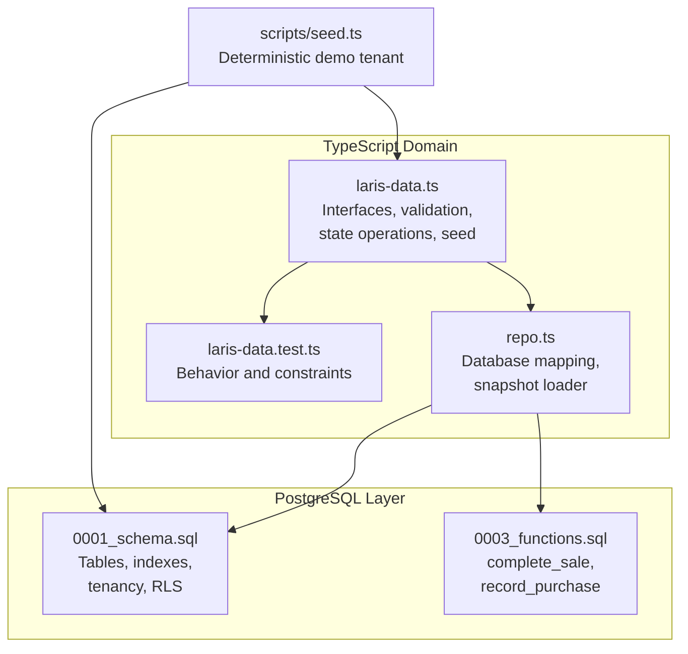

**Diagram sources**
- [laris-data.ts:1-494](file://src/lib/laris-data.ts#L1-L494)
- [laris-data.test.ts:1-519](file://src/lib/laris-data.test.ts#L1-L519)
- [repo.ts:1-202](file://src/lib/repo.ts#L1-L202)
- [0001_schema.sql:1-294](file://supabase/migrations/0001_schema.sql#L1-L294)
- [0003_functions.sql:1-320](file://supabase/migrations/0003_functions.sql#L1-L320)
- [seed.ts:1-152](file://scripts/seed.ts#L1-L152)

**Section sources**
- [laris-data.ts:1-494](file://src/lib/laris-data.ts#L1-L494)
- [repo.ts:1-202](file://src/lib/repo.ts#L1-L202)
- [0001_schema.sql:1-294](file://supabase/migrations/0001_schema.sql#L1-L294)
- [0003_functions.sql:1-320](file://supabase/migrations/0003_functions.sql#L1-L320)
- [seed.ts:1-152](file://scripts/seed.ts#L1-L152)

## Core Components
The domain model defines ten primary entity interfaces plus a central state container.

| Entity | Purpose | Key Fields | Business Meaning |
|---|---|---|---|
| `Product` | Menu item sold by the business | `id`, `name`, `category`, `price`, `cost`, `sold`, `image`, `recipe`, optional `active` | A sellable product with a recipe of inventory ingredients. |
| `InventoryItem` | Raw material or consumable | `id`, `name`, `unit`, `openingStock`, `reorderPoint`, `cost`, `supplier` | Stocked ingredient tracked by base unit and moving cost. |
| `StockMovement` | Ledger entry changing stock | `id`, `itemId`, `quantity`, `type`, `reference`, `createdAt` | Signed delta; positive for purchases/opening, negative for sales/waste. |
| `CartItem` | Line in a checkout basket | `productId`, `quantity`, optional `note` | User-facing order line with optional preparation note. |
| `Sale` | Completed POS transaction | `id`, `items`, `subtotal`, `discount`, `tax`, `total`, `payment`, `cashReceived`, `customerName`, `channel`, `createdAt`, `status` | Immutable record of a paid sale. |
| `Customer` | Loyalty profile | `id`, `name`, `phone`, `visits`, `totalSpent`, `lastVisit`, `segment`, `points` | RFM-style segmentation with points and visit history. |
| `Expense` | Operating cost | `id`, `description`, `category`, `amount`, `createdAt` | Non-inventory spending. |
| `Purchase` | Stock receipt | `id`, `itemId`, `quantity`, `total`, `createdAt` | Purchase line aggregated into a purchase record. |
| `TeamMember` | Business user | `id`, `name`, `email`, `role` | Role-based access: owner, manager, cashier, kitchen. |
| `AuditActivity` | Recent system action | `id`, `action`, `entity`, `createdAt`, `actorName` | Lightweight audit snapshot shown in the UI. |
| `BusinessState` | Central state container | `version`, `sales`, `stockMovements`, `expenses`, `customers`, `purchases`, `business`, `dayTarget`, optional catalog/team/activity arrays | Immutable snapshot used by operations and exported to the database. |

### Field Definitions and Data Types

| Interface | Field | Type | Constraints / Notes |
|---|---|---|---|
| `Product` | `id` | `string` | Stable menu code. |
| `Product` | `name` | `string` | Human-readable name. |
| `Product` | `category` | `string` | Grouping such as coffee, non-coffee, pastry. |
| `Product` | `price` | `number` | Selling price in rupiah. |
| `Product` | `cost` | `number` | Recipe-derived HPP. |
| `Product` | `sold` | `number` | Aggregated quantity sold. |
| `Product` | `image` | `string` | Static asset path. |
| `Product` | `recipe` | `{ itemId: string; quantity: number }[]` | Positive ingredient requirements. |
| `Product` | `active` | `boolean?` | Optional availability flag. |
| `InventoryItem` | `id` | `string` | Stable ingredient code. |
| `InventoryItem` | `name` | `string` | Ingredient label. |
| `InventoryItem` | `unit` | `string` | Base unit such as grams or milliliters. |
| `InventoryItem` | `openingStock` | `number` | Starting stock for demo snapshots. |
| `InventoryItem` | `reorderPoint` | `number` | Replenishment trigger. |
| `InventoryItem` | `cost` | `number` | Moving-average unit cost. |
| `InventoryItem` | `supplier` | `string` | Supplier label. |
| `StockMovement` | `id` | `string` | Unique ledger identifier. |
| `StockMovement` | `itemId` | `string` | References an inventory item. |
| `StockMovement` | `quantity` | `number` | Signed delta; zero is invalid. |
| `StockMovement` | `type` | `"sale" \| "purchase" \| "adjustment"` | Operation category. |
| `StockMovement` | `reference` | `string` | Related sale or purchase ID. |
| `StockMovement` | `createdAt` | `string` | ISO-like timestamp anchored to demo date. |
| `CartItem` | `productId` | `string` | Must exist in the active catalog. |
| `CartItem` | `quantity` | `number` | Safe positive integer. |
| `CartItem` | `note` | `string?` | Optional preparation instruction. |
| `Sale` | `id` | `string` | Deterministic or idempotency-keyed identifier. |
| `Sale` | `items` | `CartItem[]` | Copied input lines. |
| `Sale` | `subtotal` | `number` | Sum of line prices. |
| `Sale` | `discount` | `number` | Rounded rupiah discount. |
| `Sale` | `tax` | `number` | Optional restaurant tax after discount. |
| `Sale` | `total` | `number` | Final payable amount. |
| `Sale` | `payment` | `"Tunai" \| "QRIS" \| "Transfer"` | Payment method. |
| `Sale` | `cashReceived` | `number` | Cash tendered; rounded and validated. |
| `Sale` | `customerName` | `string` | Guest or loyalty customer name. |
| `Sale` | `channel` | `"Kasir" \| "Etalase"` | Sales channel. |
| `Sale` | `createdAt` | `string` | Timestamp using Jakarta timezone offset. |
| `Sale` | `status` | `"Lunas"` | Paid status in the TypeScript model. |
| `Customer` | `id` | `string` | Loyalty profile identifier. |
| `Customer` | `name` | `string` | Display name. |
| `Customer` | `phone` | `string` | 8–15 digits, optional leading plus. |
| `Customer` | `visits` | `number` | Visit counter. |
| `Customer` | `totalSpent` | `number` | Cumulative sale total. |
| `Customer` | `lastVisit` | `string` | Most recent sale timestamp. |
| `Customer` | `segment` | `"Juara" \| "Setia" \| "Potensial" \| "Berisiko" \| "Hilang"` | RFM segment. |
| `Customer` | `points` | `number` | Points from spent totals. |
| `Expense` | `id` | `string` | Expense identifier. |
| `Expense` | `description` | `string` | Short description. |
| `Expense` | `category` | `string` | Cost category. |
| `Expense` | `amount` | `number` | Positive rupiah amount. |
| `Expense` | `createdAt` | `string` | Spending timestamp. |
| `Purchase` | `id` | `string` | Purchase identifier. |
| `Purchase` | `itemId` | `string` | Inventory item code. |
| `Purchase` | `quantity` | `number` | Positive received quantity. |
| `Purchase` | `total` | `number` | Rounded purchase total. |
| `Purchase` | `createdAt` | `string` | Purchase timestamp. |
| `TeamMember` | `id` | `string` | Member identifier. |
| `TeamMember` | `name` | `string` | Display name. |
| `TeamMember` | `email` | `string` | Email address. |
| `TeamMember` | `role` | `"owner" \| "manager" \| "kasir" \| "dapur"` | Access role. |
| `AuditActivity` | `id` | `string` | Audit row identifier. |
| `AuditActivity` | `action` | `string` | Action label. |
| `AuditActivity` | `entity` | `string` | Affected entity label. |
| `AuditActivity` | `createdAt` | `string` | Audit timestamp. |
| `AuditActivity` | `actorName` | `string` | Actor display name. |
| `BusinessState` | `version` | `1` | Schema version for future migrations. |
| `BusinessState` | `sales` | `Sale[]` | All completed sales. |
| `BusinessState` | `stockMovements` | `StockMovement[]` | Stock ledger. |
| `BusinessState` | `expenses` | `Expense[]` | Operating expenses. |
| `BusinessState` | `customers` | `Customer[]` | Loyalty profiles. |
| `BusinessState` | `purchases` | `Purchase[]` | Stock receipts. |
| `BusinessState` | `business` | `{ name, owner, outlet, kind? }` | Tenant metadata. |
| `BusinessState` | `dayTarget` | `number` | Daily revenue target. |
| `BusinessState` | `products?` | `Product[]?` | Optional product catalog. |
| `BusinessState` | `inventory?` | `InventoryItem[]?` | Optional inventory catalog. |
| `BusinessState` | `members?` | `TeamMember[]?` | Optional team list. |
| `BusinessState` | `activities?` | `AuditActivity[]?` | Optional audit snapshot. |

**Section sources**
- [laris-data.ts:3-110](file://src/lib/laris-data.ts#L3-L110)

## Architecture Overview
The domain model has three cooperating layers:

1. **TypeScript domain layer**: Defines interfaces, validates inputs, computes totals, enforces stock rules, and returns new immutable states.
2. **Repository layer**: Loads persisted data from Supabase, maps rows to domain types, and builds a `BusinessState` snapshot.
3. **Database layer**: Stores canonical records and enforces atomicity, pricing, stock checks, and audit logging through SQL functions.

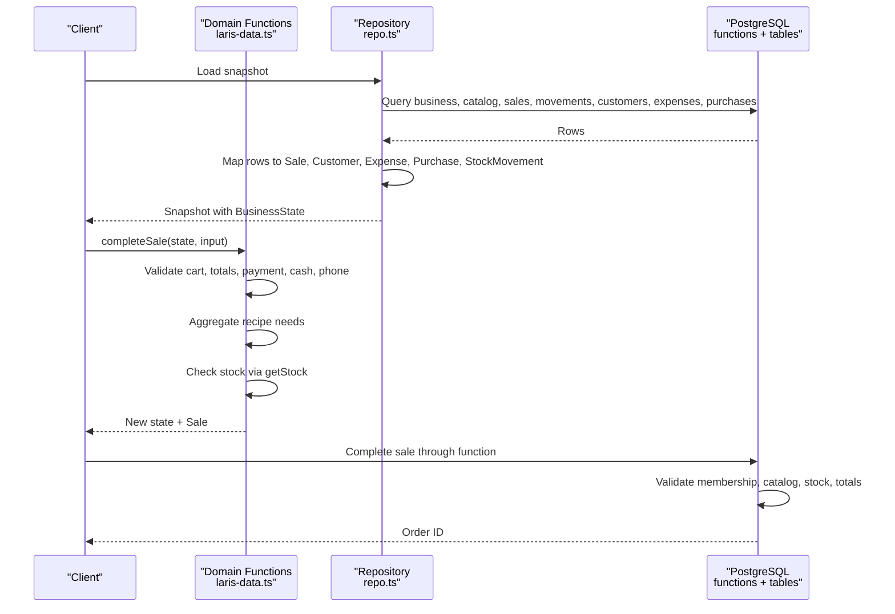

**Diagram sources**
- [laris-data.ts:155-334](file://src/lib/laris-data.ts#L155-L334)
- [repo.ts:82-193](file://src/lib/repo.ts#L82-L193)
- [0003_functions.sql:94-230](file://supabase/migrations/0003_functions.sql#L94-L230)

**Section sources**
- [laris-data.ts:155-334](file://src/lib/laris-data.ts#L155-L334)
- [repo.ts:82-193](file://src/lib/repo.ts#L82-L193)
- [0003_functions.sql:94-230](file://supabase/migrations/0003_functions.sql#L94-L230)

## Detailed Component Analysis

### Product and Inventory Relationships
A `Product` references multiple `InventoryItem`s through its `recipe`. Each recipe line specifies how many base units of an ingredient are consumed per unit of the product. The `cost` field on `Product` is derived from the current inventory costs multiplied by recipe quantities.

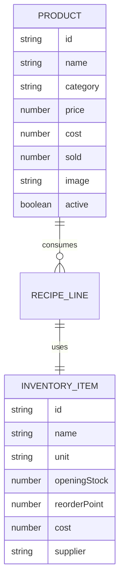

**Diagram sources**
- [laris-data.ts:3-23](file://src/lib/laris-data.ts#L3-L23)
- [0001_schema.sql:91-127](file://supabase/migrations/0001_schema.sql#L91-L127)

**Section sources**
- [laris-data.ts:3-23](file://src/lib/laris-data.ts#L3-L23)
- [0001_schema.sql:91-127](file://supabase/migrations/0001_schema.sql#L91-L127)

### Stock Movement Ledger
Stock is not stored as a single balance. Instead, `getStock` starts from an inventory item’s `openingStock` and applies every matching `StockMovement.quantity`. This makes stock auditable and reversible.

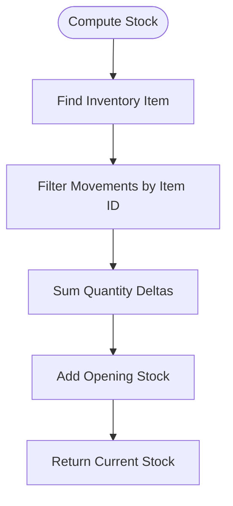

**Diagram sources**
- [laris-data.ts:172-176](file://src/lib/laris-data.ts#L172-L176)

**Section sources**
- [laris-data.ts:172-176](file://src/lib/laris-data.ts#L172-L176)

### Cart Validation and Totals
Cart validation ensures items exist, quantities are safe positive integers, notes are strings, discounts do not exceed subtotals, and totals remain finite and safe. Tax is applied only when enabled and is calculated after rounding the discount.

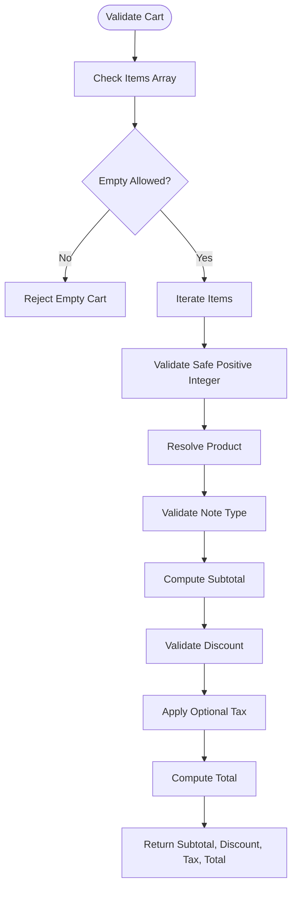

**Diagram sources**
- [laris-data.ts:155-194](file://src/lib/laris-data.ts#L155-L194)

**Section sources**
- [laris-data.ts:155-194](file://src/lib/laris-data.ts#L155-L194)

### Sale Completion Flow
`completeSale` is the central business operation. It validates the cart, totals, payment method, channel, cash received, and optional customer phone. It aggregates recipe consumption across all items, checks stock atomically, creates or updates the customer, writes sale and stock movement records, and returns a new immutable state.

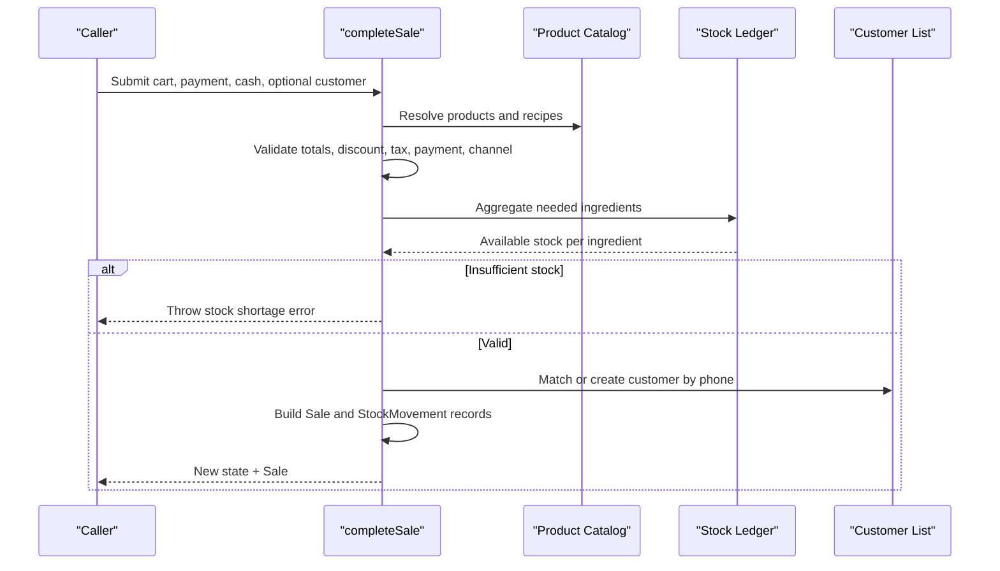

**Diagram sources**
- [laris-data.ts:215-305](file://src/lib/laris-data.ts#L215-L305)

**Section sources**
- [laris-data.ts:215-305](file://src/lib/laris-data.ts#L215-L305)

### Purchase Recording and Moving-Average Cost
`recordPurchase` validates the inventory item, quantity, and total. It increases stock, appends a purchase record and a positive stock movement, recalculates the moving-average unit cost, and recomputes every product’s recipe cost based on updated inventory costs.

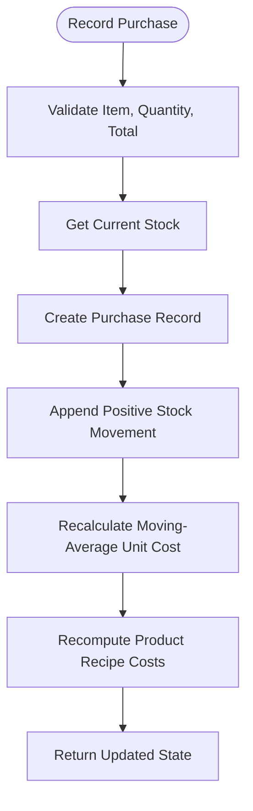

**Diagram sources**
- [laris-data.ts:307-334](file://src/lib/laris-data.ts#L307-L334)

**Section sources**
- [laris-data.ts:307-334](file://src/lib/laris-data.ts#L307-L334)

### Customer Segmentation
Customer segments are computed from visit count and recency relative to a reference date. The default segments are champion, loyal, potential, risky, and lost. When a customer is created or updated during a sale, visits, total spent, points, last visit, and segment are recalculated.

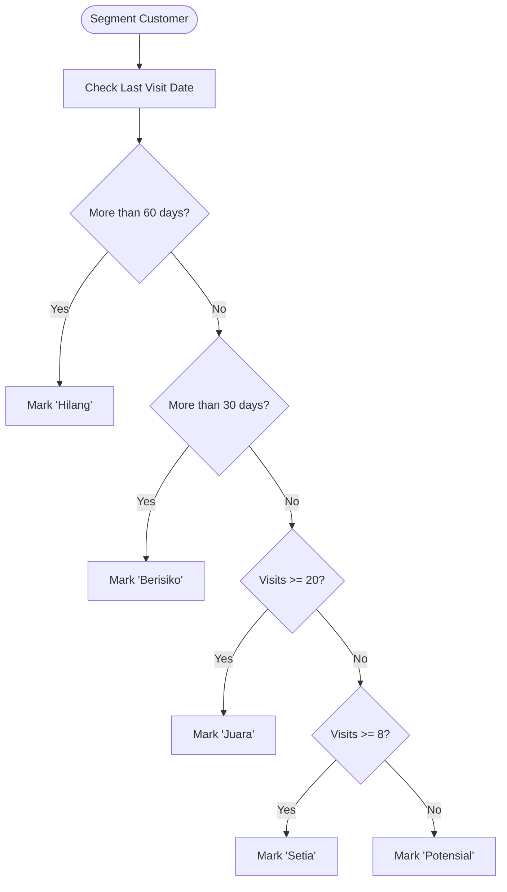

**Diagram sources**
- [laris-data.ts:208-213](file://src/lib/laris-data.ts#L208-L213)

**Section sources**
- [laris-data.ts:208-213](file://src/lib/laris-data.ts#L208-L213)

### Database Mapping and Snapshot Construction
The repository loads business metadata, outlet information, catalog, sales, stock movements, customers, expenses, purchases, and optionally team members and audit activities. It maps database rows to the TypeScript domain types and constructs a `BusinessState` with `version: 1`.

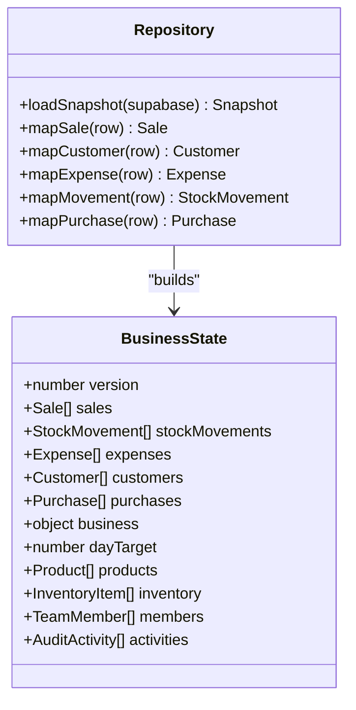

**Diagram sources**
- [repo.ts:27-62](file://src/lib/repo.ts#L27-L62)
- [repo.ts:129-193](file://src/lib/repo.ts#L129-L193)
- [laris-data.ts:97-110](file://src/lib/laris-data.ts#L97-L110)

**Section sources**
- [repo.ts:27-62](file://src/lib/repo.ts#L27-L62)
- [repo.ts:129-193](file://src/lib/repo.ts#L129-L193)

### Database Schema Alignment
The TypeScript models map closely to the PostgreSQL schema:

| TypeScript Model | Database Tables | Mapping Notes |
|---|---|---|
| `Product` | `product`, `product_variant`, `recipe_line` | Code, name, category, image, active flags, default variant price and cached HPP, recipe lines. |
| `InventoryItem` | `inventory_item`, `supplier` | Code, name, base unit, average cost, reorder point, supplier name. |
| `StockMovement` | `stock_movement` | Type mapped to sale/purchase/adjustment; signed quantity delta; reference ID. |
| `Sale` | `sales_order`, `order_item`, `payment` | Denormalized order items, payment method, totals, channel, customer name. |
| `Customer` | `customer` | Phone normalization, RFM segment, points, visits, total spent, last visit. |
| `Expense` | `expense` | Description, category, amount, timestamp. |
| `Purchase` | `purchase`, `purchase_line` | Aggregated purchase line with inventory item code and timestamp. |
| `TeamMember` | `membership`, `audit_log` | Derived from team RPC or fallback to current member. |
| `AuditActivity` | `audit_log` | Action, entity, actor name resolved from team. |
| `BusinessState` | `business`, `outlet`, plus child tables | Versioned snapshot built from loaded data. |

**Section sources**
- [0001_schema.sql:24-284](file://supabase/migrations/0001_schema.sql#L24-L284)
- [repo.ts:82-193](file://src/lib/repo.ts#L82-L193)

### Transactional Function Alignment
The database functions enforce the same business rules as the TypeScript domain:

- `complete_sale`: Validates membership, payment, channel, cart size, catalog resolution, discount bounds, optional tax, cash sufficiency, stock availability, idempotency key, customer phone, and inserts order, items, payment, stock movements, and audit log atomically.
- `record_purchase`: Validates source, line count, supplier existence, outlet, positive quantities and totals, locks inventory rows, updates moving-average cost, inserts purchase lines, stock movements, refreshes cached recipe costs, and logs audit activity.

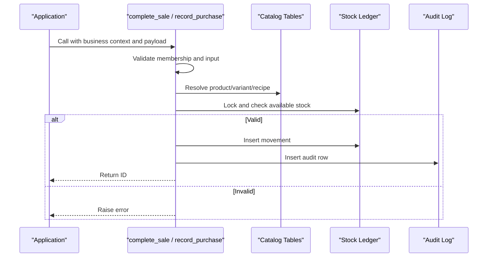

**Diagram sources**
- [0003_functions.sql:94-230](file://supabase/migrations/0003_functions.sql#L94-L230)
- [0003_functions.sql:236-303](file://supabase/migrations/0003_functions.sql#L236-L303)

**Section sources**
- [0003_functions.sql:94-230](file://supabase/migrations/0003_functions.sql#L94-L230)
- [0003_functions.sql:236-303](file://supabase/migrations/0003_functions.sql#L236-L303)

### BusinessState as Central State Container with Versioning
`BusinessState` is intentionally minimal and explicit:

- `version: 1` is a migration anchor. Future schema changes can increment this value and add migration handlers that transform older states before use.
- Required arrays hold the operational ledger: sales, stock movements, expenses, customers, and purchases.
- `business` and `dayTarget` describe tenant configuration and targets.
- Optional arrays allow the same state shape to carry catalog, team, and audit data when available.
- Operations never mutate the input state; they return a new object with appended arrays and updated derived values.

This design supports:

- Deterministic demo generation.
- Idempotent retries.
- JSON persistence round-trips.
- Clear separation between read-only historical data and new mutations.

**Section sources**
- [laris-data.ts:97-110](file://src/lib/laris-data.ts#L97-L110)
- [laris-data.ts:336-404](file://src/lib/laris-data.ts#L336-L404)
- [repo.ts:170-193](file://src/lib/repo.ts#L170-L193)

### Deterministic Seed Data and Demo Mode
The seed generator creates a 90-day history ending on a fixed demo date. It uses a seeded pseudo-random generator so repeated runs produce identical sales, customers, expenses, and timestamps. The demo business is named “Kopi Senja,” owned by “Raka,” located in Bandung, Dago, with a daily target of 3,500,000 rupiah.

Key properties:

- Fixed `DEMO_DATE` anchors timestamps.
- Customer names and phones are generated deterministically.
- Sales include realistic mix of products, occasional multi-item carts, discounts, QRIS/cash/transfer payments, and channels.
- Expenses include daily raw material costs, monthly rent and salaries, utilities, and weekly cleaning supplies.
- Customer segments are computed after generating the full history.
- Opening stock equals the demo’s remaining inventory; historical sales are not deducted because the seed represents a snapshot rather than a replay of past deductions.

The seed script then maps this state into the database:

- Creates business, outlet, and membership.
- Creates suppliers, inventory items, products, variants, and recipe lines.
- Inserts opening stock movements.
- Maps customers, sales, order items, payments, and expenses.

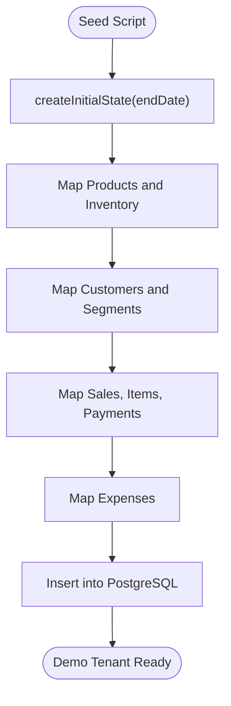

**Diagram sources**
- [laris-data.ts:336-404](file://src/lib/laris-data.ts#L336-L404)
- [seed.ts:30-108](file://scripts/seed.ts#L30-L108)

**Section sources**
- [laris-data.ts:1-133](file://src/lib/laris-data.ts#L1-L133)
- [laris-data.ts:336-404](file://src/lib/laris-data.ts#L336-L404)
- [seed.ts:1-152](file://scripts/seed.ts#L1-L152)

## Dependency Analysis
The domain model has clear directional dependencies:

- `laris-data.ts` defines interfaces and pure business logic.
- `laris-data.test.ts` asserts behavior, constraints, and determinism.
- `repo.ts` depends on `laris-data.ts` types but does not depend on test files.
- `seed.ts` imports the deterministic seed and catalog from `laris-data.ts`.
- Database migrations define the canonical schema and transactional enforcement.
- Repository mapping aligns database rows with TypeScript models.

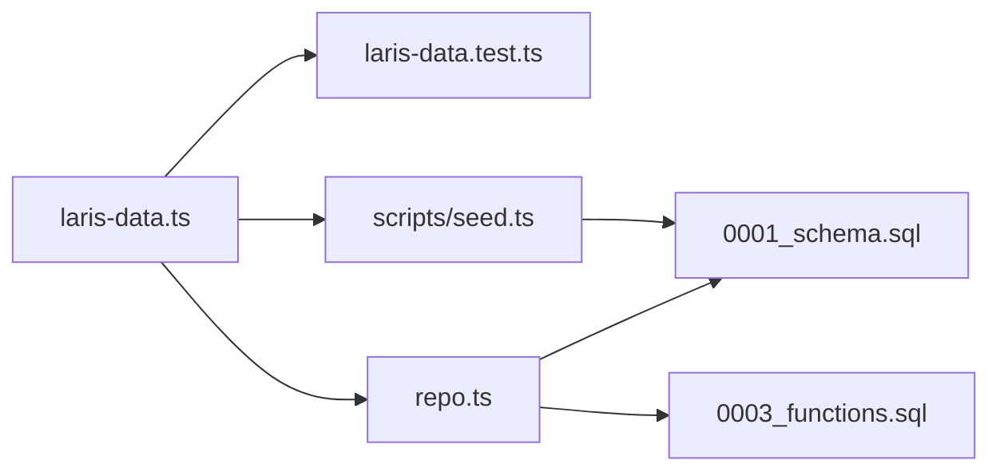

**Diagram sources**
- [laris-data.ts:1-494](file://src/lib/laris-data.ts#L1-L494)
- [laris-data.test.ts:1-519](file://src/lib/laris-data.test.ts#L1-L519)
- [repo.ts:1-202](file://src/lib/repo.ts#L1-L202)
- [seed.ts:1-152](file://scripts/seed.ts#L1-L152)
- [0001_schema.sql:1-294](file://supabase/migrations/0001_schema.sql#L1-L294)
- [0003_functions.sql:1-320](file://supabase/migrations/0003_functions.sql#L1-L320)

**Section sources**
- [laris-data.ts:1-494](file://src/lib/laris-data.ts#L1-L494)
- [repo.ts:1-202](file://src/lib/repo.ts#L1-L202)
- [seed.ts:1-152](file://scripts/seed.ts#L1-L152)

## Performance Considerations
- Stock calculation is linear in the number of stock movements for the queried item. For large ledgers, consider indexing by `itemId` and time range queries.
- `completeSale` aggregates recipe needs before writing any ledger entries, avoiding partial mutations.
- `recordPurchase` recomputes product costs across the entire product catalog; this is acceptable for small-to-medium menus but may need optimization if catalogs grow significantly.
- The repository paginates large result sets with a page size of 1,000 rows to avoid memory spikes.
- Monetary values are represented as numbers in TypeScript but stored as bigint rupiah in the database, reducing floating-point risks.

[No sources needed since this section provides general guidance]

## Troubleshooting Guide
Common validation errors and their meanings:

| Error Area | Symptom | Likely Cause | Resolution |
|---|---|---|---|
| Cart validation | “Jumlah menu harus berupa bilangan bulat positif yang aman.” | Quantity is not a safe positive integer. | Use positive integers within safe numeric range. |
| Unknown product | “Menu tidak dikenal.” | Product ID not found in catalog. | Verify product code and active status. |
| Unknown ingredient | “Bahan tidak dikenal.” | Inventory item code missing. | Ensure inventory item exists. |
| Discount validation | “Diskon tidak boleh melebihi subtotal.” | Discount greater than subtotal. | Reduce discount or increase subtotal. |
| Payment validation | “Metode pembayaran tidak valid.” | Payment method not in allowed set. | Use Tunai, QRIS, or Transfer. |
| Channel validation | “Kanal penjualan tidak valid.” | Channel not Kasir or Etalase. | Use supported channel. |
| Cash validation | “Uang tunai tidak cukup.” | Cash tendered less than total for cash payment. | Increase cash received. |
| Phone validation | “Nomor telepon harus terdiri dari 8–15 digit, boleh diawali +.” | Phone format invalid. | Use digits only, 8–15 characters, optional leading plus. |
| Stock shortage | “Stok ... tidak cukup.” | Aggregated recipe demand exceeds available stock. | Reduce order or restock. |
| Purchase validation | “Jumlah pembelian” or “Total pembelian” | Non-positive or unsafe quantity/total. | Provide positive, finite values. |
| Idempotency key | “Kunci transaksi tidak boleh kosong.” | Empty or whitespace-only idempotency key. | Provide a non-empty string. |

**Section sources**
- [laris-data.ts:155-194](file://src/lib/laris-data.ts#L155-L194)
- [laris-data.ts:215-305](file://src/lib/laris-data.ts#L215-L305)
- [laris-data.ts:307-334](file://src/lib/laris-data.ts#L307-L334)
- [laris-data.test.ts:256-350](file://src/lib/laris-data.test.ts#L256-L350)

## Conclusion
Laris’s domain model centers on a versioned `BusinessState` that encapsulates sales, stock movements, expenses, customers, purchases, and optional catalog and team data. The TypeScript interfaces provide strict typing and validation, while the PostgreSQL schema and transactional functions enforce the same rules at the database boundary. Deterministic seed data enables reliable demo mode, and immutable state operations make retries, persistence, and testing predictable.

For future work:

- Increment `BusinessState.version` when introducing breaking schema changes.
- Keep TypeScript validation aligned with database constraints.
- Extend `StockMovement.type` carefully and update both domain and database layers together.
- Monitor performance of stock aggregation and product cost recomputation as catalogs and ledgers grow.

[No sources needed since this section summarizes without analyzing specific files]