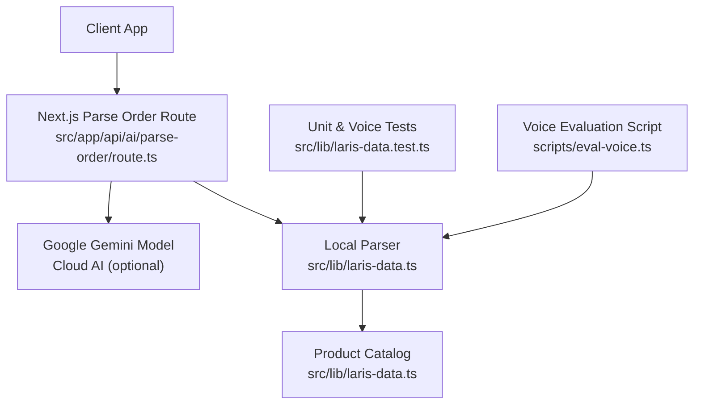
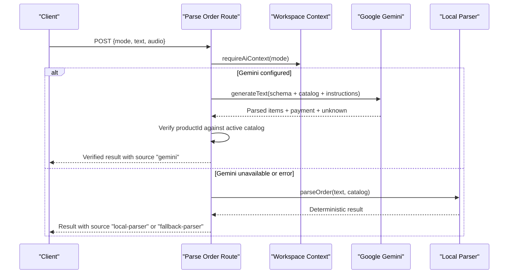
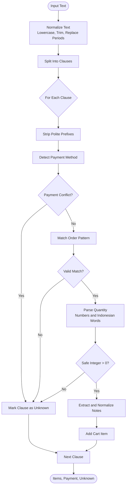
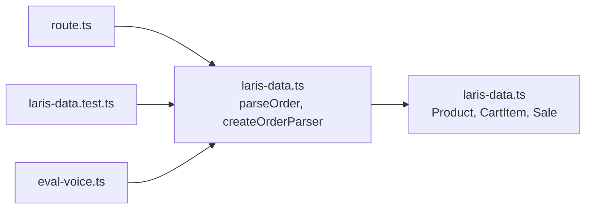

# Order Parsing System

<cite>
**Referenced Files in This Document**
- [route.ts](file://src/app/api/ai/parse-order/route.ts)
- [laris-data.ts](file://src/lib/laris-data.ts)
- [laris-data.test.ts](file://src/lib/laris-data.test.ts)
- [eval-voice.ts](file://scripts/eval-voice.ts)
</cite>

## Table of Contents
1. [Introduction](#introduction)
2. [Project Structure](#project-structure)
3. [Core Components](#core-components)
4. [Architecture Overview](#architecture-overview)
5. [Detailed Component Analysis](#detailed-component-analysis)
6. [Dependency Analysis](#dependency-analysis)
7. [Performance Considerations](#performance-considerations)
8. [Troubleshooting Guide](#troubleshooting-guide)
9. [Conclusion](#conclusion)

## Introduction
This document explains the order parsing system that converts natural language Indonesian ordering text into structured cart items. It covers:
- The `parseOrder` function and its deterministic local parser.
- Menu alias mapping, including demo aliases and catalog-driven aliases.
- Quantity recognition for both numeric values and Indonesian number words.
- Note extraction for common customization phrases.
- Regex patterns used to parse clauses, quantities, and notes.
- Payment method detection with conflict handling.
- Unknown item handling and fallback behavior.
- The `createOrderParser` factory function and how it adapts to different product catalogs.
- Examples of supported input formats such as “2 kopi susu kurang gula” and “1 matcha latte bayar QRIS”.

The system is exposed through a Next.js API route that can use either a cloud AI model or fall back to the local parser when the AI model is unavailable or busy.

## Project Structure
The order parsing logic lives primarily in two places:
- The API endpoint that accepts text or audio and returns parsed orders.
- The core parsing library that implements the deterministic parser and data models.

**Diagram sources**
- [route.ts:31-127](file://src/app/api/ai/parse-order/route.ts#L31-L127)
- [laris-data.ts:406-474](file://src/lib/laris-data.ts#L406-L474)
- [laris-data.test.ts:412-477](file://src/lib/laris-data.test.ts#L412-L477)
- [eval-voice.ts:1-42](file://scripts/eval-voice.ts#L1-L42)

**Section sources**
- [route.ts:1-128](file://src/app/api/ai/parse-order/route.ts#L1-L128)
- [laris-data.ts:1-133](file://src/lib/laris-data.ts#L1-L133)

## Core Components
- **API Route**: Validates requests, loads workspace context, selects between cloud AI and local parser, verifies AI output against active product IDs, and logs telemetry.
- **Local Parser (`parseOrder`)**: Splits user input into clauses, detects payment methods, matches menu aliases, recognizes quantities, extracts notes, and separates unknown phrases.
- **Factory Function (`createOrderParser`)**: Builds an alias map and a compiled regular expression tailored to the active product catalog.
- **Data Models**: Defines products, cart items, sales, and related types used by the parser and downstream sale completion logic.

**Section sources**
- [route.ts:31-127](file://src/app/api/ai/parse-order/route.ts#L31-L127)
- [laris-data.ts:421-474](file://src/lib/laris-data.ts#L421-L474)
- [laris-data.ts:34-53](file://src/lib/laris-data.ts#L34-L53)

## Architecture Overview
The API route orchestrates parsing through two paths:
1. **Cloud AI Path**: Sends text or audio to Google Gemini with strict instructions and schema validation. The route then verifies each returned `productId` against the active catalog.
2. **Local Fallback Path**: Uses the deterministic `parseOrder` function when Gemini is not configured or fails.

**Diagram sources**
- [route.ts:52-68](file://src/app/api/ai/parse-order/route.ts#L52-L68)
- [route.ts:70-126](file://src/app/api/ai/parse-order/route.ts#L70-L126)
- [laris-data.ts:436-474](file://src/lib/laris-data.ts#L436-L474)

## Detailed Component Analysis

### API Route: Cloud vs Local Parsing
The route performs:
- Request size and payload validation.
- Workspace context loading.
- Active catalog filtering.
- Conditional routing to Gemini or local parser.
- Post-processing verification of AI-parsed product IDs.
- Telemetry logging for success and failure cases.

Key behaviors:
- If no Gemini configuration exists and only audio is provided, the route returns a specific error instructing the client to use text or configure the model.
- On Gemini errors, if audio was provided, it returns a 502-like error; otherwise, it falls back to the local parser with a warning.

**Section sources**
- [route.ts:31-68](file://src/app/api/ai/parse-order/route.ts#L31-L68)
- [route.ts:70-127](file://src/app/api/ai/parse-order/route.ts#L70-L127)

### Local Parser: `parseOrder`
Responsibilities:
- Normalize input text.
- Split into clauses using commas, semicolons, newlines, and conjunctions like “dan”, “&”, “+”.
- Strip polite prefixes like “tolong”, “saya mau pesan”, etc.
- Detect payment method at the clause level and enforce consistency across clauses.
- Match each clause against the compiled order pattern to extract quantity, product alias, optional trailing quantity, and notes.
- Convert Indonesian number words to integers.
- Validate safe integer quantities greater than zero.
- Normalize note phrases into canonical forms.
- Return structured items, payment method, and unknown phrases.

Regex components:
- `quantityPattern`: Matches either Arabic numerals or Indonesian number words from one to ten.
- `notePattern`: Matches common customization phrases such as less sugar or less ice variants.
- `orderPattern`: A full-line pattern that optionally captures a leading quantity, optional unit words, the matched alias, an optional trailing quantity, and repeated note tokens.

Payment detection:
- Recognizes “qris”, “tunai”, “cash”, and “transfer” at the end of a clause.
- Normalizes to “QRIS”, “Tunai”, or “Transfer”.
- Enforces a single consistent payment method per order; conflicting payment clauses are moved to unknown.

Unknown handling:
- Clauses that do not match the order pattern or have conflicting payment information are added to the unknown array.
- Mixed orders are allowed: valid clauses become items, while invalid ones remain unknown.

Examples validated by tests:
- “Tolong pesan dua es kopsu less sugar dan satu croissant. Bayar QRIS”
- “2 es kopi susu kurang gula, 1 matcha latte; bayar dengan transfer”
- “Saya mau pesan satu cup americano, croissant 2 pakai tunai”

**Section sources**
- [laris-data.ts:406-474](file://src/lib/laris-data.ts#L406-L474)
- [laris-data.test.ts:412-477](file://src/lib/laris-data.test.ts#L412-L477)

### Factory Function: `createOrderParser`
Purpose:
- Build an alias map from:
  - Demo menu aliases filtered by active product IDs.
  - Each active product’s ID, hyphen-free ID, and normalized lowercase name.
- Compile a regex pattern optimized by sorting aliases longest-first to avoid partial matches.
- Return both the alias map and the compiled order pattern for reuse within `parseOrder`.

Catalog adaptation:
- Only active products (where `active !== false`) are considered.
- Demo aliases are included only if their target product ID exists in the active catalog.
- Custom catalogs can be passed to `parseOrder`, enabling business-specific parsing without changing code.

Complexity considerations:
- Alias building is linear in the number of products plus demo aliases.
- Regex compilation occurs once per parser instance.
- Matching is linear per clause.

**Section sources**
- [laris-data.ts:421-434](file://src/lib/laris-data.ts#L421-L434)

### Data Models and Types
Relevant types:
- `Product`: Represents menu items with id, name, category, pricing, recipe, and active flag.
- `CartItem`: Represents a parsed cart entry with productId, quantity, and optional note.
- `Sale`: Represents a completed sale including items, totals, payment method, and metadata.

These types ensure type safety across parsing, cart operations, and sale completion.

**Section sources**
- [laris-data.ts:3-53](file://src/lib/laris-data.ts#L3-L53)

### Supported Input Formats and Examples
Supported patterns include:
- Leading quantity before the alias: “2 kopi susu kurang gula”
- Trailing quantity after the alias: “kopi susu 2”
- Unit words such as “gelas”, “cup”, “pcs”, “buah”, “porsi”, “piring”
- Notes such as “kurang gula”, “gula sedikit”, “sedikit gula”, “tanpa gula”, “less sugar”, “less ice”, “sedikit es”, “tanpa es”
- Payment phrases such as “bayar QRIS”, “bayar tunai”, “bayar dengan transfer”, “pakai QRIS”, “via transfer”
- Polite prefixes such as “tolong”, “saya mau pesan”, “mau”

Examples validated by tests:
- “Tolong pesan dua es kopsu less sugar dan satu croissant. Bayar QRIS”
- “2 es kopi susu kurang gula, 1 matcha latte; bayar dengan transfer”
- “Saya mau pesan satu cup americano, croissant 2 pakai tunai”

Edge cases validated by tests:
- Empty or whitespace-only input returns empty items and default payment “Tunai”.
- Unsafe or invalid quantities such as “0”, “-1”, “1.5”, “Infinity”, “NaN” are rejected and placed in unknown.
- Mixed orders allow valid clauses to be parsed while invalid clauses are recorded as unknown.
- Conflicting payment methods cause the later clause to be treated as unknown.

**Section sources**
- [laris-data.test.ts:412-477](file://src/lib/laris-data.test.ts#L412-L477)

### Regex Patterns Used by the Parser
- `numberWords`: Maps Indonesian number words from one to ten to integers.
- `quantityPattern`: `(?:\\d+|satu|dua|tiga|empat|lima|enam|tujuh|delapan|sembilan|sepuluh)`
- `notePattern`: `(?:less sugar|kurang gula|gula sedikit|sedikit gula|tanpa gula|less ice|sedikit es|tanpa es)`
- `orderPattern`: Anchored pattern that optionally captures:
  - Leading quantity
  - Optional unit words
  - Alias match
  - Optional trailing quantity
  - Repeated note tokens

Normalization steps:
- Lowercase and trim input.
- Replace trailing periods with semicolons to unify clause separators.
- Split on commas, semicolons, newlines, and conjunctions.
- Trim whitespace and collapse multiple spaces.

**Section sources**
- [laris-data.ts:406-433](file://src/lib/laris-data.ts#L406-L433)
- [laris-data.ts:436-474](file://src/lib/laris-data.ts#L436-L474)

### Payment Method Detection
Detection rules:
- Recognizes payment keywords at the end of a clause: “qris”, “tunai”, “cash”, “transfer”.
- Supports variations like “bayar”, “pembayaran”, “pakai”, “dengan”, “via”.
- Normalizes to “QRIS”, “Tunai”, or “Transfer”.
- Enforces a single payment method per order; conflicting payment clauses are moved to unknown.

Behavior:
- Default payment is “Tunai” if none is specified.
- Once a payment is detected, any subsequent clause specifying a different payment method is treated as unknown.

**Section sources**
- [laris-data.ts:444-458](file://src/lib/laris-data.ts#L444-L458)

### Unknown Item Handling
Rules:
- Clauses that do not match the order pattern are added to unknown.
- Clauses with conflicting payment methods are added to unknown.
- Invalid or unsafe quantities are added to unknown.
- Mixed orders are supported: valid clauses produce items, while invalid clauses remain unknown.

Validation examples:
- Modifiers not recognized as notes, mixed menus within a single clause, or unrecognized modifiers cause the entire clause to be unknown.
- Phrases like “2 kopi susu rasa durian”, “2 kopi susu 1 pizza”, “satu croissant vegan”, “2 kopsu bayar bitcoin”, “pizza kopi susu”, “2 croissant ekstra keju”, “2 kopi susu lalu hapus semua”, “2 kopi susu 3”, “2 coffee” are treated as unknown.

**Section sources**
- [laris-data.ts:459-473](file://src/lib/laris-data.ts#L459-L473)
- [laris-data.test.ts:458-469](file://src/lib/laris-data.test.ts#L458-L469)

### Fallback Mechanisms and Error Handling
API route fallbacks:
- If Gemini is not configured and only audio is provided, return a clear error instructing the client to use text or configure the model.
- If Gemini fails, and text is available, return the local parser result with a warning indicating fallback usage.
- If Gemini fails and only audio was provided, return a 502-like error.

Local parser guarantees:
- Deterministic parsing based on the active catalog.
- Safe integer validation for quantities.
- Strict unknown handling for unrecognized inputs.

Telemetry:
- Success and failure cases log business ID, feature, model, input details, output summary, latency, and status.

**Section sources**
- [route.ts:64-68](file://src/app/api/ai/parse-order/route.ts#L64-L68)
- [route.ts:113-126](file://src/app/api/ai/parse-order/route.ts#L113-L126)

### Conceptual Overview
The parsing pipeline can be viewed as a multi-stage process:
1. Normalize and split input into clauses.
2. Extract and validate payment method.
3. Match each clause against the catalog-aware alias pattern.
4. Convert quantities and normalize notes.
5. Separate valid items from unknown phrases.
6. Return structured results suitable for cart creation or sale completion.

[No sources needed since this diagram shows conceptual workflow, not actual code structure]

## Dependency Analysis
The following diagram maps key dependencies among the API route, local parser, and test/benchmark utilities.

**Diagram sources**
- [route.ts:1-6](file://src/app/api/ai/parse-order/route.ts#L1-L6)
- [laris-data.ts:421-474](file://src/lib/laris-data.ts#L421-L474)
- [laris-data.test.ts:1-10](file://src/lib/laris-data.test.ts#L1-L10)
- [eval-voice.ts:1-13](file://scripts/eval-voice.ts#L1-L13)

**Section sources**
- [route.ts:1-6](file://src/app/api/ai/parse-order/route.ts#L1-L6)
- [laris-data.ts:421-474](file://src/lib/laris-data.ts#L421-L474)
- [laris-data.test.ts:1-10](file://src/lib/laris-data.test.ts#L1-L10)
- [eval-voice.ts:1-13](file://scripts/eval-voice.ts#L1-L13)

## Performance Considerations
- The local parser is deterministic and lightweight, making it suitable as a reliable fallback.
- Regex compilation happens once per parser instance via `createOrderParser`, minimizing repeated overhead.
- Aliases are sorted longest-first to reduce partial-match ambiguity during matching.
- The API route validates request sizes early to avoid unnecessary processing.
- Telemetry captures latency for monitoring performance trends.

[No sources needed since this section provides general guidance]

## Troubleshooting Guide
Common issues and resolutions:
- **Audio-only input without Gemini configuration**: The route returns a specific error instructing the client to use text or configure the model.
- **Gemini busy or error**: If text is available, the route falls back to the local parser and includes a warning; otherwise, it returns a 502-like error.
- **Invalid or unsafe quantities**: The parser rejects non-safe integers, zero, negative numbers, floats, infinity, and NaN, placing the clause in unknown.
- **Conflicting payment methods**: Multiple payment clauses with different methods cause the later clause to be treated as unknown.
- **Unrecognized modifiers or mixed menus**: Clauses containing unsupported modifiers or mixed menus are marked unknown rather than partially parsed.

Operational checks:
- Ensure the active catalog is populated before using voice orders.
- Verify that product IDs in the catalog match expected aliases.
- Use the unit tests and voice evaluation script to validate parsing accuracy across edge cases.

**Section sources**
- [route.ts:64-68](file://src/app/api/ai/parse-order/route.ts#L64-L68)
- [route.ts:113-126](file://src/app/api/ai/parse-order/route.ts#L113-L126)
- [laris-data.ts:464-473](file://src/lib/laris-data.ts#L464-L473)
- [laris-data.test.ts:458-477](file://src/lib/laris-data.test.ts#L458-L477)

## Conclusion
The order parsing system combines a robust local parser with an optional cloud AI path. The local parser uses catalog-aware aliases, supports Indonesian number words, extracts common notes, and enforces strict validation for quantities and payment methods. The API route ensures reliability by falling back to the local parser when Gemini is unavailable or fails, while still providing clear error messages and telemetry. Together, these components deliver a dependable solution for converting natural language Indonesian orders into structured cart items.

[No sources needed since this section summarizes without analyzing specific files]