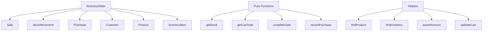
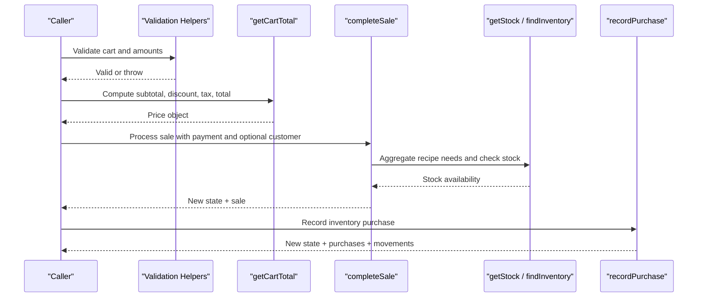
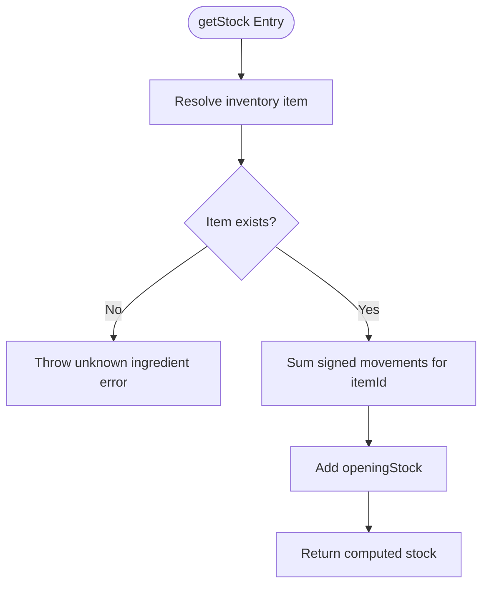
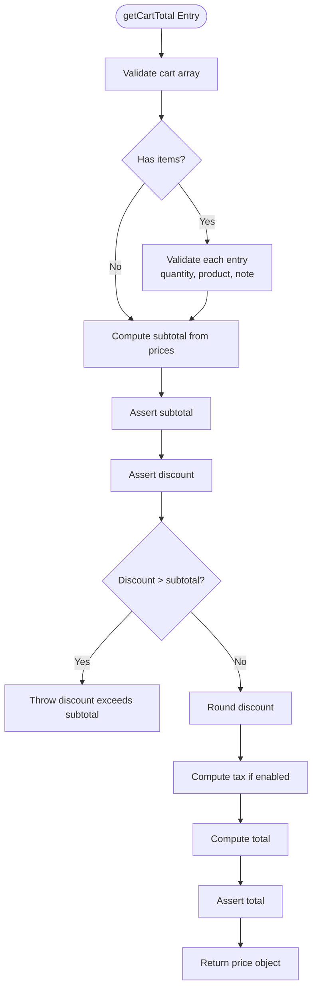
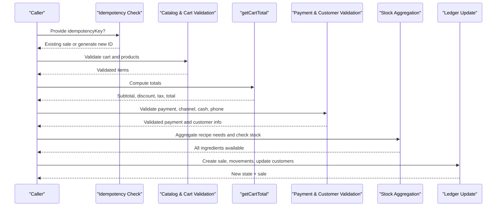
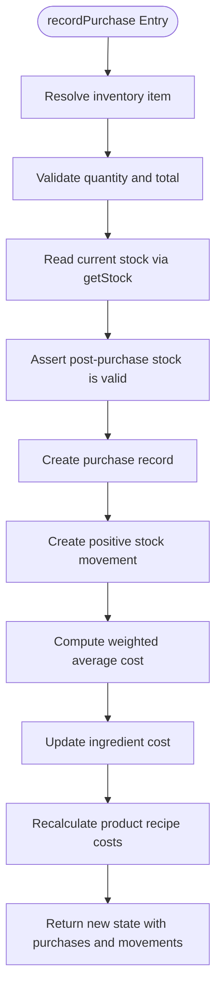
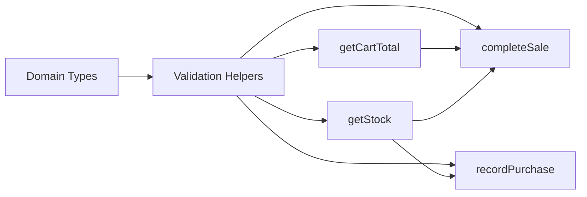

# Pure Functions

<cite>
**Referenced Files in This Document**
- [laris-data.ts](file://src/lib/laris-data.ts)
- [laris-data.test.ts](file://src/lib/laris-data.test.ts)
</cite>

## Table of Contents
1. [Introduction](#introduction)
2. [Project Structure](#project-structure)
3. [Core Components](#core-components)
4. [Architecture Overview](#architecture-overview)
5. [Detailed Component Analysis](#detailed-component-analysis)
6. [Dependency Analysis](#dependency-analysis)
7. [Performance Considerations](#performance-considerations)
8. [Troubleshooting Guide](#troubleshooting-guide)
9. [Conclusion](#conclusion)

## Introduction
This document explains the deterministic pure functions that implement core business logic for a small restaurant point-of-sale system. The focus is on inventory calculations, price computations, transaction processing, and purchase recording. These functions are intentionally side-effect free: they receive immutable state, validate inputs, compute new state, and return it without mutating the original data. This design makes them safe to test, retry, persist, replay, and reason about.

The primary implementation lives in `src/lib/laris-data.ts`, while `src/lib/laris-data.test.ts` documents expected behavior through tests.

## Project Structure
The relevant code is concentrated in one library module:

- `src/lib/laris-data.ts`: Defines domain types, catalog data, validation helpers, and the pure business functions.
- `src/lib/laris-data.test.ts`: Validates function signatures, error handling, idempotency, stock reconciliation, cost updates, and persistence safety.

**Diagram sources**
- [laris-data.ts:3-110](file://src/lib/laris-data.ts#L3-L110)
- [laris-data.ts:143-176](file://src/lib/laris-data.ts#L143-L176)
- [laris-data.ts:178-334](file://src/lib/laris-data.ts#L178-L334)

**Section sources**
- [laris-data.ts:1-110](file://src/lib/laris-data.ts#L1-L110)
- [laris-data.test.ts:1-19](file://src/lib/laris-data.test.ts#L1-L19)

## Core Components
The four core pure functions are:

| Function | Purpose | Input | Output | Determinism |
|---|---|---|---|---|
| `getStock` | Computes current inventory quantity from opening stock and signed movements | Business state, item identifier | Number | Yes; depends only on state and itemId |
| `getCartTotal` | Computes subtotal, discount, tax, and total for cart items | Cart items, discount flag, optional catalog | Price object | Yes; no state mutation |
| `completeSale` | Processes a sale, validates payment and stock, records customer and stock movements | Business state, sale input | New state plus sale record | Yes; returns new state |
| `recordPurchase` | Records an inventory purchase, updates moving-average cost, and recalculates product costs | Business state, purchase input | New state with purchases and movements | Yes; returns new state |

These functions share helper utilities:

| Helper | Responsibility | Validation Strategy |
|---|---|---|
| `findProduct` | Resolves a menu item by ID | Throws when unknown |
| `findInventory` | Resolves an ingredient by ID | Throws when unknown |
| `assertAmount` | Validates numeric amounts | Throws on invalid, negative, zero-positive, or unsafe values |
| `validateCart` | Validates cart structure and quantities | Throws on empty, malformed, or unsafe cart entries |

**Section sources**
- [laris-data.ts:143-176](file://src/lib/laris-data.ts#L143-L176)
- [laris-data.ts:178-334](file://src/lib/laris-data.ts#L178-L334)
- [laris-data.test.ts:146-168](file://src/lib/laris-data.test.ts#L146-L168)

## Architecture Overview
The pure functions form a layered pipeline:

1. **Catalog resolution**: `findProduct` and `findInventory` ensure menu and ingredient IDs are valid.
2. **Input validation**: `assertAmount` and `validateCart` reject malformed or unsafe inputs early.
3. **Price computation**: `getCartTotal` computes financial totals deterministically.
4. **Transaction processing**: `completeSale` validates payment, aggregates recipe usage, checks stock, creates a sale, updates customers, and appends stock movements.
5. **Inventory replenishment**: `recordPurchase` adds stock, records a purchase, updates ingredient cost using a weighted average, and recalculates product costs.

**Diagram sources**
- [laris-data.ts:143-176](file://src/lib/laris-data.ts#L143-L176)
- [laris-data.ts:178-334](file://src/lib/laris-data.ts#L178-L334)

## Detailed Component Analysis

### getStock
`getStock` calculates the current stock for an inventory item by starting from its opening stock and applying all signed stock movements.

- **Signature**: `getStock(state: BusinessState, itemId: string): number`
- **Parameters**:
  - `state`: Immutable business state containing `stockMovements` and optionally `inventory`.
  - `itemId`: Identifier of the inventory item.
- **Return value**: Current stock quantity as a number.
- **Error handling**:
  - Throws if the item is not found in the provided inventory or default inventory.
- **Determinism**:
  - Depends only on `state.stockMovements` and the item’s `openingStock`.
  - Ignores movements for other items.
  - Supports positive and negative adjustments, including sales, purchases, and manual adjustments.

**Diagram sources**
- [laris-data.ts:149-176](file://src/lib/laris-data.ts#L149-L176)

**Section sources**
- [laris-data.ts:172-176](file://src/lib/laris-data.ts#L172-L176)
- [laris-data.test.ts:133-138](file://src/lib/laris-data.test.ts#L133-L138)
- [laris-data.test.ts:352-361](file://src/lib/laris-data.test.ts#L352-L361)

### getCartTotal
`getCartTotal` computes the financial totals for a cart. It supports optional discounts and a demo restaurant tax applied after discount.

- **Signature**: `getCartTotal(items: CartItem[], discount?: number, taxEnabled?: boolean, catalog?: Product[]): { subtotal, discount, tax, total }`
- **Parameters**:
  - `items`: Array of cart items with product identifiers and quantities.
  - `discount`: Optional discount amount; rounded to whole rupiah.
  - `taxEnabled`: Whether to apply a 10% demo tax after discount.
  - `catalog`: Optional custom product catalog; defaults to built-in products.
- **Return value**: An object containing `subtotal`, `discount`, `tax`, and `total`.
- **Error handling**:
  - Rejects non-array or malformed carts.
  - Rejects unknown menu items.
  - Rejects unsafe or non-positive quantities.
  - Rejects discounts greater than subtotal.
  - Rejects overflowed or invalid totals.
- **Determinism**:
  - No state mutation.
  - Uses only provided catalog and cart data.
  - Rounds discount and tax consistently.

**Diagram sources**
- [laris-data.ts:155-194](file://src/lib/laris-data.ts#L155-L194)

**Section sources**
- [laris-data.ts:155-194](file://src/lib/laris-data.ts#L155-L194)
- [laris-data.test.ts:146-168](file://src/lib/laris-data.test.ts#L146-L168)
- [laris-data.test.ts:266-280](file://src/lib/laris-data.test.ts#L266-L280)

### completeSale
`completeSale` processes a full sale transaction. It validates the cart, payment method, channel, cash received, optional customer information, and aggregated ingredient stock before producing a new immutable state.

- **Signature**: `completeSale(state: BusinessState, input: {...}): { state: BusinessState; sale: Sale }`
- **Parameters**:
  - `state`: Immutable business state.
  - `input.items`: Cart items.
  - `input.payment`: Payment method (`Tunai`, `QRIS`, `Transfer`).
  - `input.cashReceived`: Cash received for cash payments; rounded to whole rupiah.
  - `input.customerName`: Optional customer name.
  - `input.customerPhone`: Optional phone number validated with a strict pattern.
  - `input.discount`: Optional discount passed to `getCartTotal`.
  - `input.taxEnabled`: Optional tax flag passed to `getCartTotal`.
  - `input.channel`: Optional sales channel (`Kasir`, `Etalase`).
  - `input.idempotencyKey`: Optional key for retry-safe transactions.
- **Return value**:
  - `sale`: A new sale record with validated and computed fields.
  - `state`: A new business state with appended sale, stock movements, and updated customers.
- **Error handling**:
  - Rejects empty carts.
  - Rejects unknown menu items.
  - Rejects unsafe or non-positive quantities.
  - Rejects invalid payment methods or channels.
  - Rejects invalid cash amounts.
  - Rejects insufficient cash for cash payments.
  - Rejects invalid phone numbers.
  - Rejects insufficient aggregated stock across all ingredients.
  - Rejects empty or whitespace-only idempotency keys.
- **Idempotency**:
  - If an idempotency key is provided, the function derives a stable sale ID and returns the existing sale and state if already present.
- **Determinism**:
  - Does not mutate input state.
  - Aggregates recipe requirements before validating stock.
  - Creates one movement per ingredient with a negative quantity.
  - Updates customers immutably based on phone matching.

**Diagram sources**
- [laris-data.ts:215-305](file://src/lib/laris-data.ts#L215-L305)

**Section sources**
- [laris-data.ts:215-305](file://src/lib/laris-data.ts#L215-L305)
- [laris-data.test.ts:170-246](file://src/lib/laris-data.test.ts#L170-L246)
- [laris-data.test.ts:248-305](file://src/lib/laris-data.test.ts#L248-L305)

### recordPurchase
`recordPurchase` records an inventory purchase, updates the ingredient’s moving-average cost, recalculates product costs, and appends both a purchase record and a positive stock movement.

- **Signature**: `recordPurchase(state: BusinessState, input: { itemId: string; quantity: number; total: number }): BusinessState`
- **Parameters**:
  - `state`: Immutable business state.
  - `input.itemId`: Inventory item identifier.
  - `input.quantity`: Quantity purchased; must be positive.
  - `input.total`: Purchase total; rounded to whole rupiah.
- **Return value**: A new business state with updated inventory, products, purchases, and stock movements.
- **Error handling**:
  - Rejects unknown inventory items.
  - Rejects non-positive or unsafe purchase quantities.
  - Rejects invalid or unsafe purchase totals.
  - Rejects resulting stock that would be invalid.
- **Cost calculation**:
  - Computes a weighted average cost using existing stock and the new purchase total.
  - Recalculates each product’s cost based on updated ingredient costs.
- **Determinism**:
  - Returns a new state without mutating the original.
  - Appends immutable purchase and movement records.
  - Preserves decimal precision for stock quantities while rounding monetary totals.

**Diagram sources**
- [laris-data.ts:307-334](file://src/lib/laris-data.ts#L307-L334)

**Section sources**
- [laris-data.ts:307-334](file://src/lib/laris-data.ts#L307-L334)
- [laris-data.test.ts:307-350](file://src/lib/laris-data.test.ts#L307-L350)

### Validation Patterns and Helpers

#### assertAmount
Validates numeric amounts used throughout the system.

- **Behavior**:
  - Rejects non-finite numbers.
  - Rejects negative numbers.
  - Optionally rejects zero when positivity is required.
  - Rejects numbers exceeding safe integer bounds.
- **Usage**:
  - Used for subtotals, discounts, totals, cash received, purchase quantities, and purchase totals.

**Section sources**
- [laris-data.ts:155-159](file://src/lib/laris-data.ts#L155-L159)
- [laris-data.test.ts:256-280](file://src/lib/laris-data.test.ts#L256-L280)
- [laris-data.test.ts:342-350](file://src/lib/laris-data.test.ts#L342-L350)

#### validateCart
Validates cart structure and entries.

- **Behavior**:
  - Requires an array.
  - Requires at least one item when the cart is intended to be processed.
  - Requires safe positive integer quantities.
  - Validates product existence through `findProduct`.
  - Allows optional notes but requires them to be strings.
- **Usage**:
  - Called by `getCartTotal` and `completeSale`.

**Section sources**
- [laris-data.ts:161-170](file://src/lib/laris-data.ts#L161-L170)
- [laris-data.test.ts:256-271](file://src/lib/laris-data.test.ts#L256-L271)

#### findProduct / findInventory
Lookup helpers that enforce catalog integrity.

- **Behavior**:
  - Search by identifier.
  - Throw descriptive errors when not found.
- **Usage**:
  - `findProduct` validates menu items in cart pricing and recipe aggregation.
  - `findInventory` validates ingredients in stock lookup and purchase recording.

**Section sources**
- [laris-data.ts:143-153](file://src/lib/laris-data.ts#L143-L153)
- [laris-data.test.ts:166-167](file://src/lib/laris-data.test.ts#L166-L167)

## Dependency Analysis
The pure functions depend on shared helpers and domain types. There are no external runtime dependencies inside these functions, which reinforces their determinism.

**Diagram sources**
- [laris-data.ts:3-110](file://src/lib/laris-data.ts#L3-L110)
- [laris-data.ts:143-334](file://src/lib/laris-data.ts#L143-L334)

**Section sources**
- [laris-data.ts:3-110](file://src/lib/laris-data.ts#L3-L110)
- [laris-data.ts:143-334](file://src/lib/laris-data.ts#L143-L334)

## Performance Considerations
- `getStock` scans all stock movements for the target item. For large histories, consider indexing movements by `itemId` if performance becomes critical.
- `completeSale` aggregates recipe requirements into a map before validating stock, avoiding repeated lookups and ensuring atomic stock checks.
- `recordPurchase` recomputes product costs by scanning recipes; this is acceptable for small catalogs but should be reviewed if the product list grows significantly.
- All functions return new objects rather than mutating state, which favors correctness and testability at the cost of additional allocations.

[No sources needed since this section provides general guidance]

## Troubleshooting Guide
Common issues and their likely causes:

| Symptom | Likely Cause | Resolution |
|---|---|---|
| Unknown ingredient error | Invalid `itemId` passed to `getStock` or `recordPurchase` | Verify the item exists in `state.inventory` or default inventory |
| Unknown menu error | Invalid `productId` in cart or custom catalog mismatch | Ensure the product exists in the catalog used by `getCartTotal` or `completeSale` |
| Empty cart error | Passing an empty cart to `completeSale` | Add at least one valid cart item before completing the sale |
| Discount exceeds subtotal | Discount larger than computed subtotal | Reduce discount or adjust cart prices |
| Insufficient cash error | Cash payment with `cashReceived` less than total | Increase cash received or use QRIS/Transfer |
| Insufficient stock error | Aggregated recipe needs exceed available stock | Replenish inventory with `recordPurchase` or reduce order size |
| Invalid phone error | Phone number does not match allowed format | Use 8–15 digits with an optional leading plus sign |
| Duplicate sale returned | Same idempotency key used twice | Use a unique idempotency key per distinct transaction |
| Purchase rejected | Non-positive quantity or invalid total | Ensure positive, finite, and safe numeric values |

**Section sources**
- [laris-data.ts:143-194](file://src/lib/laris-data.ts#L143-L194)
- [laris-data.ts:215-334](file://src/lib/laris-data.ts#L215-L334)
- [laris-data.test.ts:219-350](file://src/lib/laris-data.test.ts#L219-L350)

## Conclusion
The pure functions `getStock`, `getCartTotal`, `completeSale`, and `recordPurchase` provide deterministic, side-effect-free business logic for inventory, pricing, transactions, and purchases. They rely on consistent validation patterns through `assertAmount`, `validateCart`, `findProduct`, and `findInventory`. Their immutability, explicit error handling, and idempotency support make them reliable building blocks for maintaining data consistency across retries, persistence layers, and audits.

[No sources needed since this section summarizes without analyzing specific files]