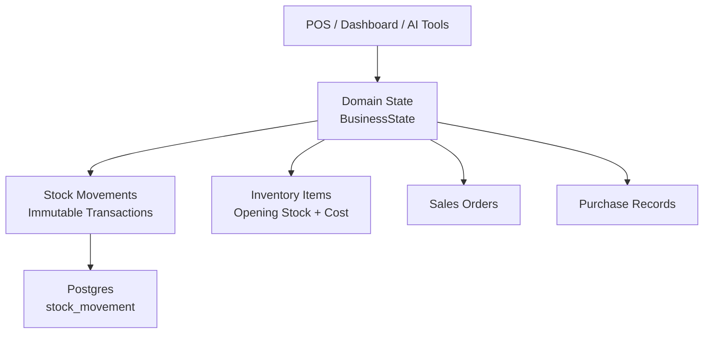
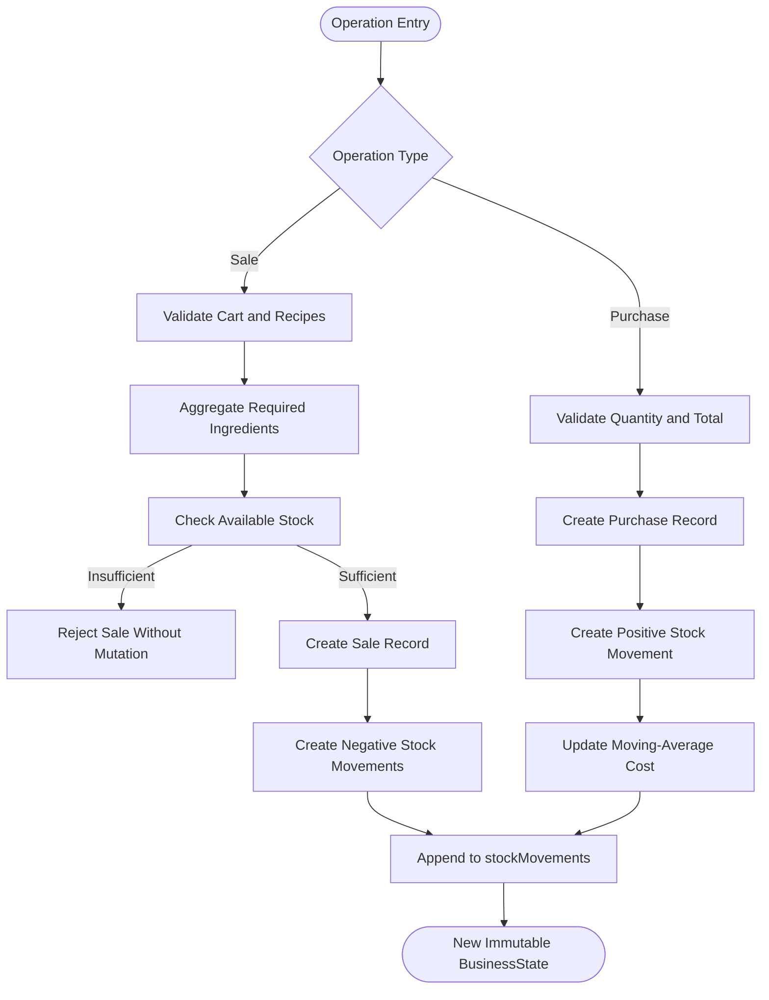
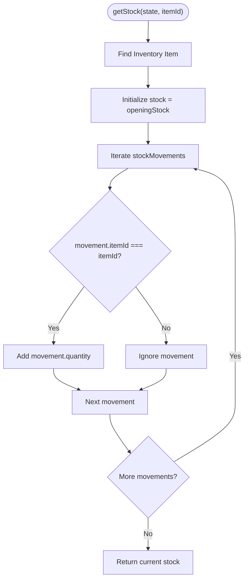
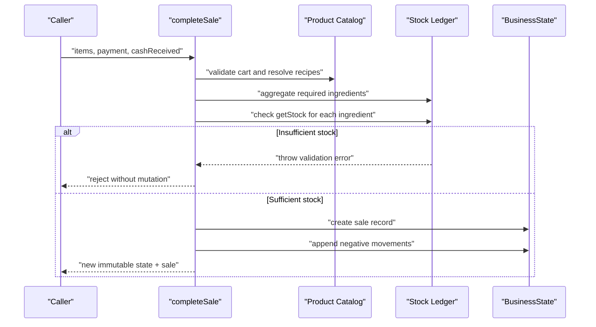
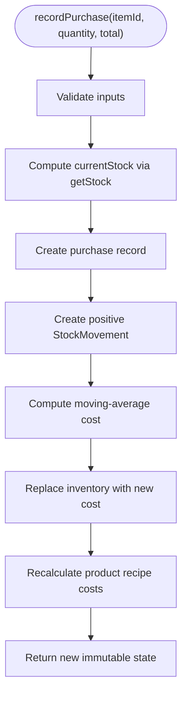
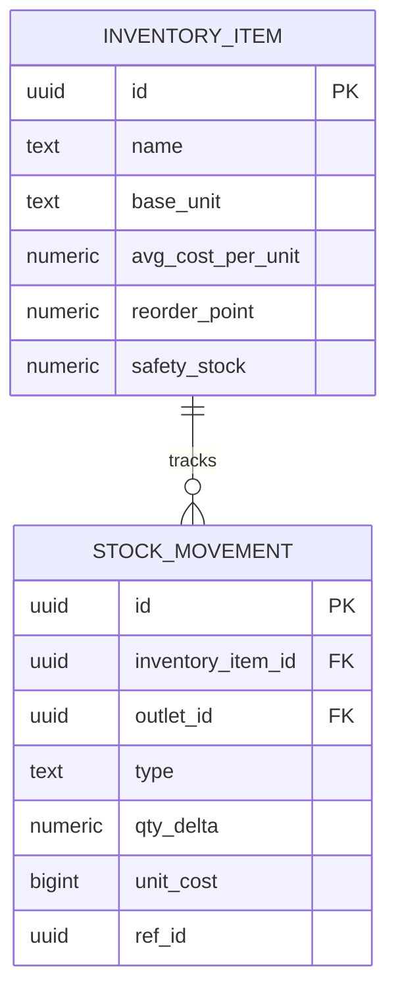
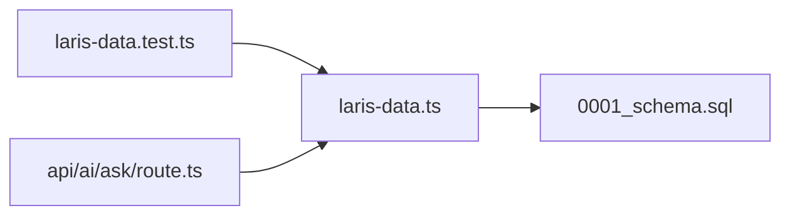

# Stock Tracking System

<cite>
**Referenced Files in This Document**
- [laris-data.ts](file://src/lib/laris-data.ts)
- [laris-data.test.ts](file://src/lib/laris-data.test.ts)
- [0001_schema.sql](file://supabase/migrations/0001_schema.sql)
- [ask/route.ts](file://src/app/api/ai/ask/route.ts)
</cite>

## Table of Contents
1. [Introduction](#introduction)
2. [Project Structure](#project-structure)
3. [Core Components](#core-components)
4. [Architecture Overview](#architecture-overview)
5. [Detailed Component Analysis](#detailed-component-analysis)
6. [Dependency Analysis](#dependency-analysis)
7. [Performance Considerations](#performance-considerations)
8. [Troubleshooting Guide](#troubleshooting-guide)
9. [Conclusion](#conclusion)

## Introduction
This document explains the ledger-based stock tracking system used by the application. Instead of directly mutating a current stock value, every change is recorded as an immutable transaction called a stock movement. Current stock is then calculated by starting from an opening snapshot and summing signed movements.

The design supports:
- Auditability: every sale, purchase, adjustment, waste, opening entry, or physical count can be traced back to its source.
- Reconciliation: current stock equals opening stock plus all relevant movements.
- Historical analysis: past transactions remain unchanged even when inventory costs or product recipes evolve.
- Safety: sales validate aggregated recipe requirements before creating negative movements; purchases create positive movements and update moving-average cost.

## Project Structure
The stock-tracking logic spans three layers:

| Layer | Responsibility | Key files |
|---|---|---|
| Domain model and state machine | Immutable business state, stock calculation, sales, purchases, and seed data | `src/lib/laris-data.ts` |
| Tests | Invariants for immutability, ledger math, idempotency, and edge cases | `src/lib/laris-data.test.ts` |
| Database schema | Persistent ledger table with typed movement types and indexes | `supabase/migrations/0001_schema.sql` |
| AI tooling | Reads current stock through the same domain function for low-stock alerts | `src/app/api/ai/ask/route.ts` |

**Diagram sources**
- [laris-data.ts:97-110](file://src/lib/laris-data.ts#L97-L110)
- [laris-data.ts:172-176](file://src/lib/laris-data.ts#L172-L176)
- [0001_schema.sql:203-216](file://supabase/migrations/0001_schema.sql#L203-L216)

**Section sources**
- [laris-data.ts:1-110](file://src/lib/laris-data.ts#L1-L110)
- [0001_schema.sql:200-216](file://supabase/migrations/0001_schema.sql#L200-L216)

## Core Components
The core components are:

| Component | Purpose | Key behavior |
|---|---|---|
| `BusinessState` | Immutable snapshot of the business at a point in time | Contains sales, stock movements, expenses, customers, purchases, products, and inventory |
| `InventoryItem` | Defines base unit, opening stock, reorder point, and current average cost | Opening stock is the baseline for calculations |
| `StockMovement` | Immutable record of a quantity change | Has type, signed quantity delta, reference ID, and timestamp |
| `getStock` | Calculates current stock | Starts from `openingStock`, then adds all matching movements |
| `completeSale` | Records a sale and creates negative stock movements | Validates cart, aggregates recipes, checks stock, and appends immutable records |
| `recordPurchase` | Records a purchase and creates a positive stock movement | Updates moving-average cost and derived product costs |

**Section sources**
- [laris-data.ts:15-32](file://src/lib/laris-data.ts#L15-L32)
- [laris-data.ts:97-110](file://src/lib/laris-data.ts#L97-L110)
- [laris-data.ts:172-176](file://src/lib/laris-data.ts#L172-L176)
- [laris-data.ts:215-305](file://src/lib/laris-data.ts#L215-L305)
- [laris-data.ts:307-334](file://src/lib/laris-data.ts#L307-L334)

## Architecture Overview
At a high level, stock is not stored as a single mutable number. It is derived from an immutable ledger.

**Diagram sources**
- [laris-data.ts:215-305](file://src/lib/laris-data.ts#L215-L305)
- [laris-data.ts:307-334](file://src/lib/laris-data.ts#L307-L334)

## Detailed Component Analysis

### Immutable Stock Calculation
Current stock is computed by starting from the item’s opening stock and adding every movement that belongs to that item.

**Diagram sources**
- [laris-data.ts:172-176](file://src/lib/laris-data.ts#L172-L176)

Key properties:
- Time complexity is O(n) over the number of stock movements for the queried item.
- Space complexity is O(1) beyond the input state.
- The function is pure: it does not mutate `state`.
- Opening stock acts as the baseline; historical sales in the seeded demo do not pre-deduct movements because the seed treats opening stock as the remaining snapshot.

**Section sources**
- [laris-data.ts:172-176](file://src/lib/laris-data.ts#L172-L176)
- [laris-data.ts:396-403](file://src/lib/laris-data.ts#L396-L403)
- [laris-data.test.ts:133-138](file://src/lib/laris-data.test.ts#L133-L138)

### Sale Flow and Negative Movements
A sale does not directly subtract stock. Instead, it:
1. Validates the cart and payment method.
2. Aggregates recipe requirements across all items.
3. Checks available stock for every ingredient.
4. Creates one sale record.
5. Creates one negative movement per ingredient.
6. Returns a new immutable state.

**Diagram sources**
- [laris-data.ts:215-305](file://src/lib/laris-data.ts#L215-L305)
- [laris-data.test.ts:170-201](file://src/lib/laris-data.test.ts#L170-L201)

Important behaviors:
- Shared ingredients across multiple menu items are aggregated into a single negative movement per ingredient.
- The entire sale is rejected if any ingredient is insufficient; no partial deduction occurs.
- The original input state remains unchanged after failure.
- Idempotent retries return the existing sale and state when an idempotency key is provided.

**Section sources**
- [laris-data.ts:215-305](file://src/lib/laris-data.ts#L215-L305)
- [laris-data.test.ts:170-201](file://src/lib/laris-data.test.ts#L170-L201)
- [laris-data.test.ts:219-246](file://src/lib/laris-data.test.ts#L219-L246)
- [laris-data.test.ts:290-305](file://src/lib/laris-data.test.ts#L290-L305)

### Purchase Flow and Positive Movements
A purchase:
1. Validates the inventory item, quantity, and total.
2. Computes current stock using the ledger.
3. Creates a purchase record.
4. Appends a positive stock movement.
5. Updates the moving-average cost for the inventory item.
6. Recalculates derived product costs based on updated recipe costs.

**Diagram sources**
- [laris-data.ts:307-334](file://src/lib/laris-data.ts#L307-L334)

Key details:
- The movement quantity preserves fractional units such as `1000.5`.
- The purchase total is rounded to whole rupiah, while the movement quantity remains precise.
- Moving-average cost uses the previous effective stock and the new purchase total.
- Product costs are recomputed from the updated inventory costs and recipe lines.

**Section sources**
- [laris-data.ts:307-334](file://src/lib/laris-data.ts#L307-L334)
- [laris-data.test.ts:307-340](file://src/lib/laris-data.test.ts#L307-L340)

### Movement Types and Reference Tracking
The system distinguishes movement types both in the domain model and in the database.

| Movement type | Meaning | Sign | Typical reference |
|---|---|---:|---|
| `sale` | Stock consumed by a sale | Negative | Sale ID |
| `purchase` | Stock received from a supplier | Positive | Purchase ID |
| `adjustment` | Manual correction or reconciliation | Signed | Adjustment identifier |
| `waste` | Spoilage, spillage, or failed batch | Usually negative | Waste log or operation ID |
| `opening` | Initial baseline snapshot | Usually positive | Opening batch or initialization ID |
| `opname` | Physical count reconciliation | Signed | Count session ID |

In the domain layer, the JavaScript interface currently exposes `sale`, `purchase`, and `adjustment`. In the database schema, the allowed types include `opening`, `sale`, `purchase`, `adjustment`, `waste`, and `opname`.

Reference tracking ensures every movement can be traced back to its originating business event.

**Section sources**
- [laris-data.ts:25-32](file://src/lib/laris-data.ts#L25-L32)
- [laris-data.ts:298-300](file://src/lib/laris-data.ts#L298-L300)
- [laris-data.ts:317-320](file://src/lib/laris-data.ts#L317-L320)
- [0001_schema.sql:203-216](file://supabase/migrations/0001_schema.sql#L203-L216)

### Relationship Between Opening Stock, Movements, and Current Stock
The relationship is additive and auditable:

**Diagram sources**
- [0001_schema.sql:73-88](file://supabase/migrations/0001_schema.sql#L73-L88)
- [0001_schema.sql:203-216](file://supabase/migrations/0001_schema.sql#L203-L216)

Mathematical relationship:
- Current stock = Opening stock + Sum of signed movements for the item.
- For sales, the movement quantity is negative.
- For purchases, the movement quantity is positive.
- For adjustments, waste, and opname, the sign depends on whether stock increased or decreased.

**Section sources**
- [laris-data.ts:172-176](file://src/lib/laris-data.ts#L172-L176)
- [0001_schema.sql:203-216](file://supabase/migrations/0001_schema.sql#L203-L216)

### Benefits of the Ledger Approach
| Benefit | Explanation |
|---|---|
| Auditability | Every stock change is an immutable row with type, signed quantity, reference, user, and timestamp. |
| Reconciliation | Current stock can be recalculated at any time by summing movements against opening stock. |
| Historical integrity | Past movements are never overwritten; only new movements are appended. |
| Traceability | Each movement links to a sale, purchase, or other operational event through `reference` / `ref_id`. |
| Cost accuracy | Purchases update moving-average cost, which propagates to recipe-based product costs. |
| Safety | Sales validate aggregated recipe needs before deducting stock, preventing overselling. |
| Reporting flexibility | Reports can filter by movement type, date range, outlet, or reference. |

**Section sources**
- [laris-data.ts:172-176](file://src/lib/laris-data.ts#L172-L176)
- [laris-data.ts:215-334](file://src/lib/laris-data.ts#L215-L334)
- [0001_schema.sql:203-216](file://supabase/migrations/0001_schema.sql#L203-L216)

## Dependency Analysis
The stock-tracking system has clear boundaries between domain logic, persistence, and consumption.

**Diagram sources**
- [laris-data.test.ts:1-10](file://src/lib/laris-data.test.ts#L1-L10)
- [ask/route.ts:140-151](file://src/app/api/ai/ask/route.ts#L140-L151)
- [laris-data.ts:172-176](file://src/lib/laris-data.ts#L172-L176)
- [0001_schema.sql:203-216](file://supabase/migrations/0001_schema.sql#L203-L216)

Coupling and cohesion:
- `getStock` is the central read path for current stock and is reused by sales validation, purchase validation, and AI tools.
- `completeSale` and `recordPurchase` are write paths that append to `stockMovements` rather than mutating existing rows.
- The database schema enforces movement types and non-zero deltas, aligning with domain constraints.
- Tests provide strong invariants around immutability, aggregation, and edge cases.

Potential risks:
- If future features bypass `getStock`, current stock may become inconsistent with the ledger.
- Large numbers of movements increase read cost for stock queries unless materialized views or indexes are used.
- Domain types and database types should stay synchronized as the system evolves.

**Section sources**
- [laris-data.ts:172-176](file://src/lib/laris-data.ts#L172-L176)
- [laris-data.ts:215-334](file://src/lib/laris-data.ts#L215-L334)
- [ask/route.ts:140-151](file://src/app/api/ai/ask/route.ts#L140-L151)
- [0001_schema.sql:203-216](file://supabase/migrations/0001_schema.sql#L203-L216)

## Performance Considerations
- Reading current stock is O(n) over movements for the item. For large histories, consider:
  - Materialized views or summary tables for current stock per item and outlet.
  - Partitioning or time-bounded queries for reporting.
  - Indexes on `inventory_item_id`, `outlet_id`, and `created_at`.
- Writing is append-only, which is efficient and safe for concurrency when combined with database transactions or RPCs.
- Recipe aggregation happens in memory during sale completion; keep catalog sizes reasonable and avoid unnecessary deep copies outside the state boundary.
- Moving-average cost updates recalculate product costs; batch or cache where appropriate if product catalogs grow significantly.

[No sources needed since this section provides general guidance]

## Troubleshooting Guide
Common issues and their causes:

| Symptom | Likely cause | Resolution |
|---|---|---|
| Sale fails with insufficient stock | Aggregated recipe requirement exceeds available stock | Review recipe quantities, opening stock, and prior movements |
| Stock becomes negative unexpectedly | A direct mutation bypassed the ledger | Use `completeSale` or `recordPurchase`; verify no code writes `stockMovements` directly |
| Purchase cost looks wrong | Moving-average cost was updated but product costs were not recalculated | Ensure purchase flow updates both inventory cost and derived product costs |
| Stock report differs from UI | UI reads a cached or denormalized field instead of recomputing from movements | Recompute using `getStock` or refresh the materialized view |
| Duplicate stock deductions | Same sale retried without idempotency | Provide an idempotency key so retries return the existing sale and state |
| Movement cannot be traced | Missing or incorrect reference ID | Link movement `reference` to the originating sale, purchase, or adjustment ID |

Relevant test coverage includes:
- Insufficient stock rejection without mutation.
- Exact remaining stock being sold.
- Purchase decimals preserved.
- Moving-average cost propagation.
- Idempotent sale retries.
- Movement filtering by item ID.

**Section sources**
- [laris-data.test.ts:219-246](file://src/lib/laris-data.test.ts#L219-L246)
- [laris-data.test.ts:290-340](file://src/lib/laris-data.test.ts#L290-L340)
- [laris-data.test.ts:352-361](file://src/lib/laris-data.test.ts#L352-L361)

## Conclusion
The ledger-based stock tracking system replaces direct stock mutations with immutable transactions. Current stock is derived from opening stock plus signed movements, making the system auditable, reconcilable, and historically stable. Sales automatically create negative movements, purchases create positive movements, and adjustments cover manual corrections and physical counts. This approach improves trust in inventory data, supports financial accuracy through moving-average cost, and enables reliable reporting and forecasting.

[No sources needed since this section summarizes without analyzing specific files]