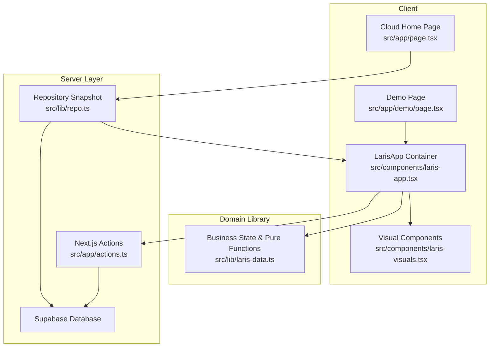
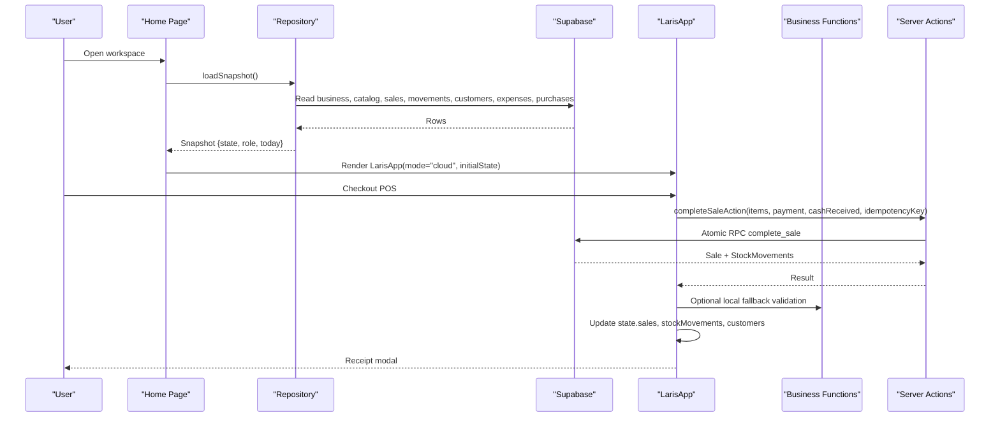
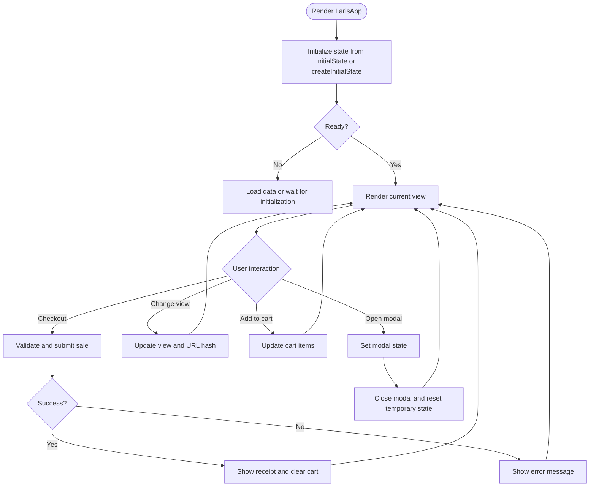
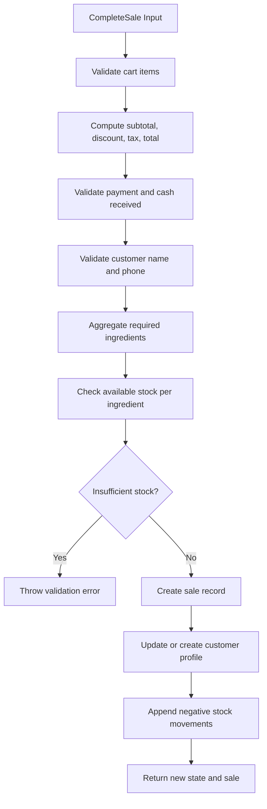
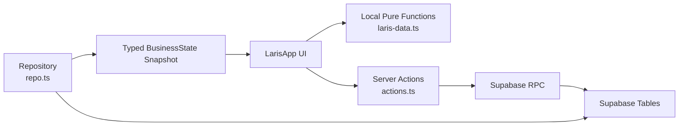
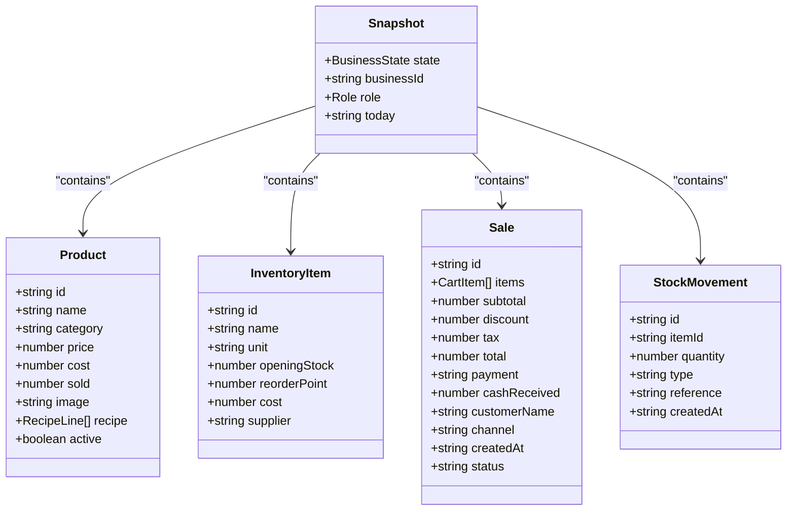
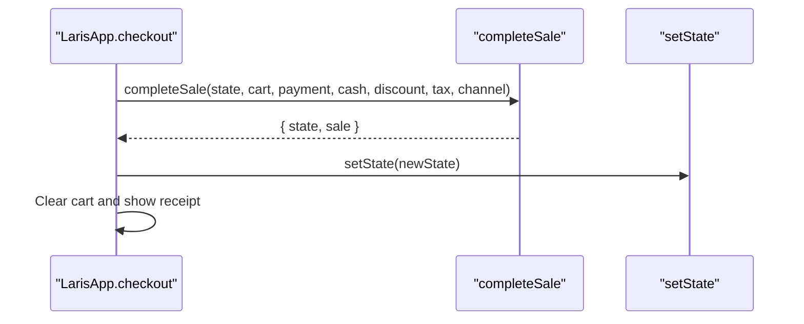
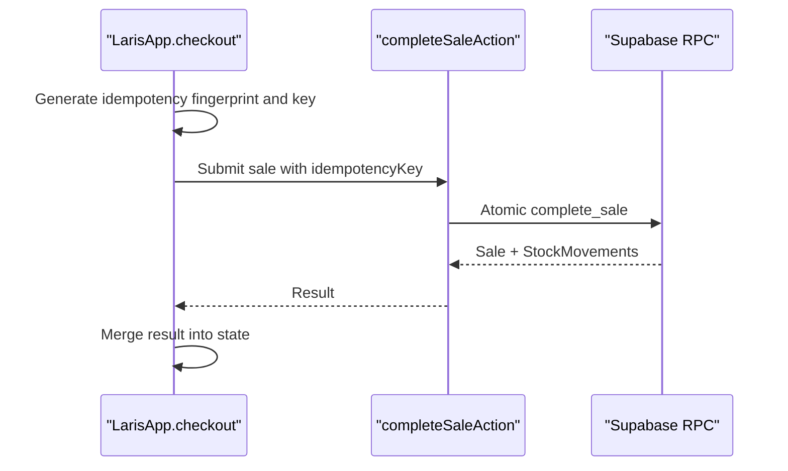
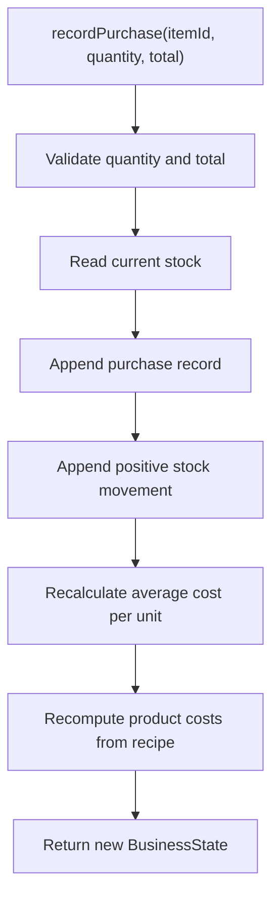
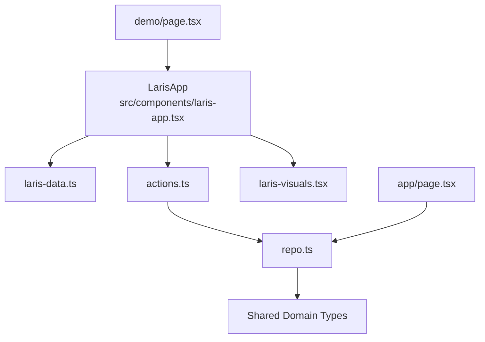

# Core Application

<cite>
**Referenced Files in This Document**
- [laris-app.tsx](file://src/components/laris-app.tsx)
- [laris-data.ts](file://src/lib/laris-data.ts)
- [repo.ts](file://src/lib/repo.ts)
- [page.tsx](file://src/app/page.tsx)
- [demo page.tsx](file://src/app/demo/page.tsx)
- [actions.ts](file://src/app/actions.ts)
- [README.md](file://README.md)
</cite>

## Table of Contents
1. [Introduction](#introduction)
2. [Project Structure](#project-structure)
3. [Core Components](#core-components)
4. [Architecture Overview](#architecture-overview)
5. [Detailed Component Analysis](#detailed-component-analysis)
6. [Dependency Analysis](#dependency-analysis)
7. [Performance Considerations](#performance-considerations)
8. [Troubleshooting Guide](#troubleshooting-guide)
9. [Conclusion](#conclusion)

## Introduction
Laris is a workspace-oriented operational application for Indonesian food-and-beverage businesses. Its core architecture separates the client-side user interface from deterministic business logic and server-side data persistence. The central `LarisApp` component acts as the main container that manages views, modals, navigation state, cart state, and either local or cloud-backed business state. Business rules such as cart totals, stock calculations, customer segmentation, purchase cost averaging, and sale completion are implemented as pure functions operating on an immutable domain model. Server-side operations use Supabase RPCs through Next.js actions, while the repository layer maps database rows into the shared `BusinessState` snapshot consumed by the UI.

The application supports two modes:
- **Local mode**: Demo data seeded deterministically, persisted to browser storage, with all business logic running in the browser.
- **Cloud mode**: A server-fetched snapshot of workspace data drives the same UI, while mutations are executed through authenticated server actions and atomic Supabase procedures.

**Section sources**
- [README.md:1-57](file://README.md#L1-L57)
- [laris-app.tsx:27-133](file://src/components/laris-app.tsx#L27-L133)
- [laris-data.ts:97-110](file://src/lib/laris-data.ts#L97-L110)

## Project Structure
At a high level, the core application consists of:
- A React client component that owns UI state and orchestrates both local and cloud workflows.
- A domain library defining the shared data model and deterministic business functions.
- A repository layer that loads a typed snapshot from Supabase.
- App pages that select between demo and cloud entry points.
- Server actions that perform validated, role-checked mutations against Supabase.

**Diagram sources**
- [demo page.tsx:9-11](file://src/app/demo/page.tsx#L9-L11)
- [page.tsx:9-17](file://src/app/page.tsx#L9-L17)
- [laris-app.tsx:14-25](file://src/components/laris-app.tsx#L14-L25)
- [laris-data.ts:3-110](file://src/lib/laris-data.ts#L3-L110)
- [repo.ts:82-193](file://src/lib/repo.ts#L82-L193)
- [actions.ts:52-117](file://src/app/actions.ts#L52-L117)

**Section sources**
- [README.md:97-110](file://README.md#L97-L110)
- [demo page.tsx:1-12](file://src/app/demo/page.tsx#L1-L12)
- [page.tsx:1-19](file://src/app/page.tsx#L1-L19)

## Core Components
### LarisApp Container
`LarisApp` is the single source of truth for the UI layer. It holds:
- Global business state (`BusinessState`) when in local mode, or a cloud-provided snapshot.
- Navigation view state (`overview`, `pos`, `transactions`, `products`, `inventory`, `purchases`, `customers`, `storefront`, `finance`, `team`).
- Modal state controlling dialogs such as checkout, receipt, product editor, inventory editor, settings, voice assistant, search, and team invitation.
- Cart state, payment options, discount/tax toggles, customer input, voice parsing state, AI assistant messages, and pending mutation flags.
- Derived metrics computed with `useMemo`, including today’s sales, revenue, gross profit, growth, low-stock alerts, top products, and chart series.

It also coordinates:
- Local persistence via `localStorage`.
- Hash-based routing for quick navigation.
- Keyboard shortcuts such as command-plus-k for search.
- Role-based permissions for catalog and business configuration changes.
- Fallback behavior when cloud features fail, ensuring the UI remains usable.

**Section sources**
- [laris-app.tsx:27-133](file://src/components/laris-app.tsx#L27-L133)
- [laris-app.tsx:146-185](file://src/components/laris-app.tsx#L146-L185)
- [laris-app.tsx:187-207](file://src/components/laris-app.tsx#L187-L207)

### Domain Model and Pure Functions
The domain model lives in `laris-data.ts`. It defines the canonical entities used across both local and cloud flows:
- `Product`: menu item, price, cost, recipe, and active status.
- `InventoryItem`: ingredient, unit, opening stock, reorder point, cost, and supplier.
- `StockMovement`: signed ledger entry tracking sales, purchases, and adjustments.
- `Sale`: completed transaction with items, totals, payment method, channel, and timestamp.
- `Customer`: loyalty profile with visits, spending, last visit, RFM segment, and points.
- `Purchase`, `Expense`, `TeamMember`, and `AuditActivity` supporting operational and audit context.
- `BusinessState`: the root snapshot containing sales, movements, customers, purchases, expenses, business profile, daily target, and optional catalog/team/activity data.

Pure functions include:
- `getStock`: computes current stock by summing signed movements against opening stock.
- `getCartTotal`: validates cart items, applies discount and optional tax, and returns subtotal/discount/tax/total.
- `completeSale`: validates inputs, checks stock availability, creates a sale, updates customers, and appends stock movements.
- `recordPurchase`: validates purchase quantity and total, records a purchase, adds a positive movement, recalculates moving-average cost, and recomputes product costs.
- `createInitialState`: generates deterministic historical sales, expenses, and customers ending at a given date.
- `parseOrder`: parses natural-language orders into structured cart items using aliases and regex patterns.
- `exportSalesCsv`: exports sales history safely, escaping potentially dangerous spreadsheet formulas.

These functions are intentionally side-effect-free except for deterministic timestamps and ID generation helpers. They throw descriptive errors on invalid input, making them suitable for testing and predictable UI error handling.

**Section sources**
- [laris-data.ts:3-110](file://src/lib/laris-data.ts#L3-L110)
- [laris-data.ts:143-199](file://src/lib/laris-data.ts#L143-L199)
- [laris-data.ts:201-334](file://src/lib/laris-data.ts#L201-L334)
- [laris-data.ts:336-404](file://src/lib/laris-data.ts#L336-L404)
- [laris-data.ts:406-494](file://src/lib/laris-data.ts#L406-L494)

### Repository and Snapshot Loading
The repository layer in `repo.ts` maps Supabase rows into the shared domain types. It provides:
- Row mappers for sales, customers, expenses, stock movements, purchases, and catalog entries.
- Paginated fetching to handle large datasets.
- `loadCatalog`: builds `Product[]` and `InventoryItem[]` from inventory, product, variant, and recipe tables.
- `loadSnapshot`: authenticates membership, reads workspace data, computes sold counts, enriches team members, and returns a fully typed `Snapshot` containing `BusinessState`, business identifier, role, and current day.

This separation ensures the UI can consume the same `BusinessState` shape whether it comes from local seed data or a server-loaded snapshot.

**Section sources**
- [repo.ts:1-16](file://src/lib/repo.ts#L1-L16)
- [repo.ts:27-62](file://src/lib/repo.ts#L27-L62)
- [repo.ts:64-112](file://src/lib/repo.ts#L64-L112)
- [repo.ts:114-193](file://src/lib/repo.ts#L114-L193)
- [repo.ts:195-202](file://src/lib/repo.ts#L195-L202)

### Cloud Entry Point and Demo Entry Point
- The cloud home page verifies authentication, loads a snapshot, and renders `LarisApp` in cloud mode with server-derived state and user metadata.
- The demo page renders `LarisApp` in local mode with explicit notice text indicating that changes are browser-scoped.

This design keeps the container reusable while isolating environment-specific setup.

**Section sources**
- [page.tsx:9-17](file://src/app/page.tsx#L9-L17)
- [demo page.tsx:9-11](file://src/app/demo/page.tsx#L9-L11)

## Architecture Overview
The application follows a layered architecture:

| Layer | Responsibility | Key Files |
|---|---|---|
| Presentation | Views, modals, navigation, cart, voice, AI assistant, charts | `laris-app.tsx`, `laris-visuals.tsx` |
| Domain | Immutable state transitions, validation, stock accounting, order parsing | `laris-data.ts` |
| Data Access | Mapping database rows to domain types and loading snapshots | `repo.ts` |
| API / Mutations | Validated server actions calling Supabase RPCs | `actions.ts` |
| Routing | Cloud vs demo entry points | `page.tsx`, `demo page.tsx` |

**Diagram sources**
- [page.tsx:9-17](file://src/app/page.tsx#L9-L17)
- [repo.ts:129-193](file://src/lib/repo.ts#L129-L193)
- [laris-app.tsx:213-267](file://src/components/laris-app.tsx#L213-L267)
- [actions.ts:52-96](file://src/app/actions.ts#L52-L96)

## Detailed Component Analysis

### LarisApp State Management and Navigation
`LarisApp` maintains a rich set of React state variables:
- `state`: the primary `BusinessState` snapshot.
- `view`: current workspace view.
- `modal`: currently open dialog.
- `cart`: line items being added to a sale.
- `payment`, `cash`, `discount`, `taxEnabled`: checkout parameters.
- `customerName`, `customerPhone`: optional customer capture.
- `receipt`: displayed sale after successful checkout.
- Voice and AI-related state: `voiceText`, `parsed`, `recording`, `assistantInput`, `messages`.
- Catalog editing state: `selectedProduct`, `recipeDraft`, `inventoryEditor`.
- Operational flags: `pendingMutation`, `pendingCheckout`, `pendingAi`, `pendingScan`.

Navigation is handled by `go`, which updates the view, clears query and sidebar state, resets errors, and syncs the URL hash. Modals are opened/closed centrally, and keyboard shortcuts improve accessibility.

**Diagram sources**
- [laris-app.tsx:81-133](file://src/components/laris-app.tsx#L81-L133)
- [laris-app.tsx:134-185](file://src/components/laris-app.tsx#L134-L185)
- [laris-app.tsx:213-267](file://src/components/laris-app.tsx#L213-L267)

**Section sources**
- [laris-app.tsx:81-133](file://src/components/laris-app.tsx#L81-L133)
- [laris-app.tsx:134-185](file://src/components/laris-app.tsx#L134-L185)

### Deterministic Business Logic
The domain library enforces business rules without mutating existing objects:
- `getStock` aggregates signed stock movements per item.
- `getCartTotal` validates cart contents, rejects discounts larger than the subtotal, and optionally applies a 10% restaurant tax.
- `completeSale` validates payment methods, channels, cash received, customer phone format, and stock availability before creating a sale and stock deductions.
- `recordPurchase` validates quantities and totals, records a purchase, adds a positive movement, recalculates average cost, and recomputes product costs based on updated inventory.
- `createInitialState` produces reproducible historical data anchored to a specific end date.
- `parseOrder` converts natural language into structured cart items using aliases and safe numeric parsing.

**Diagram sources**
- [laris-data.ts:215-305](file://src/lib/laris-data.ts#L215-L305)

**Section sources**
- [laris-data.ts:172-199](file://src/lib/laris-data.ts#L172-L199)
- [laris-data.ts:215-334](file://src/lib/laris-data.ts#L215-L334)
- [laris-data.ts:336-404](file://src/lib/laris-data.ts#L336-L404)
- [laris-data.ts:436-474](file://src/lib/laris-data.ts#L436-L474)

### Client-Side vs Server-Side Separation
The separation is explicit:
- **Client-side UI components** render the workspace, manage transient UI state, and call either local pure functions or server actions.
- **Server-side business logic** performs authenticated, role-checked mutations through Supabase RPCs. The client still validates inputs where appropriate, but authoritative pricing, cash reconciliation, and stock updates happen server-side in cloud mode.
- **Repository mapping** translates database rows into the same domain types used locally, enabling consistent UI rendering.

**Diagram sources**
- [laris-app.tsx:14-25](file://src/components/laris-app.tsx#L14-L25)
- [laris-data.ts:215-334](file://src/lib/laris-data.ts#L215-L334)
- [actions.ts:52-117](file://src/app/actions.ts#L52-L117)
- [repo.ts:82-193](file://src/lib/repo.ts#L82-L193)

**Section sources**
- [laris-app.tsx:213-267](file://src/components/laris-app.tsx#L213-L267)
- [actions.ts:52-117](file://src/app/actions.ts#L52-L117)
- [repo.ts:129-193](file://src/lib/repo.ts#L129-L193)

### Repository Pattern and Snapshot-Based Workspace Data
The repository pattern is applied through row mappers and a snapshot loader:
- Each entity has a corresponding mapper function that converts database columns into domain fields.
- `loadCatalog` joins inventory, product, variant, and recipe data into `Product[]` and `InventoryItem[]`.
- `loadSnapshot` fetches all workspace data in parallel, computes derived values like sold counts, and returns a stable `Snapshot` object.
- Pagination uses a fixed page size to avoid overwhelming the database or client with very large catalogs or long ledgers.

**Diagram sources**
- [repo.ts:8-8](file://src/lib/repo.ts#L8-L8)
- [laris-data.ts:3-32](file://src/lib/laris-data.ts#L3-L32)
- [repo.ts:82-112](file://src/lib/repo.ts#L82-L112)
- [repo.ts:129-193](file://src/lib/repo.ts#L129-L193)

**Section sources**
- [repo.ts:27-62](file://src/lib/repo.ts#L27-L62)
- [repo.ts:82-112](file://src/lib/repo.ts#L82-L112)
- [repo.ts:129-193](file://src/lib/repo.ts#L129-L193)

### Practical Examples of State Mutations, Validation, and Error Handling

#### Example: Local Checkout Flow
In local mode, `LarisApp.checkout` calls `completeSale` with validated cart and payment data. On success, it updates the global state, clears the cart, and opens the receipt modal. Errors are caught and displayed through the shared error state.

**Diagram sources**
- [laris-app.tsx:263-267](file://src/components/laris-app.tsx#L263-L267)
- [laris-data.ts:215-305](file://src/lib/laris-data.ts#L215-L305)

**Section sources**
- [laris-app.tsx:263-267](file://src/components/laris-app.tsx#L263-L267)
- [laris-data.ts:215-305](file://src/lib/laris-data.ts#L215-L305)

#### Example: Cloud Checkout with Idempotency
In cloud mode, the UI constructs an idempotency fingerprint and key, calls `completeSaleAction`, and then merges returned sales, stock movements, and customer updates into local state. If the server action fails, the error is surfaced rather than silently falling back to demo data.

**Diagram sources**
- [laris-app.tsx:213-259](file://src/components/laris-app.tsx#L213-L259)
- [actions.ts:52-96](file://src/app/actions.ts#L52-L96)

**Section sources**
- [laris-app.tsx:213-259](file://src/components/laris-app.tsx#L213-L259)
- [actions.ts:52-96](file://src/app/actions.ts#L52-L96)

#### Example: Purchase and Moving-Average Cost
When recording a purchase, the domain function validates inputs, appends a purchase record and a positive stock movement, recalculates the inventory item’s average cost, and recomputes product costs based on recipes.

**Diagram sources**
- [laris-data.ts:307-334](file://src/lib/laris-data.ts#L307-L334)

**Section sources**
- [laris-data.ts:307-334](file://src/lib/laris-data.ts#L307-L334)

#### Example: Validation Patterns
Validation is centralized and throws descriptive errors:
- Empty or malformed carts.
- Invalid product or inventory references.
- Discounts exceeding subtotals.
- Invalid payment methods or channels.
- Insufficient cash for cash payments.
- Invalid phone number formats.
- Insufficient stock for aggregated recipes.

These patterns make error messages actionable and testable.

**Section sources**
- [laris-data.ts:143-199](file://src/lib/laris-data.ts#L143-L199)
- [laris-data.ts:215-305](file://src/lib/laris-data.ts#L215-L305)

## Dependency Analysis
The core dependencies form a clear boundary between presentation, domain, and data access:

**Diagram sources**
- [laris-app.tsx:14-25](file://src/components/laris-app.tsx#L14-L25)
- [laris-data.ts:3-110](file://src/lib/laris-data.ts#L3-L110)
- [actions.ts:52-117](file://src/app/actions.ts#L52-L117)
- [repo.ts:82-193](file://src/lib/repo.ts#L82-L193)
- [demo page.tsx:9-11](file://src/app/demo/page.tsx#L9-L11)
- [page.tsx:9-17](file://src/app/page.tsx#L9-L17)

**Section sources**
- [laris-app.tsx:14-25](file://src/components/laris-app.tsx#L14-L25)
- [repo.ts:82-193](file://src/lib/repo.ts#L82-L193)

## Performance Considerations
For large catalogs and real-time-like updates, the codebase uses several strategies:

- **Derived computations with memoization**: Revenue, growth, low-stock lists, top products, and chart series are computed with `useMemo` to avoid recalculation on unrelated re-renders.
- **Immutable state updates**: Pure functions return new state objects, enabling efficient diffing and predictable persistence.
- **Pagination in repository layer**: Large datasets such as sales, movements, customers, expenses, and purchases are fetched in pages to prevent oversized responses.
- **Parallel loading**: Snapshot loading uses parallel queries for business, outlet, catalog, sales, movements, customers, expenses, purchases, and team data.
- **Client-side filtering and pagination**: Transaction lists apply client-side filters and page sizes to reduce rendered DOM nodes.
- **Avoiding unnecessary network calls**: Local mode avoids server calls entirely; cloud mode only calls server actions for mutations.
- **Deterministic seed data**: Historical data generation is deterministic, avoiding random variability during tests and demos.

Recommendations for further optimization:
- Introduce virtualized lists for very large transaction or product tables.
- Debounce search input and category changes.
- Cache computed metrics more aggressively if the dataset grows significantly.
- Use server-side aggregation for analytics when sales or movements become very large.
- Keep catalog updates incremental where possible to avoid reloading entire product and inventory sets.

[No sources needed since this section provides general guidance]

## Troubleshooting Guide
Common issues and their handling patterns:

| Issue | Symptom | Handling Strategy |
|---|---|---|
| Invalid cart | Checkout throws validation error | `validateCart` rejects empty or malformed items; UI shows error message. |
| Unknown product or ingredient | Lookup functions throw errors | `findProduct` and `findInventory` throw descriptive errors; UI should not pass unknown IDs. |
| Discount exceeds subtotal | `getCartTotal` throws | Prevent discount from being larger than subtotal before calling business functions. |
| Insufficient cash | `completeSale` throws | Enforce minimum cash received for cash payments. |
| Insufficient stock | `completeSale` throws before any mutation | Aggregate recipe requirements first, then validate stock atomically. |
| Invalid phone number | Customer creation or sale validation fails | Enforce length and digit constraints. |
| Cloud checkout failure | Server action returns error | Display error state instead of silently falling back to demo data. |
| Local storage full | Persistence fails | Notify user and keep changes session-only. |
| Voice input unavailable | Speech recognition error | Show fallback text input and error message. |
| Receipt scan failure | OCR API error | Surface error and allow manual purchase entry. |

**Section sources**
- [laris-app.tsx:213-267](file://src/components/laris-app.tsx#L213-L267)
- [laris-app.tsx:311-391](file://src/components/laris-app.tsx#L311-L391)
- [laris-data.ts:143-199](file://src/lib/laris-data.ts#L143-L199)
- [laris-data.ts:215-305](file://src/lib/laris-data.ts#L215-L305)

## Conclusion
The core Laris application architecture cleanly separates concerns:
- `LarisApp` is the central UI container managing views, modals, navigation, cart, and business state.
- `laris-data.ts` provides a strongly typed domain model and deterministic pure functions for cart totals, stock calculations, purchase accounting, customer segmentation, and order parsing.
- `repo.ts` implements a repository pattern that maps Supabase rows into the same `BusinessState` consumed by the UI.
- Server actions enforce authentication, roles, and atomic business operations, while the client retains validation and user feedback responsibilities.
- The snapshot-based approach allows the same UI to run locally with demo data or remotely with authenticated workspace data.

This structure makes the system testable, auditable, and resilient: business rules are isolated from UI effects, mutations are explicit, and errors are surfaced clearly to users.

[No sources needed since this section summarizes without analyzing specific files]