# Data Management

<cite>
**Referenced Files in This Document**
- [repo.ts](file://src/lib/repo.ts)
- [actions.ts](file://src/app/actions.ts)
- [laris-data.ts](file://src/lib/laris-data.ts)
- [0001_schema.sql](file://supabase/migrations/0001_schema.sql)
- [0002_rls.sql](file://supabase/migrations/0002_rls.sql)
- [0003_functions.sql](file://supabase/migrations/0003_functions.sql)
- [README.md](file://README.md)
</cite>

## Table of Contents
1. [Introduction](#introduction)
2. [Project Structure](#project-structure)
3. [Core Components](#core-components)
4. [Architecture Overview](#architecture-overview)
5. [Detailed Component Analysis](#detailed-component-analysis)
6. [Dependency Analysis](#dependency-analysis)
7. [Performance Considerations](#performance-considerations)
8. [Troubleshooting Guide](#troubleshooting-guide)
9. [Security Considerations](#security-considerations)
10. [Conclusion](#conclusion)

## Introduction
This document explains the data management layer that integrates Next.js Server Actions with Supabase. It focuses on:
- The repository module that abstracts database queries, builds paginated reads, and maps Supabase rows into domain models.
- The Server Actions pattern used for mutations such as completing a sale, recording purchases, adding expenses, saving products, and saving inventory items.
- Idempotency keys for preventing duplicate transactions.
- Error handling strategies and response formats.
- Transaction handling, validation, and rollback behavior enforced by server-side functions.
- Security through Row-Level Security policies and input sanitization.

The system separates read-heavy snapshot loading from write-heavy business operations. Reads are performed through typed Supabase queries and mapped to domain types. Writes go through Server Actions that validate inputs, enforce roles, and delegate ledger mutations to secure database functions.

## Project Structure
The data layer spans three main areas:
- Domain models and shared utilities live in the domain file.
- The repository module provides Supabase client usage, pagination helpers, catalog loading, membership resolution, and row-to-model mapping.
- Server Actions expose mutation endpoints that validate inputs, check authorization, call database RPCs, and return normalized results.

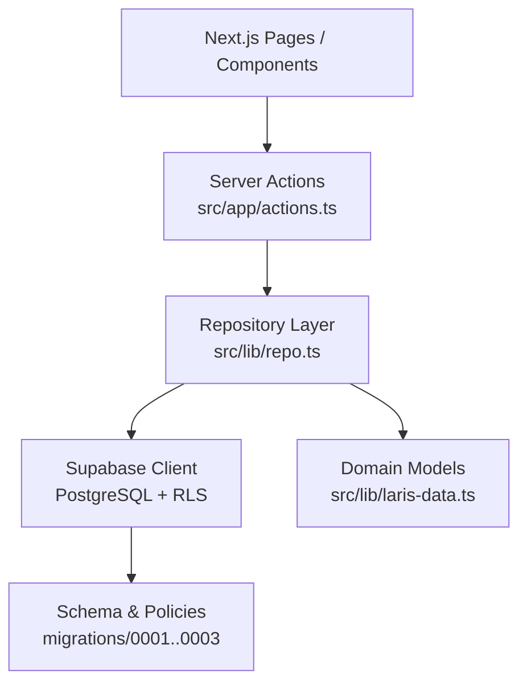

**Diagram sources**
- [actions.ts:1-310](file://src/app/actions.ts#L1-L310)
- [repo.ts:1-202](file://src/lib/repo.ts#L1-L202)
- [laris-data.ts:1-110](file://src/lib/laris-data.ts#L1-L110)
- [0001_schema.sql:1-294](file://supabase/migrations/0001_schema.sql#L1-L294)
- [0002_rls.sql:1-131](file://supabase/migrations/0002_rls.sql#L1-L131)
- [0003_functions.sql:1-320](file://supabase/migrations/0003_functions.sql#L1-L320)

**Section sources**
- [README.md:97-110](file://README.md#L97-L110)

## Core Components
The data management layer is built around these core components:

| Component | Responsibility | Key Implementation Details |
|---|---|---|
| Repository module | Database abstraction, query building, pagination, membership resolution, and domain mapping | Exports `loadCatalog`, `loadSnapshot`, `currentMembership`, and mapping functions like `mapSale`, `mapCustomer`, `mapExpense`, `mapMovement`, `mapPurchase`. Uses a page size of 1000 for large result sets. |
| Server Actions | Mutation entry points with validation, role checks, idempotency support, and normalized responses | Exposes `completeSaleAction`, `recordPurchaseAction`, `addExpenseAction`, `saveProductAction`, `saveInventoryItemAction`, plus related actions for customers, settings, image upload, and team invitations. |
| Domain models | Shared TypeScript interfaces describing business entities | Defines `Product`, `InventoryItem`, `StockMovement`, `Sale`, `Customer`, `Expense`, `Purchase`, `TeamMember`, `AuditActivity`, and `BusinessState`. |
| Supabase schema and functions | Persistent data model, RLS policies, and transactional RPCs | Defines tenant tables, indexes, constraints, RLS policies, and secure functions such as `complete_sale` and `record_purchase`. |

**Section sources**
- [repo.ts:10-112](file://src/lib/repo.ts#L10-L112)
- [repo.ts:114-193](file://src/lib/repo.ts#L114-L193)
- [actions.ts:15-38](file://src/app/actions.ts#L15-L38)
- [actions.ts:52-89](file://src/app/actions.ts#L52-L89)
- [actions.ts:97-124](file://src/app/actions.ts#L97-L124)
- [actions.ts:132-143](file://src/app/actions.ts#L132-L143)
- [actions.ts:201-215](file://src/app/actions.ts#L201-L215)
- [actions.ts:248-271](file://src/app/actions.ts#L248-L271)
- [laris-data.ts:3-110](file://src/lib/laris-data.ts#L3-L110)

## Architecture Overview
The architecture follows a layered approach:

1. **Presentation layer**: Next.js pages or components call Server Actions.
2. **Server Action layer**: Validates input with Zod, enforces environment configuration, resolves authenticated membership, checks required roles, and wraps execution in a uniform error handler.
3. **Repository layer**: Performs reads against Supabase, paginates large datasets, and maps raw rows into domain models.
4. **Database layer**: Enforces tenancy, roles, and business rules through RLS policies and `SECURITY DEFINER` functions. Ledger writes are atomic and audit-logged.

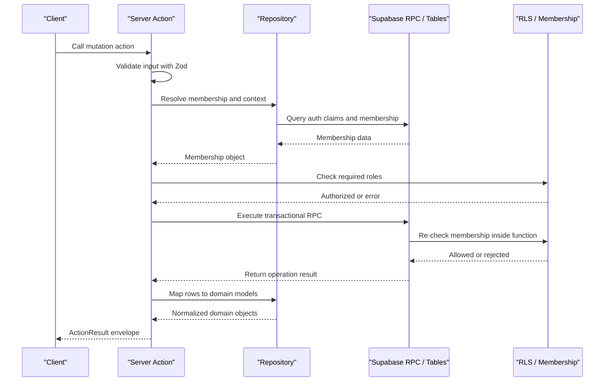

**Diagram sources**
- [actions.ts:21-38](file://src/app/actions.ts#L21-L38)
- [actions.ts:52-89](file://src/app/actions.ts#L52-L89)
- [repo.ts:114-124](file://src/lib/repo.ts#L114-L124)
- [0002_rls.sql:12-25](file://supabase/migrations/0002_rls.sql#L12-L25)
- [0003_functions.sql:94-132](file://supabase/migrations/0003_functions.sql#L94-L132)

## Detailed Component Analysis

### Repository Module (`src/lib/repo.ts`)
The repository module centralizes Supabase access patterns and domain mapping.

#### Responsibilities
- Timezone normalization to Jakarta time using a helper that adjusts UTC timestamps.
- Paginated reading via a generic `fetchAll` helper that iterates ranges until fewer than the page size are returned.
- Catalog loading that joins inventory, products, default variants, and recipe lines.
- Membership resolution from Supabase auth claims and the `membership` table.
- Snapshot loading that aggregates business metadata, outlet, catalog, sales, stock movements, customers, expenses, purchases, and optional team members.
- Mapping functions that convert PostgREST rows into domain models.

#### Key Patterns
- **Pagination**: Large tables use range-based queries with a fixed page size. Errors from Supabase are thrown so callers can handle them uniformly.
- **Parallel reads**: Snapshot loading uses parallel queries for performance, then combines results into a single `BusinessState`.
- **Mapping**: Raw rows are transformed into domain objects with consistent field names and types. Invalid or missing references are filtered out where appropriate.

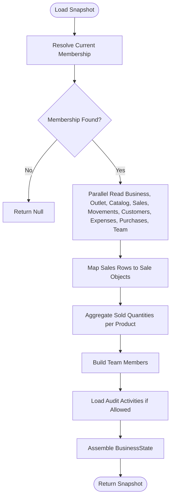

**Diagram sources**
- [repo.ts:129-193](file://src/lib/repo.ts#L129-L193)
- [repo.ts:82-112](file://src/lib/repo.ts#L82-L112)
- [repo.ts:64-72](file://src/lib/repo.ts#L64-L72)

**Section sources**
- [repo.ts:12-16](file://src/lib/repo.ts#L12-L16)
- [repo.ts:27-62](file://src/lib/repo.ts#L27-L62)
- [repo.ts:64-72](file://src/lib/repo.ts#L64-L72)
- [repo.ts:82-112](file://src/lib/repo.ts#L82-L112)
- [repo.ts:114-124](file://src/lib/repo.ts#L114-L124)
- [repo.ts:129-193](file://src/lib/repo.ts#L129-L193)

### Server Actions Pattern
Server Actions provide a consistent mutation contract:
- Input validation with Zod schemas.
- Environment and authentication checks.
- Role enforcement.
- Delegation to database RPCs for ledger mutations.
- Reading back created records and mapping them to domain models.
- Returning a uniform `ActionResult<T>` envelope.

#### Common Response Format
Every mutation returns one of:
- `{ ok: true; data: T }` when successful.
- `{ ok: false; error: string }` when validation fails, authorization fails, or a network/database error occurs.

Network-related errors are normalized into a user-friendly message. Zod validation errors surface the first issue message.

#### `completeSaleAction`
Completes a POS checkout:
- Validates cart items, payment method, cash received, optional customer details, discount, tax flag, channel, and idempotency key.
- Calls the `complete_sale` RPC with business-scoped parameters.
- Reads back the order, associated stock movements, and optionally the customer record.
- Maps results to `Sale`, `StockMovement[]`, and `Customer | null`.

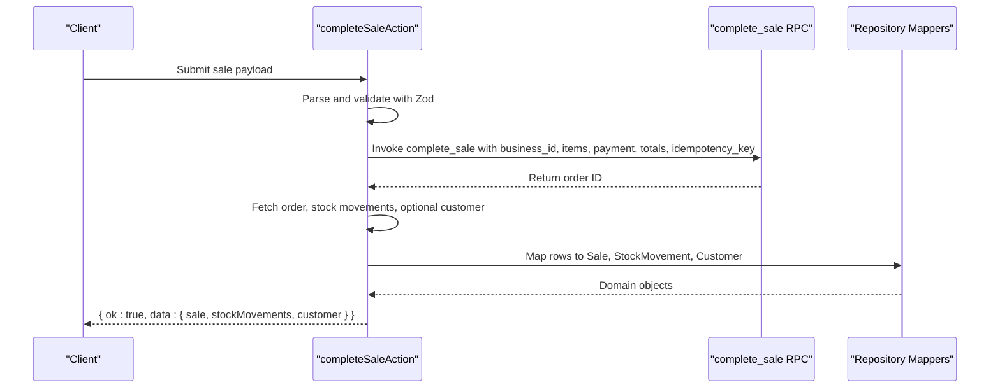

**Diagram sources**
- [actions.ts:40-50](file://src/app/actions.ts#L40-L50)
- [actions.ts:52-89](file://src/app/actions.ts#L52-L89)
- [0003_functions.sql:94-230](file://supabase/migrations/0003_functions.sql#L94-L230)

**Section sources**
- [actions.ts:40-89](file://src/app/actions.ts#L40-L89)
- [0003_functions.sql:94-230](file://supabase/migrations/0003_functions.sql#L94-L230)

#### `recordPurchaseAction`
Records a purchase receipt:
- Validates line items, source, and idempotency key.
- Calls the `record_purchase` RPC.
- Reads back purchase lines, stock movements, and reloads the catalog.
- Returns mapped purchases, movements, products, and inventory.

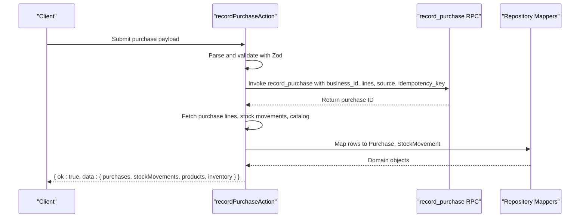

**Diagram sources**
- [actions.ts:91-95](file://src/app/actions.ts#L91-L95)
- [actions.ts:97-124](file://src/app/actions.ts#L97-L124)
- [0003_functions.sql:236-303](file://supabase/migrations/0003_functions.sql#L236-L303)

**Section sources**
- [actions.ts:91-124](file://src/app/actions.ts#L91-L124)
- [0003_functions.sql:236-303](file://supabase/migrations/0003_functions.sql#L236-L303)

#### `addExpenseAction`
Adds an expense:
- Validates description, category, and amount.
- Inserts directly into the `expense` table after resolving membership and auth claims.
- Returns the mapped expense.

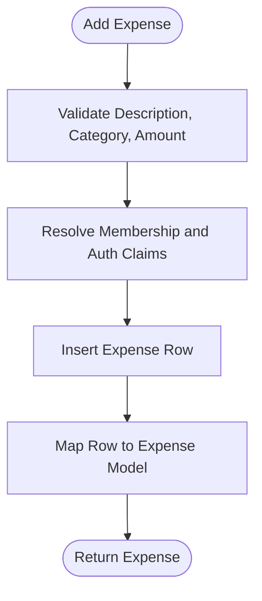

**Diagram sources**
- [actions.ts:126-130](file://src/app/actions.ts#L126-L130)
- [actions.ts:132-143](file://src/app/actions.ts#L132-L143)

**Section sources**
- [actions.ts:126-143](file://src/app/actions.ts#L126-L143)

#### `saveProductAction`
Saves product catalog data:
- Validates code, name, category, price, image URL, active flag, and recipe lines.
- Calls the `save_product` RPC.
- Reloads the catalog and revalidates the path.
- Returns updated products and inventory.

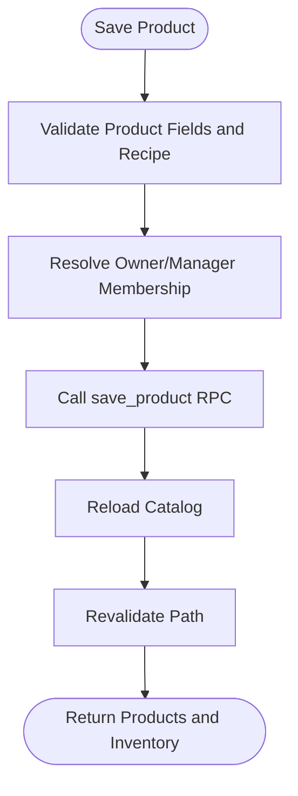

**Diagram sources**
- [actions.ts:191-199](file://src/app/actions.ts#L191-L199)
- [actions.ts:201-215](file://src/app/actions.ts#L201-L215)

**Section sources**
- [actions.ts:191-215](file://src/app/actions.ts#L191-L215)

#### `saveInventoryItemAction`
Saves inventory item data:
- Validates code, name, unit, cost, reorder point, supplier, opening stock, and optional counted stock.
- Calls the `save_inventory_item` RPC.
- Parses the RPC result to extract the movement ID.
- Loads catalog and optional movement, then returns combined results.

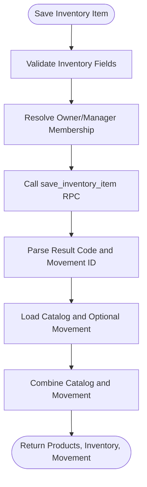

**Diagram sources**
- [actions.ts:237-246](file://src/app/actions.ts#L237-L246)
- [actions.ts:248-271](file://src/app/actions.ts#L248-L271)

**Section sources**
- [actions.ts:237-271](file://src/app/actions.ts#L237-L271)

### Idempotency Key Mechanism
Idempotency prevents duplicate transactions caused by retries, offline resubmission, or double taps.

- Client-generated idempotency keys are validated by Server Actions (length and format).
- The `complete_sale` RPC stores the key in `sales_order.idempotency_key` and enforces a unique constraint per business.
- If a request arrives with the same key, the function returns the existing order ID instead of creating a duplicate.
- Concurrent retries are handled safely: a unique violation triggers a lookup of the already-created order.

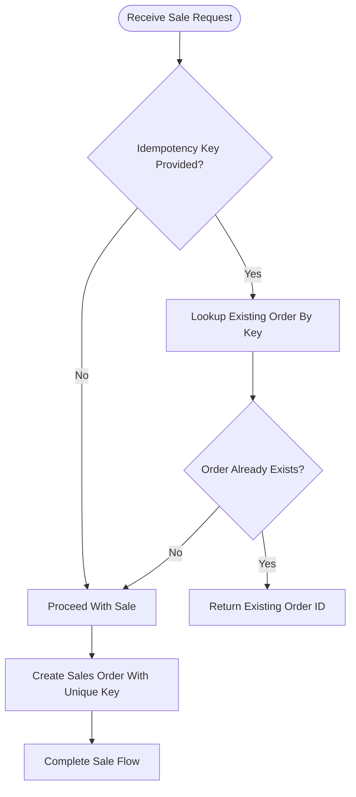

**Diagram sources**
- [actions.ts:40-50](file://src/app/actions.ts#L40-L50)
- [actions.ts:52-89](file://src/app/actions.ts#L52-L89)
- [0001_schema.sql:153-171](file://supabase/migrations/0001_schema.sql#L153-L171)
- [0003_functions.sql:127-132](file://supabase/migrations/0003_functions.sql#L127-L132)
- [0003_functions.sql:181-190](file://supabase/migrations/0003_functions.sql#L181-L190)

**Section sources**
- [actions.ts:40-89](file://src/app/actions.ts#L40-L89)
- [0001_schema.sql:153-171](file://supabase/migrations/0001_schema.sql#L153-L171)
- [0003_functions.sql:127-132](file://supabase/migrations/0003_functions.sql#L127-L132)
- [0003_functions.sql:181-190](file://supabase/migrations/0003_functions.sql#L181-L190)

### Error Handling Strategies
Error handling is consistent across Server Actions:
- Zod validation errors return a friendly message derived from the first issue.
- Network or fetch failures are detected and converted into a connection error message.
- Other errors propagate their message unless they are not instances of `Error`.
- Database RPC errors are thrown and caught by the wrapper, returning a failure envelope.

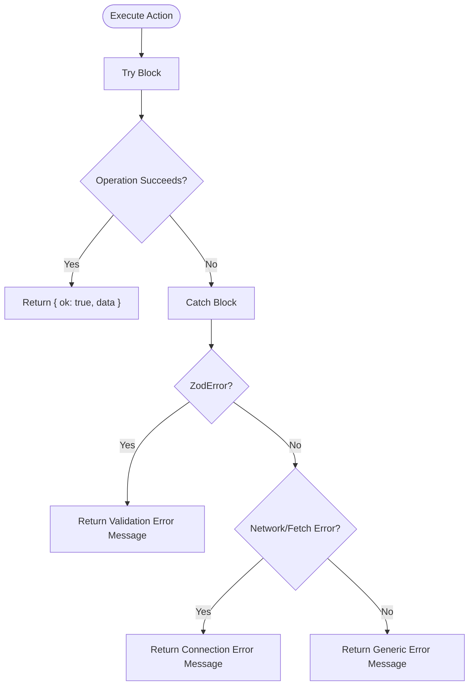

**Diagram sources**
- [actions.ts:30-38](file://src/app/actions.ts#L30-L38)

**Section sources**
- [actions.ts:30-38](file://src/app/actions.ts#L30-L38)

### Transaction Handling, Validation, and Rollback
Ledger mutations are executed inside PostgreSQL functions marked `SECURITY DEFINER`:
- Membership and role checks are repeated inside the function.
- Prices and costs are resolved from the database, not trusted from the client.
- All changes within a function run in a single transaction.
- If any step fails, the transaction rolls back automatically.
- Audit logs are written only after successful completion.

For sales:
- Input validation includes payment method, channel, cart emptiness, quantity bounds, discount limits, cash sufficiency, and ingredient stock availability.
- Ingredient rows are locked in a stable order before checking stock.
- If stock is insufficient, the function raises an exception, causing a rollback.
- The order, order items, payment, stock movements, and audit log are inserted atomically.

For purchases:
- Line items are validated and processed in order.
- Inventory rows are locked before updating moving-average cost.
- Purchase lines and stock movements are inserted atomically.
- HPP refresh runs after all lines are processed.

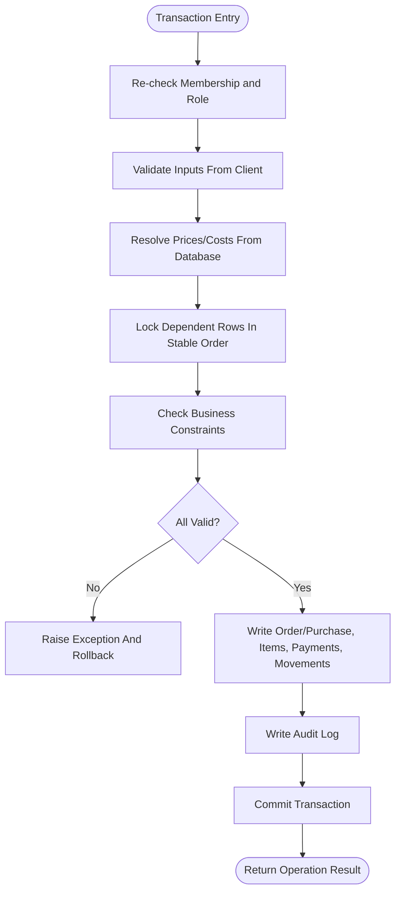

**Diagram sources**
- [0003_functions.sql:1-7](file://supabase/migrations/0003_functions.sql#L1-L7)
- [0003_functions.sql:122-132](file://supabase/migrations/0003_functions.sql#L122-L132)
- [0003_functions.sql:147-179](file://supabase/migrations/0003_functions.sql#L147-L179)
- [0003_functions.sql:181-230](file://supabase/migrations/0003_functions.sql#L181-L230)
- [0003_functions.sql:253-303](file://supabase/migrations/0003_functions.sql#L253-L303)

**Section sources**
- [0003_functions.sql:1-7](file://supabase/migrations/0003_functions.sql#L1-L7)
- [0003_functions.sql:94-230](file://supabase/migrations/0003_functions.sql#L94-L230)
- [0003_functions.sql:236-303](file://supabase/migrations/0003_functions.sql#L236-L303)

### Data Validation Examples
Validation examples include:
- Cart items must be an array of objects with valid product codes, positive integer quantities, and optional notes.
- Payment methods are restricted to cash, QRIS, or transfer.
- Cash received must be non-negative and sufficient for cash payments.
- Phone numbers must match a digit-only pattern with optional leading plus.
- Product images accept either a local `/images/*.webp` path or a valid HTTPS URL.
- Inventory units must start with a letter and contain allowed characters.

These validations occur at the Server Action boundary before any database mutation.

**Section sources**
- [actions.ts:40-50](file://src/app/actions.ts#L40-L50)
- [actions.ts:91-95](file://src/app/actions.ts#L91-L95)
- [actions.ts:126-130](file://src/app/actions.ts#L126-L130)
- [actions.ts:145-148](file://src/app/actions.ts#L145-L148)
- [actions.ts:191-199](file://src/app/actions.ts#L191-L199)
- [actions.ts:237-246](file://src/app/actions.ts#L237-L246)

## Dependency Analysis
The data layer has clear dependencies:

- Server Actions depend on Zod for validation, Supabase clients for database access, and the repository for membership and catalog loading.
- The repository depends on Supabase client methods and domain types.
- Database functions depend on RLS helper functions and schema-defined tables.
- Domain models are consumed by both repository mappings and Server Action responses.

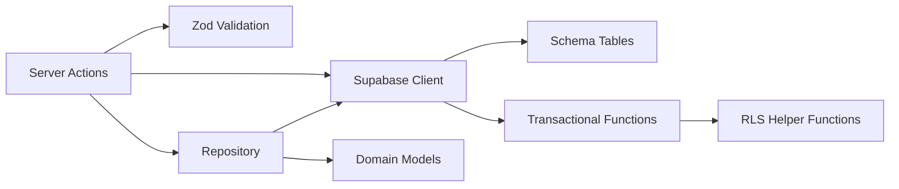

**Diagram sources**
- [actions.ts:1-14](file://src/app/actions.ts#L1-L14)
- [repo.ts:1-5](file://src/lib/repo.ts#L1-L5)
- [0002_rls.sql:12-25](file://supabase/migrations/0002_rls.sql#L12-L25)
- [0003_functions.sql:1-7](file://supabase/migrations/0003_functions.sql#L1-L7)

**Section sources**
- [actions.ts:1-14](file://src/app/actions.ts#L1-L14)
- [repo.ts:1-5](file://src/lib/repo.ts#L1-L5)
- [0002_rls.sql:12-25](file://supabase/migrations/0002_rls.sql#L12-L25)
- [0003_functions.sql:1-7](file://supabase/migrations/0003_functions.sql#L1-L7)

## Performance Considerations
- **Paginated reads**: Large result sets are fetched using range queries with a page size of 1000. This reduces memory pressure and avoids returning extremely large payloads.
- **Parallel queries**: Snapshot loading performs multiple independent reads concurrently, then merges results. This improves responsiveness when assembling business state.
- **Selective team data**: Team member queries are skipped for roles without permission, reducing unnecessary work.
- **Indexing**: Schema migrations define useful indexes on business-scoped columns and date-descending ordering for recent records.
- **Avoiding client-side totals**: Prices and costs are resolved server-side to prevent expensive or incorrect client calculations.

[No sources needed since this section provides general guidance]

## Troubleshooting Guide
Common issues and how to diagnose them:

| Symptom | Likely Cause | Resolution |
|---|---|---|
| Action returns a validation error | Zod schema failed | Inspect the input fields against the action’s schema. Check required strings, numeric ranges, enums, and phone number format. |
| Action returns a connection error | Network failure or Supabase unreachable | Verify internet connectivity, environment variables, and Supabase project status. |
| Sale creation fails due to insufficient stock | Ingredient stock below required amount | Check stock movements and current inventory levels. Adjust opening stock or perform a purchase before selling. |
| Duplicate sale appears despite retry | Missing or inconsistent idempotency key | Ensure the client generates a stable idempotency key per intended transaction and does not change it on retry. |
| Permission denied | User lacks required role | Confirm membership and role. Catalog writes require owner or manager; sales require owner, manager, or cashier. |
| Customer phone conflict | Unique constraint on business-scoped phone | Use a different phone number or update the existing customer record. |

**Section sources**
- [actions.ts:30-38](file://src/app/actions.ts#L30-L38)
- [actions.ts:150-160](file://src/app/actions.ts#L150-L160)
- [0003_functions.sql:152-179](file://supabase/migrations/0003_functions.sql#L152-L179)
- [0001_schema.sql:132-148](file://supabase/migrations/0001_schema.sql#L132-L148)

## Security Considerations
Security is enforced at multiple layers:

- **Row-Level Security**: Every tenant table enables RLS and forces RLS. Policies restrict reads and writes based on `business_id` and membership roles.
- **Membership helper**: A `SECURITY DEFINER` helper checks membership without recursing into policy evaluation.
- **Ledger protection**: Direct client writes to ledger tables are blocked; mutations must go through `SECURITY DEFINER` functions that re-check membership and roles.
- **Role-based policies**:
  - Catalog writes require owner or manager.
  - Customer inserts and updates allow owner, manager, or cashier.
  - Expense inserts require the actor to be the logged-in user; updates and deletes require owner or manager.
  - Audit logs are readable only by owner or manager.
- **Input sanitization**:
  - Server Actions validate and trim strings, enforce length limits, and restrict enums.
  - Database functions sanitize notes, names, and phone numbers, and reject invalid values.
  - Image URLs are validated to allow only safe local paths or HTTPS URLs.
- **Service-role key**: Used only on the server for administrative tasks such as inviting users. It should never be exposed to the browser.

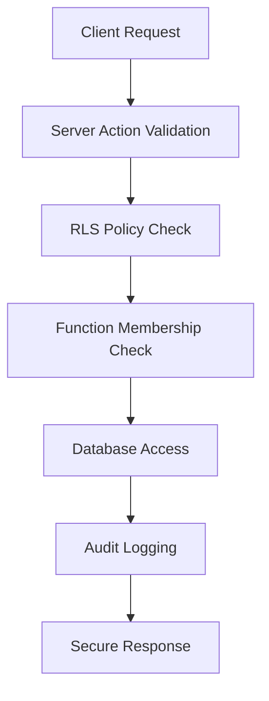

**Diagram sources**
- [0002_rls.sql:1-8](file://supabase/migrations/0002_rls.sql#L1-L8)
- [0002_rls.sql:12-25](file://supabase/migrations/0002_rls.sql#L12-L25)
- [0002_rls.sql:46-131](file://supabase/migrations/0002_rls.sql#L46-L131)
- [0003_functions.sql:1-7](file://supabase/migrations/0003_functions.sql#L1-L7)
- [actions.ts:191-199](file://src/app/actions.ts#L191-L199)

**Section sources**
- [0002_rls.sql:1-131](file://supabase/migrations/0002_rls.sql#L1-L131)
- [0003_functions.sql:1-7](file://supabase/migrations/0003_functions.sql#L1-L7)
- [actions.ts:191-199](file://src/app/actions.ts#L191-L199)
- [README.md:89-95](file://README.md#L89-L95)

## Conclusion
The data management layer cleanly separates concerns:
- Server Actions provide a secure, validated mutation surface.
- The repository module abstracts Supabase reads and maps rows into domain models.
- Database functions enforce business rules, idempotency, and atomicity.
- RLS policies ensure tenant isolation and role-based access.

This design supports reliable POS operations, accurate inventory accounting, and safe multi-user collaboration while keeping the frontend focused on presentation and user interaction.

[No sources needed since this section summarizes without analyzing specific files]