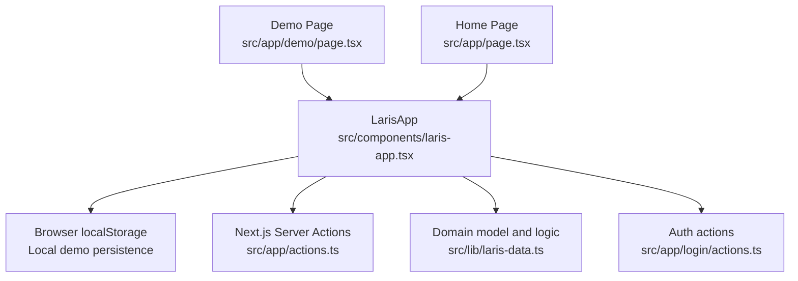
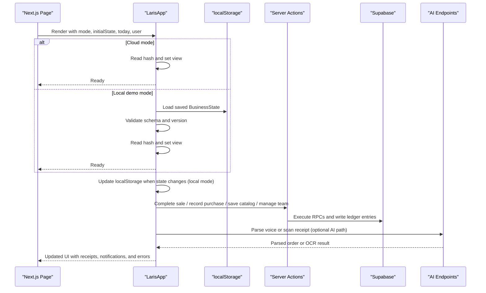
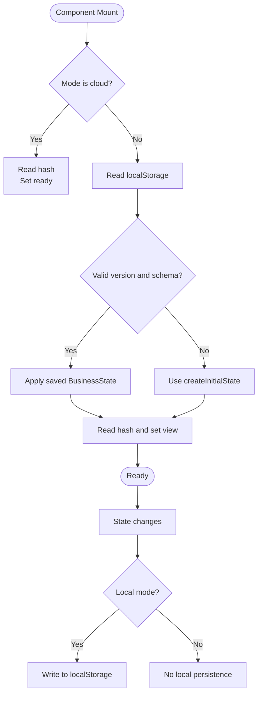
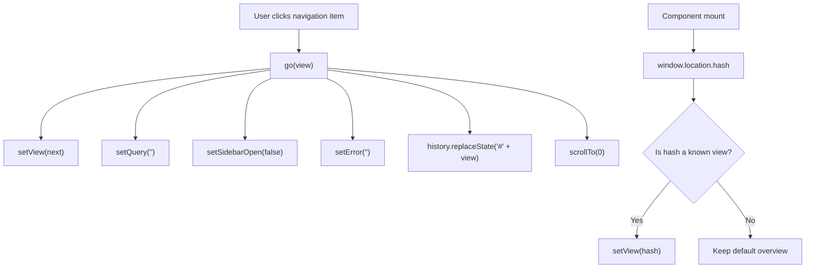
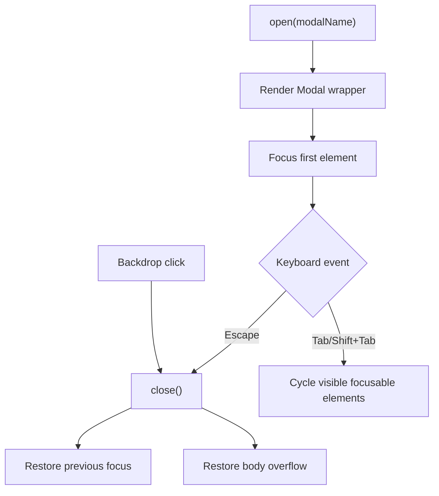
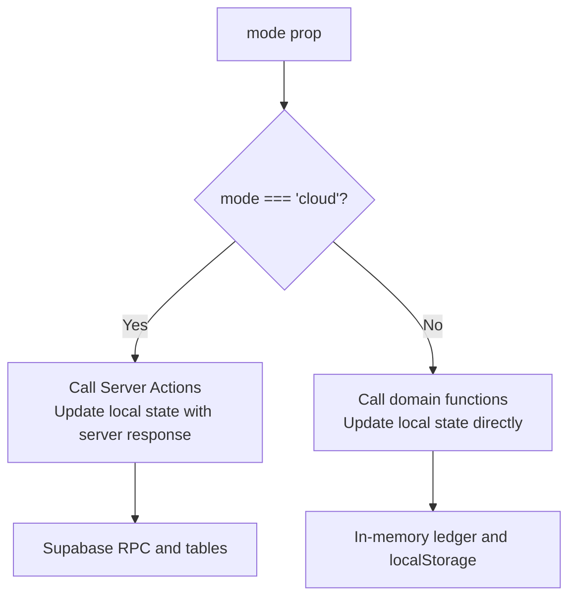
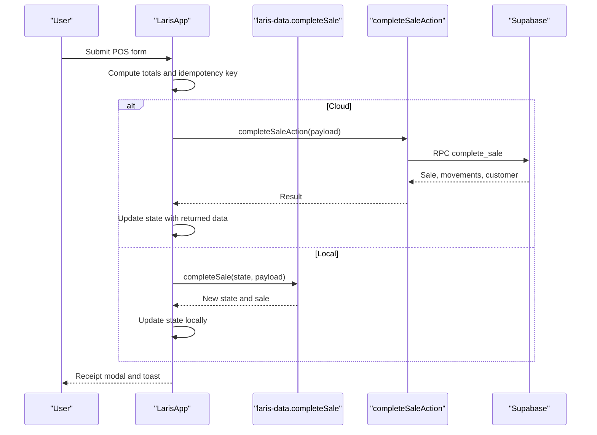
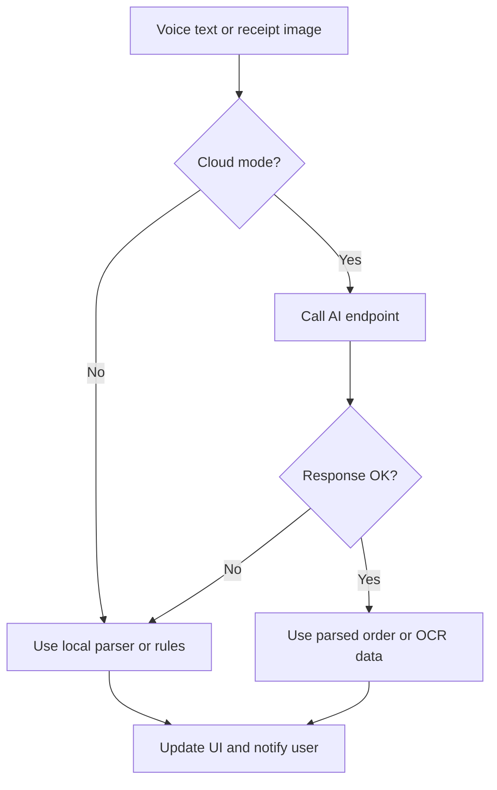
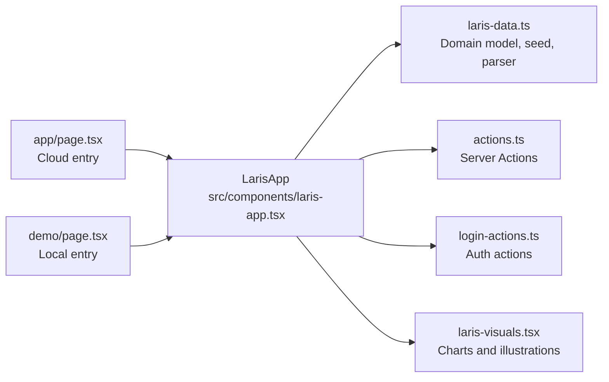

# Main Application Shell

<cite>
**Referenced Files in This Document**   
- [laris-app.tsx](file://src/components/laris-app.tsx)
- [laris-data.ts](file://src/lib/laris-data.ts)
- [actions.ts](file://src/app/actions.ts)
- [login-actions.ts](file://src/app/login/actions.ts)
- [app-page.tsx](file://src/app/page.tsx)
- [demo-page.tsx](file://src/app/demo/page.tsx)
- [README.md](file://README.md)
</cite>

## Table of Contents
1. [Introduction](#introduction)
2. [Project Structure](#project-structure)
3. [Core Components](#core-components)
4. [Architecture Overview](#architecture-overview)
5. [Detailed Component Analysis](#detailed-component-analysis)
6. [Dependency Analysis](#dependency-analysis)
7. [Performance Considerations](#performance-considerations)
8. [Troubleshooting Guide](#troubleshooting-guide)
9. [Conclusion](#conclusion)

## Introduction
LarisApp is the central client-side container for the Laris F&B workspace. It owns business state, renders the navigation shell, coordinates POS operations, inventory and purchase flows, customer management, financial summaries, AI assistant interactions, voice-to-cart parsing, receipt scanning, and modal-driven workflows. It supports two operating modes:

- **Local demo mode**: Uses browser `localStorage` persistence with deterministic demo data for “Kopi Senja”.
- **Cloud mode**: Loads a Supabase snapshot from the server, calls Next.js Server Actions, and updates the UI through optimistic local state transitions.

The component also implements hash-based routing, keyboard shortcuts, an accessible modal system, responsive layouts, and performance optimizations such as `useMemo` and `useCallback`.

**Section sources**
- [laris-app.tsx:27-33](file://src/components/laris-app.tsx#L27-L33)
- [laris-app.tsx:81-137](file://src/components/laris-app.tsx#L81-L137)
- [README.md:9-22](file://README.md#L9-L22)

## Project Structure
LarisApp lives under `src/components` and is mounted by two Next.js pages:

| Route | Purpose | Mode | State Source |
|---|---|---|---|
| `/demo` | Local demo with fictional coffee shop data | `local` | Browser `localStorage` |
| `/` | Cloud workspace after authentication | `cloud` | Supabase snapshot loaded on the server |

**Diagram sources**
- [demo-page.tsx:1-11](file://src/app/demo/page.tsx#L1-L11)
- [app-page.tsx:1-18](file://src/app/page.tsx#L1-L18)
- [laris-app.tsx:14-25](file://src/components/laris-app.tsx#L14-L25)

**Section sources**
- [demo-page.tsx:1-11](file://src/app/demo/page.tsx#L1-L11)
- [app-page.tsx:1-18](file://src/app/page.tsx#L1-L18)
- [README.md:97-109](file://README.md#L97-L109)

## Core Components
LarisApp is implemented as a single large React client component. Its responsibilities include:

| Responsibility | Implementation Summary |
|---|---|
| Business state | Holds `BusinessState`, including sales, stock movements, expenses, customers, purchases, catalog, inventory, team members, and settings. |
| Dual-mode operation | Switches between local `localStorage` persistence and cloud Server Actions based on the `mode` prop. |
| Navigation | Maintains current view, sidebar state, and hash-based URL routing. |
| Modal system | Provides a reusable modal wrapper with focus trapping, Escape handling, backdrop dismissal, and accessibility attributes. |
| View switching | Renders different feature sections depending on the active view. |
| User interactions | Handles cart updates, checkout, purchases, expenses, customers, product/inventory editing, invitations, and settings. |
| AI features | Integrates voice input, order parsing, receipt OCR, and Tanya Laris assistant responses. |
| Performance | Uses `useMemo` for derived values and `useCallback` for stable handlers. |

**Section sources**
- [laris-app.tsx:81-137](file://src/components/laris-app.tsx#L81-L137)
- [laris-app.tsx:146-185](file://src/components/laris-app.tsx#L146-L185)
- [laris-app.tsx:187-206](file://src/components/laris-app.tsx#L187-L206)

## Architecture Overview
At runtime, LarisApp acts as the application shell and orchestrator:

**Diagram sources**
- [laris-app.tsx:146-168](file://src/components/laris-app.tsx#L146-L168)
- [laris-app.tsx:213-267](file://src/components/laris-app.tsx#L213-L267)
- [laris-app.tsx:311-391](file://src/components/laris-app.tsx#L311-L391)
- [actions.ts:52-89](file://src/app/actions.ts#L52-L89)

## Detailed Component Analysis

### State Management Patterns
LarisApp uses a centralized local state pattern:

- **Single source of truth**: `state` holds the full `BusinessState`.
- **Derived data**: Products and inventory are resolved from state or demo defaults.
- **Computed metrics**: Revenue, growth, low-stock items, top products, chart series, and cart totals are computed during render or via `useMemo`.
- **Feature-scoped state**: Cart, search query, category filter, payment options, customer fields, voice input, parsed orders, assistant messages, and editor drafts live alongside the main state.
- **Persistence strategy**:
  - Local mode: loads from `localStorage` on mount and writes back whenever state changes.
  - Cloud mode: receives `initialState` from the server; UI mutations call Server Actions and update local state with returned data.

**Diagram sources**
- [laris-app.tsx:81-90](file://src/components/laris-app.tsx#L81-L90)
- [laris-app.tsx:146-168](file://src/components/laris-app.tsx#L146-L168)

**Section sources**
- [laris-app.tsx:81-137](file://src/components/laris-app.tsx#L81-L137)
- [laris-app.tsx:146-168](file://src/components/laris-app.tsx#L146-L168)
- [laris-data.ts:97-110](file://src/lib/laris-data.ts#L97-L110)

### Navigation System with Hash-Based Routing
Navigation is controlled by a `View` type and a structured navigation definition:

- Views include overview, POS, transactions, products, inventory, purchases, customers, storefront, finance, and team.
- The `go` function updates the view, clears search, closes the mobile sidebar, clears errors, scrolls to the top, and updates the URL hash.
- On mount, both cloud and local modes read `window.location.hash` and select a valid view using `pageNames`.
- The sidebar highlights the active view and exposes grouped navigation sections.

**Diagram sources**
- [laris-app.tsx:35-42](file://src/components/laris-app.tsx#L35-L42)
- [laris-app.tsx:135-136](file://src/components/laris-app.tsx#L135-L136)
- [laris-app.tsx:146-164](file://src/components/laris-app.tsx#L146-L164)

**Section sources**
- [laris-app.tsx:35-42](file://src/components/laris-app.tsx#L35-L42)
- [laris-app.tsx:135-136](file://src/components/laris-app.tsx#L135-L136)
- [laris-app.tsx:146-164](file://src/components/laris-app.tsx#L146-L164)

### Modal System with Accessibility Features
The internal `Modal` component provides:

- Focus management: moves focus into the dialog and restores previous focus on close.
- Body scroll lock: temporarily disables body overflow while open.
- Keyboard support: Escape closes the modal; Tab and Shift+Tab trap focus inside visible interactive elements.
- Backdrop dismissal: clicking the backdrop triggers close.
- Accessibility attributes: `role="dialog"`, `aria-modal="true"`, `aria-labelledby`, and descriptive button labels.

**Diagram sources**
- [laris-app.tsx:54-76](file://src/components/laris-app.tsx#L54-L76)

**Section sources**
- [laris-app.tsx:54-76](file://src/components/laris-app.tsx#L54-L76)

### View Switching Logic
LarisApp manages multiple views through a single `view` state variable. Each view corresponds to a business area:

| View | Primary Purpose |
|---|---|
| `overview` | Dashboard with revenue, growth, low stock, top products, and recent transactions. |
| `pos` | Point-of-sale cart, payment selection, discount/tax controls, and checkout. |
| `transactions` | Transaction list with filtering, pagination, and receipt preview. |
| `products` | Product catalog and recipe editing. |
| `inventory` | Ingredient management, reorder points, opening stock, and stocktake adjustments. |
| `purchases` | Record ingredient purchases, optionally from scanned receipts. |
| `customers` | Customer list, segments, and registration. |
| `storefront` | Online storefront channel used for checkout metadata. |
| `finance` | Expenses, targets, CSV export, and financial summaries. |
| `team` | Team member invitations and access roles. |

The rendering logic is split across many inline functions and JSX blocks within the same component file. For example, transaction rendering includes desktop table and mobile card variants, payment badges, and receipt navigation.

**Section sources**
- [laris-app.tsx:35-42](file://src/components/laris-app.tsx#L35-L42)
- [laris-app.tsx:643-800](file://src/components/laris-app.tsx#L643-L800)

### Dual-Mode Operation: Local Demo vs Cloud
| Aspect | Local Demo Mode | Cloud Mode |
|---|---|---|
| Entry point | `/demo` passes `mode="local"` | `/` passes `mode="cloud"` with server-loaded snapshot |
| Initial state | `createInitialState(activeToday)` | `initialState` from `loadSnapshot` |
| Persistence | `localStorage` with versioned schema validation | Server Actions and Supabase RPCs |
| Checkout | `completeSale` from domain model | `completeSaleAction` calling Supabase RPC |
| Purchases | `recordPurchase` from domain model | `recordPurchaseAction` updating inventory and moving average cost |
| Catalog edits | Local product/inventory mutation | `saveProductAction` / `saveInventoryItemAction` |
| Team and settings | Local state updates | Server Actions with role checks |
| Error behavior | In-memory error state and toast notifications | Server Action results mapped to user-friendly messages |

**Diagram sources**
- [laris-app.tsx:213-267](file://src/components/laris-app.tsx#L213-L267)
- [laris-app.tsx:393-435](file://src/components/laris-app.tsx#L393-L435)
- [actions.ts:52-89](file://src/app/actions.ts#L52-L89)

**Section sources**
- [demo-page.tsx:1-11](file://src/app/demo/page.tsx#L1-L11)
- [app-page.tsx:1-18](file://src/app/page.tsx#L1-L18)
- [laris-app.tsx:213-267](file://src/components/laris-app.tsx#L213-L267)
- [laris-app.tsx:393-435](file://src/components/laris-app.tsx#L393-L435)
- [actions.ts:52-89](file://src/app/actions.ts#L52-L89)

### Business State Coordination
LarisApp coordinates several business workflows:

#### Checkout Flow
1. Prevent default form submission and clear errors.
2. In cloud mode, build an idempotency fingerprint and key, then call `completeSaleAction`.
3. On success, append the returned sale, stock movements, and updated customer to local state.
4. In local mode, call `completeSale` from `laris-data.ts`, which validates cart, prices, cash received, stock availability, and creates ledger entries.
5. Show receipt modal, reset cart state, and display a toast.

**Diagram sources**
- [laris-app.tsx:213-267](file://src/components/laris-app.tsx#L213-L267)
- [laris-data.ts:215-305](file://src/lib/laris-data.ts#L215-L305)
- [actions.ts:52-89](file://src/app/actions.ts#L52-L89)

**Section sources**
- [laris-app.tsx:213-267](file://src/components/laris-app.tsx#L213-L267)
- [laris-data.ts:215-305](file://src/lib/laris-data.ts#L215-L305)
- [actions.ts:52-89](file://src/app/actions.ts#L52-L89)

#### Purchase and Inventory Flow
- Purchase submissions validate quantity and total, then either call `recordPurchaseAction` or `recordPurchase`.
- Domain logic computes moving-average cost, updates inventory, recalculates product costs based on recipes, and appends stock movement records.
- Receipt scanning populates purchase form fields and may warn about price increases.

**Section sources**
- [laris-app.tsx:361-435](file://src/components/laris-app.tsx#L361-L435)
- [laris-data.ts:307-334](file://src/lib/laris-data.ts#L307-L334)
- [actions.ts:91-124](file://src/app/actions.ts#L91-L124)

#### Customer, Settings, Product, Inventory, and Team Workflows
- Customer creation validates name and phone format, prevents duplicates in local mode, and adds members to local or cloud state.
- Settings require owner-level permissions in local mode and call `updateSettingsAction` in cloud mode.
- Product and inventory editors validate inputs, compute costs, and update catalogs.
- Team invitations call `inviteTeamMemberAction`, optionally inviting users without accounts through Supabase Admin.

**Section sources**
- [laris-app.tsx:437-641](file://src/components/laris-app.tsx#L437-L641)
- [actions.ts:126-290](file://src/app/actions.ts#L126-L290)

### Responsive Design and Mobile-First UI
LarisApp uses Tailwind utility classes to adapt layouts:

- Desktop/tablet: table-based transaction lists and wider modals.
- Mobile: card-based transaction lists, collapsible sidebar, and touch-friendly buttons.
- Sidebar overlay closes navigation on mobile.
- Search modal and other dialogs use consistent spacing and typography.

Examples include hidden/md:block patterns for desktop tables and md:hidden blocks for mobile cards.

**Section sources**
- [laris-app.tsx:683-800](file://src/components/laris-app.tsx#L683-L800)
- [laris-app.tsx:915-920](file://src/components/laris-app.tsx#L915-L920)

### Keyboard Shortcuts
Global keyboard listeners provide:

- `Ctrl+K` or `Meta+K`: opens the search modal and clears the query.
- `Escape`: closes the mobile sidebar.

These shortcuts are attached to `document` and cleaned up on unmount.

**Section sources**
- [laris-app.tsx:178-185](file://src/components/laris-app.tsx#L178-L185)

### AI Integration Points
LarisApp integrates three AI-related capabilities:

| Feature | Local Behavior | Cloud Behavior |
|---|---|---|
| Voice-to-cart | Uses `parseOrder` against the active catalog | Calls `/api/ai/parse-order`; falls back to local parser on failure |
| Receipt scanning | Not applicable in pure local demo flow | Calls `/api/ai/scan-receipt`; fills purchase form and warns about price hikes |
| Tanya Laris assistant | Rule-based answers using current state metrics | Calls `/api/ai/ask`; falls back to rule-based answers if the endpoint fails |

**Diagram sources**
- [laris-app.tsx:274-309](file://src/components/laris-app.tsx#L274-L309)
- [laris-app.tsx:311-391](file://src/components/laris-app.tsx#L311-L391)

**Section sources**
- [laris-app.tsx:274-309](file://src/components/laris-app.tsx#L274-L309)
- [laris-app.tsx:311-391](file://src/components/laris-app.tsx#L311-L391)
- [README.md:51-58](file://README.md#L51-L58)

## Dependency Analysis
LarisApp depends on several layers:

**Diagram sources**
- [laris-app.tsx:14-25](file://src/components/laris-app.tsx#L14-L25)
- [app-page.tsx:1-18](file://src/app/page.tsx#L1-L18)
- [demo-page.tsx:1-11](file://src/app/demo/page.tsx#L1-L11)

Key dependency relationships:

- **Domain model**: `laris-data.ts` defines types, demo data, stock calculations, cart totals, sales ledger, purchase ledger, initial state generation, order parsing, and CSV export.
- **Server Actions**: `actions.ts` validates inputs with Zod, enforces membership and roles, calls Supabase RPCs, and returns mapped entities.
- **Auth actions**: `login-actions.ts` handles sign-in, sign-up, password reset, judge login, and sign-out.
- **Visual components**: `laris-visuals.tsx` provides charts, sparklines, empty states, and branding visuals reused by the dashboard.

**Section sources**
- [laris-data.ts:1-110](file://src/lib/laris-data.ts#L1-L110)
- [actions.ts:1-38](file://src/app/actions.ts#L1-L38)
- [login-actions.ts:1-33](file://src/app/login/actions.ts#L1-L33)

## Performance Considerations
LarisApp applies several performance strategies:

| Optimization | Usage | Benefit |
|---|---|---|
| `useMemo` | Categories, daily sales, range sales, previous sales, revenue, growth, low stock, top products, cart totals, chart dates/values, filtered products | Avoids recomputation on unrelated re-renders |
| `useCallback` | Toast notification, navigation, and other handlers | Stabilizes references for child components and effects |
| Refs | Toast timer, speech recognition instance, idempotency fingerprints | Prevents stale closures and avoids unnecessary re-renders |
| Local-first mutations | Local demo mode updates state synchronously | Reduces network latency and keeps UI responsive |
| Idempotency keys | Checkout and purchase attempts prevent duplicate mutations | Improves reliability under retries |

Potential optimization opportunities:

- Extract expensive chart computations into a dedicated hook or memoized selector if datasets grow significantly.
- Consider virtualizing long transaction lists beyond the current pagination approach.
- Debounce search input if the product catalog becomes large.
- Separate heavy modal content into lazy-loaded subcomponents to reduce initial bundle size.

**Section sources**
- [laris-app.tsx:90-90](file://src/components/laris-app.tsx#L90-L90)
- [laris-app.tsx:134-136](file://src/components/laris-app.tsx#L134-L136)
- [laris-app.tsx:187-206](file://src/components/laris-app.tsx#L187-L206)
- [laris-app.tsx:221-224](file://src/components/laris-app.tsx#L221-L224)
- [laris-app.tsx:401-404](file://src/components/laris-app.tsx#L401-L404)

## Troubleshooting Guide
Common issues and their handling:

| Issue | Symptom | Handling |
|---|---|---|
| Invalid or corrupted localStorage data | Local demo fails to load saved state | Catches parse errors, shows a toast, and resets to demo state |
| Full browser storage | Cannot persist changes | Catches `localStorage.setItem` errors and notifies the user |
| Missing voice support | Speech recognition unavailable | Shows an error and falls back to text input |
| Microphone permission denied | Voice recording fails | Sets error message and stops recording |
| Network failure during AI calls | AI endpoints fail | Falls back to local parser or rule-based assistant response |
| Invalid checkout input | Cash insufficient, invalid payment method, or invalid customer phone | Throws domain errors or sets error state |
| Duplicate customer phone | Local mode rejects duplicate phones | Displays validation error |
| Cloud action failures | Server Action returns `ok: false` | Maps error message to UI state |
| Role restrictions | Owner-only or manager-only actions blocked | Shows permission error or prevents submission |

Recommended debugging steps:

1. Check whether the app is running in local or cloud mode.
2. Verify that the URL hash matches a valid view.
3. Inspect toast messages and error state at the top of the component.
4. For cloud mode, verify Supabase configuration and environment variables.
5. For AI features, confirm browser microphone permissions and endpoint availability.
6. For inventory and product edits, validate input constraints before submitting.

**Section sources**
- [laris-app.tsx:153-160](file://src/components/laris-app.tsx#L153-L160)
- [laris-app.tsx:166-168](file://src/components/laris-app.tsx#L166-L168)
- [laris-app.tsx:342-359](file://src/components/laris-app.tsx#L342-L359)
- [laris-app.tsx:361-391](file://src/components/laris-app.tsx#L361-L391)
- [laris-app.tsx:437-490](file://src/components/laris-app.tsx#L437-L490)
- [actions.ts:30-38](file://src/app/actions.ts#L30-L38)

## Conclusion
LarisApp is the central shell for the Laris application. It consolidates business state, navigation, modals, view rendering, and cross-feature coordination into one cohesive component. Its dual-mode design makes it suitable for both offline demos and production cloud workspaces. The component demonstrates practical React patterns: centralized state, derived computations, keyboard and accessibility support, responsive layouts, and careful integration with server-side actions and optional AI services.

For maintainability, consider splitting the large component into smaller feature modules while preserving its role as the primary orchestrator. For scalability, introduce more granular memoization, virtualized lists, and lazy-loaded modals as the dataset grows.

[No sources needed since this section summarizes without analyzing specific files]