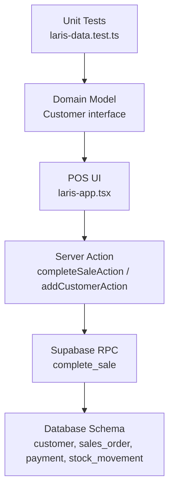
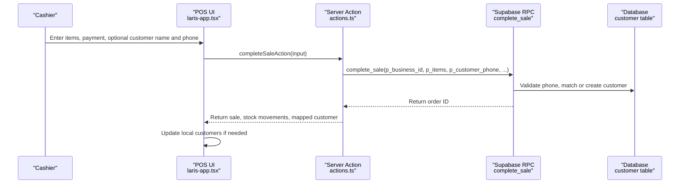
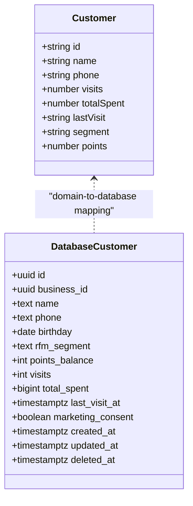
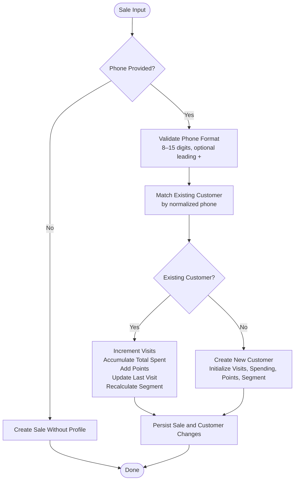
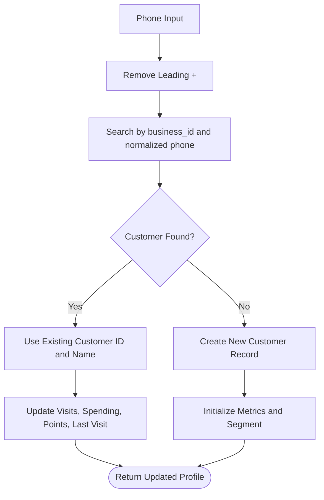
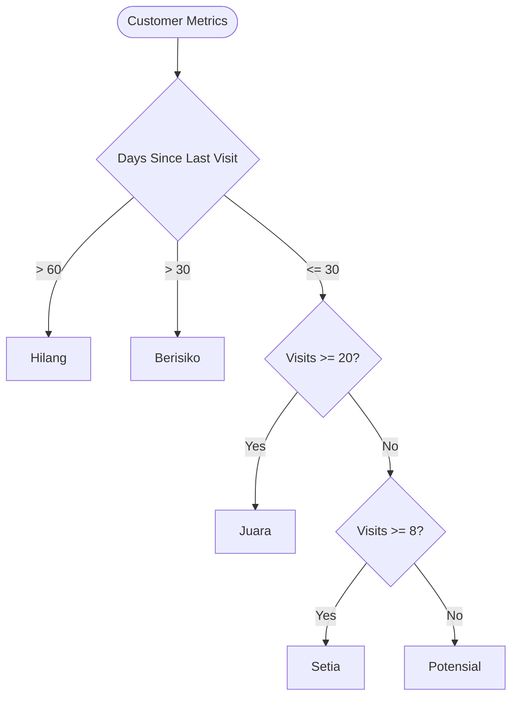
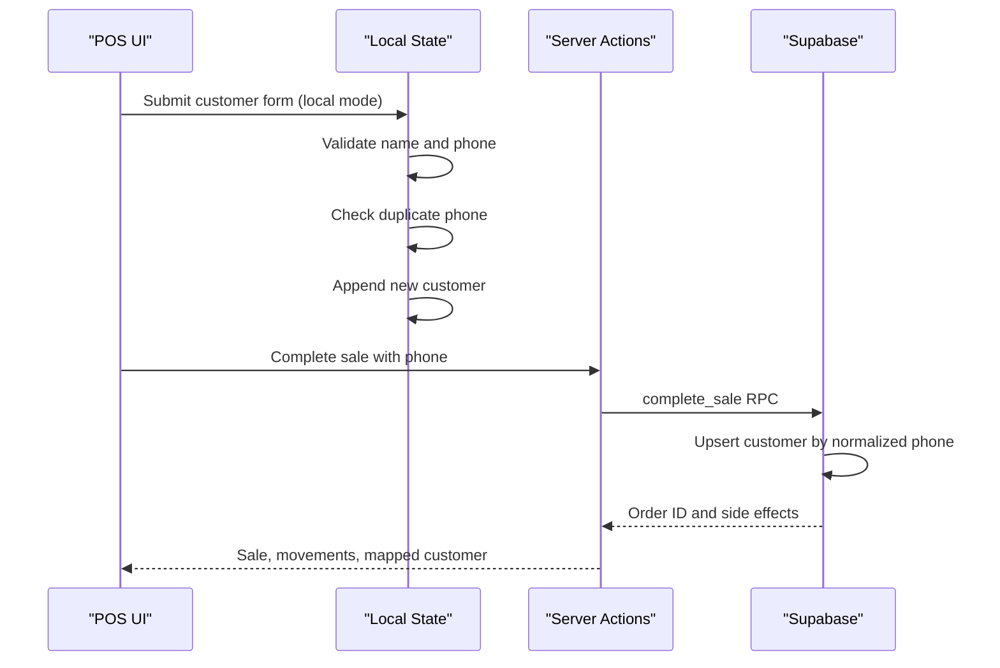
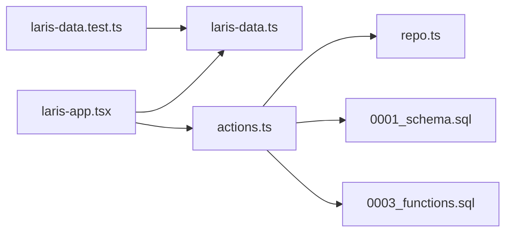

# Customer Profiles

<cite>
**Referenced Files in This Document**
- [laris-data.ts](file://src/lib/laris-data.ts)
- [actions.ts](file://src/app/actions.ts)
- [laris-app.tsx](file://src/components/laris-app.tsx)
- [0001_schema.sql](file://supabase/migrations/0001_schema.sql)
- [0003_functions.sql](file://supabase/migrations/0003_functions.sql)
- [laris-data.test.ts](file://src/lib/laris-data.test.ts)
</cite>

## Table of Contents
1. [Introduction](#introduction)
2. [Project Structure](#project-structure)
3. [Core Components](#core-components)
4. [Architecture Overview](#architecture-overview)
5. [Detailed Component Analysis](#detailed-component-analysis)
6. [Dependency Analysis](#dependency-analysis)
7. [Performance Considerations](#performance-considerations)
8. [Troubleshooting Guide](#troubleshooting-guide)
9. [Privacy and Compliance](#privacy-and-compliance)
10. [Conclusion](#conclusion)

## Introduction
This document explains how Laris manages customer profiles across its local demo state, server actions, and Supabase database. It covers the `Customer` interface fields, phone validation rules, automatic profile creation during sales, visit tracking, spending accumulation, loyalty points, RFM segmentation, and integration with the POS workflow. It also documents privacy considerations for storing contact information under Indonesian data protection regulations.

## Project Structure
The customer profile system spans several layers:

- **Domain model**: The `Customer` interface defines the in-memory profile shape used by the POS UI and local state.
- **POS logic**: The sale completion function updates or creates a customer record when a valid phone number is provided.
- **Server actions**: Next.js server actions validate input, call Supabase RPCs, and normalize phone numbers before persistence.
- **Database schema**: The `customer` table stores normalized phone numbers, RFM segment, points, visits, total spent, last visit timestamp, and marketing consent.
- **Transactional functions**: The `complete_sale` function atomically creates orders, stock movements, payments, and customer records.

**Diagram sources**
- [laris-app.tsx:463-490](file://src/components/laris-app.tsx#L463-L490)
- [actions.ts:40-89](file://src/app/actions.ts#L40-L89)
- [actions.ts:145-160](file://src/app/actions.ts#L45-L160)
- [0003_functions.sql:94-230](file://supabase/migrations/0003_functions.sql#L94-L230)
- [0001_schema.sql:132-148](file://supabase/migrations/0001_schema.sql#L132-L148)
- [laris-data.ts:55-64](file://src/lib/laris-data.ts#L55-L64)

**Section sources**
- [laris-data.ts:55-64](file://src/lib/laris-data.ts#L55-L64)
- [actions.ts:40-89](file://src/app/actions.ts#L40-L89)
- [0001_schema.sql:132-148](file://supabase/migrations/0001_schema.sql#L132-L148)
- [0003_functions.sql:94-230](file://supabase/migrations/0003_functions.sql#L94-L230)

## Core Components
The core customer profile components are:

| Layer | Responsibility | Key Behavior |
|---|---|---|
| `Customer` interface | In-memory profile contract | Defines `id`, `name`, `phone`, `visits`, `totalSpent`, `lastVisit`, `segment`, and `points`. |
| Local POS state | Demo customer management | Creates customers locally when a valid phone is provided; rejects duplicate phones. |
| Server action | Cloud customer creation | Validates name and phone, normalizes phone by removing leading `+`, inserts into `customer`, and maps to `Customer`. |
| Sale completion | Automatic profile update | Matches existing customers by normalized phone, increments visits, accumulates total spent, assigns points, updates last visit, and recalculates RFM segment. |
| Database schema | Persistent profile storage | Enforces non-negative integers, normalized phone format, RFM segment values, unique business-phone pairs, and marketing consent. |
| Transactional function | Atomic POS + customer write | Performs order, payment, stock movement, and customer operations in one transaction. |

**Section sources**
- [laris-data.ts:55-64](file://src/lib/laris-data.ts#L55-L64)
- [laris-app.tsx:463-490](file://src/components/laris-app.tsx#L463-L490)
- [actions.ts:145-160](file://src/app/actions.ts#L45-L160)
- [laris-data.ts:215-305](file://src/lib/laris-data.ts#L215-L305)
- [0001_schema.sql:132-148](file://supabase/migrations/0001_schema.sql#L132-L148)
- [0003_functions.sql:94-230](file://supabase/migrations/0003_functions.sql#L94-L230)

## Architecture Overview
The customer profile lifecycle integrates the POS checkout flow with both local and cloud states.

**Diagram sources**
- [laris-app.tsx:463-490](file://src/components/laris-app.tsx#L463-L490)
- [actions.ts:40-89](file://src/app/actions.ts#L40-L89)
- [0003_functions.sql:94-230](file://supabase/migrations/0003_functions.sql#L94-L230)
- [0001_schema.sql:132-148](file://supabase/migrations/0001_schema.sql#L132-L148)

## Detailed Component Analysis

### Customer Interface and Data Model
The `Customer` interface represents a loyalty-aware customer profile in the application’s domain layer.

| Field | Type | Meaning |
|---|---|---|
| `id` | `string` | Stable identifier for the customer record. |
| `name` | `string` | Displayed customer name; may be updated on repeat purchases. |
| `phone` | `string` | Phone number stored without a leading `+`; validated as 8–15 digits. |
| `visits` | `number` | Number of tracked purchases associated with this phone. |
| `totalSpent` | `number` | Cumulative purchase total attributed to the customer. |
| `lastVisit` | `string` | Timestamp of the most recent purchase. |
| `segment` | `"Juara" \| "Setia" \| "Potensial" \| "Berisiko" \| "Hilang"` | RFM-based loyalty segment. |
| `points` | `number` | Loyalty points accumulated from purchases. |

The database schema mirrors these concepts with additional operational fields such as `business_id`, `rfm_segment`, `points_balance`, `last_visit_at`, `marketing_consent`, timestamps, and soft delete support.

**Diagram sources**
- [laris-data.ts:55-64](file://src/lib/laris-data.ts#L55-L64)
- [0001_schema.sql:132-148](file://supabase/migrations/0001_schema.sql#L132-L148)

**Section sources**
- [laris-data.ts:55-64](file://src/lib/laris-data.ts#L55-L64)
- [0001_schema.sql:132-148](file://supabase/migrations/0001_schema.sql#L132-L148)

### Customer Creation During Sales Transactions
When a sale includes a valid phone number, the system either matches an existing customer or creates a new profile.

Key behaviors:

- A sale without a phone does not create a customer profile.
- A sale with a valid phone creates or updates a customer profile.
- Existing customers have their visit count incremented.
- Total spent accumulates per sale total.
- Points are awarded based on the sale total.
- Last visit timestamp is updated.
- RFM segment is recalculated after the update.

**Diagram sources**
- [laris-data.ts:215-305](file://src/lib/laris-data.ts#L215-L305)
- [0003_functions.sql:192-209](file://supabase/migrations/0003_functions.sql#L192-L209)

**Section sources**
- [laris-data.ts:215-305](file://src/lib/laris-data.ts#L215-L305)
- [0003_functions.sql:192-209](file://supabase/migrations/0003_functions.sql#L192-L209)

### Contact Information Validation
Phone validation occurs at multiple layers:

| Layer | Rule |
|---|---|
| Local POS form | Requires a name and a phone matching 8–15 digits, optionally starting with `+`. |
| Local sale completion | Rejects invalid phone formats before creating or updating a customer. |
| Server action | Uses Zod validation for 8–15 digits with an optional leading `+`. |
| Database schema | Stores only digits without a leading `+` and enforces the same length constraint. |
| Transactional function | Normalizes the phone by removing the leading `+` and validates the resulting digit-only string. |

Important clarification: although the documentation objective mentions Indonesian phone handling, the implemented rule accepts any 8–15 digit phone number, optionally prefixed with `+`. There is no explicit Indonesia-specific country code enforcement in the current implementation.

**Section sources**
- [laris-app.tsx:463-490](file://src/components/laris-app.tsx#L463-L490)
- [laris-data.ts:254-260](file://src/lib/laris-data.ts#L254-L260)
- [actions.ts:44-45](file://src/app/actions.ts#L44-L45)
- [actions.ts:145-157](file://src/app/actions.ts#L145-L157)
- [0001_schema.sql:136](file://supabase/migrations/0001_schema.sql#L136)
- [0003_functions.sql:192-196](file://supabase/migrations/0003_functions.sql#L192-L196)

### Customer Lookup by Phone Number
Customer lookup uses phone normalization:

- Leading `+` is removed before comparison.
- Matching is performed within the active business context.
- In local state, matching compares normalized phone strings.
- In cloud mode, the server action queries the `customer` table using the normalized phone.

**Diagram sources**
- [laris-data.ts:278-296](file://src/lib/laris-data.ts#L278-L296)
- [actions.ts:70-86](file://src/app/actions.ts#L70-L86)
- [0003_functions.sql:192-209](file://supabase/migrations/0003_functions.sql#L192-L209)

**Section sources**
- [laris-data.ts:278-296](file://src/lib/laris-data.ts#L278-L296)
- [actions.ts:70-86](file://src/app/actions.ts#L70-L86)
- [0003_functions.sql:192-209](file://supabase/migrations/0003_functions.sql#L192-L209)

### RFM Segmentation and Loyalty Points
Segmentation is based on visit frequency and recency:

- More than 60 days since last visit: `Hilang`.
- More than 30 days since last visit: `Berisiko`.
- At least 20 visits: `Juara`.
- At least 8 visits: `Setia`.
- Otherwise: `Potensial`.

Points are calculated as the integer part of the sale total divided by 1,000.

**Diagram sources**
- [laris-data.ts:208-213](file://src/lib/laris-data.ts#L208-L213)
- [0003_functions.sql:17-27](file://supabase/migrations/0003_functions.sql#L17-L27)

**Section sources**
- [laris-data.ts:208-213](file://src/lib/laris-data.ts#L208-L213)
- [0003_functions.sql:17-27](file://supabase/migrations/0003_functions.sql#L17-L27)

### Integration With the POS System
The POS workflow integrates customer profiles through three main paths:

1. **Local demo mode**: The UI validates and creates a local customer when a valid phone is provided. Duplicate phones are rejected.
2. **Cloud checkout**: The server action calls the `complete_sale` RPC, which performs atomic order, payment, stock, and customer writes.
3. **Manual customer creation**: The `addCustomerAction` allows authorized users to register a customer directly with a validated phone.

**Diagram sources**
- [laris-app.tsx:463-490](file://src/components/laris-app.tsx#L463-L490)
- [actions.ts:52-89](file://src/app/actions.ts#L52-L89)
- [actions.ts:145-160](file://src/app/actions.ts#L145-L160)
- [0003_functions.sql:94-230](file://supabase/migrations/0003_functions.sql#L94-L230)

**Section sources**
- [laris-app.tsx:463-490](file://src/components/laris-app.tsx#L463-L490)
- [actions.ts:52-89](file://src/app/actions.ts#L52-L89)
- [actions.ts:145-160](file://src/app/actions.ts#L145-L160)
- [0003_functions.sql:94-230](file://supabase/migrations/0003_functions.sql#L94-L230)

### Example Customer Profile Data Structures
Below are conceptual examples showing how customer data appears in different contexts. These are illustrative structures, not direct code excerpts.

- **Local demo customer**:
  - `id`: generated UUID or stable identifier
  - `name`: entered name
  - `phone`: normalized phone without leading `+`
  - `visits`: starts at 0, increments per sale
  - `totalSpent`: starts at 0, increases by sale total
  - `lastVisit`: ISO-like timestamp string
  - `segment`: initially `Potensial`, then updated by RFM rules
  - `points`: starts at 0, increases by `floor(total / 1000)`

- **Database customer row**:
  - `id`: UUID
  - `business_id`: tenant identifier
  - `name`: text
  - `phone`: digit-only string, 8–15 characters
  - `rfm_segment`: one of the allowed segments
  - `points_balance`: non-negative integer
  - `visits`: non-negative integer
  - `total_spent`: non-negative bigint
  - `last_visit_at`: timestamp
  - `marketing_consent`: boolean opt-in flag

**Section sources**
- [laris-data.ts:55-64](file://src/lib/laris-data.ts#L55-L64)
- [0001_schema.sql:132-148](file://supabase/migrations/0001_schema.sql#L132-L148)

## Dependency Analysis
The customer profile system has clear boundaries between presentation, domain logic, server actions, and database persistence.

**Diagram sources**
- [laris-app.tsx:463-490](file://src/components/laris-app.tsx#L463-L490)
- [laris-data.ts:215-305](file://src/lib/laris-data.ts#L215-L305)
- [actions.ts:40-89](file://src/app/actions.ts#L40-L89)
- [0001_schema.sql:132-148](file://supabase/migrations/0001_schema.sql#L132-L148)
- [0003_functions.sql:94-230](file://supabase/migrations/0003_functions.sql#L94-L230)
- [laris-data.test.ts:363-410](file://src/lib/laris-data.test.ts#L363-L410)

**Section sources**
- [laris-app.tsx:463-490](file://src/components/laris-app.tsx#L463-L490)
- [laris-data.ts:215-305](file://src/lib/laris-data.ts#L215-L305)
- [actions.ts:40-89](file://src/app/actions.ts#L40-L89)
- [0001_schema.sql:132-148](file://supabase/migrations/0001_schema.sql#L132-L148)
- [0003_functions.sql:94-230](file://supabase/migrations/0003_functions.sql#L94-L230)
- [laris-data.test.ts:363-410](file://src/lib/laris-data.test.ts#L363-L410)

## Performance Considerations
- **Normalized phone lookup**: Removing the leading `+` before matching avoids repeated normalization and reduces mismatch risk.
- **Atomic writes**: The database RPC ensures that order, payment, stock movement, and customer updates occur together, preventing partial state.
- **RFM calculation**: Segment computation is simple and runs once per customer update.
- **Duplicate prevention**: Unique constraints on `business_id` and `phone` prevent accidental duplication at the database level.
- **Local vs cloud**: Local demo state is fast but isolated; cloud mode adds network latency but provides persistent, multi-user safety.

[No sources needed since this section provides general guidance]

## Troubleshooting Guide
Common issues and their causes:

| Symptom | Likely Cause | Resolution |
|---|---|---|
| Invalid phone error during sale | Phone contains non-digit characters or is outside 8–15 digits | Accept only digits, optionally with a leading `+`, and enforce length. |
| Duplicate phone error when adding a customer | Same phone already exists for the business | Prompt the user to use another phone or look up the existing customer. |
| Customer not created despite valid name | No phone was provided | Provide a valid phone to trigger profile creation. |
| Customer profile not updated on repeat sale | Phone normalization differs between inputs | Ensure leading `+` is removed before lookup. |
| Segment remains `Potensial` after many visits | Visit threshold not reached or last visit too recent | Increase visits or wait for recency thresholds to apply. |
| Marketing consent missing | Consent field defaults to false | Capture explicit opt-in when required by policy. |

**Section sources**
- [laris-data.test.ts:363-410](file://src/lib/laris-data.test.ts#L363-L410)
- [actions.ts:145-160](file://src/app/actions.ts#L145-L160)
- [0001_schema.sql:132-148](file://supabase/migrations/0001_schema.sql#L132-L148)

## Privacy and Compliance
Storing customer contact information requires careful handling:

- **Explicit consent**: The database schema includes `marketing_consent`, defaulting to false, supporting explicit opt-in for marketing communications.
- **Data minimization**: Only necessary fields such as name, phone, visits, spending, last visit, segment, and points are stored.
- **Tenant isolation**: Every customer row belongs to a `business_id`, ensuring separation between businesses.
- **Access control**: Row-level security and membership checks restrict access to authorized roles.
- **Auditability**: Sales and related operations are auditable through audit logs and transactional functions.
- **Indonesian data protection**: Under UU PDP, organizations should obtain lawful basis and explicit consent for processing personal data, limit retention, secure storage, and provide mechanisms for correction or deletion. The soft-delete column supports deactivation, while explicit consent handling should be enforced in business logic and UI flows.

Recommendations:

- Require explicit consent before sending marketing messages.
- Allow customers to view, correct, or request deletion of their contact data.
- Encrypt sensitive fields at rest where feasible.
- Restrict phone number visibility to authorized roles.
- Log access to customer records for accountability.
- Review retention policies regularly.

**Section sources**
- [0001_schema.sql:132-148](file://supabase/migrations/0001_schema.sql#L132-L148)
- [README.md:112-117](file://README.md#L112-L117)

## Conclusion
Laris implements a robust customer profile system that balances usability, accuracy, and compliance. The `Customer` interface captures essential loyalty metrics, while layered validation ensures reliable phone handling. Sales automatically track visits, spending, points, and RFM segmentation, with both local and cloud modes supported. The database schema and transactional functions provide strong guarantees for data integrity, tenant isolation, and auditability. For production deployments, emphasize explicit consent, access controls, and retention policies aligned with Indonesian data protection requirements.