# Customer Relationship Management

<cite>
**Referenced Files in This Document**   
- [README.md](file://README.md)
- [PRD_Laris_GTNIC2026.md](file://PRD_Laris_GTNIC2026.md)
- [laris-data.ts](file://src/lib/laris-data.ts)
- [laris-app.tsx](file://src/components/laris-app.tsx)
- [actions.ts](file://src/app/actions.ts)
- [0001_schema.sql](file://supabase/migrations/0001_schema.sql)
- [0002_rls.sql](file://supabase/migrations/0002_rls.sql)
- [0003_functions.sql](file://supabase/migrations/0003_functions.sql)
</cite>

## Table of Contents
1. [Introduction](#introduction)
2. [Project Structure](#project-structure)
3. [Core Components](#core-components)
4. [Architecture Overview](#architecture-overview)
5. [Detailed Component Analysis](#detailed-component-analysis)
6. [Dependency Analysis](#dependency-analysis)
7. [Performance Considerations](#performance-considerations)
8. [Troubleshooting Guide](#troubleshooting-guide)
9. [Conclusion](#conclusion)

## Introduction
This document explains the customer relationship management (CRM) capabilities of Laris, an operational workspace for Indonesian micro and small F&B businesses. It focuses on:
- Customer profile management with contact information, visit history tracking, and spending analysis.
- RFM segmentation for classifying customers into segments such as champion, loyal, potential, at-risk, and lost.
- Loyalty points accumulation during checkout and its integration with sales analytics.
- Customer engagement tracking and the planned automation model for win-back campaigns.
- Concrete examples of customer lookup, visit logging, and loyalty point operations.
- The relationship between customer data and sales analytics.
- Privacy considerations, data retention policies, and compliance with Indonesia’s personal data protection law.

Laris is designed so that a sale can automatically create or update a customer record when a phone number is provided, while keeping all financial and inventory changes atomic through server-side functions.

**Section sources**
- [README.md:24-35](file://README.md#L24-L35)
- [PRD_Laris_GTNIC2026.md:206-215](file://PRD_Laris_GTNIC2026.md#L206-L215)

## Project Structure
The CRM layer spans several layers:
- Domain model and local demo logic define the `Customer` type, visit counters, total spend, last visit date, RFM segment, and loyalty points.
- The Next.js app UI provides forms to add customers, view transactions, and run POS checkouts that may create or update customer records.
- Server actions validate input and call Supabase RPC functions for cloud mode.
- The database schema defines the `customer` table, including fields for visits, total spend, last visit timestamp, RFM segment, points balance, marketing consent, and soft delete.
- Row-level security isolates customer data per business and controls who can read or write it.
- Transactional SQL functions perform the authoritative updates to orders, payments, stock movements, and customer profiles.

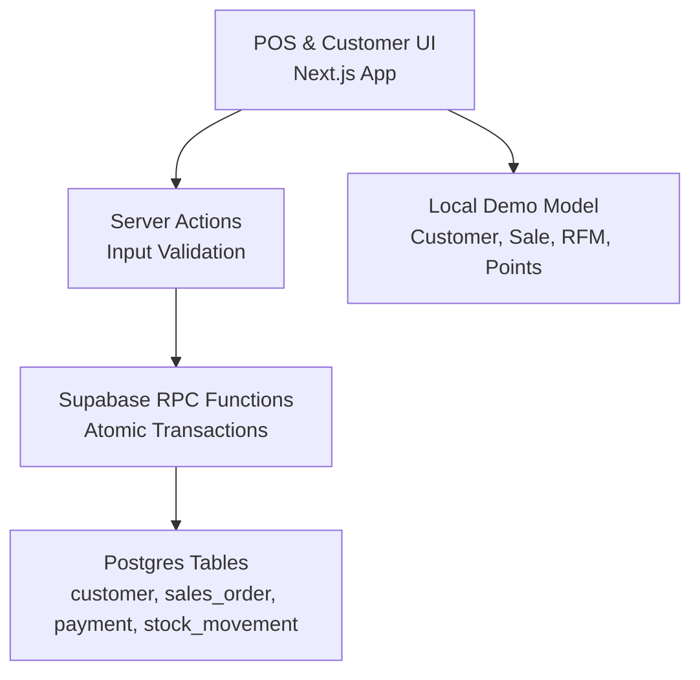

**Diagram sources**
- [laris-app.tsx:463-490](file://src/components/laris-app.tsx#L463-L490)
- [actions.ts:52-89](file://src/app/actions.ts#L52-L89)
- [0003_functions.sql:94-230](file://supabase/migrations/0003_functions.sql#L94-L230)
- [0001_schema.sql:132-148](file://supabase/migrations/0001_schema.sql#L132-L148)

**Section sources**
- [laris-data.ts:55-64](file://src/lib/laris-data.ts#L55-L64)
- [laris-app.tsx:463-490](file://src/components/laris-app.tsx#L463-L490)
- [actions.ts:145-161](file://src/app/actions.ts#L145-L161)
- [0001_schema.sql:132-148](file://supabase/migrations/0001_schema.sql#L132-L148)

## Core Components
### Customer Profile Model
The domain model represents a customer with:
- Unique identifier.
- Name and phone number.
- Visit count.
- Total amount spent.
- Last visit timestamp.
- RFM segment.
- Loyalty points balance.

In local/demo mode, this model is used directly by the application state. In cloud mode, the equivalent data lives in the `public.customer` table, which adds business isolation, timestamps, soft delete, and explicit marketing consent.

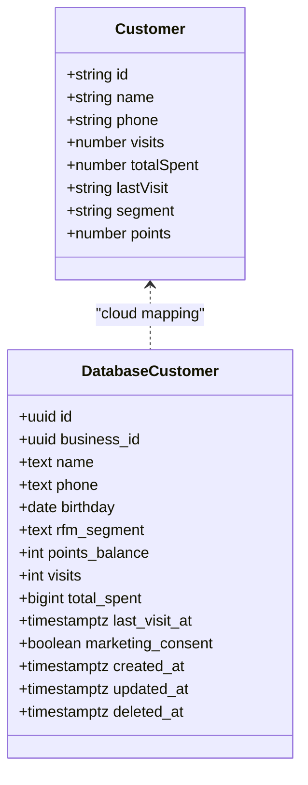

**Diagram sources**
- [laris-data.ts:55-64](file://src/lib/laris-data.ts#L55-L64)
- [0001_schema.sql:132-148](file://supabase/migrations/0001_schema.sql#L132-L148)

**Section sources**
- [laris-data.ts:55-64](file://src/lib/laris-data.ts#L55-L64)
- [0001_schema.sql:132-148](file://supabase/migrations/0001_schema.sql#L132-L148)

### RFM Segmentation System
RFM segmentation in Laris uses two dimensions:
- Recency: how long ago the customer last visited.
- Frequency: how many visits the customer has made.

The current implementation classifies customers into five segments:
- Juara (Champion): high frequency.
- Setia (Loyal): moderate frequency.
- Potensial (Potential): low frequency but recent enough.
- Berisiko (At Risk): no visit in more than 30 days.
- Hilang (Lost): no visit in more than 60 days.

Both the local demo logic and the database function implement similar rules:
- More than 60 days since last visit → Lost.
- More than 30 days since last visit → At Risk.
- 20 or more visits → Champion.
- 8 or more visits → Loyal.
- Otherwise → Potential.

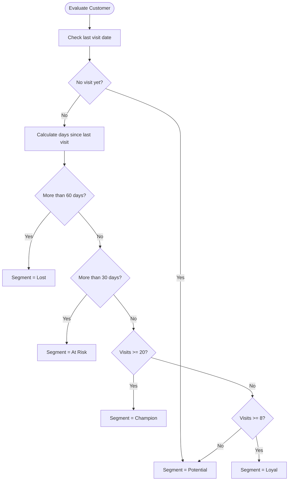

**Diagram sources**
- [laris-data.ts:208-213](file://src/lib/laris-data.ts#L208-L213)
- [0003_functions.sql:17-27](file://supabase/migrations/0003_functions.sql#L17-L27)

**Section sources**
- [laris-data.ts:208-213](file://src/lib/laris-data.ts#L208-L213)
- [0003_functions.sql:17-27](file://supabase/migrations/0003_functions.sql#L17-L27)
- [PRD_Laris_GTNIC2026.md:206-215](file://PRD_Laris_GTNIC2026.md#L206-L215)

### Loyalty Points Accumulation
Laris awards loyalty points based on the order total. In the local demo, one point is awarded for every thousand rupiah spent. During checkout, the system:
- Creates a new customer if a valid phone number is provided.
- Increments the visit count.
- Adds the order total to the customer’s lifetime spend.
- Updates the last visit timestamp.
- Adds points equal to the integer part of total divided by 1,000.
- Recomputes the RFM segment after the update.

In cloud mode, the `complete_sale` RPC inserts or updates the customer row, increments `points_balance`, and recalculates the RFM segment using the database function.

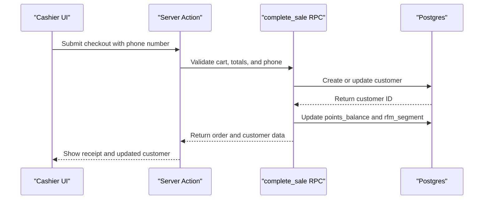

**Diagram sources**
- [laris-data.ts:278-297](file://src/lib/laris-data.ts#L278-L297)
- [0003_functions.sql:192-209](file://supabase/migrations/0003_functions.sql#L192-L209)
- [actions.ts:52-89](file://src/app/actions.ts#L52-L89)

**Section sources**
- [laris-data.ts:278-297](file://src/lib/laris-data.ts#L278-L297)
- [0003_functions.sql:192-209](file://supabase/migrations/0003_functions.sql#L192-L209)

### Visit History Tracking
Every completed sale contributes to visit history when a customer phone number is present:
- The visit counter increases by one.
- The last visit timestamp is set to the sale creation time.
- The sale itself is recorded in `sales_order`.
- Stock movements are recorded for recipe ingredients.
- Payment records are created.

This means visit history is not just a simple counter; it is backed by immutable sales and stock ledger data.

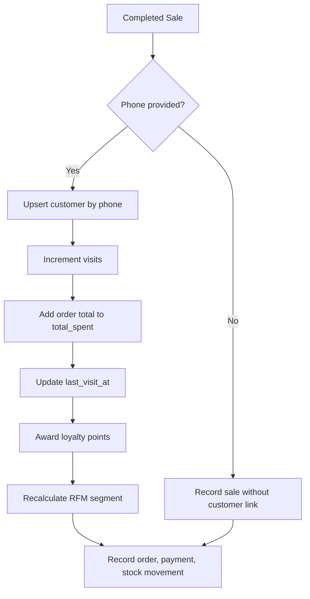

**Diagram sources**
- [laris-data.ts:278-304](file://src/lib/laris-data.ts#L278-L304)
- [0003_functions.sql:181-229](file://supabase/migrations/0003_functions.sql#L181-L229)

**Section sources**
- [laris-data.ts:278-304](file://src/lib/laris-data.ts#L278-L304)
- [0003_functions.sql:181-229](file://supabase/migrations/0003_functions.sql#L181-L229)

### Spending Analysis
Customer spending is tracked through:
- `total_spent`: cumulative order totals linked to the customer.
- `visits`: transaction frequency proxy.
- `last_visit_at`: recency indicator.
- `rfm_segment`: derived classification.
- `points_balance`: loyalty reward accumulation.

These fields allow owners to identify top spenders, frequent visitors, and customers whose spending behavior has changed. The PRD also describes favorite items and last visit as part of the customer profile, while the current schema emphasizes structured metrics suitable for reporting and segmentation.

**Section sources**
- [PRD_Laris_GTNIC2026.md:206-215](file://PRD_Laris_GTNIC2026.md#L206-L215)
- [0001_schema.sql:132-148](file://supabase/migrations/0001_schema.sql#L132-L148)

## Architecture Overview
The CRM architecture connects the user interface, server actions, database functions, and relational tables.

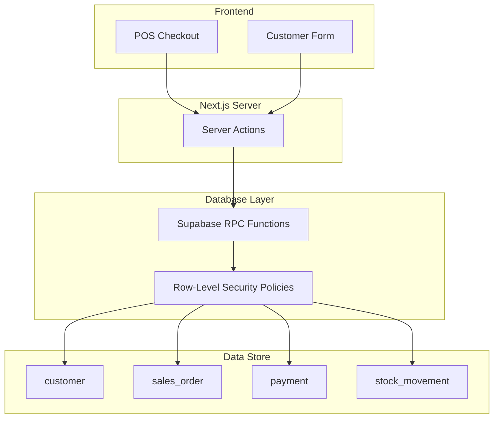

**Diagram sources**
- [laris-app.tsx:213-267](file://src/components/laris-app.tsx#L213-L267)
- [actions.ts:52-89](file://src/app/actions.ts#L52-L89)
- [0002_rls.sql:77-88](file://supabase/migrations/0002_rls.sql#L77-L88)
- [0003_functions.sql:94-230](file://supabase/migrations/0003_functions.sql#L94-L230)

**Section sources**
- [laris-app.tsx:213-267](file://src/components/laris-app.tsx#L213-L267)
- [actions.ts:52-89](file://src/app/actions.ts#L52-L89)
- [0002_rls.sql:77-88](file://supabase/migrations/0002_rls.sql#L77-L88)
- [0003_functions.sql:94-230](file://supabase/migrations/0003_functions.sql#L94-L230)

## Detailed Component Analysis

### Customer Lookup and Creation
#### Local Mode
In local mode, the application validates the customer form and either creates a new customer or rejects duplicate phone numbers. The validation requires:
- A non-empty name.
- A phone number with 8–15 digits, optionally starting with `+`.

When adding a customer manually, the system initializes visits, total spend, last visit, segment, and points to default values.

#### Cloud Mode
In cloud mode, the server action validates the same fields and inserts a customer row scoped to the authenticated business. If a duplicate phone exists under the same business, the operation returns a conflict error.

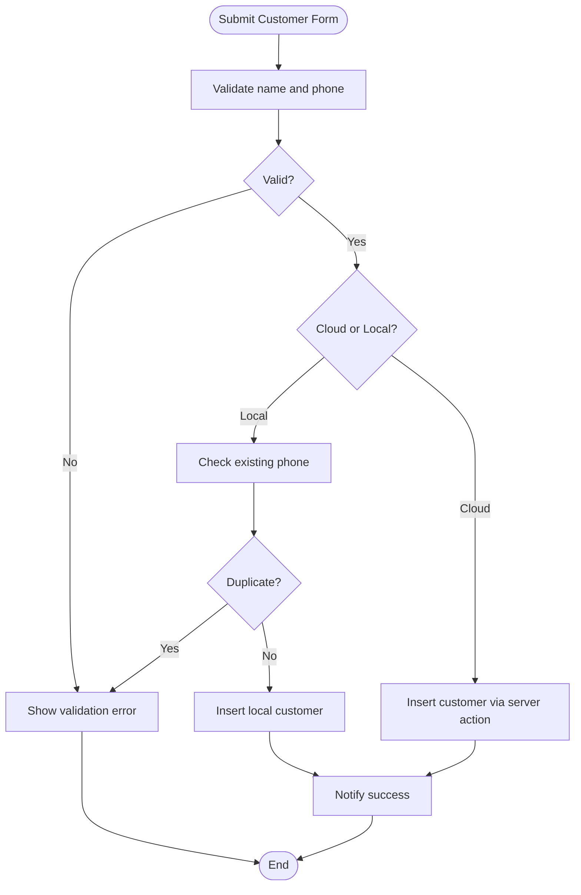

**Diagram sources**
- [laris-app.tsx:463-490](file://src/components/laris-app.tsx#L463-L490)
- [actions.ts:145-161](file://src/app/actions.ts#L145-L161)

**Section sources**
- [laris-app.tsx:463-490](file://src/components/laris-app.tsx#L463-L490)
- [actions.ts:145-161](file://src/app/actions.ts#L145-L161)

### Visit Logging Through Checkout
A visit is logged when a sale includes a valid phone number. The flow ensures:
- Phone format validation.
- Idempotent retry handling.
- Atomic creation of the order, payment, and stock movements.
- Automatic customer upsert.
- Point awarding.
- RFM recalculation.

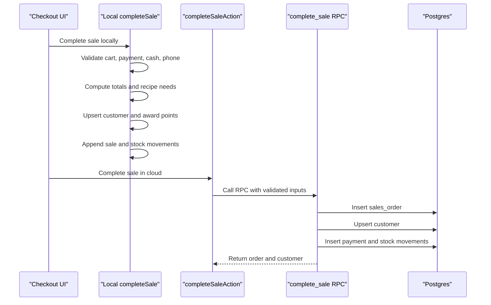

**Diagram sources**
- [laris-data.ts:215-304](file://src/lib/laris-data.ts#L215-L304)
- [actions.ts:52-89](file://src/app/actions.ts#L52-L89)
- [0003_functions.sql:94-230](file://supabase/migrations/0003_functions.sql#L94-L230)

**Section sources**
- [laris-data.ts:215-304](file://src/lib/laris-data.ts#L215-L304)
- [actions.ts:52-89](file://src/app/actions.ts#L52-L89)
- [0003_functions.sql:94-230](file://supabase/migrations/0003_functions.sql#L94-L230)

### Loyalty Point Operations
#### Points Accrual
Points accrue automatically during checkout:
- Local mode: points increase by the integer part of the order total divided by 1,000.
- Cloud mode: `points_balance` is incremented by the same rule inside the RPC.

#### Points Balance Field
The database stores points as `points_balance`. A production hardening migration upgrades the column from `int` to `bigint`, allowing larger balances over time.

#### Redemption
The product requirements describe loyalty points or digital stamps redeemable at the POS. The current repository implements accrual and storage, but does not include a dedicated redemption workflow in the analyzed files. Redemption would require additional UI, validation, and a ledger-style deduction mechanism similar to stock movements.

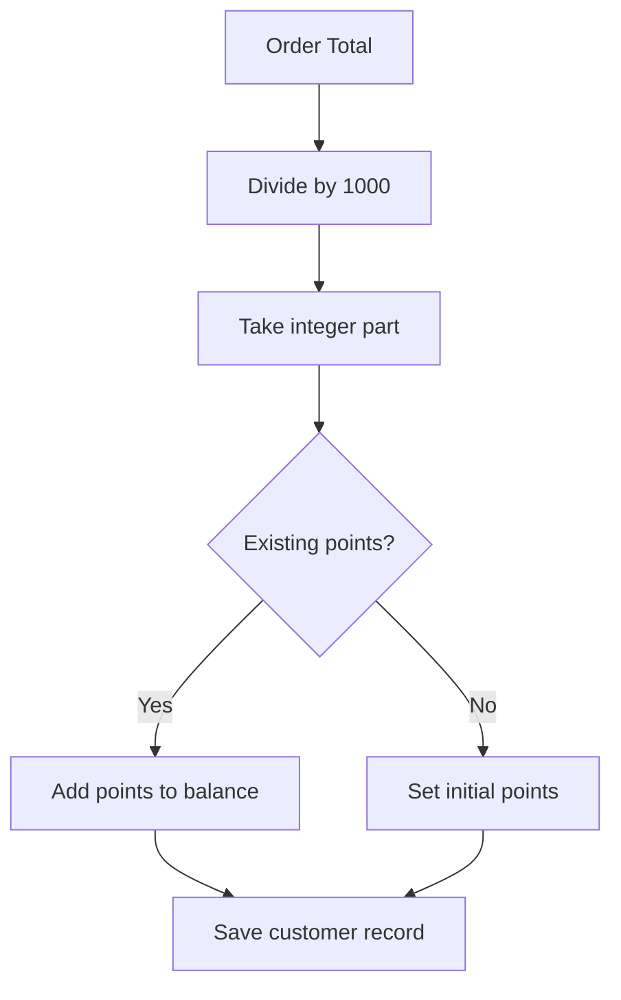

**Diagram sources**
- [laris-data.ts:288-294](file://src/lib/laris-data.ts#L288-L294)
- [0003_functions.sql:197-204](file://supabase/migrations/0003_functions.sql#L197-L204)
- [0001_schema.sql:139-139](file://supabase/migrations/0001_schema.sql#L139-L139)

**Section sources**
- [laris-data.ts:288-294](file://src/lib/laris-data.ts#L288-L294)
- [0003_functions.sql:197-204](file://supabase/migrations/0003_functions.sql#L197-L204)
- [0001_schema.sql:139-139](file://supabase/migrations/0001_schema.sql#L139-L139)
- [PRD_Laris_GTNIC2026.md:206-215](file://PRD_Laris_GTNIC2026.md#L206-L215)

### Customer Engagement Tracking and Win-Back Campaigns
Engagement tracking is currently represented by:
- Visit frequency.
- Last visit date.
- RFM segment.
- Marketing consent flag.

Win-back automation is specified in the product requirements as a future feature:
- Triggered when a customer has no visit for a defined period.
- Intended to send promotional messages, such as WhatsApp deep links or API-based broadcasts.
- Planned alongside birthday promotions and post-purchase thank-you prompts.

The current codebase does not contain an automated win-back scheduler. The PRD identifies jobs such as nightly forecasts, RFM updates, daily briefs, and automations as part of the broader system architecture.

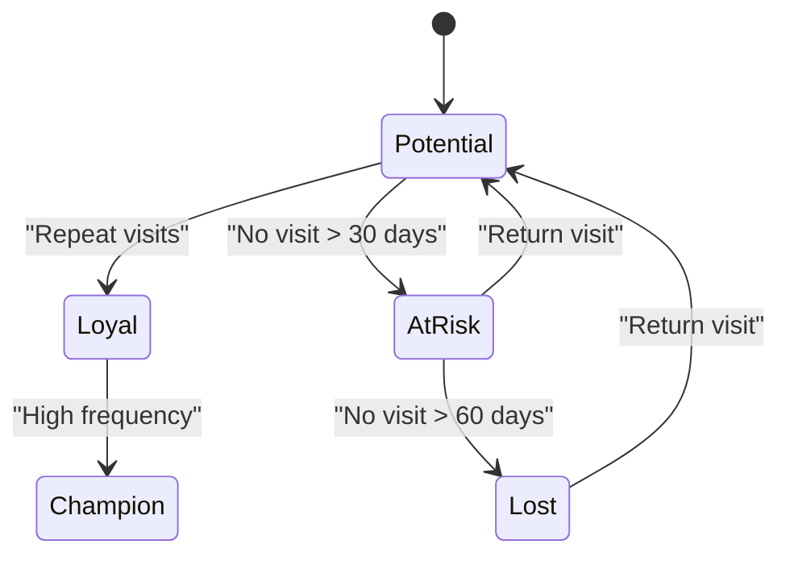

**Diagram sources**
- [laris-data.ts:208-213](file://src/lib/laris-data.ts#L208-L213)
- [0003_functions.sql:17-27](file://supabase/migrations/0003_functions.sql#L17-L27)
- [PRD_Laris_GTNIC2026.md:206-215](file://PRD_Laris_GTNIC2026.md#L206-L215)

**Section sources**
- [PRD_Laris_GTNIC2026.md:206-215](file://PRD_Laris_GTNIC2026.md#L206-L215)
- [PRD_Laris_GTNIC2026.md:341-356](file://PRD_Laris_GTNIC2026.md#L341-L356)

### Relationship Between Customer Data and Sales Analytics
Customer data supports sales analytics in several ways:
- `visits` and `total_spent` help identify repeat buyers and high-value customers.
- `last_visit_at` enables recency analysis and churn detection.
- `rfm_segment` provides a ready-to-use classification for dashboards and targeted campaigns.
- `points_balance` connects loyalty rewards to revenue performance.
- Sales orders link to customers, enabling per-customer revenue reports.
- Stock movements and purchases connect product costs to sales margins.

The AI copilot tool in the demo reads customer segments from the local state and can summarize segment counts, supporting natural-language queries about customer distribution.

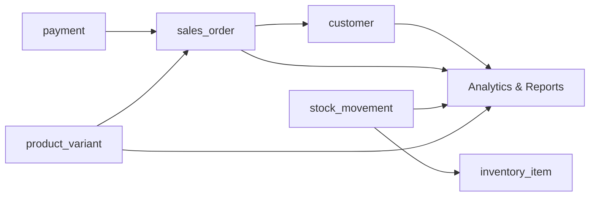

**Diagram sources**
- [0001_schema.sql:153-185](file://supabase/migrations/0001_schema.sql#L153-L185)
- [0001_schema.sql:132-148](file://supabase/migrations/0001_schema.sql#L132-L148)
- [0001_schema.sql:203-216](file://supabase/migrations/0001_schema.sql#L203-L216)

**Section sources**
- [0001_schema.sql:132-185](file://supabase/migrations/0001_schema.sql#L132-L185)
- [0001_schema.sql:203-216](file://supabase/migrations/0001_schema.sql#L203-L216)

## Dependency Analysis
The CRM components depend on each other as follows:
- The UI depends on the domain model for local mode and on server actions for cloud mode.
- Server actions depend on Supabase client configuration, membership checks, and RPC functions.
- RPC functions depend on the schema, RLS helper functions, and audit logging.
- Customer data depends on sales activity for visits, spend, last visit, and RFM updates.
- Loyalty points depend on order totals and are stored in the customer table.

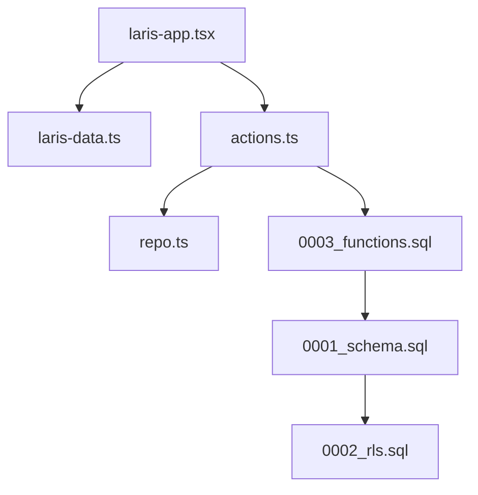

**Diagram sources**
- [laris-app.tsx:14-24](file://src/components/laris-app.tsx#L14-L24)
- [actions.ts:1-14](file://src/app/actions.ts#L1-L14)
- [0003_functions.sql:1-7](file://supabase/migrations/0003_functions.sql#L1-L7)
- [0001_schema.sql:1-7](file://supabase/migrations/0001_schema.sql#L1-L7)
- [0002_rls.sql:1-8](file://supabase/migrations/0002_rls.sql#L1-L8)

**Section sources**
- [laris-app.tsx:14-24](file://src/components/laris-app.tsx#L14-L24)
- [actions.ts:1-14](file://src/app/actions.ts#L1-L14)
- [0003_functions.sql:1-7](file://supabase/migrations/0003_functions.sql#L1-L7)
- [0001_schema.sql:1-7](file://supabase/migrations/0001_schema.sql#L1-L7)
- [0002_rls.sql:1-8](file://supabase/migrations/0002_rls.sql#L1-L8)

## Performance Considerations
- Customer lookups should be scoped by `business_id` to avoid cross-tenant scans.
- RFM segmentation is lightweight and can be recomputed on checkout or scheduled nightly.
- Points accrual is a simple arithmetic update and should remain within the same transaction as the sale.
- Large customer lists benefit from pagination and filtering by segment, visits, or last visit date.
- Avoid storing unnecessary PII beyond what is required for CRM and legal compliance.

[No sources needed since this section provides general guidance]

## Troubleshooting Guide
### Common Issues
- **Invalid phone number:** Both local and cloud modes reject phone numbers outside the 8–15 digit range. Ensure the number contains only digits and an optional leading plus sign.
- **Duplicate customer:** Adding a customer with a phone number already registered under the same business fails in cloud mode.
- **Missing customer linkage:** A sale without a phone number records the customer name in the order but does not create or update the customer profile.
- **RFM segment mismatch:** If the last visit date is null or very old, the segment may be Potential, At Risk, or Lost depending on the exact rule set.
- **Points not increasing:** Verify that the order total is positive and that the checkout path actually reaches the customer upsert step.

### Debugging Steps
1. Confirm the phone number passes the regex validation.
2. Check whether the checkout runs in local or cloud mode.
3. Inspect the returned sale and customer data after checkout.
4. Verify the `customer` row has the expected `visits`, `total_spent`, `last_visit_at`, `points_balance`, and `rfm_segment`.
5. Review audit logs for sensitive operations if available.

**Section sources**
- [laris-data.ts:251-260](file://src/lib/laris-data.ts#L251-L260)
- [actions.ts:145-161](file://src/app/actions.ts#L145-L161)
- [0003_functions.sql:192-209](file://supabase/migrations/0003_functions.sql#L192-L209)

## Conclusion
Laris implements a practical CRM foundation for small F&B businesses:
- Customer profiles capture contact details, visit history, lifetime spend, RFM segment, and loyalty points.
- RFM segmentation is deterministic and applied both locally and in the database.
- Loyalty points accumulate automatically during checkout and are persisted in the customer record.
- Visit logging is tied to atomic sales transactions, ensuring consistency across orders, payments, and stock movements.
- Win-back campaign automation is defined in the product requirements but is not fully implemented in the analyzed source files.
- Privacy is addressed through explicit marketing consent, tenant isolation, and role-based access control.

For production use, consider extending the system with:
- A formal loyalty redemption ledger.
- Scheduled RFM recalculation and win-back automation.
- Consent-aware messaging workflows.
- Data retention and deletion policies aligned with privacy regulations.

[No sources needed since this section summarizes without analyzing specific files]