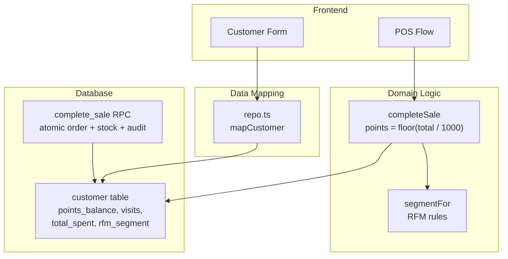
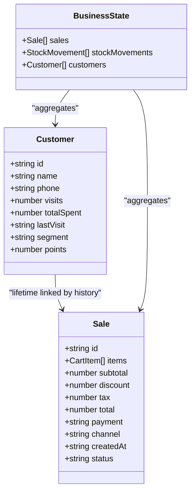
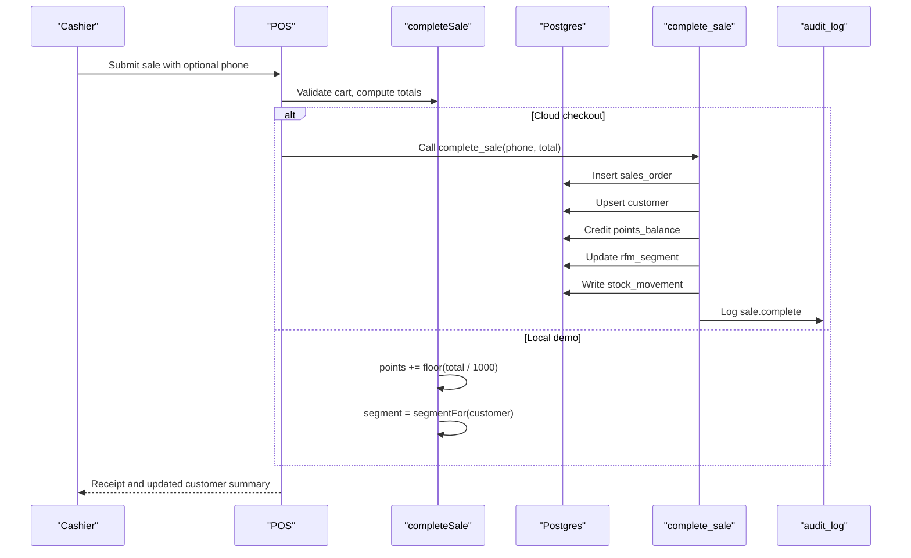
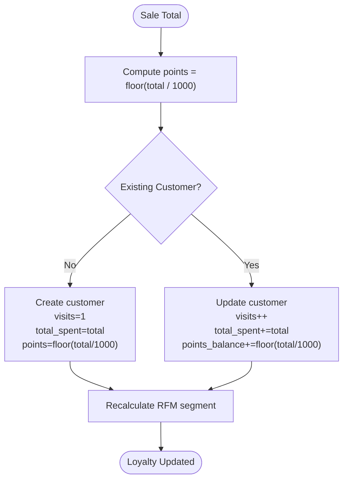
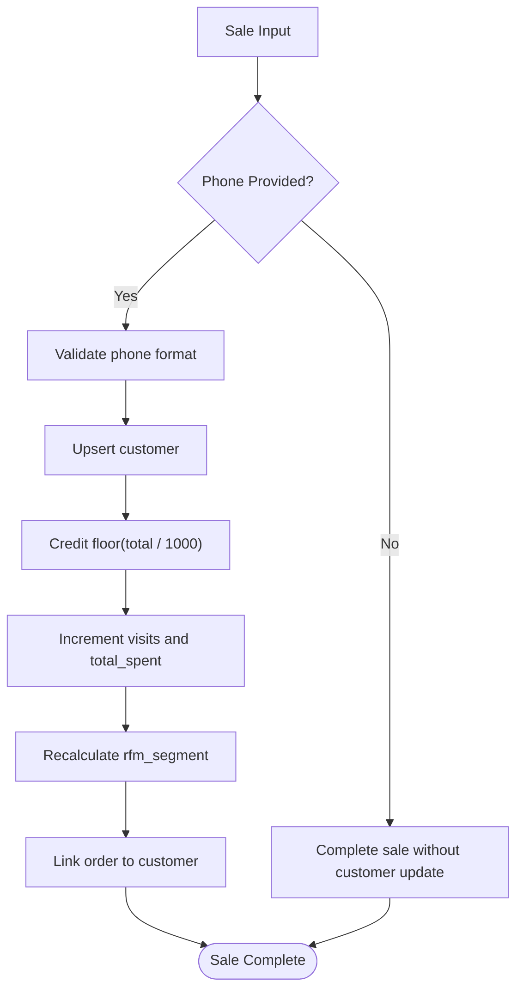
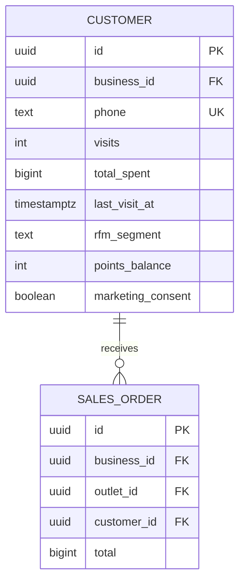
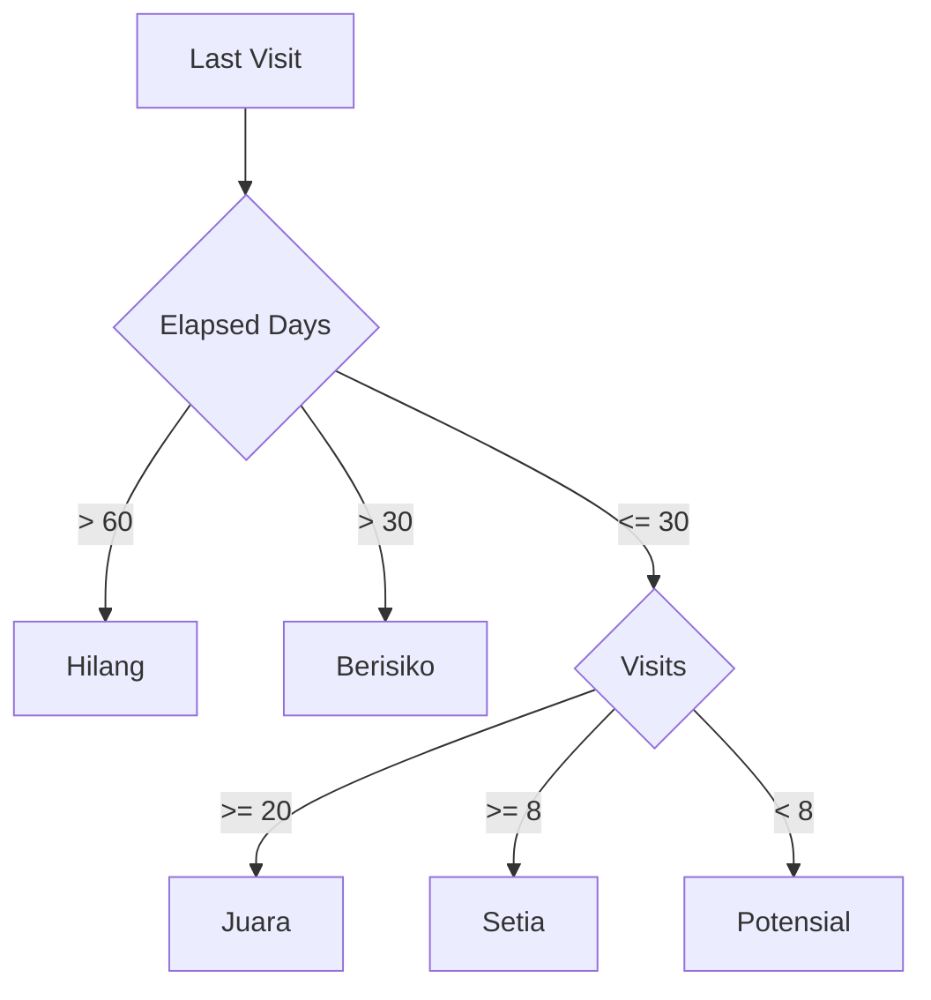
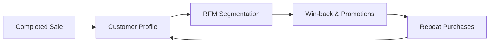
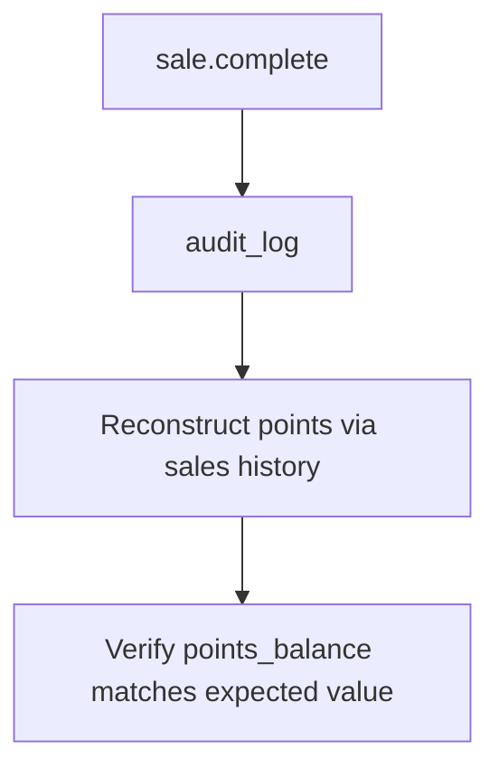
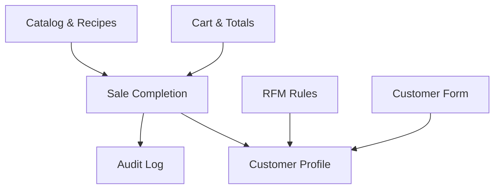

# Loyalty Program

<cite>
**Referenced Files in This Document**   
- [PRD_Laris_GTNIC2026.md](file://PRD_Laris_GTNIC2026.md)
- [README.md](file://README.md)
- [laris-data.ts](file://src/lib/laris-data.ts)
- [laris-data.test.ts](file://src/lib/laris-data.test.ts)
- [repo.ts](file://src/lib/repo.ts)
- [laris-app.tsx](file://src/components/laris-app.tsx)
- [0001_schema.sql](file://supabase/migrations/0001_schema.sql)
- [0003_functions.sql](file://supabase/migrations/0003_functions.sql)
- [0005_production_hardening.sql](file://supabase/migrations/0005_production_hardening.sql)
</cite>

## Table of Contents
1. [Introduction](#introduction)
2. [Project Structure](#project-structure)
3. [Core Components](#core-components)
4. [Architecture Overview](#architecture-overview)
5. [Detailed Component Analysis](#detailed-component-analysis)
6. [Dependency Analysis](#dependency-analysis)
7. [Performance Considerations](#performance-considerations)
8. [Troubleshooting Guide](#troubleshooting-guide)
9. [Conclusion](#conclusion)
10. [Appendices](#appendices)

## Introduction
This document explains the loyalty program implementation in Laris, focusing on how customers earn points during sales, how those points integrate with customer profiles and RFM segmentation, and how the system maintains data consistency and auditability. The core rule is simple: a customer earns one point for every Rp1,000 spent, calculated as `Math.floor(sale.total / 1000)`. Points are credited automatically when a sale completes, either through the local business logic or through the database checkout function.

The PRD positions loyalty under CRM (M6), alongside customer creation, RFM segmentation, automations, and broadcast messaging. In the current codebase, the implemented loyalty mechanism is primarily points accumulation; explicit point redemption is marked as future scope.

**Section sources**
- [PRD_Laris_GTNIC2026.md:206-215](file://PRD_Laris_GTNIC2026.md#L206-L215)
- [README.md:24-35](file://README.md#L24-L35)

## Project Structure
The loyalty feature spans three layers:

| Layer | Responsibility | Key Files |
|---|---|---|
| Domain model and demo logic | Customer profile, points calculation, segment assignment, sale completion | [laris-data.ts](file://src/lib/laris-data.ts), [laris-data.test.ts](file://src/lib/laris-data.test.ts) |
| Database schema and transactional functions | Persistent customer records, points balance, RFM segment, atomic checkout | [0001_schema.sql](file://supabase/migrations/0001_schema.sql), [0003_functions.sql](file://supabase/migrations/0003_functions.sql), [0005_production_hardening.sql](file://supabase/migrations/0005_production_hardening.sql) |
| Data mapping and UI integration | Mapping database rows to application models, customer form validation | [repo.ts](file://src/lib/repo.ts), [laris-app.tsx](file://src/components/laris-app.tsx) |

**Diagram sources**
- [laris-data.ts:208-305](file://src/lib/laris-data.ts#L208-L305)
- [0001_schema.sql:132-148](file://supabase/migrations/0001_schema.sql#L132-L148)
- [0003_functions.sql:94-230](file://supabase/migrations/0003_functions.sql#L94-L230)
- [repo.ts:40-47](file://src/lib/repo.ts#L40-L47)

**Section sources**
- [PRD_Laris_GTNIC2026.md:377-494](file://PRD_Laris_GTNIC2026.md#L377-L494)
- [laris-data.ts:55-64](file://src/lib/laris-data.ts#L55-L64)
- [0001_schema.sql:132-148](file://supabase/migrations/0001_schema.sql#L132-L148)

## Core Components
The loyalty system has five core components:

1. **Points Calculation Rule**: One point per Rp1,000 of sale total, using integer division.
2. **Customer Profile Model**: Stores phone-based identity, visit count, lifetime spend, last visit, RFM segment, and points balance.
3. **Sale Completion Flow**: Creates or updates the customer, credits points, updates lifetime metrics, and recalculates the segment.
4. **RFM Segmentation**: Classifies customers into Juara, Setia, Potensial, Berisiko, or Hilang based on visits and recency.
5. **Persistence and Audit Trail**: Uses a ledger-style design with atomic transactions and audit logging.

**Diagram sources**
- [laris-data.ts:40-64](file://src/lib/laris-data.ts#L40-L64)
- [laris-data.ts:97-110](file://src/lib/laris-data.ts#L97-L110)

**Section sources**
- [laris-data.ts:55-64](file://src/lib/laris-data.ts#L55-L64)
- [laris-data.ts:208-305](file://src/lib/laris-data.ts#L208-L305)
- [0001_schema.sql:132-148](file://supabase/migrations/0001_schema.sql#L132-L148)

## Architecture Overview
The loyalty architecture integrates three paths:

| Path | When Used | Behavior |
|---|---|---|
| Local demo flow | `/demo` and local state mutations | `completeSale` computes totals, validates inputs, creates or updates the customer, adds `Math.floor(sale.total / 1000)` points, and recomputes the RFM segment. |
| Cloud checkout flow | Server-side RPC | `public.complete_sale` performs the same loyalty update inside an atomic transaction that also writes orders, payments, stock movements, and audit logs. |
| Data mapping layer | Snapshot loading | `repo.ts` maps database columns `points_balance`, `visits`, `total_spent`, and `rfm_segment` back into the frontend `Customer` model. |

**Diagram sources**
- [laris-data.ts:215-305](file://src/lib/laris-data.ts#L215-L305)
- [0003_functions.sql:94-230](file://supabase/migrations/0003_functions.sql#L94-L230)
- [0005_production_hardening.sql:84-214](file://supabase/migrations/0005_production_hardening.sql#L84-L214)

**Section sources**
- [PRD_Laris_GTNIC2026.md:319-356](file://PRD_Laris_GTNIC2026.md#L319-L356)
- [laris-data.ts:215-305](file://src/lib/laris-data.ts#L215-L305)
- [0003_functions.sql:94-230](file://supabase/migrations/0003_functions.sql#L94-L230)
- [0005_production_hardening.sql:84-214](file://supabase/migrations/0005_production_hardening.sql#L84-L214)

## Detailed Component Analysis

### Points Accumulation Rule
The loyalty rule is applied consistently across both the domain model and the database function:

- Local demo: `points = existingPoints + Math.floor(sale.total / 1000)`.
- Database: new customers receive `(v_total / 1000)::int`; existing customers receive `points_balance + excluded.points_balance`.
- Seed data and tests assert that each customer’s points equal the sum of `Math.floor(sale.total / 1000)` over their associated sales.

**Diagram sources**
- [laris-data.ts:287-297](file://src/lib/laris-data.ts#L287-L297)
- [0003_functions.sql:192-208](file://supabase/migrations/0003_functions.sql#L192-L208)
- [0005_production_hardening.sql:179-193](file://supabase/migrations/0005_production_hardening.sql#L179-L193)

**Section sources**
- [laris-data.ts:287-297](file://src/lib/laris-data.ts#L287-L297)
- [0003_functions.sql:192-208](file://supabase/migrations/0003_functions.sql#L192-L208)
- [0005_production_hardening.sql:179-193](file://supabase/migrations/0005_production_hardening.sql#L179-L193)
- [laris-data.test.ts:118-131](file://src/lib/laris-data.test.ts#L118-L131)

### Automatic Points Crediting During Sales Completion
Points are not credited manually. They are part of the sale completion process:

- If no phone number is provided, no customer record is created and no loyalty update occurs.
- If a valid phone number is provided, the system creates or updates the customer profile.
- Points are credited before the segment is recalculated.
- The sale remains independent of whether a customer exists; customer linkage is optional but recommended for retention.

**Diagram sources**
- [laris-data.ts:254-297](file://src/lib/laris-data.ts#L254-L297)
- [0003_functions.sql:192-209](file://supabase/migrations/0003_functions.sql#L192-L209)
- [0005_production_hardening.sql:179-194](file://supabase/migrations/0005_production_hardening.sql#L179-L194)

**Section sources**
- [laris-data.ts:254-297](file://src/lib/laris-data.ts#L254-L297)
- [0003_functions.sql:192-209](file://supabase/migrations/0003_functions.sql#L192-L209)
- [0005_production_hardening.sql:179-194](file://supabase/migrations/0005_production_hardening.sql#L179-L194)

### Integration with Customer Profiles
The customer profile is the central loyalty entity. It stores:

| Field | Meaning | Loyalty Relevance |
|---|---|---|
| `phone` | Primary identity key | Prevents duplicate profiles; normalizes leading `+`. |
| `visits` | Number of completed sales | Drives RFM segmentation. |
| `total_spent` | Lifetime sale total | Supports value assessment and segmentation. |
| `last_visit_at` | Most recent purchase time | Determines recency-based segments. |
| `rfm_segment` | Derived segment label | Used for marketing and retention campaigns. |
| `points_balance` | Accumulated loyalty points | Current redeemable or trackable loyalty value. |

In the application model, `points` maps to the database column `points_balance`.

**Diagram sources**
- [0001_schema.sql:132-148](file://supabase/migrations/0001_schema.sql#L132-L148)
- [0001_schema.sql:153-171](file://supabase/migrations/0001_schema.sql#L153-L171)
- [repo.ts:40-47](file://src/lib/repo.ts#L40-L47)

**Section sources**
- [0001_schema.sql:132-148](file://supabase/migrations/0001_schema.sql#L132-L148)
- [repo.ts:40-47](file://src/lib/repo.ts#L40-L47)
- [laris-data.ts:55-64](file://src/lib/laris-data.ts#L55-L64)

### Relationship Between Loyalty Points and Customer Segments
Points and RFM segments serve different purposes:

- **Points** measure cumulative monetary contribution at a fixed rate.
- **Segments** measure engagement behavior using recency and frequency.

The local segment function uses:

- More than 60 days since last visit → `Hilang`.
- More than 30 days since last visit → `Berisiko`.
- 20 or more visits → `Juara`.
- 8 or more visits → `Setia`.
- Otherwise → `Potensial`.

The database function applies equivalent logic server-side after updating the customer.

**Diagram sources**
- [laris-data.ts:208-213](file://src/lib/laris-data.ts#L208-L213)
- [0003_functions.sql:17-27](file://supabase/migrations/0003_functions.sql#L17-L27)

**Section sources**
- [laris-data.ts:208-213](file://src/lib/laris-data.ts#L208-L213)
- [0003_functions.sql:17-27](file://supabase/migrations/0003_functions.sql#L17-L27)
- [PRD_Laris_GTNIC2026.md:206-215](file://PRD_Laris_GTNIC2026.md#L206-L215)

### Points Calculation Examples
The following examples illustrate how points are calculated from sale totals. All values use IDR and follow the rule `points = floor(total / 1000)`.

| Scenario | Subtotal | Discount | Tax | Sale Total | Points Earned |
|---|---:|---:|---:|---:|---:|
| Single Es Kopi Susu | Rp25,000 | Rp0 | Rp0 | Rp25,000 | 25 |
| Two Es Kopi Susu | Rp50,000 | Rp0 | Rp0 | Rp50,000 | 50 |
| Purchase with 10% tax | Rp25,000 | Rp0 | Rp2,500 | Rp27,500 | 27 |
| Purchase with discount and tax | Rp25,000 | Rp1,000 | Rp2,400 | Rp26,400 | 26 |
| Small purchase below threshold | Rp900 | Rp0 | Rp0 | Rp900 | 0 |
| Large purchase | Rp1,250,000 | Rp0 | Rp0 | Rp1,250,000 | 1,250 |

These calculations are validated by tests that assert:

- A first sale of Rp25,000 gives 25 points.
- A second sale raises the cumulative points correctly.
- The seed data reconciles each customer’s points with the sum of `Math.floor(sale.total / 1000)` across their sales.

**Section sources**
- [laris-data.test.ts:118-131](file://src/lib/laris-data.test.ts#L118-L131)
- [laris-data.test.ts:363-384](file://src/lib/laris-data.test.ts#L363-L384)
- [laris-data.ts:178-194](file://src/lib/laris-data.ts#L178-L194)

### Future Extensions
The PRD explicitly marks loyalty redemption as P1, meaning it is planned but not fully implemented in the current build. Suggested extensions include:

| Extension | Purpose | Implementation Notes |
|---|---|---|
| Point redemption | Allow customers to exchange points for discounts or free items | Add redemption ledger entries, validate sufficient balance, and apply redemption at checkout. |
| Tier-based rewards | Reward high-value customers with better benefits | Introduce tier thresholds based on points, visits, or lifetime spend; adjust multipliers or perks. |
| Promotional campaigns | Run limited-time bonus point events | Add campaign metadata, conditional multipliers, and audit trails for promotional adjustments. |
| Win-back automation | Reactivate inactive customers | Use `Hilang` and `Berisiko` segments to trigger WhatsApp or email campaigns. |
| Birthday promotions | Personalized offers | Use `birthday` field combined with segment and points balance. |

**Section sources**
- [PRD_Laris_GTNIC2026.md:206-215](file://PRD_Laris_GTNIC2026.md#L206-L215)
- [PRD_Laris_GTNIC2026.md:653-663](file://PRD_Laris_GTNIC2026.md#L653-L663)

### Integration with Broader CRM Strategy
Loyalty is part of a broader customer retention strategy:

1. **Customer Creation**: Customers are created automatically when a phone number is provided at checkout.
2. **Profile Enrichment**: Visits, total spend, last visit, and points accumulate over time.
3. **Segmentation**: RFM segmentation identifies champions, loyal customers, potential buyers, at-risk customers, and lost customers.
4. **Automation**: The PRD includes win-back, birthday promos, thank-you messages, and broadcast messaging.
5. **Retention Metrics**: Points and segments help owners understand repeat purchase behavior and target outreach.

**Diagram sources**
- [PRD_Laris_GTNIC2026.md:206-215](file://PRD_Laris_GTNIC2026.md#L206-L215)
- [laris-data.ts:208-213](file://src/lib/laris-data.ts#L208-L213)

**Section sources**
- [PRD_Laris_GTNIC2026.md:206-215](file://PRD_Laris_GTNIC2026.md#L206-L215)
- [laris-data.ts:208-213](file://src/lib/laris-data.ts#L208-L213)

### Data Consistency Requirements
The loyalty system enforces several consistency rules:

| Requirement | Enforcement |
|---|---|
| Points cannot be negative | Database constraint `points_balance >= 0`. |
| Points are derived from sale totals | Both domain logic and RPC use `floor(total / 1000)`. |
| Customer identity is phone-based | Unique constraint on `business_id` and `phone`. |
| Phone normalization | Leading `+` removed before upsert. |
| Atomicity | Checkout writes order, items, payment, stock movement, customer update, and audit log in one transaction. |
| Idempotency | Duplicate checkout calls with the same key return the same order. |
| Audit trail | Every sale completion logs actor, entity, and relevant data. |

**Section sources**
- [0001_schema.sql:132-148](file://supabase/migrations/0001_schema.sql#L132-L148)
- [0003_functions.sql:94-230](file://supabase/migrations/0003_functions.sql#L94-L230)
- [0005_production_hardening.sql:84-214](file://supabase/migrations/0005_production_hardening.sql#L84-L214)
- [laris-data.test.ts:290-305](file://src/lib/laris-data.test.ts#L290-L305)

### Audit Trails for Point Transactions
Point transactions are not stored in a separate ledger table in the current schema. Instead, they are implied by changes to the customer row and tied to the sale completion audit entry. This means:

- The primary audit event is `sale.complete`.
- The audit payload includes sale total, payment method, channel, and discount.
- Points earned can be reconstructed by querying customer history and applying the same formula.
- For stronger point-level auditability, a dedicated `loyalty_ledger` table could be added in future iterations.

**Diagram sources**
- [0001_schema.sql:255-265](file://supabase/migrations/0001_schema.sql#L255-L265)
- [0003_functions.sql:225-227](file://supabase/migrations/0003_functions.sql#L225-L227)
- [0005_production_hardening.sql:210-212](file://supabase/migrations/0005_production_hardening.sql#L210-L212)

**Section sources**
- [0001_schema.sql:255-265](file://supabase/migrations/0001_schema.sql#L255-L265)
- [0003_functions.sql:225-227](file://supabase/migrations/0003_functions.sql#L225-L227)
- [0005_production_hardening.sql:210-212](file://supabase/migrations/0005_production_hardening.sql#L210-L212)

## Dependency Analysis
The loyalty feature depends on several other parts of Laris:

| Dependency | Why It Matters |
|---|---|
| Cart and total calculation | Points depend on the final sale total, which includes discount and tax. |
| Catalog and recipes | Stock deduction runs alongside loyalty updates, ensuring inventory integrity. |
| RFM segmentation | Points contribute indirectly to customer value assessment, while visits and recency drive segments. |
| Audit log | Provides traceability for sales that affect loyalty balances. |
| Customer form | Validates phone numbers before creating or linking loyalty accounts. |

**Diagram sources**
- [laris-data.ts:178-194](file://src/lib/laris-data.ts#L178-L194)
- [laris-data.ts:215-305](file://src/lib/laris-data.ts#L215-L305)
- [laris-app.tsx:463-490](file://src/components/laris-app.tsx#L463-L490)

**Section sources**
- [laris-data.ts:178-194](file://src/lib/laris-data.ts#L178-L194)
- [laris-data.ts:215-305](file://src/lib/laris-data.ts#L215-L305)
- [laris-app.tsx:463-490](file://src/components/laris-app.tsx#L463-L490)

## Performance Considerations
- Points calculation is O(1) per sale because it only reads the sale total.
- Customer lookup is O(n) in the local demo model where `n` is the number of customers.
- Database operations are protected by RLS and run inside atomic functions.
- Frequent customer updates should avoid unnecessary churn; phone normalization prevents duplicate profiles.
- Future point redemption and tier logic should introduce indexed queries on `business_id`, `points_balance`, and `rfm_segment` if used in heavy reporting or campaign filtering.

[No sources needed since this section provides general guidance]

## Troubleshooting Guide
Common issues and resolutions:

| Issue | Symptom | Resolution |
|---|---|---|
| Invalid phone number | Sale fails with phone validation error | Ensure the phone contains 8–15 digits and may start with `+`. |
| No points credited | Customer profile unchanged | Confirm a valid phone was provided; names alone do not create loyalty accounts. |
| Points mismatch | `points_balance` does not match expected value | Reconcile against sales history using `floor(total / 1000)` per sale. |
| Segment not updating | Customer stays in wrong segment | Verify `last_visit_at` and `visits`; recompute segment using the defined rules. |
| Duplicate customer | Same person appears twice | Normalize phone numbers and ensure consistent formatting. |
| Idempotent retry confusion | Same sale appears multiple times | Check idempotency keys; retries should return the original order. |

**Section sources**
- [laris-data.test.ts:363-410](file://src/lib/laris-data.test.ts#L363-L410)
- [0003_functions.sql:192-208](file://supabase/migrations/0003_functions.sql#L192-L208)
- [0005_production_hardening.sql:179-193](file://supabase/migrations/0005_production_hardening.sql#L179-L193)

## Conclusion
Laris implements a straightforward and reliable loyalty program centered on points accumulation at one point per Rp1,000 spent. Points are credited automatically during sales completion, integrated with customer profiles, and aligned with RFM segmentation. The current implementation emphasizes correctness, idempotency, and auditability. Future work can extend the system toward point redemption, tiered rewards, and promotional campaigns while preserving the strong data consistency already established by the schema and transactional functions.

[No sources needed since this section summarizes without analyzing specific files]

## Appendices

### API and Contract Summary
| Area | Current State | Notes |
|---|---|---|
| Points earning | Implemented | `floor(total / 1000)` |
| Points redemption | Not implemented | Marked as future scope |
| Tier-based rewards | Not implemented | Can be built on top of points and segments |
| Promotional campaigns | Not implemented | Requires campaign metadata and multiplier logic |
| Audit trail | Implemented for sales | Point-level ledger can be added later |
| Customer identity | Phone-based | Normalized and unique per business |

**Section sources**
- [PRD_Laris_GTNIC2026.md:206-215](file://PRD_Laris_GTNIC2026.md#L206-L215)
- [0001_schema.sql:132-148](file://supabase/migrations/0001_schema.sql#L132-L148)
- [laris-data.ts:287-297](file://src/lib/laris-data.ts#L287-L297)