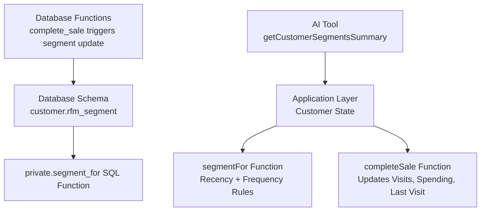
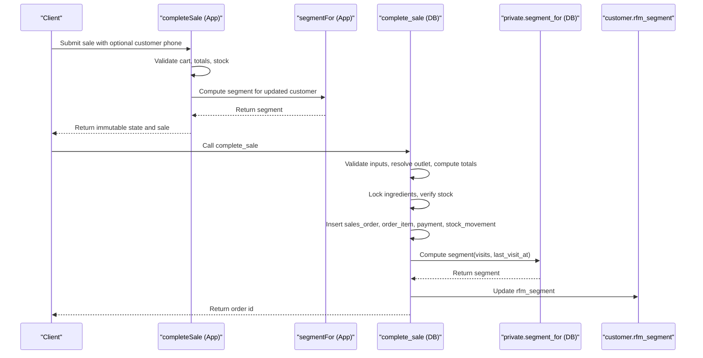
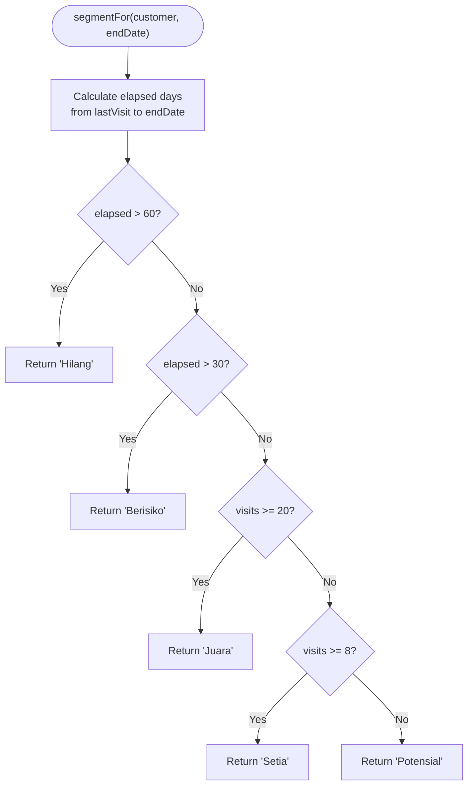
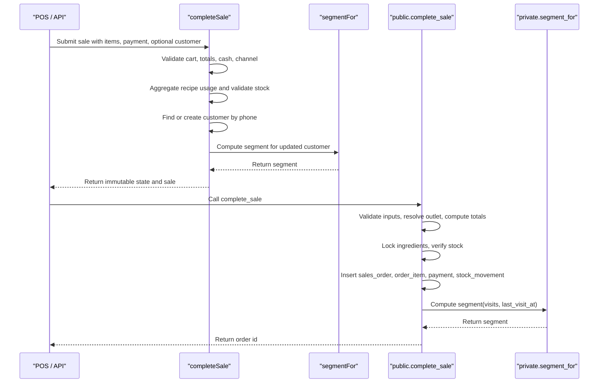
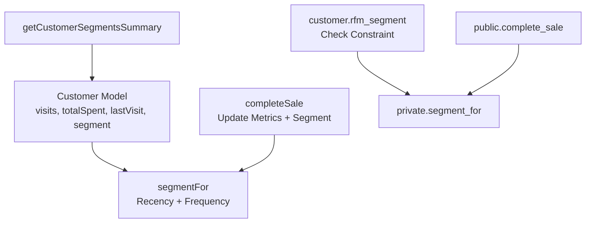

# RFM Segmentation System

<cite>
**Referenced Files in This Document**
- [laris-data.ts](file://src/lib/laris-data.ts)
- [laris-data.test.ts](file://src/lib/laris-data.test.ts)
- [0001_schema.sql](file://supabase/migrations/0001_schema.sql)
- [0003_functions.sql](file://supabase/migrations/0003_functions.sql)
- [route.ts](file://src/app/api/ai/ask/route.ts)
</cite>

## Table of Contents
1. [Introduction](#introduction)
2. [Project Structure](#project-structure)
3. [Core Components](#core-components)
4. [Architecture Overview](#architecture-overview)
5. [Detailed Component Analysis](#detailed-component-analysis)
6. [Dependency Analysis](#dependency-analysis)
7. [Performance Considerations](#performance-considerations)
8. [Troubleshooting Guide](#troubleshooting-guide)
9. [Conclusion](#conclusion)

## Introduction
This document explains the RFM (Recency, Frequency, Monetary) customer segmentation system used by the project. The core logic is implemented as a `segmentFor` function that assigns each customer to one of five segments based on:
- Recency: how many days have passed since the customer’s last visit.
- Frequency: how many visits the customer has made.
- Monetary data is tracked through total spending and points, but the current segment calculation uses recency and frequency.

The five segments are:
- Juara (Champions): high-frequency active customers.
- Setia (Loyal): moderately frequent active customers.
- Potensial (Potential): new or low-frequency active customers.
- Berisiko (At-risk): customers who visited recently enough to be active but not frequently enough for higher tiers.
- Hilang (Lost): customers whose last visit is too old.

The implementation exists both in the application layer and in the database layer, ensuring consistent rules across in-memory state and persisted business logic.

## Project Structure
The RFM segmentation logic is primarily located in the data layer and database migrations:
- Application-layer segment calculation: `src/lib/laris-data.ts`.
- Database schema and constraints: `supabase/migrations/0001_schema.sql`.
- Database-side segment function: `supabase/migrations/0003_functions.sql`.
- AI tooling that reads customer segments: `src/app/api/ai/ask/route.ts`.
- Tests validating segment behavior during sales: `src/lib/laris-data.test.ts`.

**Diagram sources**
- [laris-data.ts:208-213](file://src/lib/laris-data.ts#L208-L213)
- [laris-data.ts:215-305](file://src/lib/laris-data.ts#L215-L305)
- [0001_schema.sql:132-148](file://supabase/migrations/0001_schema.sql#L132-L148)
- [0003_functions.sql:17-27](file://supabase/migrations/0003_functions.sql#L17-L27)
- [0003_functions.sql:192-209](file://supabase/migrations/0003_functions.sql#L192-L209)
- [route.ts:152-159](file://src/app/api/ai/ask/route.ts#L152-L159)

**Section sources**
- [laris-data.ts:55-64](file://src/lib/laris-data.ts#L55-L64)
- [laris-data.ts:208-213](file://src/lib/laris-data.ts#L208-L213)
- [0001_schema.sql:132-148](file://supabase/migrations/0001_schema.sql#L132-L148)
- [0003_functions.sql:17-27](file://supabase/migrations/0003_functions.sql#L17-L27)
- [route.ts:152-159](file://src/app/api/ai/ask/route.ts#L152-L159)

## Core Components
The RFM segmentation system centers around these components:
- Customer model with segment field.
- `segmentFor` function calculating segment from recency and frequency.
- `completeSale` function updating customer metrics and recalculating segment.
- Database schema enforcing valid segment values.
- Database function `private.segment_for` mirroring application logic.
- AI summary tool reading segment counts.

Key responsibilities:
- Calculate segment deterministically using recency thresholds and frequency thresholds.
- Update customer records atomically during sales.
- Persist segment values with validation constraints.
- Provide segment summaries for analytics and AI tools.

**Section sources**
- [laris-data.ts:55-64](file://src/lib/laris-data.ts#L55-L64)
- [laris-data.ts:208-213](file://src/lib/laris-data.ts#L208-L213)
- [laris-data.ts:215-305](file://src/lib/laris-data.ts#L215-L305)
- [0001_schema.sql:132-148](file://supabase/migrations/0001_schema.sql#L132-L148)
- [0003_functions.sql:17-27](file://supabase/migrations/0003_functions.sql#L17-L27)
- [route.ts:152-159](file://src/app/api/ai/ask/route.ts#L152-L159)

## Architecture Overview
The RFM segmentation architecture operates at two layers:

1. Application Layer:
   - `segmentFor` computes segment based on elapsed days since last visit and visit count.
   - `completeSale` updates customer visits, total spent, last visit, and recalculates segment.

2. Database Layer:
   - `customer.rfm_segment` stores the segment with allowed values enforced by a check constraint.
   - `private.segment_for` implements the same rules in SQL.
   - `public.complete_sale` updates customer metrics and calls `private.segment_for` to set the segment.

**Diagram sources**
- [laris-data.ts:215-305](file://src/lib/laris-data.ts#L215-L305)
- [laris-data.ts:208-213](file://src/lib/laris-data.ts#L208-L213)
- [0003_functions.sql:94-230](file://supabase/migrations/0003_functions.sql#L94-L230)
- [0003_functions.sql:17-27](file://supabase/migrations/0003_functions.sql#L17-L27)
- [0001_schema.sql:132-148](file://supabase/migrations/0001_schema.sql#L132-L148)

## Detailed Component Analysis

### segmentFor Function
The `segmentFor` function determines a customer’s segment using:
- Recency threshold:
  - More than 60 days since last visit → Hilang.
  - More than 30 days since last visit → Berisiko.
- Frequency threshold:
  - 20 or more visits → Juara.
  - 8 or more visits → Setia.
  - Otherwise → Potensial.

The function calculates elapsed days between the customer’s last visit and a reference end date. It applies recency checks first; if the customer is still within 30–60 days, it then applies frequency-based tiering.

**Diagram sources**
- [laris-data.ts:208-213](file://src/lib/laris-data.ts#L208-L213)

**Section sources**
- [laris-data.ts:208-213](file://src/lib/laris-data.ts#L208-L213)

### Database Segment Function
The database mirrors the application logic through `private.segment_for`:
- If last visit is null → Potensial.
- If last visit is older than 60 days → Hilang.
- If last visit is older than 30 days → Berisiko.
- If visits >= 20 → Juara.
- If visits >= 8 → Setia.
- Else → Potensial.

This ensures consistency when sales are processed through the database layer.

**Section sources**
- [0003_functions.sql:17-27](file://supabase/migrations/0003_functions.sql#L17-L27)

### Sales Flow and Automatic Segment Updates
When a sale occurs:
- The application validates the cart, computes totals, verifies stock, and creates a sale record.
- If a customer phone is provided, the system either creates a new customer or updates an existing one.
- Customer metrics are updated:
  - visits incremented.
  - totalSpent increased by sale total.
  - lastVisit updated to sale timestamp.
  - points updated based on spending.
- The segment is recalculated using `segmentFor`.
- The database layer performs equivalent steps inside `public.complete_sale`, including calling `private.segment_for` to set `rfm_segment`.

**Diagram sources**
- [laris-data.ts:215-305](file://src/lib/laris-data.ts#L215-L305)
- [laris-data.ts:208-213](file://src/lib/laris-data.ts#L208-L213)
- [0003_functions.sql:94-230](file://supabase/migrations/0003_functions.sql#L94-L230)
- [0003_functions.sql:17-27](file://supabase/migrations/0003_functions.sql#L17-L27)

**Section sources**
- [laris-data.ts:215-305](file://src/lib/laris-data.ts#L215-L305)
- [0003_functions.sql:94-230](file://supabase/migrations/0003_functions.sql#L94-L230)

### Customer Model and Segment Field
The customer model includes:
- Identification fields: id, name, phone.
- RFM-related fields: visits, totalSpent, lastVisit, segment.
- Loyalty points: points.

The database schema enforces:
- Valid segment values via check constraint.
- Non-negative visits and total_spent.
- Phone format validation.
- Marketing consent flag for compliance.

**Section sources**
- [laris-data.ts:55-64](file://src/lib/laris-data.ts#L55-L64)
- [0001_schema.sql:132-148](file://supabase/migrations/0001_schema.sql#L132-L148)

### AI Segment Summary
The AI tool `getCustomerSegmentsSummary` aggregates customer segments into counts for each category: Juara, Setia, Potensial, Berisiko, Hilang. It returns the total number of customers and the distribution across segments.

**Section sources**
- [route.ts:152-159](file://src/app/api/ai/ask/route.ts#L152-L159)

## Dependency Analysis
The RFM segmentation system depends on:
- Customer data structure and lifecycle managed by `completeSale`.
- Deterministic segment calculation via `segmentFor`.
- Database schema constraints ensuring valid segment values.
- Database functions ensuring transactional integrity and consistent segment updates.
- AI tooling consuming segment counts for analytics.

**Diagram sources**
- [laris-data.ts:55-64](file://src/lib/laris-data.ts#L55-L64)
- [laris-data.ts:208-213](file://src/lib/laris-data.ts#L208-L213)
- [laris-data.ts:215-305](file://src/lib/laris-data.ts#L215-L305)
- [0001_schema.sql:132-148](file://supabase/migrations/0001_schema.sql#L132-L148)
- [0003_functions.sql:17-27](file://supabase/migrations/0003_functions.sql#L17-L27)
- [0003_functions.sql:94-230](file://supabase/migrations/0003_functions.sql#L94-L230)
- [route.ts:152-159](file://src/app/api/ai/ask/route.ts#L152-L159)

**Section sources**
- [laris-data.ts:55-64](file://src/lib/laris-data.ts#L55-L64)
- [laris-data.ts:208-213](file://src/lib/laris-data.ts#L208-L213)
- [laris-data.ts:215-305](file://src/lib/laris-data.ts#L215-L305)
- [0001_schema.sql:132-148](file://supabase/migrations/0001_schema.sql#L132-L148)
- [0003_functions.sql:17-27](file://supabase/migrations/0003_functions.sql#L17-L27)
- [0003_functions.sql:94-230](file://supabase/migrations/0003_functions.sql#L94-L230)
- [route.ts:152-159](file://src/app/api/ai/ask/route.ts#L152-L159)

## Performance Considerations
- Segment calculation is O(1) per customer because it only compares elapsed days and visit counts.
- During `completeSale`, segment recalculation happens once per affected customer.
- Database segment computation is also O(1) and executed within a transaction.
- Aggregating segment counts for AI summaries is O(n) over all customers.

[No sources needed since this section provides general guidance]

## Troubleshooting Guide
Common issues and their causes:
- Invalid segment value:
  - Cause: Attempting to set a segment outside the allowed set.
  - Resolution: Use only Juara, Setia, Potensial, Berisiko, Hilang.
- Incorrect segment after sale:
  - Cause: Misunderstanding recency thresholds or frequency thresholds.
  - Resolution: Verify lastVisit date and visit count; ensure recency >60 days → Hilang, >30 days → Berisiko; frequency >=20 → Juara, >=8 → Setia, else Potensial.
- Customer not created without phone:
  - Cause: Customer creation requires a valid phone number.
  - Resolution: Provide a phone number matching the 8–15 digit pattern.
- Segment not updated in database:
  - Cause: Not using the database function path or missing the update step.
  - Resolution: Ensure `public.complete_sale` calls `private.segment_for` and updates `rfm_segment`.

**Section sources**
- [laris-data.test.ts:363-410](file://src/lib/laris-data.test.ts#L363-L410)
- [0001_schema.sql:132-148](file://supabase/migrations/0001_schema.sql#L132-L148)
- [0003_functions.sql:17-27](file://supabase/migrations/0003_functions.sql#L17-L27)

## Conclusion
The RFM segmentation system provides a clear, deterministic way to classify customers based on recency and frequency. The implementation is consistent across application and database layers, ensuring reliable segment assignment during sales. The five segments—Juara, Setia, Potensial, Berisiko, Hilang—enable targeted engagement strategies:
- Juara: reward loyalty programs and exclusive offers.
- Setia: encourage upselling and repeat purchases.
- Potensial: nurture with introductory campaigns and incentives.
- Berisiko: reactivation campaigns and personalized outreach.
- Hilang: win-back campaigns or consider de-prioritization.

Monetary metrics like totalSpent and points complement segmentation for richer marketing insights, even though they do not directly influence the current segment calculation.

[No sources needed since this section summarizes without analyzing specific files]