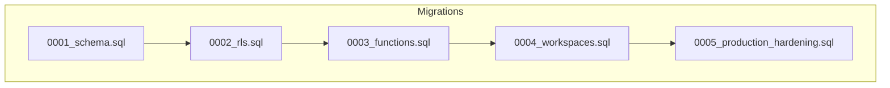
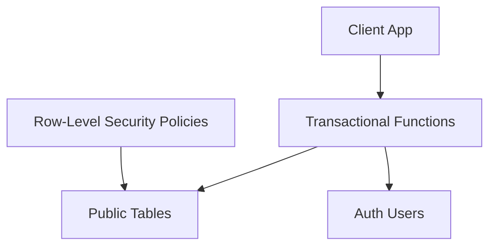
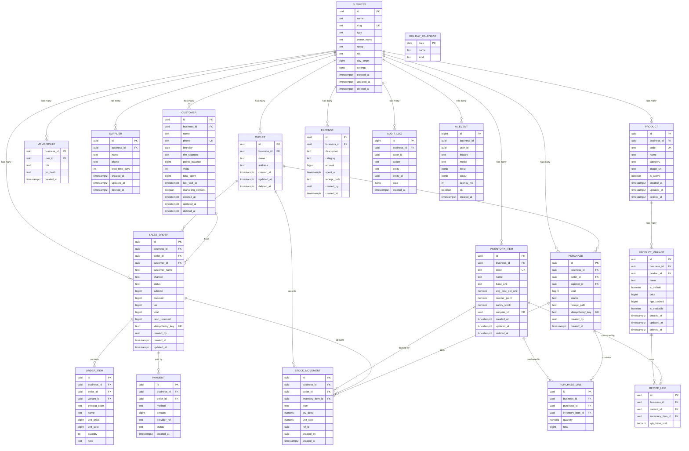
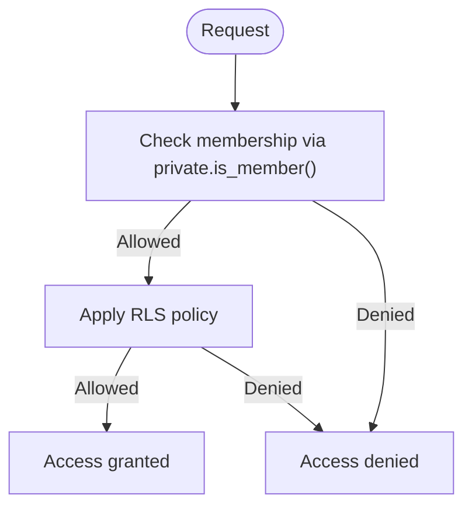
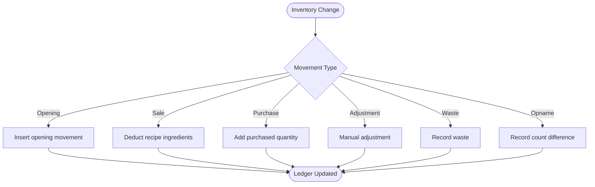
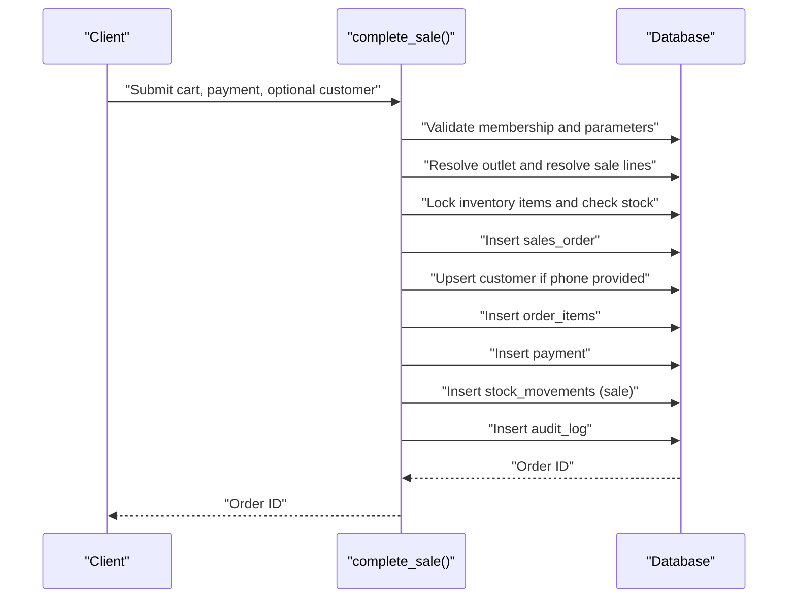
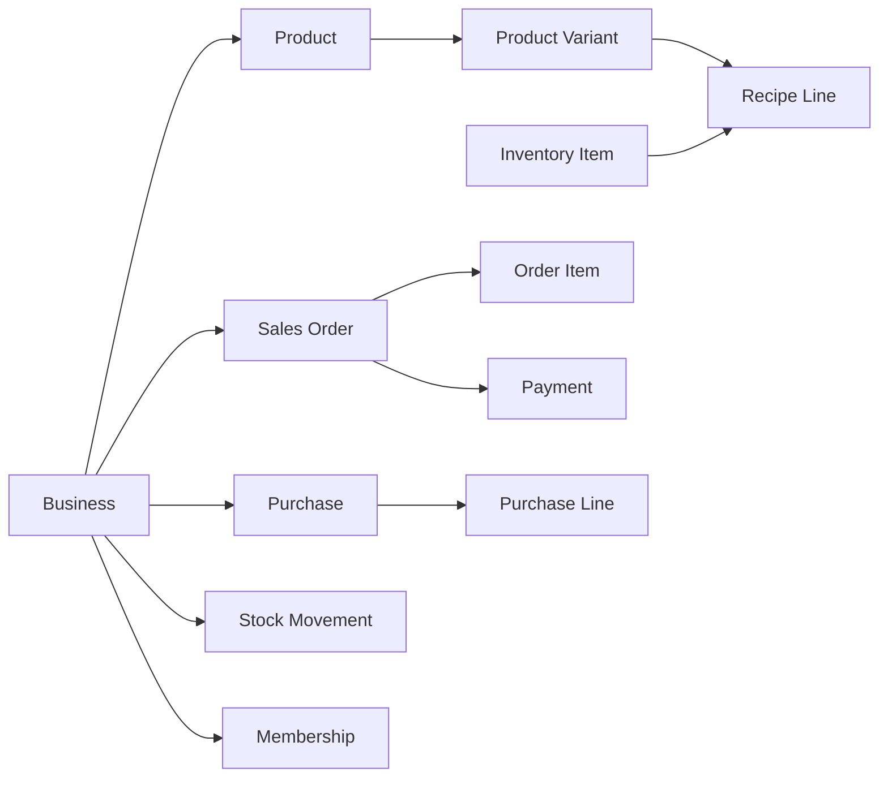

# Database Design

<cite>
**Referenced Files in This Document**
- [0001_schema.sql](file://supabase/migrations/0001_schema.sql)
- [0002_rls.sql](file://supabase/migrations/0002_rls.sql)
- [0003_functions.sql](file://supabase/migrations/0003_functions.sql)
- [0004_workspaces.sql](file://supabase/migrations/0004_workspaces.sql)
- [0005_production_hardening.sql](file://supabase/migrations/0005_production_hardening.sql)
</cite>

## Table of Contents
1. [Introduction](#introduction)
2. [Project Structure](#project-structure)
3. [Core Components](#core-components)
4. [Architecture Overview](#architecture-overview)
5. [Detailed Component Analysis](#detailed-component-analysis)
6. [Dependency Analysis](#dependency-analysis)
7. [Performance Considerations](#performance-considerations)
8. [Troubleshooting Guide](#troubleshooting-guide)
9. [Conclusion](#conclusion)

## Introduction
This document describes the Laris database design as implemented through Supabase migrations. It focuses on:
- Business entities: business, outlet, supplier, inventory item, product, product variant, recipe line, customer, sales order, order item, payment, purchase, purchase line, expense.
- Stock tracking via an immutable ledger table for stock movements.
- Multi-tenancy using `business_id` partitioning and Row-Level Security policies.
- Transactional functions that enforce atomicity, validation, and tenant isolation.
- Indexing strategies, constraints, and production hardening patterns.

The schema follows these conventions:
- Every tenant-scoped table carries a `business_id`.
- Money is stored as integer rupiah (`bigint`).
- Quantities use `NUMERIC(14,3)` in base units.
- Moving-average cost per unit uses `NUMERIC(14,4)`.
- Stock is derived from summing `qty_delta` in the stock movement ledger.
- Human-readable stable codes are used for products and inventory items.

**Section sources**
- [0001_schema.sql:1-7](file://supabase/migrations/0001_schema.sql#L1-L7)

## Project Structure
The database design is defined by five migration files:
- Schema definition and core tables.
- Row-Level Security policies.
- Transactional functions for POS checkout and purchasing.
- Workspace onboarding and catalog management helpers.
- Production hardening with idempotency, finite numeric checks, and catalog write locks.

**Diagram sources**
- [0001_schema.sql:1-294](file://supabase/migrations/0001_schema.sql#L1-L294)
- [0002_rls.sql:1-131](file://supabase/migrations/0002_rls.sql#L1-L131)
- [0003_functions.sql:1-320](file://supabase/migrations/0003_functions.sql#L1-L320)
- [0004_workspaces.sql:1-346](file://supabase/migrations/0004_workspaces.sql#L1-L346)
- [0005_production_hardening.sql:1-395](file://supabase/migrations/0005_production_hardening.sql#L1-L395)

**Section sources**
- [0001_schema.sql:1-294](file://supabase/migrations/0001_schema.sql#L1-L294)
- [0002_rls.sql:1-131](file://supabase/migrations/0002_rls.sql#L1-L131)
- [0003_functions.sql:1-320](file://supabase/migrations/0003_functions.sql#L1-L320)
- [0004_workspaces.sql:1-346](file://supabase/migrations/0004_workspaces.sql#L1-L346)
- [0005_production_hardening.sql:1-395](file://supabase/migrations/0005_production_hardening.sql#L1-L395)

## Core Components
This section summarizes the main entity groups and their responsibilities.

- Tenancy and membership
  - `business`: top-level tenant.
  - `outlet`: physical location under a business.
  - `membership`: maps users to roles within a business.

- Catalog and inventory
  - `supplier`: vendor reference per business.
  - `inventory_item`: raw material or ingredient with moving-average cost and reorder/safety thresholds.
  - `product`, `product_variant`: sellable menu items with pricing and availability.
  - `recipe_line`: bill-of-materials linking variants to inventory items.

- Customers
  - `customer`: loyalty profile with RFM segmentation, points, visits, and marketing consent.

- Sales and payments
  - `sales_order`: header for a transaction.
  - `order_item`: line items referencing product variants and denormalized product metadata.
  - `payment`: payment method and amount per order.

- Purchasing and expenses
  - `purchase`, `purchase_line`: inbound stock records.
  - `expense`: operational costs.

- Ledger and audit
  - `stock_movement`: immutable ledger entries for all stock changes.
  - `audit_log`: actor-driven audit trail.
  - `ai_event`: AI feature telemetry.
  - `holiday_calendar`: shared reference data.

Key design notes:
- All monetary values are integers representing rupiah.
- Quantities are `NUMERIC(14,3)`; costs are `NUMERIC(14,4)`.
- Soft deletes are supported via `deleted_at` on many tables.
- Stable human-readable codes exist for products and inventory items.

**Section sources**
- [0001_schema.sql:24-284](file://supabase/migrations/0001_schema.sql#L24-L284)

## Architecture Overview
The architecture enforces multi-tenancy and data integrity through:
- `business_id` scoping across tenant tables.
- Row-Level Security policies restricting access by role and tenant.
- SECURITY DEFINER functions for all ledger writes.
- Immutable stock movement records ensuring auditable inventory history.
- Triggers enforcing updated timestamps and tenant consistency.

**Diagram sources**
- [0002_rls.sql:10-25](file://supabase/migrations/0002_rls.sql#L10-L25)
- [0003_functions.sql:1-7](file://supabase/migrations/0003_functions.sql#L1-L7)
- [0001_schema.sql:24-284](file://supabase/migrations/0001_schema.sql#L24-L284)

## Detailed Component Analysis

### Entity Relationship Model
The following diagram shows primary and foreign key relationships among core entities.

**Diagram sources**
- [0001_schema.sql:24-284](file://supabase/migrations/0001_schema.sql#L24-L284)
- [0005_production_hardening.sql:5-7](file://supabase/migrations/0005_production_hardening.sql#L5-L7)

**Section sources**
- [0001_schema.sql:24-284](file://supabase/migrations/0001_schema.sql#L24-L284)

### Primary Keys, Foreign Keys, and Constraints
- Primary keys
  - Most tables use UUID primary keys generated at insert time.
  - Audit and telemetry tables use auto-incrementing bigints.
  - Composite primary keys include `membership(business_id, user_id)`.

- Foreign keys
  - Tenant scoping: most tables reference `business.id`.
  - Outlet references: sales, purchases, and stock movements reference `outlet.id`.
  - Catalog references: product variants reference product; recipe lines reference product variants and inventory items.
  - Customer linkage: sales orders optionally reference customers.
  - Purchase linkage: purchase lines reference purchases and inventory items.

- Constraints
  - Monetary fields: non-negative checks for prices, totals, discounts, taxes, amounts.
  - Quantity fields: positive checks for quantities and recipe line usage.
  - Enum-like checks: channels, statuses, methods, types, categories, features, kinds.
  - Unique constraints: stable codes per business, unique phone per business, default variant uniqueness, idempotency keys.
  - Numeric finiteness: explicit rejection of NaN and Infinity for critical numeric columns.

- Soft deletes
  - Many tables include `deleted_at` for logical deletion.

**Section sources**
- [0001_schema.sql:24-284](file://supabase/migrations/0001_schema.sql#L24-L284)
- [0005_production_hardening.sql:11-33](file://supabase/migrations/0005_production_hardening.sql#L11-L33)

### Indexing Strategy
Indexes support common queries and reporting:
- Text search on inventory names using trigram GIN index.
- Business-scoped time-series indexes for sales, stock movements, expenses, and audit logs.
- Order and payment lookup indexes.
- Unique indexes for stable codes and idempotency keys.

Examples:
- Inventory name search: GIN trigram index on `inventory_item.name`.
- Sales listing: composite index on `(business_id, created_at desc)`.
- Stock movement queries: index on `(inventory_item_id, outlet_id)` and `(business_id, created_at desc)`.
- Expense reporting: index on `(business_id, spent_at desc)`.
- Purchase idempotency: partial unique index where `idempotency_key` is not null.

**Section sources**
- [0001_schema.sql:89-89](file://supabase/migrations/0001_schema.sql#L89-L89)
- [0001_schema.sql:172-172](file://supabase/migrations/0001_schema.sql#L172-L172)
- [0001_schema.sql:215-216](file://supabase/migrations/0001_schema.sql#L215-L216)
- [0001_schema.sql:250-250](file://supabase/migrations/0001_schema.sql#L250-L250)
- [0005_production_hardening.sql:6-7](file://supabase/migrations/0005_production_hardening.sql#L6-L7)

### Multi-Tenancy and Row-Level Security
Multi-tenancy is enforced by:
- `business_id` presence on tenant tables.
- RLS policies requiring membership checks via `private.is_member`.
- Role-based permissions:
  - Owner and manager roles can modify catalog entities.
  - Cashier roles can perform sales and limited customer operations.
  - Ledger tables are read-only for clients; writes occur only through transactional functions.
- Trigger-enforced tenant consistency:
  - Prevent changing `business_id` after row creation.
  - Ensure product variants, recipes, and suppliers belong to the same business.
  - Lock catalog writes per business to avoid concurrent version skew.

**Diagram sources**
- [0002_rls.sql:10-25](file://supabase/migrations/0002_rls.sql#L10-L25)
- [0002_rls.sql:46-131](file://supabase/migrations/0002_rls.sql#L46-L131)
- [0004_workspaces.sql:14-56](file://supabase/migrations/0004_workspaces.sql#L14-L56)
- [0005_production_hardening.sql:34-68](file://supabase/migrations/0005_production_hardening.sql#L34-L68)

**Section sources**
- [0002_rls.sql:10-131](file://supabase/migrations/0002_rls.sql#L10-L131)
- [0004_workspaces.sql:14-56](file://supabase/migrations/0004_workspaces.sql#L14-L56)
- [0005_production_hardening.sql:34-68](file://supabase/migrations/0005_production_hardening.sql#L34-L68)

### Ledger-Based Stock Tracking
Stock is tracked immutably through `stock_movement`:
- Types include opening, sale, purchase, adjustment, waste, and opname.
- Current stock equals the sum of `qty_delta` filtered by inventory item and outlet.
- Unit cost is recorded per movement for accurate moving-average calculations.
- Sales deduct ingredients based on recipe lines.
- Purchases add stock and update moving-average cost.

**Diagram sources**
- [0001_schema.sql:203-216](file://supabase/migrations/0001_schema.sql#L203-L216)
- [0003_functions.sql:11-15](file://supabase/migrations/0003_functions.sql#L11-L15)
- [0003_functions.sql:218-223](file://supabase/migrations/0003_functions.sql#L218-L223)
- [0003_functions.sql:290-291](file://supabase/migrations/0003_functions.sql#L290-L291)

**Section sources**
- [0001_schema.sql:203-216](file://supabase/migrations/0001_schema.sql#L203-L216)
- [0003_functions.sql:11-15](file://supabase/migrations/0003_functions.sql#L11-L15)
- [0003_functions.sql:218-223](file://supabase/migrations/0003_functions.sql#L218-L223)
- [0003_functions.sql:290-291](file://supabase/migrations/0003_functions.sql#L290-L291)

### Transactional Functions and Atomic Workflows
All ledger writes go through SECURITY DEFINER functions:
- `create_business`: creates business, outlet, membership, and audit log atomically.
- `complete_sale`: validates cart, resolves prices and costs, checks stock, inserts order, items, payment, stock deductions, and audit log.
- `record_purchase`: validates lines, inserts purchase and lines, updates moving-average cost, inserts stock additions, refreshes HPP, and audits.
- Workspace and catalog helpers: `create_workspace`, `save_product`, `save_inventory_item`, `add_team_member_by_email`.

**Diagram sources**
- [0003_functions.sql:94-230](file://supabase/migrations/0003_functions.sql#L94-L230)
- [0005_production_hardening.sql:84-214](file://supabase/migrations/0005_production_hardening.sql#L84-L214)

**Section sources**
- [0003_functions.sql:71-230](file://supabase/migrations/0003_functions.sql#L71-L230)
- [0003_functions.sql:236-303](file://supabase/migrations/0003_functions.sql#L236-L303)
- [0004_workspaces.sql:72-153](file://supabase/migrations/0004_workspaces.sql#L72-L153)
- [0004_workspaces.sql:155-221](file://supabase/migrations/0004_workspaces.sql#L155-L221)
- [0004_workspaces.sql:223-300](file://supabase/migrations/0004_workspaces.sql#L223-L300)
- [0004_workspaces.sql:302-333](file://supabase/migrations/0004_workspaces.sql#L302-L333)
- [0005_production_hardening.sql:84-214](file://supabase/migrations/0005_production_hardening.sql#L84-L214)
- [0005_production_hardening.sql:217-306](file://supabase/migrations/0005_production_hardening.sql#L217-L306)
- [0005_production_hardening.sql:308-389](file://supabase/migrations/0005_production_hardening.sql#L308-L389)

### Data Validation Rules Enforced at the Database Level
Validation occurs at multiple layers:
- Column constraints: non-negative money, positive quantities, enum-like checks.
- Unique constraints: stable codes, phone numbers, default variants, idempotency keys.
- Numeric finiteness: explicit rejection of NaN and Infinity for critical numeric columns.
- Trigger validations:
  - Tenant consistency for product variants, recipe lines, and inventory-supplier links.
  - Prevention of `business_id` mutation after creation.
  - Catalog write locking per business.
- Function-level validation:
  - Parameter ranges and formats.
  - Cart size limits and quantity bounds.
  - Payment method and channel enumeration.
  - Discount bounds relative to subtotal.
  - Cash tender sufficiency for cash payments.
  - Supplier existence checks.
  - Recipe ingredient positivity and uniqueness.

**Section sources**
- [0001_schema.sql:24-284](file://supabase/migrations/0001_schema.sql#L24-L284)
- [0005_production_hardening.sql:11-33](file://supabase/migrations/0005_production_hardening.sql#L11-L33)
- [0004_workspaces.sql:14-56](file://supabase/migrations/0004_workspaces.sql#L14-L56)
- [0003_functions.sql:122-162](file://supabase/migrations/0003_functions.sql#L122-L162)
- [0003_functions.sql:254-282](file://supabase/migrations/0003_functions.sql#L254-L282)
- [0004_workspaces.sql:173-184](file://supabase/migrations/0004_workspaces.sql#L173-L184)
- [0004_workspaces.sql:247-252](file://supabase/migrations/0004_workspaces.sql#L247-L252)

### Stored Procedures for Atomic Transactions
Key procedures ensure end-to-end consistency:
- `create_business`: tenant setup with initial outlet and ownership.
- `complete_sale`: order creation, customer upsert, itemization, payment recording, stock deduction, and audit logging.
- `record_purchase`: purchase creation, line processing, moving-average cost update, stock addition, HPP refresh, and audit logging.
- `create_workspace`: bulk onboarding including suppliers, inventory items, products, variants, recipes, and opening stock.
- `save_product`: create or update product with default variant and recipe lines.
- `save_inventory_item`: create or update inventory item with optional opening stock and opname adjustments.
- `add_team_member_by_email`: invite team members with role assignment.

**Section sources**
- [0003_functions.sql:71-88](file://supabase/migrations/0003_functions.sql#L71-L88)
- [0003_functions.sql:94-230](file://supabase/migrations/0003_functions.sql#L94-L230)
- [0003_functions.sql:236-303](file://supabase/migrations/0003_functions.sql#L236-L303)
- [0004_workspaces.sql:72-153](file://supabase/migrations/0004_workspaces.sql#L72-L153)
- [0004_workspaces.sql:155-221](file://supabase/migrations/0004_workspaces.sql#L155-L221)
- [0004_workspaces.sql:223-300](file://supabase/migrations/0004_workspaces.sql#L223-L300)
- [0004_workspaces.sql:302-333](file://supabase/migrations/0004_workspaces.sql#L302-L333)

## Dependency Analysis
The database schema exhibits clear dependency chains:
- Catalog dependencies: product depends on business; product variant depends on product; recipe line depends on product variant and inventory item.
- Sales dependencies: sales order depends on business and outlet; order item depends on sales order and product variant; payment depends on sales order.
- Stock dependencies: stock movement depends on business, outlet, and inventory item; purchase and purchase line depend on business, outlet, and inventory item.
- Membership dependencies: membership depends on business and auth users.

**Diagram sources**
- [0001_schema.sql:24-284](file://supabase/migrations/0001_schema.sql#L24-L284)

**Section sources**
- [0001_schema.sql:24-284](file://supabase/migrations/0001_schema.sql#L24-L284)

## Performance Considerations
- Query optimization
  - Use composite indexes for business-scoped time-series queries such as sales, stock movements, expenses, and audit logs.
  - Leverage trigram GIN indexing for fuzzy text search on inventory names.
  - Prefer reading current stock via the ledger function rather than maintaining a separate stock balance table.
- Partitioning strategies
  - The schema does not implement native table partitioning; instead, it relies on `business_id` scoping and indexes.
  - For very large datasets, consider partitioning time-series tables like `stock_movement`, `sales_order`, and `audit_log` by month or year while retaining `business_id` filters.
- Concurrency and locking
  - Catalog writes lock the business row to prevent concurrent version skew during sales and catalog updates.
  - Idempotency keys prevent duplicate orders and purchases under concurrency or retries.
- Backup procedures for production
  - Back up the entire database regularly, including schema, data, and functions.
  - Include transaction logs for point-in-time recovery.
  - Validate backups with restore drills and verify RLS policies and function privileges post-restore.
- Monitoring and maintenance
  - Monitor slow queries on stock movement aggregation and sales reporting.
  - Vacuum and analyze tables frequently to maintain statistics.
  - Review index usage and remove unused indexes.

[No sources needed since this section provides general guidance]

## Troubleshooting Guide
Common issues and resolutions:
- Access denied errors
  - Occur when the caller is not authenticated or lacks required membership/role.
  - Verify `auth.uid()` and membership via `private.is_member`.

- Invalid parameter errors
  - Occur when payment methods, channels, cart sizes, or quantity bounds are invalid.
  - Validate inputs before calling transactional functions.

- Insufficient stock errors
  - Occur when recipe ingredient requirements exceed available stock.
  - Check stock via `private.stock_of` and review recent stock movements.

- Duplicate idempotency key errors
  - Occur when retrying the same order or purchase key concurrently.
  - Handle unique violation gracefully and return the existing record ID.

- Tenant consistency errors
  - Occur when attempting to link entities across different businesses.
  - Ensure all referenced entities share the same `business_id`.

- Numeric finiteness errors
  - Occur when NaN or Infinity values are inserted into numeric columns.
  - Sanitize inputs and rely on explicit constraints rejecting non-finite values.

**Section sources**
- [0003_functions.sql:122-162](file://supabase/migrations/0003_functions.sql#L122-L162)
- [0003_functions.sql:254-282](file://supabase/migrations/0003_functions.sql#L254-L282)
- [0005_production_hardening.sql:11-33](file://supabase/migrations/0005_production_hardening.sql#L11-L33)
- [0004_workspaces.sql:14-56](file://supabase/migrations/0004_workspaces.sql#L14-L56)

## Conclusion
The Laris database design emphasizes secure multi-tenancy, strict data integrity, and auditable inventory tracking. Through `business_id` scoping, comprehensive RLS policies, and SECURITY DEFINER transactional functions, the system ensures tenant isolation and consistent state transitions. The immutable stock movement ledger provides a reliable foundation for cost accounting and inventory reconciliation. With targeted indexing, robust constraints, and production hardening measures, the schema supports scalable and safe operations in production environments.

[No sources needed since this section summarizes without analyzing specific files]