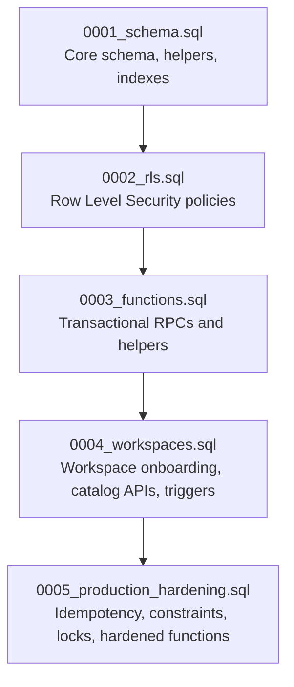
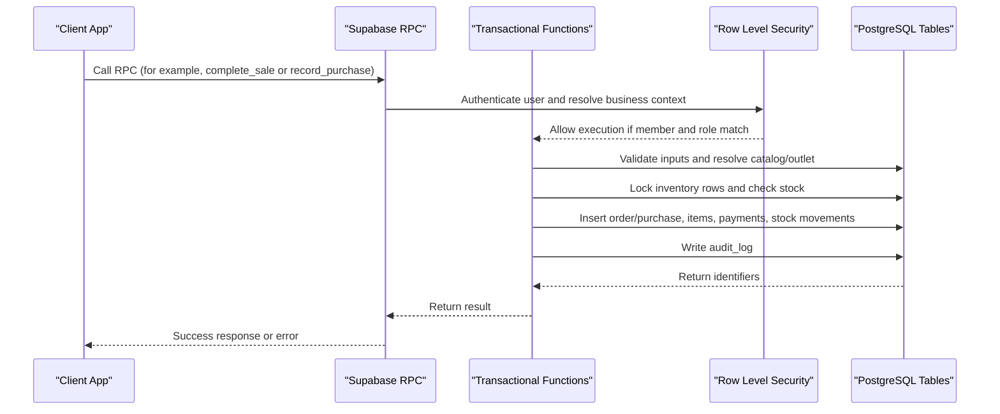
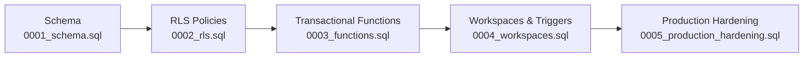

# Migrations & Version Management

<cite>
**Referenced Files in This Document**
- [README.md](file://README.md)
- [0001_schema.sql](file://supabase/migrations/0001_schema.sql)
- [0002_rls.sql](file://supabase/migrations/0002_rls.sql)
- [0003_functions.sql](file://supabase/migrations/0003_functions.sql)
- [0004_workspaces.sql](file://supabase/migrations/0004_workspaces.sql)
- [0005_production_hardening.sql](file://supabase/migrations/0005_production_hardening.sql)
- [rls.test.ts](file://scripts/rls.test.ts)
</cite>

## Table of Contents
1. [Introduction](#introduction)
2. [Project Structure](#project-structure)
3. [Core Components](#core-components)
4. [Architecture Overview](#architecture-overview)
5. [Detailed Component Analysis](#detailed-component-analysis)
6. [Dependency Analysis](#dependency-analysis)
7. [Performance Considerations](#performance-considerations)
8. [Troubleshooting Guide](#troubleshooting-guide)
9. [Conclusion](#conclusion)
10. [Appendices](#appendices)

## Introduction
This document explains the database migration and version management system used by Laris. The project uses sequential SQL migrations under `supabase/migrations` to evolve the PostgreSQL schema, Row Level Security policies, transactional functions, workspace onboarding features, and production hardening controls.

The migration strategy is intentionally staged:
- Initial schema definition establishes tenant isolation, catalog, inventory, sales, purchasing, expenses, audit, AI telemetry, and reference data.
- Row Level Security enforces per-tenant access control.
- Transactional functions centralize business logic and ledger writes.
- Workspace features add onboarding, team management, product/inventory APIs, and catalog integrity checks.
- Production hardening adds idempotency, stronger constraints, tenant immutability, catalog write locking, and safer function signatures.

The repository’s README explicitly requires applying all migrations in order and warns against applying only the latest migration on a fresh database.

**Section sources**
- [README.md:37-47](file://README.md#L37-L47)
- [README.md:89-95](file://README.md#L89-L95)

## Project Structure
The migration files are ordered by numeric prefix. Each file is self-contained but may depend on objects created by earlier migrations.

**Diagram sources**
- [0001_schema.sql:1-294](file://supabase/migrations/0001_schema.sql#L1-L294)
- [0002_rls.sql:1-131](file://supabase/migrations/0002_rls.sql#L1-L131)
- [0003_functions.sql:1-320](file://supabase/migrations/0003_functions.sql#L1-L320)
- [0004_workspaces.sql:1-346](file://supabase/migrations/0004_workspaces.sql#L1-L346)
- [0005_production_hardening.sql:1-395](file://supabase/migrations/0005_production_hardening.sql#L1-L395)

**Section sources**
- [README.md:97-110](file://README.md#L97-L110)

## Core Components
The migration set defines five major layers:

| Layer | Migration | Purpose | Key Concepts |
|---|---|---|---|
| Schema foundation | `0001_schema.sql` | Defines core tables, constraints, indexes, and updated-at triggers | Tenant isolation via `business_id`, money as BIGINT rupiah, quantities as `NUMERIC`, stock ledger via `stock_movement`, stable `code` keys |
| Access control | `0002_rls.sql` | Enables and configures Row Level Security | Membership helper, role-based policies, read-only ledger access for clients |
| Business logic | `0003_functions.sql` | Implements transactional RPCs | `create_business`, `complete_sale`, `record_purchase`, moving-average cost, HPP refresh, audit logging |
| Workspace features | `0004_workspaces.sql` | Adds onboarding, team management, product/inventory APIs | `create_workspace`, `save_product`, `save_inventory_item`, tenant integrity triggers |
| Production hardening | `0005_production_hardening.sql` | Strengthens safety and concurrency | Idempotency keys, finite numeric checks, immutable `business_id`, catalog write locks, hardened function signatures |

**Section sources**
- [0001_schema.sql:1-294](file://supabase/migrations/0001_schema.sql#L1-L294)
- [0002_rls.sql:1-131](file://supabase/migrations/0002_rls.sql#L1-L131)
- [0003_functions.sql:1-320](file://supabase/migrations/0003_functions.sql#L1-L320)
- [0004_workspaces.sql:1-346](file://supabase/migrations/0004_workspaces.sql#L1-L346)
- [0005_production_hardening.sql:1-395](file://supabase/migrations/0005_production_hardening.sql#L1-L395)

## Architecture Overview
At runtime, client applications interact with Supabase through authenticated RPC calls. Direct writes to ledger tables are blocked by RLS; changes go through security-definer functions that re-check membership, compute prices and costs server-side, and perform atomic multi-table updates.

**Diagram sources**
- [0002_rls.sql:10-25](file://supabase/migrations/0002_rls.sql#L10-L25)
- [0002_rls.sql:90-101](file://supabase/migrations/0002_rls.sql#L90-L101)
- [0003_functions.sql:70-88](file://supabase/migrations/0003_functions.sql#L70-L88)
- [0003_functions.sql:90-230](file://supabase/migrations/0003_functions.sql#L90-L230)
- [0003_functions.sql:232-303](file://supabase/migrations/0003_functions.sql#L232-L303)

## Detailed Component Analysis

### Migration File Naming Convention and Sequential Numbering Strategy
- All migrations use zero-padded four-digit prefixes: `0001`, `0002`, `0003`, `0004`, `0005`.
- The prefix guarantees deterministic execution order.
- The README instructs applying them sequentially from schema through production hardening.
- Applying only the latest migration on a fresh database is explicitly discouraged because later migrations assume earlier objects exist.

Recommended naming pattern for future migrations:
- Use incremental numbers: `0006_<feature>.sql`.
- Keep filenames descriptive and lowercase with underscores.
- Place each logical change in its own migration when it affects schema, policies, functions, or data differently.

**Section sources**
- [README.md:44-44](file://README.md#L44-L44)

### Migration 0001: Initial Schema Definition
This migration creates the foundational schema:
- Tenancy: `business`, `outlet`, `membership`.
- Catalog and inventory: `supplier`, `inventory_item`, `product`, `product_variant`, `recipe_line`.
- Customers: `customer` with RFM segment and marketing consent.
- Sales ledger: `sales_order`, `order_item`, `payment`.
- Stock and purchasing: `stock_movement`, `purchase`, `purchase_line`.
- Expenses: `expense`.
- Audit and telemetry: `audit_log`, `ai_event`.
- Reference data: `holiday_calendar`.
- Helpers: `private.touch_updated_at()` and automatic updated-at triggers.

Key design decisions:
- Every tenant table carries `business_id`.
- Money values use BIGINT rupiah to avoid floating-point rounding issues.
- Quantities use `NUMERIC` with appropriate precision.
- Stock is an append-only ledger; current stock is derived from `SUM(qty_delta)`.
- Stable human-readable `code` columns support UI catalogs and AI parsing.

**Section sources**
- [0001_schema.sql:1-294](file://supabase/migrations/0001_schema.sql#L1-L294)

### Migration 0002: Row Level Security
This migration enables RLS across all core tables and defines policies:
- A security-definer helper `private.is_member` checks membership without recursive policy evaluation.
- Read policies allow any authenticated member to see their business data.
- Catalog write policies restrict writes to owner and manager roles.
- Ledger tables expose select-only policies for members; direct client writes are intended to be blocked, with mutations going through transactional functions.
- Customer policies allow cashier-level create/update while reserving delete for owners/managers.
- Expense policies enforce ownership and role-based modification.
- Audit and AI event policies limit visibility and insertion appropriately.

**Section sources**
- [0002_rls.sql:1-131](file://supabase/migrations/0002_rls.sql#L1-L131)

### Migration 0003: Transactional Functions
This migration introduces the core business functions:
- `private.stock_of`: computes current stock from the movement ledger.
- `private.segment_for`: derives customer RFM segments.
- `private.rupiah`: formats rupiah amounts.
- `private.sale_lines`: resolves cart lines against the catalog using database prices and HPP.
- `private.refresh_hpp`: recalculates cached recipe cost after ingredient cost changes.
- `private.resolve_outlet`: selects a valid outlet for a business.
- `public.create_business`: onboarding flow that makes the creator an owner.
- `public.complete_sale`: POS checkout with validation, stock checks, idempotency, customer upsert, payment recording, stock deduction, and audit logging.
- `public.record_purchase`: stock-in with moving-average cost update, purchase line creation, stock movement, HPP refresh, and audit logging.

Important safety properties:
- Functions are `SECURITY DEFINER` and re-check membership and roles.
- Prices and costs come from the database, not client input.
- Operations run inside transactions and write audit logs.
- Errors use explicit error codes for client handling.

**Section sources**
- [0003_functions.sql:1-320](file://supabase/migrations/0003_functions.sql#L1-L320)

### Migration 0004: Workspaces and Catalog Integrity
This migration extends functionality and strengthens catalog integrity:
- Updates `private.sale_lines` to include business scoping for product variants.
- Adds tenant-integrity triggers:
  - `check_variant_tenant`: ensures product and variant belong to the same business.
  - `check_recipe_tenant`: ensures recipe, variant, and inventory item share the same business.
  - `check_inventory_supplier_tenant`: ensures inventory item and supplier share the same business.
- Adds team management API: `list_team_members`.
- Adds workspace onboarding API: `create_workspace` with optional initial inventory and products.
- Adds product management API: `save_product` with recipe validation and HPP refresh.
- Adds inventory management API: `save_inventory_item` with opening stock, unit-change protection, and opname adjustments.
- Adds team invitation API: `add_team_member_by_email` with idempotent membership insertion.

**Section sources**
- [0004_workspaces.sql:1-346](file://supabase/migrations/0004_workspaces.sql#L1-L346)

### Migration 0005: Production Hardening
This migration improves safety, correctness, and concurrency:
- Adds `idempotency_key` to `purchase` with a partial unique index.
- Changes `customer.points_balance` to BIGINT.
- Replaces numeric constraints with explicit checks rejecting NaN and Infinity values.
- Adds `business_id` immutability trigger across core tables.
- Adds catalog write lock trigger that locks the target business row during catalog mutations.
- Revokes and re-grants policies/functions where needed.
- Redefines `list_team_members` to require owner or manager role.
- Redefines `complete_sale` to acquire a business-level lock before processing.
- Drops and recreates `record_purchase` with an additional idempotency parameter and stricter validation.
- Redefines `save_inventory_item` to acquire a business-level lock and validate unit-cost limits.

These changes reduce race conditions between catalog writes and checkout operations, prevent accidental tenant migration, and make financial fields more robust.

**Section sources**
- [0005_production_hardening.sql:1-395](file://supabase/migrations/0005_production_hardening.sql#L1-L395)

### Migration Workflow: Development, Testing, and Deployment
Development workflow:
1. Install dependencies and start the development server.
2. Configure Supabase environment variables.
3. Apply all migrations in order on the development database.
4. Run type checking, linting, tests, voice evaluation, and build steps.
5. Use `/demo` for local browser-only demo data and `/login` for cloud account flows.

Testing workflow:
- Unit and integration tests cover ledger behavior, checkout, validation, catalog customization, moving-average cost, HPP, parser behavior, CSV export safety, and RLS isolation.
- The RLS test script creates two tenants and verifies cross-tenant isolation, ledger write restrictions, and anonymous access denial.

Deployment workflow:
- Apply migrations first on staging.
- Run RLS tests and end-to-end registration, onboarding, and checkout flows.
- Verify email confirmation, recovery, team invitations, stock opname, purchases, and AI failure paths.
- Enforce HTTPS, disable demo credentials, restrict service-role key usage, and prepare database backups.
- Run the full verification checklist on the release commit.

**Section sources**
- [README.md:9-22](file://README.md#L9-L22)
- [README.md:37-47](file://README.md#L37-L47)
- [README.md:75-87](file://README.md#L75-L87)
- [README.md:89-95](file://README.md#L89-L95)
- [rls.test.ts:25-88](file://scripts/rls.test.ts#L25-L88)

### Rollback Procedures and Failed Migration Handling
Rollback guidance:
- Treat migrations as forward-only changes whenever possible.
- If a migration fails mid-execution, inspect the database state and determine which objects were partially created.
- For failed schema changes, restore from a pre-migration backup rather than attempting manual partial rollbacks.
- For failed function or policy changes, drop or recreate the affected object carefully, ensuring dependent code is compatible.
- Avoid ad-hoc fixes that bypass RLS or transactional functions; prefer safe, documented rollback scripts.

Production failure strategy:
- Stop new deployments until the database state is understood.
- Compare the expected schema with the actual schema.
- Restore from a known-good backup if data integrity is uncertain.
- Reapply only the missing or corrected migration after validating on staging.
- Add a targeted follow-up migration instead of rewriting earlier migrations.

**Section sources**
- [README.md:44-44](file://README.md#L44-L44)
- [README.md:89-95](file://README.md#L89-L95)

### Writing Safe, Idempotent Migrations
Safe migration principles demonstrated by the codebase:
- Use `if not exists` or `drop ... if exists` patterns when redefining objects.
- Prefer `create or replace function` for RPCs so repeated application does not fail.
- Guard constraint changes by dropping old constraints before adding new ones.
- Use partial unique indexes for optional idempotency keys.
- Keep business logic in transactional functions rather than allowing direct client writes to sensitive tables.
- Validate inputs at the function boundary and reject invalid ranges, types, and sizes.
- Log important mutations through audit tables.

Examples visible in the migrations:
- Numeric constraints are replaced with explicit finite-value checks.
- Purchase idempotency uses a partial unique index on `business_id` and `idempotency_key`.
- Catalog write locks protect concurrent mutations.
- Tenant immutability prevents changing `business_id` after row creation.

**Section sources**
- [0005_production_hardening.sql:5-7](file://supabase/migrations/0005_production_hardening.sql#L5-L7)
- [0005_production_hardening.sql:11-32](file://supabase/migrations/0005_production_hardening.sql#L11-L32)
- [0005_production_hardening.sql:34-68](file://supabase/migrations/0005_production_hardening.sql#L34-L68)
- [0003_functions.sql:127-132](file://supabase/migrations/0003_functions.sql#L127-L132)
- [0003_functions.sql:216-217](file://supabase/migrations/0003_functions.sql#L216-L217)

### Data Transformations, Backfill Operations, and Zero-Downtime Deployments
Guidelines based on the project’s approach:
- Prefer additive schema changes: add nullable columns, new tables, or new functions before removing legacy objects.
- Use backfill migrations that process data in batches and log progress.
- Keep long-running backfills separate from deployment-critical schema changes.
- Introduce dual-write or shadow-read patterns when migrating critical paths.
- Harden functions gradually, as seen in the transition from `0003_functions.sql` to `0005_production_hardening.sql`.
- Test zero-downtime scenarios on staging: deploy new functions while older clients still work, then retire old callers.

Current implementation highlights:
- Ledger tables are written exclusively through transactional functions.
- Moving-average cost and HPP recalculation are centralized.
- Idempotency keys protect against duplicate orders and purchases.
- Catalog integrity triggers prevent cross-tenant references.

**Section sources**
- [0003_functions.sql:48-61](file://supabase/migrations/0003_functions.sql#L48-L61)
- [0003_functions.sql:90-230](file://supabase/migrations/0003_functions.sql#L90-L230)
- [0003_functions.sql:232-303](file://supabase/migrations/0003_functions.sql#L232-L303)
- [0004_workspaces.sql:13-56](file://supabase/migrations/0004_workspaces.sql#L13-L56)
- [0005_production_hardening.sql:1-4](file://supabase/migrations/0005_production_hardening.sql#L1-L4)

### Testing Migrations Locally and in Staging
Local testing:
- Run TypeScript compilation and linting.
- Execute the test suite covering ledger, checkout, validation, catalog, cost calculations, parser, and CSV export.
- Run voice evaluation against the Indonesian utterance dataset.
- Use the RLS integration test only on a development Supabase instance that has received all migrations and seed data.

Staging testing:
- Apply all migrations before running RLS and functional tests.
- Verify tenant isolation, role permissions, email flows, onboarding, checkout, purchases, and AI fallback behavior.
- Confirm that demo credentials are disabled and service-role keys are restricted.

**Section sources**
- [README.md:75-87](file://README.md#L75-L87)
- [README.md:89-95](file://README.md#L89-L95)
- [rls.test.ts:25-88](file://scripts/rls.test.ts#L25-L88)

### Backup and Recovery Procedures Specific to Migration Scenarios
Backup recommendations:
- Take a full database backup before applying migrations in production.
- Retain point-in-time recovery snapshots around migration windows.
- Record the applied migration version and timestamp in deployment logs.

Recovery procedures:
- If a migration corrupts data or leaves the schema inconsistent, restore from the pre-migration snapshot.
- After restoration, verify that the expected migration version is applied.
- Re-run only the corrected migration after validating it on staging.
- Perform post-recovery validation checks:
  - Verify all required tables and functions exist.
  - Confirm RLS policies are enabled.
  - Validate that ledger totals reconcile with stock movements.
  - Check that no cross-tenant data leakage occurs.

Data validation checks:
- Ensure every tenant table contains a valid `business_id`.
- Ensure numeric fields are finite and non-negative where required.
- Ensure stock movements balance with inventory levels.
- Ensure purchases and sales have consistent audit entries.

**Section sources**
- [README.md:89-95](file://README.md#L89-L95)
- [0001_schema.sql:200-216](file://supabase/migrations/0001_schema.sql#L200-L216)
- [0005_production_hardening.sql:11-32](file://supabase/migrations/0005_production_hardening.sql#L11-L32)

## Dependency Analysis
The migrations form a strict dependency chain. Later migrations assume earlier objects exist and often refine or extend them.

**Diagram sources**
- [0001_schema.sql:1-294](file://supabase/migrations/0001_schema.sql#L1-L294)
- [0002_rls.sql:1-131](file://supabase/migrations/0002_rls.sql#L1-L131)
- [0003_functions.sql:1-320](file://supabase/migrations/0003_functions.sql#L1-L320)
- [0004_workspaces.sql:1-346](file://supabase/migrations/0004_workspaces.sql#L1-L346)
- [0005_production_hardening.sql:1-395](file://supabase/migrations/0005_production_hardening.sql#L1-L395)

Key dependency relationships:
- RLS depends on tables defined in the schema.
- Transactional functions depend on schema tables and RLS membership checks.
- Workspace features depend on functions, policies, and schema objects.
- Production hardening depends on all previous layers and refines functions, constraints, and triggers.

**Section sources**
- [README.md:44-44](file://README.md#L44-L44)

## Performance Considerations
- Use append-only ledgers for stock movements to keep historical accuracy and simplify reconciliation.
- Maintain indexes on frequently queried columns such as `business_id`, `created_at`, `order_id`, and `inventory_item_id`.
- Centralize price and cost computation in functions to avoid client-side inconsistencies.
- Use idempotency keys to reduce duplicate workload from retries.
- Apply catalog write locks to serialize conflicting mutations within a business.
- Avoid large single-statement backfills; batch data transformations and monitor lock contention.

[No sources needed since this section provides general guidance]

## Troubleshooting Guide
Common migration and runtime issues:
- **Direct ledger writes rejected**: Clients must use RPC functions like `complete_sale` or `record_purchase`; direct inserts into `sales_order`, `order_item`, `payment`, `stock_movement`, `purchase`, or `purchase_line` are blocked by RLS.
- **Cross-tenant access denied**: RLS policies ensure users can only see data belonging to their business.
- **Invalid catalog references**: Tenant integrity triggers reject mismatched product, variant, inventory, and supplier combinations.
- **Insufficient stock**: Checkout validates available stock before creating orders.
- **Invalid numeric values**: Production hardening rejects NaN and Infinity values in financial and quantity fields.
- **Duplicate checkout or purchase**: Idempotency keys return existing records instead of creating duplicates.

Verification tools:
- Use the RLS test script to confirm tenant isolation and ledger write restrictions.
- Run the full test suite before deploying migrations.
- Inspect audit logs for business-critical actions.

**Section sources**
- [0002_rls.sql:90-101](file://supabase/migrations/0002_rls.sql#L90-L101)
- [0004_workspaces.sql:13-56](file://supabase/migrations/0004_workspaces.sql#L13-L56)
- [0003_functions.sql:152-179](file://supabase/migrations/0003_functions.sql#L152-L179)
- [0005_production_hardening.sql:11-32](file://supabase/migrations/0005_production_hardening.sql#L11-L32)
- [0005_production_hardening.sql:242-267](file://supabase/migrations/0005_production_hardening.sql#L242-L267)
- [rls.test.ts:63-77](file://scripts/rls.test.ts#L63-L77)

## Conclusion
Laris’s migration system evolves the database safely through five ordered stages: schema, RLS, transactional functions, workspace features, and production hardening. The design emphasizes tenant isolation, server-side business logic, append-only ledgers, idempotency, and strong constraints. Successful deployments depend on applying migrations in order, testing thoroughly on staging, backing up databases before changes, and following rollback procedures when failures occur. Future migrations should follow the established naming convention, remain idempotent, and prioritize zero-downtime safety.

[No sources needed since this section summarizes without analyzing specific files]

## Appendices

### Migration Checklist
- Apply all migrations in order on development and staging.
- Run type checks, linting, tests, voice evaluation, and build.
- Verify RLS isolation and role permissions.
- Test onboarding, checkout, purchases, stock opname, and AI fallbacks.
- Prepare backups and enable point-in-time recovery.
- Disable demo credentials and restrict service-role keys in production.

**Section sources**
- [README.md:37-47](file://README.md#L37-L47)
- [README.md:75-95](file://README.md#L75-L95)