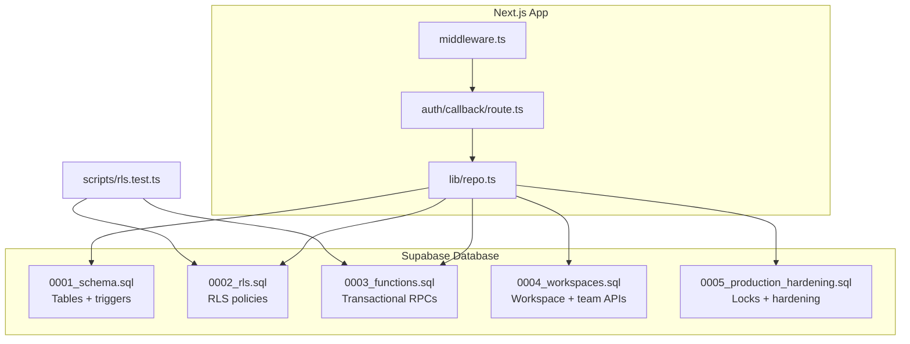
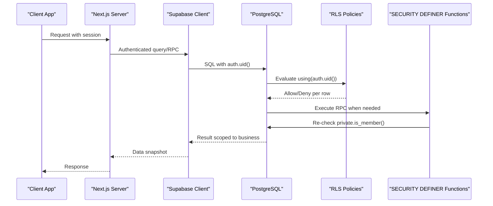
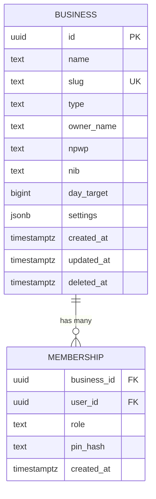
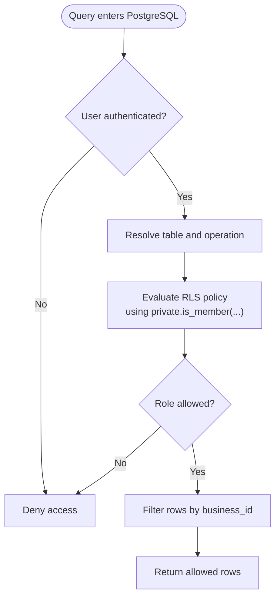
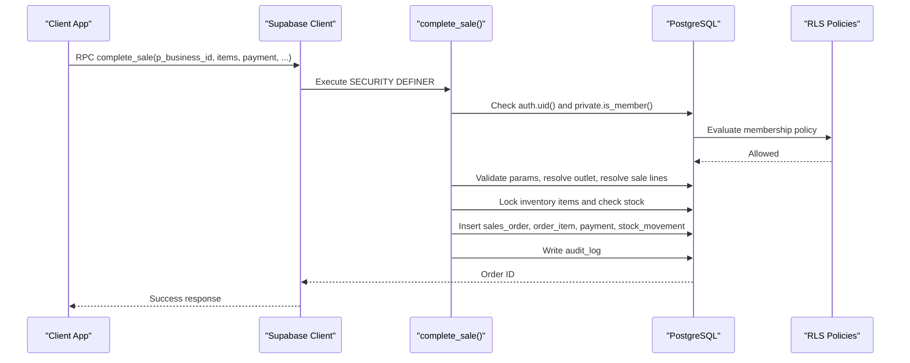
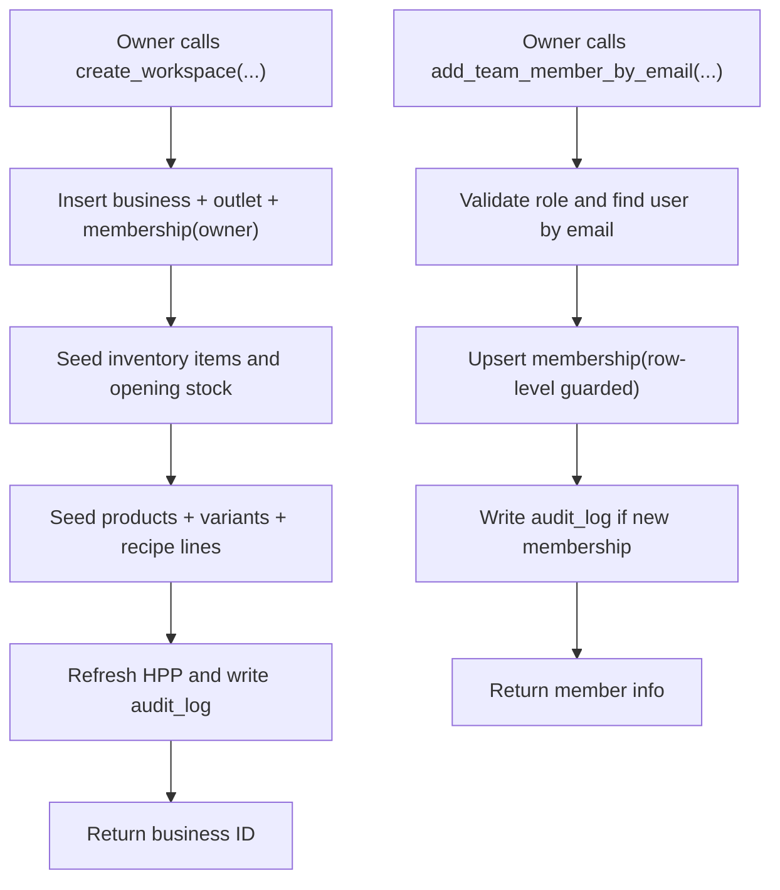
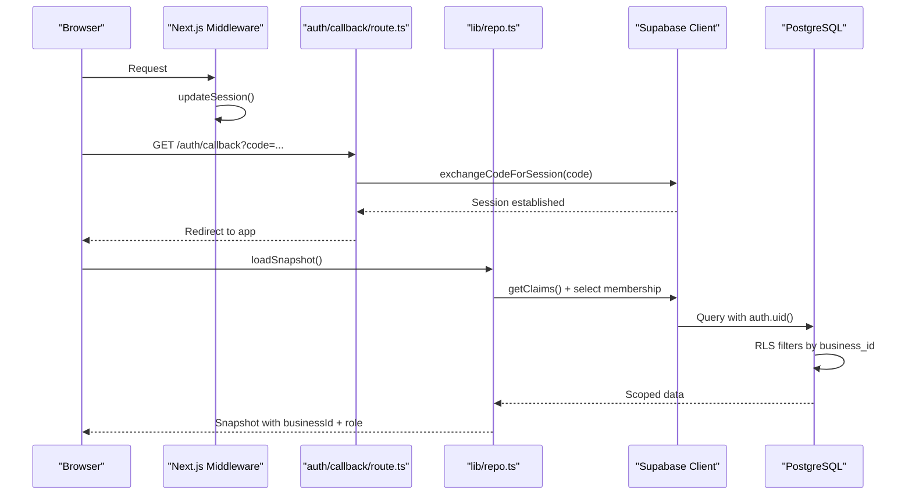
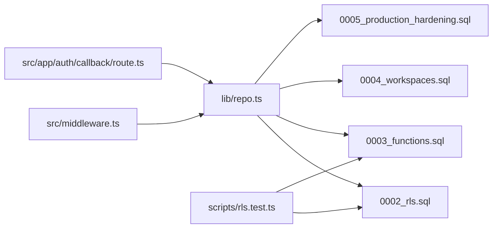

# Multi-Tenancy & Row-Level Security

<cite>
**Referenced Files in This Document**
- [0001_schema.sql](file://supabase/migrations/0001_schema.sql)
- [0002_rls.sql](file://supabase/migrations/0002_rls.sql)
- [0003_functions.sql](file://supabase/migrations/0003_functions.sql)
- [0004_workspaces.sql](file://supabase/migrations/0004_workspaces.sql)
- [0005_production_hardening.sql](file://supabase/migrations/0005_production_hardening.sql)
- [rls.test.ts](file://scripts/rls.test.ts)
- [repo.ts](file://src/lib/repo.ts)
- [route.ts](file://src/app/auth/callback/route.ts)
- [middleware.ts](file://src/middleware.ts)
</cite>

## Table of Contents
1. [Introduction](#introduction)
2. [Project Structure](#project-structure)
3. [Core Components](#core-components)
4. [Architecture Overview](#architecture-overview)
5. [Detailed Component Analysis](#detailed-component-analysis)
6. [Dependency Analysis](#dependency-analysis)
7. [Performance Considerations](#performance-considerations)
8. [Troubleshooting Guide](#troubleshooting-guide)
9. [Conclusion](#conclusion)
10. [Appendices](#appendices)

## Introduction
This document explains how Laris implements multi-tenancy using PostgreSQL Row-Level Security (RLS). The system isolates tenant data by requiring every business-scoped table to carry a `business_id` column and enforcing RLS policies that filter queries based on the authenticated user’s workspace membership. Business isolation is enforced at three layers:

- Schema design: all tenant tables include `business_id`, with foreign keys and constraints ensuring referential integrity within a single business.
- Database security: RLS policies and `SECURITY DEFINER` functions enforce read/write permissions and prevent direct client writes to ledger tables.
- Application layer: server-side code resolves the current user’s membership, selects a business context, and passes it explicitly to database operations.

The goal is complete tenant separation: a user from one business cannot read or write another business’s rows, even if they attempt to manipulate IDs or request parameters.

## Project Structure
The multi-tenancy implementation is primarily defined in Supabase migrations and validated by an integration test. The Next.js application uses Supabase clients to perform authenticated queries and RPC calls.

**Diagram sources**
- [middleware.ts:1-12](file://src/middleware.ts#L1-L12)
- [route.ts:1-18](file://src/app/auth/callback/route.ts#L1-L18)
- [repo.ts:82-193](file://src/lib/repo.ts#L82-L193)
- [0001_schema.sql:24-284](file://supabase/migrations/0001_schema.sql#L24-L284)
- [0002_rls.sql:10-131](file://supabase/migrations/0002_rls.sql#L10-L131)
- [0003_functions.sql:70-320](file://supabase/migrations/0003_functions.sql#L70-L320)
- [0004_workspaces.sql:58-346](file://supabase/migrations/0004_workspaces.sql#L58-L346)
- [0005_production_hardening.sql:34-395](file://supabase/migrations/0005_production_hardening.sql#L34-L395)
- [rls.test.ts:1-89](file://scripts/rls.test.ts#L1-L89)

**Section sources**
- [middleware.ts:1-12](file://src/middleware.ts#L1-L12)
- [route.ts:1-18](file://src/app/auth/callback/route.ts#L1-L18)
- [repo.ts:82-193](file://src/lib/repo.ts#L82-L193)
- [0001_schema.sql:24-284](file://supabase/migrations/0001_schema.sql#L24-L284)
- [0002_rls.sql:10-131](file://supabase/migrations/0002_rls.sql#L10-L131)
- [0003_functions.sql:70-320](file://supabase/migrations/0003_functions.sql#L70-L320)
- [0004_workspaces.sql:58-346](file://supabase/migrations/0004_workspaces.sql#L58-L346)
- [0005_production_hardening.sql:34-395](file://supabase/migrations/0005_production_hardening.sql#L34-L395)
- [rls.test.ts:1-89](file://scripts/rls.test.ts#L1-L89)

## Core Components
- Tenant identity model: `business` represents a tenant; `membership` links users to businesses with roles.
- RLS helper: `private.is_member(business_id, roles?)` checks whether the authenticated user belongs to a business and optionally has required roles.
- Policy matrix: per-table policies define allowed operations for `authenticated` users based on membership and role.
- Transactional RPCs: `create_business`, `complete_sale`, `record_purchase`, `create_workspace`, `save_product`, `save_inventory_item`, `add_team_member_by_email`, and `list_team_members`.
- Production hardening: immutable `business_id`, catalog-write locks, idempotency keys, and numeric validation.
- Application context resolution: `currentMembership` and `loadSnapshot` resolve the active business and role, then query only within that tenant.

Key responsibilities:
- **Schema**: defines tenant-scoped tables and audit telemetry.
- **RLS**: enables and enforces row-level access control.
- **Functions**: encapsulate business logic, re-check authorization, and ensure atomicity.
- **Tests**: assert cross-tenant isolation and rejection of direct ledger writes.

**Section sources**
- [0001_schema.sql:24-284](file://supabase/migrations/0001_schema.sql#L24-L284)
- [0002_rls.sql:10-131](file://supabase/migrations/0002_rls.sql#L10-L131)
- [0003_functions.sql:70-320](file://supabase/migrations/0003_functions.sql#L70-L320)
- [0004_workspaces.sql:58-346](file://supabase/migrations/0004_workspaces.sql#L58-L346)
- [0005_production_hardening.sql:34-395](file://supabase/migrations/0005_production_hardening.sql#L34-L395)
- [rls.test.ts:1-89](file://scripts/rls.test.ts#L1-L89)
- [repo.ts:114-193](file://src/lib/repo.ts#L114-L193)

## Architecture Overview
The architecture separates concerns between authentication, policy evaluation, and transactional execution.

**Diagram sources**
- [0002_rls.sql:10-25](file://supabase/migrations/0002_rls.sql#L10-L25)
- [0002_rls.sql:46-131](file://supabase/migrations/0002_rls.sql#L46-L131)
- [0003_functions.sql:70-320](file://supabase/migrations/0003_functions.sql#L70-L320)
- [repo.ts:114-193](file://src/lib/repo.ts#L114-L193)

## Detailed Component Analysis

### Tenant Identity and Membership Model
The core tenant model centers on `business` and `membership`:
- `business` holds tenant metadata such as name, slug, type, owner, tax identifiers, daily target, settings, and timestamps.
- `membership` maps users to businesses with roles: `owner`, `manager`, `kasir`, `dapur`. It also supports optional PIN hashing for POS workflows.

**Diagram sources**
- [0001_schema.sql:24-56](file://supabase/migrations/0001_schema.sql#L24-L56)

**Section sources**
- [0001_schema.sql:24-56](file://supabase/migrations/0001_schema.sql#L24-L56)

### Row-Level Security Policies
RLS is enabled and forced across all tenant tables. The central helper function `private.is_member` evaluates whether the current user (`auth.uid()`) is a member of the requested business and optionally matches required roles.

Policy categories:
- Tenancy tables: `business`, `outlet`, `membership`.
- Catalog tables: `supplier`, `inventory_item`, `product`, `product_variant`, `recipe_line`.
- Customer and sales tables: `customer`, `sales_order`, `order_item`, `payment`.
- Stock and purchasing: `stock_movement`, `purchase`, `purchase_line`.
- Expenses: `expense`.
- Audit and AI telemetry: `audit_log`, `ai_event`.
- Shared reference data: `holiday_calendar`.

**Diagram sources**
- [0002_rls.sql:10-25](file://supabase/migrations/0002_rls.sql#L10-L25)
- [0002_rls.sql:28-41](file://supabase/migrations/0002_rls.sql#L28-L41)
- [0002_rls.sql:46-131](file://supabase/migrations/0002_rls.sql#L46-L131)

**Section sources**
- [0002_rls.sql:10-131](file://supabase/migrations/0002_rls.sql#L10-L131)

### Transactional RPCs and Ledger Safety
Ledger tables are protected against direct client writes. All mutations go through `SECURITY DEFINER` functions that:
- Re-check membership and roles via `private.is_member`.
- Resolve prices and costs from the database rather than trusting client inputs.
- Enforce idempotency where applicable.
- Record audit events.

Key RPCs:
- `create_business`: onboarding flow creating business, outlet, membership, and audit log.
- `complete_sale`: POS checkout with stock reservation, customer update, order creation, payment recording, and stock movement.
- `record_purchase`: stock-in with moving-average cost updates, purchase lines, stock movements, and HPP refresh.
- Workspace/team RPCs: `create_workspace`, `save_product`, `save_inventory_item`, `add_team_member_by_email`, `list_team_members`.

**Diagram sources**
- [0003_functions.sql:90-230](file://supabase/migrations/0003_functions.sql#L90-L230)
- [0002_rls.sql:10-25](file://supabase/migrations/0002_rls.sql#L10-L25)

**Section sources**
- [0003_functions.sql:70-320](file://supabase/migrations/0003_functions.sql#L70-L320)

### Workspace Management System
Workspace management includes:
- Creating a workspace with initial inventory and products.
- Managing team members by email with role assignment.
- Listing team members for owners/managers.
- Saving products and inventory items with recipe and supplier relationships.

**Diagram sources**
- [0004_workspaces.sql:72-153](file://supabase/migrations/0004_workspaces.sql#L72-L153)
- [0004_workspaces.sql:302-333](file://supabase/migrations/0004_workspaces.sql#L302-L333)

**Section sources**
- [0004_workspaces.sql:58-346](file://supabase/migrations/0004_workspaces.sql#L58-L346)

### Authentication Flow and Tenant Context
Authentication integrates with RLS through Supabase sessions:
- The Next.js middleware updates the session.
- The auth callback exchanges the authorization code for a session.
- Server-side repository code retrieves claims, resolves the current membership, and scopes all queries to the selected business.

**Diagram sources**
- [middleware.ts:1-12](file://src/middleware.ts#L1-L12)
- [route.ts:1-18](file://src/app/auth/callback/route.ts#L1-L18)
- [repo.ts:114-193](file://src/lib/repo.ts#L114-L193)

**Section sources**
- [middleware.ts:1-12](file://src/middleware.ts#L1-L12)
- [route.ts:1-18](file://src/app/auth/callback/route.ts#L1-L18)
- [repo.ts:114-193](file://src/lib/repo.ts#L114-L193)

### Security Implications and Best Practices
- Never trust client-provided totals or prices; always compute them server-side inside `SECURITY DEFINER` functions.
- Use `private.is_member` consistently in both RLS policies and RPCs to avoid bypasses.
- Keep ledger tables write-only through RPCs; do not expose direct inserts/updates for sales, payments, stock movements, purchases, and related lines.
- Enforce immutability of `business_id` after row creation to prevent tenant migration attacks.
- Apply per-business locking for catalog writes to avoid concurrent version skew during sales.
- Validate numeric fields to reject non-finite values like NaN or Infinity.
- Log critical actions to `audit_log` for accountability and debugging.

**Section sources**
- [0002_rls.sql:10-25](file://supabase/migrations/0002_rls.sql#L10-L25)
- [0003_functions.sql:90-230](file://supabase/migrations/0003_functions.sql#L90-L230)
- [0005_production_hardening.sql:34-68](file://supabase/migrations/0005_production_hardening.sql#L34-L68)
- [0005_production_hardening.sql:11-33](file://supabase/migrations/0005_production_hardening.sql#L11-L33)

### Examples of RLS Policy Syntax and Evaluation
RLS policies use the `private.is_member` helper to evaluate membership and roles. Example patterns:
- Select policy for catalog tables: allow any member to read rows where `business_id` matches the user’s membership.
- Write policy for catalog tables: restrict insert/update/delete to owners and managers.
- Expense insert policy: require membership and set `created_by` to the current user.
- Audit select policy: restrict reading audit logs to owners and managers.
- AI event insert policy: require ownership or membership and validate `user_id`.

During query execution:
1. PostgreSQL identifies the table and operation.
2. The relevant policy’s `using` clause is evaluated with `auth.uid()`.
3. If denied, no rows are returned or the write is rejected.
4. If allowed, the query proceeds with the filtered result set.

**Section sources**
- [0002_rls.sql:46-131](file://supabase/migrations/0002_rls.sql#L46-L131)

### Common Pitfalls and Debugging Techniques
Common pitfalls:
- Forgetting to enable RLS on new tables.
- Missing `with check` clauses on write policies.
- Exposing ledger tables directly instead of using RPCs.
- Not re-checking membership inside RPCs.
- Allowing `business_id` changes after creation.
- Trusting client-provided financial values.

Debugging techniques:
- Run the RLS isolation tests to verify tenant separation.
- Inspect policy definitions and ensure they cover all operations.
- Verify that RPCs raise explicit errors for unauthorized access.
- Check audit logs for actor actions and entity changes.
- Confirm that numeric validations reject non-finite values.

**Section sources**
- [rls.test.ts:1-89](file://scripts/rls.test.ts#L1-L89)
- [0002_rls.sql:28-41](file://supabase/migrations/0002_rls.sql#L28-L41)
- [0005_production_hardening.sql:34-68](file://supabase/migrations/0005_production_hardening.sql#L34-L68)

### Migration Strategy for New Tables
When adding a new table to the multi-tenant architecture:
1. Add the table with `business_id` and appropriate constraints.
2. Enable and force RLS on the table.
3. Define select policies for members.
4. Define write policies restricted to appropriate roles.
5. If the table is part of a ledger, disallow direct client writes and route mutations through RPCs.
6. Add triggers to enforce tenant consistency (e.g., preventing cross-tenant references).
7. Harden with immutability of `business_id` and per-business locking if the table participates in catalog or stock operations.
8. Update tests to assert isolation for the new table.

**Section sources**
- [0001_schema.sql:24-284](file://supabase/migrations/0001_schema.sql#L24-L284)
- [0002_rls.sql:28-41](file://supabase/migrations/0002_rls.sql#L28-L41)
- [0002_rls.sql:46-131](file://supabase/migrations/0002_rls.sql#L46-L131)
- [0004_workspaces.sql:14-56](file://supabase/migrations/0004_workspaces.sql#L14-L56)
- [0005_production_hardening.sql:34-68](file://supabase/migrations/0005_production_hardening.sql#L34-L68)
- [rls.test.ts:9-10](file://scripts/rls.test.ts#L9-L10)

## Dependency Analysis
The following diagram shows how components depend on each other to enforce multi-tenancy.

**Diagram sources**
- [repo.ts:82-193](file://src/lib/repo.ts#L82-L193)
- [0002_rls.sql:10-131](file://supabase/migrations/0002_rls.sql#L10-L131)
- [0003_functions.sql:70-320](file://supabase/migrations/0003_functions.sql#L70-L320)
- [0004_workspaces.sql:58-346](file://supabase/migrations/0004_workspaces.sql#L58-L346)
- [0005_production_hardening.sql:34-395](file://supabase/migrations/0005_production_hardening.sql#L34-L395)
- [rls.test.ts:1-89](file://scripts/rls.test.ts#L1-L89)
- [middleware.ts:1-12](file://src/middleware.ts#L1-L12)
- [route.ts:1-18](file://src/app/auth/callback/route.ts#L1-L18)

**Section sources**
- [repo.ts:82-193](file://src/lib/repo.ts#L82-L193)
- [0002_rls.sql:10-131](file://supabase/migrations/0002_rls.sql#L10-L131)
- [0003_functions.sql:70-320](file://supabase/migrations/0003_functions.sql#L70-L320)
- [0004_workspaces.sql:58-346](file://supabase/migrations/0004_workspaces.sql#L58-L346)
- [0005_production_hardening.sql:34-395](file://supabase/migrations/0005_production_hardening.sql#L34-L395)
- [rls.test.ts:1-89](file://scripts/rls.test.ts#L1-L89)
- [middleware.ts:1-12](file://src/middleware.ts#L1-L12)
- [route.ts:1-18](file://src/app/auth/callback/route.ts#L1-L18)

## Performance Considerations
- RLS adds per-row evaluation overhead; keep policies simple and rely on indexes on `business_id` and frequently filtered columns.
- Avoid broad scans by scoping queries to the current business in application code.
- Use pagination for large datasets (the repository already paginates reads).
- Minimize RPC complexity and avoid excessive nested loops; leverage set-based SQL where possible.
- Catalog-write locks protect consistency but can serialize writes; batch catalog updates carefully.

[No sources needed since this section provides general guidance]

## Troubleshooting Guide
Symptoms and remedies:
- Tenant sees no data: verify authentication and membership selection; ensure RLS is enabled on the table.
- Cross-tenant data leakage: inspect RLS policies and confirm `private.is_member` is used correctly.
- Direct ledger write failures: route mutations through RPCs; do not insert into sales, payments, stock movements, or purchases directly.
- Permission denied in RPCs: check role requirements and ensure the caller is a member of the business.
- Inconsistent catalog state: ensure catalog-write locks are applied and that sales resolve product lines against the same catalog version.

Useful checks:
- Run `npm run test:rls` to validate isolation.
- Review audit logs for actor actions.
- Confirm numeric validations reject invalid values.
- Ensure `business_id` is immutable after creation.

**Section sources**
- [rls.test.ts:37-83](file://scripts/rls.test.ts#L37-L83)
- [0002_rls.sql:46-131](file://supabase/migrations/0002_rls.sql#L46-L131)
- [0005_production_hardening.sql:34-68](file://supabase/migrations/0005_production_hardening.sql#L34-L68)

## Conclusion
Laris achieves robust multi-tenancy by combining schema design, RLS policies, and transactional RPCs. Every tenant-scoped table carries `business_id`, RLS policies filter queries based on the authenticated user’s workspace membership, and sensitive ledger mutations are executed through secure functions that re-validate permissions and maintain atomicity. The application layer reinforces isolation by resolving membership and scoping all queries to the selected business. Together, these mechanisms provide strong tenant boundaries, clear role-based access control, and reliable auditing.

[No sources needed since this section summarizes without analyzing specific files]

## Appendices

### Role-Based Access Control Matrix
- Owner: full control over business configuration, team management, and catalog writes.
- Manager: catalog writes and expense modifications; limited team visibility.
- Kasir: POS operations, customer creation/updates, expense insertion.
- Dapur: kitchen-focused roles as defined by membership; typically read-only or limited write scope depending on policy.

Access rules:
- Catalog reads: any member.
- Catalog writes: owner or manager.
- Customer writes: owner, manager, or kasir; delete restricted to owner or manager.
- Expense insert: owner, manager, or kasir; modify/delete restricted to owner or manager.
- Audit and AI telemetry select: owner or manager.
- Ledger writes: only through RPCs with explicit role checks.

**Section sources**
- [0002_rls.sql:46-131](file://supabase/migrations/0002_rls.sql#L46-L131)
- [0003_functions.sql:90-230](file://supabase/migrations/0003_functions.sql#L90-L230)
- [0004_workspaces.sql:302-333](file://supabase/migrations/0004_workspaces.sql#L302-L333)