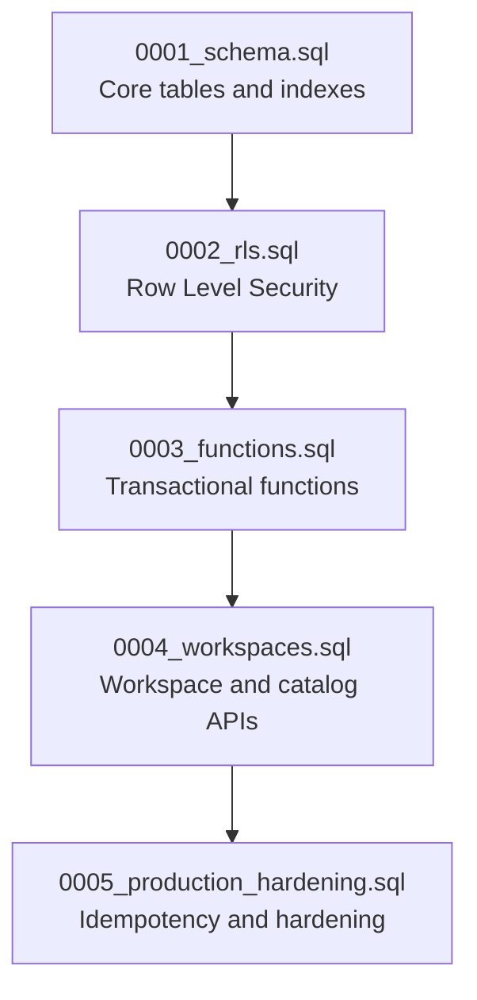
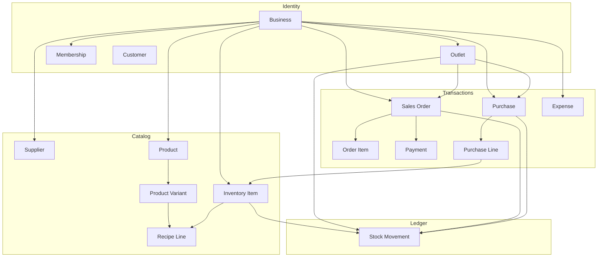
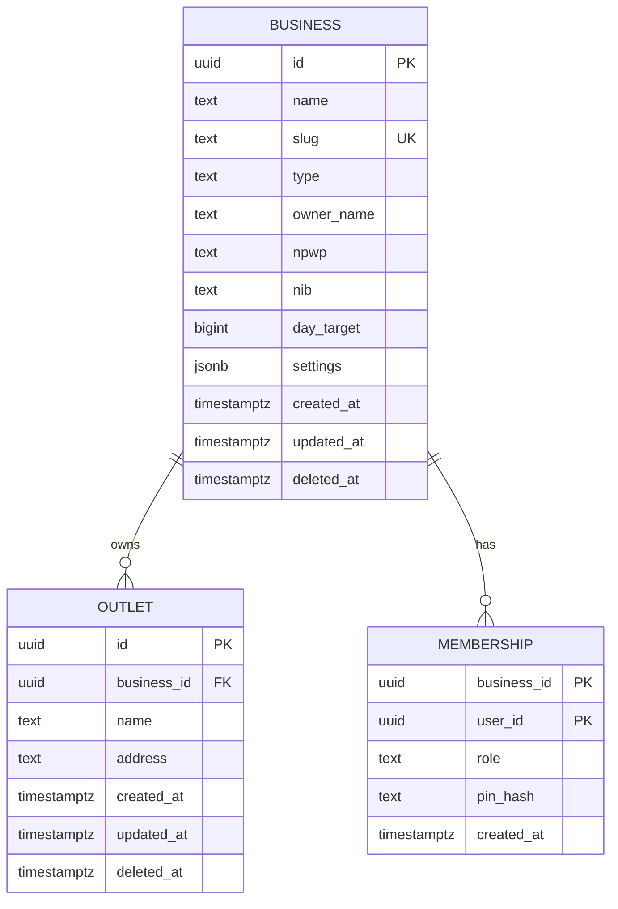
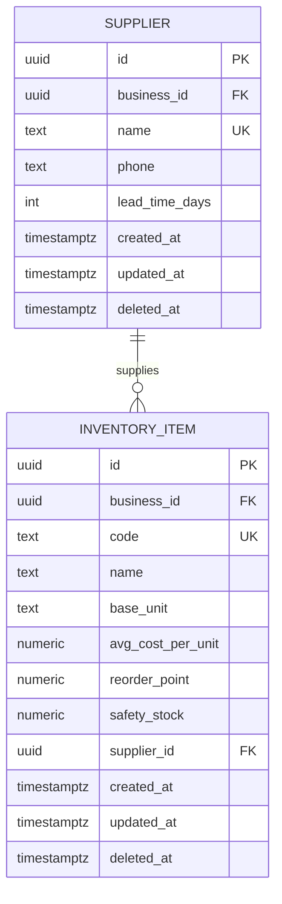
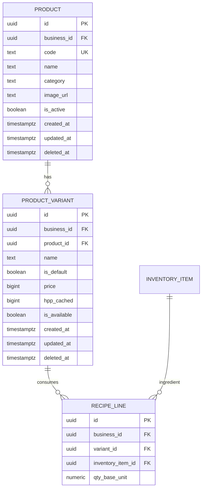
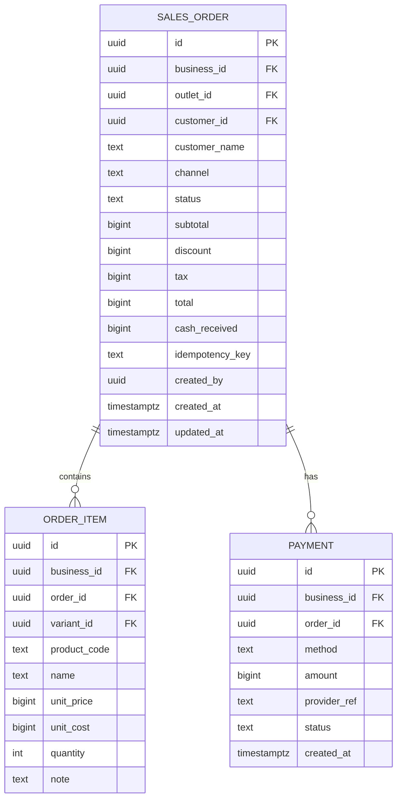
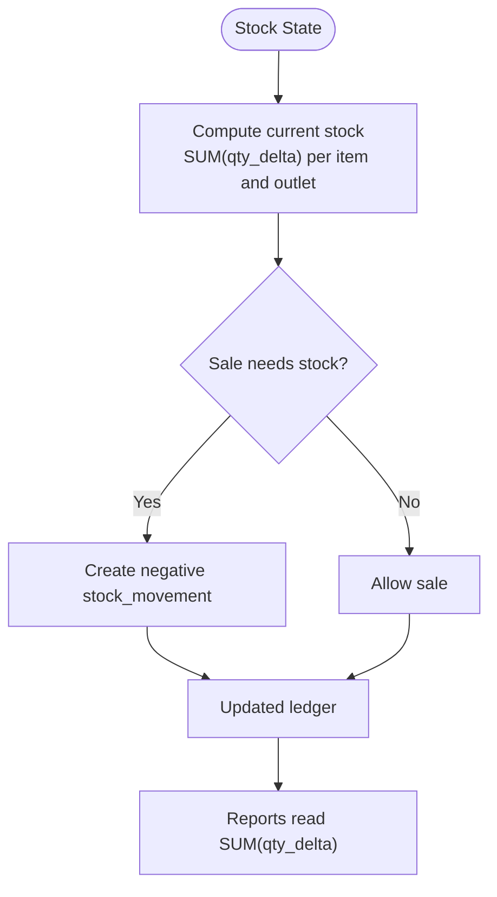
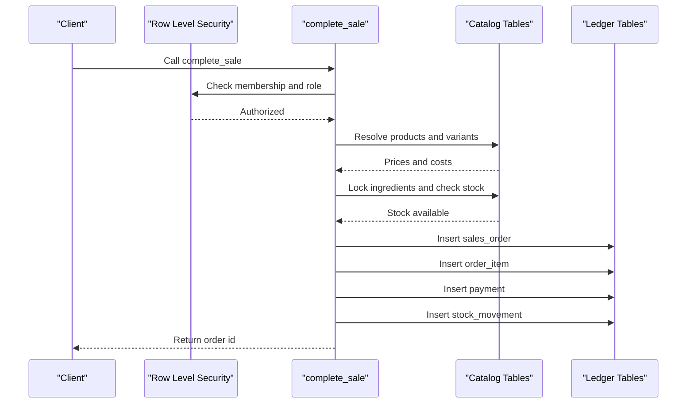

# Schema Architecture

<cite>
**Referenced Files in This Document**
- [0001_schema.sql](file://supabase/migrations/0001_schema.sql)
- [0002_rls.sql](file://supabase/migrations/0002_rls.sql)
- [0003_functions.sql](file://supabase/migrations/0003_functions.sql)
- [0004_workspaces.sql](file://supabase/migrations/0004_workspaces.sql)
- [0005_production_hardening.sql](file://supabase/migrations/0005_production_hardening.sql)
- [README.md](file://README.md)
</cite>

## Table of Contents
1. [Introduction](#introduction)
2. [Project Structure](#project-structure)
3. [Core Components](#core-components)
4. [Architecture Overview](#architecture-overview)
5. [Detailed Component Analysis](#detailed-component-analysis)
6. [Dependency Analysis](#dependency-analysis)
7. [Performance Considerations](#performance-considerations)
8. [Troubleshooting Guide](#troubleshooting-guide)
9. [Conclusion](#conclusion)

## Introduction
This document describes the Laris database schema architecture and its ledger-based stock tracking design. The system models businesses, outlets, team members, suppliers, inventory items, products with variants, recipes, customers, sales orders, order items, payments, purchases, purchase lines, expenses, audit logs, AI telemetry, and a holiday calendar.

The core data integrity model is:
- Every tenant table carries `business_id`.
- Row Level Security enforces per-business isolation.
- Ledger tables such as `stock_movement` are immutable append-only records; current stock is derived by summing quantity deltas.
- Business logic for complex operations runs inside `SECURITY DEFINER` functions that re-check membership, resolve prices from the catalog, and execute atomic transactions.

The README confirms that cloud mode persists workspace data, checkout uses atomic RPCs, and stock is tracked through a signed ledger with automatic HPP recalculation.

**Section sources**
- [README.md:1-35](file://README.md#L1-L35)
- [README.md:97-118](file://README.md#L97-L118)

## Project Structure
The database schema is defined across five ordered Supabase migrations:

| Migration | Responsibility |
|---|---|
| `0001_schema.sql` | Core tables, constraints, indexes, and updated-at triggers |
| `0002_rls.sql` | Row Level Security policies and membership helper |
| `0003_functions.sql` | Transactional functions including sale completion and purchase recording |
| `0004_workspaces.sql` | Workspace onboarding, product/inventory management, team member management, and tenant consistency triggers |
| `0005_production_hardening.sql` | Idempotency keys, numeric safety checks, business-wide locking, and hardened function versions |

**Diagram sources**
- [0001_schema.sql:1-10](file://supabase/migrations/0001_schema.sql#L1-L10)
- [0002_rls.sql:1-8](file://supabase/migrations/0002_rls.sql#L1-L8)
- [0003_functions.sql:1-7](file://supabase/migrations/0003_functions.sql#L1-L7)
- [0004_workspaces.sql:1-12](file://supabase/migrations/0004_workspaces.sql#L1-L12)
- [0005_production_hardening.sql:1-7](file://supabase/migrations/0005_production_hardening.sql#L1-L7)

**Section sources**
- [README.md:37-47](file://README.md#L37-L47)
- [0001_schema.sql:1-7](file://supabase/migrations/0001_schema.sql#L1-L7)

## Core Components
The schema groups entities into ten functional areas:

| Area | Tables | Purpose |
|---|---|---|
| Tenancy | `business`, `outlet`, `membership` | Business identity, outlet location, and team roles |
| Catalog | `supplier`, `inventory_item`, `product`, `product_variant`, `recipe_line` | Items, menu definitions, pricing, and recipe composition |
| Customers | `customer` | Customer profile, RFM segment, points, and visit history |
| Sales | `sales_order`, `order_item`, `payment` | Order capture, line-level sales history, and payment recording |
| Stock Ledger | `stock_movement` | Immutable movement records used to derive current stock |
| Purchasing | `purchase`, `purchase_line` | Purchase receipts and itemized stock-in entries |
| Expenses | `expense` | Operational spending records |
| Audit & Telemetry | `audit_log`, `ai_event` | Action audit trail and AI feature telemetry |
| Reference Data | `holiday_calendar` | Shared calendar reference data |
| Helpers | Functions and triggers | Membership checks, stock calculation, cost refresh, and updated-at maintenance |

Key modeling conventions:
- Primary keys are UUIDs generated by `gen_random_uuid()`, except audit and telemetry tables which use auto-incrementing bigints.
- Money values are stored as `bigint` rupiah; quantities use `NUMERIC(14,3)` in base units.
- Cost fields use `NUMERIC(14,4)` to allow fractional rupiah per base unit.
- Soft deletes use `deleted_at` where applicable.
- Stable human-readable identifiers use `code` columns scoped per business.

**Section sources**
- [0001_schema.sql:21-284](file://supabase/migrations/0001_schema.sql#L21-L284)
- [0001_schema.sql:286-294](file://supabase/migrations/0001_schema.sql#L286-L294)

## Architecture Overview
At a high level, the database separates catalog state from transactional state:

- Catalog state includes suppliers, inventory items, products, variants, and recipes.
- Transactional state includes sales, payments, purchases, purchase lines, expenses, and stock movements.
- Current inventory is not stored directly; it is computed from `stock_movement.qty_delta`.
- Product cost (`hpp_cached`) is derived from recipe ingredients and their moving-average costs.
- All sensitive writes go through server-side functions that enforce role checks and atomicity.

**Diagram sources**
- [0001_schema.sql:24-284](file://supabase/migrations/0001_schema.sql#L24-L284)
- [0003_functions.sql:11-68](file://supabase/migrations/0003_functions.sql#L11-L68)

## Detailed Component Analysis

### Tenancy and Team Members
The tenancy layer defines who owns an operation and where it occurs.

| Entity | Key Fields | Constraints and Notes |
|---|---|---|
| `business` | `id`, `name`, `slug`, `type`, `owner_name`, `npwp`, `nib`, `day_target`, `settings`, `created_at`, `updated_at`, `deleted_at` | `id` is UUID primary key; `slug` is unique and validated; `type` is restricted to `fnb`, `retail`, or `service`; `day_target` is non-negative |
| `outlet` | `id`, `business_id`, `name`, `address`, `created_at`, `updated_at`, `deleted_at` | Foreign key to `business.id` with cascade delete |
| `membership` | `business_id`, `user_id`, `role`, `pin_hash`, `created_at` | Composite primary key `(business_id, user_id)`; `role` restricted to `owner`, `manager`, `kasir`, `dapur` |

Team roles control access:
- Owner and manager can modify catalog data.
- Cashier can complete sales and create/update customers.
- Kitchen role exists for operational separation but is not granted direct write access to ledger tables.

**Diagram sources**
- [0001_schema.sql:24-56](file://supabase/migrations/0001_schema.sql#L24-L56)

**Section sources**
- [0001_schema.sql:24-56](file://supabase/migrations/0001_schema.sql#L24-L56)
- [0002_rls.sql:46-59](file://supabase/migrations/0002_rls.sql#L46-L59)

### Suppliers and Inventory Items
Suppliers provide context for purchasing, while inventory items represent consumable materials.

| Entity | Key Fields | Constraints and Notes |
|---|---|---|
| `supplier` | `id`, `business_id`, `name`, `phone`, `lead_time_days`, `created_at`, `updated_at`, `deleted_at` | Unique per business by `name`; `lead_time_days` between 0 and 60 |
| `inventory_item` | `id`, `business_id`, `code`, `name`, `base_unit`, `avg_cost_per_unit`, `reorder_point`, `safety_stock`, `supplier_id`, `created_at`, `updated_at`, `deleted_at` | Unique per business by `code`; cost and stock thresholds are non-negative; supplier link is optional and set to null on supplier deletion |

Important behaviors:
- Base unit changes are blocked after an item participates in recipes or stock movements.
- Safety stock defaults to half of the reorder point.
- Moving-average cost is updated when purchases are recorded.

**Diagram sources**
- [0001_schema.sql:61-88](file://supabase/migrations/0001_schema.sql#L61-L88)
- [0005_production_hardening.sql:11-32](file://supabase/migrations/0005_production_hardening.sql#L11-L32)

**Section sources**
- [0001_schema.sql:61-89](file://supabase/migrations/0001_schema.sql#L61-L89)
- [0004_workspaces.sql:223-300](file://supabase/migrations/0004_workspaces.sql#L223-L300)
- [0005_production_hardening.sql:11-32](file://supabase/migrations/0005_production_hardening.sql#L11-L32)

### Products, Variants, and Recipes
Products define sellable menu items; variants hold price and availability; recipes define ingredient consumption.

| Entity | Key Fields | Constraints and Notes |
|---|---|---|
| `product` | `id`, `business_id`, `code`, `name`, `category`, `image_url`, `is_active`, `created_at`, `updated_at`, `deleted_at` | Unique per business by `code`; default category is `Lainnya` |
| `product_variant` | `id`, `business_id`, `product_id`, `name`, `is_default`, `price`, `hpp_cached`, `is_available`, `created_at`, `updated_at`, `deleted_at` | One default variant per product; price and cached cost are non-negative |
| `recipe_line` | `id`, `business_id`, `variant_id`, `inventory_item_id`, `qty_base_unit` | Prevents duplicate ingredient per variant; requires positive quantity |

Relationship rules:
- A product has one or more variants.
- A variant references exactly one product.
- A recipe line connects a variant to an inventory item.
- Tenant consistency triggers ensure product, variant, recipe, and inventory belong to the same business.

**Diagram sources**
- [0001_schema.sql:91-127](file://supabase/migrations/0001_schema.sql#L91-L127)
- [0004_workspaces.sql:14-35](file://supabase/migrations/0004_workspaces.sql#L14-L35)

**Section sources**
- [0001_schema.sql:91-127](file://supabase/migrations/0001_schema.sql#L91-L127)
- [0004_workspaces.sql:14-56](file://supabase/migrations/0004_workspaces.sql#L14-L56)

### Customers
Customers store contact information, loyalty metrics, and RFM segmentation.

| Field | Type | Constraint |
|---|---|---|
| `id` | UUID | Primary key |
| `business_id` | UUID | Foreign key to `business.id` with cascade delete |
| `name` | Text | Required |
| `phone` | Text | Unique per business; must match digits only, 8–15 characters |
| `birthday` | Date | Optional |
| `rfm_segment` | Text | Restricted to `Juara`, `Setia`, `Potensial`, `Berisiko`, `Hilang` |
| `points_balance` | Integer originally, changed to `bigint` | Non-negative |
| `visits` | Integer | Non-negative |
| `total_spent` | BigInt | Non-negative |
| `last_visit_at` | Timestamp with timezone | Optional |
| `marketing_consent` | Boolean | Default false |
| `created_at`, `updated_at`, `deleted_at` | Timestamps | Standard lifecycle |

RFM segmentation is recomputed during checkout when a customer is linked to an order.

**Section sources**
- [0001_schema.sql:132-148](file://supabase/migrations/0001_schema.sql#L132-L148)
- [0003_functions.sql:17-27](file://supabase/migrations/0003_functions.sql#L17-L27)
- [0005_production_hardening.sql:9](file://supabase/migrations/0005_production_hardening.sql#L9)

### Sales, Order Items, and Payments
Sales are modeled as orders with line items and payment records.

| Entity | Key Fields | Constraints and Notes |
|---|---|---|
| `sales_order` | `id`, `business_id`, `outlet_id`, `customer_id`, `customer_name`, `channel`, `status`, `subtotal`, `discount`, `tax`, `total`, `cash_received`, `idempotency_key`, `created_by`, `created_at`, `updated_at` | Status restricted to `open`, `paid`, `void`, `refunded`; channel restricted to `kasir`, `etalase`, `wa`; unique per business by `idempotency_key` |
| `order_item` | `id`, `business_id`, `order_id`, `variant_id`, `product_code`, `name`, `unit_price`, `unit_cost`, `quantity`, `note` | Denormalized product metadata for reporting; quantity positive; note limited to 200 characters |
| `payment` | `id`, `business_id`, `order_id`, `method`, `amount`, `provider_ref`, `status`, `created_at` | Method restricted to `tunai`, `qris`, `transfer`; status restricted to `pending`, `paid`, `failed`, `refunded` |

**Diagram sources**
- [0001_schema.sql:153-198](file://supabase/migrations/0001_schema.sql#L153-L198)

**Section sources**
- [0001_schema.sql:153-198](file://supabase/migrations/0001_schema.sql#L153-L198)

### Stock Ledger Design
Stock is tracked immutably through `stock_movement`. There is no direct `current_stock` column. Current stock equals the sum of `qty_delta` for an item at an outlet.

Supported movement types:
- `opening`: initial stock entry
- `sale`: negative delta triggered by completed orders
- `purchase`: positive delta from recorded purchases
- `adjustment`: manual adjustment
- `waste`: loss recording
- `opname`: reconciliation difference between counted and computed stock

Movement fields:
- `id`: UUID primary key
- `business_id`: Tenant scope
- `outlet_id`: Location scope
- `inventory_item_id`: Consumed or added item
- `type`: Movement category
- `qty_delta`: Non-zero quantity change
- `unit_cost`: Unit cost associated with the movement
- `ref_id`: Reference to related entity such as order or purchase
- `created_by`: User who created the movement
- `created_at`: Timestamp

**Diagram sources**
- [0001_schema.sql:203-216](file://supabase/migrations/0001_schema.sql#L203-L216)
- [0003_functions.sql:11-15](file://supabase/migrations/0003_functions.sql#L11-L15)

**Section sources**
- [0001_schema.sql:200-216](file://supabase/migrations/0001_schema.sql#L200-L216)
- [0003_functions.sql:11-15](file://supabase/migrations/0003_functions.sql#L11-L15)

### Purchases and Purchase Lines
Purchases record stock-in events and update moving-average cost.

| Entity | Key Fields | Constraints and Notes |
|---|---|---|
| `purchase` | `id`, `business_id`, `outlet_id`, `supplier_id`, `total`, `source`, `receipt_path`, `created_by`, `created_at`, `idempotency_key` | Source restricted to `manual`, `scan`; optional idempotency key with unique index |
| `purchase_line` | `id`, `business_id`, `purchase_id`, `inventory_item_id`, `quantity`, `total` | Positive quantity and total |

When a purchase is recorded:
- A purchase header is created.
- Each line updates the inventory item’s moving-average cost.
- A positive `stock_movement` is inserted.
- Recipe-based product costs are refreshed.

**Section sources**
- [0001_schema.sql:218-237](file://supabase/migrations/0001_schema.sql#L218-L237)
- [0003_functions.sql:232-303](file://supabase/migrations/0003_functions.sql#L232-L303)
- [0005_production_hardening.sql:5-7](file://supabase/migrations/0005_production_hardening.sql#L5-L7)
- [0005_production_hardening.sql:216-306](file://supabase/migrations/0005_production_hardening.sql#L216-L306)

### Expenses, Audit Logs, AI Events, and Holiday Calendar
These tables support financial tracking, compliance, observability, and shared reference data.

| Entity | Purpose | Important Rules |
|---|---|---|
| `expense` | Records operational spending | Amount positive; description length bounded; indexed by business and spent date |
| `audit_log` | Tracks important actions | Identity-auditable with JSONB payload |
| `ai_event` | Stores AI feature inputs, outputs, latency, and success | Feature restricted to parse-order, scan-receipt, ask |
| `holiday_calendar` | Shared calendar reference | Primary key is date; kind restricted |

**Section sources**
- [0001_schema.sql:239-284](file://supabase/migrations/0001_schema.sql#L239-L284)

## Dependency Analysis

### Referential Integrity and Cascade Behavior
| Relationship | Rule |
|---|---|
| `outlet.business_id` → `business.id` | Cascade delete |
| `membership.business_id` → `business.id` | Cascade delete |
| `supplier.business_id` → `business.id` | Cascade delete |
| `inventory_item.business_id` → `business.id` | Cascade delete |
| `product.business_id` → `business.id` | Cascade delete |
| `product_variant.product_id` → `product.id` | Cascade delete |
| `product_variant.business_id` → `business.id` | Cascade delete |
| `recipe_line.variant_id` → `product_variant.id` | Cascade delete |
| `recipe_line.inventory_item_id` → `inventory_item.id` | Restrict delete to protect recipe integrity |
| `sales_order.outlet_id` → `outlet.id` | Restrict delete |
| `sales_order.customer_id` → `customer.id` | Set null on delete |
| `order_item.order_id` → `sales_order.id` | Cascade delete |
| `order_item.variant_id` → `product_variant.id` | Restrict delete |
| `payment.order_id` → `sales_order.id` | Cascade delete |
| `stock_movement.outlet_id` → `outlet.id` | Restrict delete |
| `stock_movement.inventory_item_id` → `inventory_item.id` | Restrict delete |
| `purchase.outlet_id` → `outlet.id` | Restrict delete |
| `purchase.supplier_id` → `supplier.id` | Set null on delete |
| `purchase_line.purchase_id` → `purchase.id` | Cascade delete |
| `purchase_line.inventory_item_id` → `inventory_item.id` | Restrict delete |
| `audit_log.business_id` → `business.id` | Cascade delete |
| `ai_event.business_id` → `business.id` | Cascade delete |

### Business Logic Ownership
Direct client writes to ledger tables are intentionally disabled. Instead, clients call:
- `public.complete_sale`
- `public.record_purchase`
- `public.create_business`
- `public.create_workspace`
- `public.save_product`
- `public.save_inventory_item`
- `public.add_team_member_by_email`
- `public.list_team_members`

These functions:
- Re-check membership using `private.is_member`.
- Resolve outlet selection.
- Validate input payloads.
- Read prices and costs from the database.
- Insert immutable ledger rows.
- Update cached HPP where needed.
- Write audit log entries.

**Diagram sources**
- [0002_rls.sql:12-25](file://supabase/migrations/0002_rls.sql#L12-L25)
- [0003_functions.sql:94-230](file://supabase/migrations/0003_functions.sql#L94-L230)
- [0005_production_hardening.sql:84-214](file://supabase/migrations/0005_production_hardening.sql#L84-L214)

**Section sources**
- [0001_schema.sql:24-284](file://supabase/migrations/0001_schema.sql#L24-L284)
- [0002_rls.sql:1-131](file://supabase/migrations/0002_rls.sql#L1-L131)
- [0003_functions.sql:1-320](file://supabase/migrations/0003_functions.sql#L1-L320)
- [0005_production_hardening.sql:34-68](file://supabase/migrations/0005_production_hardening.sql#L34-L68)

## Performance Considerations

### Index Strategy
The schema includes targeted indexes for common query patterns:

| Index | Target Column(s) | Query Benefit |
|---|---|---|
| `inventory_item_name_trgm` | `name` using `gin_trgm_ops` | Fuzzy search on inventory item names |
| `sales_order_business_created` | `business_id`, `created_at desc` | Recent sales per business |
| `order_item_order` | `order_id` | Fast lookup of order lines |
| `payment_order` | `order_id` | Fast lookup of payments per order |
| `stock_movement_item` | `inventory_item_id`, `outlet_id` | Stock derivation per item and outlet |
| `stock_movement_business_created` | `business_id`, `created_at desc` | Recent stock movements per business |
| `expense_business_spent` | `business_id`, `spent_at desc` | Recent expenses per business |
| `audit_log_business_created` | `business_id`, `created_at desc` | Recent audit entries per business |
| `purchase_business_idempotency` | `business_id`, `idempotency_key` | Idempotent purchase deduplication |
| `product_variant_one_default` | `product_id` where `is_default` and not deleted | Enforce single default variant efficiently |

### Constraint Optimization
- Numeric constraints explicitly reject NaN and Infinity values to avoid misleading comparisons.
- Quantity deltas must be nonzero.
- Recipe quantities, purchase quantities, and inventory costs have explicit positivity and range checks.
- Business ID immutability prevents cross-tenant row migration.
- Catalog writes acquire a per-business lock to prevent concurrent catalog mutations from observing inconsistent versions during sales.

### Query Patterns
Common operations should follow these patterns:
- Current stock: aggregate `stock_movement.qty_delta` grouped by `inventory_item_id` and `outlet_id`.
- Recent sales: filter by `business_id` and sort by `created_at desc`.
- Order details: join `sales_order` to `order_item` and optionally `payment`.
- Product cost: use `product_variant.hpp_cached`, refreshed by recipe and inventory cost changes.
- RFM segmentation: compute from `visits` and `last_visit_at`.

**Section sources**
- [0001_schema.sql:89-89](file://supabase/migrations/0001_schema.sql#L89-L89)
- [0001_schema.sql:172-172](file://supabase/migrations/0001_schema.sql#L172-L172)
- [0001_schema.sql:186-186](file://supabase/migrations/0001_schema.sql#L186-L186)
- [0001_schema.sql:198-198](file://supabase/migrations/0001_schema.sql#L198-L198)
- [0001_schema.sql:215-216](file://supabase/migrations/0001_schema.sql#L215-L216)
- [0001_schema.sql:250-250](file://supabase/migrations/0001_schema.sql#L250-L250)
- [0001_schema.sql:265-265](file://supabase/migrations/0001_schema.sql#L265-L265)
- [0005_production_hardening.sql:6-7](file://supabase/migrations/0005_production_hardening.sql#L6-L7)
- [0005_production_hardening.sql:11-32](file://supabase/migrations/0005_production_hardening.sql#L11-L32)
- [0005_production_hardening.sql:43-68](file://supabase/migrations/0005_production_hardening.sql#L43-L68)

## Troubleshooting Guide

### Common Validation Errors
| Symptom | Likely Cause | Resolution |
|---|---|---|
| Access denied during sale or purchase | Missing or insufficient role | Ensure caller is authenticated and has `owner`, `manager`, or `kasir` depending on operation |
| Invalid payment method or channel | Unsupported enum value | Use `tunai`, `qris`, or `transfer` for payment; use `kasir`, `etalase`, or `wa` for channel |
| Empty or oversized cart | Invalid JSON array or too many items | Provide 1–100 valid items |
| Unknown menu or unavailable variant | Product inactive, deleted, or missing default variant | Activate product and ensure default variant exists |
| Insufficient cash | Cash received below total | Increase cash received or reduce discount/tax |
| Insufficient stock | Sum of stock deltas below required amount | Record purchase or opening stock before selling |
| Duplicate idempotency key | Retry with same key | Return existing order or purchase instead of creating duplicates |
| Invalid phone number | Not matching digit pattern | Normalize phone to 8–15 digits without leading plus |
| Cannot change base unit | Item already used in recipes or ledger | Keep original base unit or create new inventory item |
| Cross-tenant data error | Catalog or inventory belongs to different business | Ensure all referenced entities share the same `business_id` |

### Idempotency and Concurrency
- `complete_sale` supports an `idempotency_key` to safely retry failed POS submissions.
- `record_purchase` also supports an idempotency key after production hardening.
- Concurrent attempts with the same key return the existing record rather than creating duplicates.
- Catalog writes are protected by per-business locks to avoid inconsistent reads during concurrent mutations.

### Audit and Observability
- Successful operations write to `audit_log`.
- AI features write to `ai_event` with input, output, latency, and success flags.
- Use audit logs to trace ownership, action type, affected entity, and contextual JSON data.

**Section sources**
- [0003_functions.sql:94-230](file://supabase/migrations/0003_functions.sql#L94-L230)
- [0005_production_hardening.sql:84-214](file://supabase/migrations/0005_production_hardening.sql#L84-L214)
- [0005_production_hardening.sql:216-306](file://supabase/migrations/0005_production_hardening.sql#L216-L306)
- [0004_workspaces.sql:155-221](file://supabase/migrations/0004_workspaces.sql#L155-L221)
- [0004_workspaces.sql:223-300](file://supabase/migrations/0004_workspaces.sql#L223-L300)

## Conclusion
The Laris schema implements a robust, tenant-isolated, ledger-first inventory system. It avoids fragile direct stock mutations by recording immutable movements and deriving current stock from those records. Catalog data, transactional data, and audit data are clearly separated, with strong referential integrity, role-based access control, and server-side transaction handlers enforcing business rules.

For reliable operations:
- Always use the provided functions for sales, purchases, catalog updates, and team management.
- Treat stock as a derived value from `stock_movement`.
- Rely on constraints and triggers for data validation.
- Use indexes for performance-critical queries.
- Monitor audit logs and AI event telemetry for troubleshooting and compliance.