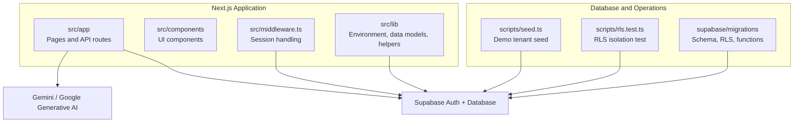
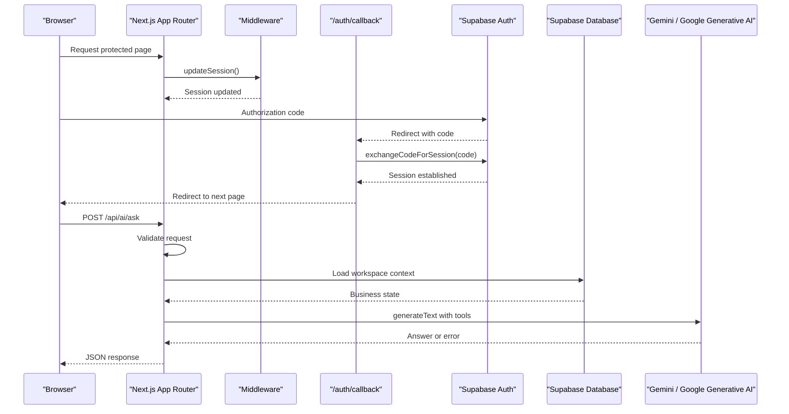
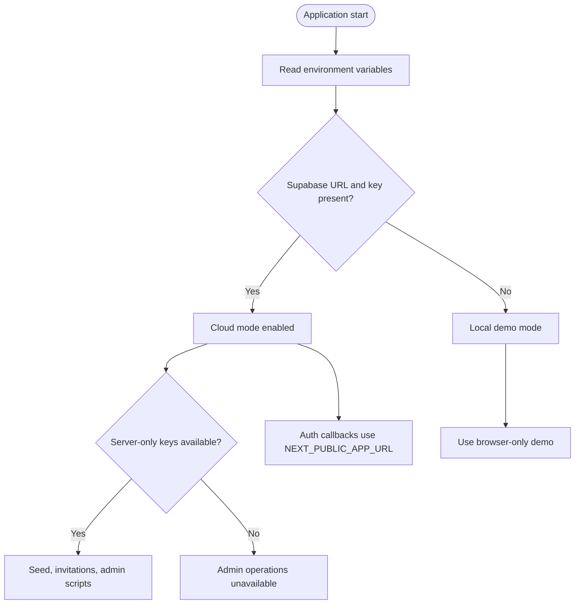
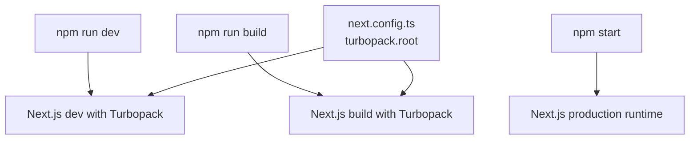
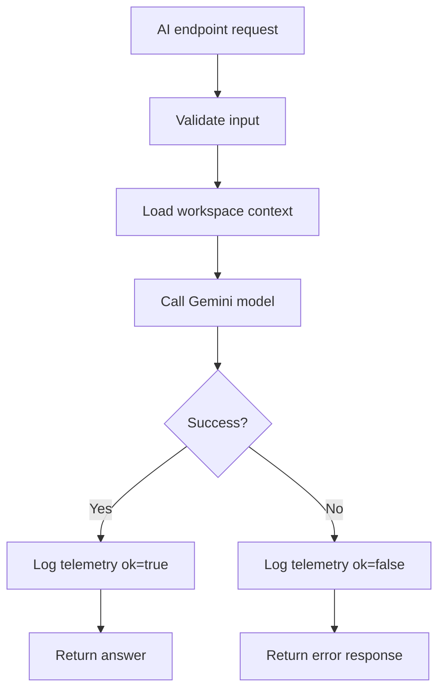
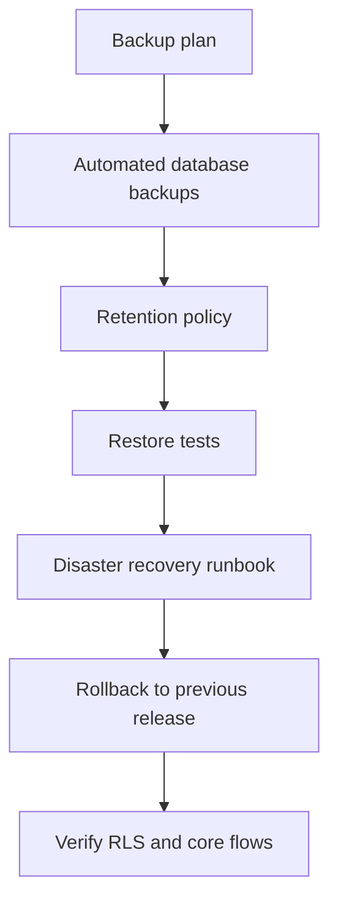
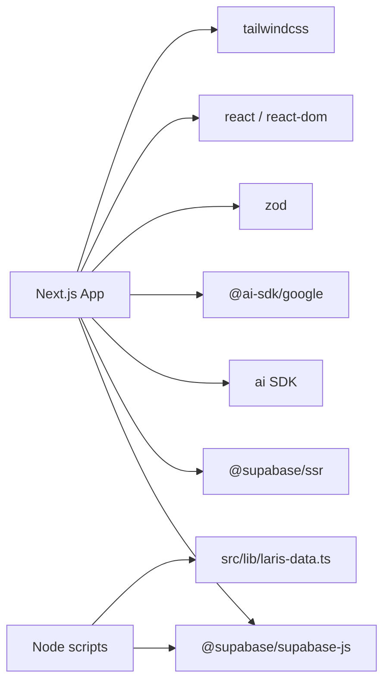

# Deployment Guide

<cite>
**Referenced Files in This Document**
- [README.md](file://README.md)
- [.env.example](file://.env.example)
- [package.json](file://package.json)
- [next.config.ts](file://next.config.ts)
- [src/lib/env.ts](file://src/lib/env.ts)
- [src/middleware.ts](file://src/middleware.ts)
- [src/app/auth/callback/route.ts](file://src/app/auth/callback/route.ts)
- [src/app/api/ai/ask/route.ts](file://src/app/api/ai/ask/route.ts)
- [src/app/api/ai/scan-receipt/route.ts](file://src/app/api/ai/scan-receipt/route.ts)
- [supabase/migrations/0005_production_hardening.sql](file://supabase/migrations/0005_production_hardening.sql)
- [scripts/seed.ts](file://scripts/seed.ts)
- [scripts/rls.test.ts](file://scripts/rls.test.ts)
</cite>

## Table of Contents
1. [Introduction](#introduction)
2. [Project Structure](#project-structure)
3. [Core Components](#core-components)
4. [Architecture Overview](#architecture-overview)
5. [Detailed Component Analysis](#detailed-component-analysis)
6. [Dependency Analysis](#dependency-analysis)
7. [Performance Considerations](#performance-considerations)
8. [Troubleshooting Guide](#troubleshooting-guide)
9. [Conclusion](#conclusion)
10. [Appendices](#appendices)

## Introduction
This deployment guide explains how to deploy Laris to production. It covers Supabase configuration, API key management, security hardening, Next.js 15 build optimization with Turbopack, monitoring and telemetry, backup and disaster recovery, rollback strategies, staging-to-production checklists, scaling and CDN considerations, and troubleshooting for common deployment issues.

Laris is a workspace application for small F&B businesses. It supports authentication, POS operations, inventory and purchasing, customer segmentation, financial summaries, and AI-assisted features such as order parsing, business Q&A, and receipt scanning. Production deployments must treat Supabase credentials, service-role keys, and AI provider keys as sensitive secrets.

**Section sources**
- [README.md:1-23](file://README.md#L1-L23)
- [README.md:37-58](file://README.md#L37-L58)
- [README.md:97-118](file://README.md#L97-L118)

## Project Structure
The repository follows a Next.js App Router layout with server-side API routes under `src/app/api`, shared domain logic under `src/lib`, database migrations under `supabase/migrations`, and operational scripts under `scripts`.

**Diagram sources**
- [package.json:5-13](file://package.json#L5-L13)
- [src/middleware.ts:1-12](file://src/middleware.ts#L1-L12)
- [src/app/auth/callback/route.ts:1-18](file://src/app/auth/callback/route.ts#L1-L18)
- [src/app/api/ai/ask/route.ts:1-218](file://src/app/api/ai/ask/route.ts#L1-L218)
- [src/app/api/ai/scan-receipt/route.ts:1-216](file://src/app/api/ai/scan-receipt/route.ts#L1-L216)
- [supabase/migrations/0005_production_hardening.sql:1-395](file://supabase/migrations/0005_production_hardening.sql#L1-L395)
- [scripts/seed.ts:1-152](file://scripts/seed.ts#L1-L152)
- [scripts/rls.test.ts:1-89](file://scripts/rls.test.ts#L1-L89)

**Section sources**
- [README.md:97-110](file://README.md#L97-L110)
- [package.json:1-39](file://package.json#L1-L39)

## Core Components
- Environment configuration: Centralized environment access distinguishes public browser variables from server-only secrets. Cloud mode is enabled when Supabase URL and publishable key are configured; otherwise the app runs local demo behavior.
- Authentication flow: The middleware updates the session, and the `/auth/callback` route exchanges the authorization code for a session before redirecting back to the requested page.
- AI endpoints: `/api/ai/ask` provides business Q&A using Gemini tools or deterministic local rules. `/api/ai/scan-receipt` parses uploaded receipts into purchase lines with validation, unit normalization, and optional Gemini OCR.
- Production hardening: Database migration adds idempotency constraints, numeric safety checks, tenant immutability triggers, catalog write locks, and secure RPC functions for sales, purchases, and inventory.
- Operational scripts: Seed script creates demo tenants and judge accounts. RLS test validates tenant isolation and rejects direct client writes to ledger tables.

**Section sources**
- [src/lib/env.ts:1-29](file://src/lib/env.ts#L1-L29)
- [src/middleware.ts:1-12](file://src/middleware.ts#L1-L12)
- [src/app/auth/callback/route.ts:1-18](file://src/app/auth/callback/route.ts#L1-L18)
- [src/app/api/ai/ask/route.ts:1-218](file://src/app/api/ai/ask/route.ts#L1-L218)
- [src/app/api/ai/scan-receipt/route.ts:1-216](file://src/app/api/ai/scan-receipt/route.ts#L1-L216)
- [supabase/migrations/0005_production_hardening.sql:1-395](file://supabase/migrations/0005_production_hardening.sql#L1-L395)
- [scripts/seed.ts:1-152](file://scripts/seed.ts#L1-L152)
- [scripts/rls.test.ts:1-89](file://scripts/rls.test.ts#L1-L89)

## Architecture Overview
The production architecture uses Next.js 15 as the application runtime, Supabase for authentication and relational data, and Gemini for AI features. Middleware protects pages by updating sessions, while API routes enforce input validation, workspace context loading, and telemetry logging.

**Diagram sources**
- [src/middleware.ts:1-12](file://src/middleware.ts#L1-L12)
- [src/app/auth/callback/route.ts:1-18](file://src/app/auth/callback/route.ts#L1-L18)
- [src/app/api/ai/ask/route.ts:1-218](file://src/app/api/ai/ask/route.ts#L1-L218)

## Detailed Component Analysis

### Environment Configuration and Security
- Public variables: `NEXT_PUBLIC_SUPABASE_URL`, `NEXT_PUBLIC_SUPABASE_PUBLISHABLE_KEY` (or `NEXT_PUBLIC_SUPABASE_ANON_KEY`), and `NEXT_PUBLIC_APP_URL` are intended for the browser bundle.
- Server-only variables: `SUPABASE_SERVICE_ROLE_KEY`, `LARIS_DEMO_EMAIL`, `LARIS_DEMO_PASSWORD`, `GOOGLE_GENERATIVE_AI_API_KEY`, `LARIS_AI_MODEL_FAST`, and `LARIS_AI_MODEL_SMART` must never be exposed to the client.
- Cloud mode detection: If Supabase URL and key exist, the app operates in cloud mode; otherwise it falls back to local demo behavior.
- Origin configuration: Set `NEXT_PUBLIC_APP_URL` to the HTTPS origin in production so Supabase Auth redirects work correctly.

**Diagram sources**
- [src/lib/env.ts:1-29](file://src/lib/env.ts#L1-L29)
- [.env.example:1-24](file://.env.example#L1-L24)
- [README.md:59-74](file://README.md#L59-L74)

**Section sources**
- [src/lib/env.ts:1-29](file://src/lib/env.ts#L1-L29)
- [.env.example:1-24](file://.env.example#L1-L24)
- [README.md:59-74](file://README.md#L59-L74)

### Build Optimization with Next.js 15 and Turbopack
- Development uses `next dev --turbopack`.
- Production builds use `next build --turbopack`.
- `next.config.ts` enables Turbopack with the project root.
- Use a modern Node.js version compatible with native TypeScript execution and the declared dependencies.

**Diagram sources**
- [package.json:5-13](file://package.json#L5-L13)
- [next.config.ts:1-8](file://next.config.ts#L1-L8)

**Section sources**
- [package.json:5-13](file://package.json#L5-L13)
- [next.config.ts:1-8](file://next.config.ts#L1-L8)

### Monitoring Setup
- Error tracking: AI endpoints log telemetry through `logAiTelemetry`, recording feature name, model identifier, input/output size, latency, and success/failure status. Errors return appropriate HTTP status codes and user-facing messages.
- Performance metrics: Latency is measured around AI calls and stored in telemetry. For production observability, forward these logs to your centralized logging system and define alerts on failure rates and latency thresholds.
- User behavior analytics: The application does not include built-in frontend analytics. Integrate your preferred analytics provider at the application layer and ensure privacy-compliant collection.

**Diagram sources**
- [src/app/api/ai/ask/route.ts:77-218](file://src/app/api/ai/ask/route.ts#L77-L218)
- [src/app/api/ai/scan-receipt/route.ts:54-216](file://src/app/api/ai/scan-receipt/route.ts#L54-L216)

**Section sources**
- [src/app/api/ai/ask/route.ts:77-218](file://src/app/api/ai/ask/route.ts#L77-L218)
- [src/app/api/ai/scan-receipt/route.ts:54-216](file://src/app/api/ai/scan-receipt/route.ts#L54-L216)

### Backup Procedures and Disaster Recovery
- Database backups: Enable automated backups in Supabase and configure point-in-time recovery. Test restore procedures regularly.
- Storage assets: Back up any uploaded files referenced by the application, including receipt images processed by OCR.
- Migration history: Keep all migrations under version control and apply them in order during restores.
- Rollback strategy: Maintain tagged releases and immutable artifacts. If a deployment fails, roll back to the last known good release and verify RLS and critical flows.
- Data integrity: Production hardening includes idempotency keys for sales and purchases, preventing duplicate transactions during retries.

[No sources needed since this diagram shows conceptual workflow, not actual code structure]

**Section sources**
- [supabase/migrations/0005_production_hardening.sql:5-7](file://supabase/migrations/0005_production_hardening.sql#L5-L7)
- [supabase/migrations/0005_production_hardening.sql:84-214](file://supabase/migrations/0005_production_hardening.sql#L84-L214)
- [supabase/migrations/0005_production_hardening.sql:217-306](file://supabase/migrations/0005_production_hardening.sql#L217-L306)

### Deployment Checklists

#### Staging Checklist
- Apply all migrations in order on the staging Supabase project.
- Run RLS isolation tests against staging.
- Register a real account, complete email confirmation, onboarding, and checkout.
- Test AI fallback behavior without Gemini.
- Verify that demo credentials are disabled.
- Confirm HTTPS origins and callback URLs.

#### Production Checklist
- Apply migrations only after successful staging verification.
- Restrict `SUPABASE_SERVICE_ROLE_KEY` to server-side processes.
- Disable demo credentials and judge login in production.
- Configure HTTPS, CORS, and Supabase site URL plus callback URLs.
- Enable database backups and retention policies.
- Run full verification suite: type checking, linting, tests, voice evaluation, and build.
- Monitor error rates, latency, and AI telemetry.

**Section sources**
- [README.md:75-95](file://README.md#L75-L95)
- [scripts/rls.test.ts:1-89](file://scripts/rls.test.ts#L1-L89)

### Security Hardening Steps
- Never commit `.env`, `.env.local`, service-role keys, or API keys.
- Use HTTPS everywhere and set `NEXT_PUBLIC_APP_URL` to the production origin.
- Limit service-role key usage to server-side scripts and administrative operations.
- Enforce RLS policies and rely on database-level RPC functions for sensitive mutations.
- Validate and sanitize all inputs in API routes.
- Revoke unnecessary function permissions and grant only authenticated users where required.

**Section sources**
- [README.md:59-74](file://README.md#L59-L74)
- [supabase/migrations/0005_production_hardening.sql:391-395](file://supabase/migrations/0005_production_hardening.sql#L391-L395)

### Compliance Verification Procedures
- Tenant isolation: Ensure each business row has `business_id` and that RLS prevents cross-tenant reads and writes.
- Role-based access: Verify that owner, manager, and cashier roles can perform only allowed actions.
- Audit trail: Confirm audit logs capture important mutations such as sales completion and purchase recording.
- Idempotency: Verify that repeated requests with the same idempotency key do not create duplicate records.
- Data export safety: CSV exports should escape dangerous content and avoid exposing internal identifiers unnecessarily.

**Section sources**
- [README.md:112-118](file://README.md#L112-L118)
- [supabase/migrations/0005_production_hardening.sql:34-68](file://supabase/migrations/0005_production_hardening.sql#L34-L68)
- [supabase/migrations/0005_production_hardening.sql:84-214](file://supabase/migrations/0005_production_hardening.sql#L84-L214)
- [supabase/migrations/0005_production_hardening.sql:217-306](file://supabase/migrations/0005_production_hardening.sql#L217-L306)

### Scaling Considerations and Load Balancing
- Stateless application servers: Next.js instances should be horizontally scalable behind a load balancer.
- Connection pooling: Use Supabase connection pooling if running multiple server instances.
- Cache strategy: Avoid caching user-specific workspace data at the CDN layer; cache only static assets and public responses where safe.
- Rate limiting: Apply rate limits at the edge or API gateway to protect AI endpoints and auth flows.
- Autoscaling: Scale based on CPU, memory, and request latency metrics.

[No sources needed since this section provides general guidance]

### CDN Setup
- Serve static assets, images, and public files through a CDN.
- Exclude dynamic API routes and authenticated pages from CDN caching.
- Configure cache headers for long-lived static assets and short-lived dynamic responses.
- Ensure image optimization routes bypass CDN cache unless explicitly supported.

[No sources needed since this section provides general guidance]

## Dependency Analysis
The application depends on Next.js 15, React 19, Supabase client libraries, AI SDK integration, Zod for validation, and Tailwind CSS. Scripts use Node.js with experimental TypeScript stripping.

**Diagram sources**
- [package.json:15-37](file://package.json#L15-L37)
- [scripts/seed.ts:1-152](file://scripts/seed.ts#L1-L152)

**Section sources**
- [package.json:15-37](file://package.json#L15-L37)

## Performance Considerations
- Turbopack accelerates development and builds.
- AI endpoints measure latency and log telemetry; monitor slow queries and model timeouts.
- Receipt scanning enforces maximum body and image sizes to prevent abuse.
- Database functions lock per-business rows and validate stock levels before mutations.
- Avoid large payloads in AI prompts; keep catalog context concise and relevant.

**Section sources**
- [src/app/api/ai/scan-receipt/route.ts:9-11](file://src/app/api/ai/scan-receipt/route.ts#L9-L11)
- [src/app/api/ai/ask/route.ts:77-218](file://src/app/api/ai/ask/route.ts#L77-L218)
- [supabase/migrations/0005_production_hardening.sql:43-68](file://supabase/migrations/0005_production_hardening.sql#L43-L68)

## Troubleshooting Guide

### Supabase Authentication Fails After Deploy
- Verify `NEXT_PUBLIC_SUPABASE_URL` and `NEXT_PUBLIC_SUPABASE_PUBLISHABLE_KEY` are set.
- Confirm `NEXT_PUBLIC_APP_URL` matches the production HTTPS origin.
- Add `<origin>/auth/callback` to Supabase redirect URLs.
- Check that the callback route successfully exchanges the code for a session.

**Section sources**
- [README.md:37-47](file://README.md#L37-L47)
- [src/app/auth/callback/route.ts:1-18](file://src/app/auth/callback/route.ts#L1-L18)

### Service-Role Key Not Working
- Ensure `SUPABASE_SERVICE_ROLE_KEY` is set only on the server.
- Do not expose it to the browser bundle.
- Use it only for administrative scripts and server-side operations.

**Section sources**
- [src/lib/env.ts:12-23](file://src/lib/env.ts#L12-L23)
- [README.md:46-47](file://README.md#L46-L47)

### AI Features Return Local Rules Instead of Gemini Responses
- Confirm `GOOGLE_GENERATIVE_AI_API_KEY` is set.
- Check model names `LARIS_AI_MODEL_FAST` and `LARIS_AI_MODEL_SMART`.
- Review AI telemetry logs for errors and latency.

**Section sources**
- [src/lib/env.ts:12-23](file://src/lib/env.ts#L12-L23)
- [src/app/api/ai/ask/route.ts:93-95](file://src/app/api/ai/ask/route.ts#L93-L95)
- [src/app/api/ai/ask/route.ts:195-218](file://src/app/api/ai/ask/route.ts#L195-L218)

### Receipt Scanning Returns Mock Data
- In local demo mode without Gemini, receipt scanning returns simulated results.
- In cloud mode without the Gemini key, the endpoint returns a service-unavailable message.
- Upload valid JPG, PNG, or WebP images under the size limit.

**Section sources**
- [src/app/api/ai/scan-receipt/route.ts:109-134](file://src/app/api/ai/scan-receipt/route.ts#L109-L134)
- [src/app/api/ai/scan-receipt/route.ts:54-97](file://src/app/api/ai/scan-receipt/route.ts#L54-L97)

### RLS Isolation Tests Fail
- Run the seed script first to create tenants.
- Ensure all migrations are applied.
- Verify that tenant A cannot read tenant B rows and that anonymous users see nothing.

**Section sources**
- [scripts/rls.test.ts:1-89](file://scripts/rls.test.ts#L1-L89)
- [scripts/seed.ts:131-152](file://scripts/seed.ts#L131-L152)

### Sales or Purchases Duplicate on Retry
- Use idempotency keys for both sales and purchases.
- Database constraints and functions return existing records when the same key is submitted again.

**Section sources**
- [supabase/migrations/0005_production_hardening.sql:5-7](file://supabase/migrations/0005_production_hardening.sql#L5-L7)
- [supabase/migrations/0005_production_hardening.sql:118-122](file://supabase/migrations/0005_production_hardening.sql#L118-L122)
- [supabase/migrations/0005_production_hardening.sql:242-248](file://supabase/migrations/0005_production_hardening.sql#L242-L248)

## Conclusion
Deploying Laris to production requires careful configuration of Supabase, strict secret management, hardened database policies, and robust monitoring. Use Turbopack for faster builds, validate all changes through staging, and maintain clear backup, disaster recovery, and rollback procedures. Protect sensitive credentials, enforce tenant isolation, and continuously monitor AI performance and error rates.

[No sources needed since this section summarizes without analyzing specific files]

## Appendices

### Environment Variables Reference
- `NEXT_PUBLIC_SUPABASE_URL`: Supabase project URL.
- `NEXT_PUBLIC_SUPABASE_PUBLISHABLE_KEY` or `NEXT_PUBLIC_SUPABASE_ANON_KEY`: Public Supabase key.
- `NEXT_PUBLIC_APP_URL`: Application origin for auth redirects.
- `SUPABASE_SERVICE_ROLE_KEY`: Server-only administrative key.
- `LARIS_DEMO_EMAIL` and `LARIS_DEMO_PASSWORD`: Optional demo judge credentials.
- `GOOGLE_GENERATIVE_AI_API_KEY`: Optional Gemini API key.
- `LARIS_AI_MODEL_FAST` and `LARIS_AI_MODEL_SMART`: AI model identifiers.

**Section sources**
- [.env.example:1-24](file://.env.example#L1-L24)
- [README.md:59-74](file://README.md#L59-L74)

### Pre-Production Verification Commands
- Type check: `npx tsc --noEmit`
- Lint: `npm run lint`
- Tests: `npm test`
- Voice evaluation: `npm run eval:voice`
- Build: `npm run build`

**Section sources**
- [README.md:75-83](file://README.md#L75-L83)