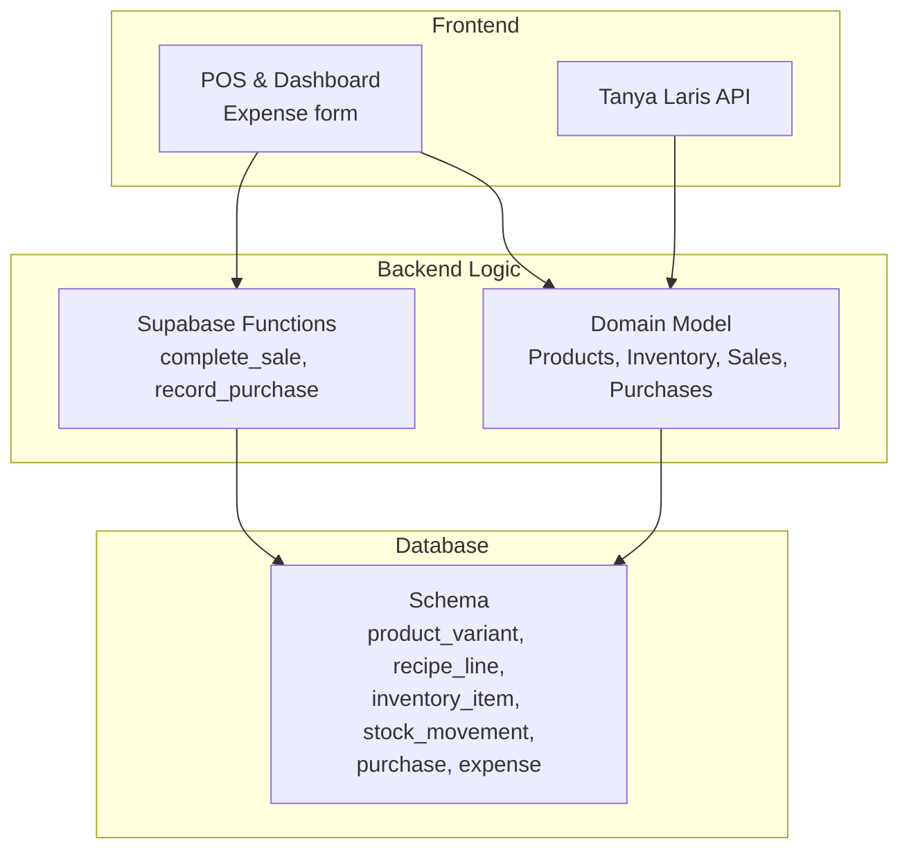
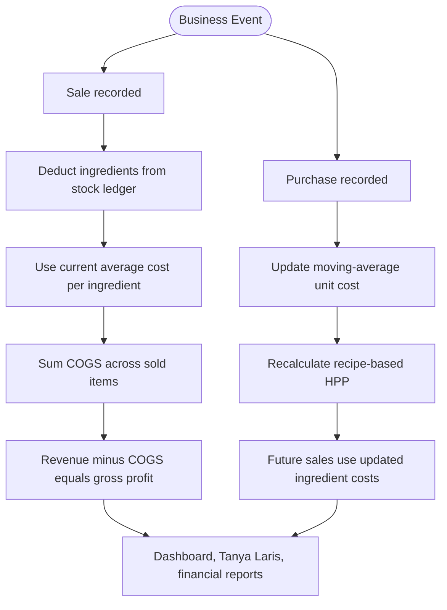
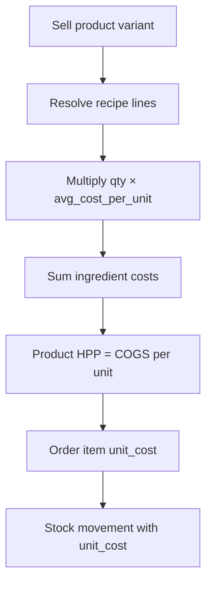
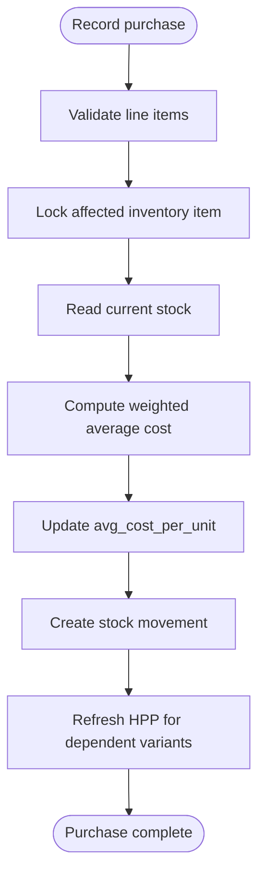
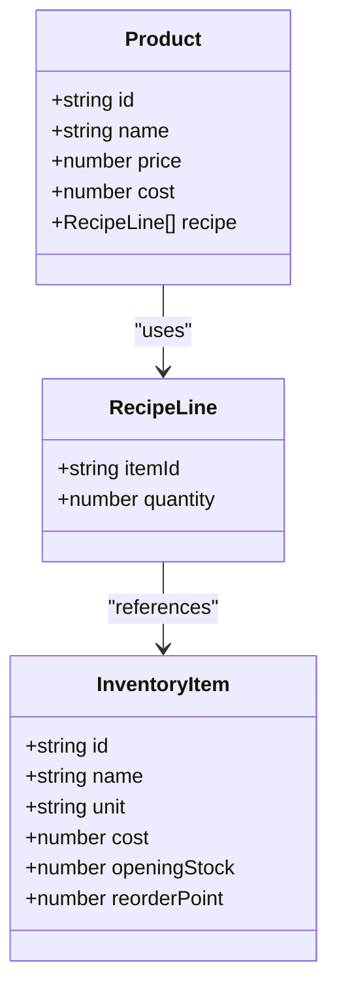
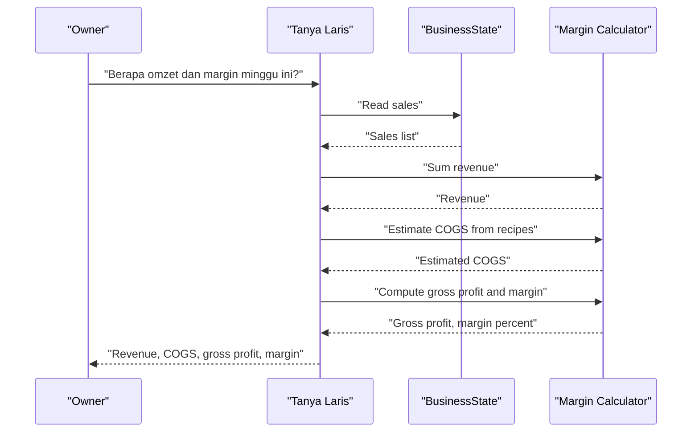
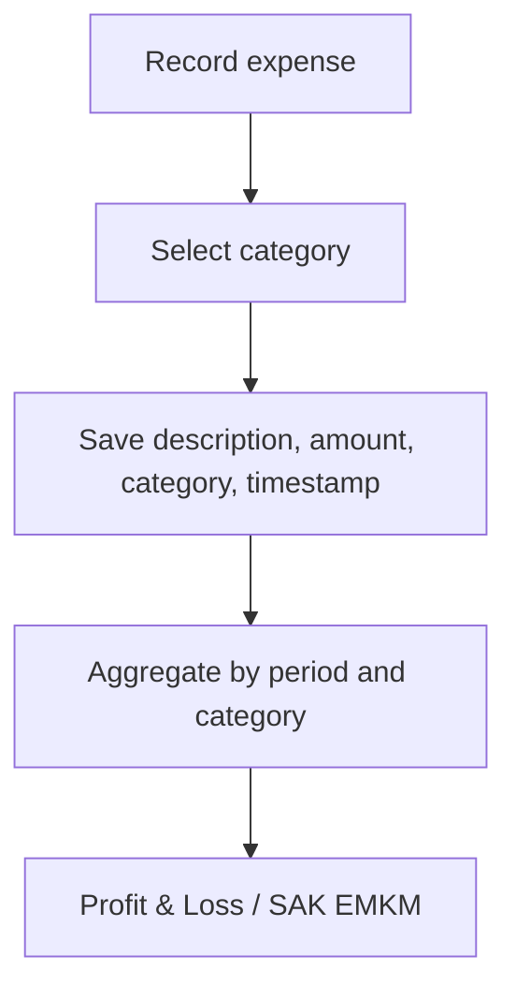
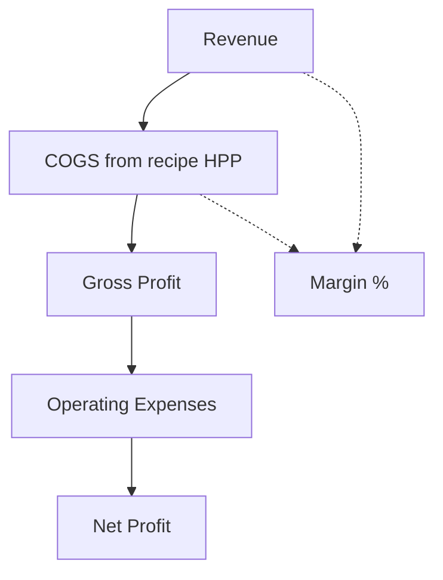
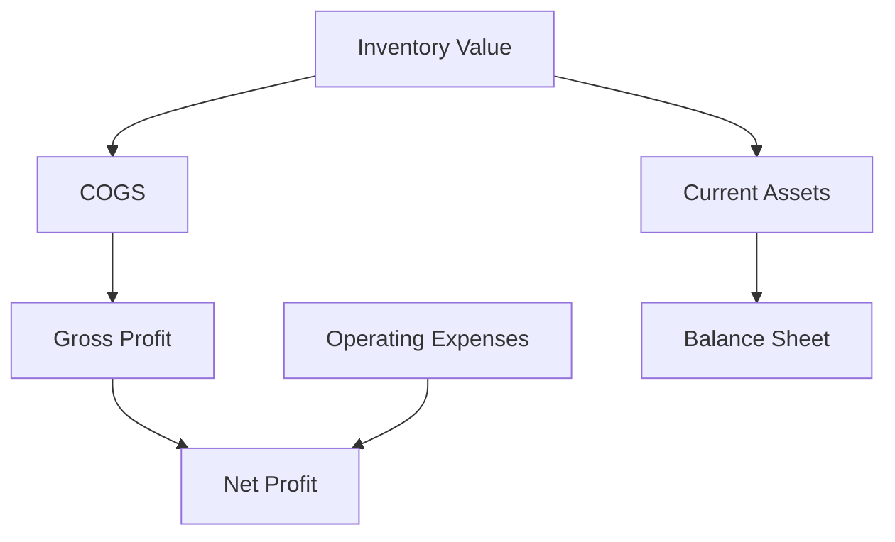
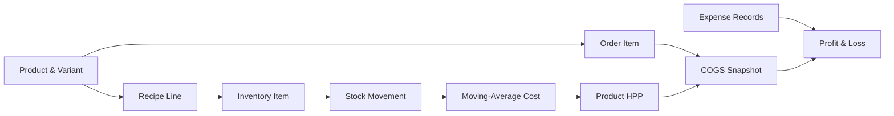

# Cost Management

<cite>
**Referenced Files in This Document**
- [README.md](file://README.md)
- [PRD_Laris_GTNIC2026.md](file://PRD_Laris_GTNIC2026.md)
- [laris-data.ts](file://src/lib/laris-data.ts)
- [laris-data.test.ts](file://src/lib/laris-data.test.ts)
- [laris-app.tsx](file://src/components/laris-app.tsx)
- [ask route.ts](file://src/app/api/ai/ask/route.ts)
- [0001_schema.sql](file://supabase/migrations/0001_schema.sql)
- [0003_functions.sql](file://supabase/migrations/0003_functions.sql)
</cite>

## Table of Contents
1. [Introduction](#introduction)
2. [Project Structure](#project-structure)
3. [Core Components](#core-components)
4. [Architecture Overview](#architecture-overview)
5. [Detailed Component Analysis](#detailed-component-analysis)
6. [Dependency Analysis](#dependency-analysis)
7. [Performance Considerations](#performance-considerations)
8. [Troubleshooting Guide](#troubleshooting-guide)
9. [Conclusion](#conclusion)

## Introduction
This document explains the cost management system in Laris, focusing on how product costs are calculated from recipe-level Bill of Materials (BOM), how inventory valuation updates through purchases, and how financial metrics such as COGS, gross margin, and profit tracking are derived. It also documents the expense categorization model used for operating expenses and shows how inventory valuation connects to financial reporting.

Laris is designed for Indonesian F&B UMKM and combines POS, recipe-based inventory, purchasing, CRM, dashboards, and financial reports. The cost engine uses a ledger-style stock model with moving-average unit cost, so every sale deducts ingredients at their current average cost, and every purchase recalculates that average while automatically refreshing product HPP (COGS).

**Section sources**
- [README.md:24-35](file://README.md#L24-L35)
- [PRD_Laris_GTNIC2026.md:175-194](file://PRD_Laris_GTNIC2026.md#L175-L194)
- [PRD_Laris_GTNIC2026.md:237-245](file://PRD_Laris_GTNIC2026.md#L237-L245)

## Project Structure
The cost management logic spans three layers:

| Layer | Responsibility | Key files |
|---|---|---|
| Domain model and demo state | Product catalog, recipes, inventory items, sales, purchases, expenses, and deterministic seed data | [laris-data.ts](file://src/lib/laris-data.ts) |
| Server-side transactional functions | Atomic POS checkout, stock deduction, purchase recording, moving-average cost update, and HPP refresh | [0003_functions.sql](file://supabase/migrations/0003_functions.sql) |
| Database schema | Tables for products, variants, recipes, inventory, stock movements, purchases, expenses, and related entities | [0001_schema.sql](file://supabase/migrations/0001_schema.sql) |
| UI and AI integration | Expense entry categories, dashboard KPIs including gross margin, and natural-language profit/margin summaries | [laris-app.tsx](file://src/components/laris-app.tsx), [ask route.ts](file://src/app/api/ai/ask/route.ts) |

**Diagram sources**
- [laris-data.ts:3-133](file://src/lib/laris-data.ts#L3-L133)
- [0003_functions.sql:94-303](file://supabase/migrations/0003_functions.sql#L94-L303)
- [0001_schema.sql:91-249](file://supabase/migrations/0001_schema.sql#L91-L249)

**Section sources**
- [README.md:97-110](file://README.md#L97-L110)
- [PRD_Laris_GTNIC2026.md:377-494](file://PRD_Laris_GTNIC2026.md#L377-L494)

## Core Components
The cost management system is built around five core components:

| Component | Purpose | Implementation location |
|---|---|---|
| Recipe BOM | Defines raw-material requirements per product or variant | [laris-data.ts:3-13](file://src/lib/laris-data.ts#L3-L13), [0001_schema.sql:120-127](file://supabase/migrations/0001_schema.sql#L120-L127) |
| Inventory valuation | Tracks opening stock, reorder points, and moving-average unit cost | [laris-data.ts:15-23](file://src/lib/laris-data.ts#L15-L23), [0001_schema.sql:73-89](file://supabase/migrations/0001_schema.sql#L73-L89) |
| Stock ledger | Immutable movement records for sales, purchases, adjustments, waste, and opname | [laris-data.ts:25-32](file://src/lib/laris-data.ts#L25-L32), [0001_schema.sql:203-216](file://supabase/migrations/0001_schema.sql#L203-L216) |
| Purchase processing | Records stock-in, updates moving-average cost, and refreshes product HPP | [laris-data.ts:307-334](file://src/lib/laris-data.ts#L307-L334), [0003_functions.sql:232-303](file://supabase/migrations/0003_functions.sql#L232-L303) |
| Financial aggregation | Calculates revenue, estimated COGS, gross profit, and margin for dashboards and AI answers | [ask route.ts:65-72](file://src/app/api/ai/ask/route.ts#L65-L72), [ask route.ts:116-134](file://src/app/api/ai/ask/route.ts#L116-L134) |

**Section sources**
- [laris-data.ts:3-133](file://src/lib/laris-data.ts#L3-L133)
- [0001_schema.sql:73-249](file://supabase/migrations/0001_schema.sql#L73-L249)
- [0003_functions.sql:48-61](file://supabase/migrations/0003_functions.sql#L48-L61)

## Architecture Overview
At a high level, cost calculation flows from recipe definitions and inventory prices into product HPP, then into COGS per sale, and finally into gross margin and profit metrics.

**Diagram sources**
- [0003_functions.sql:164-229](file://supabase/migrations/0003_functions.sql#L164-L229)
- [0003_functions.sql:272-303](file://supabase/migrations/0003_functions.sql#L272-L303)
- [ask route.ts:65-72](file://src/app/api/ai/ask/route.ts#L65-L72)

## Detailed Component Analysis

### COGS Calculation Based on Recipe-Level BOM
Laris calculates COGS by expanding each sold item into its recipe lines and multiplying the required quantity by the current average cost of each raw material.

In the domain model:
- Products carry a `recipe` array mapping inventory item IDs to base-unit quantities.
- Inventory items carry an average cost per unit.
- When a sale completes, the system aggregates needed ingredients across all cart items, validates available stock, and creates negative stock movements.

In the database layer:
- `product_variant` stores selling price and cached HPP (`hpp_cached`).
- `recipe_line` defines the BOM per variant.
- `inventory_item.avg_cost_per_unit` provides the current ingredient cost.
- `order_item.unit_cost` captures the cost snapshot for historical reporting.

**Diagram sources**
- [laris-data.ts:3-13](file://src/lib/laris-data.ts#L3-L13)
- [laris-data.ts:262-304](file://src/lib/laris-data.ts#L262-L304)
- [0001_schema.sql:105-127](file://supabase/migrations/0001_schema.sql#L105-L127)
- [0001_schema.sql:174-185](file://supabase/migrations/0001_schema.sql#L174-L185)
- [0001_schema.sql:203-216](file://supabase/migrations/0001_schema.sql#L203-L216)

**Section sources**
- [laris-data.ts:3-133](file://src/lib/laris-data.ts#L3-L133)
- [laris-data.ts:215-304](file://src/lib/laris-data.ts#L215-L304)
- [0001_schema.sql:105-216](file://supabase/migrations/0001_schema.sql#L105-L216)
- [0003_functions.sql:34-61](file://supabase/migrations/0003_functions.sql#L34-L61)
- [0003_functions.sql:164-229](file://supabase/migrations/0003_functions.sql#L164-L229)

### Moving-Average Cost Updates When Purchasing New Inventory
When a purchase is recorded, Laris updates the inventory item’s average cost using a weighted formula based on existing stock and the new purchase total.

Key behaviors:
- Existing stock is treated as non-negative when computing the average.
- The new average cost is rounded to four decimal places in the database, allowing fractional rupiah per base unit.
- A positive stock movement is created for the purchased quantity.
- All product variants using the affected ingredient have their cached HPP refreshed.

**Diagram sources**
- [0003_functions.sql:272-303](file://supabase/migrations/0003_functions.sql#L272-L303)
- [0003_functions.sql:48-61](file://supabase/migrations/0003_functions.sql#L48-L61)

**Section sources**
- [laris-data.ts:307-334](file://src/lib/laris-data.ts#L307-L334)
- [0001_schema.sql:73-89](file://supabase/migrations/0001_schema.sql#L73-L89)
- [0001_schema.sql:218-237](file://supabase/migrations/0001_schema.sql#L218-L237)
- [0003_functions.sql:232-303](file://supabase/migrations/0003_functions.sql#L232-L303)

### Automated Product Cost Recalculation When Ingredient Costs Change
Laris ensures that changes in ingredient costs propagate to product costs:

- In the domain model, `recordPurchase` recomputes each product’s cost by summing recipe-line quantities multiplied by the updated inventory item costs.
- In the database layer, `private.refresh_hpp` recalculates `hpp_cached` for every variant whose recipe includes any of the changed inventory items.

**Diagram sources**
- [laris-data.ts:3-23](file://src/lib/laris-data.ts#L3-L23)
- [laris-data.ts:323-326](file://src/lib/laris-data.ts#L323-L326)
- [0001_schema.sql:105-127](file://supabase/migrations/0001_schema.sql#L105-L127)

**Section sources**
- [laris-data.ts:307-334](file://src/lib/laris-data.ts#L307-L334)
- [laris-data.test.ts:325-340](file://src/lib/laris-data.test.ts#L325-L340)
- [0003_functions.sql:48-61](file://supabase/migrations/0003_functions.sql#L48-L61)

### Margin Analysis: Selling Price vs Calculated Cost
Margin analysis compares product selling prices against calculated costs to determine gross margins.

In the demo domain model:
- Each product has a `price` and a computed `cost`.
- Dashboard KPIs compute total revenue, estimated COGS, gross profit, and margin percentage.

In the AI copilot layer:
- Revenue is summed from recorded sales.
- Estimated COGS is derived from sales and current recipe costs.
- Gross profit equals revenue minus estimated COGS.
- Margin percentage is expressed as a ratio of gross profit to revenue.

**Diagram sources**
- [ask route.ts:65-72](file://src/app/api/ai/ask/route.ts#L65-L72)
- [ask route.ts:116-134](file://src/app/api/ai/ask/route.ts#L116-L134)
- [laris-app.tsx:933-937](file://src/components/laris-app.tsx#L933-L937)

**Section sources**
- [laris-data.ts:3-13](file://src/lib/laris-data.ts#L3-L13)
- [laris-app.tsx:933-937](file://src/components/laris-app.tsx#L933-L937)
- [ask route.ts:65-72](file://src/app/api/ai/ask/route.ts#L65-L72)
- [ask route.ts:116-134](file://src/app/api/ai/ask/route.ts#L116-L134)

### Expense Categorization System
Laris supports expense records with categories. The UI exposes a category selector, and the seed data demonstrates typical UMKM operating expenses.

Categories present in the implementation include:
- Bahan baku (raw materials)
- Sewa (rent)
- Gaji (salaries)
- Utilitas (utilities; implemented as "Listrik & air")
- Operasional (operational expenses)
- Pemasaran (marketing)
- Lainnya (other)

These categories align with the PRD requirement for expense records with categories and recurring expenses, and they feed into financial statements such as Profit & Loss.

**Diagram sources**
- [laris-app.tsx:1146](file://src/components/laris-app.tsx#L1146)
- [laris-data.ts:66-72](file://src/lib/laris-data.ts#L66-L72)
- [laris-data.ts:384-394](file://src/lib/laris-data.ts#L384-L394)
- [0001_schema.sql:239-250](file://supabase/migrations/0001_schema.sql#L239-L250)

**Section sources**
- [laris-app.tsx:1146](file://src/components/laris-app.tsx#L1146)
- [laris-data.ts:66-72](file://src/lib/laris-data.ts#L66-L72)
- [laris-data.ts:384-394](file://src/lib/laris-data.ts#L384-L394)
- [PRD_Laris_GTNIC2026.md:237-245](file://PRD_Laris_GTNIC2026.md#L237-L245)
- [0001_schema.sql:239-250](file://supabase/migrations/0001_schema.sql#L239-L250)

### Profit Tracking: Revenue Minus COGS and Operating Expenses
Profit tracking in Laris follows this progression:

1. **Revenue**: Sum of sales totals.
2. **COGS**: Estimated from recipe-based HPP applied to sold items.
3. **Gross profit**: Revenue minus COGS.
4. **Operating expenses**: Sum of categorized expenses such as rent, salaries, utilities, marketing, and operational costs.
5. **Net profit**: Gross profit minus operating expenses.

The AI tool `getProfitSummary` returns revenue, estimated COGS, gross profit, and margin percentage, explicitly noting that operating expenses are not yet subtracted. The dashboard also displays gross margin alongside revenue and transaction counts.

**Diagram sources**
- [ask route.ts:116-134](file://src/app/api/ai/ask/route.ts#L116-L134)
- [laris-app.tsx:933-937](file://src/components/laris-app.tsx#L933-L937)
- [laris-data.ts:384-394](file://src/lib/laris-data.ts#L384-L394)

**Section sources**
- [ask route.ts:116-134](file://src/app/api/ai/ask/route.ts#L116-L134)
- [laris-app.tsx:933-937](file://src/components/laris-app.tsx#L933-L937)
- [laris-data.ts:384-394](file://src/lib/laris-data.ts#L384-L394)

### Relationship Between Inventory Valuation and Financial Statements
Inventory valuation directly affects both COGS and balance sheet assets:

- **Balance sheet impact**: Inventory value increases with purchases and decreases with sales, waste, adjustments, and physical count differences.
- **Income statement impact**: COGS is derived from ingredient costs consumed by sales; higher ingredient costs raise COGS and reduce gross profit.
- **Reporting alignment**: The PRD specifies SAK EMKM-aligned Profit & Loss, cash flow, and simple balance sheet outputs, which depend on accurate inventory valuation and expense categorization.

**Diagram sources**
- [0001_schema.sql:73-89](file://supabase/migrations/0001_schema.sql#L73-L89)
- [0001_schema.sql:203-249](file://supabase/migrations/0001_schema.sql#L203-L249)
- [PRD_Laris_GTNIC2026.md:237-245](file://PRD_Laris_GTNIC2026.md#L237-L245)

**Section sources**
- [0001_schema.sql:73-249](file://supabase/migrations/0001_schema.sql#L73-L249)
- [PRD_Laris_GTNIC2026.md:237-245](file://PRD_Laris_GTNIC2026.md#L237-L245)

## Dependency Analysis
The cost management system has clear dependencies between catalog, inventory, transactions, and financial reporting.

**Diagram sources**
- [0001_schema.sql:91-249](file://supabase/migrations/0001_schema.sql#L91-L249)
- [0003_functions.sql:48-61](file://supabase/migrations/0003_functions.sql#L48-L61)
- [0003_functions.sql:164-229](file://supabase/migrations/0003_functions.sql#L164-L229)
- [0003_functions.sql:272-303](file://supabase/migrations/0003_functions.sql#L272-L303)

**Section sources**
- [0001_schema.sql:91-249](file://supabase/migrations/0001_schema.sql#L91-L249)
- [0003_functions.sql:48-61](file://supabase/migrations/0003_functions.sql#L48-L61)
- [0003_functions.sql:94-303](file://supabase/migrations/0003_functions.sql#L94-L303)

## Performance Considerations
- **Ledger design**: Stock is maintained as immutable movements rather than overwritten balances, improving auditability and reducing race conditions.
- **Cached HPP**: Product variants store `hpp_cached`, avoiding repeated recipe calculations for every query.
- **Atomic transactions**: POS checkout and purchase recording run inside database functions that lock ingredients and write order, payment, and stock movements atomically.
- **Rounding strategy**: Money is stored as integer rupiah in most tables, while inventory unit cost allows fractional rupiah precision where needed.
- **Scalability note**: As sales volume grows, COGS estimation should rely on precomputed snapshots in `order_item.unit_cost` and aggregated reports rather than recalculating full recipe trees for large date ranges.

[No sources needed since this section provides general guidance]

## Troubleshooting Guide
Common issues and their likely causes:

| Symptom | Likely cause | Resolution |
|---|---|---|
| Sale fails due to insufficient stock | Recipe expansion requires more raw material than available | Check low-stock alerts and reorder before completing sale |
| Product cost does not change after purchase | Purchase did not affect recipe-linked inventory items | Verify purchase line references correct inventory item code |
| Margin appears lower than expected | Ingredient cost increased via purchase | Review recent purchases and updated moving-average cost |
| COGS seems inconsistent across periods | Using outdated product cost instead of ledger-based movement cost | Prefer `order_item.unit_cost` and stock movement history for historical accuracy |
| Expense not reflected in operating costs | Wrong category or missing expense record | Confirm category selection and save timestamp |

**Section sources**
- [laris-data.ts:262-275](file://src/lib/laris-data.ts#L262-L275)
- [laris-data.ts:307-334](file://src/lib/laris-data.ts#L307-L334)
- [0003_functions.sql:164-179](file://supabase/migrations/0003_functions.sql#L164-L179)
- [0003_functions.sql:272-297](file://supabase/migrations/0003_functions.sql#L272-L297)

## Conclusion
Laris implements a robust cost management system grounded in recipe-level BOM, ledger-based inventory, and moving-average costing. COGS is calculated from current ingredient costs, purchases automatically update average costs and refresh product HPP, and financial metrics such as gross margin and profit are derived from sales, COGS, and categorized operating expenses. The design emphasizes traceability, atomicity, and alignment with UMKM financial reporting needs, making it suitable for F&B businesses that require accurate pricing, inventory control, and financial clarity.

[No sources needed since this section summarizes without analyzing specific files]