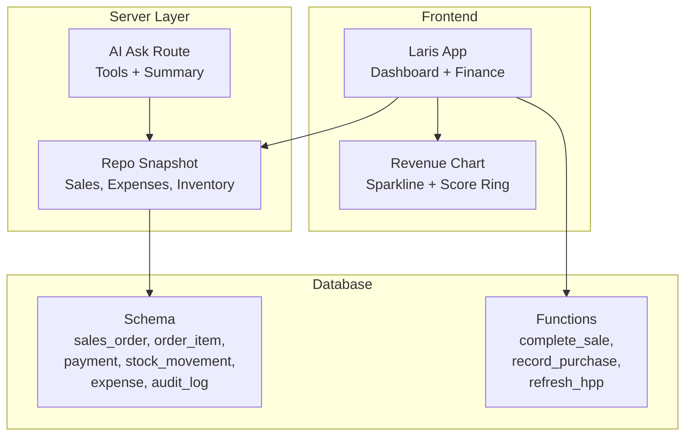
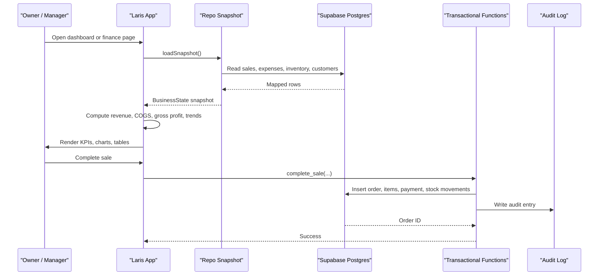
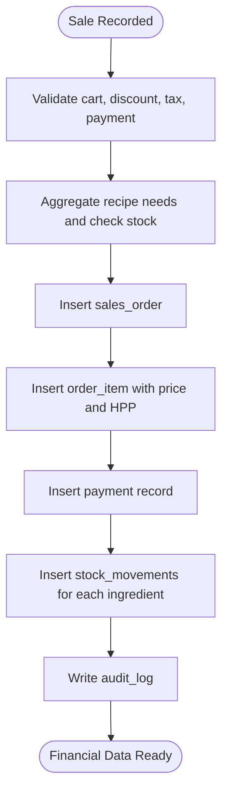
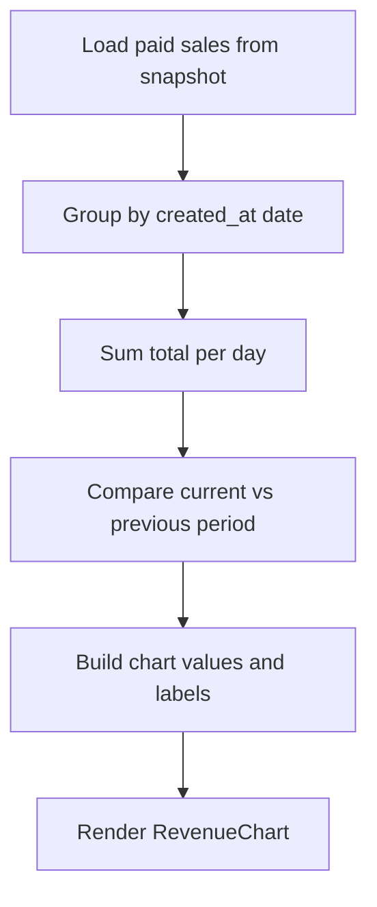
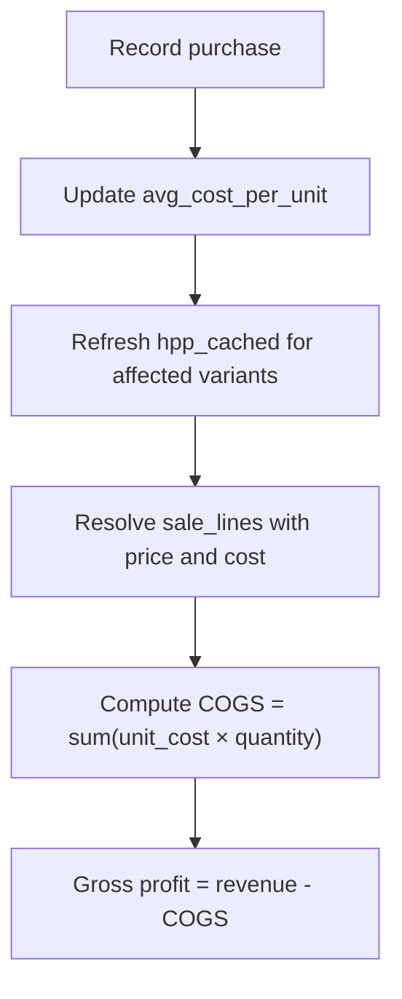
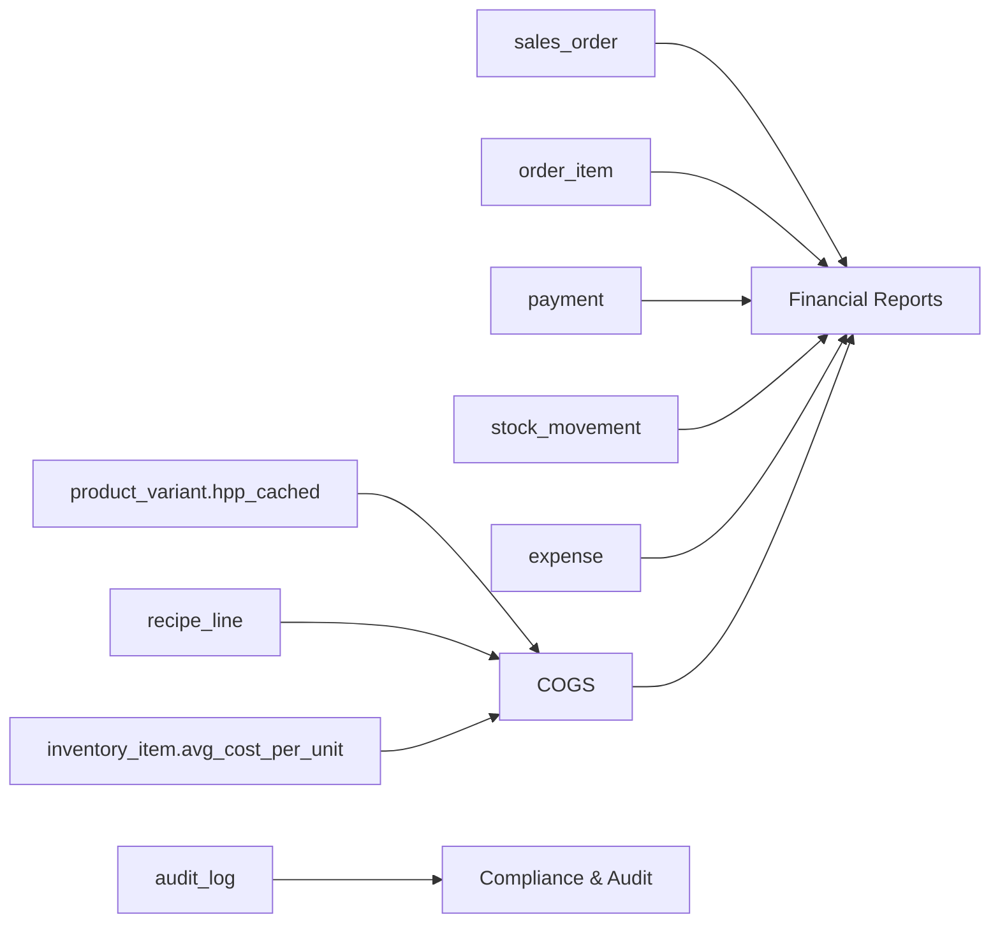

# Financial Reporting

<cite>
**Referenced Files in This Document**   
- [README.md](file://README.md)
- [PRD_Laris_GTNIC2026.md](file://PRD_Laris_GTNIC2026.md)
- [laris-data.ts](file://src/lib/laris-data.ts)
- [repo.ts](file://src/lib/repo.ts)
- [laris-visuals.tsx](file://src/components/laris-visuals.tsx)
- [laris-app.tsx](file://src/components/laris-app.tsx)
- [ask route.ts](file://src/app/api/ai/ask/route.ts)
- [0001_schema.sql](file://supabase/migrations/0001_schema.sql)
- [0002_rls.sql](file://supabase/migrations/0002_rls.sql)
- [0003_functions.sql](file://supabase/migrations/0003_functions.sql)
- [0004_workspaces.sql](file://supabase/migrations/0004_workspaces.sql)
</cite>

## Table of Contents
1. [Introduction](#introduction)
2. [Project Structure](#project-structure)
3. [Core Components](#core-components)
4. [Architecture Overview](#architecture-overview)
5. [Detailed Component Analysis](#detailed-component-analysis)
6. [Dependency Analysis](#dependency-analysis)
7. [Performance Considerations](#performance-considerations)
8. [Troubleshooting Guide](#troubleshooting-guide)
9. [Conclusion](#conclusion)
10. [Appendices](#appendices)

## Introduction
This document explains the financial reporting capabilities of Laris, an Indonesian SME operational system focused on F&B businesses. It covers revenue tracking, cost management, SAK EMKM-style financial statements, CSV export, dashboard visualizations, comparative analysis, and the integration between operational data and financial outputs. It also documents accounting principles applied by the system, audit trail requirements, and compliance considerations for Indonesian SMEs.

Laris is designed so that daily sales, recipes, purchases, expenses, and stock movements flow into consistent financial summaries. The product requirements define SAK EMKM Profit & Loss, cash flow, and balance sheet generation, a financing readiness score, and PDF/Excel exports. The current implementation provides strong foundations: atomic POS transactions, recipe-based COGS (HPP), moving-average inventory cost, expense categorization, channel tracking, and CSV export of sales.

**Section sources**
- [README.md:24-35](file://README.md#L24-L35)
- [PRD_Laris_GTNIC2026.md:227-245](file://PRD_Laris_GTNIC2026.md#L227-L245)

## Project Structure
The financial reporting layer spans several parts of the codebase:

| Area | Responsibility | Key files |
|---|---|---|
| Domain model and demo logic | Sales, expenses, purchases, stock movements, CSV export | `src/lib/laris-data.ts` |
| Cloud snapshot mapping | Maps Supabase rows to domain models used by dashboards and reports | `src/lib/repo.ts` |
| Dashboard UI | KPI cards, revenue charts, bestsellers, stock alerts, finance navigation | `src/components/laris-app.tsx`, `src/components/laris-visuals.tsx` |
| AI copilot tools | Revenue, margin, expense breakdown, customer segments | `src/app/api/ai/ask/route.ts` |
| Database schema | Sales, payments, orders, stock ledger, expenses, audit log | `supabase/migrations/0001_schema.sql` |
| Security and roles | Row-level security and membership checks | `supabase/migrations/0002_rls.sql` |
| Transactional functions | Atomic sale completion, purchase recording, HPP refresh | `supabase/migrations/0003_functions.sql` |
| Workspace setup | Catalog seeding, HPP refresh, audit logging | `supabase/migrations/0004_workspaces.sql` |

**Diagram sources**
- [laris-app.tsx:933-947](file://src/components/laris-app.tsx#L933-L947)
- [laris-visuals.tsx:42-56](file://src/components/laris-visuals.tsx#L42-L56)
- [repo.ts:129-192](file://src/lib/repo.ts#L129-L192)
- [ask route.ts:65-71](file://src/app/api/ai/ask/route.ts#L65-L71)
- [0001_schema.sql:153-249](file://supabase/migrations/0001_schema.sql#L153-L249)
- [0003_functions.sql:94-230](file://supabase/migrations/0003_functions.sql#L94-L230)

**Section sources**
- [README.md:97-110](file://README.md#L97-L110)
- [PRD_Laris_GTNIC2026.md:377-494](file://PRD_Laris_GTNIC2026.md#L377-L494)

## Core Components
This section maps the financial reporting building blocks to their implementations.

### Revenue Tracking
- Daily sales are recorded through `complete_sale`, which stores `sales_order`, `order_item`, `payment`, and recipe-driven `stock_movement` rows atomically.
- The repository snapshot loads paid sales with subtotal, discount, tax, total, payment method, and channel.
- The dashboard computes revenue, transaction count, average ticket, gross profit, and growth against a previous period.
- Channel breakdown is available from the `channel` field (`kasir`, `etalase`, `wa`) and mapped to `Kasir` or `Etalase` in the client snapshot.

**Section sources**
- [0003_functions.sql:94-230](file://supabase/migrations/0003_functions.sql#L94-L230)
- [repo.ts:20-38](file://src/lib/repo.ts#L20-L38)
- [repo.ts:135-144](file://src/lib/repo.ts#L135-L144)
- [laris-app.tsx:933-937](file://src/components/laris-app.tsx#L933-L937)

### Cost Management and COGS
- Recipe lines link products to inventory items with base-unit quantities.
- Purchases update moving-average unit cost per inventory item.
- Product variants cache `hpp_cached`, recalculated when inventory costs change.
- Sale line resolution uses `hpp_cached` as the estimated COGS per unit.
- Gross profit is calculated as revenue minus recipe-based COGS; operating expenses are subtracted later for net profit.

**Section sources**
- [0001_schema.sql:120-127](file://supabase/migrations/0001_schema.sql#L120-L127)
- [0001_schema.sql:105-118](file://supabase/migrations/0001_schema.sql#L105-L118)
- [0003_functions.sql:48-61](file://supabase/migrations/0003_functions.sql#L48-L61)
- [0003_functions.sql:34-46](file://supabase/migrations/0003_functions.sql#L34-L46)
- [0003_functions.sql:232-303](file://supabase/migrations/0003_functions.sql#L232-L303)

### Expense Categorization and Profit Tracking
- Expenses have description, category, amount, and timestamp.
- The demo seed creates categories such as raw materials, rent, salaries, utilities, and operational costs.
- The AI ask route aggregates expenses by category and returns totals for summary questions.
- Net profit can be derived from gross profit minus categorized operating expenses.

**Section sources**
- [0001_schema.sql:239-250](file://supabase/migrations/0001_schema.sql#L239-L250)
- [laris-data.ts:384-394](file://src/lib/laris-data.ts#L384-L394)
- [ask route.ts:161-173](file://src/app/api/ai/ask/route.ts#L161-L173)

### SAK EMKM-Style Statements and CSV Export
- The PRD requires Profit & Loss, cash flow, and simple balance sheet per SAK EMKM.
- The current codebase provides the data foundation: sales, COGS via recipes, operating expenses, and stock ledger.
- CSV export is implemented for sales records, including ID, date, customer, menu, subtotal, discount, tax, total, payment, cash received, channel, and status.
- Full SAK EMKM statement rendering and PDF/Excel export are defined in the product requirements but not fully implemented in the analyzed files.

**Section sources**
- [PRD_Laris_GTNIC2026.md:237-245](file://PRD_Laris_GTNIC2026.md#L237-L245)
- [laris-data.ts:483-493](file://src/lib/laris-data.ts#L483-L493)

### Dashboard Visualizations and Comparative Analysis
- The dashboard shows KPI cards for revenue, transactions, average ticket, and gross margin.
- A revenue chart compares current period values with previous period values.
- Bestsellers table shows top products by quantity sold and contribution to revenue.
- Stock alerts highlight low-stock ingredients based on opening stock and movement history.

**Section sources**
- [laris-app.tsx:933-947](file://src/components/laris-app.tsx#L933-L947)
- [laris-visuals.tsx:42-56](file://src/components/laris-visuals.tsx#L42-L56)

## Architecture Overview
Financial reporting in Laris follows a layered architecture:

**Diagram sources**
- [repo.ts:129-192](file://src/lib/repo.ts#L129-L192)
- [0003_functions.sql:94-230](file://supabase/migrations/0003_functions.sql#L94-L230)
- [0001_schema.sql:255-265](file://supabase/migrations/0001_schema.sql#L255-L265)

## Detailed Component Analysis

### Revenue Tracking Mechanisms
Daily sales summaries are built from paid orders. Each order includes:
- Subtotal before discount and tax.
- Discount amount.
- Tax amount, using a demo restaurant tax rule.
- Total payable amount.
- Payment method and channel.
- Cash received for cash payments.

The dashboard calculates:
- Total revenue as the sum of order totals.
- Transaction count.
- Average ticket as total revenue divided by transaction count.
- Growth compared to a previous period.

Channel breakdown is available from the order’s channel field. In the current snapshot mapping, `kasir` becomes `Kasir` and other channels become `Etalase`. Future extensions can expose all channels for richer channel-wise reporting.

**Diagram sources**
- [0003_functions.sql:147-229](file://supabase/migrations/0003_functions.sql#L147-L229)

**Section sources**
- [0003_functions.sql:94-230](file://supabase/migrations/0003_functions.sql#L94-L230)
- [repo.ts:20-38](file://src/lib/repo.ts#L20-L38)
- [laris-app.tsx:933-937](file://src/components/laris-app.tsx#L933-L937)

### Revenue Trends Analysis
The revenue trend visualization compares current-period daily revenue with previous-period daily revenue. The chart component accepts arrays of values, previous values, and labels, then renders a smoothed line chart with hover tooltips and a gradient fill.

Trend calculation in the dashboard:
- Groups sales by day.
- Computes current-period revenue.
- Compares with previous-period revenue to derive percentage change.
- Displays sparklines and trend indicators alongside KPI cards.

**Diagram sources**
- [laris-visuals.tsx:42-56](file://src/components/laris-visuals.tsx#L42-L56)
- [laris-app.tsx:938-940](file://src/components/laris-app.tsx#L938-L940)

**Section sources**
- [laris-visuals.tsx:42-56](file://src/components/laris-visuals.tsx#L42-L56)
- [laris-app.tsx:938-940](file://src/components/laris-app.tsx#L938-L940)

### Channel Breakdown Reporting
Channel data is stored at the order level and mapped into the client snapshot. Current mapping treats `kasir` as `Kasir` and other channels as `Etalase`. To support full channel breakdown reporting:
- Extend the channel mapping to preserve original channel values.
- Aggregate revenue, transaction count, and average ticket by channel.
- Add a channel pie or bar chart to the dashboard.
- Use the channel field in CSV export and AI tool responses.

**Section sources**
- [repo.ts:20-38](file://src/lib/repo.ts#L20-L38)
- [0001_schema.sql:153-171](file://supabase/migrations/0001_schema.sql#L153-L171)

### COGS Calculation and Margin Analysis
COGS is driven by recipes and moving-average inventory cost:
- Recipes define how much of each inventory item a product variant consumes.
- Purchases update the moving-average cost per inventory item.
- Product variants cache `hpp_cached`, recomputed when relevant inventory costs change.
- Sale lines use `hpp_cached` as the unit cost for COGS estimation.

Margin analysis:
- Gross profit equals revenue minus recipe-based COGS.
- Gross margin percentage equals gross profit divided by revenue.
- Operating expenses are subtracted afterward to estimate net profit.

**Diagram sources**
- [0003_functions.sql:232-303](file://supabase/migrations/0003_functions.sql#L232-L303)
- [0003_functions.sql:48-61](file://supabase/migrations/0003_functions.sql#L48-L61)
- [0003_functions.sql:34-46](file://supabase/migrations/0003_functions.sql#L34-L46)

**Section sources**
- [0003_functions.sql:48-61](file://supabase/migrations/0003_functions.sql#L48-L61)
- [0003_functions.sql:232-303](file://supabase/migrations/0003_functions.sql#L232-L303)

### Expense Categorization
Expenses are categorized by business-defined categories. The demo seed creates recurring categories such as raw materials, rent, salaries, utilities, and operational costs. The AI copilot can summarize total expenses and category-wise breakdowns.

Practical usage:
- Record daily raw material purchases as expenses or through purchases that update inventory.
- Record fixed monthly costs such as rent and salaries.
- Record variable operational costs such as cleaning supplies.
- Use category aggregation to identify major cost drivers.

**Section sources**
- [0001_schema.sql:239-250](file://supabase/migrations/0001_schema.sql#L239-L250)
- [laris-data.ts:384-394](file://src/lib/laris-data.ts#L384-L394)
- [ask route.ts:161-173](file://src/app/api/ai/ask/route.ts#L161-L173)

### Profit Tracking
Profit tracking combines revenue, COGS, and operating expenses:
- Revenue comes from paid sales totals.
- COGS comes from recipe-based unit costs.
- Gross profit is revenue minus COGS.
- Net profit is gross profit minus categorized operating expenses.

The dashboard already displays gross profit and gross margin. Net profit can be computed by subtracting total expenses from gross profit.

**Section sources**
- [laris-app.tsx:933-937](file://src/components/laris-app.tsx#L933-L937)
- [ask route.ts:65-71](file://src/app/api/ai/ask/route.ts#L65-L71)

### SAK EMKM-Style Financial Statement Generation
The PRD defines SAK EMKM Profit & Loss, cash flow, and simple balance sheet generation. The current implementation provides the necessary data structures:
- Profit & Loss: revenue, COGS, gross profit, operating expenses, net profit.
- Cash flow: cash inflows from sales and outflows from purchases and expenses.
- Balance sheet: assets, liabilities, and equity can be derived from ledger balances and retained earnings.

CSV export currently supports sales records. PDF and Excel exports are required by the PRD but are not present in the analyzed source files.

**Section sources**
- [PRD_Laris_GTNIC2026.md:237-245](file://PRD_Laris_GTNIC2026.md#L237-L245)
- [laris-data.ts:483-493](file://src/lib/laris-data.ts#L483-L493)

### CSV Export Functionality
The sales CSV exporter generates rows with:
- ID
- Date
- Customer name
- Menu details
- Subtotal
- Discount
- Tax
- Total
- Payment method
- Cash received
- Channel
- Status

It safely escapes cells to prevent formula injection and quotes every cell.

**Section sources**
- [laris-data.ts:476-493](file://src/lib/laris-data.ts#L476-L493)

### Dashboard Visualizations
The dashboard includes:
- KPI cards for revenue, transactions, average ticket, and gross margin.
- Revenue trend chart comparing current and previous periods.
- Bestsellers table showing top products by sales volume and revenue contribution.
- Stock alerts highlighting low-stock ingredients.
- Navigation to detailed transactions and finance views.

**Section sources**
- [laris-app.tsx:933-947](file://src/components/laris-app.tsx#L933-L947)
- [laris-visuals.tsx:42-56](file://src/components/laris-visuals.tsx#L42-L56)

### Comparative Analysis Tools
Comparative analysis is supported through:
- Period-over-period revenue comparison in the chart.
- Percentage change indicators on KPI cards.
- AI copilot summaries that compare revenue, COGS, gross profit, and margin.

Future enhancements can add:
- Month-over-month and year-over-year comparisons.
- Channel-wise and product-wise comparative tables.
- Anomaly detection for unusual spikes or drops.

**Section sources**
- [laris-app.tsx:933-937](file://src/components/laris-app.tsx#L933-L937)
- [ask route.ts:65-71](file://src/app/api/ai/ask/route.ts#L65-L71)

## Dependency Analysis
The financial reporting pipeline depends on:
- Operational data: sales, orders, payments, stock movements, purchases, expenses.
- Catalog data: products, variants, recipes, inventory items.
- Transactional functions: atomic sale completion and purchase recording.
- Security policies: RLS ensures tenant isolation and role-based access.
- Audit log: records sensitive actions for compliance.

**Diagram sources**
- [0001_schema.sql:153-250](file://supabase/migrations/0001_schema.sql#L153-L250)
- [0001_schema.sql:255-265](file://supabase/migrations/0001_schema.sql#L255-L265)

**Section sources**
- [0001_schema.sql:153-265](file://supabase/migrations/0001_schema.sql#L153-L265)
- [0002_rls.sql:1-131](file://supabase/migrations/0002_rls.sql#L1-L131)

## Performance Considerations
- Ledger-based stock movements avoid overwriting quantities and support accurate historical reporting.
- Moving-average cost updates occur during purchase recording, keeping COGS calculations efficient.
- HPP caching reduces repeated recipe cost computation.
- Repository pagination prevents loading excessively large datasets in one request.
- Dashboard metrics are computed from mapped snapshots, reducing repeated database queries.

Recommendations:
- Materialize common financial aggregates if query latency grows.
- Index frequently filtered columns such as `business_id`, `created_at`, and `spent_at`.
- Cache dashboard KPIs for short intervals to reduce recompute overhead.

[No sources needed since this section provides general guidance]

## Troubleshooting Guide
Common issues and resolutions:

| Issue | Cause | Resolution |
|---|---|---|
| Sale fails due to insufficient stock | Recipe-based stock check rejects incomplete inventory | Restock ingredients or adjust recipe quantities |
| Invalid payment or channel | Client sends unsupported values | Use allowed values: `tunai`, `qris`, `transfer`; channels: `kasir`, `etalase`, `wa` |
| Discount exceeds subtotal | Validation rejects invalid discounts | Ensure discount is less than or equal to subtotal |
| CSV export contains unexpected formulas | Unsafe text triggers spreadsheet formula parsing | Use the existing safe CSV exporter that quotes and escapes cells |
| Tenant data leakage risk | Missing RLS or incorrect membership | Verify RLS policies and `private.is_member` checks |
| HPP mismatch after purchase | Cached HPP not refreshed | Ensure `refresh_hpp` runs after purchase recording |

**Section sources**
- [0003_functions.sql:134-179](file://supabase/migrations/0003_functions.sql#L134-L179)
- [laris-data.ts:476-493](file://src/lib/laris-data.ts#L476-L493)
- [0002_rls.sql:1-131](file://supabase/migrations/0002_rls.sql#L1-L131)

## Conclusion
Laris provides a solid foundation for financial reporting tailored to Indonesian SMEs. Revenue tracking, recipe-based COGS, expense categorization, and audit trails are implemented. The dashboard visualizes key performance indicators and trends, while the AI copilot offers natural-language summaries. SAK EMKM-style statements and advanced exports are defined in the product requirements and can be built on top of the existing data model and transactional functions. For production readiness, extend channel breakdown reporting, implement full SAK EMKM statement rendering, and add robust PDF/Excel export functionality.

[No sources needed since this section summarizes without analyzing specific files]

## Appendices

### Practical Examples

#### Example: Generating a Daily Sales Summary
1. Load the workspace snapshot.
2. Filter paid sales by the desired date range.
3. Sum totals for revenue.
4. Count transactions.
5. Compute average ticket.
6. Calculate COGS from recipe-based unit costs.
7. Derive gross profit and gross margin.

**Section sources**
- [repo.ts:129-192](file://src/lib/repo.ts#L129-L192)
- [0003_functions.sql:34-46](file://supabase/migrations/0003_functions.sql#L34-L46)

#### Example: Custom Date Range Filtering
1. Parse start and end dates.
2. Filter `sales_order.created_at` within the range.
3. Map results to domain sales objects.
4. Aggregate by day, channel, or product.
5. Render trends and breakdowns.

**Section sources**
- [repo.ts:20-38](file://src/lib/repo.ts#L20-L38)
- [0001_schema.sql:153-171](file://supabase/migrations/0001_schema.sql#L153-L171)

#### Example: Performance Metric Calculations
- Revenue: sum of order totals.
- COGS: sum of `unit_cost × quantity` across order items.
- Gross profit: revenue minus COGS.
- Gross margin: gross profit divided by revenue.
- Operating expenses: sum of categorized expenses.
- Net profit: gross profit minus operating expenses.

**Section sources**
- [laris-app.tsx:933-937](file://src/components/laris-app.tsx#L933-L937)
- [ask route.ts:65-71](file://src/app/api/ai/ask/route.ts#L65-L71)

### Accounting Principles Applied
- **Double-entry spirit via ledger:** Stock movements record deltas rather than overwriting balances.
- **Matching principle:** COGS is matched to sales through recipe consumption.
- **Conservatism:** Discounts and taxes are validated server-side; totals are computed from catalog prices.
- **Materiality and traceability:** Every financial event has a reference, timestamp, and actor.
- **Multi-tenancy:** All financial data is scoped to `business_id` with RLS enforcement.

**Section sources**
- [0001_schema.sql:203-216](file://supabase/migrations/0001_schema.sql#L203-L216)
- [0002_rls.sql:1-131](file://supabase/migrations/0002_rls.sql#L1-L131)

### Audit Trail Requirements
- Audit logs capture business creation, product saves, inventory changes, sales completion, and purchase recording.
- Access to audit logs is restricted to owners and managers.
- AI events can be logged for feature telemetry and evaluation.

**Section sources**
- [0001_schema.sql:255-278](file://supabase/migrations/0001_schema.sql#L255-L278)
- [0002_rls.sql:116-125](file://supabase/migrations/0002_rls.sql#L116-L125)
- [0003_functions.sql:225-227](file://supabase/migrations/0003_functions.sql#L225-L227)
- [0004_workspaces.sql:149-151](file://supabase/migrations/0004_workspaces.sql#L149-L151)

### Regulatory Compliance for Indonesian SMEs
- SAK EMKM financial statements are required by the product scope.
- PPh Final UMKM tax estimation is mentioned in the PRD.
- UU PDP privacy compliance is reflected in marketing consent fields and minimal PII handling.
- Multi-tenant isolation and audit trails support regulatory scrutiny and internal controls.

**Section sources**
- [PRD_Laris_GTNIC2026.md:237-245](file://PRD_Laris_GTNIC2026.md#L237-L245)
- [0001_schema.sql:132-148](file://supabase/migrations/0001_schema.sql#L132-L148)