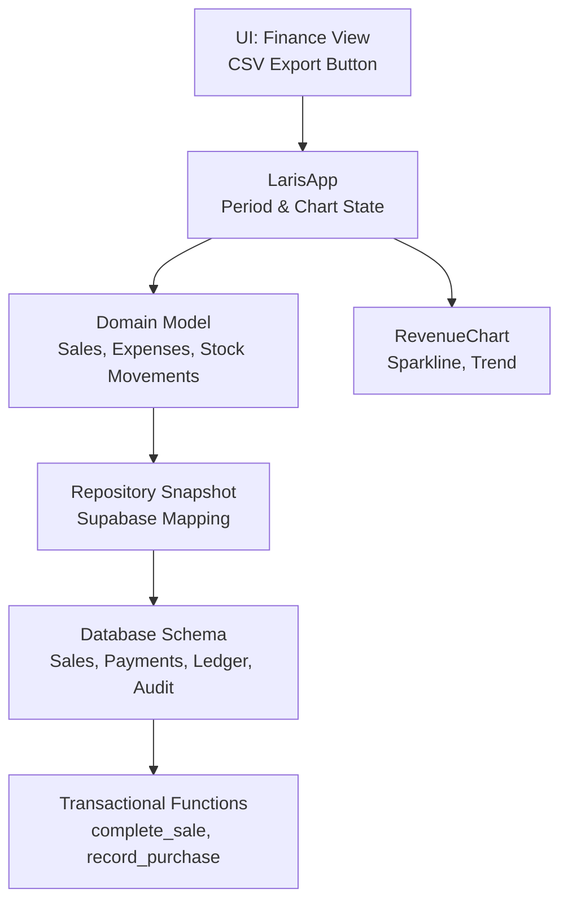
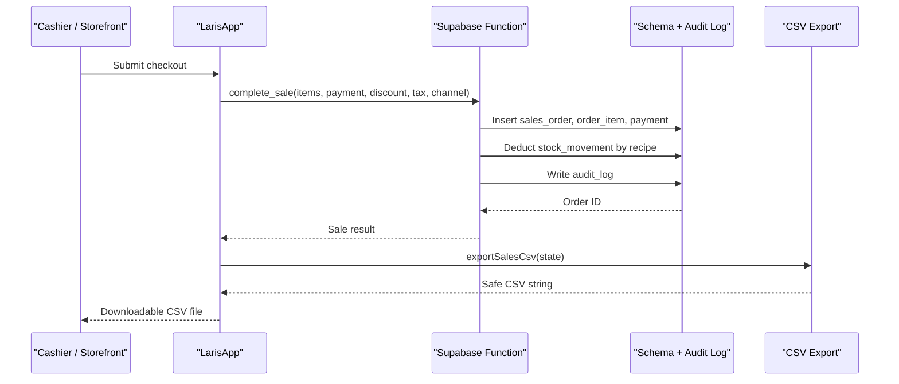
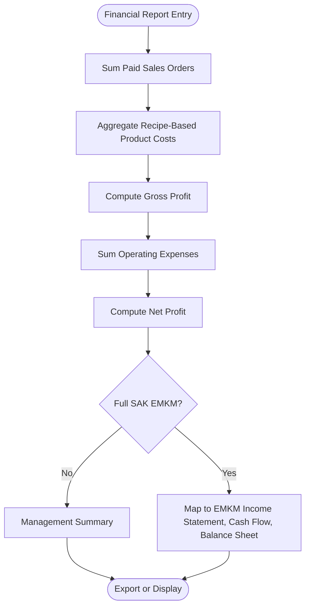
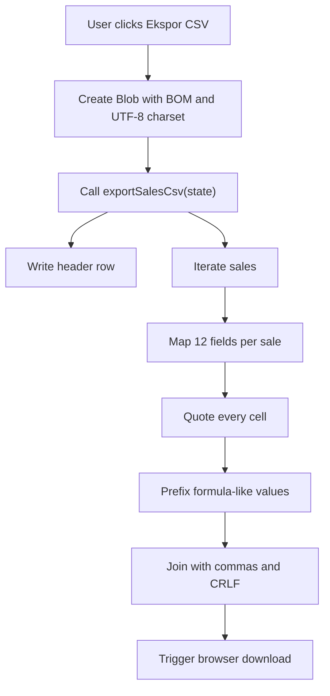
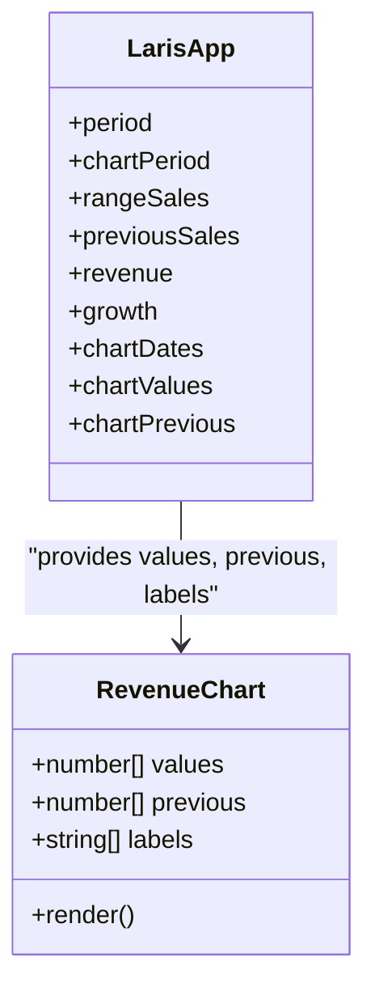
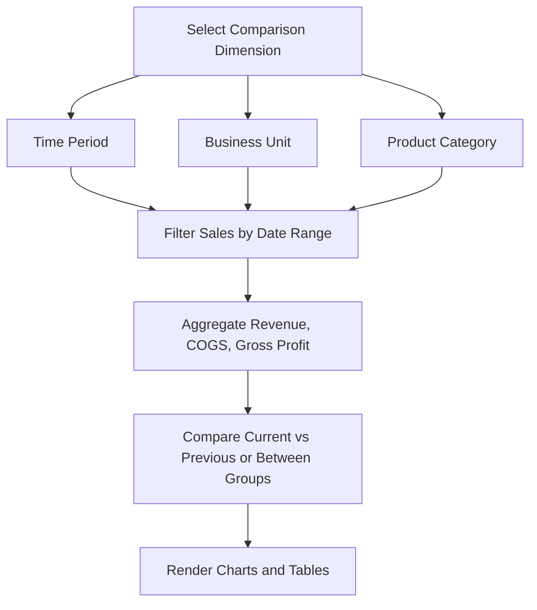
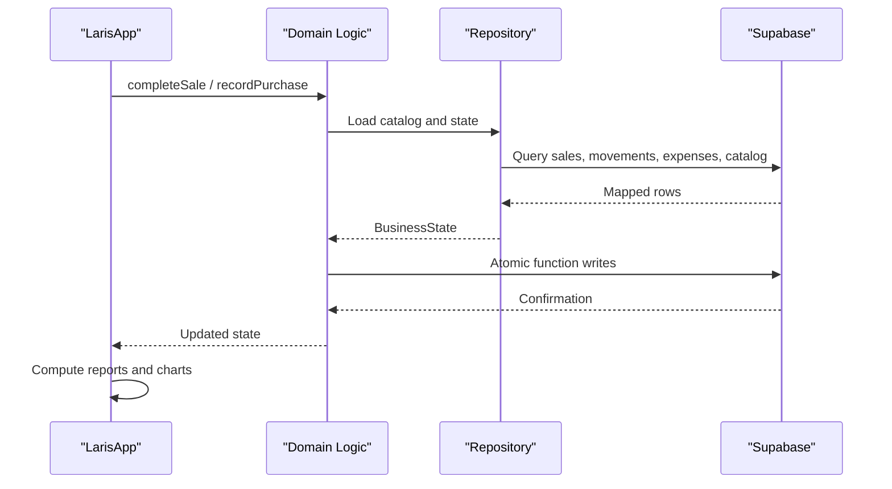
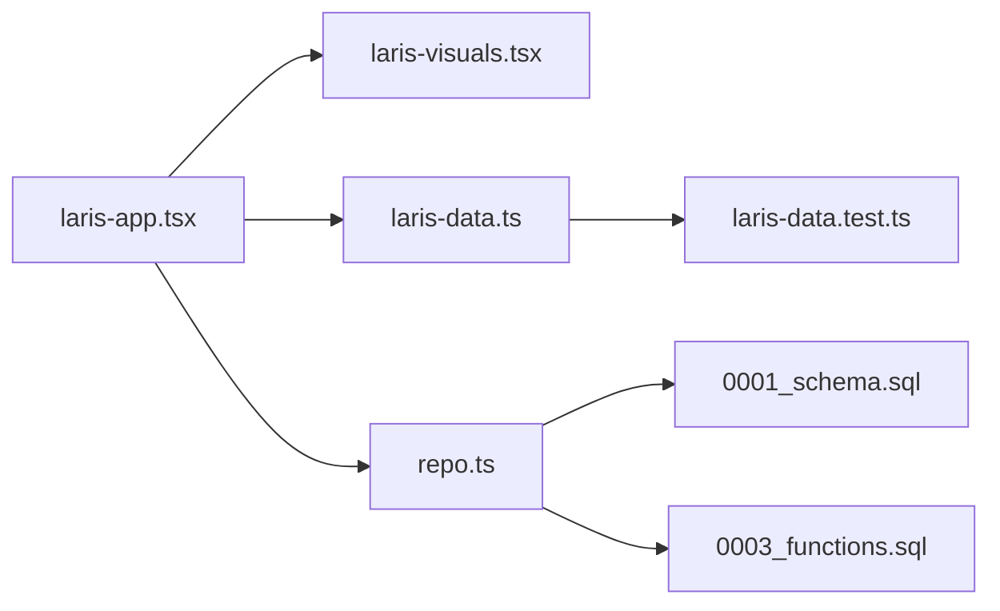

# Reporting Tools

<cite>
**Referenced Files in This Document**
- [README.md](file://README.md)
- [PRD_Laris_GTNIC2026.md](file://PRD_Laris_GTNIC2026.md)
- [laris-app.tsx](file://src/components/laris-app.tsx)
- [laris-visuals.tsx](file://src/components/laris-visuals.tsx)
- [laris-data.ts](file://src/lib/laris-data.ts)
- [repo.ts](file://src/lib/repo.ts)
- [0001_schema.sql](file://supabase/migrations/0001_schema.sql)
- [0003_functions.sql](file://supabase/migrations/0003_functions.sql)
</cite>

## Table of Contents
1. [Introduction](#introduction)
2. [Project Structure](#project-structure)
3. [Core Components](#core-components)
4. [Architecture Overview](#architecture-overview)
5. [Detailed Component Analysis](#detailed-component-analysis)
6. [Dependency Analysis](#dependency-analysis)
7. [Performance Considerations](#performance-considerations)
8. [Troubleshooting Guide](#troubleshooting-guide)
9. [Conclusion](#conclusion)

## Introduction
Laris is an operational workspace for Indonesian micro and small F&B businesses. It connects business accounts, POS, voice-to-cart ordering, recipes and inventory, purchasing, customers, financial reporting, team access, and AI assistance. The reporting tools sit at the intersection of daily operations and financial visibility: sales, cost of goods sold, expenses, stock movements, and dashboards that help owners understand revenue trends, profitability, and operational readiness.

The product requirements describe SAK EMKM-style financial statements as a finance goal, while the current implementation provides a management-oriented profit-and-loss summary, CSV export, dashboard charts, and audit-ready transactional functions. This document explains how those pieces connect, what is implemented today, and where future SAK EMKM reporting can extend from the existing data model.

**Section sources**
- [README.md:1-35](file://README.md#L1-L35)
- [PRD_Laris_GTNIC2026.md:23-31](file://PRD_Laris_GTNIC2026.md#L23-L31)
- [PRD_Laris_GTNIC2026.md:237-245](file://PRD_Laris_GTNIC2026.md#L237-L245)

## Project Structure
The reporting system spans UI components, domain logic, server-side repository mapping, and database schema/functions:

| Area | Responsibility | Key files |
|---|---|---|
| User interface | Navigation, finance view, CSV download, dashboard metrics | `src/components/laris-app.tsx` |
| Visualizations | Revenue chart, sparkline, trend indicators | `src/components/laris-visuals.tsx` |
| Domain model | Sale, expense, inventory, stock movement, CSV generation, demo seed | `src/lib/laris-data.ts` |
| Cloud snapshot | Mapping Supabase rows to Laris state, pagination, role-based loading | `src/lib/repo.ts` |
| Database schema | Tenancy, catalog, sales, payments, stock ledger, purchases, expenses, audit log | `supabase/migrations/0001_schema.sql` |
| Transactional functions | Atomic checkout, purchase recording, HPP refresh, audit logging | `supabase/migrations/0003_functions.sql` |

**Diagram sources**
- [laris-app.tsx:270-273](file://src/components/laris-app.tsx#L270-L273)
- [laris-app.tsx:1140-1140](file://src/components/laris-app.tsx#L1140-L1140)
- [laris-visuals.tsx:42-56](file://src/components/laris-visuals.tsx#L42-L56)
- [laris-data.ts:483-493](file://src/lib/laris-data.ts#L483-L493)
- [repo.ts:129-193](file://src/lib/repo.ts#L129-L193)
- [0001_schema.sql:153-249](file://supabase/migrations/0001_schema.sql#L153-L249)
- [0003_functions.sql:94-230](file://supabase/migrations/0003_functions.sql#L94-L230)

**Section sources**
- [README.md:97-110](file://README.md#L97-L110)
- [laris-app.tsx:35-41](file://src/components/laris-app.tsx#L35-L41)
- [laris-data.ts:40-110](file://src/lib/laris-data.ts#L40-L110)

## Core Components
This section focuses on the reporting-related building blocks:

- **Finance view**: Displays a simple profit-and-loss summary, operational controls, and expense listing. It also exposes CSV export.
- **CSV export**: Uses `exportSalesCsv` to generate a safe, quoted CSV with columns for sale identity, date, customer, menu summary, subtotal, discount, tax, total, payment method, cash received, channel, and status.
- **Dashboard visualizations**: Shows revenue trends over selected periods, previous-period comparison lines, and compact sparklines/trend indicators.
- **Operational-financial integration**: Sales reduce stock via recipe-based movements; purchases update moving-average cost and product cost; expenses are recorded separately; all critical writes go through atomic functions with audit logs.

**Section sources**
- [laris-app.tsx:1140-1140](file://src/components/laris-app.tsx#L1140-L1140)
- [laris-app.tsx:270-273](file://src/components/laris-app.tsx#L270-L273)
- [laris-visuals.tsx:42-56](file://src/components/laris-visuals.tsx#L42-L56)
- [laris-data.ts:476-493](file://src/lib/laris-data.ts#L476-L493)
- [0001_schema.sql:153-249](file://supabase/migrations/0001_schema.sql#L153-L249)
- [0003_functions.sql:94-303](file://supabase/migrations/0003_functions.sql#L94-L303)

## Architecture Overview
Reporting in Laris follows a layered flow:

1. Operational events (POS checkout, purchase, expense) create immutable records in the database.
2. A cloud snapshot maps those records into a unified `BusinessState`.
3. The UI computes period totals, gross profit, growth, and top products.
4. Charts render revenue trends and comparisons.
5. CSV export serializes sales into a secure spreadsheet-compatible format.

**Diagram sources**
- [laris-app.tsx:214-268](file://src/components/laris-app.tsx#L214-L268)
- [laris-app.tsx:270-273](file://src/components/laris-app.tsx#L270-L273)
- [0003_functions.sql:94-230](file://supabase/migrations/0003_functions.sql#L94-L230)
- [0001_schema.sql:153-249](file://supabase/migrations/0001_schema.sql#L153-L249)

## Detailed Component Analysis

### SAK EMKM-Style Financial Statement Generation
The product requirements define SAK EMKM Profit & Loss, cash flow, and balance sheet as finance goals. The current implementation provides a management-oriented profit-and-loss summary rather than a full statutory SAK EMKM report.

What exists today:
- Revenue from sales.
- Cost of goods sold derived from product costs and recipes.
- Gross profit.
- Daily operating expenses.
- Net profit after subtracting operating expenses.
- A disclaimer stating this is a management summary, not a complete SAK EMKM report.

Where SAK EMKM reporting can extend:
- Formalize income statement line items per SAK EMKM guidance.
- Add cash flow classification: operating, investing, financing.
- Add a simplified balance sheet with assets, liabilities, and equity.
- Map database tables to EMKM categories:
  - Revenue → sales orders.
  - COGS → recipe-based product costs and stock movements.
  - Operating expenses → expense table.
  - Inventory valuation → stock ledger and moving-average cost.
  - Taxes → tax column and future tax estimation features.

**Diagram sources**
- [laris-app.tsx:1140-1140](file://src/components/laris-app.tsx#L1140-L1140)
- [laris-data.ts:215-305](file://src/lib/laris-data.ts#L215-L305)
- [0001_schema.sql:153-249](file://supabase/migrations/0001_schema.sql#L153-L249)
- [0003_functions.sql:94-303](file://supabase/migrations/0003_functions.sql#L94-L303)

**Section sources**
- [PRD_Laris_GTNIC2026.md:237-245](file://PRD_Laris_GTNIC2026.md#L237-L245)
- [laris-app.tsx:1140-1140](file://src/components/laris-app.tsx#L1140-L1140)

### CSV Export Through `exportSalesCsv`
The CSV export workflow starts in the UI and delegates serialization to `exportSalesCsv`.

Key behaviors:
- The UI creates a UTF-8 Blob with a BOM (`\uFEFF`) so Excel opens it correctly.
- The filename includes the active date.
- Each sale becomes one row with 12 columns.
- Every cell is safely quoted.
- Values that could be interpreted as formulas are prefixed with a single quote to prevent formula injection.
- Quotes inside values are escaped by doubling them.
- Row separators use CRLF for spreadsheet compatibility.

Field mappings:
| Column | Meaning | Source |
|---|---|---|
| ID | Sale identifier | `sale.id` |
| Tanggal | Sale timestamp | `sale.createdAt` |
| Pelanggan | Customer name | `sale.customerName` |
| Menu | Quantity, product name, optional note | `sale.items` mapped to product names |
| Subtotal | Pre-discount total | `sale.subtotal` |
| Diskon | Applied discount | `sale.discount` |
| Pajak | Tax amount | `sale.tax` |
| Total | Final payable amount | `sale.total` |
| Pembayaran | Payment method | `sale.payment` |
| Uang diterima | Cash received | `sale.cashReceived` |
| Kanal | Channel | `sale.channel` |
| Status | Sale status | `sale.status` |

Security considerations:
- All cells are wrapped in double quotes.
- Values starting with characters commonly used in spreadsheet formulas (`=`, `+`, `-`, `@`) are prefixed with a single quote.
- Leading whitespace, control characters, zero-width characters, and directional marks are treated as potentially dangerous and receive the same protection.
- Tests verify that formula-like strings, control-character prefixes, and embedded commas, quotes, and newlines round-trip safely.

**Diagram sources**
- [laris-app.tsx:270-273](file://src/components/laris-app.tsx#L270-L273)
- [laris-data.ts:476-493](file://src/lib/laris-data.ts#L476-L493)

**Section sources**
- [laris-app.tsx:270-273](file://src/components/laris-app.tsx#L270-L273)
- [laris-data.ts:476-493](file://src/lib/laris-data.ts#L476-L493)

### Dashboard Visualizations
The dashboard presents financial data through:
- KPI-style summaries such as revenue, transactions, average ticket, gross margin, and growth versus the previous period.
- A revenue chart showing current-period values and a dashed previous-period comparison line.
- Sparklines and trend indicators for compact metric display.

Data preparation:
- Period selection determines whether the range is today, the last 7 days, or the last 30 days.
- Previous-period sales are computed using the same length window before the current range.
- Chart dates are generated relative to the active day.
- Chart values aggregate sales within each chart date window.
- Previous chart values align with the same historical offsets.

Visual behavior:
- The revenue chart scales to the maximum value across current and previous series.
- Hover points show formatted currency values.
- Labels use localized date formatting.

**Diagram sources**
- [laris-app.tsx:190-204](file://src/components/laris-app.tsx#L190-L204)
- [laris-visuals.tsx:42-56](file://src/components/laris-visuals.tsx#L42-L56)

**Section sources**
- [laris-app.tsx:190-204](file://src/components/laris-app.tsx#L190-L204)
- [laris-visuals.tsx:42-56](file://src/components/laris-visuals.tsx#L42-L56)

### Comparative Analysis Tools
Comparative analysis is currently implemented around time periods:
- Current period vs previous period revenue.
- Growth percentage calculation.
- Weekly vs monthly chart windows.
- Top products aggregated over the selected range.

Limitations and extension points:
- There is no explicit side-by-side comparison UI for different business units or product categories in the analyzed code.
- Future comparative tools can reuse the same filtering pattern:
  - Business unit → filter by outlet.
  - Product category → filter by product category.
  - Time period → reuse range-day logic.
  - Metrics → reuse sum, cost, gross, and growth calculations.

[No sources needed since this diagram shows conceptual workflow, not actual code structure]

**Section sources**
- [laris-app.tsx:190-204](file://src/components/laris-app.tsx#L190-L204)
- [laris-app.tsx:197-197](file://src/components/laris-app.tsx#L197-L197)

### Practical Examples

#### Report Customization
- Use the finance view to inspect today’s revenue, HPP, gross profit, operating expenses, and net profit.
- Use the assistant responses to read summarized revenue, margin, and top-menu insights based on the selected period.
- Use the operational controls to track menu coverage, low-stock risk, and daily target progress.

#### Date Range Selection
- The application supports “today,” “week,” and “month” ranges.
- Chart mode supports weekly and monthly aggregation windows.
- Range boundaries are calculated relative to the active day.

#### Data Export Workflow
1. Open the finance or transactions view.
2. Click the CSV export button.
3. The browser downloads a UTF-8 CSV file with a BOM.
4. Open the file in Excel or another spreadsheet tool.
5. Verify that sensitive or unusual text values are displayed as text, not executed as formulas.

**Section sources**
- [laris-app.tsx:190-204](file://src/components/laris-app.tsx#L190-L204)
- [laris-app.tsx:270-273](file://src/components/laris-app.tsx#L270-L273)
- [laris-app.tsx:1140-1140](file://src/components/laris-app.tsx#L1140-L1140)

### Integration Between Operational Data and Financial Reporting
Operational events feed financial reporting through a strict ledger model:

- Sales:
  - Validate cart, prices, discounts, taxes, payment method, and cash received.
  - Check ingredient availability against stock movements.
  - Record sales order, order items, payment, and stock deductions.
  - Update customer visit history when phone is provided.
  - Write an audit log entry.

- Purchases:
  - Validate lines, supplier, source, and amounts.
  - Update moving-average cost per inventory item.
  - Record purchase lines and stock-in movements.
  - Refresh cached recipe cost.
  - Write an audit log entry.

- Expenses:
  - Recorded separately from sales and purchases.
  - Used in the management profit-and-loss summary.

- Audit trail:
  - Critical actions write to `audit_log`.
  - Repository mapping loads recent activities for authorized roles.

**Diagram sources**
- [laris-app.tsx:214-268](file://src/components/laris-app.tsx#L214-L268)
- [laris-data.ts:215-334](file://src/lib/laris-data.ts#L215-L334)
- [repo.ts:129-193](file://src/lib/repo.ts#L129-L193)
- [0003_functions.sql:94-303](file://supabase/migrations/0003_functions.sql#L94-L303)

**Section sources**
- [0001_schema.sql:153-249](file://supabase/migrations/0001_schema.sql#L153-L249)
- [0003_functions.sql:94-303](file://supabase/migrations/0003_functions.sql#L94-L303)
- [repo.ts:129-193](file://src/lib/repo.ts#L129-L193)

## Dependency Analysis
The reporting pipeline depends on several layers:

**Diagram sources**
- [laris-app.tsx:14-25](file://src/components/laris-app.tsx#L14-L25)
- [laris-data.ts:483-493](file://src/lib/laris-data.ts#L483-L493)
- [repo.ts:1-10](file://src/lib/repo.ts#L1-L10)
- [0001_schema.sql:1-10](file://supabase/migrations/0001_schema.sql#L1-L10)
- [0003_functions.sql:1-7](file://supabase/migrations/0003_functions.sql#L1-L7)

Coupling and cohesion:
- `laris-app.tsx` owns UI state, navigation, and report rendering but delegates CSV serialization to `laris-data.ts`.
- `laris-data.ts` centralizes domain types, calculations, and CSV safety logic.
- `repo.ts` isolates Supabase mapping and pagination from UI logic.
- Database schema and functions enforce tenancy, validation, and auditability.

Potential circular dependencies:
- No direct circular imports are visible between the analyzed modules.
- UI depends on domain and visuals; domain does not import UI.
- Repository depends on domain types but not on UI.

External dependencies and integration points:
- Supabase authentication and membership determine access.
- Supabase RLS and security-definer functions protect ledger writes.
- Browser APIs handle CSV blob creation and download.

**Section sources**
- [laris-app.tsx:14-25](file://src/components/laris-app.tsx#L14-L25)
- [laris-data.ts:483-493](file://src/lib/laris-data.ts#L483-L493)
- [repo.ts:1-10](file://src/lib/repo.ts#L1-L10)
- [0001_schema.sql:1-10](file://supabase/migrations/0001_schema.sql#L1-L10)
- [0003_functions.sql:1-7](file://supabase/migrations/0003_functions.sql#L1-L7)

## Performance Considerations
- CSV export iterates all sales once and builds rows in memory. For very large datasets, consider streaming or server-side export.
- Chart computation aggregates sales per date window; precomputing chart buckets can reduce repeated filtering.
- Repository uses paginated fetches with a page size of 1000 to avoid loading entire tables in one request.
- Moving-average cost and HPP refresh run during purchase recording; batch updates should avoid excessive recalculations.
- UI memoization reduces recomputation for categories, top products, and chart values.

[No sources needed since this section provides general guidance]

## Troubleshooting Guide
Common issues and resolutions:

| Issue | Likely Cause | Resolution |
|---|---|---|
| CSV opens with garbled text in Excel | Missing BOM or wrong encoding | Ensure the exported Blob uses UTF-8 with a BOM. |
| Spreadsheet executes formulas from exported data | Unsafe raw values | Verify that `csvCell` quotes and neutralizes formula-like inputs. |
| Empty CSV has only headers | No sales in state | Confirm sales exist before exporting. |
| Finance view shows only management summary | Full SAK EMKM not yet implemented | Treat the view as a management summary; plan EMKM mapping later. |
| Reports do not reflect latest cloud data | Snapshot not refreshed or network error | Recheck cloud connection and reload the workspace snapshot. |
| Stock deduction fails | Insufficient ingredients | Review recipe quantities and current stock levels. |
| Purchase cost changes unexpectedly | Moving-average cost recalculation | Verify purchase quantity, total, and prior stock level. |

**Section sources**
- [laris-data.ts:476-493](file://src/lib/laris-data.ts#L476-L493)
- [laris-app.tsx:270-273](file://src/components/laris-app.tsx#L270-L273)
- [laris-app.tsx:1140-1140](file://src/components/laris-app.tsx#L1140-L1140)
- [0003_functions.sql:164-179](file://supabase/migrations/0003_functions.sql#L164-L179)
- [0003_functions.sql:272-297](file://supabase/migrations/0003_functions.sql#L272-L297)

## Conclusion
Laris’ reporting tools currently provide a practical bridge between daily operations and financial visibility. Sales, purchases, expenses, and stock movements are captured in a structured, auditable way. The finance view offers a clear management profit-and-loss summary, while CSV export delivers a safe, spreadsheet-compatible sales report. Dashboards visualize revenue trends and comparisons across time periods.

For full SAK EMKM compliance, the existing schema and transactional functions form a strong foundation. Future work should map these operational records to formal EMKM statements, add cash flow and balance sheet views, and extend comparative analysis to business units and product categories. Until then, users should treat the finance view as a management summary and rely on the CSV export and audit logs for verification and external reporting workflows.

[No sources needed since this section summarizes without analyzing specific files]