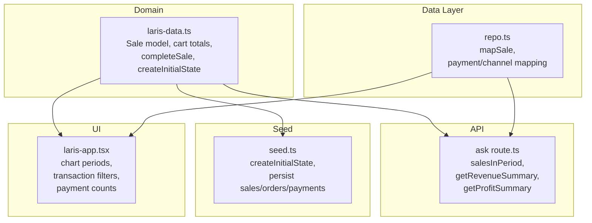
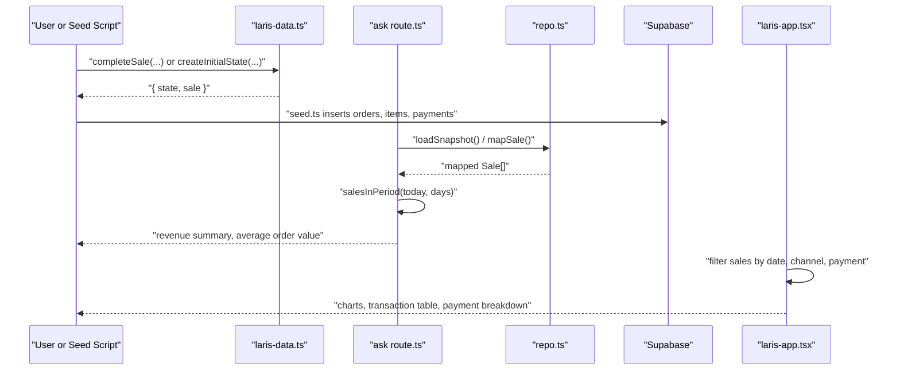
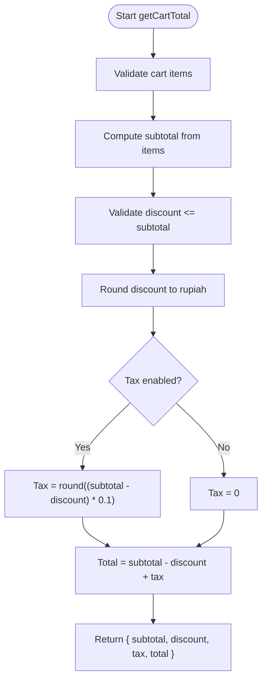
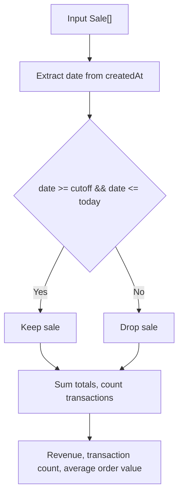
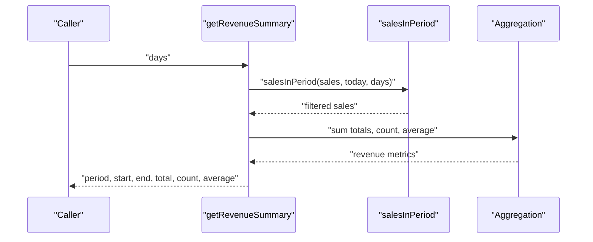
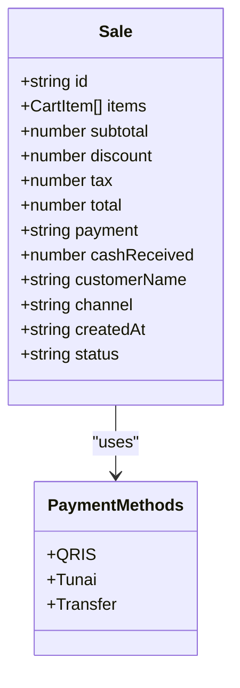
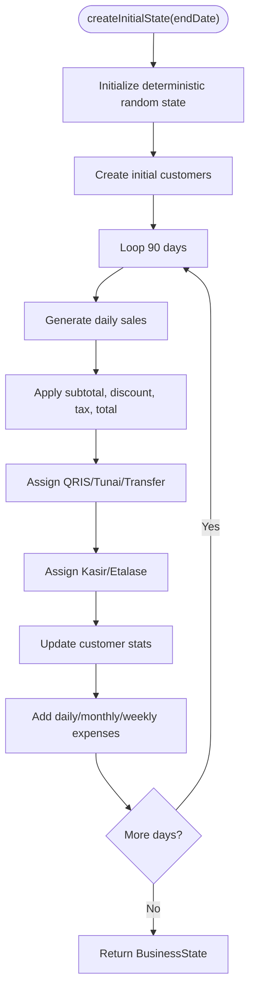
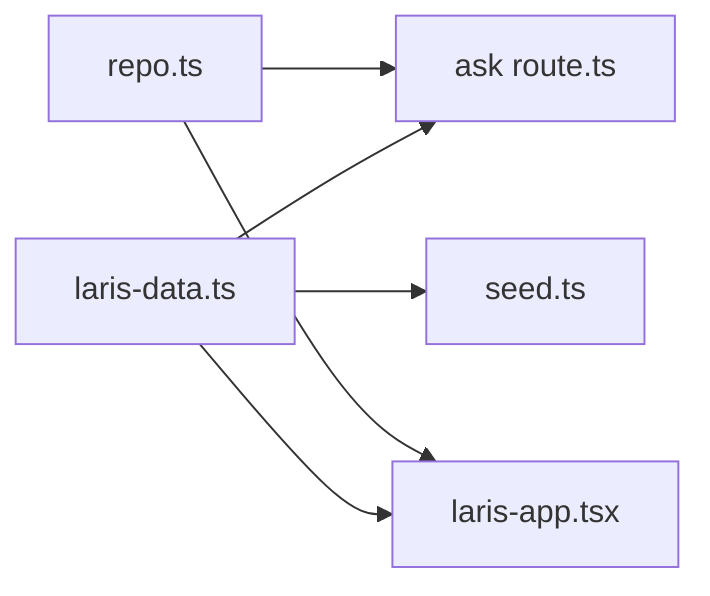

# Revenue Tracking

<cite>
**Referenced Files in This Document**
- [laris-data.ts](file://src/lib/laris-data.ts)
- [ask route.ts](file://src/app/api/ai/ask/route.ts)
- [repo.ts](file://src/lib/repo.ts)
- [seed.ts](file://scripts/seed.ts)
- [laris-app.tsx](file://src/components/laris-app.tsx)
- [README.md](file://README.md)
</cite>

## Table of Contents
1. [Introduction](#introduction)
2. [Project Structure](#project-structure)
3. [Core Components](#core-components)
4. [Architecture Overview](#architecture-overview)
5. [Detailed Component Analysis](#detailed-component-analysis)
6. [Dependency Analysis](#dependency-analysis)
7. [Performance Considerations](#performance-considerations)
8. [Troubleshooting Guide](#troubleshooting-guide)
9. [Conclusion](#conclusion)

## Introduction
This document explains how Laris tracks revenue from the `Sale` interface and turns it into daily summaries, trend analysis, channel breakdowns, and payment method distributions. It also documents deterministic seed data that creates a realistic 90-day sales history for demonstration purposes.

The system supports:
- Daily subtotal, discount, tax, and total calculations.
- Revenue trends across configurable time windows.
- Channel reporting between `Kasir` (cashier) and `Etalase` (display).
- Payment method reporting for `QRIS`, `Tunai` (cash), and `Transfer`.
- Practical metrics such as average transaction value and conversion-oriented counts.
- A deterministic seed generator producing 90 days of sales ending on a fixed demo date.

## Project Structure
Revenue tracking is implemented across three main layers:
- Domain model and deterministic seed logic live in the domain library.
- The AI assistant exposes tools that compute revenue summaries over date ranges.
- The UI filters and aggregates sales for charts, transaction tables, and summary cards.
- The seed script persists the generated state into the database for cloud demos.

**Diagram sources**
- [laris-data.ts:40-53](file://src/lib/laris-data.ts#L40-L53)
- [laris-data.ts:178-194](file://src/lib/laris-data.ts#L178-L194)
- [laris-data.ts:337-404](file://src/lib/laris-data.ts#L337-L404)
- [ask route.ts:18-25](file://src/app/api/ai/ask/route.ts#L18-L25)
- [ask route.ts:96-114](file://src/app/api/ai/ask/route.ts#L96-L114)
- [repo.ts:18-38](file://src/lib/repo.ts#L18-L38)
- [seed.ts:30-107](file://scripts/seed.ts#L30-L107)
- [laris-app.tsx:197-203](file://src/components/laris-app.tsx#L197-L203)
- [laris-app.tsx:952-1018](file://src/components/laris-app.tsx#L952-L1018)

**Section sources**
- [README.md:24-35](file://README.md#L24-L35)
- [README.md:97-110](file://README.md#L97-L110)

## Core Components
The revenue system centers on the `Sale` interface and functions that calculate totals, filter by date range, and aggregate business metrics.

Key elements:
- `Sale`: stores items, subtotal, discount, tax, total, payment method, cash received, customer name, channel, creation timestamp, and status.
- `getCartTotal`: computes subtotal, rounded discount, optional restaurant tax, and final total.
- `completeSale`: validates inputs, calculates totals, enforces stock and payment rules, and returns a persisted sale record.
- `createInitialState`: generates deterministic 90-day sales with realistic product mix, discounts, payments, channels, and customers.
- `salesInPeriod`: filters sales by a rolling day window anchored to today.
- `mapSale`: maps database rows back to the `Sale` interface, normalizing payment and channel values.

**Section sources**
- [laris-data.ts:40-53](file://src/lib/laris-data.ts#L40-L53)
- [laris-data.ts:178-194](file://src/lib/laris-data.ts#L178-L194)
- [laris-data.ts:215-305](file://src/lib/laris-data.ts#L215-L305)
- [laris-data.ts:337-404](file://src/lib/laris-data.ts#L337-L404)
- [ask route.ts:18-25](file://src/app/api/ai/ask/route.ts#L18-L25)
- [repo.ts:18-38](file://src/lib/repo.ts#L18-L38)

## Architecture Overview
Revenue flows through these stages:
1. Sales are created either interactively via `completeSale` or deterministically via `createInitialState`.
2. Each sale records subtotal, discount, tax, total, payment method, channel, and timestamp.
3. The AI API exposes tools that filter sales by period and compute revenue metrics.
4. The UI renders charts and transaction tables using the same `Sale` fields.
5. The seed script persists the generated state into Supabase tables for cloud demonstrations.

**Diagram sources**
- [laris-data.ts:215-305](file://src/lib/laris-data.ts#L215-L305)
- [laris-data.ts:337-404](file://src/lib/laris-data.ts#L337-L404)
- [seed.ts:30-107](file://scripts/seed.ts#L30-L107)
- [repo.ts:129-193](file://src/lib/repo.ts#L129-L193)
- [ask route.ts:96-114](file://src/app/api/ai/ask/route.ts#L96-L114)
- [laris-app.tsx:197-203](file://src/components/laris-app.tsx#L197-L203)
- [laris-app.tsx:952-1018](file://src/components/laris-app.tsx#L952-L1018)

## Detailed Component Analysis

### Sale Model and Totals
The `Sale` interface captures all financial fields needed for revenue tracking:
- `subtotal`: sum of item prices before discount.
- `discount`: rounded discount applied after subtotal validation.
- `tax`: optional restaurant tax calculated after discount.
- `total`: final payable amount.
- `payment`: one of `Tunai`, `QRIS`, or `Transfer`.
- `channel`: one of `Kasir` or `Etalase`.
- `createdAt`: timestamp used for daily and periodic aggregation.
- `status`: always `Lunas` in this implementation.

`getCartTotal` implements the core calculation:
- Subtotal is computed from catalog prices and quantities.
- Discount is validated against subtotal and rounded to whole rupiah.
- Tax is enabled optionally and calculated as 10% of discounted subtotal.
- Total equals discounted subtotal plus tax.

**Diagram sources**
- [laris-data.ts:178-194](file://src/lib/laris-data.ts#L178-L194)

**Section sources**
- [laris-data.ts:40-53](file://src/lib/laris-data.ts#L40-L53)
- [laris-data.ts:178-194](file://src/lib/laris-data.ts#L178-L194)

### Daily Sales Summary Generation
Daily summaries are produced by filtering sales by their date portion and aggregating totals. The same pattern is used in multiple places:
- The AI tool uses `salesInPeriod` to compute revenue for a given number of days.
- The UI builds chart series by comparing current and previous periods.
- Transaction views filter by payment method and query text.

**Diagram sources**
- [ask route.ts:18-25](file://src/app/api/ai/ask/route.ts#L18-L25)
- [laris-app.tsx:197-203](file://src/components/laris-app.tsx#L197-L203)
- [laris-app.tsx:952-962](file://src/components/laris-app.tsx#L952-L962)

**Section sources**
- [ask route.ts:18-25](file://src/app/api/ai/ask/route.ts#L18-L25)
- [laris-app.tsx:197-203](file://src/components/laris-app.tsx#L197-L203)
- [laris-app.tsx:952-962](file://src/components/laris-app.tsx#L952-L962)

### Revenue Trend Analysis Across Time Periods
The AI assistant provides a `getRevenueSummary` tool that accepts a day count and returns:
- Start and end dates.
- Total revenue.
- Transaction count.
- Average order value.

The UI supports two chart modes:
- Weekly view: seven consecutive days.
- Monthly-like view: five points spaced every five days within a longer window.

For each point, the UI compares current-period sales with the corresponding previous period to show growth behavior.

**Diagram sources**
- [ask route.ts:96-114](file://src/app/api/ai/ask/route.ts#L96-L114)
- [ask route.ts:18-25](file://src/app/api/ai/ask/route.ts#L18-L25)

**Section sources**
- [ask route.ts:96-114](file://src/app/api/ai/ask/route.ts#L96-L114)
- [laris-app.tsx:197-203](file://src/components/laris-app.tsx#L197-L203)

### Channel Breakdown: Kasir vs Etalase
Channel values are normalized when loading from the database:
- Database channel `kasir` maps to `Kasir`.
- Any other channel maps to `Etalase`.

When creating sales interactively, the default channel is `Kasir`, but callers can explicitly set `Etalase`. The seed generator assigns `Etalase` approximately 18% of the time.

Practical usage:
- Filter sales by `sale.channel === "Kasir"` or `sale.channel === "Etalase"`.
- Compare channel-specific revenue and transaction counts.
- Use channel data to understand whether display-driven sales differ from cashier-driven sales.

**Section sources**
- [repo.ts:32-34](file://src/lib/repo.ts#L32-L34)
- [laris-data.ts:244-245](file://src/lib/laris-data.ts#L244-L245)
- [laris-data.ts:374](file://src/lib/laris-data.ts#L374)

### Payment Method Breakdown: QRIS, Tunai, Transfer
Payment methods are strongly typed as `Tunai`, `QRIS`, or `Transfer`. The database layer normalizes lowercase method names to these values.

Distribution in the seed generator:
- Approximately 66% `QRIS`.
- Approximately 26% `Tunai`.
- Remaining share `Transfer`.

UI transaction view counts:
- Non-cash orders: `QRIS` + `Transfer`.
- Cash orders: `Tunai`.
- Total filtered transaction count and average transaction value are shown alongside the filtered total.

**Diagram sources**
- [laris-data.ts:40-53](file://src/lib/laris-data.ts#L40-L53)
- [repo.ts:18-38](file://src/lib/repo.ts#L18-L38)
- [laris-data.ts:370-374](file://src/lib/laris-data.ts#L370-L374)
- [laris-app.tsx:952-1018](file://src/components/laris-app.tsx#L952-L1018)

**Section sources**
- [laris-data.ts:40-53](file://src/lib/laris-data.ts#L40-L53)
- [repo.ts:18-38](file://src/lib/repo.ts#L18-L38)
- [laris-data.ts:370-374](file://src/lib/laris-data.ts#L370-L374)
- [laris-app.tsx:952-1018](file://src/components/laris-app.tsx#L952-L1018)

### Practical Examples of Revenue Calculation Functions

#### Example 1: Calculating Cart Totals
Use `getCartTotal` to compute subtotal, discount, tax, and total for any cart:
- Pass an array of cart items.
- Optionally pass a discount amount.
- Optionally enable tax.
- The function returns structured totals suitable for checkout and reporting.

Reference path: `[laris-data.ts:178-194](file://src/lib/laris-data.ts#L178-L194)`

#### Example 2: Creating a Sale with Totals
Use `completeSale` to validate and persist a sale:
- Items are validated against the catalog.
- Totals are computed using `getCartTotal`.
- Payment method and channel are validated.
- Cash received is validated for `Tunai`.
- Stock availability is checked before committing.

Reference path: `[laris-data.ts:215-305](file://src/lib/laris-data.ts#L215-L305)`

#### Example 3: Filtering Sales by Date Range
Use `salesInPeriod` to select sales within a rolling window:
- Provide the full sales list.
- Provide today’s date string.
- Provide the number of days.
- Returns only sales whose date falls within the cutoff-to-today range.

Reference path: `[ask route.ts:18-25](file://src/app/api/ai/ask/route.ts#L18-L25)`

#### Example 4: Computing Average Transaction Value
Average transaction value is computed by dividing total revenue by transaction count:
- If there are no transactions, the result is zero.
- This metric helps compare performance across periods.

Reference path: `[ask route.ts:102-114](file://src/app/api/ai/ask/route.ts#L102-L114)`

#### Example 5: Channel and Payment Filters in the UI
The UI filters transactions by payment method and query text, then computes:
- Filtered total revenue.
- Filtered average transaction value.
- Counts for `QRIS`, `Tunai`, and `Transfer`.
- Non-cash order count as `QRIS` + `Transfer`.

Reference path: `[laris-app.tsx:952-1018](file://src/components/laris-app.tsx#L952-L1018)`

**Section sources**
- [laris-data.ts:178-194](file://src/lib/laris-data.ts#L178-L194)
- [laris-data.ts:215-305](file://src/lib/laris-data.ts#L215-L305)
- [ask route.ts:18-25](file://src/app/api/ai/ask/route.ts#L18-L25)
- [ask route.ts:102-114](file://src/app/api/ai/ask/route.ts#L102-L114)
- [laris-app.tsx:952-1018](file://src/components/laris-app.tsx#L952-L1018)

### Deterministic Seed Data Generator
`createInitialState` generates a deterministic 90-day sales history ending on a specified date:
- Uses a seeded random function so results are reproducible.
- Generates products based on a weighted menu distribution.
- Applies discounts roughly 12% of the time.
- Assigns payment methods with realistic proportions.
- Assigns channels with `Etalase` occurring less frequently than `Kasir`.
- Updates customer visits, total spent, points, and last visit.
- Adds daily expenses, monthly rent/salary/utilities, and weekly operational costs.

The seed script then persists this state into Supabase:
- Business, outlet, membership, supplier, inventory, product, recipe lines.
- Opening stock movements.
- Customers.
- Sales orders, order items, and payments.
- Expenses.

**Diagram sources**
- [laris-data.ts:337-404](file://src/lib/laris-data.ts#L337-L404)
- [seed.ts:30-107](file://scripts/seed.ts#L30-L107)

**Section sources**
- [laris-data.ts:337-404](file://src/lib/laris-data.ts#L337-L404)
- [seed.ts:30-107](file://scripts/seed.ts#L30-L107)

## Dependency Analysis
Revenue tracking depends on consistent mapping between domain models and database rows.

**Diagram sources**
- [laris-data.ts:40-53](file://src/lib/laris-data.ts#L40-L53)
- [ask route.ts:18-25](file://src/app/api/ai/ask/route.ts#L18-L25)
- [repo.ts:18-38](file://src/lib/repo.ts#L18-L38)
- [seed.ts:30-107](file://scripts/seed.ts#L30-L107)
- [laris-app.tsx:197-203](file://src/components/laris-app.tsx#L197-L203)

Key relationships:
- `laris-data.ts` defines the canonical `Sale` contract.
- `repo.ts` maps database rows to `Sale`, ensuring payment and channel values match the domain model.
- `ask route.ts` consumes `Sale[]` to compute revenue summaries.
- `laris-app.tsx` consumes `Sale[]` for visualization and filtering.
- `seed.ts` uses `createInitialState` to generate persistent demo data.

**Section sources**
- [laris-data.ts:40-53](file://src/lib/laris-data.ts#L40-L53)
- [repo.ts:18-38](file://src/lib/repo.ts#L18-L38)
- [ask route.ts:18-25](file://src/app/api/ai/ask/route.ts#L18-L25)
- [seed.ts:30-107](file://scripts/seed.ts#L30-L107)
- [laris-app.tsx:197-203](file://src/components/laris-app.tsx#L197-L203)

## Performance Considerations
- Date filtering is performed by slicing the `createdAt` timestamp string, which is simple but scans the full sales array. For very large datasets, consider indexing by date or pre-aggregating daily totals.
- Chart generation computes both current and previous periods; avoid recomputation by caching period slices if the dataset grows significantly.
- Payment and channel counts are linear scans over filtered sales; grouping once per view render is acceptable for typical POS workloads.
- The seed generator creates deterministic data efficiently, but running it repeatedly against production databases should be avoided outside development.

[No sources needed since this section provides general guidance]

## Troubleshooting Guide
Common issues and where they originate:
- Invalid payment method: thrown when payment is not `Tunai`, `QRIS`, or `Transfer`.
- Invalid channel: thrown when channel is not `Kasir` or `Etalase`.
- Insufficient cash: thrown for `Tunai` when cash received is less than total.
- Empty cart: rejected separately during checkout completion.
- Unknown menu or ingredient: thrown when product or inventory lookup fails.
- Negative or invalid amounts: validated through helper assertions.

These validations ensure that revenue numbers remain consistent and auditable.

**Section sources**
- [laris-data.ts:155-170](file://src/lib/laris-data.ts#L155-L170)
- [laris-data.ts:243-250](file://src/lib/laris-data.ts#L243-L250)
- [laris-data.ts:271-276](file://src/lib/laris-data.ts#L271-L276)

## Conclusion
Laris’ revenue tracking is built around a clear `Sale` model and deterministic calculations. Daily summaries come from straightforward date-based filtering and aggregation. Trends are exposed through AI tools and UI charts, while channel and payment breakdowns provide actionable segmentation. The deterministic seed generator supplies realistic historical data for demonstration, and the database mapping ensures consistency between local and cloud environments.

[No sources needed since this section summarizes without analyzing specific files]