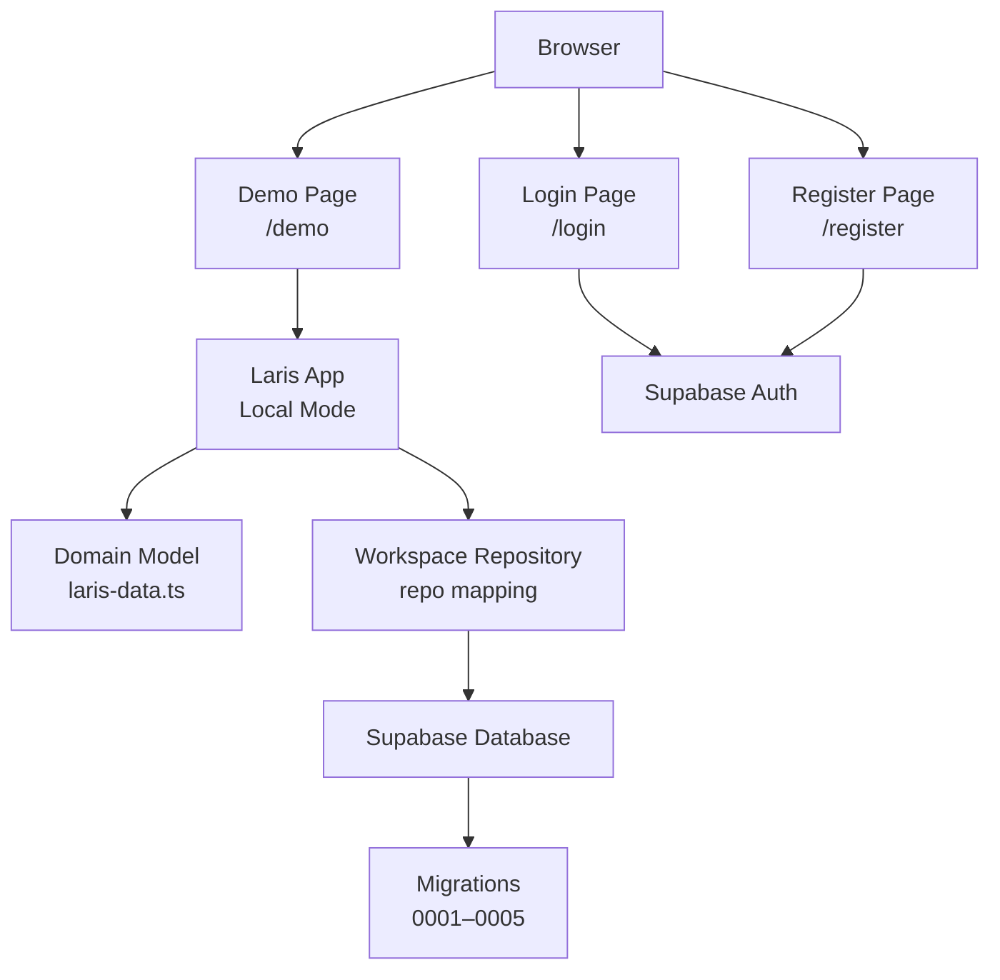
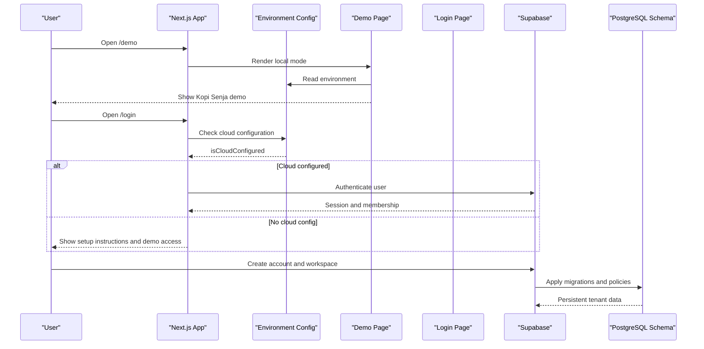
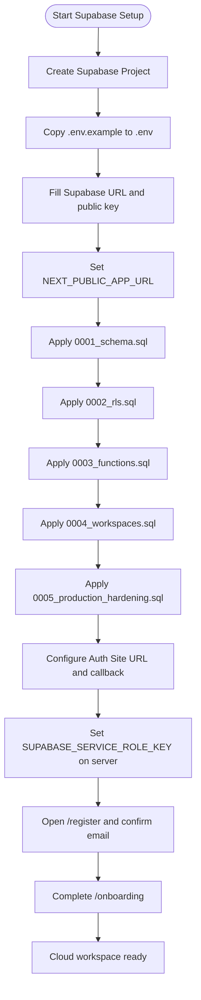
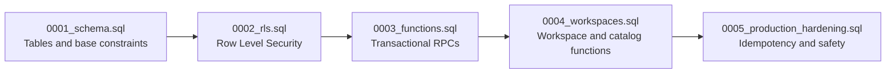
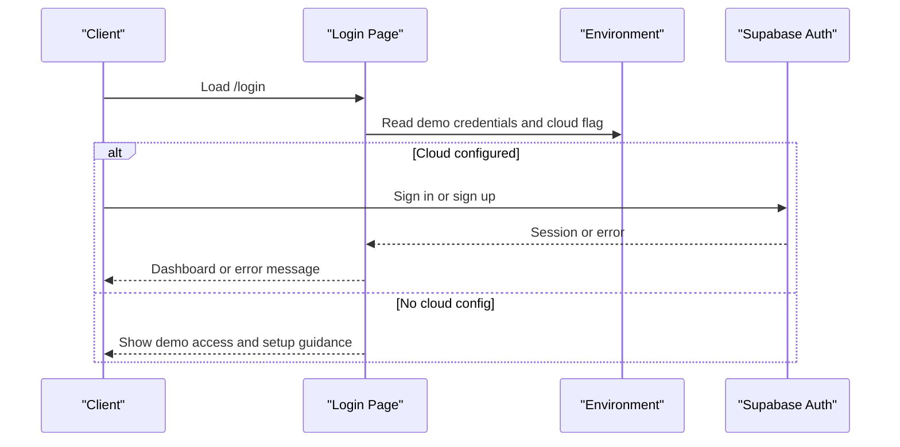
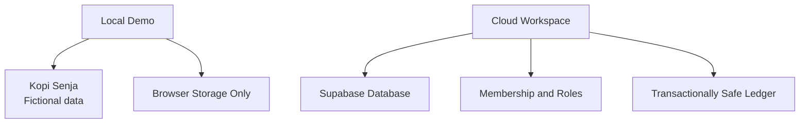
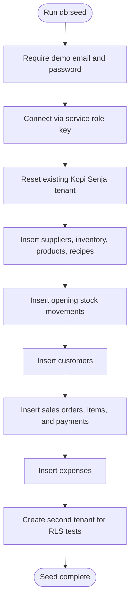
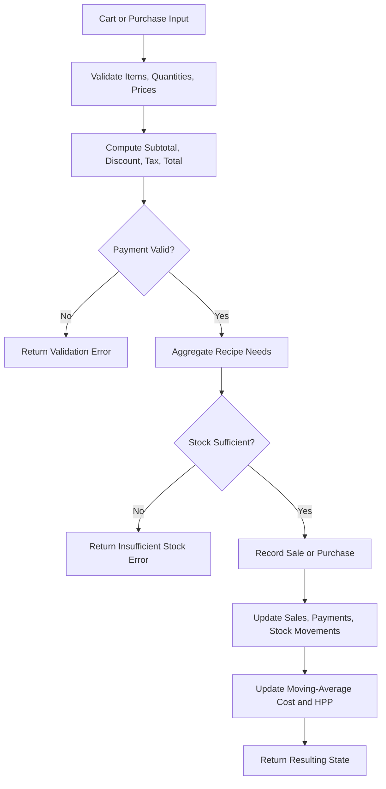
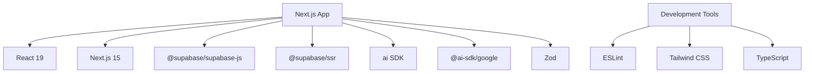

# Getting Started

<cite>
**Referenced Files in This Document**
- [README.md](file://README.md)
- [package.json](file://package.json)
- [.env.example](file://.env.example)
- [src/lib/env.ts](file://src/lib/env.ts)
- [src/app/demo/page.tsx](file://src/app/demo/page.tsx)
- [src/app/login/page.tsx](file://src/app/login/page.tsx)
- [src/app/register/page.tsx](file://src/app/register/page.tsx)
- [src/lib/laris-data.ts](file://src/lib/laris-data.ts)
- [scripts/seed.ts](file://scripts/seed.ts)
- [supabase/migrations/0001_schema.sql](file://supabase/migrations/0001_schema.sql)
- [supabase/migrations/0002_rls.sql](file://supabase/migrations/0002_rls.sql)
- [supabase/migrations/0003_functions.sql](file://supabase/migrations/0003_functions.sql)
- [supabase/migrations/0004_workspaces.sql](file://supabase/migrations/0004_workspaces.sql)
- [supabase/migrations/0005_production_hardening.sql](file://supabase/migrations/0005_production_hardening.sql)
</cite>

## Table of Contents
1. [Introduction](#introduction)
2. [Project Structure](#project-structure)
3. [Core Components](#core-components)
4. [Architecture Overview](#architecture-overview)
5. [Detailed Component Analysis](#detailed-component-analysis)
6. [Dependency Analysis](#dependency-analysis)
7. [Performance Considerations](#performance-considerations)
8. [Troubleshooting Guide](#troubleshooting-guide)
9. [Conclusion](#conclusion)

## Introduction
Laris is an AI-native business operating system designed for Indonesian F&B UMKM. Its core purpose is to replace scattered notebooks and WhatsApp chats with a unified workspace that connects accounting, cashier POS, voice-to-cart ordering in Bahasa Indonesia, recipes and stock, purchasing, customers, financial reporting, team roles, and an AI copilot.

The repository supports two modes:
- Local demo mode at `/demo`, which uses fictional Kopi Senja data stored only in the browser.
- Cloud mode backed by Supabase, which provides persistent accounts, workspaces, RLS-protected tenant data, transactional checkout, inventory ledger, and optional Gemini-powered AI features.

**Section sources**
- [README.md:1-22](file://README.md#L1-L22)
- [README.md:51-58](file://README.md#L51-L58)

## Project Structure
At a high level, Laris is a Next.js application with TypeScript, Supabase integration, server-side API routes for AI, and database migrations under `supabase/migrations`. The most important entry points are:
- `/demo` for local browser-only demo.
- `/login` and `/register` for cloud authentication and workspace onboarding.
- `src/components/laris-app.tsx` for the main operational UI.
- `src/lib/laris-data.ts` for domain model, demo seed data, cart validation, sales completion, purchase recording, order parsing, and CSV export.
- `scripts/seed.ts` for seeding the Kopi Senja demo tenant and test tenants into Supabase.
- `supabase/migrations/*` for schema, row-level security, transactional functions, workspace creation, and production hardening.

**Diagram sources**
- [src/app/demo/page.tsx:1-12](file://src/app/demo/page.tsx#L1-L12)
- [src/app/login/page.tsx:1-16](file://src/app/login/page.tsx#L1-L16)
- [src/app/register/page.tsx:1-12](file://src/app/register/page.tsx#L1-L12)
- [src/lib/laris-data.ts:1-110](file://src/lib/laris-data.ts#L1-L110)
- [supabase/migrations/0001_schema.sql:1-40](file://supabase/migrations/0001_schema.sql#L1-L40)

**Section sources**
- [README.md:97-110](file://README.md#L97-L110)
- [package.json:1-14](file://package.json#L1-L14)

## Core Components
Laris separates local demo behavior from cloud operations:

| Area | Local Demo | Cloud Workspace |
|---|---|---|
| Data storage | Browser-only state | Supabase tables with RLS |
| Authentication | Not required | Supabase Auth |
| Business identity | Fictional Kopi Senja | Real business slug and membership |
| Checkout | In-memory sale completion | Transactional RPC function |
| Inventory | Deterministic stock ledger | Ledger with moving-average cost |
| Purchasing | Manual simulation | Server-side purchase recording |
| Customers | Local CRM records | Tenant-isolated customer table |
| Financial reports | Local CSV export | Aggregated from ledger and orders |
| AI | Optional Gemini parser and OCR fallback | Gemini-enabled OCR and Tanya Laris |

Key implementation anchors:
- Environment detection decides whether the app runs in cloud or local demo mode.
- The demo page explicitly passes local mode and a notice that changes are browser-only.
- Registration redirects to login when Supabase is not configured.
- The login page exposes demo credentials when configured.

**Section sources**
- [src/lib/env.ts:1-29](file://src/lib/env.ts#L1-L29)
- [src/app/demo/page.tsx:1-12](file://src/app/demo/page.tsx#L1-L12)
- [src/app/register/page.tsx:1-12](file://src/app/register/page.tsx#L1-L12)
- [src/app/login/page.tsx:1-16](file://src/app/login/page.tsx#L1-L16)

## Architecture Overview
Laris follows a clear separation between client-facing pages, domain logic, and server-side persistence:

**Diagram sources**
- [src/app/demo/page.tsx:1-12](file://src/app/demo/page.tsx#L1-L12)
- [src/app/login/page.tsx:1-16](file://src/app/login/page.tsx#L1-L16)
- [src/lib/env.ts:1-29](file://src/lib/env.ts#L1-L29)
- [supabase/migrations/0001_schema.sql:1-40](file://supabase/migrations/0001_schema.sql#L1-L40)
- [supabase/migrations/0002_rls.sql:1-41](file://supabase/migrations/0002_rls.sql#L1-L41)

## Detailed Component Analysis

### Installation and Local Demo
Use Node.js 22.18+ because the project runs native TypeScript scripts. Install dependencies and start development:

1. Run `npm install`.
2. Run `npm run dev`.
3. Open `/demo` to explore the fictional Kopi Senja workspace. Changes stay in your browser.
4. Open `/login` to try cloud login if Supabase is configured.

The demo page renders the same operational UI but forces local mode and warns that it is not a cloud business account.

**Section sources**
- [README.md:9-22](file://README.md#L9-L22)
- [package.json:5-14](file://package.json#L5-L14)
- [src/app/demo/page.tsx:1-12](file://src/app/demo/page.tsx#L1-L12)

### Environment Variables
Copy `.env.example` to `.env`. Leave Supabase values empty to use the explicit browser-only demo at `/demo`. Fill them to enable cloud mode.

| Variable | Required For | Purpose |
|---|---|---|
| `NEXT_PUBLIC_SUPABASE_URL` | Cloud | Supabase project URL |
| `NEXT_PUBLIC_SUPABASE_PUBLISHABLE_KEY` or `NEXT_PUBLIC_SUPABASE_ANON_KEY` | Cloud | Public Supabase key |
| `NEXT_PUBLIC_APP_URL` | Cloud Auth | Application origin for auth redirects |
| `SUPABASE_SERVICE_ROLE_KEY` | Server only | Seed scripts, invitations, admin operations |
| `LARIS_DEMO_EMAIL` | Optional judge login | Demo cloud email |
| `LARIS_DEMO_PASSWORD` | Optional judge login | Demo cloud password, minimum eight characters |
| `GOOGLE_GENERATIVE_AI_API_KEY` | Gemini and OCR | Optional; text parsing and rule-based answers still work without it |
| `LARIS_AI_MODEL_FAST` | AI | Default fast model |
| `LARIS_AI_MODEL_SMART` | AI | Default smart model |

The environment module centralizes public keys, detects cloud mode, and exposes server-only values such as service role key, demo credentials, app URL, Gemini key, and AI model names.

**Section sources**
- [README.md:59-74](file://README.md#L59-L74)
- [.env.example:1-24](file://.env.example#L1-L24)
- [src/lib/env.ts:1-29](file://src/lib/env.ts#L1-L29)

### Cloud Deployment with Supabase
Cloud mode is required for persistent accounts and business data. Follow this exact order:

1. Create a Supabase project.
2. Copy `.env.example` to `.env` and fill `NEXT_PUBLIC_SUPABASE_URL`, one of the public keys, and `NEXT_PUBLIC_APP_URL`.
3. Apply all migrations in order:
   - `0001_schema.sql`
   - `0002_rls.sql`
   - `0003_functions.sql`
   - `0004_workspaces.sql`
   - `0005_production_hardening.sql`
4. Configure Supabase Auth:
   - Set Site URL to the application origin.
   - Add `<origin>/auth/callback` to redirect URLs.
5. Set `SUPABASE_SERVICE_ROLE_KEY` on the server only. It is used for inviting members and administrative scripts.
6. Start the app, open `/register`, confirm email, and complete `/onboarding`. A new cloud workspace starts without fictional transactions.

**Diagram sources**
- [README.md:37-48](file://README.md#L37-L48)
- [.env.example:1-24](file://.env.example#L1-L24)
- [supabase/migrations/0001_schema.sql:1-40](file://supabase/migrations/0001_schema.sql#L1-L40)
- [supabase/migrations/0002_rls.sql:1-41](file://supabase/migrations/0002_rls.sql#L1-L41)
- [supabase/migrations/0003_functions.sql:1-10](file://supabase/migrations/0003_functions.sql#L1-L10)
- [supabase/migrations/0004_workspaces.sql:72-153](file://supabase/migrations/0004_workspaces.sql#L72-L153)
- [supabase/migrations/0005_production_hardening.sql:1-10](file://supabase/migrations/0005_production_hardening.sql#L1-L10)

**Section sources**
- [README.md:37-48](file://README.md#L37-L48)

### Migration Execution Order and Responsibilities
Each migration has a specific responsibility. Do not skip earlier migrations even on a fresh database.

| Migration | Responsibility |
|---|---|
| `0001_schema.sql` | Creates tenancy, catalog, inventory, customers, sales, payments, stock ledger, purchases, expenses, audit, AI telemetry, and calendar tables |
| `0002_rls.sql` | Enables Row Level Security, defines membership helper, and creates read/write policies per role |
| `0003_functions.sql` | Adds transactional `create_business`, `complete_sale`, and `record_purchase` functions that re-check membership and compute totals server-side |
| `0004_workspaces.sql` | Adds workspace creation, team listing, product and inventory management functions, and tenant integrity triggers |
| `0005_production_hardening.sql` | Adds idempotency support, numeric safety checks, tenant immutability, catalog write locks, and hardened versions of sale and purchase functions |

**Diagram sources**
- [supabase/migrations/0001_schema.sql:1-40](file://supabase/migrations/0001_schema.sql#L1-L40)
- [supabase/migrations/0002_rls.sql:1-41](file://supabase/migrations/0002_rls.sql#L1-L41)
- [supabase/migrations/0003_functions.sql:1-10](file://supabase/migrations/0003_functions.sql#L1-L10)
- [supabase/migrations/0004_workspaces.sql:1-36](file://supabase/migrations/0004_workspaces.sql#L1-L36)
- [supabase/migrations/0005_production_hardening.sql:1-10](file://supabase/migrations/0005_production_hardening.sql#L1-L10)

**Section sources**
- [supabase/migrations/0001_schema.sql:1-294](file://supabase/migrations/0001_schema.sql#L1-L294)
- [supabase/migrations/0002_rls.sql:1-131](file://supabase/migrations/0002_rls.sql#L1-L131)
- [supabase/migrations/0003_functions.sql:1-320](file://supabase/migrations/0003_functions.sql#L1-L320)
- [supabase/migrations/0004_workspaces.sql:1-346](file://supabase/migrations/0004_workspaces.sql#L1-L346)
- [supabase/migrations/0005_production_hardening.sql:1-395](file://supabase/migrations/0005_production_hardening.sql#L1-L395)

### Authentication Configuration
Authentication flows depend on whether Supabase is configured:

- If no Supabase URL and public key are present, the app stays in local demo mode.
- If Supabase is configured, `/register` is available and `/login` can authenticate users.
- The login page receives an error parameter indicating whether the authenticated account is not yet linked to a business.
- When `LARIS_DEMO_EMAIL` and `LARIS_DEMO_PASSWORD` are set, the login page shows a demo judge button.

**Diagram sources**
- [src/app/login/page.tsx:1-16](file://src/app/login/page.tsx#L1-L16)
- [src/app/register/page.tsx:1-12](file://src/app/register/page.tsx#L1-L12)
- [src/lib/env.ts:1-29](file://src/lib/env.ts#L1-L29)

**Section sources**
- [README.md:18-21](file://README.md#L18-L21)
- [src/app/login/page.tsx:1-16](file://src/app/login/page.tsx#L1-L16)
- [src/app/register/page.tsx:1-12](file://src/app/register/page.tsx#L1-L12)

### Local Demo Data vs Cloud Workspaces
The local demo uses fictional Kopi Senja data generated deterministically. It includes products, inventory items, customers, sales history, and expenses, but does not connect to any cloud database.

Cloud workspaces are created through the workspace function after registration and onboarding. They contain real business metadata, outlets, memberships, catalog, inventory, ledger, and team members.

**Diagram sources**
- [src/lib/laris-data.ts:336-404](file://src/lib/laris-data.ts#L336-L404)
- [supabase/migrations/0004_workspaces.sql:72-153](file://supabase/migrations/0004_workspaces.sql#L72-L153)

**Section sources**
- [src/lib/laris-data.ts:1-110](file://src/lib/laris-data.ts#L1-L110)
- [src/lib/laris-data.ts:336-404](file://src/lib/laris-data.ts#L336-L404)
- [supabase/migrations/0004_workspaces.sql:72-153](file://supabase/migrations/0004_workspaces.sql#L72-L153)

### Seeding the Kopi Senja Demo in Supabase
For cloud demo data, run the seed script on a development Supabase project, never on production. The script:
- Requires `LARIS_DEMO_EMAIL` and `LARIS_DEMO_PASSWORD`.
- Ensures the demo user exists.
- Resets and recreates the Kopi Senja tenant.
- Seeds suppliers, inventory, products, variants, recipes, opening stock, customers, sales orders, order items, payments, and expenses.
- Creates a second tenant for RLS testing.

**Diagram sources**
- [scripts/seed.ts:1-152](file://scripts/seed.ts#L1-L152)

**Section sources**
- [README.md:49-50](file://README.md#L49-L50)
- [scripts/seed.ts:1-152](file://scripts/seed.ts#L1-L152)

### POS, Inventory, and Purchase Logic
The domain layer validates carts, computes totals, enforces payment rules, checks stock against recipes, updates customers, and records stock movements. Purchases update moving-average cost and refresh product HPP.

**Diagram sources**
- [src/lib/laris-data.ts:161-194](file://src/lib/laris-data.ts#L161-L194)
- [src/lib/laris-data.ts:215-334](file://src/lib/laris-data.ts#L215-L334)

**Section sources**
- [src/lib/laris-data.ts:161-194](file://src/lib/laris-data.ts#L161-L194)
- [src/lib/laris-data.ts:215-334](file://src/lib/laris-data.ts#L215-L334)

### AI Copilot Behavior
AI features are optional and clearly separated from deterministic business logic:
- Without Gemini, text orders are parsed using a deterministic parser based on the active workspace catalog.
- Tanya Laris can answer rule-based summaries from workspace data.
- Cloud receipt OCR requires `GOOGLE_GENERATIVE_AI_API_KEY`; without it, manual purchasing must be used.
- Simulated OCR is only available in `/demo` and is explicitly marked as simulated.
- Cloud failures do not silently replace business data with Kopi Senja.

**Section sources**
- [README.md:51-58](file://README.md#L51-L58)
- [src/lib/laris-data.ts:406-474](file://src/lib/laris-data.ts#L406-L474)

## Dependency Analysis
The runtime depends on Next.js, React, Supabase SDKs, AI SDKs, and Zod. Development tools include ESLint, Tailwind CSS, and TypeScript.

**Diagram sources**
- [package.json:15-37](file://package.json#L15-L37)

**Section sources**
- [package.json:1-39](file://package.json#L1-L39)

## Performance Considerations
- Use the recommended Node.js version to avoid issues with native TypeScript execution.
- Keep migrations applied in order so transactional functions and policies exist before running scripts.
- Avoid committing `.env`, service-role keys, or API keys.
- Run linting, type checking, tests, and build verification before deployment.
- For production, apply migrations to staging first, verify tenant isolation, test email confirmation, recovery, team invitations, stock adjustments, purchasing, and AI failure paths.

**Section sources**
- [README.md:75-95](file://README.md#L75-L95)

## Troubleshooting Guide

| Symptom | Likely Cause | Resolution |
|---|---|---|
| `/demo` works but `/register` redirects to `/login` | Supabase URL or public key is missing | Fill `NEXT_PUBLIC_SUPABASE_URL` and one of the public keys in `.env` |
| Auth redirect fails | `NEXT_PUBLIC_APP_URL` or Supabase Auth site URL is wrong | Set the app origin and add `<origin>/auth/callback` to Supabase redirect URLs |
| Seed script fails with missing environment variables | Service role key or demo credentials are missing | Set `SUPABASE_SERVICE_ROLE_KEY`, `LARIS_DEMO_EMAIL`, and `LARIS_DEMO_PASSWORD` |
| Seed script rejects demo password | Password is shorter than eight characters | Use a password with at least eight characters |
| Database errors after applying only the latest migration | Earlier migrations were skipped | Apply all migrations in the documented order |
| Cloud OCR does not work | Missing Gemini API key | Set `GOOGLE_GENERATIVE_AI_API_KEY` |
| Text order parsing still works but OCR does not | Gemini key is missing | Provide the key for OCR; deterministic parsing remains available |
| Demo data appears in cloud unexpectedly | Confusing local demo with cloud seed | Remember that `/demo` is browser-only; cloud seed must be run intentionally on development databases |
| Tenant data leaks between businesses | Migrations or policies not applied correctly | Reapply migrations in order and verify RLS policies |

**Section sources**
- [README.md:37-50](file://README.md#L37-L50)
- [README.md:59-74](file://README.md#L59-L74)
- [scripts/seed.ts:131-152](file://scripts/seed.ts#L131-L152)

## Conclusion
Laris gives Indonesian F&B UMKM a single operational workspace instead of fragmented notebooks and chats. Start with `/demo` to understand the POS, inventory, purchasing, CRM, financial reporting, and AI-assisted workflows. Move to Supabase for persistent cloud workspaces, secure tenant isolation, transactional checkout, and optional Gemini-powered AI. Follow the environment setup, migration order, and authentication configuration carefully, and use the troubleshooting guide to resolve common beginner issues while keeping experienced developers productive.