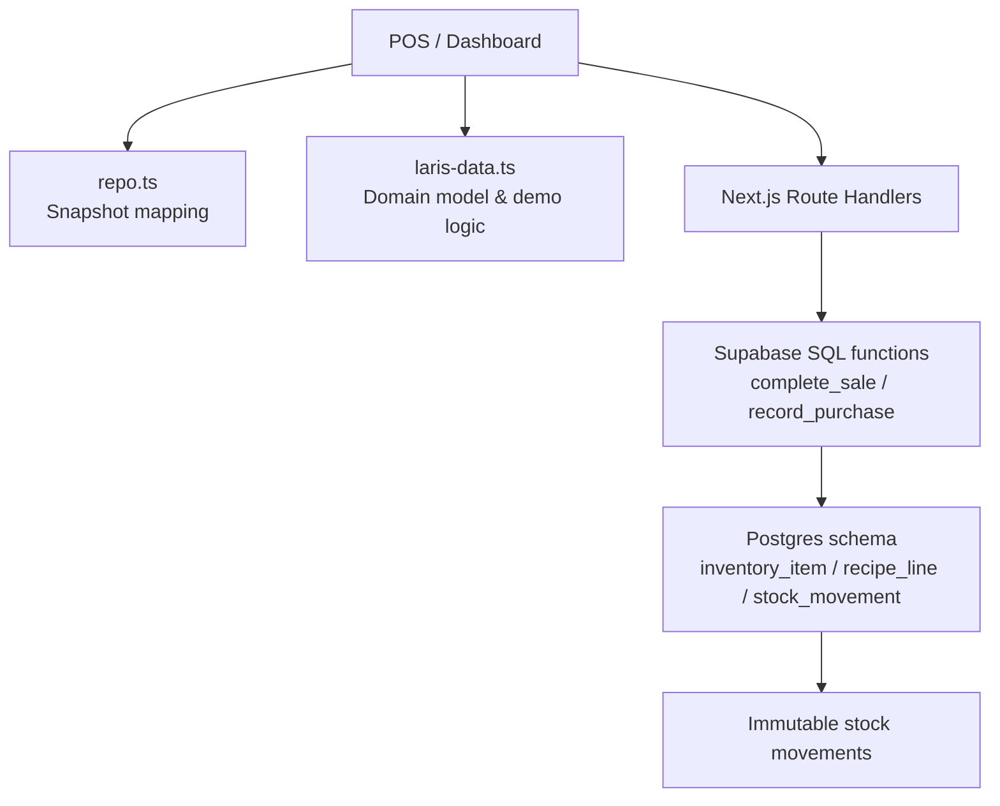
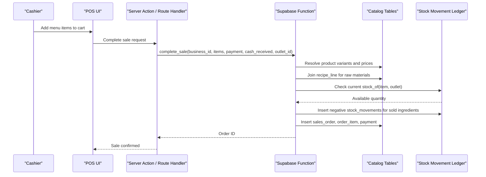
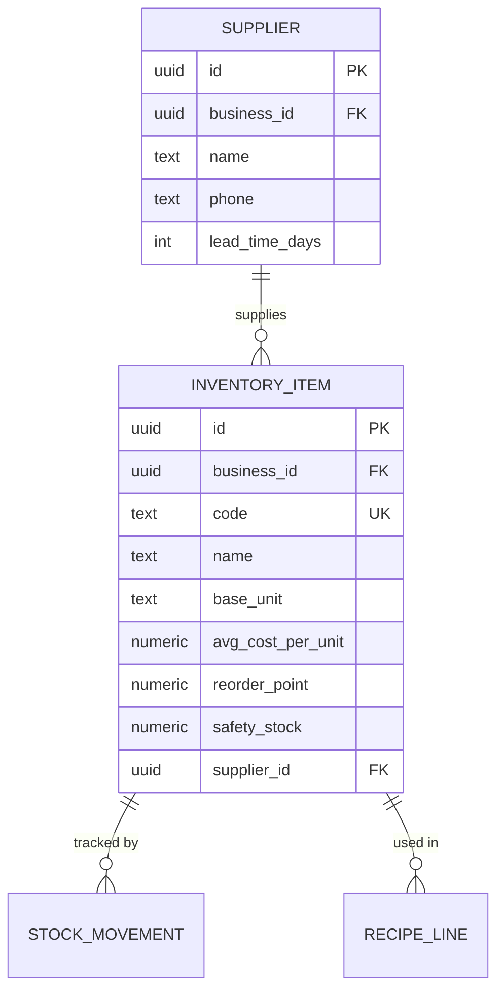
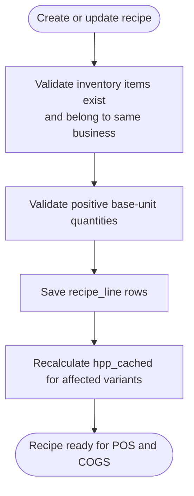
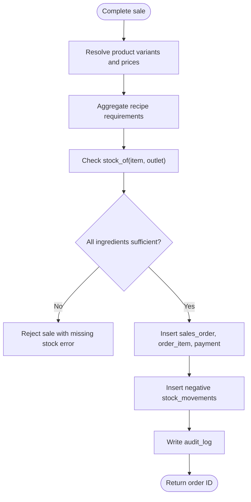
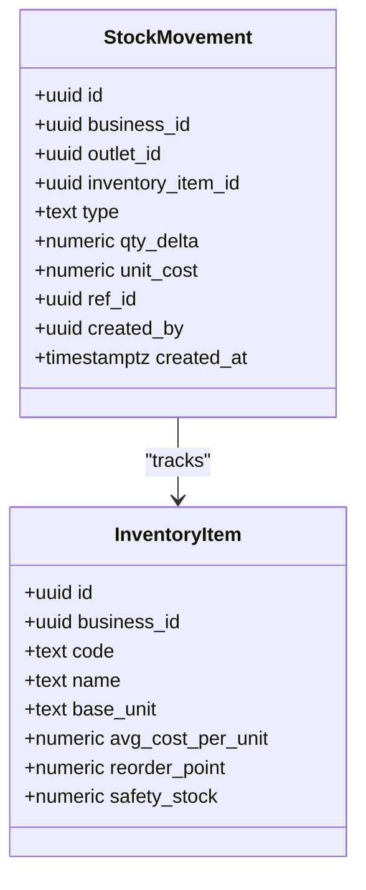
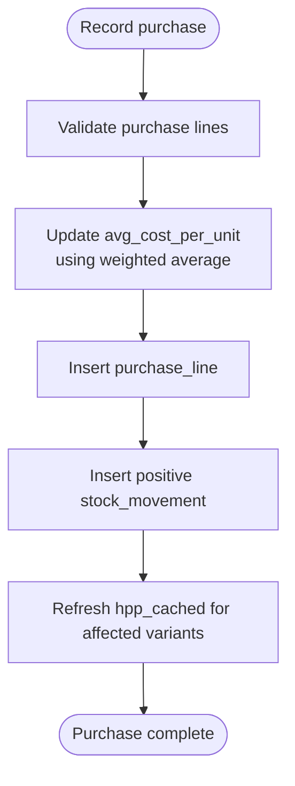
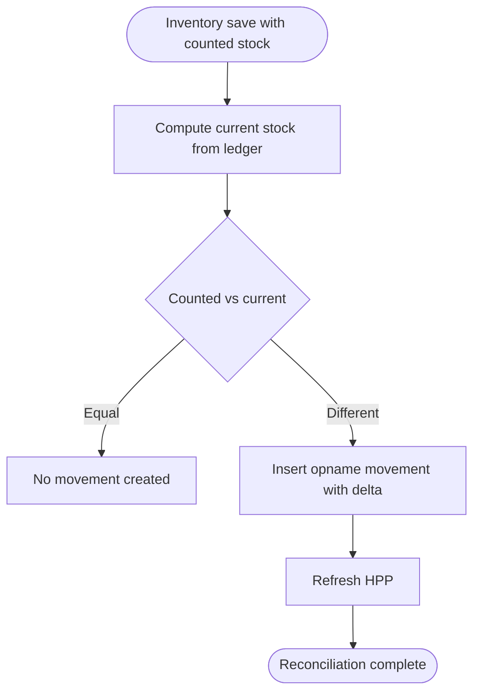
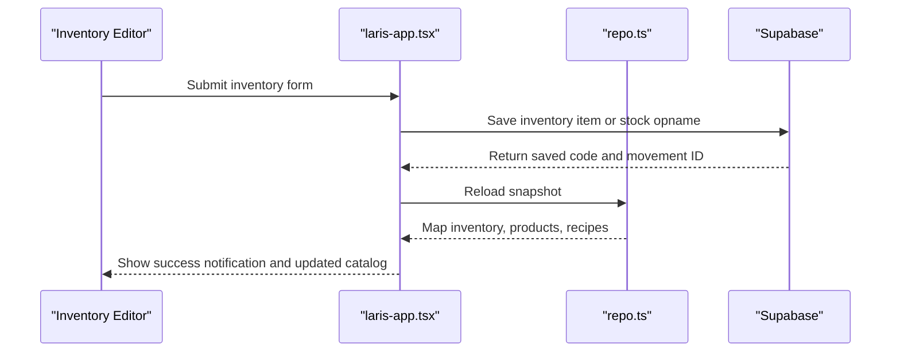
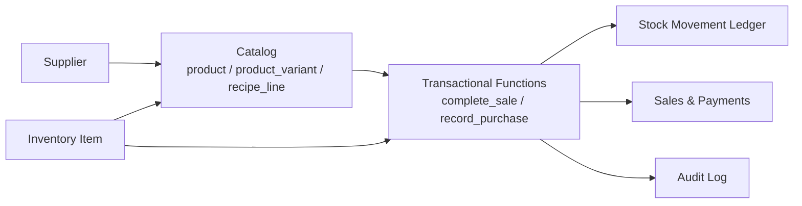

# Inventory Management

<cite>
**Referenced Files in This Document**
- [README.md](file://README.md)
- [PRD_Laris_GTNIC2026.md](file://PRD_Laris_GTNIC2026.md)
- [laris-data.ts](file://src/lib/laris-data.ts)
- [repo.ts](file://src/lib/repo.ts)
- [laris-app.tsx](file://src/components/laris-app.tsx)
- [0001_schema.sql](file://supabase/migrations/0001_schema.sql)
- [0002_rls.sql](file://supabase/migrations/0002_rls.sql)
- [0003_functions.sql](file://supabase/migrations/0003_functions.sql)
- [0004_workspaces.sql](file://supabase/migrations/0004_workspaces.sql)
- [0005_production_hardening.sql](file://supabase/migrations/0005_production_hardening.sql)
</cite>

## Table of Contents
1. [Introduction](#introduction)
2. [Project Structure](#project-structure)
3. [Core Components](#core-components)
4. [Architecture Overview](#architecture-overview)
5. [Detailed Component Analysis](#detailed-component-analysis)
6. [Dependency Analysis](#dependency-analysis)
7. [Performance Considerations](#performance-considerations)
8. [Troubleshooting Guide](#troubleshooting-guide)
9. [Conclusion](#conclusion)

## Introduction
This document explains the inventory management system for Laris, an operational workspace for Indonesian micro and small F&B businesses. It focuses on raw materials tracking, supplier relationships, recipe/BOM management, automatic stock deduction on sales, ledger-based immutable stock movements, moving-average cost calculation, low-stock alerts, stock reconciliation, COGS/HPP automation, financial reporting linkage, and advanced scenarios such as stock adjustments, waste tracking, and multi-location inventory.

The system is designed so that inventory changes are never direct mutations of a single quantity field. Instead, every change is recorded as an immutable `stock_movement` row. Current stock is derived from these movements, which makes the ledger auditable, reversible through documented variance entries, and safe under concurrent POS operations.

**Section sources**
- [README.md:24-35](file://README.md#L24-L35)
- [PRD_Laris_GTNIC2026.md:175-194](file://PRD_Laris_GTNIC2026.md#L175-L194)

## Project Structure
The inventory domain spans three layers:

| Layer | Responsibility | Key files |
|---|---|---|
| Domain model and demo logic | Product catalog, inventory items, cart validation, sale completion, purchase recording, moving-average cost, deterministic seed data | [laris-data.ts](file://src/lib/laris-data.ts) |
| Cloud mapping layer | Maps Supabase snapshot rows to the frontend domain model, including inventory, product variants, recipes, and supplier names | [repo.ts](file://src/lib/repo.ts) |
| Database schema and transactional functions | Tenancy, catalog, recipes, purchases, sales, payments, stock ledger, RLS, security-definer functions, audit logging | [0001_schema.sql](file://supabase/migrations/0001_schema.sql), [0002_rls.sql](file://supabase/migrations/0002_rls.sql), [0003_functions.sql](file://supabase/migrations/0003_functions.sql), [0004_workspaces.sql](file://supabase/migrations/0004_workspaces.sql), [0005_production_hardening.sql](file://supabase/migrations/0005_production_hardening.sql) |
| UI integration | Inventory editor, stock opname flow, mutation state handling, notifications | [laris-app.tsx](file://src/components/laris-app.tsx) |

**Diagram sources**
- [repo.ts:90-112](file://src/lib/repo.ts#L90-L112)
- [laris-data.ts:143-176](file://src/lib/laris-data.ts#L143-L176)
- [0001_schema.sql:73-127](file://supabase/migrations/0001_schema.sql#L73-L127)
- [0003_functions.sql:94-230](file://supabase/migrations/0003_functions.sql#L94-L230)

**Section sources**
- [README.md:97-107](file://README.md#L97-L107)
- [PRD_Laris_GTNIC2026.md:377-494](file://PRD_Laris_GTNIC2026.md#L377-L494)

## Core Components
The inventory system is built around five core concepts:

| Concept | Purpose | Implementation |
|---|---|---|
| Raw material item | Defines a base unit, current average cost, reorder point, safety stock, and supplier relationship | `inventory_item` table with `base_unit`, `avg_cost_per_unit`, `reorder_point`, `safety_stock`, `supplier_id` |
| Supplier | Tracks vendor name, phone, lead time, and links to inventory items | `supplier` table; enforced by triggers and RLS policies |
| Recipe / BOM | Links finished product variants to raw ingredients in base units | `recipe_line` with `variant_id`, `inventory_item_id`, `qty_base_unit` |
| Stock ledger | Immutable history of all stock changes | `stock_movement` with typed deltas (`opening`, `sale`, `purchase`, `adjustment`, `waste`, `opname`) |
| Cost engine | Moving-average cost per base unit and recipe-level HPP (COGS) | `record_purchase` updates `avg_cost_per_unit`; `refresh_hpp` recalculates `hpp_cached` |

Key domain interfaces used by the demo and frontend include `InventoryItem`, `Product`, `StockMovement`, `Purchase`, and `BusinessState`. The demo implementation provides deterministic seed data for a coffee shop scenario called “Kopi Senja.”

**Section sources**
- [0001_schema.sql:61-127](file://supabase/migrations/0001_schema.sql#L61-L127)
- [0001_schema.sql:203-237](file://supabase/migrations/0001_schema.sql#L203-L237)
- [laris-data.ts:3-32](file://src/lib/laris-data.ts#L3-L32)
- [laris-data.ts:112-133](file://src/lib/laris-data.ts#L112-L133)

## Architecture Overview
At runtime, inventory changes follow one of two main flows:

1. **Sale flow:** POS creates a sales order, validates payment, checks recipe-based raw material availability, records order items and payment, then writes negative `stock_movement` rows for each ingredient.
2. **Purchase flow:** Owner or manager records a purchase, inserts purchase lines, updates the moving-average cost of affected raw materials, writes positive `stock_movement` rows, and refreshes recipe HPP values.

**Diagram sources**
- [0003_functions.sql:94-230](file://supabase/migrations/0003_functions.sql#L94-L230)
- [0005_production_hardening.sql:84-214](file://supabase/migrations/0005_production_hardening.sql#L84-L214)
- [0001_schema.sql:153-216](file://supabase/migrations/0001_schema.sql#L153-L216)

**Section sources**
- [PRD_Laris_GTNIC2026.md:266-291](file://PRD_Laris_GTNIC2026.md#L266-L291)
- [PRD_Laris_GTNIC2026.md:319-356](file://PRD_Laris_GTNIC2026.md#L319-L356)

## Detailed Component Analysis

### Raw Materials Tracking and Unit Conventions
Raw materials are stored with a stable business-scoped code, human-readable name, and a single base unit. Money is stored as integer rupiah, while quantities use numeric types with fractional support in base units. This avoids floating-point rounding errors and keeps calculations consistent across recipes, purchases, and reports.

Important design rules:
- Base units are chosen once and should not be changed after the item participates in recipes or has ledger history.
- Reorder points and safety stocks are defined per item to support low-stock alerts and forecasting.
- Supplier relationships are optional but recommended for purchasing and receipt scanning workflows.

**Diagram sources**
- [0001_schema.sql:61-88](file://supabase/migrations/0001_schema.sql#L61-L88)
- [0001_schema.sql:203-216](file://supabase/migrations/0001_schema.sql#L203-L216)

**Section sources**
- [0001_schema.sql:1-7](file://supabase/migrations/0001_schema.sql#L1-L7)
- [0001_schema.sql:61-88](file://supabase/migrations/0001_schema.sql#L61-L88)
- [PRD_Laris_GTNIC2026.md:377-384](file://PRD_Laris_GTNIC2026.md#L377-L384)

### Supplier Relationships
Suppliers are tenant-scoped entities linked to inventory items. The database enforces that an inventory item’s supplier belongs to the same business. This prevents accidental cross-tenant references and supports features like automated PO drafts and receipt scanning.

Supplier-related constraints and checks include:
- Unique supplier name per business.
- Lead time validation between zero and sixty days.
- Triggered validation when assigning a supplier to an inventory item.
- Optional supplier association in purchase records.

**Section sources**
- [0001_schema.sql:61-71](file://supabase/migrations/0001_schema.sql#L61-L71)
- [0004_workspaces.sql:37-46](file://supabase/migrations/0004_workspaces.sql#L37-L46)
- [0001_schema.sql:218-228](file://supabase/migrations/0001_schema.sql#L218-L228)

### Recipe and BOM Management
Recipes define how many base units of each raw material are consumed by one unit of a product variant. Recipes are stored in `recipe_line`, linking a product variant to an inventory item with a positive quantity in base units.

Key behaviors:
- Each recipe line must reference a valid default available variant and a non-deleted inventory item.
- Tenant consistency is enforced by triggers: product, variant, and inventory item must belong to the same business.
- Recipe changes trigger HPP recalculation for affected variants.
- Sales consume aggregated recipe requirements before any stock movement is written.

**Diagram sources**
- [0004_workspaces.sql:25-35](file://supabase/migrations/0004_workspaces.sql#L25-L35)
- [0004_workspaces.sql:155-221](file://supabase/migrations/0004_workspaces.sql#L155-L221)
- [0003_functions.sql:48-61](file://supabase/migrations/0003_functions.sql#L48-L61)

**Section sources**
- [0001_schema.sql:105-127](file://supabase/migrations/0001_schema.sql#L105-L127)
- [0004_workspaces.sql:25-35](file://supabase/migrations/0004_workspaces.sql#L25-L35)
- [0004_workspaces.sql:155-221](file://supabase/migrations/0004_workspaces.sql#L155-L221)

### Automatic Stock Deduction on Sales
When a sale is completed, the system:
1. Resolves product codes to active product variants.
2. Joins recipe lines to compute total raw-material requirements.
3. Locks and checks current stock per ingredient at the selected outlet.
4. Rejects the sale if any required raw material is insufficient.
5. Writes one negative `stock_movement` row per ingredient.
6. Records the sales order, order items, payment, and audit log atomically.

**Diagram sources**
- [0003_functions.sql:94-230](file://supabase/migrations/0003_functions.sql#L94-L230)
- [0005_production_hardening.sql:84-214](file://supabase/migrations/0005_production_hardening.sql#L84-L214)

**Section sources**
- [0003_functions.sql:34-46](file://supabase/migrations/0003_functions.sql#L34-L46)
- [0003_functions.sql:94-230](file://supabase/migrations/0003_functions.sql#L94-L230)
- [0005_production_hardening.sql:84-214](file://supabase/migrations/0005_production_hardening.sql#L84-L214)

### Ledger-Based Stock Tracking
The ledger approach stores every change as an immutable row rather than updating a running balance column. Current stock is computed by summing signed `qty_delta` values for an item and outlet.

Supported movement types include:
- `opening`: initial stock when creating an inventory item.
- `sale`: negative consumption based on recipes.
- `purchase`: positive stock-in from suppliers.
- `adjustment`: manual correction.
- `waste`: spoilage, spillage, failed batches.
- `opname`: physical count reconciliation delta.

**Diagram sources**
- [0001_schema.sql:203-216](file://supabase/migrations/0001_schema.sql#L203-L216)

**Section sources**
- [0001_schema.sql:203-216](file://supabase/migrations/0001_schema.sql#L203-L216)
- [laris-data.ts:25-32](file://src/lib/laris-data.ts#L25-L32)
- [laris-data.ts:172-176](file://src/lib/laris-data.ts#L172-L176)

### Moving-Average Cost Calculation and COGS
The system uses a moving-average cost model:
- When a purchase arrives, the new average cost is calculated using existing stock, the purchase total, and the purchased quantity.
- The average cost is stored per base unit in `inventory_item.avg_cost_per_unit`.
- Recipe-level COGS (HPP) is recomputed by multiplying each recipe line’s base-unit quantity by the current average cost of the corresponding inventory item.
- Product variants store a cached HPP value for fast reporting and pricing analysis.

**Diagram sources**
- [0003_functions.sql:232-303](file://supabase/migrations/0003_functions.sql#L232-L303)
- [0005_production_hardening.sql:216-306](file://supabase/migrations/0005_production_hardening.sql#L216-L306)
- [0003_functions.sql:48-61](file://supabase/migrations/0003_functions.sql#L48-L61)

**Section sources**
- [0003_functions.sql:48-61](file://supabase/migrations/0003_functions.sql#L48-L61)
- [0003_functions.sql:232-303](file://supabase/migrations/0003_functions.sql#L232-L303)
- [0005_production_hardening.sql:216-306](file://supabase/migrations/0005_production_hardening.sql#L216-L306)
- [laris-data.ts:307-334](file://src/lib/laris-data.ts#L307-L334)

### Low-Stock Alerts and Reorder Logic
Low-stock alerts are part of the inventory and forecasting requirements. The schema includes:
- `reorder_point`: threshold below which the item should trigger a reorder suggestion.
- `safety_stock`: buffer stock used by forecasting and reorder-point calculations.
- Forecasting requirements mention demand during lead time plus safety stock.

In practice, low-stock alerts can be generated by:
- Comparing current stock (sum of `stock_movement.qty_delta`) with `reorder_point`.
- Using forecasted demand and lead time to compute dynamic reorder points.
- Integrating with supplier information to suggest WhatsApp PO drafts.

**Section sources**
- [0001_schema.sql:73-88](file://supabase/migrations/0001_schema.sql#L73-L88)
- [PRD_Laris_GTNIC2026.md:196-204](file://PRD_Laris_GTNIC2026.md#L196-L204)
- [PRD_Laris_GTNIC2026.md:258-259](file://PRD_Laris_GTNIC2026.md#L258-L259)

### Stock Reconciliation and Waste Tracking
Stock reconciliation is supported through:
- Physical count input via the inventory save function.
- Automatic creation of an `opname` movement when the counted stock differs from the ledger-derived current stock.
- Manual `adjustment` and dedicated `waste` movement types for corrections and spoilage.

The demo domain also demonstrates signed adjustments and waste-style deductions through test cases.

**Diagram sources**
- [0004_workspaces.sql:223-300](file://supabase/migrations/0004_workspaces.sql#L223-L300)
- [0005_production_hardening.sql:308-389](file://supabase/migrations/0005_production_hardening.sql#L308-L389)

**Section sources**
- [0001_schema.sql:203-216](file://supabase/migrations/0001_schema.sql#L203-L216)
- [0004_workspaces.sql:223-300](file://supabase/migrations/0004_workspaces.sql#L223-L300)
- [0005_production_hardening.sql:308-389](file://supabase/migrations/0005_production_hardening.sql#L308-L389)
- [laris-data.test.ts:352-361](file://src/lib/laris-data.test.ts#L352-L361)

### Multi-Location Inventory Management
Multi-location inventory is modeled through the `outlet` entity. Stock movements, sales orders, purchases, and stock checks are scoped to an outlet. The server resolves the outlet either explicitly or by selecting the first active outlet for the business.

Key implications:
- Current stock is computed per item and outlet.
- Sales deduct stock at the receiving outlet.
- Purchases add stock to the outlet where they are recorded.
- Future features include outlet switching, inter-outlet transfers, and consolidated dashboards.

**Section sources**
- [0001_schema.sql:39-47](file://supabase/migrations/0001_schema.sql#L39-L47)
- [0001_schema.sql:153-216](file://supabase/migrations/0001_schema.sql#L153-L216)
- [0003_functions.sql:63-68](file://supabase/migrations/0003_functions.sql#L63-L68)
- [PRD_Laris_GTNIC2026.md:258-259](file://PRD_Laris_GTNIC2026.md#L258-L259)

### Relationship Between Inventory Changes and Financial Reporting
Inventory changes directly affect financial reporting through several mechanisms:

| Area | How inventory affects finance |
|---|---|
| Revenue | Sales orders and payments record revenue and payment method. |
| COGS / HPP | `order_item.unit_cost` captures the variant’s HPP at sale time; recipe HPP comes from moving-average costs. |
| Gross margin | Derived from revenue minus COGS per order or period. |
| Expenses | Separate expense records track operating costs. |
| Purchasing | Purchase totals increase inventory value and affect future COGS through moving-average cost. |
| Auditability | Audit logs record key operational actions, supporting reconciliation and compliance. |

The schema separates revenue-generating tables (`sales_order`, `order_item`, `payment`) from inventory tables (`stock_movement`, `purchase`, `purchase_line`) and operating expenses (`expense`). This separation allows financial reports to aggregate revenue and expenses independently while still being able to trace COGS back to recipe-level costs.

**Section sources**
- [0001_schema.sql:132-198](file://supabase/migrations/0001_schema.sql#L132-L198)
- [0001_schema.sql:239-250](file://supabase/migrations/0001_schema.sql#L239-L250)
- [0001_schema.sql:255-265](file://supabase/migrations/0001_schema.sql#L255-L265)
- [PRD_Laris_GTNIC2026.md:237-246](file://PRD_Laris_GTNIC2026.md#L237-L246)

### Concrete Examples

#### Example: Creating a Recipe
A recipe is created by associating a product variant with multiple inventory items, each with a positive quantity in base units. For example, a coffee drink might consume grams of coffee beans, milliliters of milk, milliliters of syrup, and one cup.

Steps:
1. Ensure the inventory items exist with correct base units.
2. Create or update the product and its default variant.
3. Add recipe lines linking each raw material to the variant.
4. Save the recipe; the system recalculates HPP for the variant.

**Section sources**
- [0004_workspaces.sql:155-221](file://supabase/migrations/0004_workspaces.sql#L155-L221)
- [0003_functions.sql:48-61](file://supabase/migrations/0003_functions.sql#L48-L61)

#### Example: Stock Movement Types
| Type | Direction | Typical source | Meaning |
|---|---:|---|---|
| `opening` | Positive | Inventory creation | Initial stock entry |
| `sale` | Negative | POS checkout | Recipe-based consumption |
| `purchase` | Positive | Purchase entry | Supplier stock-in |
| `adjustment` | Either | Manual correction | Correcting known discrepancies |
| `waste` | Negative | Spoilage or failure | Intentional loss without revenue |
| `opname` | Either | Physical count | Reconciliation delta |

**Section sources**
- [0001_schema.sql:203-216](file://supabase/migrations/0001_schema.sql#L203-L216)
- [laris-data.ts:25-32](file://src/lib/laris-data.ts#L25-L32)

#### Example: Automated COGS Calculation
When a sale occurs:
- The system resolves the product variant’s price and cached HPP.
- It joins recipe lines to determine raw-material consumption.
- It writes `order_item.unit_cost` from the variant’s HPP.
- It writes negative `stock_movement` rows using the current average cost of each raw material.

When a purchase occurs:
- The system updates the moving-average cost of the raw material.
- It refreshes HPP for variants using that raw material.
- Future sales will reflect updated COGS.

**Section sources**
- [0003_functions.sql:34-46](file://supabase/migrations/0003_functions.sql#L34-L46)
- [0003_functions.sql:94-230](file://supabase/migrations/0003_functions.sql#L94-L230)
- [0003_functions.sql:232-303](file://supabase/migrations/0003_functions.sql#L232-L303)

### Frontend Integration and State Handling
The frontend maps Supabase snapshots into the domain model used by the UI. It reads inventory items, product variants, recipes, and supplier names, then exposes them to the POS and inventory screens. The inventory editor handles both new items and edits, including stock opname inputs and movement responses returned by the backend.

**Diagram sources**
- [laris-app.tsx:588-608](file://src/components/laris-app.tsx#L588-L608)
- [repo.ts:90-112](file://src/lib/repo.ts#L90-L112)

**Section sources**
- [repo.ts:90-112](file://src/lib/repo.ts#L90-L112)
- [laris-app.tsx:588-608](file://src/components/laris-app.tsx#L588-L608)

## Dependency Analysis
The inventory system has clear boundaries between catalog data, transactional operations, and immutable ledger history.

**Diagram sources**
- [0001_schema.sql:61-127](file://supabase/migrations/0001_schema.sql#L61-L127)
- [0001_schema.sql:153-216](file://supabase/migrations/0001_schema.sql#L153-L216)
- [0003_functions.sql:94-303](file://supabase/migrations/0003_functions.sql#L94-L303)

Key dependency characteristics:
- Catalog writes are protected by RLS and triggers that enforce tenant isolation.
- Ledger writes are restricted to security-definer functions; clients cannot directly insert into `stock_movement`, `sales_order`, `payment`, or `purchase`.
- Business-level locks prevent catalog mutations from observing inconsistent catalog versions during concurrent sales.
- Idempotency keys protect against duplicate offline retries for sales and purchases.

**Section sources**
- [0002_rls.sql:1-8](file://supabase/migrations/0002_rls.sql#L1-L8)
- [0002_rls.sql:90-101](file://supabase/migrations/0002_rls.sql#L90-L101)
- [0005_production_hardening.sql:1-8](file://supabase/migrations/0005_production_hardening.sql#L1-L8)
- [0005_production_hardening.sql:43-68](file://supabase/migrations/0005_production_hardening.sql#L43-L68)

## Performance Considerations
- **Atomic transactions:** Sales and purchases run inside database functions that write related tables atomically, reducing partial-state risk.
- **Immutable ledger:** Summing `stock_movement.qty_delta` is predictable and auditable, though large ledgers require proper indexing.
- **Indexes:** The schema includes indexes on item/outlet combinations and business-scoped timestamps to support queries over recent activity and per-item stock.
- **Moving-average cost:** Average-cost updates are done per purchase line; bulk purchases should avoid excessive tiny transactions.
- **HPP refresh:** Recipe HPP is refreshed after catalog or purchase changes; this is efficient because it targets only affected variants.
- **Concurrency:** Per-business locking and row-level locks on inventory items reduce race conditions during simultaneous POS checkouts.

[No sources needed since this section provides general guidance]

## Troubleshooting Guide

### Common Errors and Causes
| Symptom | Likely cause | Resolution |
|---|---|---|
| Sale rejected due to insufficient stock | Recipe requirement exceeds current stock at the outlet | Check `stock_movement` history, adjust purchases, or reduce sale quantity |
| Invalid payment or channel | Client sent unsupported payment method or channel | Use `tunai`, `qris`, or `transfer`; use `kasir`, `etalase`, or `wa` |
| Unknown menu item | Product code not found or variant unavailable | Verify product is active and the default variant is available |
| Discount exceeds subtotal | Client passed discount larger than calculated subtotal | Recalculate discount server-side or validate client input |
| Purchase fails with unknown item | Purchase line references an invalid inventory code | Confirm inventory item exists and is not deleted |
| Cannot change base unit | Item already has ledger history or recipe usage | Keep base unit immutable after first use |
| Duplicate sale or purchase | Offline retry without idempotency key | Generate and reuse a unique idempotency key per operation |

**Section sources**
- [0003_functions.sql:123-179](file://supabase/migrations/0003_functions.sql#L123-L179)
- [0003_functions.sql:254-294](file://supabase/migrations/0003_functions.sql#L254-L294)
- [0005_production_hardening.sql:118-167](file://supabase/migrations/0005_production_hardening.sql#L118-L167)
- [0005_production_hardening.sql:242-298](file://supabase/migrations/0005_production_hardening.sql#L242-L298)
- [0005_production_hardening.sql:363-368](file://supabase/migrations/0005_production_hardening.sql#L363-L368)

### Debugging Stock Discrepancies
To investigate stock differences:
1. Identify the inventory item and outlet.
2. Query `stock_movement` rows filtered by `inventory_item_id`, `outlet_id`, and date range.
3. Sum `qty_delta` to verify current stock.
4. Compare with physical count and review `opname`, `adjustment`, or `waste` movements.
5. Check whether recipe changes or purchase price changes affected HPP and COGS.

**Section sources**
- [0001_schema.sql:203-216](file://supabase/migrations/0001_schema.sql#L203-L216)
- [0004_workspaces.sql:284-291](file://supabase/migrations/0004_workspaces.sql#L284-L291)
- [0005_production_hardening.sql:373-380](file://supabase/migrations/0005_production_hardening.sql#L373-L380)

## Conclusion
Laris’s inventory management system combines a strict ledger model with recipe-driven stock deduction, moving-average cost accounting, and strong tenant isolation. By treating stock as immutable movements rather than mutable balances, the system supports auditing, reconciliation, and reliable financial reporting. Recipes link finished products to raw materials, enabling automatic COGS calculation and margin visibility. Purchases update average costs and propagate HPP changes to dependent products. Low-stock alerts, waste tracking, stock opname reconciliation, and multi-outlet scoping provide practical tools for F&B operations.

For production use, operators should:
- Define accurate base units and avoid changing them after ledger or recipe usage.
- Record purchases promptly so moving-average costs stay realistic.
- Use stock opname and adjustment/waste movements to reconcile physical counts.
- Monitor reorder points and safety stock against forecasted demand.
- Treat sales and purchases as idempotent operations when syncing offline data.

[No sources needed since this section summarizes without analyzing specific files]