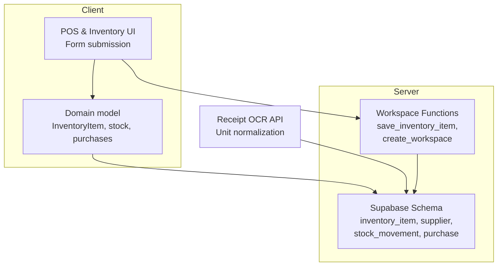
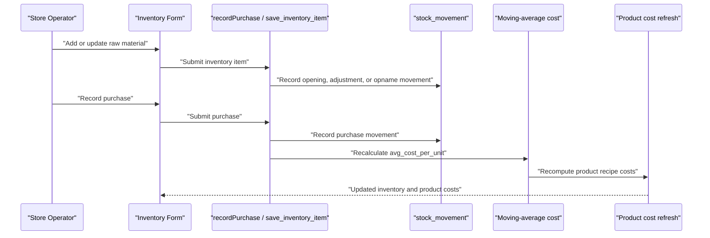
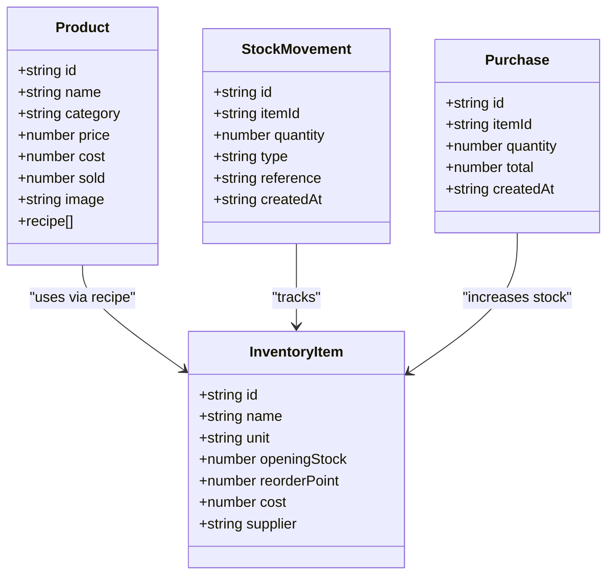
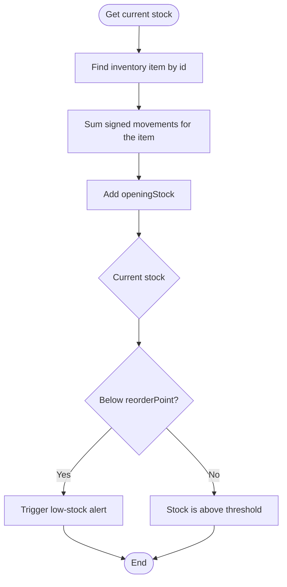
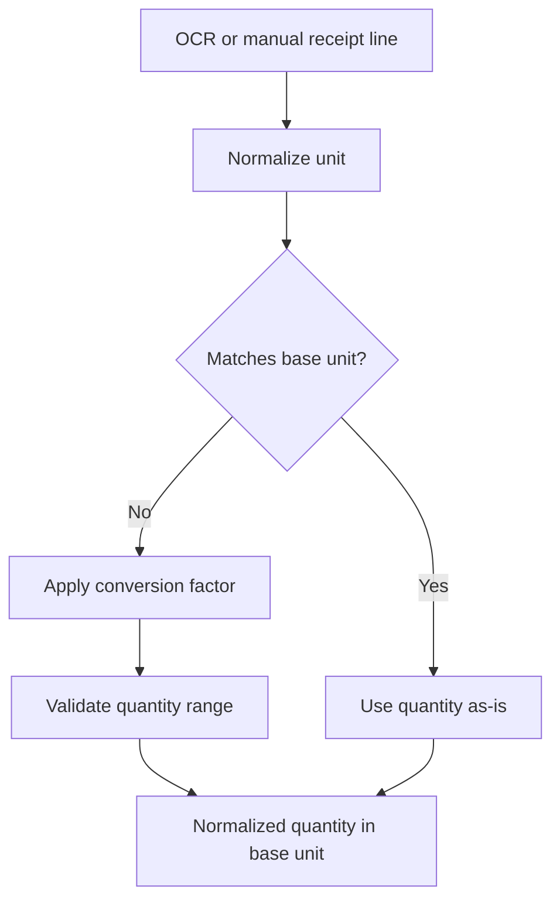
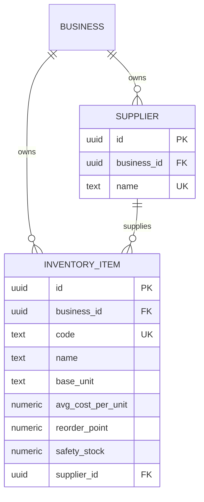
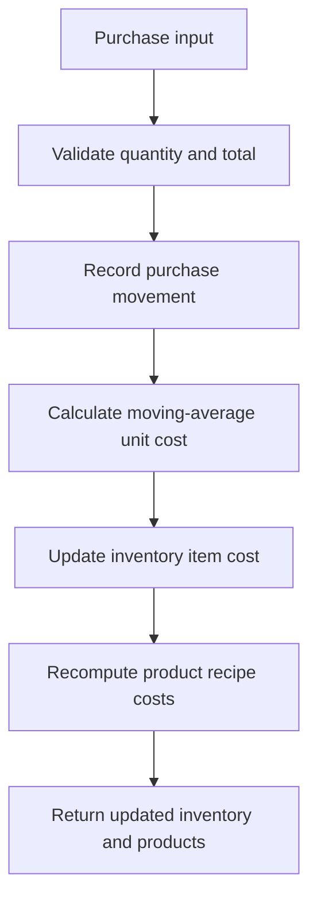
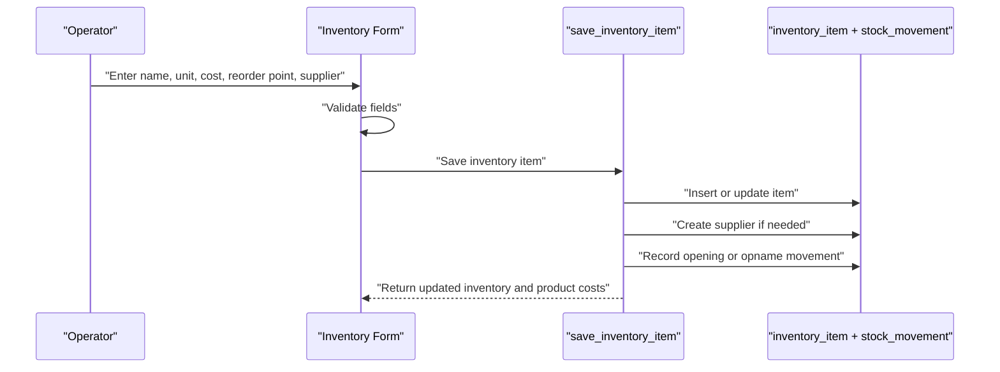
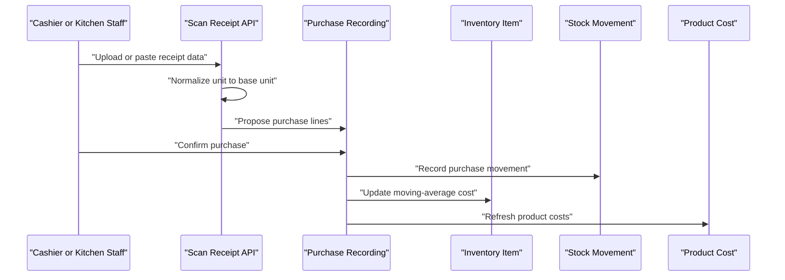
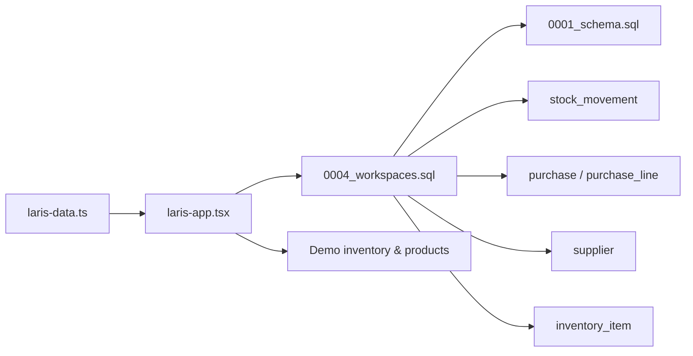

# Raw Materials Management

<cite>
**Referenced Files in This Document**
- [laris-data.ts](file://src/lib/laris-data.ts)
- [laris-app.tsx](file://src/components/laris-app.tsx)
- [0001_schema.sql](file://supabase/migrations/0001_schema.sql)
- [0004_workspaces.sql](file://supabase/migrations/0004_workspaces.sql)
- [scan-receipt route.ts](file://src/app/api/ai/scan-receipt/route.ts)
</cite>

## Table of Contents
1. [Introduction](#introduction)
2. [Project Structure](#project-structure)
3. [Core Components](#core-components)
4. [Architecture Overview](#architecture-overview)
5. [Detailed Component Analysis](#detailed-component-analysis)
6. [Dependency Analysis](#dependency-analysis)
7. [Performance Considerations](#performance-considerations)
8. [Troubleshooting Guide](#troubleshooting-guide)
9. [Conclusion](#conclusion)

## Introduction
This document explains the raw materials management system in Laris, an operational workspace for Indonesian food and beverage businesses. It focuses on how inventory items are modeled, how stock is tracked, how suppliers are managed, and how purchasing affects product cost and pricing. The documentation uses real examples from the demo coffee shop data, such as house blend coffee beans, fresh milk, palm sugar syrup, cups, pastries, matcha powder, cocoa powder, and jasmine tea bags.

Laris separates a lightweight client-side domain model from a server-side schema that enforces tenant isolation, ledger-based stock tracking, moving-average cost updates, and supplier relationships.

## Project Structure
The raw materials feature spans three main layers:

- Client-side domain model and demo data: defines `InventoryItem`, sample inventory, stock calculation, purchase recording, and product cost recalculation.
- Server-side database schema: defines persistent tables for inventory items, suppliers, recipes, purchases, and stock movements.
- UI and API integration: handles adding or updating raw materials, converting receipt units to base units, and propagating changes back to the application state.

**Diagram sources**
- [laris-data.ts:15-23](file://src/lib/laris-data.ts#L15-L23)
- [laris-data.ts:112-121](file://src/lib/laris-data.ts#L112-L121)
- [laris-data.ts:172-176](file://src/lib/laris-data.ts#L172-L176)
- [laris-data.ts:307-333](file://src/lib/laris-data.ts#L307-L333)
- [0001_schema.sql:61-88](file://supabase/migrations/0001_schema.sql#L61-L88)
- [0001_schema.sql:203-237](file://supabase/migrations/0001_schema.sql#L203-L237)
- [0004_workspaces.sql:223-300](file://supabase/migrations/0004_workspaces.sql#L223-L300)
- [scan-receipt route.ts:28-46](file://src/app/api/ai/scan-receipt/route.ts#L28-L46)

**Section sources**
- [README.md:24-35](file://README.md#L24-L35)
- [README.md:97-110](file://README.md#L97-L110)

## Core Components
At the center of raw materials management is the `InventoryItem` interface. It represents a single raw material with identifiers, naming, unit of measure, initial stock, reorder threshold, unit cost, and supplier reference.

| Field | Meaning | Example usage |
|---|---|---|
| `id` | Stable identifier for the item | `"beans"`, `"milk"`, `"syrup"` |
| `name` | Human-readable raw material name | `"Biji kopi house blend"`, `"Susu segar"`, `"Sirup gula aren"` |
| `unit` | Base unit of measure | `"g"`, `"ml"`, `"pcs"`, `"kantong"` |
| `openingStock` | Starting quantity before daily transactions | `3800` grams of beans |
| `reorderPoint` | Threshold that triggers low-stock alerts | `1000` grams for beans |
| `cost` | Unit cost used for product cost calculation | IDR per gram, milliliter, piece, or tea bag |
| `supplier` | Supplier name or identifier | `"Dago Coffee Roastery"`, `"Susu Lembang"`, `"Aren Nusantara"` |

The demo inventory includes Indonesian coffee shop staples:

- Beans: `"Biji kopi house blend"` measured in grams.
- Milk: `"Susu segar"` measured in milliliters.
- Palm sugar syrup: `"Sirup gula aren"` measured in milliliters.
- Cups and lids: `"Gelas & tutup"` measured in pieces.
- Pastries: `"Pastry aneka rasa"` measured in pieces.
- Matcha powder: `"Bubuk matcha"` measured in grams.
- Cocoa powder: `"Bubuk cokelat"` measured in grams.
- Jasmine tea: `"Teh melati"` measured in tea bags (`"kantong"`).

These items are consumed by menu recipes, which link products to inventory items through recipe lines.

**Section sources**
- [laris-data.ts:15-23](file://src/lib/laris-data.ts#L15-L23)
- [laris-data.ts:112-121](file://src/lib/laris-data.ts#L112-L121)
- [laris-data.ts:123-133](file://src/lib/laris-data.ts#L123-L133)

## Architecture Overview
Raw materials flow through four key stages:

1. **Definition:** A raw material is created or updated with a code, name, base unit, cost, reorder point, optional opening stock, and optional supplier.
2. **Stock Ledger:** Stock is not stored as a simple balance; it is derived from signed movements such as opening stock, sales, purchases, adjustments, waste, and physical counts.
3. **Supplier Relationship:** Suppliers can be linked to inventory items. The server ensures suppliers belong to the same business tenant.
4. **Cost Propagation:** When a purchase increases stock, the system recalculates the moving-average unit cost and then recomputes each product’s total cost based on its recipe.

**Diagram sources**
- [laris-data.ts:307-333](file://src/lib/laris-data.ts#L307-L333)
- [0004_workspaces.sql:223-300](file://supabase/migrations/0004_workspaces.sql#L223-L300)
- [0001_schema.sql:203-237](file://supabase/migrations/0001_schema.sql#L203-L237)

## Detailed Component Analysis

### InventoryItem Interface and Demo Data
The `InventoryItem` interface captures the essential attributes needed for raw material tracking. In the demo, these items represent typical Indonesian coffee shop inputs. Each item has:

- A stable `id`.
- A readable `name`.
- A base `unit`.
- An `openingStock` representing starting inventory.
- A `reorderPoint` used for low-stock awareness.
- A `cost` representing unit cost.
- A `supplier` string linking the item to a supplier.

The demo also includes non-coffee items like cups, pastries, matcha powder, cocoa powder, and tea bags, showing that the system supports both liquid and solid ingredients as well as packaging and tea bags.

**Diagram sources**
- [laris-data.ts:3-13](file://src/lib/laris-data.ts#L3-L13)
- [laris-data.ts:15-32](file://src/lib/laris-data.ts#L15-L32)
- [laris-data.ts:74-80](file://src/lib/laris-data.ts#L74-L80)
- [laris-data.ts:112-121](file://src/lib/laris-data.ts#L112-L121)

**Section sources**
- [laris-data.ts:15-23](file://src/lib/laris-data.ts#L15-L23)
- [laris-data.ts:112-121](file://src/lib/laris-data.ts#L112-L121)

### Stock Calculation and Low-Stock Alerts
Current stock is calculated by starting from `openingStock` and applying all signed `stockMovements` for the item. Sales create negative movements; purchases create positive movements; adjustments and physical counts create explicit corrections.

Low-stock alerts are driven by comparing current stock against `reorderPoint`. If current stock falls below the reorder point, operators should consider reordering from the linked supplier.

**Diagram sources**
- [laris-data.ts:172-176](file://src/lib/laris-data.ts#L172-L176)
- [laris-data.ts:15-23](file://src/lib/laris-data.ts#L15-L23)

**Section sources**
- [laris-data.ts:172-176](file://src/lib/laris-data.ts#L172-L176)

### Unit Conversion Handling
Laris stores quantities in a consistent base unit per inventory item. For example:

- Grams: `"g"`
- Milliliters: `"ml"`
- Pieces: `"pcs"`
- Tea bags: `"kantong"`

When receipts are scanned or parsed, the system normalizes input units to the item’s base unit. The receipt scanning API supports conversions such as:

- Grams to kilograms.
- Milliliters to liters.
- Pieces to dozens.

If the input unit cannot be converted to the base unit, the value is rejected rather than silently miscounting stock.

**Diagram sources**
- [scan-receipt route.ts:28-46](file://src/app/api/ai/scan-receipt/route.ts#L28-L46)

**Section sources**
- [scan-receipt route.ts:28-46](file://src/app/api/ai/scan-receipt/route.ts#L28-L46)

### Supplier Relationship Management
Suppliers are separate entities linked to inventory items. The server schema enforces:

- Supplier names are unique per business.
- Inventory items reference a supplier through a foreign key.
- Tenant checks ensure that suppliers and inventory items belong to the same business.

When saving an inventory item, the server can automatically create or reuse a supplier record based on the provided supplier name. This keeps supplier information centralized while allowing quick association during raw material entry.

**Diagram sources**
- [0001_schema.sql:61-88](file://supabase/migrations/0001_schema.sql#L61-L88)
- [0004_workspaces.sql:37-46](file://supabase/migrations/0004_workspaces.sql#L37-L46)

**Section sources**
- [0001_schema.sql:61-88](file://supabase/migrations/0001_schema.sql#L61-L88)
- [0004_workspaces.sql:37-46](file://supabase/migrations/0004_workspaces.sql#L37-L46)

### Cost Tracking and Moving-Average Cost
When a purchase is recorded, the system:

1. Validates the purchase quantity and total.
2. Records a positive stock movement.
3. Recalculates the moving-average unit cost using existing stock, previous unit cost, new purchase quantity, and new purchase total.
4. Recomputes each product’s cost by summing recipe ingredient costs multiplied by their required quantities.

This means raw material cost changes propagate directly into product cost calculations, helping operators understand how supplier price changes affect profitability.

**Diagram sources**
- [laris-data.ts:307-333](file://src/lib/laris-data.ts#L307-L333)

**Section sources**
- [laris-data.ts:307-333](file://src/lib/laris-data.ts#L307-L333)

### Adding New Raw Materials
Operators can add new raw materials through the inventory form. The UI validates:

- Name presence.
- Unit format.
- Non-negative cost, reorder point, and opening stock.
- Optional counted stock for physical inventory reconciliation.

In cloud mode, the form calls a server function that creates or updates the inventory item, optionally creates a supplier, records opening or count movements, and refreshes product costs. In local demo mode, the UI updates the in-memory state and recalculates product costs.

**Diagram sources**
- [laris-app.tsx:566-618](file://src/components/laris-app.tsx#L566-L618)
- [0004_workspaces.sql:223-300](file://supabase/migrations/0004_workspaces.sql#L223-L300)

**Section sources**
- [laris-app.tsx:566-618](file://src/components/laris-app.tsx#L566-L618)
- [0004_workspaces.sql:223-300](file://supabase/migrations/0004_workspaces.sql#L223-L300)

### Setting Reorder Points for Low-Stock Alerts
To set a reorder point:

1. Open the raw material editor.
2. Enter the desired reorder threshold.
3. Save the item.
4. Monitor current stock versus the reorder point.
5. If current stock drops below the reorder point, trigger a purchase from the linked supplier.

For example, `"Susu segar"` has a relatively high reorder point compared to its opening stock, indicating that milk may need frequent replenishment.

**Section sources**
- [laris-data.ts:112-121](file://src/lib/laris-data.ts#L112-L121)
- [laris-data.ts:172-176](file://src/lib/laris-data.ts#L172-L176)

### Managing Supplier Information
Supplier information can be entered alongside a raw material. The server either creates a new supplier or reuses an existing one within the same business. This avoids duplicate supplier entries and keeps purchasing history traceable.

Best practices:

- Use consistent supplier names.
- Link every frequently purchased raw material to a supplier.
- Review supplier lead times when planning reorder points.
- Keep supplier contact details in the broader supplier profile where available.

**Section sources**
- [0001_schema.sql:61-71](file://supabase/migrations/0001_schema.sql#L61-L71)
- [0004_workspaces.sql:253-257](file://supabase/migrations/0004_workspaces.sql#L253-L257)

### Integration with Purchasing Workflows
Purchasing integrates with raw materials in two ways:

1. **Direct purchase recording:** Operators record purchases with item, quantity, and total cost. The system updates stock and recalculates average cost.
2. **Receipt scanning:** OCR or manual receipt parsing extracts item quantities and units, normalizes them to base units, and feeds them into the purchasing workflow.

**Diagram sources**
- [scan-receipt route.ts:28-46](file://src/app/api/ai/scan-receipt/route.ts#L28-L46)
- [laris-data.ts:307-333](file://src/lib/laris-data.ts#L307-L333)

**Section sources**
- [laris-data.ts:307-333](file://src/lib/laris-data.ts#L307-L333)
- [scan-receipt route.ts:28-46](file://src/app/api/ai/scan-receipt/route.ts#L28-L46)

### How Raw Material Costs Affect Product Pricing
Product cost is computed by summing the cost of each recipe ingredient multiplied by its required quantity. When raw material costs change due to purchases, product costs are recalculated. Selling prices remain independent unless explicitly updated, but operators can use the updated product cost to adjust pricing, discounts, or promotions.

Example logic:

- Product cost equals the sum of `(ingredient unit cost × recipe quantity)` across all recipe lines.
- After a purchase, the ingredient’s unit cost may change.
- The system recomputes product costs so reports reflect accurate gross profit estimates.

**Section sources**
- [laris-data.ts:323-326](file://src/lib/laris-data.ts#L323-L326)

## Dependency Analysis
The raw materials system has clear dependencies between client-side models, server-side functions, and database tables.

**Diagram sources**
- [laris-data.ts:112-121](file://src/lib/laris-data.ts#L112-L121)
- [laris-app.tsx:566-618](file://src/components/laris-app.tsx#L566-L618)
- [0004_workspaces.sql:223-300](file://supabase/migrations/0004_workspaces.sql#L223-L300)
- [0001_schema.sql:61-88](file://supabase/migrations/0001_schema.sql#L61-L88)
- [0001_schema.sql:203-237](file://supabase/migrations/0001_schema.sql#L203-L237)

**Section sources**
- [laris-data.ts:112-121](file://src/lib/laris-data.ts#L112-L121)
- [laris-app.tsx:566-618](file://src/components/laris-app.tsx#L566-L618)
- [0004_workspaces.sql:223-300](file://supabase/migrations/0004_workspaces.sql#L223-L300)
- [0001_schema.sql:61-88](file://supabase/migrations/0001_schema.sql#L61-L88)
- [0001_schema.sql:203-237](file://supabase/migrations/0001_schema.sql#L203-L237)

## Performance Considerations
- Stock calculation scans movements for a given item. For large histories, indexes on `business_id`, `inventory_item_id`, and `created_at` help queries stay efficient.
- Moving-average cost recalculation happens after purchases and inventory saves. Batch operations should avoid excessive repeated recalculations.
- Unit normalization rejects invalid conversions early, preventing expensive downstream errors.
- Product cost refresh iterates over products and their recipes; keep recipe sizes reasonable and avoid unnecessary updates.

[No sources needed since this section provides general guidance]

## Troubleshooting Guide
Common issues and resolutions:

| Issue | Likely Cause | Resolution |
|---|---|---|
| Cannot change unit after item creation | The item already has stock movements or recipe lines | Keep the original base unit; create a new item if a different unit is required. |
| Negative or invalid cost or stock values | Input validation failed | Ensure cost, reorder point, opening stock, and counted stock are non-negative numbers. |
| Low stock alert appears unexpectedly | Current stock fell below `reorderPoint` | Record a purchase or adjust opening stock; verify recipe consumption rates. |
| Receipt quantity ignored | Unit cannot be converted to base unit | Use supported units such as grams, kilograms, milliliters, liters, pieces, or dozens. |
| Product cost does not update | Purchase was not saved or recipe changed | Confirm purchase recording and recipe linkage; check that the inventory item cost updated. |

**Section sources**
- [0004_workspaces.sql:274-279](file://supabase/migrations/0004_workspaces.sql#L274-L279)
- [laris-app.tsx:579-581](file://src/components/laris-app.tsx#L579-L581)
- [scan-receipt route.ts:28-46](file://src/app/api/ai/scan-receipt/route.ts#L28-L46)

## Conclusion
Laris’s raw materials management system combines a clear client-side `InventoryItem` model with a robust server-side ledger. It supports realistic Indonesian coffee shop operations by modeling coffee beans, milk, syrups, cups, pastries, powders, and tea bags. Stock is tracked through signed movements, suppliers are centrally managed, and purchasing updates move-average costs that cascade into product cost calculations. By setting appropriate reorder points, managing supplier relationships, and integrating purchasing workflows, operators can maintain healthy stock levels and accurate cost visibility.

[No sources needed since this section summarizes without analyzing specific files]