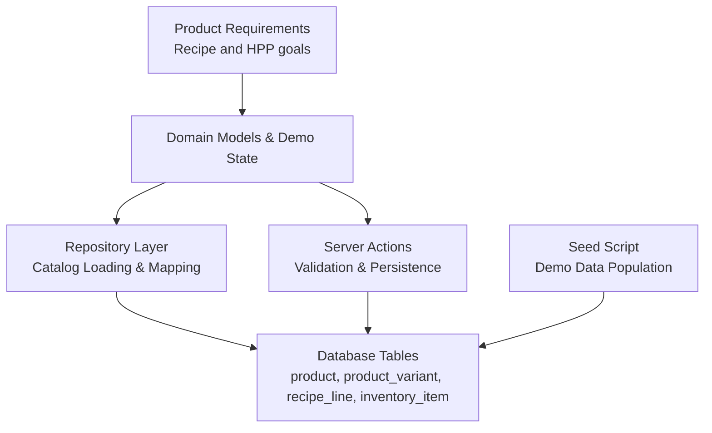
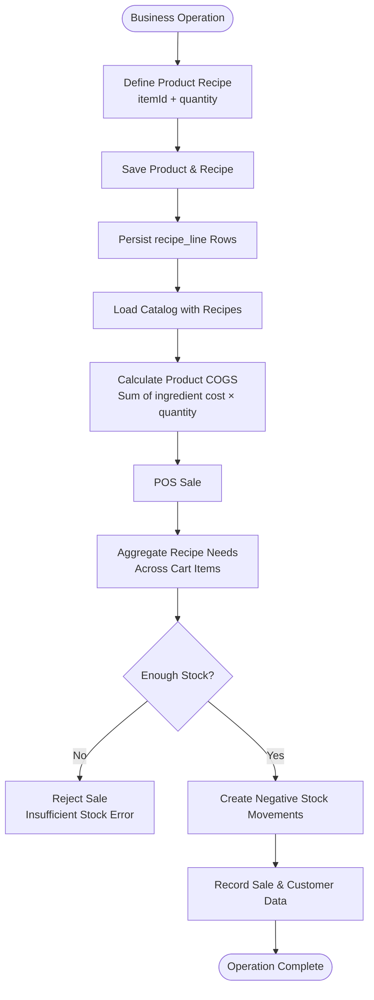
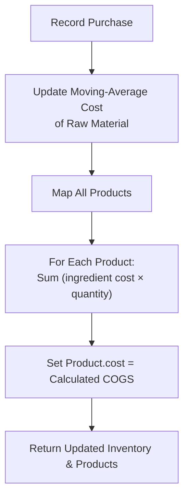
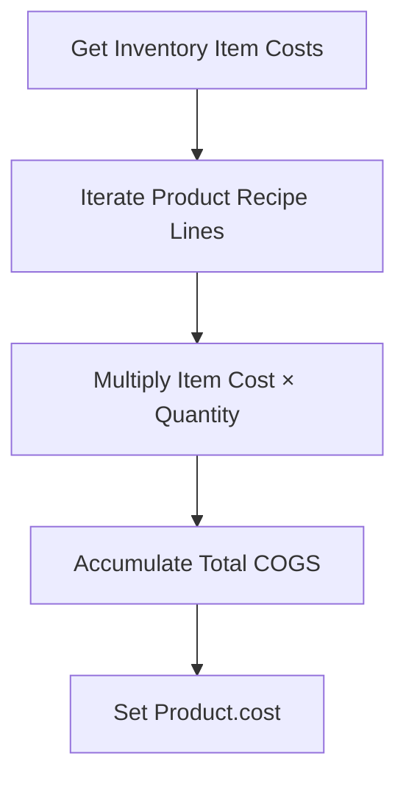
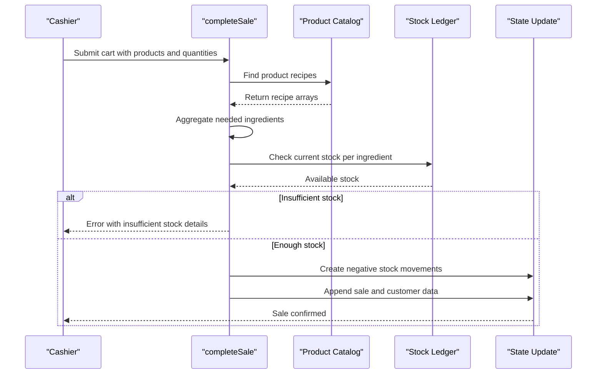
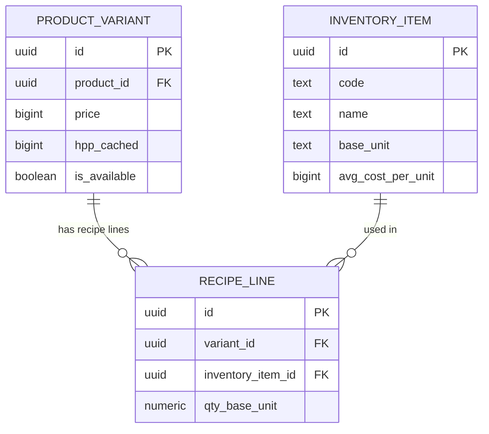
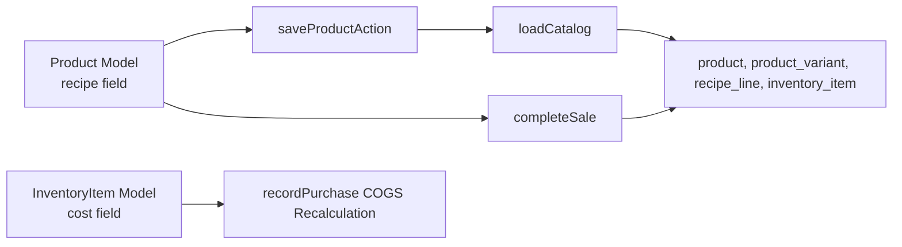

# Recipe and BOM Management

<cite>
**Referenced Files in This Document**
- [PRD_Laris_GTNIC2026.md](file://PRD_Laris_GTNIC2026.md)
- [laris-data.ts](file://src/lib/laris-data.ts)
- [actions.ts](file://src/app/actions.ts)
- [repo.ts](file://src/lib/repo.ts)
- [seed.ts](file://scripts/seed.ts)
</cite>

## Table of Contents
1. [Introduction](#introduction)
2. [Project Structure](#project-structure)
3. [Core Components](#core-components)
4. [Architecture Overview](#architecture-overview)
5. [Detailed Component Analysis](#detailed-component-analysis)
6. [Dependency Analysis](#dependency-analysis)
7. [Performance Considerations](#performance-considerations)
8. [Troubleshooting Guide](#troubleshooting-guide)
9. [Conclusion](#conclusion)

## Introduction
This document explains the recipe and Bill of Materials (BOM) management system used by the Laris application. It focuses on how products link to raw materials through recipe arrays, how automatic cost-of-goods calculation works, how sales deduct stock, and how product creation and purchase recording affect profitability. The goal is to make these concepts clear for both technical readers and business users who need to understand menu costing, inventory safety, and recipe-driven operations.

The system supports F&B businesses where recipes define exactly how much of each raw material a product consumes. Recipes are stored as arrays of ingredient mappings with an item identifier and quantity. When purchases change raw-material costs, product costs are recalculated automatically. When sales occur, stock is deducted atomically based on the product recipes.

## Project Structure
The recipe and BOM logic spans several layers:

- Domain data models and demo state live in the library module.
- Server actions validate and persist product and purchase changes.
- Repository functions load catalog data from the database and map rows into domain objects.
- Seed scripts populate the database with realistic products, variants, and recipe lines.
- The product requirements document defines the business goals for recipe-level inventory and HPP tracking.



**Diagram sources**
- [PRD_Laris_GTNIC2026.md:175-185](file://PRD_Laris_GTNIC2026.md#L175-L185)
- [laris-data.ts:3-13](file://src/lib/laris-data.ts#L3-L13)
- [actions.ts:191-215](file://src/app/actions.ts#L191-L215)
- [repo.ts:82-112](file://src/lib/repo.ts#L82-L112)
- [seed.ts:54-64](file://scripts/seed.ts#L54-L64)

**Section sources**
- [PRD_Laris_GTNIC2026.md:175-185](file://PRD_Laris_GTNIC2026.md#L175-L185)
- [laris-data.ts:3-13](file://src/lib/laris-data.ts#L3-L13)
- [actions.ts:191-215](file://src/app/actions.ts#L191-L215)
- [repo.ts:82-112](file://src/lib/repo.ts#L82-L112)
- [seed.ts:54-64](file://scripts/seed.ts#L54-L64)

## Core Components
The core components for recipe and BOM management are:

| Component | Responsibility | Key Behavior |
|---|---|---|
| Product interface | Defines product metadata and its recipe | Contains `recipe` as an array of `{ itemId, quantity }` entries |
| InventoryItem interface | Defines raw materials and their unit cost | Used to compute product COGS from current inventory prices |
| StockMovement interface | Records ledger-style stock changes | Tracks sales, purchases, and adjustments |
| completeSale function | Processes POS sales | Validates cart, aggregates recipe needs, checks stock, records movements |
| recordPurchase function | Records raw-material purchases | Updates moving-average cost and recalculates all product costs |
| saveProductAction | Persists product and recipe changes | Validates recipe array and calls database RPC |
| loadCatalog function | Loads product, variant, and recipe data | Maps database rows into `Product["recipe"]` arrays |
| seed script | Populates database with demo products and recipes | Inserts `recipe_line` rows per product |

**Section sources**
- [laris-data.ts:3-32](file://src/lib/laris-data.ts#L3-L32)
- [laris-data.ts:123-133](file://src/lib/laris-data.ts#L123-L133)
- [laris-data.ts:215-334](file://src/lib/laris-data.ts#L215-L334)
- [actions.ts:191-215](file://src/app/actions.ts#L191-L215)
- [repo.ts:82-112](file://src/lib/repo.ts#L82-L112)
- [seed.ts:54-64](file://scripts/seed.ts#L54-L64)

## Architecture Overview
At a high level, recipe and BOM management connects three main flows:

1. **Recipe definition:** Products declare their ingredients through the `recipe` field.
2. **Cost calculation:** Raw-material costs drive automatic COGS computation for every product.
3. **Sales processing:** Each sold product triggers recipe-based stock deduction.



**Diagram sources**
- [laris-data.ts:3-13](file://src/lib/laris-data.ts#L3-L13)
- [laris-data.ts:215-305](file://src/lib/laris-data.ts#L215-L305)
- [repo.ts:82-112](file://src/lib/repo.ts#L82-L112)

**Section sources**
- [laris-data.ts:3-13](file://src/lib/laris-data.ts#L3-L13)
- [laris-data.ts:215-305](file://src/lib/laris-data.ts#L215-L305)
- [repo.ts:82-112](file://src/lib/repo.ts#L82-L112)

## Detailed Component Analysis

### Product Interface and Recipe Field Structure
The `Product` interface defines the shape of a sellable menu item. Its most important field for BOM management is `recipe`, which is an array of ingredient mappings. Each mapping contains:

- `itemId`: A string identifier that links to an inventory item.
- `quantity`: A numeric amount in the inventory item’s base unit.

Concrete examples include:

| Product | Recipe Ingredients |
|---|---|
| Es Kopi Susu | beans 18g, milk 150ml, syrup 20ml, cups 1 piece |
| Americano | beans 18g, cups 1 piece |
| Matcha Latte | matcha-powder 4g, milk 180ml, syrup 10ml, cups 1 piece |
| Butter Croissant | pastry 1 piece |
| Cappuccino | beans 18g, milk 150ml, cups 1 piece |
| Iced Chocolate | cocoa-powder 25g, milk 180ml, cups 1 piece |
| Es Teh Melati | tea 1 sachet, syrup 15ml, cups 1 piece |

These examples show how complex recipes can combine multiple raw materials, including dry goods, liquids, and packaging.

```mermaid
classDiagram
class Product {
+string id
+string name
+string category
+number price
+number cost
+number sold
+string image
+{ itemId : string; quantity : number }[] recipe
+boolean active
}
class InventoryItem {
+string id
+string name
+string unit
+number openingStock
+number reorderPoint
+number cost
+string supplier
}
class StockMovement {
+string id
+string itemId
+number quantity
+string type
+string reference
+string createdAt
}
Product --> InventoryItem : "uses through recipe.itemId"
StockMovement --> InventoryItem : "tracks changes per itemId"
```

**Diagram sources**
- [laris-data.ts:3-32](file://src/lib/laris-data.ts#L3-L32)
- [laris-data.ts:112-133](file://src/lib/laris-data.ts#L112-L133)

**Section sources**
- [laris-data.ts:3-13](file://src/lib/laris-data.ts#L3-L13)
- [laris-data.ts:112-133](file://src/lib/laris-data.ts#L112-L133)

### Automatic COGS Calculation Based on Ingredient Costs
The system calculates product cost by summing the cost of each recipe line multiplied by its required quantity. When raw-material costs change, product costs are recalculated automatically.

Key behaviors:

- Product cost equals the sum of `(inventory item cost × recipe quantity)` across all recipe lines.
- Purchasing raw materials updates the moving-average cost of that item.
- After updating the inventory cost, the system recomputes the cost for every product that uses the changed item.
- This ensures that menu profitability reflects current supply costs.



**Diagram sources**
- [laris-data.ts:307-334](file://src/lib/laris-data.ts#L307-L334)

**Section sources**
- [laris-data.ts:307-334](file://src/lib/laris-data.ts#L307-L334)

### Recipe Validation and Input Safety
Recipe validation occurs at two levels:

1. **Server action validation:** The product input schema requires a `recipe` array where each entry has a valid code and a positive quantity, with a maximum of 100 recipe lines.
2. **Runtime validation:** Functions like `findInventory` throw errors when an unknown ingredient ID is referenced.

This means:

- Invalid or missing ingredient IDs are rejected before persistence.
- Excessive recipe complexity is bounded by a maximum line count.
- Quantity values must be valid numbers.
- Unknown inventory items cause explicit errors rather than silently failing.

**Section sources**
- [actions.ts:191-199](file://src/app/actions.ts#L191-L199)
- [laris-data.ts:149-153](file://src/lib/laris-data.ts#L149-L153)

### Ingredient Substitution Handling
In the current implementation, there is no built-in automatic ingredient substitution mechanism. The recipe system uses exact `itemId` references. If a business wants to substitute an ingredient, it should update the product recipe to point to the new inventory item.

Recommended operational approach:

- Create a new inventory item for the substitute ingredient.
- Edit the product recipe to replace the old `itemId` with the new one.
- Recalculate product cost after saving the updated recipe.
- Monitor margin impact before publishing the change.

This approach keeps recipes explicit, auditable, and easy to trace through stock movements and cost reports.

**Section sources**
- [laris-data.ts:3-13](file://src/lib/laris-data.ts#L3-L13)
- [actions.ts:191-215](file://src/app/actions.ts#L191-L215)

### Version Control for Recipe Changes
The current repository does not implement explicit recipe versioning such as version numbers, effective dates, or change history tables. Recipe changes are persisted through the product and `recipe_line` tables.

Operational recommendations aligned with the codebase:

- Treat recipe edits as configuration changes that directly affect COGS and stock deduction.
- Use audit logs and team roles to track who changed a recipe.
- Test recipe changes against current inventory costs before making them live.
- For production systems, consider adding version fields, effective dates, and change reasons to support rollback and compliance.

**Section sources**
- [actions.ts:191-215](file://src/app/actions.ts#L191-L215)
- [repo.ts:82-112](file://src/lib/repo.ts#L82-L112)

### Creating Complex Recipes with Multiple Ingredients
Complex recipes are supported by allowing multiple entries in the `recipe` array. Examples include:

- Beverages combining coffee, milk, syrup, and cups.
- Non-coffee drinks combining powder, milk, syrup, and cups.
- Pastries using a single pastry base.
- Tea drinks combining tea bags, syrup, and cups.

When creating a complex recipe:

1. Ensure each `itemId` exists in inventory.
2. Use the correct base unit for each ingredient.
3. Keep quantities realistic for one serving.
4. Validate that total recipe lines stay within limits.
5. Confirm that the resulting COGS produces acceptable margins.

**Section sources**
- [laris-data.ts:123-133](file://src/lib/laris-data.ts#L123-L133)
- [actions.ts:191-199](file://src/app/actions.ts#L191-L199)

### Calculating Recipe Costs from Current Inventory Prices
Recipe cost calculation follows this logic:

- Retrieve the current cost of each inventory item.
- Multiply each item’s cost by the recipe quantity.
- Sum those values to get the product’s COGS.
- Update the product’s `cost` field accordingly.

This process runs automatically when purchases update raw-material costs.



**Diagram sources**
- [laris-data.ts:321-326](file://src/lib/laris-data.ts#L321-L326)

**Section sources**
- [laris-data.ts:321-326](file://src/lib/laris-data.ts#L321-L326)

### Handling Recipe Modifications That Affect Profitability
Recipe modifications directly affect product profitability because COGS is derived from ingredient costs and quantities.

Impact scenarios:

- Increasing ingredient quantity raises COGS and reduces gross margin.
- Switching to a more expensive ingredient raises COGS.
- Reducing portion size lowers COGS but may affect quality.
- Changing raw-material purchase prices automatically updates COGS for dependent products.

Business guidance:

- Review product cost and margin after every recipe change.
- Compare selling price against updated COGS.
- Adjust pricing if margins fall below target thresholds.
- Track historical recipe changes through audit and team permissions.

**Section sources**
- [laris-data.ts:307-334](file://src/lib/laris-data.ts#L307-L334)
- [actions.ts:191-215](file://src/app/actions.ts#L191-L215)

### Relationship Between Recipes and Stock Deduction During Sales
During sales processing, the system:

1. Validates the cart and totals.
2. Aggregates recipe needs across all cart items.
3. Checks available stock for every required ingredient.
4. Rejects the sale if any ingredient is insufficient.
5. Creates negative stock movements for each ingredient.
6. Records the sale and customer information.



**Diagram sources**
- [laris-data.ts:215-305](file://src/lib/laris-data.ts#L215-L305)

**Section sources**
- [laris-data.ts:215-305](file://src/lib/laris-data.ts#L215-L305)

### Database Representation of Recipes
The database stores recipes through `recipe_line` rows that connect product variants to inventory items. The repository layer loads these rows and maps them into `Product["recipe"]` arrays.

Key relationships:

- `product_variant` holds pricing and cached HPP.
- `recipe_line` links a variant to an inventory item with a base-unit quantity.
- `inventory_item` holds the raw material’s base unit and average cost.
- `loadCatalog` builds product objects with populated recipe arrays.



**Diagram sources**
- [repo.ts:74-112](file://src/lib/repo.ts#L74-L112)
- [seed.ts:54-64](file://scripts/seed.ts#L54-L64)

**Section sources**
- [repo.ts:74-112](file://src/lib/repo.ts#L74-L112)
- [seed.ts:54-64](file://scripts/seed.ts#L54-L64)

## Dependency Analysis
The recipe and BOM system has clear dependencies between domain models, server actions, repository loading, and database tables.



**Diagram sources**
- [laris-data.ts:3-32](file://src/lib/laris-data.ts#L3-L32)
- [actions.ts:191-215](file://src/app/actions.ts#L191-L215)
- [repo.ts:82-112](file://src/lib/repo.ts#L82-L112)

**Section sources**
- [laris-data.ts:3-32](file://src/lib/laris-data.ts#L3-L32)
- [actions.ts:191-215](file://src/app/actions.ts#L191-L215)
- [repo.ts:82-112](file://src/lib/repo.ts#L82-L112)

## Performance Considerations
Recipe and BOM operations have several performance implications:

- **Cart aggregation:** Aggregating recipe needs across multiple cart items is linear in the number of cart lines and recipe lines.
- **Stock validation:** Checking stock for each required ingredient involves scanning stock movements, which is linear in movement history.
- **COGS recalculation:** Updating product costs iterates over all products and their recipe lines after a purchase.
- **Catalog loading:** Loading recipes joins product, variant, and recipe-line data, then groups recipe lines by variant.

Optimization opportunities:

- Cache current stock levels instead of recomputing from movements on every check.
- Index recipe lookups by variant or product code.
- Limit full-product COGS recalculation to only affected products when possible.
- Paginate catalog loading carefully, as already implemented for large datasets.

[No sources needed since this section provides general guidance]

## Troubleshooting Guide
Common issues and resolutions related to recipe and BOM management:

| Issue | Likely Cause | Resolution |
|---|---|---|
| Sale rejected due to insufficient stock | One or more recipe ingredients lack enough inventory | Increase stock through purchases or adjust order quantities |
| Unknown ingredient error | Recipe references an invalid `itemId` | Verify the ingredient exists in inventory and update the recipe |
| Product cost seems incorrect | Raw-material cost changed or recipe quantity changed | Recheck inventory cost and recipe quantities |
| Recipe too long | More than allowed recipe lines | Consolidate ingredients or split into modifiers |
| Margin dropped after recipe change | COGS increased without price adjustment | Review COGS and adjust selling price or reduce ingredient usage |
| Recipe not reflected in catalog | Database recipe lines not saved or loaded correctly | Verify `save_product` RPC and `recipe_line` rows |

**Section sources**
- [laris-data.ts:149-153](file://src/lib/laris-data.ts#L149-L153)
- [laris-data.ts:270-276](file://src/lib/laris-data.ts#L270-L276)
- [laris-data.ts:321-326](file://src/lib/laris-data.ts#L321-L326)
- [actions.ts:191-215](file://src/app/actions.ts#L191-L215)

## Conclusion
The Laris recipe and BOM system centers on a simple but powerful idea: products are defined by explicit ingredient recipes, and those recipes drive both stock deduction and cost calculation. The `Product.recipe` field provides a clear mapping between menu items and raw materials. Purchases update raw-material costs, which automatically propagate to product COGS. Sales aggregate recipe needs, validate stock, and create ledger-style stock movements.

For F&B businesses, this model delivers accurate menu costing, safer inventory planning, and clearer profitability insights. While the current implementation does not include automatic ingredient substitution or explicit recipe versioning, it provides a solid foundation for manual recipe management, cost tracking, and stock control. Future enhancements can add versioned recipes, substitution rules, and advanced forecasting while preserving the core relationship between recipes, inventory, and sales.

[No sources needed since this section summarizes without analyzing specific files]