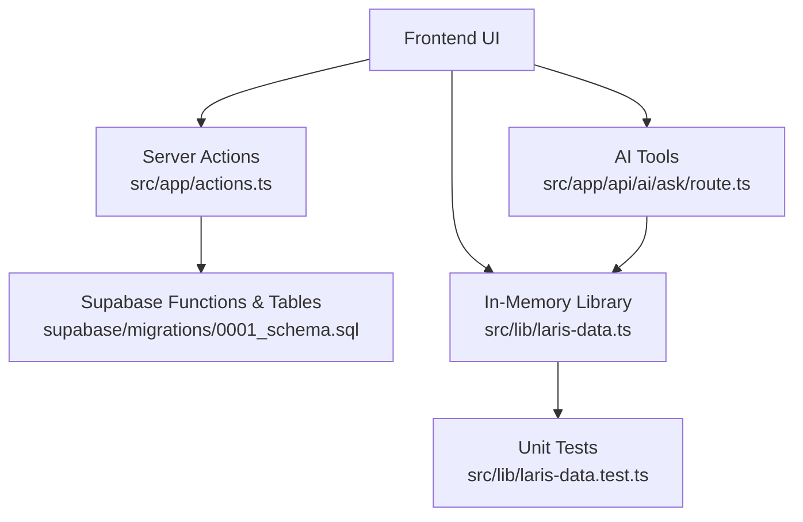
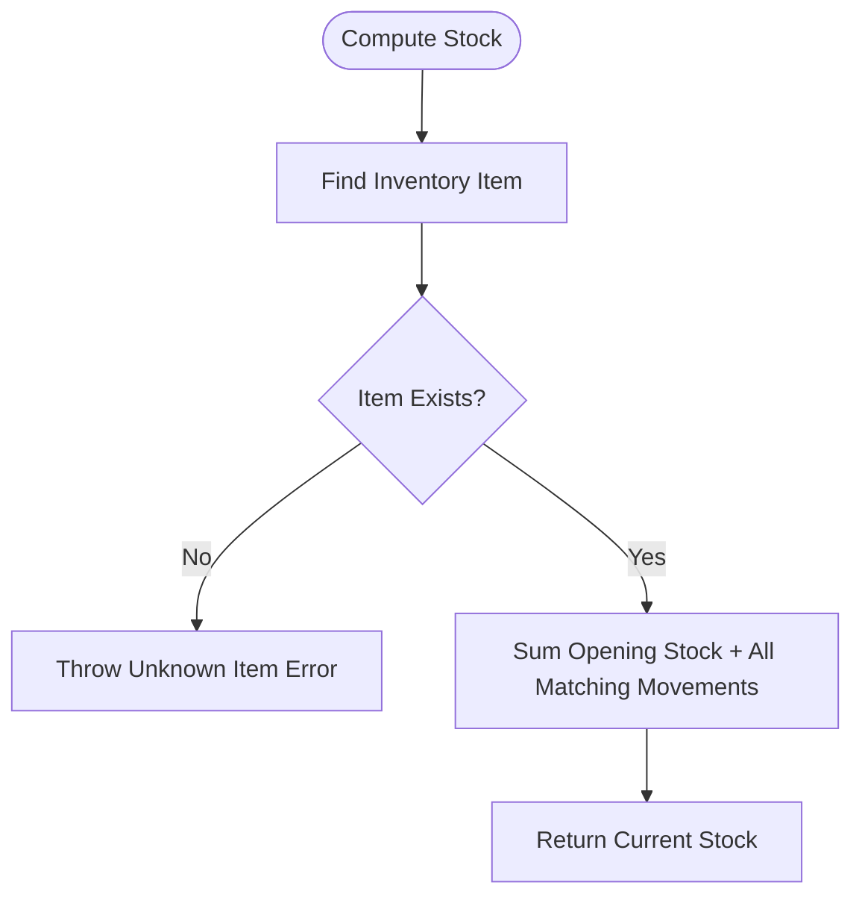
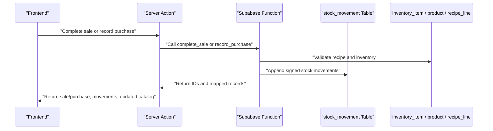
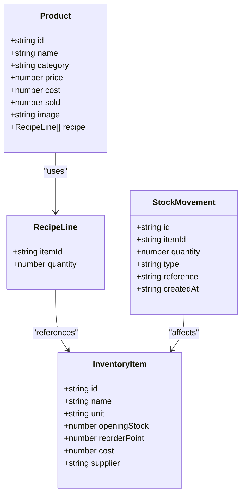
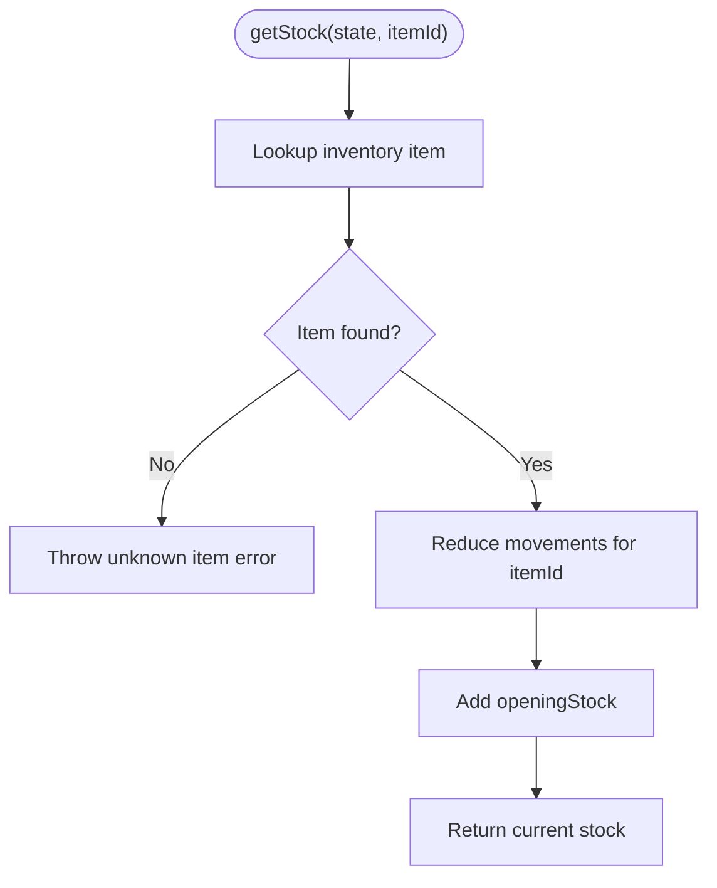
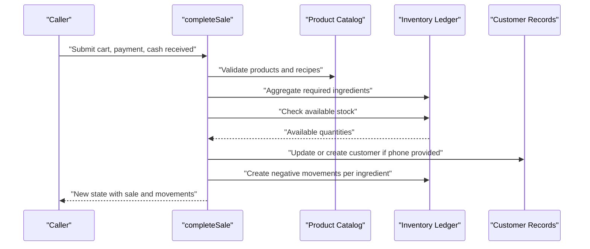
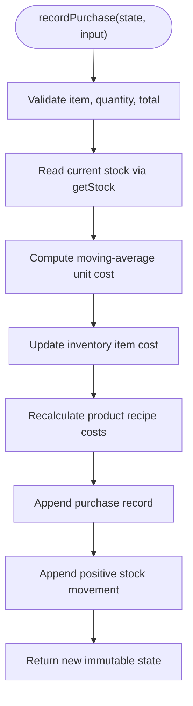
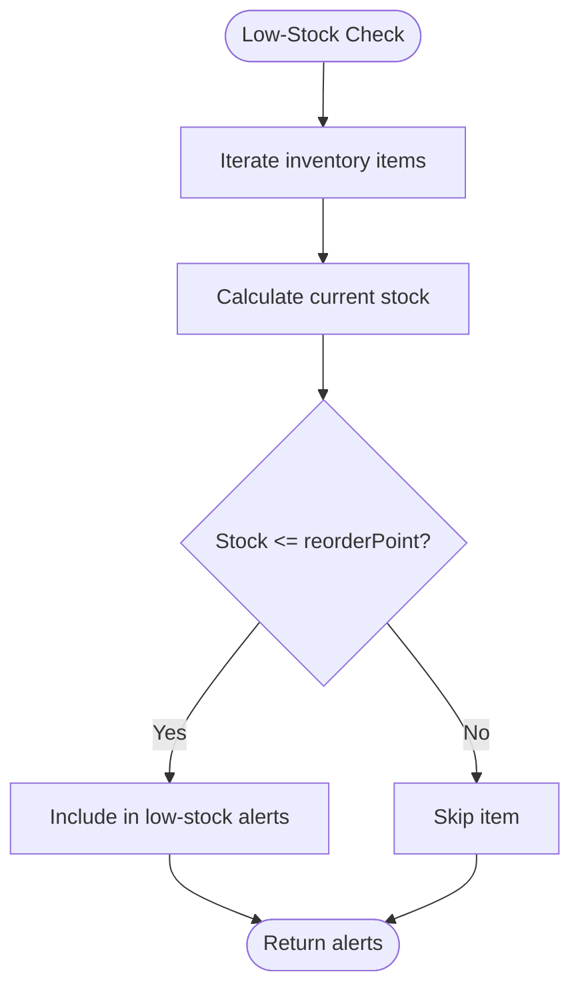
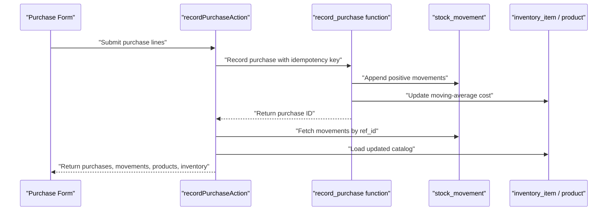
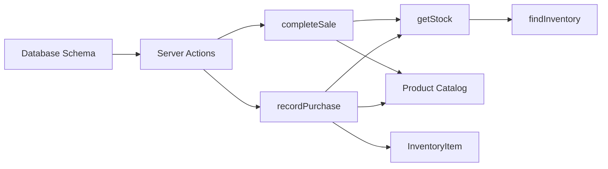

# Stock Tracking and Ledger System

<cite>
**Referenced Files in This Document**
- [laris-data.ts](file://src/lib/laris-data.ts)
- [laris-data.test.ts](file://src/lib/laris-data.test.ts)
- [actions.ts](file://src/app/actions.ts)
- [0001_schema.sql](file://supabase/migrations/0001_schema.sql)
- [ask/route.ts](file://src/app/api/ai/ask/route.ts)
- [PRD_Laris_GTNIC2026.md](file://PRD_Laris_GTNIC2026.md)
</cite>

## Table of Contents
1. [Introduction](#introduction)
2. [Project Structure](#project-structure)
3. [Core Components](#core-components)
4. [Architecture Overview](#architecture-overview)
5. [Detailed Component Analysis](#detailed-component-analysis)
6. [Dependency Analysis](#dependency-analysis)
7. [Performance Considerations](#performance-considerations)
8. [Troubleshooting Guide](#troubleshooting-guide)
9. [Conclusion](#conclusion)

## Introduction
This document explains the ledger-based stock tracking system used by the application. The system models inventory as an immutable append-only ledger: current stock is never mutated directly, but instead calculated by summing opening stock with all signed stock movements. Sales automatically create negative movements for every recipe ingredient, while purchases create positive movements and update moving-average unit costs. Reorder-point thresholds enable low-stock alerts and can drive purchasing workflows.

The implementation exists at two levels:
- In-memory business logic and types in the TypeScript library.
- Persistent schema and server actions that integrate with a Supabase-backed relational database.

## Project Structure
The stock tracking system spans several layers:

- TypeScript data model and pure functions define `StockMovement`, `InventoryItem`, `Product`, `BusinessState`, and core operations such as `getStock`, `completeSale`, and `recordPurchase`.
- Server actions validate inputs, enforce roles, call database functions, and return mapped results to the frontend.
- Database migrations define the canonical ledger table and related catalog tables.
- AI tools expose low-stock alert queries over the same state model.
- Tests verify immutability, rounding behavior, shortage validation, and purchase cost propagation.

**Diagram sources**
- [actions.ts:52-124](file://src/app/actions.ts#L52-L124)
- [0001_schema.sql:73-88](file://supabase/migrations/0001_schema.sql#L73-L88)
- [0001_schema.sql:203-216](file://supabase/migrations/0001_schema.sql#L203-L216)
- [laris-data.ts:25-32](file://src/lib/laris-data.ts#L25-L32)
- [laris-data.ts:172-176](file://src/lib/laris-data.ts#L172-L176)
- [ask/route.ts:140-151](file://src/app/api/ai/ask/route.ts#L140-L151)

**Section sources**
- [laris-data.ts:1-110](file://src/lib/laris-data.ts#L1-L110)
- [actions.ts:1-30](file://src/app/actions.ts#L1-L30)
- [0001_schema.sql:1-10](file://supabase/migrations/0001_schema.sql#L1-L10)

## Core Components
The core of the system is the `StockMovement` interface and the immutable ledger approach it represents.

### StockMovement Interface
`StockMovement` captures one atomic change to inventory:

| Field | Meaning | Notes |
|---|---|---|
| `id` | Unique movement identifier | Used for auditability and linking to higher-level entities. |
| `itemId` | Inventory item being affected | Links the movement to an inventory record. |
| `quantity` | Signed quantity delta | Positive for purchases or adjustments; negative for sales or waste. |
| `type` | Movement category | In-memory type is `'sale' | 'purchase' | 'adjustment'`; the database supports additional categories such as `'opening'`, `'waste'`, and `'opname'`. |
| `reference` | Linking identifier | Usually a sale ID or purchase ID. |
| `createdAt` | Timestamp of the movement | Enables chronological audit trails. |

The in-memory type is intentionally narrower than the database type. The database allows more operational movement types, while the demo library focuses on sales, purchases, and adjustments.

**Section sources**
- [laris-data.ts:25-32](file://src/lib/laris-data.ts#L25-L32)
- [0001_schema.sql:203-216](file://supabase/migrations/0001_schema.sql#L203-L216)

### Immutable Ledger Approach
Current inventory is not stored as a mutable counter. Instead:

1. Each inventory item has an `openingStock`.
2. Every transaction appends a new `StockMovement`.
3. Current stock is computed by summing `openingStock` plus all relevant signed movements.

This design guarantees:
- Full auditability.
- No hidden mutations.
- Deterministic reconciliation.
- Safe replay of historical events.

**Diagram sources**
- [laris-data.ts:149-153](file://src/lib/laris-data.ts#L149-L153)
- [laris-data.ts:172-176](file://src/lib/laris-data.ts#L172-L176)

**Section sources**
- [laris-data.ts:149-176](file://src/lib/laris-data.ts#L149-L176)
- [laris-data.test.ts:133-138](file://src/lib/laris-data.test.ts#L133-L138)
- [laris-data.test.ts:352-361](file://src/lib/laris-data.test.ts#L352-L361)

## Architecture Overview
The system combines in-memory state management with persistent relational storage.

**Diagram sources**
- [actions.ts:52-89](file://src/app/actions.ts#L52-L89)
- [actions.ts:97-124](file://src/app/actions.ts#L97-L124)
- [0001_schema.sql:120-127](file://supabase/migrations/0001_schema.sql#L120-L127)
- [0001_schema.sql:203-216](file://supabase/migrations/0001_schema.sql#L203-L216)

**Section sources**
- [actions.ts:52-124](file://src/app/actions.ts#L52-L124)
- [0001_schema.sql:120-127](file://supabase/migrations/0001_schema.sql#L120-L127)

## Detailed Component Analysis

### Stock Movement Model
The in-memory `StockMovement` is a simple, immutable event record. It does not contain business context beyond what is needed to calculate stock changes and link back to a sale or purchase.

**Diagram sources**
- [laris-data.ts:3-23](file://src/lib/laris-data.ts#L3-L23)
- [laris-data.ts:25-32](file://src/lib/laris-data.ts#L25-L32)

**Section sources**
- [laris-data.ts:3-32](file://src/lib/laris-data.ts#L3-L32)

### getStock Function
`getStock` calculates current inventory by:
1. Finding the inventory item.
2. Starting from `openingStock`.
3. Summing all `stockMovements` where `itemId` matches.
4. Returning the resulting number.

Complexity:
- Time: O(M), where M is the number of stock movements.
- Space: O(1) extra space during reduction.

Validation:
- If the item is unknown, it throws an error rather than returning zero.
- Adjustments, sales, and purchases are treated uniformly as signed deltas.

**Diagram sources**
- [laris-data.ts:149-153](file://src/lib/laris-data.ts#L149-L153)
- [laris-data.ts:172-176](file://src/lib/laris-data.ts#L172-L176)

**Section sources**
- [laris-data.ts:149-176](file://src/lib/laris-data.ts#L149-L176)
- [laris-data.test.ts:133-138](file://src/lib/laris-data.test.ts#L133-L138)
- [laris-data.test.ts:352-361](file://src/lib/laris-data.test.ts#L352-L361)

### completeSale Function
`completeSale` implements automatic stock deduction through negative stock movements.

Key behaviors:
- Validates cart items, payment method, channel, cash received, and optional customer details.
- Aggregates recipe requirements across all cart lines before checking stock.
- Rejects the entire sale if any ingredient is insufficient.
- Creates one negative movement per ingredient, linked to the sale ID.
- Updates customers only when a valid phone is provided.
- Returns a new immutable state containing the sale and appended movements.

**Diagram sources**
- [laris-data.ts:215-305](file://src/lib/laris-data.ts#L215-L305)

**Section sources**
- [laris-data.ts:215-305](file://src/lib/laris-data.ts#L215-L305)
- [laris-data.test.ts:170-201](file://src/lib/laris-data.test.ts#L170-L201)
- [laris-data.test.ts:219-246](file://src/lib/laris-data.test.ts#L219-L246)
- [laris-data.test.ts:290-305](file://src/lib/laris-data.test.ts#L290-L305)

### recordPurchase Function
`recordPurchase` records a positive stock movement and updates moving-average costs.

Key behaviors:
- Validates the inventory item, quantity, and total cost.
- Computes the next average unit cost using existing stock and the new purchase total.
- Rounds the average cost to four decimal places to support fractional rupiah per base unit.
- Recalculates product costs based on updated ingredient costs.
- Appends both a purchase record and a positive stock movement.
- Returns a new immutable state without mutating the input.

**Diagram sources**
- [laris-data.ts:307-334](file://src/lib/laris-data.ts#L307-L334)

**Section sources**
- [laris-data.ts:307-334](file://src/lib/laris-data.ts#L307-L334)
- [laris-data.test.ts:307-340](file://src/lib/laris-data.test.ts#L307-L340)

### Low-Stock Alerts and Reorder Points
Low-stock alerts compare current stock against `reorderPoint`:

- In-memory: `getStock(state, item.id)` returns current stock.
- Alert condition: `currentStock <= reorderPoint`.
- AI tool: `getLowStockAlerts` maps inventory items into alert objects and filters those at or below the threshold.

**Diagram sources**
- [laris-data.ts:172-176](file://src/lib/laris-data.ts#L172-L176)
- [ask/route.ts:140-151](file://src/app/api/ai/ask/route.ts#L140-L151)

**Section sources**
- [laris-data.ts:15-23](file://src/lib/laris-data.ts#L15-L23)
- [ask/route.ts:140-151](file://src/app/api/ai/ask/route.ts#L140-L151)

### Integration with Purchasing Workflows
The server action layer integrates the in-memory concepts with persistent operations:

- `completeSaleAction` validates inputs, calls a database function, and returns the persisted sale, sale-related stock movements, and optionally the customer.
- `recordPurchaseAction` validates purchase lines, calls a database function, and returns purchase lines, purchase-related stock movements, and refreshed catalog data.
- `saveInventoryItemAction` persists inventory metadata, including `reorderPoint`, and can create an adjustment movement when opening or counted stock differs.

**Diagram sources**
- [actions.ts:91-124](file://src/app/actions.ts#L91-L124)
- [0001_schema.sql:218-237](file://supabase/migrations/0001_schema.sql#L218-L237)
- [0001_schema.sql:203-216](file://supabase/migrations/0001_schema.sql#L203-L216)

**Section sources**
- [actions.ts:91-124](file://src/app/actions.ts#L91-L124)
- [actions.ts:237-271](file://src/app/actions.ts#L237-L271)

### Examples of Reconciliation, Variance Reporting, and Audit Trails
Although this section describes conceptual usage patterns, they are grounded in the implemented interfaces and tests:

- **Reconciliation:** Use `getStock` to compute current stock from `openingStock` and `stockMovements`. Compare this value with physical counts to identify discrepancies.
- **Variance Reporting:** Create adjustment movements with positive or negative quantities to reconcile differences between system stock and physical stock.
- **Audit Trail:** Every movement includes `id`, `itemId`, `quantity`, `type`, `reference`, and `createdAt`. Sales and purchases provide stable references for tracing stock changes back to business transactions.

Tests demonstrate:
- Adjustment movements increase or decrease stock without affecting unrelated items.
- Purchase movements preserve decimal quantities and round monetary totals.
- Sales aggregate shared recipe ingredients into one movement per ingredient.

**Section sources**
- [laris-data.test.ts:352-361](file://src/lib/laris-data.test.ts#L352-L361)
- [laris-data.test.ts:307-340](file://src/lib/laris-data.test.ts#L307-L340)
- [laris-data.test.ts:170-201](file://src/lib/laris-data.test.ts#L170-L201)

## Dependency Analysis
The stock tracking system has clear dependency boundaries:

- `getStock` depends on `findInventory` and the `stockMovements` array.
- `completeSale` depends on product recipes, cart validation, customer lookup, and `getStock`.
- `recordPurchase` depends on `getStock`, inventory lookup, and product recipe recalculation.
- Server actions depend on Zod validation, membership checks, Supabase RPC calls, and mapping functions.
- Database schema defines the canonical ledger and catalog relationships.

**Diagram sources**
- [laris-data.ts:149-176](file://src/lib/laris-data.ts#L149-L176)
- [laris-data.ts:215-334](file://src/lib/laris-data.ts#L215-L334)
- [actions.ts:52-124](file://src/app/actions.ts#L52-L124)
- [0001_schema.sql:73-88](file://supabase/migrations/0001_schema.sql#L73-L88)

**Section sources**
- [laris-data.ts:149-334](file://src/lib/laris-data.ts#L149-L334)
- [actions.ts:52-124](file://src/app/actions.ts#L52-L124)

## Performance Considerations
- `getStock` scans all stock movements for an item. For large ledgers, consider:
  - Indexing by `inventory_item_id` and `outlet_id`.
  - Caching current stock snapshots for read-heavy reports.
  - Partitioning or archiving old movements by date.
- `completeSale` aggregates recipe requirements before validating stock, preventing partial deductions and overselling.
- `recordPurchase` recalculates product costs after updating inventory costs; batch updates should be considered for bulk catalog changes.
- Server actions use Zod validation and role checks to reduce invalid database work.

[No sources needed since this section provides general guidance]

## Troubleshooting Guide
Common issues and their causes:

| Symptom | Likely Cause | Resolution |
|---|---|---|
| `getStock` throws unknown item error | `itemId` does not exist in inventory | Verify inventory catalog and ensure the item was created before recording movements. |
| Sale fails due to insufficient stock | Total recipe requirement exceeds available stock | Review aggregated recipe consumption and adjust order size or replenish stock. |
| Cash tender rejected | Cash received is less than total for cash payments | Increase cash received or apply discount/tax according to business rules. |
| Purchase does not update stock | Invalid quantity or total | Ensure positive numeric values and correct inventory item code. |
| Low-stock alerts missing | Current stock is above `reorderPoint` | Confirm `getStock` calculation and review recent movements. |
| Duplicate sale or purchase | Missing idempotency handling | Provide a stable idempotency key and retry safely. |

**Section sources**
- [laris-data.ts:149-153](file://src/lib/laris-data.ts#L149-L153)
- [laris-data.ts:215-305](file://src/lib/laris-data.ts#L215-L305)
- [laris-data.ts:307-334](file://src/lib/laris-data.ts#L307-L334)
- [laris-data.test.ts:219-246](file://src/lib/laris-data.test.ts#L219-L246)
- [laris-data.test.ts:290-305](file://src/lib/laris-data.test.ts#L290-L305)

## Conclusion
The stock tracking system uses an immutable ledger to ensure accurate, auditable inventory accounting. `StockMovement` records every change, `getStock` derives current inventory deterministically, `completeSale` enforces stock availability and creates negative movements, and `recordPurchase` adds positive movements while updating moving-average costs. Reorder points enable proactive low-stock alerts, and server actions bridge in-memory logic with persistent database operations. Together, these components support reliable stock reconciliation, variance reporting, audit trails, and integrated purchasing workflows.

[No sources needed since this section summarizes without analyzing specific files]