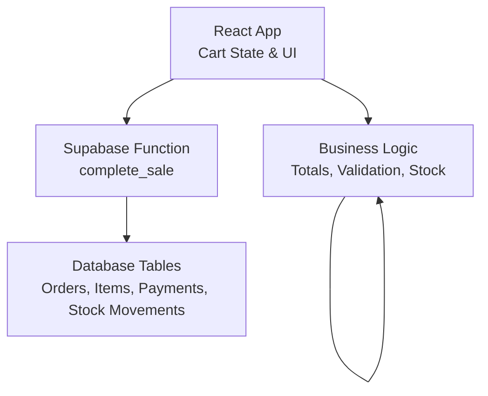
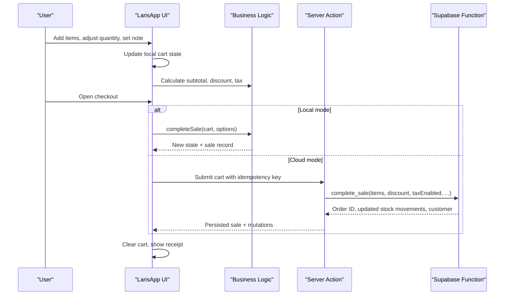
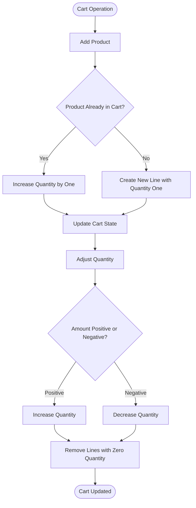
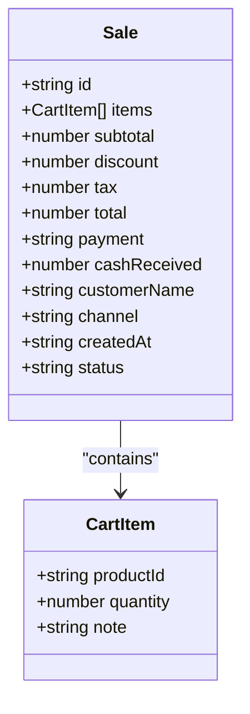
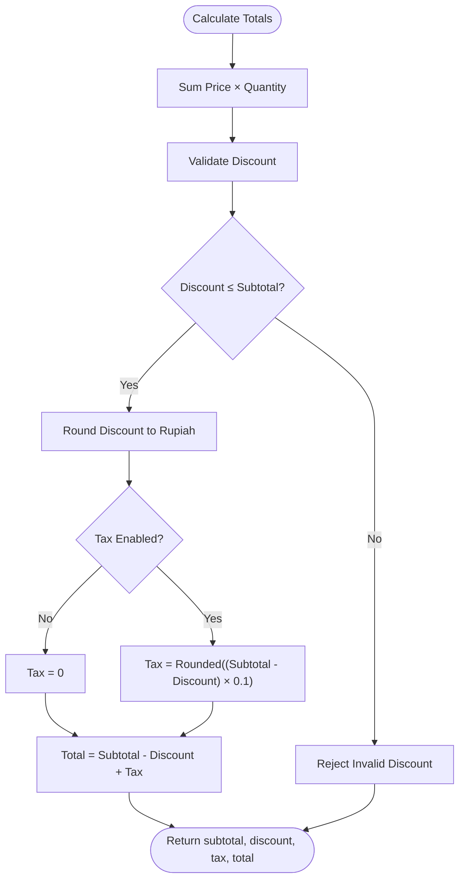
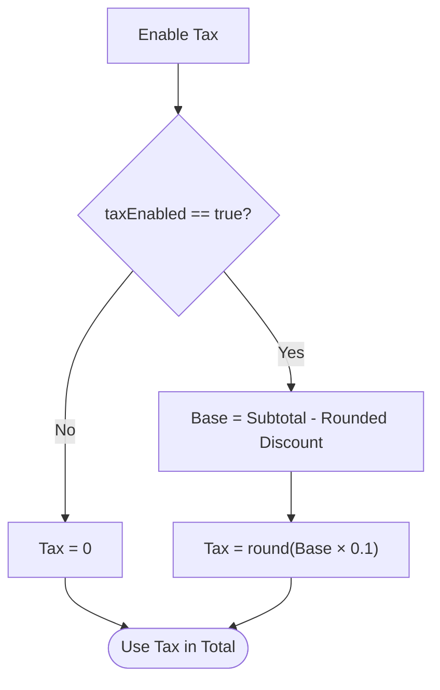
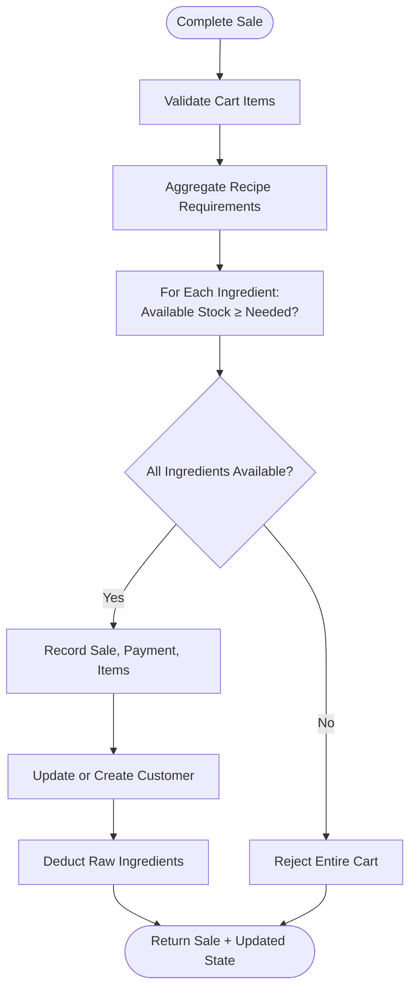
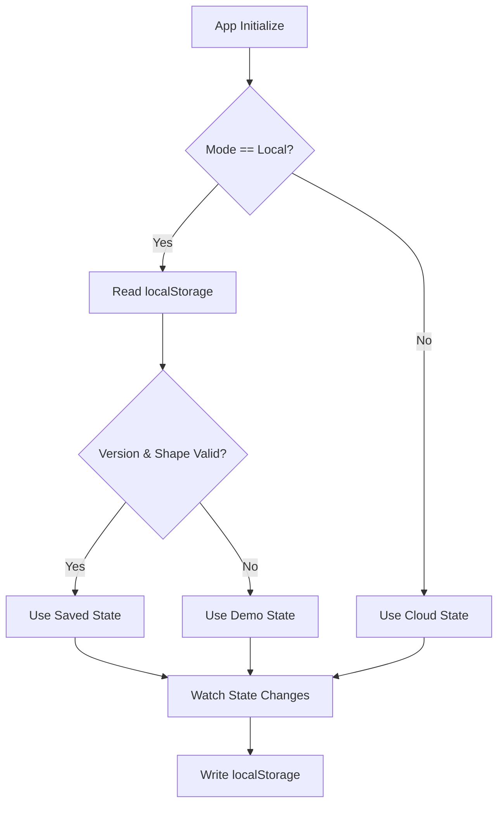
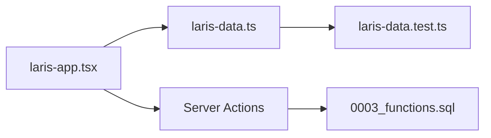

# Cart Management

<cite>
**Referenced Files in This Document**
- [laris-data.ts](file://src/lib/laris-data.ts)
- [laris-app.tsx](file://src/components/laris-app.tsx)
- [0003_functions.sql](file://supabase/migrations/0003_functions.sql)
- [laris-data.test.ts](file://src/lib/laris-data.test.ts)
</cite>

## Table of Contents
1. [Introduction](#introduction)
2. [Project Structure](#project-structure)
3. [Core Components](#core-components)
4. [Architecture Overview](#architecture-overview)
5. [Detailed Component Analysis](#detailed-component-analysis)
6. [Dependency Analysis](#dependency-analysis)
7. [Performance Considerations](#performance-considerations)
8. [Troubleshooting Guide](#troubleshooting-guide)
9. [Conclusion](#conclusion)

## Introduction
This document explains the cart management system used by the application. It covers how cart items are added, adjusted, and removed; how customer notes are captured; how discounts and taxes are calculated; how product availability is validated against inventory recipes; and how carts persist locally or synchronize through a cloud checkout flow. The goal is to make the cart logic understandable for both developers and non-technical readers while remaining grounded in the actual implementation.

## Project Structure
The cart system spans three layers:

- **Data layer**: Pure functions define cart item types, catalog lookup, validation, totals, stock calculations, sale completion, purchases, and order parsing.
- **UI layer**: A React component manages local cart state, user interactions, real-time price updates, discount input, tax toggling, and checkout flows.
- **Cloud layer**: A database function performs authoritative pricing, validation, idempotent checkout, stock locking, ledger writes, and audit logging.

**Diagram sources**
- [laris-app.tsx:99-267](file://src/components/laris-app.tsx#L99-L267)
- [laris-data.ts:178-305](file://src/lib/laris-data.ts#L178-L305)
- [0003_functions.sql:94-230](file://supabase/migrations/0003_functions.sql#L94-L230)

**Section sources**
- [laris-app.tsx:81-267](file://src/components/laris-app.tsx#L81-L267)
- [laris-data.ts:34-110](file://src/lib/laris-data.ts#L34-L110)
- [0003_functions.sql:1-10](file://supabase/migrations/0003_functions.sql#L1-L10)

## Core Components
The cart system is built around these core concepts:

| Concept | Responsibility | Key Implementation |
|---|---|---|
| Cart Item | Represents one menu line with product identifier, quantity, and optional note | `CartItem` interface |
| Catalog Lookup | Finds product prices and recipe ingredients | `findProduct`, product list |
| Inventory Stock | Computes available raw material stock from opening stock and movements | `getStock` |
| Totals Calculation | Computes subtotal, discount, tax, and total | `getCartTotal` |
| Sale Completion | Validates, checks stock, records sales, updates customers and stock movements | `completeSale` |
| Purchase Recording | Adds raw materials, updates moving-average cost, refreshes product costs | `recordPurchase` |
| Voice Order Parsing | Converts natural language into cart items and payment method | `parseOrder` |
| UI Cart State | Manages adding, updating quantities, removing items, notes, discount, tax toggle, and checkout | React state and handlers |

**Section sources**
- [laris-data.ts:34-110](file://src/lib/laris-data.ts#L34-L110)
- [laris-data.ts:143-194](file://src/lib/laris-data.ts#L143-L194)
- [laris-data.ts:215-334](file://src/lib/laris-data.ts#L215-L334)
- [laris-data.ts:436-474](file://src/lib/laris-data.ts#L436-L474)
- [laris-app.tsx:99-211](file://src/components/laris-app.tsx#L99-L211)

## Architecture Overview
The cart workflow has two execution paths:

1. **Local mode**: The UI calls pure business logic functions directly.
2. **Cloud mode**: The UI sends cart data to a server action that calls a Supabase function.

**Diagram sources**
- [laris-app.tsx:213-267](file://src/components/laris-app.tsx#L213-L267)
- [laris-data.ts:215-305](file://src/lib/laris-data.ts#L215-L305)
- [0003_functions.sql:94-230](file://supabase/migrations/0003_functions.sql#L94-L230)

## Detailed Component Analysis

### Cart State Management
The UI maintains the cart as an array of cart items. Each item contains a product identifier, quantity, and optional note.

Key behaviors:

- **Add item**: If the product already exists in the cart, its quantity increases by one; otherwise, a new line is created with quantity one.
- **Adjust quantity**: Increasing or decreasing quantity is supported; lines with zero or negative quantity are removed.
- **Remove item**: Quantity can be reduced until it reaches zero, effectively removing the line.
- **Clear cart**: The entire cart can be cleared, resetting discount and related state.

**Diagram sources**
- [laris-app.tsx:208-211](file://src/components/laris-app.tsx#L208-L211)

**Section sources**
- [laris-app.tsx:99-100](file://src/components/laris-app.tsx#L99-L100)
- [laris-app.tsx:208-211](file://src/components/laris-app.tsx#L208-L211)

### Customer Notes
Customer notes allow special requests such as “less sugar” or “no ice.” Notes are part of each cart item and survive persistence.

Behavior:

- Notes are optional strings.
- The UI renders a per-item note field.
- When submitting to the backend, only present notes are included.
- Business logic validates that notes are strings when provided.
- Parsed voice orders can also include recognized modifiers as notes.

**Diagram sources**
- [laris-data.ts:34-53](file://src/lib/laris-data.ts#L34-L53)

**Section sources**
- [laris-data.ts:34-38](file://src/lib/laris-data.ts#L34-L38)
- [laris-data.ts:161-170](file://src/lib/laris-data.ts#L161-L170)
- [laris-app.tsx:216-217](file://src/components/laris-app.tsx#L216-L217)
- [laris-data.test.ts:203-217](file://src/lib/laris-data.test.ts#L203-L217)

### Discount Application Logic
Discounts are applied after subtotal calculation and before tax calculation.

Rules:

- Discounts must be valid numbers.
- Discounts cannot exceed the subtotal.
- Discounts are rounded to whole rupiah.
- Tax is calculated on the discounted amount.
- The UI caps the discount input at the current subtotal.

Algorithm summary:

1. Compute subtotal from product prices and quantities.
2. Validate discount.
3. Round discount to rupiah.
4. If tax is enabled, compute tax as ten percent of discounted subtotal.
5. Compute final total as subtotal minus rounded discount plus tax.

**Diagram sources**
- [laris-data.ts:178-194](file://src/lib/laris-data.ts#L178-L194)

**Section sources**
- [laris-data.ts:178-194](file://src/lib/laris-data.ts#L178-L194)
- [laris-app.tsx:197-200](file://src/components/laris-app.tsx#L197-L200)
- [laris-data.test.ts:146-153](file://src/lib/laris-data.test.ts#L146-L153)

### Tax Calculation Algorithms
Tax is implemented as a demo restaurant tax at ten percent. It is not automatically applied; it must be explicitly enabled.

Key points:

- Tax is disabled by default.
- When enabled, tax equals ten percent of the discounted subtotal.
- Tax is rounded to whole rupiah.
- The UI shows the computed tax value and allows toggling it.
- The cloud function mirrors this behavior.

**Diagram sources**
- [laris-data.ts:188-191](file://src/lib/laris-data.ts#L188-L191)
- [0003_functions.sql:158-159](file://supabase/migrations/0003_functions.sql#L158-L159)

**Section sources**
- [laris-data.ts:178-194](file://src/lib/laris-data.ts#L178-L194)
- [laris-app.tsx:105](file://src/components/laris-app.tsx#L105)
- [laris-app.tsx:197-200](file://src/components/laris-app.tsx#L197-L200)
- [0003_functions.sql:158-159](file://supabase/migrations/0003_functions.sql#L158-L159)

### Product Availability and Stock Validation
Carts are not just price lists; they consume raw ingredients defined by product recipes. Before completing a sale, the system aggregates all required ingredients across all cart lines and validates total availability.

Validation rules:

- Each cart line references a known active product.
- Quantities must be safe positive integers.
- Recipe ingredient requirements are aggregated across duplicate products and multiple lines.
- Available stock is computed from opening stock plus signed stock movements.
- If any ingredient is insufficient, the entire cart is rejected atomically.
- On success, one negative stock movement is recorded per ingredient.

**Diagram sources**
- [laris-data.ts:262-305](file://src/lib/laris-data.ts#L262-L305)

**Section sources**
- [laris-data.ts:143-153](file://src/lib/laris-data.ts#L143-L153)
- [laris-data.ts:172-176](file://src/lib/laris-data.ts#L172-L176)
- [laris-data.ts:262-305](file://src/lib/laris-data.ts#L262-L305)
- [laris-data.test.ts:170-246](file://src/lib/laris-data.test.ts#L170-L246)

### Real-Time Price Updates
Real-time price updates happen in the UI whenever:

- An item is added or removed.
- Quantity changes.
- Discount changes.
- Tax toggle changes.

The UI computes:

- Cart subtotal without discount or tax.
- Applied discount capped at subtotal.
- Final cart total using the business logic totals function.
- Total item count for badges and summaries.

This ensures users see accurate totals before checkout.

**Section sources**
- [laris-app.tsx:197-200](file://src/components/laris-app.tsx#L197-L200)
- [laris-app.tsx:208-211](file://src/components/laris-app.tsx#L208-L211)

### Cart Persistence Across Sessions
In local mode, the full business state is persisted to browser storage.

Persistence rules:

- The app loads saved state on startup if the version and structure match expectations.
- On every state change, the app saves the serialized state.
- Errors during load or save are handled gracefully with notifications.
- In cloud mode, persistence is delegated to the database; the UI updates from returned mutations.

**Diagram sources**
- [laris-app.tsx:146-168](file://src/components/laris-app.tsx#L146-L168)

**Section sources**
- [laris-app.tsx:146-168](file://src/components/laris-app.tsx#L146-L168)

### Synchronization Between Devices
Synchronization is achieved through the cloud checkout path rather than direct client-to-client sync.

Flow:

1. The UI builds a cart locally.
2. On checkout, the UI sends cart data to a server action.
3. The server action calls a Supabase function with an idempotency key.
4. The database function validates pricing, stock, and payment, then returns persisted results.
5. The UI merges returned sales, stock movements, and customer data into local state.

Idempotency prevents duplicate orders on retries, double taps, or offline recovery.

**Section sources**
- [laris-app.tsx:213-267](file://src/components/laris-app.tsx#L213-L267)
- [0003_functions.sql:127-132](file://supabase/migrations/0003_functions.sql#L127-L132)
- [0003_functions.sql:181-190](file://supabase/migrations/0003_functions.sql#L181-L190)

### Relationship Between Cart Items and Product Availability
Each product defines a recipe mapping to raw inventory items. The cart does not directly reserve inventory; instead, stock is validated at sale time.

Important implications:

- Adding items to the cart does not reduce stock.
- Multiple cart lines sharing ingredients are aggregated.
- Insufficient shared stock rejects the entire cart.
- Successful sales create one stock movement per ingredient.
- Purchases increase stock and update moving-average ingredient cost, which affects product cost calculations.

**Section sources**
- [laris-data.ts:123-133](file://src/lib/laris-data.ts#L123-L133)
- [laris-data.ts:262-305](file://src/lib/laris-data.ts#L262-L305)
- [laris-data.test.ts:170-246](file://src/lib/laris-data.test.ts#L170-L246)

## Dependency Analysis
The cart system has clear boundaries between UI, business logic, and database functions.

**Diagram sources**
- [laris-app.tsx:14-25](file://src/components/laris-app.tsx#L14-L25)
- [laris-data.ts:178-334](file://src/lib/laris-data.ts#L178-L334)
- [laris-data.test.ts:1-10](file://src/lib/laris-data.test.ts#L1-L10)
- [0003_functions.sql:94-230](file://supabase/migrations/0003_functions.sql#L94-L230)

**Section sources**
- [laris-app.tsx:14-25](file://src/components/laris-app.tsx#L14-L25)
- [laris-data.ts:178-334](file://src/lib/laris-data.ts#L178-L334)
- [laris-data.test.ts:1-10](file://src/lib/laris-data.test.ts#L1-L10)
- [0003_functions.sql:94-230](file://supabase/migrations/0003_functions.sql#L94-L230)

## Performance Considerations
- **Cart totals**: Computed from arrays of cart items and catalog entries. For typical POS use, this is fast, but large catalogs or very large carts should be profiled.
- **Stock aggregation**: Recipe aggregation runs once per sale. Shared ingredients are grouped, avoiding redundant checks.
- **Local persistence**: Writing to browser storage on every state change is simple but may cause frequent writes; consider debouncing if state becomes larger.
- **Cloud checkout**: Idempotency keys prevent duplicate work and protect against network retries.
- **Voice parsing**: Natural language parsing creates intermediate arrays and regex matches; keep parsed text short and avoid unnecessary re-parsing.

[No sources needed since this section provides general guidance]

## Troubleshooting Guide

### Common Validation Errors
| Symptom | Likely Cause | Resolution |
|---|---|---|
| Empty cart error | No items submitted | Add at least one valid product |
| Unknown menu error | Product ID not found in catalog | Verify product code and active status |
| Invalid quantity error | Non-positive, unsafe, or non-integer quantity | Use safe positive integers |
| Discount exceeds subtotal | Discount greater than subtotal | Reduce discount or add more items |
| Insufficient cash error | Cash received less than total | Enter enough cash or switch payment method |
| Stock shortage error | Shared ingredient stock insufficient | Reduce quantities or restock ingredients |
| Invalid phone error | Phone number outside allowed format | Use 8–15 digits with optional leading plus |

**Section sources**
- [laris-data.ts:161-170](file://src/lib/laris-data.ts#L161-L170)
- [laris-data.ts:240-260](file://src/lib/laris-data.ts#L240-L260)
- [laris-data.ts:271-276](file://src/lib/laris-data.ts#L271-L276)
- [laris-data.test.ts:256-288](file://src/lib/laris-data.test.ts#L256-L288)
- [laris-data.test.ts:386-400](file://src/lib/laris-data.test.ts#L386-L400)

### Debugging Cart Totals
To verify totals:

1. Confirm product prices exist in the catalog.
2. Confirm quantities are safe positive integers.
3. Confirm discount is non-negative and not greater than subtotal.
4. Confirm tax toggle matches expected behavior.
5. Compare computed totals with test assertions.

**Section sources**
- [laris-data.ts:178-194](file://src/lib/laris-data.ts#L178-L194)
- [laris-data.test.ts:146-153](file://src/lib/laris-data.test.ts#L146-L153)

### Debugging Stock Shortages
To debug stock issues:

1. Identify all products in the cart.
2. Expand their recipes into raw ingredients.
3. Aggregate required quantities per ingredient.
4. Compare required quantities against available stock.
5. Restock or reduce cart quantities until all ingredients pass.

**Section sources**
- [laris-data.ts:262-305](file://src/lib/laris-data.ts#L262-L305)
- [laris-data.test.ts:219-246](file://src/lib/laris-data.test.ts#L219-L246)

## Conclusion
The cart management system combines a straightforward UI-driven cart with robust business logic and a secure cloud checkout path. It supports item addition, quantity adjustments, removal, customer notes, percentage-style discount capping, fixed rupiah discount rounding, optional ten percent tax, and strict product availability validation based on recipe consumption. Local persistence enables session continuity, while cloud synchronization ensures durable, idempotent transactions across devices. For future enhancements, consider explicit percentage-based discount inputs, configurable tax rates, optimistic UI updates with rollback, and richer availability previews before checkout.

[No sources needed since this section summarizes without analyzing specific files]