# Checkout Flow

<cite>
**Referenced Files in This Document**
- [laris-app.tsx](file://src/components/laris-app.tsx)
- [actions.ts](file://src/app/actions.ts)
- [laris-data.ts](file://src/lib/laris-data.ts)
- [0001_schema.sql](file://supabase/migrations/0001_schema.sql)
- [0003_functions.sql](file://supabase/migrations/0003_functions.sql)
- [0005_production_hardening.sql](file://supabase/migrations/0005_production_hardening.sql)
- [README.md](file://README.md)
- [PRD_Laris_GTNIC2026.md](file://PRD_Laris_GTNIC2026.md)
</cite>

## Table of Contents
1. [Introduction](#introduction)
2. [Project Structure](#project-structure)
3. [Core Components](#core-components)
4. [Architecture Overview](#architecture-overview)
5. [Detailed Component Analysis](#detailed-component-analysis)
6. [Dependency Analysis](#dependency-analysis)
7. [Performance Considerations](#performance-considerations)
8. [Troubleshooting Guide](#troubleshooting-guide)
9. [Conclusion](#conclusion)

## Introduction
This document explains the complete checkout flow from cart review to receipt generation. It covers order validation, stock availability checks, price verification, transaction recording, automatic recipe-based inventory deduction, digital receipt formatting and delivery, voice-to-cart checkout, manual order entry, payment confirmation, edge cases such as last-minute item changes, payment method changes, and order cancellations, and the relationship between POS transactions and financial reporting.

The system supports two execution modes:
- Local demo mode: all logic runs in the browser using deterministic functions and local state.
- Cloud mode: server actions call Supabase RPC functions that perform authoritative validation, pricing, stock checks, ledger writes, and audit logging.

**Section sources**
- [README.md:24-35](file://README.md#L24-L35)
- [PRD_Laris_GTNIC2026.md:151-165](file://PRD_Laris_GTNIC2026.md#L151-L165)

## Project Structure
The checkout flow spans four layers:
- UI layer: `laris-app.tsx` manages the POS cart, voice input, checkout submission, receipt modal, and navigation.
- Server action layer: `actions.ts` validates inputs, enforces roles, calls database RPCs, and maps results back to the UI model.
- Database layer: schema defines sales, payments, orders, customers, inventory, recipes, and stock movements; functions implement atomic checkout and purchase workflows.
- Domain logic layer: `laris-data.ts` provides local models, cart totals, stock aggregation, deterministic checkout, purchase recording, and voice parsing.

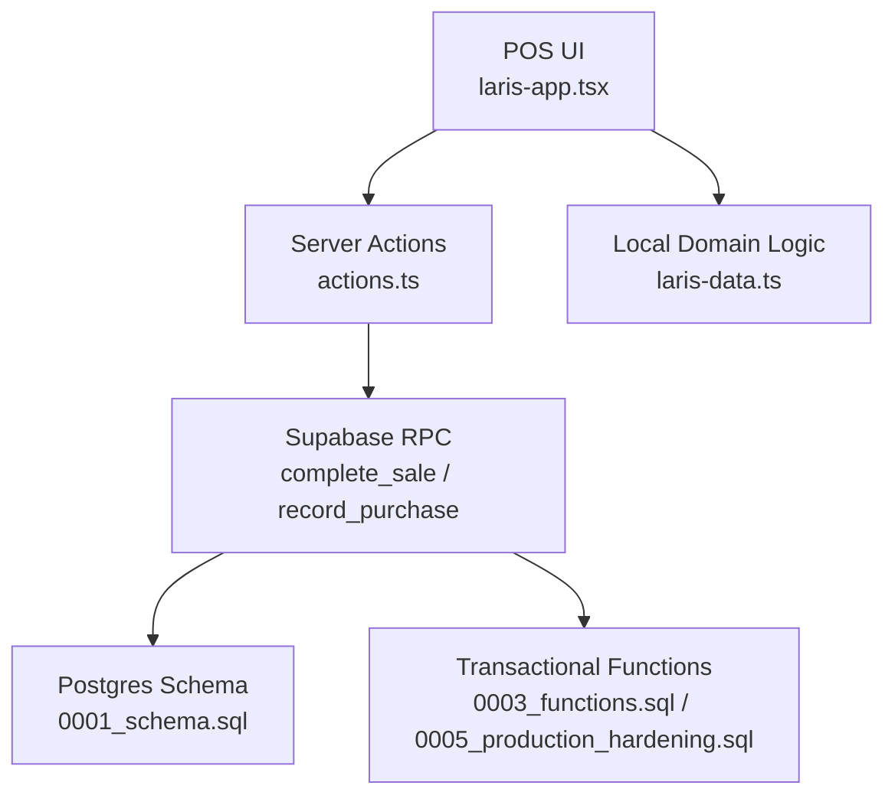

**Diagram sources**
- [laris-app.tsx:214-268](file://src/components/laris-app.tsx#L214-L268)
- [actions.ts:40-89](file://src/app/actions.ts#L40-L89)
- [0001_schema.sql:153-216](file://supabase/migrations/0001_schema.sql#L153-L216)
- [0003_functions.sql:90-230](file://supabase/migrations/0003_functions.sql#L90-L230)
- [0005_production_hardening.sql:84-214](file://supabase/migrations/0005_production_hardening.sql#L84-L214)
- [laris-data.ts:178-305](file://src/lib/laris-data.ts#L178-L305)

**Section sources**
- [laris-app.tsx:1-134](file://src/components/laris-app.tsx#L1-L134)
- [actions.ts:1-50](file://src/app/actions.ts#L1-L50)
- [0001_schema.sql:1-10](file://supabase/migrations/0001_schema.sql#L1-L10)
- [laris-data.ts:1-110](file://src/lib/laris-data.ts#L1-L110)

## Core Components
- **POS Cart and Checkout UI**: Builds the cart, computes totals, handles cash input, discount, tax toggle, customer details, and triggers cloud or local checkout.
- **Server Action for Sale Completion**: Validates request shape, checks membership, calls `complete_sale`, then fetches the created order, stock movements, and optional customer.
- **Database Checkout Function**: Performs idempotency, catalog lookup, price calculation, discount/tax rules, cash validation, recipe BOM aggregation, stock reservation, order/payment/item insertion, customer update, stock movement creation, and audit logging.
- **Local Checkout Logic**: Mirrors core validation and stock checks for offline/demo mode, returning updated state and a sale object.
- **Receipt Modal**: Displays formatted receipt data and offers print and next-order actions.

**Section sources**
- [laris-app.tsx:214-268](file://src/components/laris-app.tsx#L214-L268)
- [actions.ts:40-89](file://src/app/actions.ts#L40-L89)
- [0003_functions.sql:90-230](file://supabase/migrations/0003_functions.sql#L90-L230)
- [laris-data.ts:178-305](file://src/lib/laris-data.ts#L178-L305)
- [laris-app.tsx:1154-1154](file://src/components/laris-app.tsx#L1154-L1154)

## Architecture Overview
The checkout architecture is designed around server-side authority and atomicity. The client never trusts its own totals for final accounting. In cloud mode, prices, discounts, taxes, stock levels, and ledger entries are computed inside PostgreSQL. In local mode, deterministic functions simulate the same business rules.

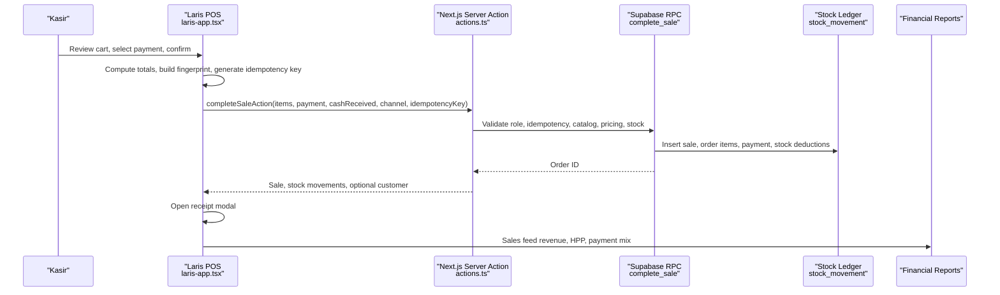

**Diagram sources**
- [laris-app.tsx:214-268](file://src/components/laris-app.tsx#L214-L268)
- [actions.ts:52-89](file://src/app/actions.ts#L52-L89)
- [0003_functions.sql:90-230](file://supabase/migrations/0003_functions.sql#L90-L230)
- [0001_schema.sql:153-216](file://supabase/migrations/0001_schema.sql#L153-L216)

## Detailed Component Analysis

### Order Validation and Price Verification
Order validation occurs at multiple layers:
1. Client-side validation ensures the cart is not empty, quantities are valid integers, product codes exist, notes are strings, and amounts are finite and non-negative.
2. Server action validation uses Zod to enforce allowed payment methods, phone format, discount bounds, item limits, and idempotency key length.
3. Database function validation rejects invalid payment methods, channels, empty or oversized carts, unknown or inactive products, invalid quantities, excessive discounts, insufficient cash, and missing outlets.

Price verification is intentionally server-authoritative:
- Catalog lookup joins product and default variant tables.
- Subtotal is calculated from stored `price`.
- Discount cannot exceed subtotal.
- Tax is applied only when enabled, using a fixed 10% rate on discounted subtotal.
- Total equals subtotal minus discount plus tax.
- Cash received must be at least total for cash payments.

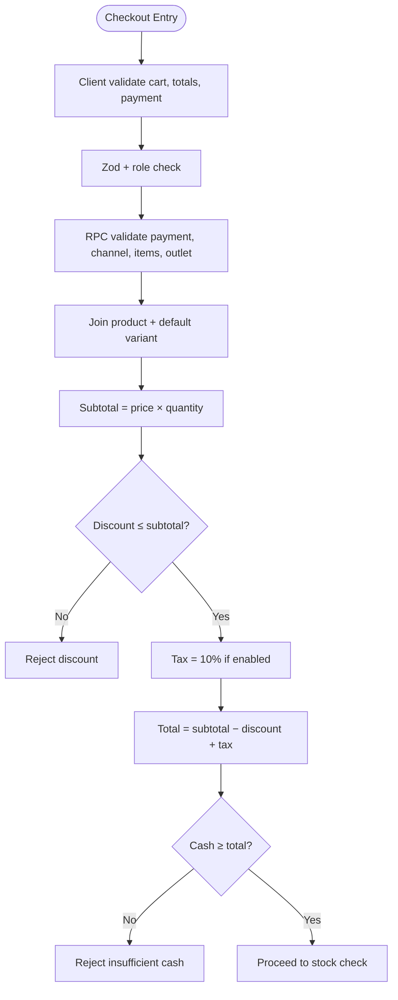

**Diagram sources**
- [laris-data.ts:161-194](file://src/lib/laris-data.ts#L161-L194)
- [actions.ts:40-50](file://src/app/actions.ts#L40-L50)
- [0003_functions.sql:134-162](file://supabase/migrations/0003_functions.sql#L134-L162)
- [0005_production_hardening.sql:123-151](file://supabase/migrations/0005_production_hardening.sql#L123-L151)

**Section sources**
- [laris-data.ts:161-194](file://src/lib/laris-data.ts#L161-L194)
- [actions.ts:40-50](file://src/app/actions.ts#L40-L50)
- [0003_functions.sql:134-162](file://supabase/migrations/0003_functions.sql#L134-L162)
- [0005_production_hardening.sql:123-151](file://supabase/migrations/0005_production_hardening.sql#L123-L151)

### Stock Availability Checks and Recipe BOM Aggregation
Stock validation aggregates recipe requirements before any deduction:
- For each cart item, the system finds the product’s default variant.
- It joins recipe lines to sum required base units per inventory item across the entire basket.
- It locks each affected inventory row and reads current stock via the ledger (`stock_movement`).
- If any ingredient’s available stock is less than needed, checkout fails with an explicit error showing available versus required units.
- Only after all ingredients pass does the system proceed to insert records.

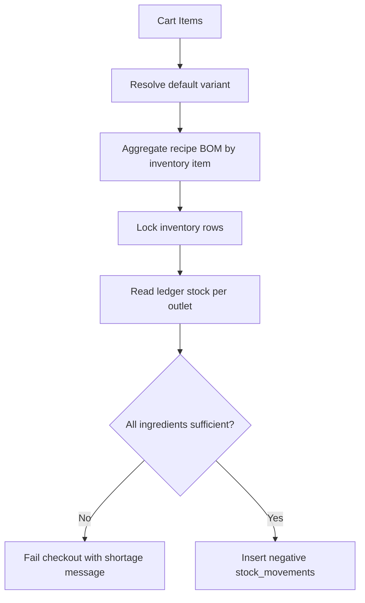

**Diagram sources**
- [0003_functions.sql:164-179](file://supabase/migrations/0003_functions.sql#L164-L179)
- [0005_production_hardening.sql:153-167](file://supabase/migrations/0005_production_hardening.sql#L153-L167)
- [laris-data.ts:262-276](file://src/lib/laris-data.ts#L262-L276)

**Section sources**
- [0003_functions.sql:164-179](file://supabase/migrations/0003_functions.sql#L164-L179)
- [0005_production_hardening.sql:153-167](file://supabase/migrations/0005_production_hardening.sql#L153-L167)
- [laris-data.ts:262-276](file://src/lib/laris-data.ts#L262-L276)

### Transaction Recording Mechanism
Once validation passes, the database function performs an atomic sequence:
1. Create `sales_order` with business, outlet, channel, status, subtotal, discount, tax, total, cash received, idempotency key, and actor.
2. Upsert or create the customer by phone, increment visits and total spend, assign points, update RFM segment, and link the order.
3. Insert `order_item` rows with snapshot pricing and cost.
4. Insert `payment` with method, amount, and paid status.
5. Insert `stock_movement` rows with negative deltas for each aggregated recipe line.
6. Write an audit log entry summarizing total, payment method, channel, and discount.

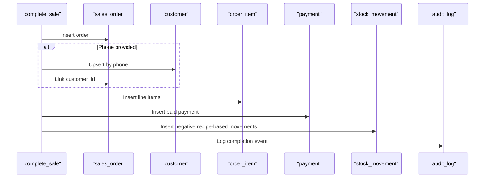

**Diagram sources**
- [0003_functions.sql:181-229](file://supabase/migrations/0003_functions.sql#L181-L229)
- [0005_production_hardening.sql:169-213](file://supabase/migrations/0005_production_hardening.sql#L169-L213)
- [0001_schema.sql:153-216](file://supabase/migrations/0001_schema.sql#L153-L216)

**Section sources**
- [0003_functions.sql:181-229](file://supabase/migrations/0003_functions.sql#L181-L229)
- [0005_production_hardening.sql:169-213](file://supabase/migrations/0005_production_hardening.sql#L169-L213)
- [0001_schema.sql:153-216](file://supabase/migrations/0001_schema.sql#L153-L216)

### Digital Receipt Generation and Delivery
After successful checkout, the UI opens a receipt modal containing:
- Business name and outlet.
- Receipt identifier derived from the sale ID.
- Date and time.
- Customer name.
- Line items with quantity, product name, note, and line total.
- Discount and tax lines when applicable.
- Final total and payment method badge.
- Change amount for cash payments.
- Thank-you message and branding.

Delivery options include:
- Browser print through the receipt container, supporting thermal printer CSS styling.
- A “next order” action to continue POS workflow.
- The PRD specifies WhatsApp receipt links via `wa.me`; the current implementation focuses on browser-printed receipts and internal receipt viewing.

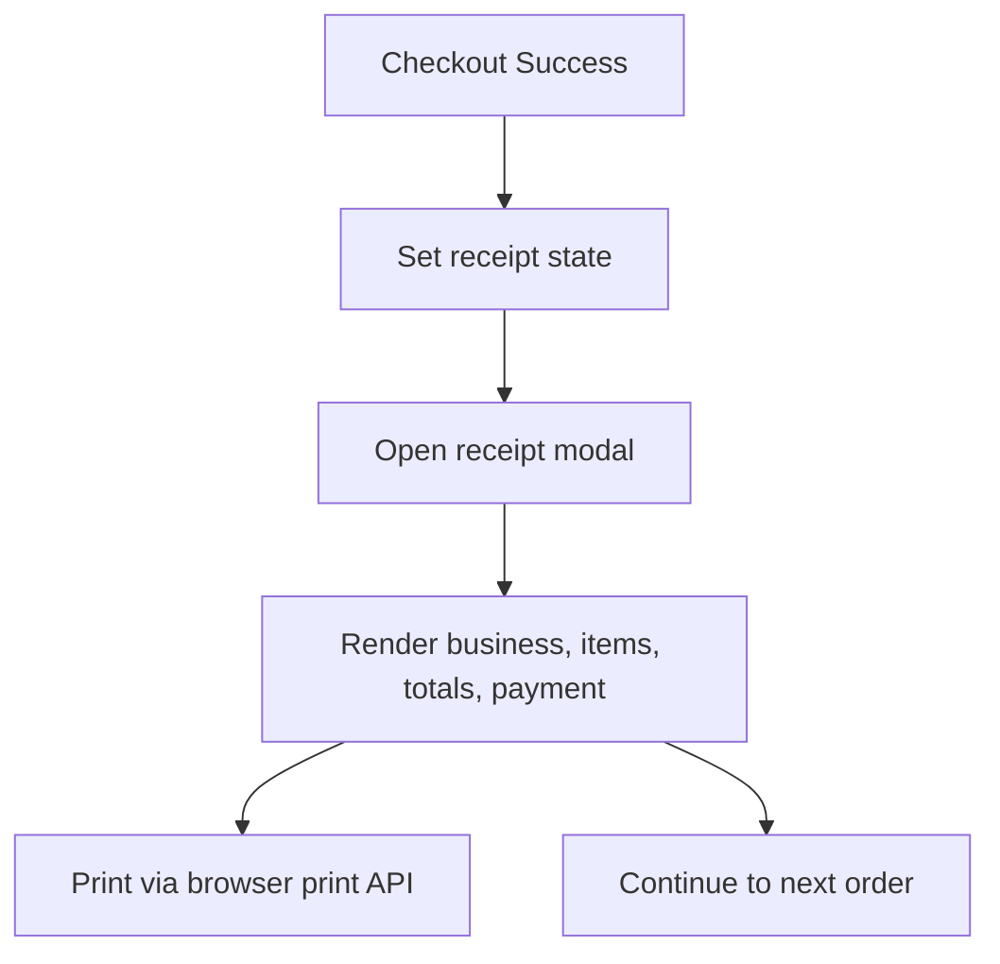

**Diagram sources**
- [laris-app.tsx:255-267](file://src/components/laris-app.tsx#L255-L267)
- [laris-app.tsx:1154-1154](file://src/components/laris-app.tsx#L1154-L1154)
- [PRD_Laris_GTNIC2026.md:157-157](file://PRD_Laris_GTNIC2026.md#L157-L157)

**Section sources**
- [laris-app.tsx:255-267](file://src/components/laris-app.tsx#L255-L267)
- [laris-app.tsx:1154-1154](file://src/components/laris-app.tsx#L1154-L1154)
- [PRD_Laris_GTNIC2026.md:157-157](file://PRD_Laris_GTNIC2026.md#L157-L157)

### Voice-to-Cart Checkout Example
Voice-to-cart checkout follows this path:
1. The cashier starts speech recognition with Indonesian locale.
2. Transcripts are sent to either a local parser or a Gemini-powered parse endpoint.
3. The parser extracts items, quantities, modifiers, and payment method.
4. Unknown items are flagged for human review.
5. The parsed result fills the cart preview before confirmation.

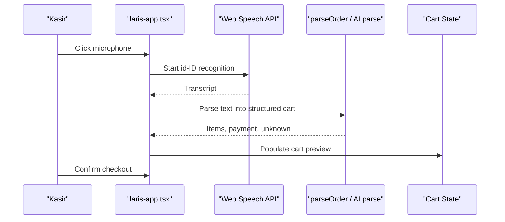

**Diagram sources**
- [laris-app.tsx:312-341](file://src/components/laris-app.tsx#L312-L341)
- [laris-app.tsx:343-360](file://src/components/laris-app.tsx#L343-L360)
- [laris-data.ts:436-474](file://src/lib/laris-data.ts#L436-L474)

**Section sources**
- [laris-app.tsx:312-341](file://src/components/laris-app.tsx#L312-L341)
- [laris-app.tsx:343-360](file://src/components/laris-app.tsx#L343-L360)
- [laris-data.ts:436-474](file://src/lib/laris-data.ts#L436-L474)

### Manual Order Entry Example
Manual order entry allows the cashier to:
- Select products from the catalog.
- Adjust quantities.
- Add notes such as “less sugar.”
- Apply order-level discount.
- Toggle tax.
- Enter cash received for cash payments.
- Provide optional customer name and phone.
- Submit checkout.

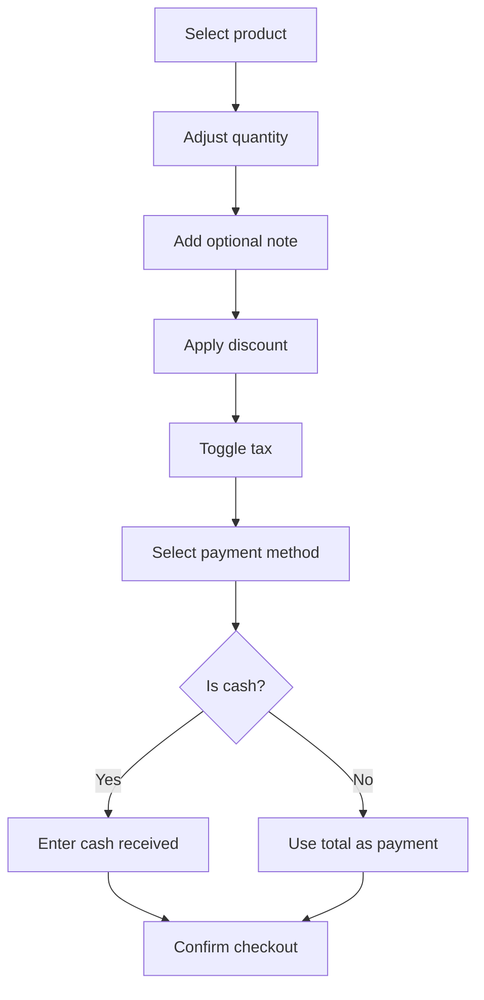

**Diagram sources**
- [laris-app.tsx:99-108](file://src/components/laris-app.tsx#L99-L108)
- [laris-app.tsx:214-268](file://src/components/laris-app.tsx#L214-L268)

**Section sources**
- [laris-app.tsx:99-108](file://src/components/laris-app.tsx#L99-L108)
- [laris-app.tsx:214-268](file://src/components/laris-app.tsx#L214-L268)

### Payment Confirmation Sequence
Payment confirmation differs by method:
- QRIS: The PRD describes sandbox QRIS integration and webhook-driven settlement updates. The current checkout function records a paid payment row; external provider settlement is handled outside this function.
- Cash: The system validates that cash received is at least the total and records the cash received amount.
- Transfer: The system records transfer as a paid payment method without additional cash validation.

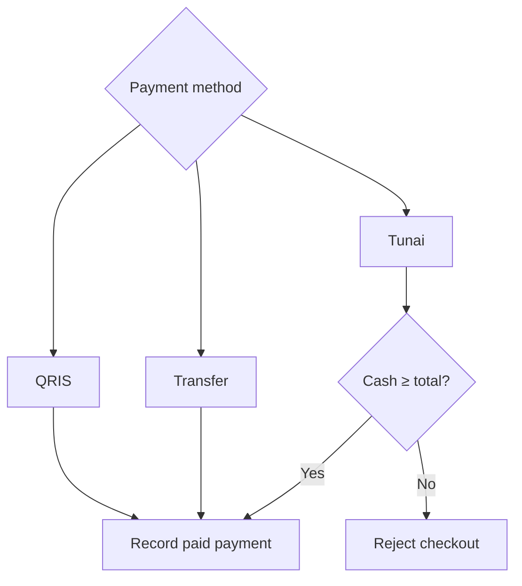

**Diagram sources**
- [0003_functions.sql:134-162](file://supabase/migrations/0003_functions.sql#L134-L162)
- [0005_production_hardening.sql:123-151](file://supabase/migrations/0005_production_hardening.sql#L123-L151)
- [PRD_Laris_GTNIC2026.md:156-165](file://PRD_Laris_GTNIC2026.md#L156-L165)

**Section sources**
- [0003_functions.sql:134-162](file://supabase/migrations/0003_functions.sql#L134-L162)
- [0005_production_hardening.sql:123-151](file://supabase/migrations/0005_production_hardening.sql#L123-L151)
- [PRD_Laris_GTNIC2026.md:156-165](file://PRD_Laris_GTNIC2026.md#L156-L165)

### Edge Cases

#### Last-Minute Item Additions
If a user adds items after initial parsing or selection:
- The client recomputes cart totals and rebuilds the idempotency fingerprint when the checkout payload changes.
- The server revalidates the full cart against the catalog and recalculates totals.
- Stock checks aggregate the complete basket before allowing deduction.

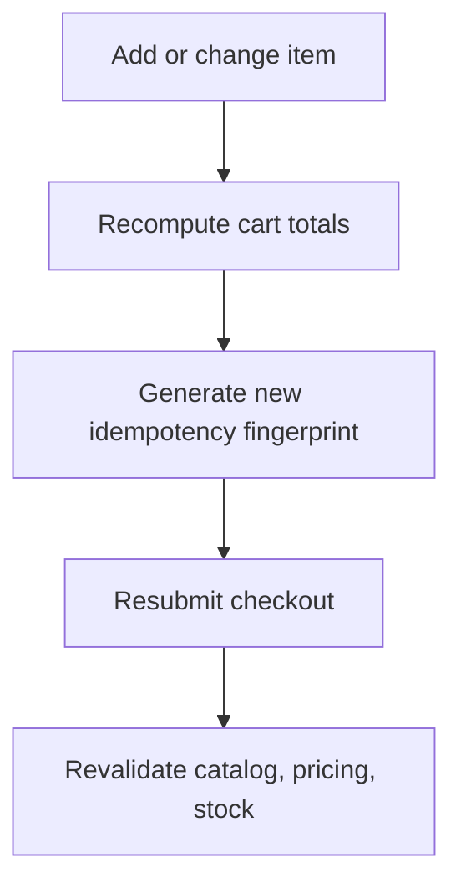

**Diagram sources**
- [laris-app.tsx:217-225](file://src/components/laris-app.tsx#L217-L225)
- [0003_functions.sql:147-179](file://supabase/migrations/0003_functions.sql#L147-L179)

**Section sources**
- [laris-app.tsx:217-225](file://src/components/laris-app.tsx#L217-L225)
- [0003_functions.sql:147-179](file://supabase/migrations/0003_functions.sql#L147-L179)

#### Payment Method Changes
Changing payment method affects:
- Cash input requirement for cash payments.
- Idempotency fingerprint, ensuring retries use the latest payload.
- Recorded payment method in the database.

The system rejects cash payments where received amount is below total and accepts QRIS and transfer as paid methods.

**Section sources**
- [laris-app.tsx:218-238](file://src/components/laris-app.tsx#L218-L238)
- [0003_functions.sql:134-162](file://supabase/migrations/0003_functions.sql#L134-L162)
- [0005_production_hardening.sql:123-151](file://supabase/migrations/0005_production_hardening.sql#L123-L151)

#### Order Cancellations and Voids
The schema includes void and refund statuses, but the implemented checkout function always creates orders with `paid` status. There is no dedicated cancel or void RPC shown in the analyzed files. Therefore:
- Completed sales cannot be cancelled through the analyzed checkout flow.
- Refunds and voids would require additional server-side logic beyond the current implementation.
- Operators should treat completed sales as final unless extended functionality is added.

**Section sources**
- [0001_schema.sql:153-171](file://supabase/migrations/0001_schema.sql#L153-L171)
- [0003_functions.sql:181-185](file://supabase/migrations/0003_functions.sql#L181-L185)
- [0005_production_hardening.sql:169-173](file://supabase/migrations/0005_production_hardening.sql#L169-L173)

### Relationship Between POS Transactions and Financial Reporting
POS transactions feed financial reporting through several mechanisms:
- Revenue is derived from sales totals.
- Cost of goods sold is derived from product costs and quantities sold.
- Expenses are recorded separately and subtracted to estimate net profit.
- CSV export provides raw transaction data for external analysis.
- The financial view shows daily revenue, HPP, gross profit, operating expenses, and net profit.

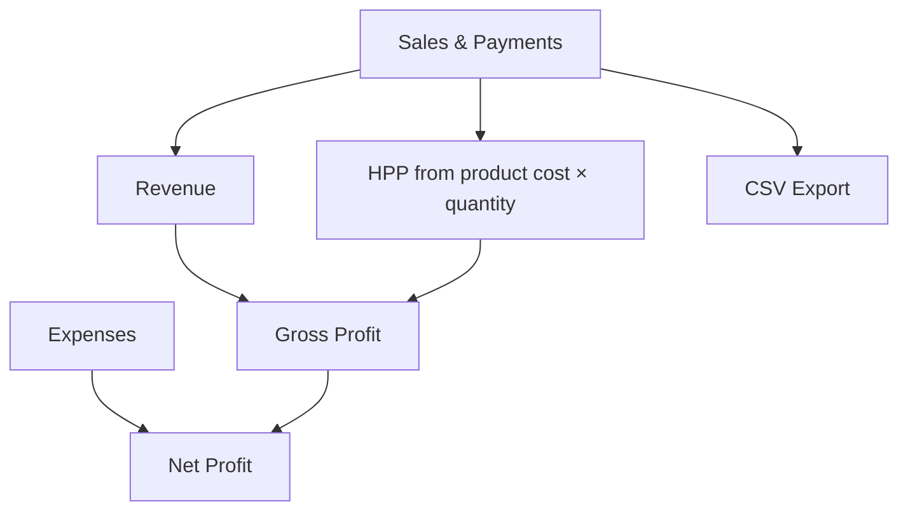

**Diagram sources**
- [laris-app.tsx:188-194](file://src/components/laris-app.tsx#L188-L194)
- [laris-app.tsx:1140-1140](file://src/components/laris-app.tsx#L1140-L1140)
- [laris-data.ts:483-493](file://src/lib/laris-data.ts#L483-L493)

**Section sources**
- [laris-app.tsx:188-194](file://src/components/laris-app.tsx#L188-L194)
- [laris-app.tsx:1140-1140](file://src/components/laris-app.tsx#L1140-L1140)
- [laris-data.ts:483-493](file://src/lib/laris-data.ts#L483-L493)

## Dependency Analysis
The checkout flow depends on:
- UI state and form inputs.
- Deterministic domain functions for local mode.
- Server actions for role checks and RPC invocation.
- PostgreSQL functions for authoritative validation and ledger writes.
- Schema constraints for tenant isolation, referential integrity, and data types.

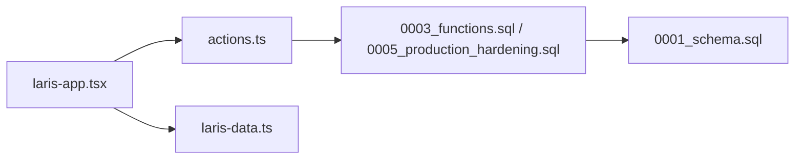

**Diagram sources**
- [laris-app.tsx:214-268](file://src/components/laris-app.tsx#L214-L268)
- [actions.ts:52-89](file://src/app/actions.ts#L52-L89)
- [0003_functions.sql:90-230](file://supabase/migrations/0003_functions.sql#L90-L230)
- [0005_production_hardening.sql:84-214](file://supabase/migrations/0005_production_hardening.sql#L84-L214)
- [0001_schema.sql:153-216](file://supabase/migrations/0001_schema.sql#L153-L216)
- [laris-data.ts:215-305](file://src/lib/laris-data.ts#L215-L305)

**Section sources**
- [laris-app.tsx:214-268](file://src/components/laris-app.tsx#L214-L268)
- [actions.ts:52-89](file://src/app/actions.ts#L52-L89)
- [0003_functions.sql:90-230](file://supabase/migrations/0003_functions.sql#L90-L230)
- [0005_production_hardening.sql:84-214](file://supabase/migrations/0005_production_hardening.sql#L84-L214)
- [0001_schema.sql:153-216](file://supabase/migrations/0001_schema.sql#L153-L216)
- [laris-data.ts:215-305](file://src/lib/laris-data.ts#L215-L305)

## Performance Considerations
- Client-side totals and cart operations are fast and optimistic, improving perceived responsiveness.
- Cloud checkout delegates expensive and sensitive calculations to PostgreSQL, reducing client trust assumptions.
- Stock checks lock inventory rows and aggregate recipe requirements once per checkout, avoiding repeated partial validations.
- Idempotency keys prevent duplicate charges and duplicate ledger entries under retry or network failure.
- CSV export and financial summaries operate over existing state and do not block checkout.

[No sources needed since this section provides general guidance]

## Troubleshooting Guide
Common issues and their likely causes:
- Empty cart: The client and server both reject empty carts. Ensure at least one valid product is added.
- Unknown menu: Product code not found, inactive, or unavailable. Verify catalog configuration.
- Invalid quantity: Quantities must be positive integers within allowed ranges.
- Insufficient cash: Cash received must be at least the calculated total.
- Stock shortage: Recipe-based stock check failed. Check opening stock, purchases, and previous sales.
- Duplicate order: Same idempotency key returns the original order instead of creating another.
- Role access denied: Current user lacks owner, manager, or kasir role.
- Network error: Server action wraps network failures with a connection error message.

**Section sources**
- [laris-data.ts:161-194](file://src/lib/laris-data.ts#L161-L194)
- [actions.ts:30-38](file://src/app/actions.ts#L30-L38)
- [0003_functions.sql:127-179](file://supabase/migrations/0003_functions.sql#L127-L179)
- [0005_production_hardening.sql:118-167](file://supabase/migrations/0005_production_hardening.sql#L118-L167)

## Conclusion
The checkout flow combines a responsive POS interface with authoritative database logic. Order validation, price verification, and stock reservation happen server-side in cloud mode, while local mode mirrors the same rules deterministically. Successful checkout produces a sale, order items, payment record, recipe-based stock deductions, and an audit log. The receipt modal provides clear post-sale confirmation and printing support. Financial reporting consumes sales and expenses to present revenue, HPP, gross profit, and net profit. For production readiness, extend cancellation/refund handling, integrate QRIS webhooks explicitly into order lifecycle updates, and ensure receipt delivery matches operational needs such as WhatsApp links and thermal printer compatibility.

[No sources needed since this section summarizes without analyzing specific files]