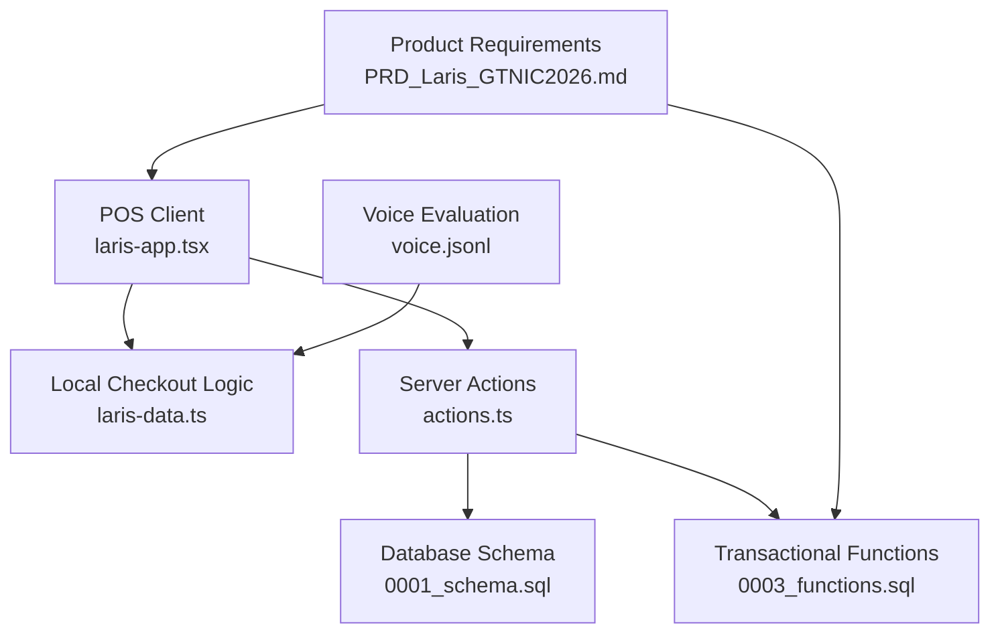
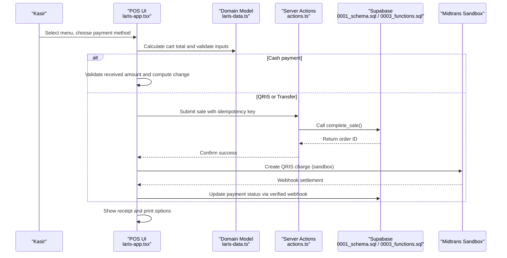
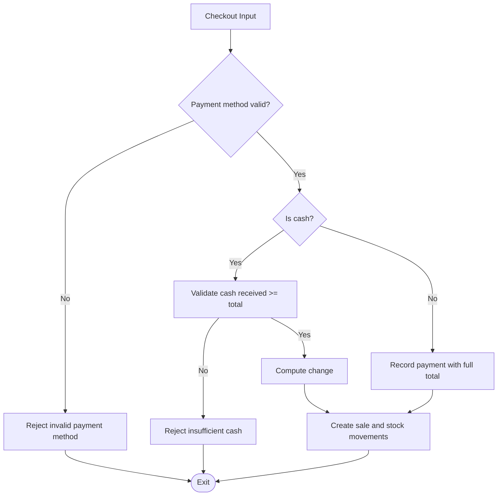
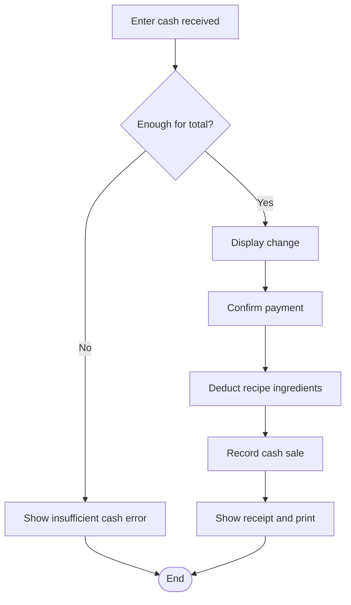
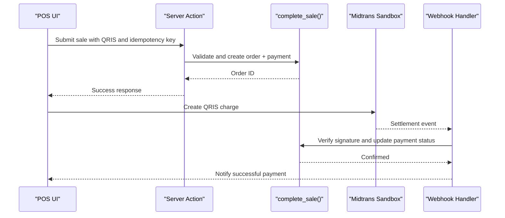
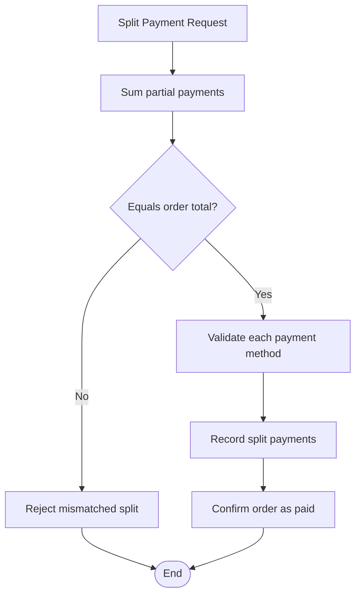
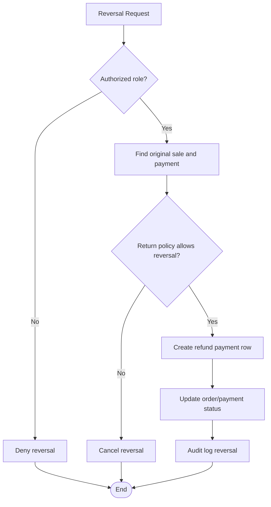
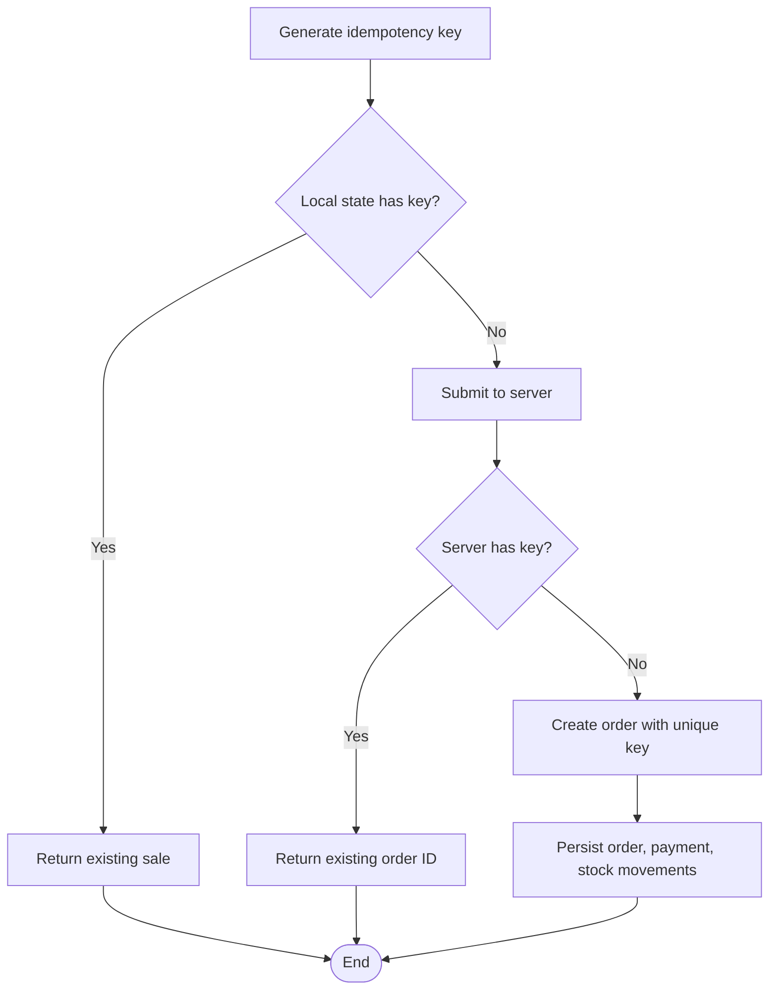
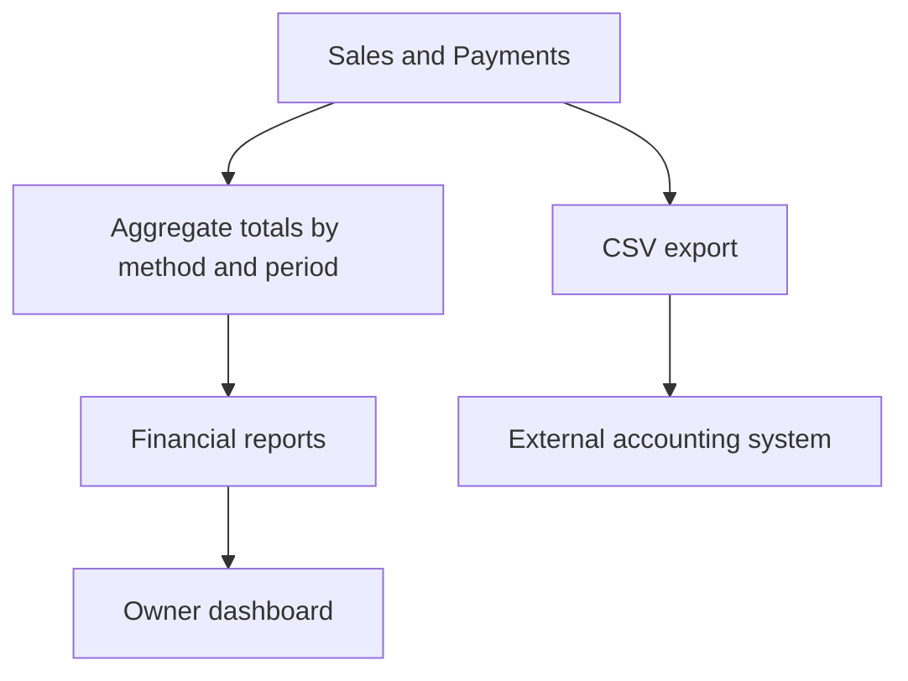
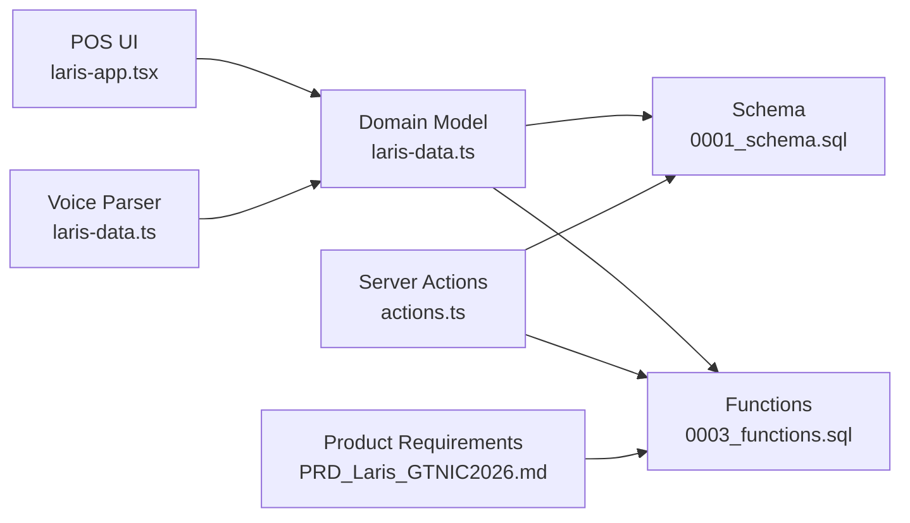

# Payment Processing

<cite>
**Referenced Files in This Document**
- [README.md](file://README.md)
- [PRD_Laris_GTNIC2026.md](file://PRD_Laris_GTNIC2026.md)
- [laris-data.ts](file://src/lib/laris-data.ts)
- [laris-app.tsx](file://src/components/laris-app.tsx)
- [actions.ts](file://src/app/actions.ts)
- [0001_schema.sql](file://supabase/migrations/0001_schema.sql)
- [0003_functions.sql](file://supabase/migrations/0003_functions.sql)
- [voice.jsonl](file://evals/voice.jsonl)
</cite>

## Table of Contents
1. [Introduction](#introduction)
2. [Project Structure](#project-structure)
3. [Core Components](#core-components)
4. [Architecture Overview](#architecture-overview)
5. [Detailed Component Analysis](#detailed-component-analysis)
6. [Dependency Analysis](#dependency-analysis)
7. [Performance Considerations](#performance-considerations)
8. [Troubleshooting Guide](#troubleshooting-guide)
9. [Conclusion](#conclusion)

## Introduction
This document explains the payment processing system implemented by Laris, an Indonesian UMKM operational workspace. The system supports three primary payment methods: cash (`Tunai`), QRIS, and bank transfer (`Transfer`). It also documents how sales are validated, how inventory is deducted, how idempotency keys prevent duplicate transactions, and how financial reporting and receipts integrate with the broader application.

The demo explicitly states that all payments are simulated and no real money is moved. Real QRIS settlement uses Midtrans sandbox in the product requirements, while the current client-side implementation focuses on deterministic state transitions and ledger integrity.

**Section sources**
- [README.md:22-35](file://README.md#L22-L35)
- [PRD_Laris_GTNIC2026.md:151-164](file://PRD_Laris_GTNIC2026.md#L151-L164)

## Project Structure
Payment-related logic spans several layers:

| Layer | Responsibility | Key Files |
|---|---|---|
| Domain model and local checkout | Sale totals, validation, stock deduction, customer updates, CSV export | `src/lib/laris-data.ts` |
| POS UI and payment selection | Cash input, quick-cash buttons, change display, method filtering, receipt printing | `src/components/laris-app.tsx`, `src/app/globals.css` |
| Server actions and validation | Zod schema for sale inputs, network error normalization | `src/app/actions.ts` |
| Database schema | Sales, order items, payments, stock movements, idempotency constraints | `supabase/migrations/0001_schema.sql` |
| Transactional functions | Atomic sale completion, stock locking, audit logging, server-side validation | `supabase/migrations/0003_functions.sql` |
| Product requirements | Payment features, offline mode, QRIS sandbox, split payment intent | `PRD_Laris_GTNIC2026.md` |
| Voice evaluation | Expected payment methods from natural-language input | `evals/voice.jsonl` |

**Diagram sources**
- [laris-app.tsx:1002-1037](file://src/components/laris-app.tsx#L1002-L1037)
- [laris-data.ts:178-305](file://src/lib/laris-data.ts#L178-L305)
- [actions.ts:30-50](file://src/app/actions.ts#L30-L50)
- [0001_schema.sql:153-198](file://supabase/migrations/0001_schema.sql#L153-L198)
- [0003_functions.sql:94-230](file://supabase/migrations/0003_functions.sql#L94-L230)
- [PRD_Laris_GTNIC2026.md:151-164](file://PRD_Laris_GTNIC2026.md#L151-L164)
- [voice.jsonl:15-17](file://evals/voice.jsonl#L15-L17)

**Section sources**
- [laris-data.ts:1-110](file://src/lib/laris-data.ts#L1-L110)
- [laris-app.tsx:1002-1037](file://src/components/laris-app.tsx#L1002-L1037)
- [actions.ts:30-50](file://src/app/actions.ts#L30-L50)
- [0001_schema.sql:153-198](file://supabase/migrations/0001_schema.sql#L153-L198)
- [0003_functions.sql:94-230](file://supabase/migrations/0003_functions.sql#L94-L230)
- [PRD_Laris_GTNIC2026.md:151-164](file://PRD_Laris_GTNIC2026.md#L151-L164)
- [voice.jsonl:15-17](file://evals/voice.jsonl#L15-L17)

## Core Components
The payment system is built around a small set of core concepts:

| Concept | Description |
|---|---|
| Sale | Represents a completed transaction with items, totals, payment method, cash received, channel, timestamp, and status. |
| Payment method | One of `Tunai`, `QRIS`, or `Transfer`. |
| Cart total | Subtotal after item prices, discount, and optional tax. |
| Stock movement | Ledger entry recording material usage for each sold recipe line. |
| Customer update | Optional phone-based customer record updated with visits, spend, points, and RFM segment. |
| Idempotency key | Stable key used to prevent duplicate sales during retries or offline sync. |

Key behaviors:

- Cash requires sufficient received amount; otherwise the sale is rejected.
- Non-cash payments use the exact total as the recorded received amount.
- Recipe-based stock is aggregated per ingredient and validated before any ledger entries are created.
- Sales can be persisted deterministically using an idempotency key.
- The database schema stores money as integer rupiah and provides explicit payment and order statuses.

**Section sources**
- [laris-data.ts:40-53](file://src/lib/laris-data.ts#L40-L53)
- [laris-data.ts:178-194](file://src/lib/laris-data.ts#L178-L194)
- [laris-data.ts:215-305](file://src/lib/laris-data.ts#L215-L305)
- [0001_schema.sql:153-198](file://supabase/migrations/0001_schema.sql#L153-L198)

## Architecture Overview
At a high level, payment processing flows through the POS interface, domain validation, and either local state mutation or a server-side atomic function.

**Diagram sources**
- [laris-app.tsx:1002-1037](file://src/components/laris-app.tsx#L1002-L1037)
- [laris-data.ts:178-305](file://src/lib/laris-data.ts#L178-L305)
- [actions.ts:30-50](file://src/app/actions.ts#L30-L50)
- [0003_functions.sql:94-230](file://supabase/migrations/0003_functions.sql#L94-L230)
- [PRD_Laris_GTNIC2026.md:270-289](file://PRD_Laris_GTNIC2026.md#L270-L289)

**Section sources**
- [PRD_Laris_GTNIC2026.md:270-289](file://PRD_Laris_GTNIC2026.md#L270-L289)
- [0003_functions.sql:94-230](file://supabase/migrations/0003_functions.sql#L94-L230)

## Detailed Component Analysis

### Supported Payment Methods
The system recognizes three payment methods:

| Method | Behavior | Validation | Reporting |
|---|---|---|---|
| `Tunai` | Requires `cashReceived`; computes change as received minus total. | Must be non-negative and at least equal to total. | Stored in `cash_received`; included in CSV export. |
| `QRIS` | Uses total as payment amount; intended to integrate with Midtrans sandbox. | Validated against allowed enum values. | Stored in `payment.method = qris`; dashboard counts non-cash orders. |
| `Transfer` | Uses total as payment amount; represents bank transfer. | Validated against allowed enum values. | Stored in `payment.method = transfer`; dashboard counts non-cash orders. |

The voice parser also maps spoken payment intents such as “bayar QRIS”, “via transfer”, and “bayar cash” into the same internal payment types.

**Diagram sources**
- [laris-data.ts:215-250](file://src/lib/laris-data.ts#L215-L250)
- [0003_functions.sql:134-162](file://supabase/migrations/0003_functions.sql#L134-L162)
- [laris-data.ts:436-473](file://src/lib/laris-data.ts#L436-L473)

**Section sources**
- [laris-data.ts:40-53](file://src/lib/laris-data.ts#L40-L53)
- [laris-data.ts:215-250](file://src/lib/laris-data.ts#L215-L250)
- [0001_schema.sql:188-198](file://supabase/migrations/0001_schema.sql#L188-L198)
- [laris-data.ts:436-473](file://src/lib/laris-data.ts#L436-L473)
- [voice.jsonl:15-17](file://evals/voice.jsonl#L15-L17)

### Cash Payment Workflow and Change Calculation
The cash workflow emphasizes simplicity and safety:

1. The POS collects the order total and the cash received.
2. If the payment method is cash, the system rejects the sale when received is less than the total.
3. Change is displayed to the cashier so they can verify the amount before completing the sale.
4. The sale records `cashReceived` and marks the order as paid.
5. Inventory is deducted according to the recipe lines.

Although the repository does not implement a formal denomination breakdown algorithm, the UI includes quick-cash buttons and a visible change field. These elements support common denominations and make change calculation transparent to the cashier.

**Diagram sources**
- [laris-data.ts:246-250](file://src/lib/laris-data.ts#L246-L250)
- [laris-data.ts:281-304](file://src/lib/laris-data.ts#L281-L304)
- [0003_functions.sql:160-162](file://supabase/migrations/0003_functions.sql#L160-L162)
- [globals.css:3482-3513](file://src/app/globals.css#L3482-L3513)

**Section sources**
- [laris-data.ts:246-304](file://src/lib/laris-data.ts#L246-L304)
- [0003_functions.sql:160-162](file://supabase/migrations/0003_functions.sql#L160-L162)
- [globals.css:3482-3513](file://src/app/globals.css#L3482-L3513)

### QRIS Integration Patterns and Payment Confirmation
The product requirements specify QRIS through Midtrans sandbox. The golden demo path shows:

- The POS creates a QRIS charge.
- Midtrans sends a settlement webhook.
- The system updates the payment status to paid.
- The order, payment, and stock movements are written atomically.

In the current codebase, the client-side demo simulates payment behavior, while the database schema and transactional function define the canonical payment structure and status flow. Production integration should verify webhooks, map provider references, and avoid trusting client-provided amounts.

**Diagram sources**
- [PRD_Laris_GTNIC2026.md:270-289](file://PRD_Laris_GTNIC2026.md#L270-L289)
- [0001_schema.sql:188-198](file://supabase/migrations/0001_schema.sql#L188-L198)
- [0003_functions.sql:215-216](file://supabase/migrations/0003_functions.sql#L215-L216)

**Section sources**
- [PRD_Laris_GTNIC2026.md:270-289](file://PRD_Laris_GTNIC2026.md#L270-L289)
- [0001_schema.sql:188-198](file://supabase/migrations/0001_schema.sql#L188-L198)
- [0003_functions.sql:215-216](file://supabase/migrations/0003_functions.sql#L215-L216)

### Bank Transfer Verification and Manual Confirmation
Bank transfer is modeled as a supported payment method with the same total-based amount as QRIS. In practice, manual verification is appropriate because bank transfers may arrive asynchronously.

Recommended workflow:

1. Record the order with payment method `Transfer`.
2. Mark the payment as pending until bank confirmation.
3. On manual or automated verification, update the payment status to paid.
4. Ensure stock movements and order status remain consistent with the final confirmed amount.
5. Log the verification action in the audit log.

The current schema allows multiple payment statuses, including pending, paid, failed, and refunded, which supports both automated and manual reconciliation flows.

**Section sources**
- [0001_schema.sql:188-198](file://supabase/migrations/0001_schema.sql#L188-L198)
- [0001_schema.sql:153-171](file://supabase/migrations/0001_schema.sql#L153-L171)

### Split Payments and Partial Payments
The product requirement lists split payment as a P0 feature. However, the current domain model and transactional function represent a single payment per sale with one method and one amount.

Current limitations:

- A sale has one `payment` method and one `amount`.
- There is no multi-payment row structure in the current domain model.
- The server-side `complete_sale` function inserts one payment row per order.

Recommended approach for future implementation:

- Introduce a `payment_split` table with rows per payment method and partial amount.
- Require the sum of split payments to equal the order total.
- Allow mixed methods such as QRIS plus cash.
- Keep the order-level total immutable once paid.
- Use the existing idempotency mechanism to prevent duplicate splits.

[No diagram sources needed since this diagram shows conceptual split-payment design, not current code]

**Section sources**
- [PRD_Laris_GTNIC2026.md:156](file://PRD_Laris_GTNIC2026.md#L156)
- [laris-data.ts:40-53](file://src/lib/laris-data.ts#L40-L53)
- [0003_functions.sql:215-216](file://supabase/migrations/0003_functions.sql#L215-L216)

### Transaction Reversals
The database schema defines order and payment statuses that include void and refunded states. The current domain model marks sales as `Lunas` and does not expose a reversal function.

Recommended implementation:

- Add a dedicated refund or void operation.
- Reverse stock movements only if business policy permits returns.
- Record a new payment row with a negative or refund amount.
- Preserve the original sale for auditability.
- Require owner or manager role for reversals.
- Log the reversal in the audit log.

[No diagram sources needed since this diagram shows conceptual reversal design, not current code]

**Section sources**
- [0001_schema.sql:153-171](file://supabase/migrations/0001_schema.sql#L153-L171)
- [0001_schema.sql:188-198](file://supabase/migrations/0001_schema.sql#L188-L198)
- [laris-data.ts:40-53](file://src/lib/laris-data.ts#L40-L53)

### Idempotency Key Generation for Cloud Deployments
Idempotency is critical for cloud deployments where retries, offline outboxes, and concurrent requests can occur.

Client-side behavior:

- The local `completeSale` function accepts an optional idempotency key.
- When provided, it derives a stable sale ID from the key.
- If a sale with the same derived ID already exists, it returns the existing sale without duplicating state.
- An empty or whitespace-only key throws an error.

Server-side behavior:

- The `complete_sale` SQL function checks the idempotency key before creating the order.
- If a matching order already exists, it returns the existing order ID.
- A unique constraint on `(business_id, idempotency_key)` prevents concurrent duplicates.
- The server action validates that the key length is between 8 and 100 characters.

Best practices for key generation:

- Generate a random UUID per checkout attempt.
- Include tenant context, such as business ID or outlet ID, outside the key itself.
- Do not reuse keys across different orders.
- Store the key alongside the outbox record so retries return the same result.
- Avoid encoding sensitive data in the key.

**Diagram sources**
- [laris-data.ts:225-238](file://src/lib/laris-data.ts#L225-L238)
- [0003_functions.sql:127-132](file://supabase/migrations/0003_functions.sql#L127-L132)
- [0001_schema.sql:166-171](file://supabase/migrations/0001_schema.sql#L166-L171)
- [actions.ts:40-50](file://src/app/actions.ts#L40-L50)

**Section sources**
- [laris-data.ts:225-238](file://src/lib/laris-data.ts#L225-L238)
- [0003_functions.sql:127-132](file://supabase/migrations/0003_functions.sql#L127-L132)
- [0001_schema.sql:166-171](file://supabase/migrations/0001_schema.sql#L166-L171)
- [actions.ts:40-50](file://src/app/actions.ts#L40-L50)

### Error Handling for Failed Payments, Network Timeouts, and Payment Method Failures
Error handling occurs at multiple layers:

| Layer | Errors Handled | Behavior |
|---|---|---|
| Domain model | Invalid payment method, insufficient cash, invalid cart, invalid customer phone, insufficient stock | Throws descriptive errors before mutating state. |
| Server actions | Zod validation errors, network failures, generic errors | Normalizes messages and distinguishes connectivity issues. |
| Database functions | Invalid payment/channel, empty cart, missing outlet, insufficient cash, insufficient stock, unique key violation | Raises structured exceptions and returns existing order on idempotent retry. |
| UI | Payment method selection, cash input, receipt display | Provides visual feedback and disabled controls for invalid states. |

Recommended improvements:

- Map database error codes to user-friendly messages.
- Distinguish transient network timeouts from permanent validation failures.
- Retry only idempotent operations with the same key.
- Surface provider-specific QRIS failures separately from internal validation errors.
- Log failed attempts with tenant context but without sensitive payment details.

**Section sources**
- [laris-data.ts:155-169](file://src/lib/laris-data.ts#L155-L169)
- [laris-data.ts:240-276](file://src/lib/laris-data.ts#L240-L276)
- [actions.ts:30-50](file://src/app/actions.ts#L30-L50)
- [0003_functions.sql:123-162](file://supabase/migrations/0003_functions.sql#L123-L162)
- [0003_functions.sql:181-190](file://supabase/migrations/0003_functions.sql#L181-L190)

### Financial Reporting and Receipt Generation
Financial reporting integrates with sales, expenses, customers, and CSV export:

- Sales include subtotal, discount, tax, total, payment method, cash received, channel, and status.
- The domain model exports sales to CSV for external accounting tools.
- The dashboard displays revenue, transaction counts, and non-cash payment counts.
- Receipt generation is described in the product requirements as digital receipts with WhatsApp links and thermal printer support.

For production financial systems:

- Export normalized sales and payment rows.
- Include provider references for QRIS and bank transfers.
- Separate revenue from refunds and voids.
- Align reporting periods with business closing rules.
- Preserve audit logs for compliance.

[No diagram sources needed since this diagram shows conceptual reporting flow, not a specific implementation file]

**Section sources**
- [laris-data.ts:483-493](file://src/lib/laris-data.ts#L483-L493)
- [laris-app.tsx:1020-1037](file://src/components/laris-app.tsx#L1020-L1037)
- [PRD_Laris_GTNIC2026.md:156-158](file://PRD_Laris_GTNIC2026.md#L156-L158)

## Dependency Analysis
Payment processing depends on consistent validation, immutable totals, and auditable state changes.

**Diagram sources**
- [laris-app.tsx:1002-1037](file://src/components/laris-app.tsx#L1002-L1037)
- [laris-data.ts:178-305](file://src/lib/laris-data.ts#L178-L305)
- [actions.ts:30-50](file://src/app/actions.ts#L30-L50)
- [0001_schema.sql:153-198](file://supabase/migrations/0001_schema.sql#L153-L198)
- [0003_functions.sql:94-230](file://supabase/migrations/0003_functions.sql#L94-L230)
- [PRD_Laris_GTNIC2026.md:151-164](file://PRD_Laris_GTNIC2026.md#L151-L164)

**Section sources**
- [laris-data.ts:178-305](file://src/lib/laris-data.ts#L178-L305)
- [0001_schema.sql:153-198](file://supabase/migrations/0001_schema.sql#L153-L198)
- [0003_functions.sql:94-230](file://supabase/migrations/0003_functions.sql#L94-L230)

## Performance Considerations
- Money is stored as integer rupiah to avoid floating-point rounding errors.
- Stock movements are ledger-based, preventing overwrite bugs and supporting accurate history.
- Recipe aggregation validates all ingredients before writing any movement, reducing partial failures.
- Idempotency keys reduce duplicate writes during retries and offline sync.
- The server-side function locks inventory rows in a stable order before checking stock, improving concurrency safety.

Recommendations:

- Keep payment amounts as integers.
- Batch stock deductions per sale rather than per item.
- Cache catalog lookups on the client for faster POS interactions.
- Use pagination for large transaction histories.
- Monitor webhook latency and queue failed events for retry.

**Section sources**
- [laris-data.ts:135-141](file://src/lib/laris-data.ts#L135-L141)
- [laris-data.ts:262-304](file://src/lib/laris-data.ts#L262-L304)
- [0003_functions.sql:164-179](file://supabase/migrations/0003_functions.sql#L164-L179)

## Troubleshooting Guide
Common payment issues and their likely causes:

| Symptom | Likely Cause | Resolution |
|---|---|---|
| Cash payment rejected | Received amount is less than total | Ask the customer for additional cash or adjust payment method. |
| Duplicate sale appears | Missing or reused idempotency key | Generate a unique key per checkout attempt and retry with the same key. |
| QRIS payment never confirms | Webhook not verified or not processed | Verify webhook signature, check provider reference, and update payment status. |
| Bank transfer marked paid too early | Manual confirmation before funds arrive | Require bank confirmation before updating status. |
| Stock deduction fails | Insufficient inventory after recipe aggregation | Review opening stock, purchases, and other pending sales. |
| Network timeout during checkout | Connectivity issue | Normalize error message and allow safe retry with idempotency key. |

**Section sources**
- [laris-data.ts:246-276](file://src/lib/laris-data.ts#L246-L276)
- [actions.ts:30-50](file://src/app/actions.ts#L30-L50)
- [0003_functions.sql:127-162](file://supabase/migrations/0003_functions.sql#L127-L162)

## Conclusion
Laris’s payment processing system centers on three supported methods: cash, QRIS, and bank transfer. The current implementation guarantees deterministic totals, ledger-based stock deduction, and idempotent sale creation. Cash payments validate received amounts and display change; QRIS and transfer payments use the full total and rely on external or manual confirmation. Split payments and reversals are defined conceptually by the schema and product requirements but require additional modeling and UI work. For cloud deployments, idempotency keys must be generated per checkout and preserved across retries. Robust error handling, webhook verification, and clear audit trails are essential for reliable financial operations.