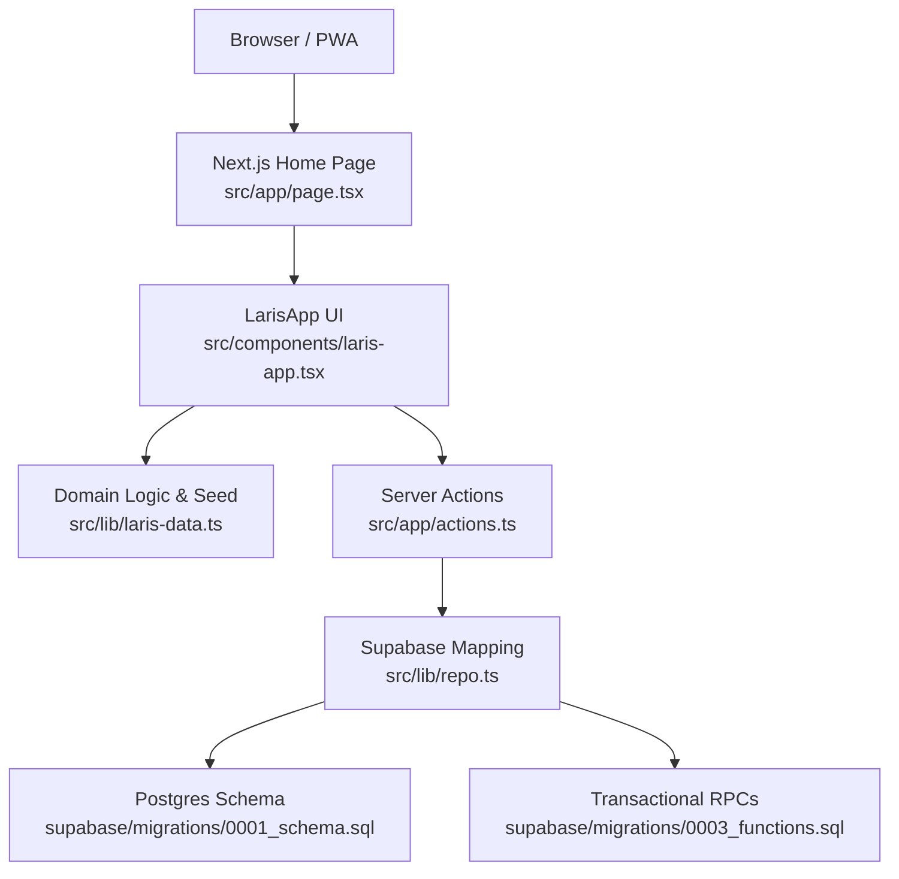
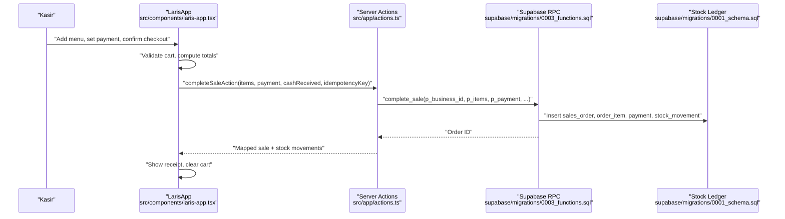
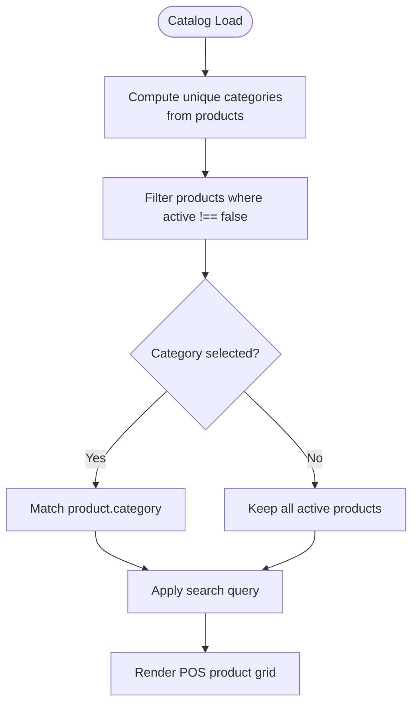
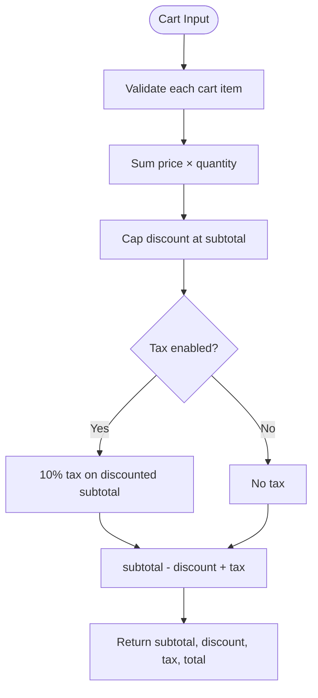
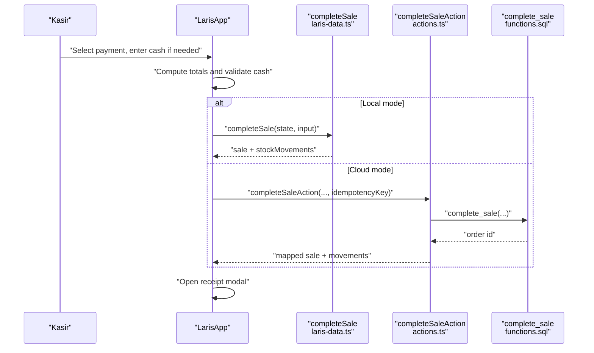
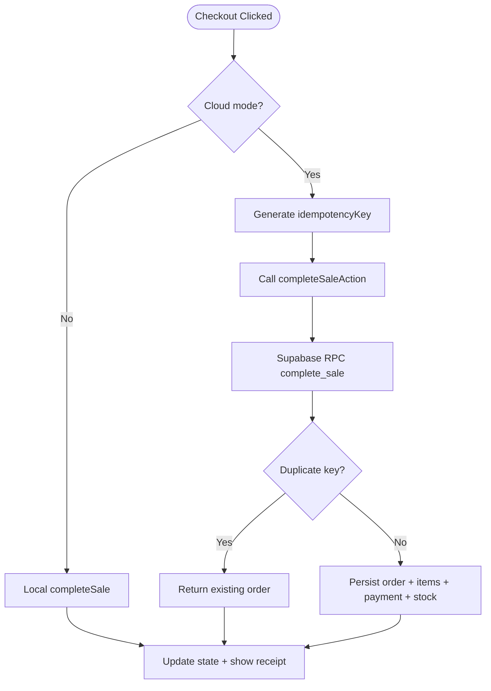
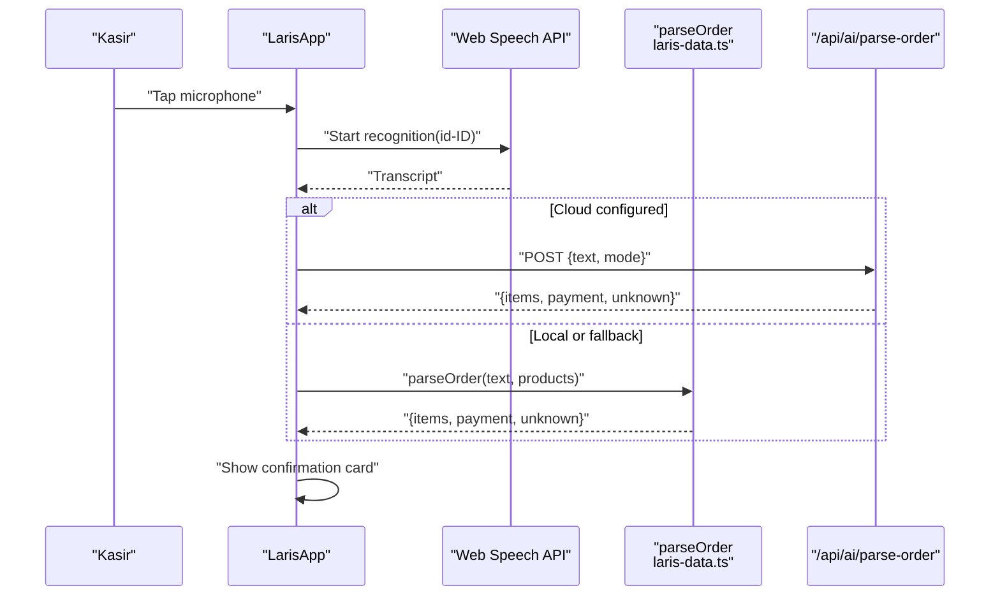
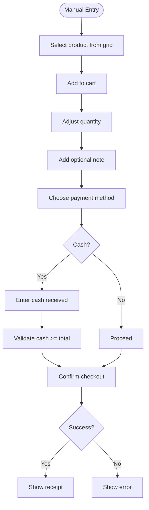
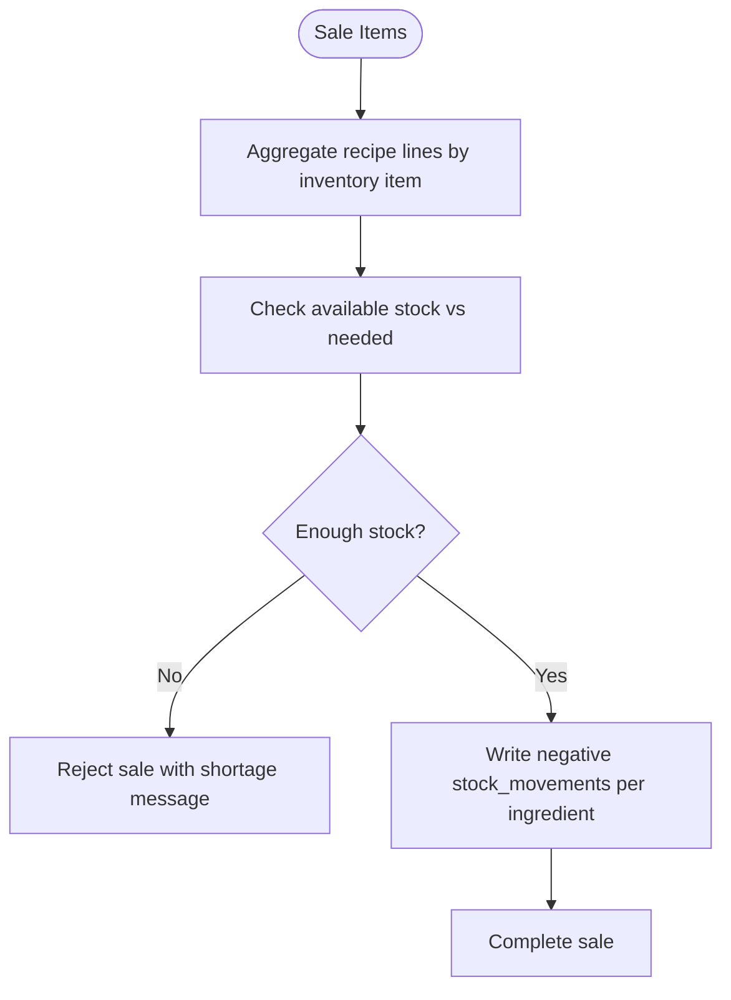
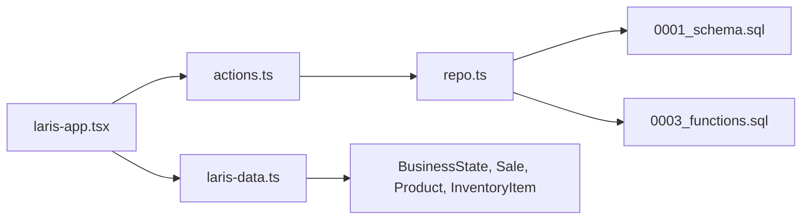

# Point of Sale System

<cite>
**Referenced Files in This Document**
- [README.md](file://README.md)
- [PRD_Laris_GTNIC2026.md](file://PRD_Laris_GTNIC2026.md)
- [src/app/page.tsx](file://src/app/page.tsx)
- [src/components/laris-app.tsx](file://src/components/laris-app.tsx)
- [src/lib/laris-data.ts](file://src/lib/laris-data.ts)
- [src/app/actions.ts](file://src/app/actions.ts)
- [supabase/migrations/0001_schema.sql](file://supabase/migrations/0001_schema.sql)
- [supabase/migrations/0003_functions.sql](file://supabase/migrations/0003_functions.sql)
- [src/lib/repo.ts](file://src/lib/repo.ts)
</cite>

## Table of Contents
1. [Introduction](#introduction)
2. [Project Structure](#project-structure)
3. [Core Components](#core-components)
4. [Architecture Overview](#architecture-overview)
5. [Detailed Component Analysis](#detailed-component-analysis)
6. [Dependency Analysis](#dependency-analysis)
7. [Performance Considerations](#performance-considerations)
8. [Troubleshooting Guide](#troubleshooting-guide)
9. [Conclusion](#conclusion)

## Introduction
Laris is an Indonesian UMKM-focused operational workspace that combines a mobile-first POS, recipe-driven inventory, purchasing, customer management, financial reporting, and AI-assisted workflows. The POS supports voice-to-cart input, manual order entry, category browsing, cart adjustments, discounts, tax calculation, cash change handling, QRIS sandbox payments, bank transfer simulation, digital receipts, and idempotent cloud checkout. Stock deductions are driven by product recipes (BOM), and purchases update moving-average cost and HPP automatically.

The system runs in two modes:
- Local demo mode with browser storage and deterministic seed data.
- Cloud mode backed by Supabase, where prices, stock validation, ledger entries, and audit logs are enforced server-side through Postgres functions.

**Section sources**
- [README.md:1-35](file://README.md#L1-L35)
- [PRD_Laris_GTNIC2026.md:19-31](file://PRD_Laris_GTNIC2026.md#L19-L31)

## Project Structure
At a high level, the application uses Next.js App Router for routing and server actions, React components for the POS UI, a domain layer for local state and algorithms, and Supabase migrations for schema, RLS, and transactional functions.

**Diagram sources**
- [src/app/page.tsx:9-17](file://src/app/page.tsx#L9-L17)
- [src/components/laris-app.tsx:81-133](file://src/components/laris-app.tsx#L81-L133)
- [src/lib/laris-data.ts:97-110](file://src/lib/laris-data.ts#L97-L110)
- [src/app/actions.ts:52-88](file://src/app/actions.ts#L52-L88)
- [src/lib/repo.ts:82-112](file://src/lib/repo.ts#L82-L112)
- [supabase/migrations/0001_schema.sql:153-198](file://supabase/migrations/0001_schema.sql#L153-L198)
- [supabase/migrations/0003_functions.sql:94-230](file://supabase/migrations/0003_functions.sql#L94-L230)

**Section sources**
- [README.md:97-110](file://README.md#L97-L110)
- [PRD_Laris_GTNIC2026.md:319-373](file://PRD_Laris_GTNIC2026.md#L319-L373)

## Core Components
The POS experience is centered around these core areas:

| Area | Responsibility | Key Implementation |
|---|---|---|
| Product catalog browsing | Display active products, categories, search, and image-based grid | Category list derived from products; `active !== false` filtering; search query filter |
| Cart management | Add/remove items, adjust quantity, per-item notes, order discount, tax toggle, totals | `updateQuantity`, `getCartTotal`, discount cap, 10% demo restaurant tax |
| Payment processing | Cash, QRIS, bank transfer; cash change validation; payment method selection | `checkout` flow, `Tunai` cash received check, QRIS/Transfer simulated |
| Checkout persistence | Save sale, create customer, deduct stock, generate receipt | Local `completeSale`; cloud `completeSaleAction` → `public.complete_sale` RPC |
| Voice-to-cart | Speech recognition or text input parsed into cart items | Web Speech API fallback to deterministic parser |
| Purchasing and stock | Record purchases, update moving-average cost, refresh HPP | `recordPurchase` local; `record_purchase` RPC server-side |
| Receipt generation | Show completed sale details and print-friendly view | Receipt modal after successful checkout |

**Section sources**
- [src/components/laris-app.tsx:81-133](file://src/components/laris-app.tsx#L81-L133)
- [src/components/laris-app.tsx:208-267](file://src/components/laris-app.tsx#L208-L267)
- [src/lib/laris-data.ts:178-194](file://src/lib/laris-data.ts#L178-L194)
- [src/lib/laris-data.ts:215-305](file://src/lib/laris-data.ts#L215-L305)
- [src/app/actions.ts:40-88](file://src/app/actions.ts#L40-L88)

## Architecture Overview
The Laris POS follows a layered architecture:

- **Client layer:** React component tree renders the POS, manages cart state, handles voice input, and calls either local domain logic or server actions.
- **Server layer:** Next.js server actions validate inputs with Zod, enforce roles, and call Supabase RPCs.
- **Database layer:** Postgres tables store business, outlet, catalog, sales, payments, stock movements, customers, purchases, expenses, and audit logs. Transactional PL/pgSQL functions ensure atomicity and security.

**Diagram sources**
- [src/components/laris-app.tsx:213-267](file://src/components/laris-app.tsx#L213-L267)
- [src/app/actions.ts:52-88](file://src/app/actions.ts#L52-L88)
- [supabase/migrations/0003_functions.sql:94-230](file://supabase/migrations/0003_functions.sql#L94-L230)
- [supabase/migrations/0001_schema.sql:153-216](file://supabase/migrations/0001_schema.sql#L153-L216)

## Detailed Component Analysis

### Product Catalog Browsing and Category Organization
The catalog displays products filtered by:
- Active status: only products where `active !== false` are shown.
- Category: derived from product categories, with a default “Semua menu” option.
- Search: case-insensitive name matching against the current query.

Categories are computed once using memoization, and the product list is recalculated when products, category, or query changes. This keeps the POS responsive while allowing owners to hide unavailable items without deleting them.

**Diagram sources**
- [src/components/laris-app.tsx:90-101](file://src/components/laris-app.tsx#L90-L101)
- [src/components/laris-app.tsx:204-205](file://src/components/laris-app.tsx#L204-L205)
- [src/lib/laris-data.ts:3-13](file://src/lib/laris-data.ts#L3-L13)

**Section sources**
- [src/components/laris-app.tsx:90-101](file://src/components/laris-app.tsx#L90-L101)
- [src/components/laris-app.tsx:204-205](file://src/components/laris-app.tsx#L204-L205)
- [src/lib/laris-data.ts:3-13](file://src/lib/laris-data.ts#L3-L13)

### Active and Inactive Product Status Management
Product status is represented by the `active` field on the product model. In local mode, this is stored directly in the product object. In cloud mode, the database stores `is_active` on the product table and `is_available` on the product variant, and the catalog loader composes both flags into the UI-facing `active` property.

This design allows:
- Quick deactivation of a menu item without removing its history.
- Variant-level availability control for future size/modifier variants.
- Consistent filtering across the POS, storefront, and AI parser.

**Section sources**
- [src/lib/laris-data.ts:3-13](file://src/lib/laris-data.ts#L3-L13)
- [supabase/migrations/0001_schema.sql:91-118](file://supabase/migrations/0001_schema.sql#L91-L118)
- [src/lib/repo.ts:103-110](file://src/lib/repo.ts#L103-L110)

### Cart Management: Quantity Adjustments, Notes, Discounts, and Taxes
The cart holds line items with product identifiers, quantities, and optional notes. The UI provides:
- Add-to-cart behavior.
- Increment/decrement quantity with removal at zero.
- Per-item notes passed through to the sale record.
- Order-level discount capped at subtotal.
- Optional tax toggle implementing a 10% demo restaurant tax after discount.

Totals are calculated in the domain layer, which validates cart contents, product existence, note types, discount bounds, and final total safety.

**Diagram sources**
- [src/lib/laris-data.ts:161-194](file://src/lib/laris-data.ts#L161-L194)
- [src/components/laris-app.tsx:197-200](file://src/components/laris-app.tsx#L197-L200)

**Section sources**
- [src/lib/laris-data.ts:34-53](file://src/lib/laris-data.ts#L34-L53)
- [src/lib/laris-data.ts:161-194](file://src/lib/laris-data.ts#L161-L194)
- [src/components/laris-app.tsx:197-200](file://src/components/laris-app.tsx#L197-L200)

### Payment Processing Workflow: Cash, QRIS, and Bank Transfer
The POS supports three payment methods:
- **Tunai (cash):** requires `cashReceived >= total`. Change is implicitly handled by validating sufficient cash rather than computing change explicitly in the domain function.
- **QRIS:** simulated payment method used in sandbox mode.
- **Transfer:** simulated bank transfer method.

In local mode, `completeSale` validates payment type, channel, cash amount, and creates the sale and stock movements. In cloud mode, `completeSaleAction` sends validated input to the `complete_sale` RPC, which enforces pricing, stock checks, idempotency, customer creation, and ledger writes atomically.

**Diagram sources**
- [src/components/laris-app.tsx:213-267](file://src/components/laris-app.tsx#L213-L267)
- [src/lib/laris-data.ts:215-305](file://src/lib/laris-data.ts#L215-L305)
- [src/app/actions.ts:52-88](file://src/app/actions.ts#L52-L88)
- [supabase/migrations/0003_functions.sql:94-230](file://supabase/migrations/0003_functions.sql#L94-L230)

**Section sources**
- [src/lib/laris-data.ts:40-53](file://src/lib/laris-data.ts#L40-L53)
- [src/lib/laris-data.ts:215-305](file://src/lib/laris-data.ts#L215-L305)
- [src/app/actions.ts:40-88](file://src/app/actions.ts#L40-L88)
- [supabase/migrations/0001_schema.sql:188-198](file://supabase/migrations/0001_schema.sql#L188-L198)

### Checkout Process, Idempotency Keys, and Digital Receipts
Checkout differs between local and cloud modes:

- **Local mode:** `completeSale` generates a deterministic sale ID based on date and sequence, or uses an idempotency key when provided. It validates the cart, computes totals, checks stock, updates customers, and appends stock movements.
- **Cloud mode:** The client generates a random UUID as the idempotency key and stores it in memory until the checkout succeeds. The server action calls `public.complete_sale`, which rejects duplicate keys via a unique constraint and returns the existing order if a concurrent retry occurs.

After success, the UI clears the cart, resets discount/tax/cash/customer fields, and opens the receipt modal.

**Diagram sources**
- [src/components/laris-app.tsx:213-267](file://src/components/laris-app.tsx#L213-L267)
- [src/lib/laris-data.ts:225-238](file://src/lib/laris-data.ts#L225-L238)
- [supabase/migrations/0003_functions.sql:127-190](file://supabase/migrations/0003_functions.sql#L127-L190)

**Section sources**
- [src/components/laris-app.tsx:213-267](file://src/components/laris-app.tsx#L213-L267)
- [src/lib/laris-data.ts:225-305](file://src/lib/laris-data.ts#L225-L305)
- [src/app/actions.ts:52-88](file://src/app/actions.ts#L52-L88)
- [supabase/migrations/0001_schema.sql:153-171](file://supabase/migrations/0001_schema.sql#L153-L171)
- [supabase/migrations/0003_functions.sql:127-190](file://supabase/migrations/0003_functions.sql#L127-L190)

### Voice-to-Cart Integration
Voice input is implemented with:
- Web Speech API for live transcription in Indonesian.
- Fallback to text input when speech recognition is unavailable.
- Deterministic parser that understands colloquial terms, aliases, quantities, and modifiers such as “less sugar”.
- Optional cloud parsing endpoint that can use Gemini, falling back to the deterministic parser on failure.

The parser returns cart items, detected payment method, and unknown clauses for human review.

**Diagram sources**
- [src/components/laris-app.tsx:311-359](file://src/components/laris-app.tsx#L311-L359)
- [src/lib/laris-data.ts:436-474](file://src/lib/laris-data.ts#L436-L474)

**Section sources**
- [src/components/laris-app.tsx:311-359](file://src/components/laris-app.tsx#L311-L359)
- [src/lib/laris-data.ts:406-474](file://src/lib/laris-data.ts#L406-L474)
- [PRD_Laris_GTNIC2026.md:166-174](file://PRD_Laris_GTNIC2026.md#L166-L174)

### Manual Order Entry and Payment Confirmation Flow
Manual entry flows through the same cart and checkout pipeline as voice input. The cashier selects products, adjusts quantities, adds notes, chooses a payment method, enters cash if required, and confirms checkout. The UI shows errors for invalid inputs, insufficient cash, or failed server requests.

**Diagram sources**
- [src/components/laris-app.tsx:208-267](file://src/components/laris-app.tsx#L208-L267)
- [src/lib/laris-data.ts:215-305](file://src/lib/laris-data.ts#L215-L305)

**Section sources**
- [src/components/laris-app.tsx:208-267](file://src/components/laris-app.tsx#L208-L267)
- [src/lib/laris-data.ts:215-305](file://src/lib/laris-data.ts#L215-L305)

### Relationship Between POS Transactions and Automatic Stock Deductions Through Recipe BOM Aggregation
When a sale is completed, the system aggregates recipe requirements across all cart items before writing any ledger entries. For each ingredient:
- The total needed quantity equals the sum of recipe line quantities multiplied by the sold item quantity.
- Current stock is checked against the aggregated need.
- If stock is insufficient, the sale is rejected with a clear message.
- On success, negative stock movements are recorded per ingredient, referencing the sale ID.

This ensures atomic, consistent inventory accounting even for multi-item orders.

**Diagram sources**
- [src/lib/laris-data.ts:262-305](file://src/lib/laris-data.ts#L262-L305)
- [supabase/migrations/0003_functions.sql:164-223](file://supabase/migrations/0003_functions.sql#L164-L223)

**Section sources**
- [src/lib/laris-data.ts:262-305](file://src/lib/laris-data.ts#L262-L305)
- [supabase/migrations/0003_functions.sql:164-223](file://supabase/migrations/0003_functions.sql#L164-L223)

### Common Scenarios: Split Payments, Order Modifications, and Transaction Reversals
Based on the current implementation:

| Scenario | Current Behavior | Guidance |
|---|---|---|
| Split payments | Not implemented. A sale records one payment method and one total. | Use multiple separate transactions or extend the payment model to support multiple payment rows per order. |
| Order modifications after completion | Not supported. Completed sales are marked “Lunas” and stock movements are already posted. | Void/refund would require additional server-side logic and audit logging. |
| Transaction reversals | No explicit void or refund RPC exists in the analyzed files. | Implement a reversal flow that creates refund stock movements, updates payment status, and records audit events. |
| Duplicate checkout retries | Handled by idempotency keys in cloud mode. | Ensure clients reuse the same generated key until success. |
| Insufficient cash | Validated before sale completion. | Prompt cashier to increase cash or switch payment method. |

**Section sources**
- [src/lib/laris-data.ts:40-53](file://src/lib/laris-data.ts#L40-L53)
- [supabase/migrations/0001_schema.sql:153-198](file://supabase/migrations/0001_schema.sql#L153-L198)
- [supabase/migrations/0003_functions.sql:127-190](file://supabase/migrations/0003_functions.sql#L127-L190)

## Dependency Analysis
The POS depends on several layers:

- **UI dependencies:** Lucide icons, React hooks, and Tailwind classes.
- **Domain dependencies:** Product catalog, inventory, cart totals, sale completion, purchase recording, CSV export, and deterministic order parsing.
- **Server dependencies:** Zod validation, Supabase client, membership context, and mapping utilities.
- **Database dependencies:** Schema tables, RLS policies, and transactional functions.

**Diagram sources**
- [src/components/laris-app.tsx:1-25](file://src/components/laris-app.tsx#L1-L25)
- [src/lib/laris-data.ts:1-110](file://src/lib/laris-data.ts#L1-L110)
- [src/app/actions.ts:1-20](file://src/app/actions.ts#L1-L20)
- [src/lib/repo.ts:1-10](file://src/lib/repo.ts#L1-L10)

**Section sources**
- [src/components/laris-app.tsx:1-25](file://src/components/laris-app.tsx#L1-L25)
- [src/lib/laris-data.ts:1-110](file://src/lib/laris-data.ts#L1-L110)
- [src/app/actions.ts:1-20](file://src/app/actions.ts#L1-L20)
- [src/lib/repo.ts:1-10](file://src/lib/repo.ts#L1-L10)

## Performance Considerations
- **Optimistic UI:** Cart operations update state immediately; server mutations are asynchronous.
- **Memoization:** Categories, chart values, and filtered products are computed efficiently.
- **Server-side validation:** Prices, costs, and stock are recomputed in Postgres functions to prevent client tampering.
- **Pagination:** Catalog and snapshot loading use page-sized fetches to avoid large payloads.
- **Offline resilience:** Local mode persists state in localStorage; cloud mode uses idempotency keys for retries.

[No sources needed since this section provides general guidance]

## Troubleshooting Guide
Common issues and their likely causes:

| Issue | Likely Cause | Resolution |
|---|---|---|
| Voice input not working | Browser does not support Web Speech API or microphone permission denied | Use text input fallback; check browser permissions |
| Parse result contains unknown items | Colloquial phrase not matched by parser or product inactive | Edit product alias, activate product, or manually add items |
| Checkout fails with insufficient cash | `cashReceived < total` for cash payments | Increase cash input or switch to QRIS/transfer |
| Stock deduction fails | Ingredient stock below aggregated recipe requirement | Restock ingredients or reduce order quantity |
| Cloud checkout returns network error | Supabase connection or server action failure | Check internet, environment variables, and deployment logs |
| Duplicate checkout appears | Client retries without reusing idempotency key | Ensure client retains the same key until success |
| Receipt shows incorrect totals | Discount exceeds subtotal or tax applied unexpectedly | Validate discount cap and tax toggle before checkout |

**Section sources**
- [src/components/laris-app.tsx:342-359](file://src/components/laris-app.tsx#L342-L359)
- [src/lib/laris-data.ts:155-194](file://src/lib/laris-data.ts#L155-L194)
- [src/lib/laris-data.ts:243-276](file://src/lib/laris-data.ts#L243-L276)
- [src/app/actions.ts:30-38](file://src/app/actions.ts#L30-L38)

## Conclusion
The Laris POS integrates product catalog browsing, cart management, payment processing, and recipe-driven stock deductions into a cohesive workflow. Local mode provides fast, deterministic behavior suitable for demos and offline use, while cloud mode enforces security, atomicity, and auditability through Supabase RPCs. Voice-to-cart and manual entry share the same validation and persistence path, ensuring consistency. Future enhancements should consider split payments, order modification, and formal reversal flows, along with richer payment provider integration beyond sandbox simulation.

[No sources needed since this section summarizes without analyzing specific files]