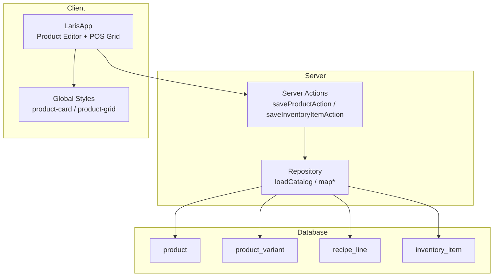
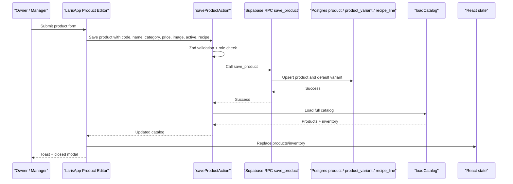
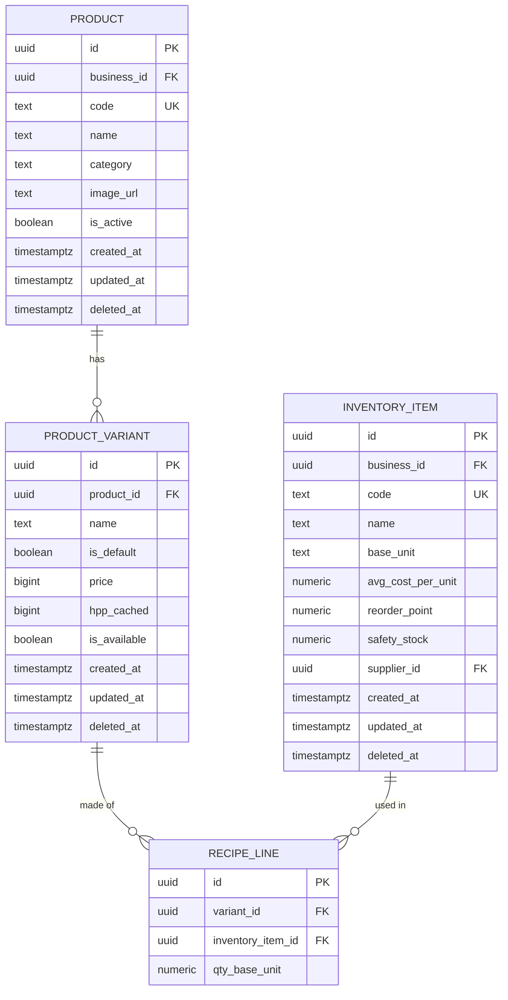
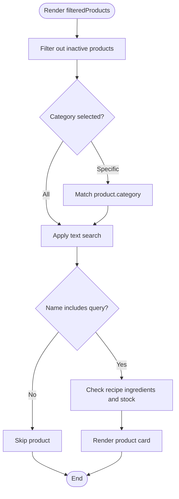
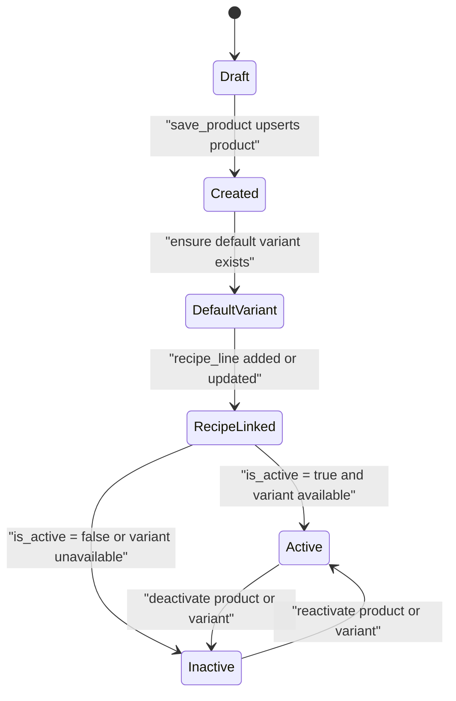
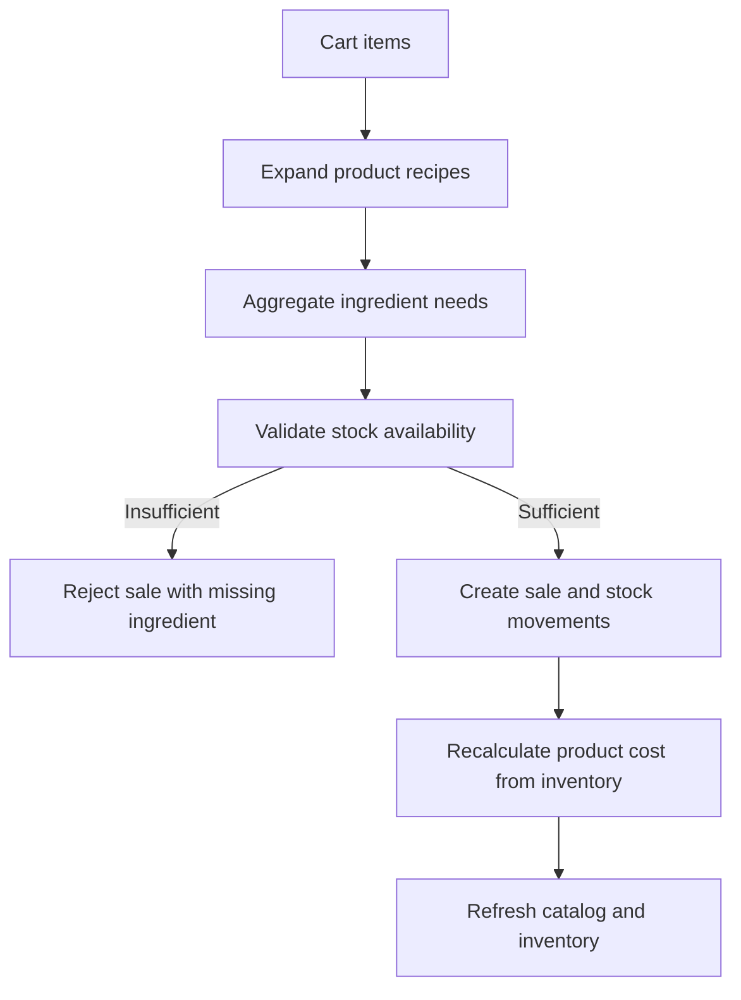
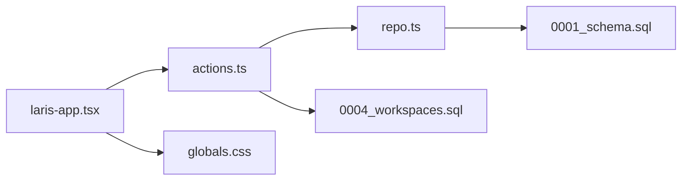

# Product Catalog

<cite>
**Referenced Files in This Document**
- [README.md](file://README.md)
- [PRD_Laris_GTNIC2026.md](file://PRD_Laris_GTNIC2026.md)
- [0001_schema.sql](file://supabase/migrations/0001_schema.sql)
- [0004_workspaces.sql](file://supabase/migrations/0004_workspaces.sql)
- [laris-data.ts](file://src/lib/laris-data.ts)
- [repo.ts](file://src/lib/repo.ts)
- [actions.ts](file://src/app/actions.ts)
- [laris-app.tsx](file://src/components/laris-app.tsx)
- [globals.css](file://src/app/globals.css)
</cite>

## Table of Contents
1. [Introduction](#introduction)
2. [Project Structure](#project-structure)
3. [Core Components](#core-components)
4. [Architecture Overview](#architecture-overview)
5. [Detailed Component Analysis](#detailed-component-analysis)
6. [Dependency Analysis](#dependency-analysis)
7. [Performance Considerations](#performance-considerations)
8. [Troubleshooting Guide](#troubleshooting-guide)
9. [Conclusion](#conclusion)

## Introduction
This document explains the Laris product catalog system: how products are modeled, stored, browsed, edited, and integrated with recipes and inventory. It covers the product data model, browsing interface, product lifecycle, examples for adding and updating products, category management, image handling, recipe-driven stock deduction, performance considerations for large catalogs, and mobile-first UI patterns.

Laris is a workspace operating system for Indonesian micro and small F&B businesses. The catalog is central to POS sales, recipe-based inventory, purchasing, pricing, and financial reporting.

**Section sources**
- [README.md:24-35](file://README.md#L24-L35)
- [PRD_Laris_GTNIC2026.md:175-185](file://PRD_Laris_GTNIC2026.md#L175-L185)

## Project Structure
The product catalog spans database schema, server actions, domain models, repository mapping, and the React application UI.

**Diagram sources**
- [0001_schema.sql:91-127](file://supabase/migrations/0001_schema.sql#L91-L127)
- [actions.ts:191-215](file://src/app/actions.ts#L191-L215)
- [repo.ts:82-112](file://src/lib/repo.ts#L82-L112)
- [laris-app.tsx:521-564](file://src/components/laris-app.tsx#L521-L564)
- [globals.css:1980-2039](file://src/app/globals.css#L1980-L2039)

**Section sources**
- [README.md:97-110](file://README.md#L97-L110)
- [PRD_Laris_GTNIC2026.md:377-494](file://PRD_Laris_GTNIC2026.md#L377-L494)

## Core Components
The catalog has four core layers:

| Layer | Responsibility | Key Files |
|---|---|---|
| Database schema | Defines product, variant, recipe line, and inventory tables with business isolation and constraints | [0001_schema.sql](file://supabase/migrations/0001_schema.sql) |
| Server actions | Validates input, enforces roles, calls Supabase RPCs, and returns updated catalog | [actions.ts](file://src/app/actions.ts) |
| Repository mapping | Loads catalog rows from Supabase and maps them to domain types | [repo.ts](file://src/lib/repo.ts) |
| Client UI | Product editor, category filtering, search, visual product cards, and POS integration | [laris-app.tsx](file://src/components/laris-app.tsx), [globals.css](file://src/app/globals.css) |

**Section sources**
- [0001_schema.sql:91-127](file://supabase/migrations/0001_schema.sql#L91-L127)
- [actions.ts:191-251](file://src/app/actions.ts#L191-L251)
- [repo.ts:74-112](file://src/lib/repo.ts#L74-L112)
- [laris-app.tsx:521-618](file://src/components/laris-app.tsx#L521-L618)

## Architecture Overview
The product catalog follows a client-to-server-to-database flow with strong validation and role checks.

**Diagram sources**
- [laris-app.tsx:521-564](file://src/components/laris-app.tsx#L521-L564)
- [actions.ts:191-215](file://src/app/actions.ts#L191-L215)
- [0004_workspaces.sql:186-205](file://supabase/migrations/0004_workspaces.sql#L186-L205)
- [repo.ts:82-112](file://src/lib/repo.ts#L82-L112)

## Detailed Component Analysis

### Product Data Model
The persistent product model centers on `product`, its default `product_variant`, and optional `recipe_line` ingredients.

| Entity | Important Fields | Purpose |
|---|---|---|
| `product` | `business_id`, `code`, `name`, `category`, `image_url`, `is_active`, timestamps, `deleted_at` | Menu item identity, display metadata, and activation status |
| `product_variant` | `product_id`, `name`, `is_default`, `price`, `hpp_cached`, `is_available`, timestamps, `deleted_at` | Selling price, cost-of-goods cache, and availability per variant |
| `recipe_line` | `variant_id`, `inventory_item_id`, `qty_base_unit` | Links menu variants to raw materials |
| `inventory_item` | `business_id`, `code`, `name`, `base_unit`, `avg_cost_per_unit`, `reorder_point`, `safety_stock`, supplier, timestamps, `deleted_at` | Raw material definition and cost tracking |

Key design rules:
- Every tenant table uses `business_id`.
- Money is stored as rupiah integers; quantities use numeric precision.
- Soft delete is supported through `deleted_at`.
- A unique index ensures one default variant per product.

**Diagram sources**
- [0001_schema.sql:73-127](file://supabase/migrations/0001_schema.sql#L73-L127)

**Section sources**
- [0001_schema.sql:91-127](file://supabase/migrations/0001_schema.sql#L91-L127)
- [0001_schema.sql:73-88](file://supabase/migrations/0001_schema.sql#L73-L88)

### Product Browsing Interface
The browsing interface supports:
- Category filtering via horizontal tabs.
- Text search by product name.
- Visual product cards with image, category, name, price, and add-to-cart action.
- Availability logic that considers product activation, recipe ingredient presence, and stock levels.

**Diagram sources**
- [laris-app.tsx:90-101](file://src/components/laris-app.tsx#L90-L101)
- [laris-app.tsx:204-205](file://src/components/laris-app.tsx#L204-L205)
- [laris-app.tsx:910-913](file://src/components/laris-app.tsx#L910-L913)

**Section sources**
- [laris-app.tsx:90-101](file://src/components/laris-app.tsx#L90-L101)
- [laris-app.tsx:204-205](file://src/components/laris-app.tsx#L204-L205)
- [laris-app.tsx:910-913](file://src/components/laris-app.tsx#L910-L913)
- [globals.css:1946-1988](file://src/app/globals.css#L1946-L1988)
- [globals.css:1990-2039](file://src/app/globals.css#L1990-L2039)

### Product Lifecycle: Creation to Activation
The product lifecycle moves from creation through default variant setup, recipe linking, and activation control.

**Diagram sources**
- [0004_workspaces.sql:186-205](file://supabase/migrations/0004_workspaces.sql#L186-L205)
- [0001_schema.sql:91-118](file://supabase/migrations/0001_schema.sql#L91-L118)

**Section sources**
- [0004_workspaces.sql:186-205](file://supabase/migrations/0004_workspaces.sql#L186-L205)
- [actions.ts:191-215](file://src/app/actions.ts#L191-L215)
- [repo.ts:103-110](file://src/lib/repo.ts#L103-L110)

### Adding New Products
To add a new product:
1. Open the product editor.
2. Fill in name, category, price, image, and active status.
3. Add recipe lines linking the product to inventory items.
4. Submit the form.
5. The server validates input, calls the `save_product` RPC, reloads the catalog, and updates the UI.

Validation rules include:
- Required name and category.
- Non-negative integer price.
- Valid image path pattern.
- Boolean active flag.
- Recipe lines must have valid item codes and positive quantities.

**Section sources**
- [laris-app.tsx:521-564](file://src/components/laris-app.tsx#L521-L564)
- [actions.ts:191-215](file://src/app/actions.ts#L191-L215)
- [0004_workspaces.sql:186-205](file://supabase/migrations/0004_workspaces.sql#L186-L205)

### Updating Prices
Prices are stored at the default `product_variant` level. When a product is saved:
- If a default variant exists, its price is updated.
- If no default variant exists, one is created with the provided price and availability tied to the product’s active status.

The catalog loader maps the default variant’s price into the product object used by the UI.

**Section sources**
- [0004_workspaces.sql:199-205](file://supabase/migrations/0004_workspaces.sql#L199-L205)
- [repo.ts:94-110](file://src/lib/repo.ts#L94-L110)

### Managing Categories
Categories are free-text fields on the product record. The UI derives categories dynamically from the current product list and provides an “All menus” filter plus category tabs.

Best practices:
- Use consistent category names when creating or editing products.
- Avoid empty categories; the default is “Lainnya”.
- Treat categories as presentation labels rather than strict enums.

**Section sources**
- [0001_schema.sql:91-103](file://supabase/migrations/0001_schema.sql#L91-L103)
- [laris-app.tsx:90-101](file://src/components/laris-app.tsx#L90-L101)

### Handling Product Images
Images are referenced by URL. The server action validates that images follow a safe path pattern under `/images/` and use `.webp`. The UI renders product photos inside product cards and falls back to a default image when none is set.

For production:
- Store images in Supabase Storage or a CDN.
- Keep URLs stable and relative to the app origin.
- Optimize images to WebP for performance.

**Section sources**
- [actions.ts:191-199](file://src/app/actions.ts#L191-L199)
- [laris-app.tsx:49-50](file://src/components/laris-app.tsx#L49-L50)
- [laris-app.tsx:910-913](file://src/components/laris-app.tsx#L910-L913)

### Integration with Recipes and Inventory
Products consume raw materials through recipe lines. Sales trigger stock deductions based on the aggregated recipe across all cart items.

Key behaviors:
- The POS calculates total needed ingredients before committing.
- Stock is validated against current opening stock plus ledger movements.
- Successful sales create negative stock movements.
- Purchases create positive stock movements and update moving-average cost.
- Product cost is recalculated from ingredient costs.

**Diagram sources**
- [laris-data.ts:215-334](file://src/lib/laris-data.ts#L215-L334)
- [actions.ts:52-89](file://src/app/actions.ts#L52-L89)
- [actions.ts:97-124](file://src/app/actions.ts#L97-L124)

**Section sources**
- [laris-data.ts:215-334](file://src/lib/laris-data.ts#L215-L334)
- [actions.ts:52-124](file://src/app/actions.ts#L52-L124)
- [0001_schema.sql:120-127](file://supabase/migrations/0001_schema.sql#L120-L127)

### Examples

#### Example: Add a New Product
- Enter a stable code such as `es-kopi-susu`.
- Set name to `Es Kopi Susu`.
- Choose category `Kopi`.
- Set price in rupiah.
- Select an image from the allowed image set.
- Mark active if the product should be visible immediately.
- Add recipe lines such as coffee beans, milk, syrup, and cups.
- Submit and verify the product appears in the catalog and POS grid.

**Section sources**
- [laris-app.tsx:521-564](file://src/components/laris-app.tsx#L521-L564)
- [actions.ts:191-215](file://src/app/actions.ts#L191-L215)

#### Example: Update Price
- Open the existing product editor.
- Change the price field.
- Submit.
- The default variant price is updated; the UI reflects the new price.

**Section sources**
- [0004_workspaces.sql:199-205](file://supabase/migrations/0004_workspaces.sql#L199-L205)
- [repo.ts:103-110](file://src/lib/repo.ts#L103-L110)

#### Example: Manage Categories
- Create products with consistent categories like `Kopi`, `Non-kopi`, and `Pastry`.
- Use the category tabs in the POS to filter the grid.
- Edit products to correct or unify category names.

**Section sources**
- [laris-app.tsx:90-101](file://src/components/laris-app.tsx#L90-L101)
- [0001_schema.sql:91-103](file://supabase/migrations/0001_schema.sql#L91-L103)

#### Example: Handle Product Images
- Upload or reference a WebP image under `/images/`.
- Ensure the filename matches the expected pattern.
- Verify the product card shows the image and fallback behavior works when no image is set.

**Section sources**
- [actions.ts:191-199](file://src/app/actions.ts#L191-L199)
- [laris-app.tsx:49-50](file://src/components/laris-app.tsx#L49-L50)
- [laris-app.tsx:910-913](file://src/components/laris-app.tsx#L910-L913)

## Dependency Analysis
The catalog depends on several layers working together.

**Diagram sources**
- [laris-app.tsx:521-564](file://src/components/laris-app.tsx#L521-L564)
- [actions.ts:191-251](file://src/app/actions.ts#L191-L251)
- [repo.ts:82-112](file://src/lib/repo.ts#L82-L112)
- [0001_schema.sql:91-127](file://supabase/migrations/0001_schema.sql#L91-L127)
- [0004_workspaces.sql:186-205](file://supabase/migrations/0004_workspaces.sql#L186-L205)
- [globals.css:1980-2039](file://src/app/globals.css#L1980-L2039)

**Section sources**
- [laris-app.tsx:521-618](file://src/components/laris-app.tsx#L521-L618)
- [actions.ts:191-251](file://src/app/actions.ts#L191-L251)
- [repo.ts:82-112](file://src/lib/repo.ts#L82-L112)

## Performance Considerations
For large catalogs, the system already uses several techniques:

- **Pagination:** The repository loads rows in pages of 1,000 to avoid loading entire tables at once.
- **Parallel queries:** Catalog loading fetches inventory, products, variants, and recipes concurrently.
- **Indexed lookups:** Trigram indexing supports fuzzy matching for inventory names.
- **Optimistic UI:** The POS adds items quickly and defers heavy operations where possible.
- **Mobile-first layout:** The product grid adapts to screen size, reducing layout complexity on phones.

Recommendations for further optimization:
- Limit initial catalog load to active products when browsing the POS.
- Cache computed categories and top-selling products in component state.
- Defer heavy image rendering until cards enter viewport.
- Use server-side filtering for very large catalogs instead of client-side filtering alone.
- Monitor network payloads for catalog snapshots and consider incremental updates.

**Section sources**
- [repo.ts:64-88](file://src/lib/repo.ts#L64-L88)
- [0001_schema.sql:89-89](file://supabase/migrations/0001_schema.sql#L89-L89)
- [laris-app.tsx:204-205](file://src/components/laris-app.tsx#L204-L205)
- [globals.css:1980-1988](file://src/app/globals.css#L1980-L1988)

## Troubleshooting Guide

| Problem | Likely Cause | Resolution |
|---|---|---|
| Product does not appear in POS | Product is inactive, variant unavailable, or recipe ingredient missing | Check `is_active`, variant availability, and recipe lines |
| Product image not shown | Image path invalid or not under allowed pattern | Use a valid `/images/*.webp` path |
| Saving product fails | Missing required fields, invalid price, duplicate recipe item, or role restriction | Validate form inputs and ensure owner/manager role |
| Sale rejected due to insufficient stock | Ingredient stock below required amount | Record purchase or adjust opening stock |
| Category filter shows unexpected results | Inconsistent category strings | Normalize category names during product edits |
| Large catalog loads slowly | Too many rows loaded without pagination or caching | Rely on repository pagination and consider limiting active products |

**Section sources**
- [actions.ts:191-215](file://src/app/actions.ts#L191-L215)
- [laris-data.ts:215-334](file://src/lib/laris-data.ts#L215-L334)
- [repo.ts:82-112](file://src/lib/repo.ts#L82-L112)

## Conclusion
The Laris product catalog is a robust, recipe-aware system designed for real F&B operations. Products carry clear metadata including name, price, category, image, and active status. The browsing interface combines category filtering, search, and visual product cards optimized for mobile use. The lifecycle from creation to activation is enforced through database constraints, server actions, and repository mapping. Integration with recipes and inventory ensures accurate stock deduction and cost calculation. With pagination, parallel queries, and mobile-first styling, the system scales toward larger catalogs while remaining usable for cashiers and owners.