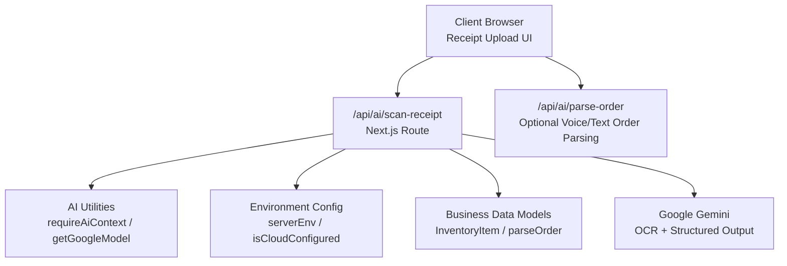
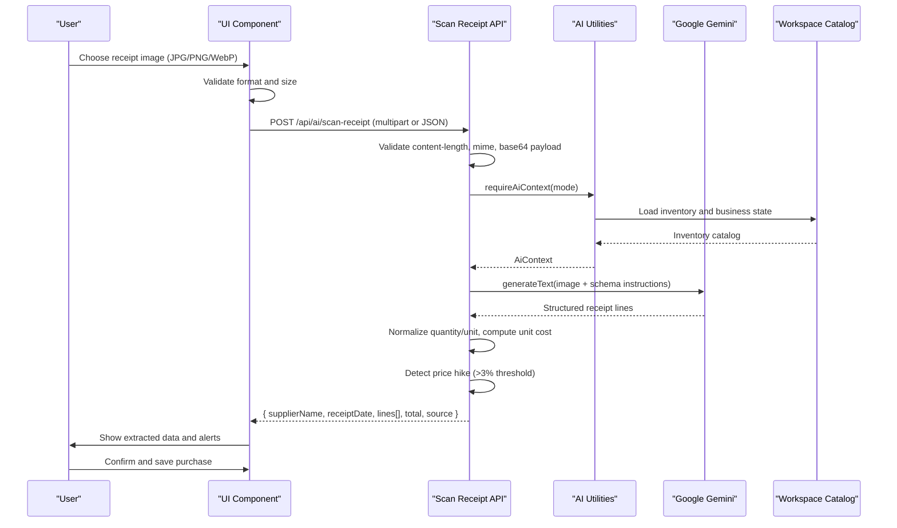
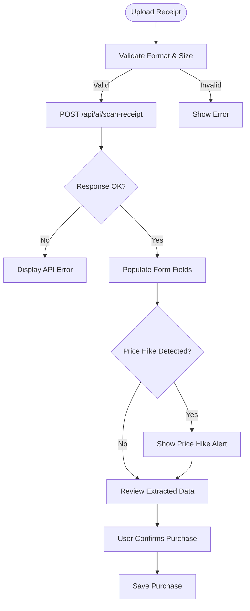
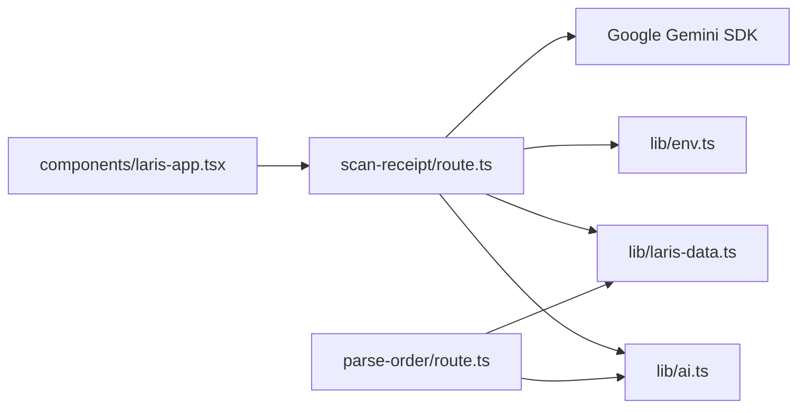

# AI-Powered Receipt Scanning

<cite>
**Referenced Files in This Document**
- [route.ts](file://src/app/api/ai/scan-receipt/route.ts)
- [route.ts](file://src/app/api/ai/parse-order/route.ts)
- [ai.ts](file://src/lib/ai.ts)
- [env.ts](file://src/lib/env.ts)
- [laris-data.ts](file://src/lib/laris-data.ts)
- [laris-app.tsx](file://src/components/laris-app.tsx)
- [0001_schema.sql](file://supabase/migrations/0001_schema.sql)
</cite>

## Table of Contents
1. [Introduction](#introduction)
2. [Project Structure](#project-structure)
3. [Core Components](#core-components)
4. [Architecture Overview](#architecture-overview)
5. [Detailed Component Analysis](#detailed-component-analysis)
6. [Dependency Analysis](#dependency-analysis)
7. [Performance Considerations](#performance-considerations)
8. [Troubleshooting Guide](#troubleshooting-guide)
9. [Conclusion](#conclusion)

## Introduction
This document explains the AI-powered receipt scanning feature that lets users upload a photo of a purchase receipt, extract line items with Google Gemini, connect scanned items to existing inventory, detect price increases compared to historical costs, and review the results before finalizing purchases. It covers supported image formats, file size limits, validation rules, OCR processing, matching logic, price-hike detection, user confirmation workflow, error handling, and the local mock OCR mode used during development.

## Project Structure
The receipt scanning capability is implemented as a Next.js API route backed by shared AI utilities, environment configuration, business data models, and a UI component that orchestrates the upload and confirmation flow.

**Diagram sources**
- [route.ts:54-215](file://src/app/api/ai/scan-receipt/route.ts#L54-L215)
- [ai.ts:9-69](file://src/lib/ai.ts#L9-L69)
- [env.ts:13-23](file://src/lib/env.ts#L13-L23)
- [laris-data.ts:15-23](file://src/lib/laris-data.ts#L15-L23)
- [route.ts:31-127](file://src/app/api/ai/parse-order/route.ts#L31-L127)

**Section sources**
- [route.ts:54-215](file://src/app/api/ai/scan-receipt/route.ts#L54-L215)
- [route.ts:31-127](file://src/app/api/ai/parse-order/route.ts#L31-L127)
- [ai.ts:9-69](file://src/lib/ai.ts#L9-L69)
- [env.ts:13-23](file://src/lib/env.ts#L13-L23)
- [laris-data.ts:15-23](file://src/lib/laris-data.ts#L15-L23)

## Core Components
- Receipt scan API endpoint: validates uploads, loads workspace context, calls Gemini for OCR, normalizes quantities, computes unit cost, detects price hikes, and returns structured results.
- AI utility layer: provides Gemini model access, workspace context loading, catalog context injection, and telemetry logging.
- Environment configuration: exposes server-only settings such as the Gemini API key and preferred model IDs.
- Business data models: define inventory item structures and provide deterministic parsing helpers for orders.
- UI component: handles client-side validation, file upload, result display, and user confirmation before saving a purchase.

**Section sources**
- [route.ts:54-215](file://src/app/api/ai/scan-receipt/route.ts#L54-L215)
- [ai.ts:9-69](file://src/lib/ai.ts#L9-L69)
- [env.ts:13-23](file://src/lib/env.ts#L13-L23)
- [laris-data.ts:15-23](file://src/lib/laris-data.ts#L15-L23)
- [laris-app.tsx:361-391](file://src/components/laris-app.tsx#L361-L391)

## Architecture Overview
The receipt scanning pipeline integrates client-side validation, server-side request validation, workspace context resolution, Gemini OCR, inventory normalization, and price-hike detection.

**Diagram sources**
- [route.ts:54-215](file://src/app/api/ai/scan-receipt/route.ts#L54-L215)
- [ai.ts:30-69](file://src/lib/ai.ts#L30-L69)
- [laris-app.tsx:361-391](file://src/components/laris-app.tsx#L361-L391)

## Detailed Component Analysis

### Image Upload and Validation
- Supported formats: JPG, PNG, WebP.
- File size limit: 8 MB per image; overall request body limit: 12 MB.
- Accepts multipart form data with a `file` field and a `mode` field (`local` or `cloud`).
- Also accepts JSON payloads containing a base64-encoded image string and optional MIME type.
- Validates content-type, presence of image data, MIME type, and decoded byte length.
- Returns clear error responses for invalid requests, unsupported formats, oversized files, empty images, and missing images.

Key behaviors:
- Rejects non-image MIME types with a 415 response.
- Rejects oversized images with a 413 response.
- Requires at least one valid image payload.
- Normalizes base64 decoding and checks for zero-byte images.

**Section sources**
- [route.ts:9-12](file://src/app/api/ai/scan-receipt/route.ts#L9-L12)
- [route.ts:54-97](file://src/app/api/ai/scan-receipt/route.ts#L54-L97)

### Workspace Context and Inventory Loading
- The API resolves workspace context using the provided mode.
- In cloud mode, it authenticates the user, verifies membership, and loads the business snapshot including inventory.
- In local mode, it creates an initial demo state with sample inventory.
- If no inventory exists, the API rejects the scan with a 422 error instructing the user to add ingredients first.

**Section sources**
- [ai.ts:30-69](file://src/lib/ai.ts#L30-L69)
- [route.ts:98-107](file://src/app/api/ai/scan-receipt/route.ts#L98-L107)

### OCR Processing Pipeline Using Google Gemini
- When the Gemini API key is configured, the endpoint sends the image and structured output schema to Gemini.
- The prompt includes business context and inventory catalog so Gemini maps scanned lines to known inventory IDs.
- Gemini returns structured receipt data validated against a Zod schema:
  - Supplier name (optional).
  - Receipt date in YYYY-MM-DD (optional).
  - Lines array with raw name, matched inventory code, quantity, unit, unit price, and total price.
  - Total receipt amount.

Processing steps after OCR:
- For each line, look up the matched inventory item.
- Normalize quantity and unit to the inventory’s base unit.
- Compute unit cost from total price and normalized quantity.
- Compare unit cost to historical inventory cost to detect price hikes.
- Skip lines where unit conversion fails or the matched item is missing.

**Section sources**
- [route.ts:136-155](file://src/app/api/ai/scan-receipt/route.ts#L136-L155)
- [route.ts:157-182](file://src/app/api/ai/scan-receipt/route.ts#L157-L182)

### Fuzzy Matching Logic for Inventory Items
- The system does not implement a custom fuzzy string-matching algorithm on the server.
- Instead, Gemini is instructed to map scanned line names directly to inventory IDs present in the catalog.
- If Gemini cannot confidently match an item, it returns null for the matched code, and the line is skipped during processing.
- The database schema includes a trigram index on inventory names to support future fuzzy search capabilities, but current OCR mapping relies on Gemini’s instruction-following rather than explicit fuzzy matching code.

Practical implications:
- Accurate mapping depends on Gemini’s ability to recognize receipt text and align it with inventory names.
- Users should ensure inventory names are descriptive and consistent to improve matching reliability.

**Section sources**
- [route.ts:140-147](file://src/app/api/ai/scan-receipt/route.ts#L140-L147)
- [route.ts:160-167](file://src/app/api/ai/scan-receipt/route.ts#L160-L167)
- [0001_schema.sql:73-89](file://supabase/migrations/0001_schema.sql#L73-L89)

### Price-Hike Detection System
- After computing the unit cost from the scanned line, the system compares it to the inventory’s historical cost.
- If the percentage increase exceeds 3%, a price-hike alert is attached to the line with old price, new price, and difference percent.
- This enables users to be alerted when scanned prices exceed historical costs.

Example behavior:
- A line with a unit cost significantly higher than the stored cost triggers a price-hike object.
- Lines without significant changes do not include the price-hike field.

**Section sources**
- [route.ts:168-181](file://src/app/api/ai/scan-receipt/route.ts#L168-L181)

### User Confirmation Workflow
- The UI component validates the selected image format and size before uploading.
- On success, it populates the purchase form with the first scanned line’s matched inventory ID, quantity, and total.
- If a price-hike is detected, it displays an alert to the user.
- The user reviews the extracted data and confirms the purchase before saving.
- In mock OCR mode, the UI notifies the user that the data is simulated and must be checked before saving.

**Diagram sources**
- [laris-app.tsx:361-391](file://src/components/laris-app.tsx#L361-L391)
- [route.ts:193-202](file://src/app/api/ai/scan-receipt/route.ts#L193-L202)

**Section sources**
- [laris-app.tsx:361-391](file://src/components/laris-app.tsx#L361-L391)
- [route.ts:193-202](file://src/app/api/ai/scan-receipt/route.ts#L193-L202)

### Example Successful Receipt Scans
Successful scans return structured data including:
- Supplier name.
- Receipt date (YYYY-MM-DD).
- Lines with:
  - Raw name from the receipt.
  - Matched inventory code.
  - Item name.
  - Quantity in base unit.
  - Unit.
  - Total price.
  - Unit cost.
  - Historical cost.
  - Optional price-hike details if the unit cost increased more than 3%.
- Overall total.
- Source indicating whether the result came from Gemini or mock OCR.

Example fields returned by the API:
- supplierName
- receiptDate
- lines[].rawName
- lines[].matchedCode
- lines[].name
- lines[].quantity
- lines[].unit
- lines[].total
- lines[].unitCost
- lines[].oldCost
- lines[].priceHike.oldPrice
- lines[].priceHike.newPrice
- lines[].priceHike.diffPercent
- total
- source

These values enable the UI to populate forms and show alerts for price increases.

**Section sources**
- [route.ts:157-182](file://src/app/api/ai/scan-receipt/route.ts#L157-L182)
- [route.ts:193-202](file://src/app/api/ai/scan-receipt/route.ts#L193-L202)

### Mock OCR Mode in Local Development
- If the Gemini API key is not configured, the API returns simulated receipt data based on the first available inventory item.
- The mock response includes:
  - A simulated supplier name.
  - Today’s date.
  - One line with a simulated raw name, matched code, name, quantity, unit, total, unit cost, old cost, and price-hike calculation.
  - Source marked as “mock-ocr”.
  - A notice explaining that this is demo simulation and advising users to configure Gemini for real OCR.

Limitations:
- Does not perform actual image reading.
- Uses deterministic fallback values derived from inventory.
- Intended for local development and testing only.

**Section sources**
- [route.ts:109-134](file://src/app/api/ai/scan-receipt/route.ts#L109-L134)

### Error Handling
Common errors and their handling:
- Invalid request format or missing image: returns a 400 error with guidance to check mode and image.
- Unsupported image MIME type: returns a 415 error instructing the user to use JPG, PNG, or WebP.
- Oversized image or request body: returns a 413 error with size limits.
- Empty or invalid image bytes: returns a 400 error.
- Missing inventory: returns a 422 error prompting the user to add ingredients.
- Cloud mode without Gemini API key: returns a 503 error explaining that cloud scanning requires the API key; manual purchasing remains available.
- Gemini processing failure: logs telemetry and returns a 502 error encouraging the user to try again with a clearer image.

Telemetry:
- All successful and failed Gemini calls log telemetry including business ID, feature, model, input/output metadata, latency, and status.

**Section sources**
- [route.ts:54-97](file://src/app/api/ai/scan-receipt/route.ts#L54-L97)
- [route.ts:98-134](file://src/app/api/ai/scan-receipt/route.ts#L98-L134)
- [route.ts:184-214](file://src/app/api/ai/scan-receipt/route.ts#L184-L214)
- [ai.ts:97-125](file://src/lib/ai.ts#L97-L125)

## Dependency Analysis
The receipt scanning feature depends on several modules:

**Diagram sources**
- [route.ts:1-6](file://src/app/api/ai/scan-receipt/route.ts#L1-L6)
- [ai.ts:1-8](file://src/lib/ai.ts#L1-L8)
- [env.ts:1-8](file://src/lib/env.ts#L1-L8)
- [laris-data.ts:1-23](file://src/lib/laris-data.ts#L1-L23)
- [laris-app.tsx:361-391](file://src/components/laris-app.tsx#L361-L391)
- [route.ts:1-6](file://src/app/api/ai/parse-order/route.ts#L1-L6)

**Section sources**
- [route.ts:1-6](file://src/app/api/ai/scan-receipt/route.ts#L1-L6)
- [ai.ts:1-8](file://src/lib/ai.ts#L1-L8)
- [env.ts:1-8](file://src/lib/env.ts#L1-L8)
- [laris-data.ts:1-23](file://src/lib/laris-data.ts#L1-L23)
- [laris-app.tsx:361-391](file://src/components/laris-app.tsx#L361-L391)
- [route.ts:1-6](file://src/app/api/ai/parse-order/route.ts#L1-L6)

## Performance Considerations
- Image size limits prevent large uploads from consuming excessive bandwidth and memory.
- Base64 encoding adds overhead; clients should compress images before upload when possible.
- Gemini calls can be slow; telemetry captures latency for monitoring.
- Inventory lookup uses a Map for O(1) access during line processing.
- Unit normalization avoids expensive string operations by trimming and lowercasing once per line.

[No sources needed since this section provides general guidance]

## Troubleshooting Guide
- Unreadable receipts:
  - Ensure the image is well-lit and legible.
  - Retry with a clearer photo if the API returns a 502 error.
- Unmatched items:
  - Verify inventory names are descriptive and consistent.
  - Check that the receipt line corresponds to an existing inventory item.
  - Inspect the `skippedLines` field in the response to identify lines that could not be processed.
- API failures:
  - Confirm the workspace mode is set correctly (`local` or `cloud`).
  - In cloud mode, ensure authentication and membership are complete.
  - Configure the Gemini API key for full OCR functionality.
- Mock mode limitations:
  - Recognize that mock responses are simulated and must be reviewed before saving.
  - Switch to cloud mode with Gemini enabled for real OCR.

**Section sources**
- [route.ts:184-214](file://src/app/api/ai/scan-receipt/route.ts#L184-L214)
- [route.ts:109-134](file://src/app/api/ai/scan-receipt/route.ts#L109-L134)
- [laris-app.tsx:361-391](file://src/components/laris-app.tsx#L361-L391)

## Conclusion
The AI-powered receipt scanning feature combines robust input validation, workspace-aware context loading, Gemini-based OCR, inventory normalization, and price-hike detection to streamline purchase recording. Users upload receipts, review AI-extracted data, confirm purchases, and receive alerts when prices rise above historical costs. The system gracefully handles errors, supports local mock OCR for development, and provides telemetry for observability. Proper inventory naming and clear receipt images improve accuracy, while the UI ensures users validate data before finalizing transactions.