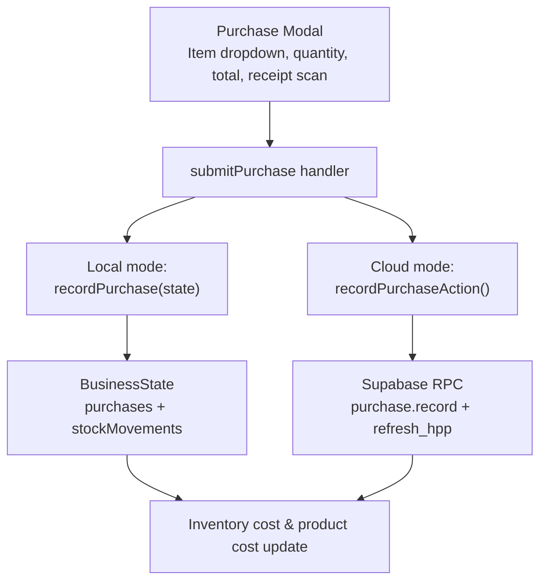
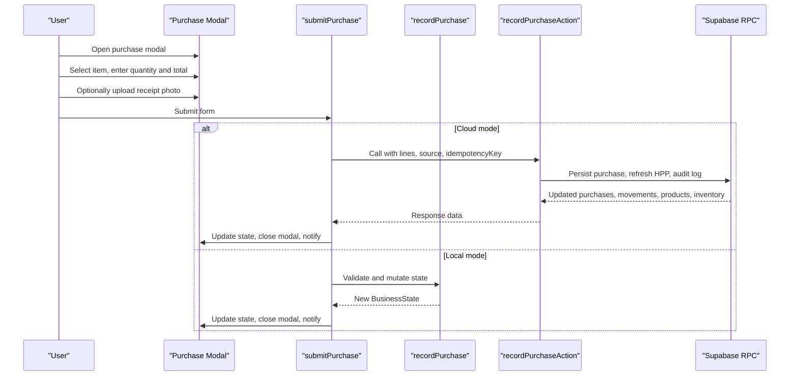
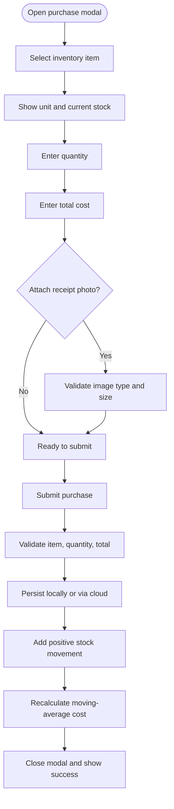
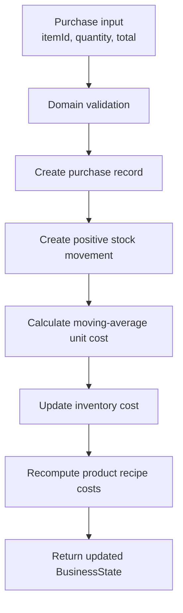
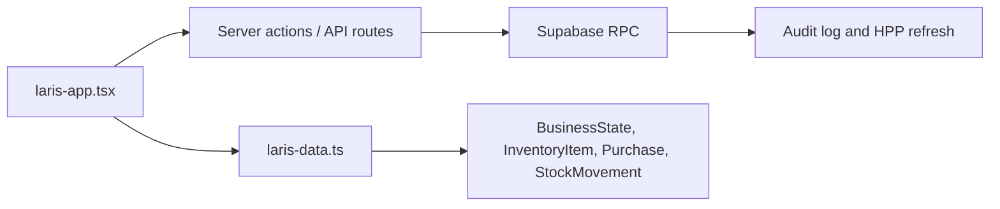

# Manual Purchase Entry

<cite>
**Referenced Files in This Document**
- [laris-app.tsx](file://src/components/laris-app.tsx)
- [laris-data.ts](file://src/lib/laris-data.ts)
- [0005_production_hardening.sql](file://supabase/migrations/0005_production_hardening.sql)
- [README.md](file://README.md)
</cite>

## Table of Contents
1. [Introduction](#introduction)
2. [Project Structure](#project-structure)
3. [Core Components](#core-components)
4. [Architecture Overview](#architecture-overview)
5. [Detailed Component Analysis](#detailed-component-analysis)
6. [Dependency Analysis](#dependency-analysis)
7. [Performance Considerations](#performance-considerations)
8. [Troubleshooting Guide](#troubleshooting-guide)
9. [Conclusion](#conclusion)

## Introduction
This document explains the manual purchase entry system in Laris, covering the complete workflow from opening the purchase modal to completing a transaction. It documents the form fields, validation rules, inventory integration, error handling, and the differences between local and cloud modes. The goal is to help users and developers understand how purchases of raw materials such as coffee beans, milk, and sugar are recorded, validated, and reflected in stock levels and product costs.

## Project Structure
The manual purchase feature spans three main layers:
- UI and interaction logic in the application component.
- Domain model and local state mutation for purchases and inventory.
- Cloud persistence and server-side business rules through Supabase migrations.

**Diagram sources**
- [laris-app.tsx:393-435](file://src/components/laris-app.tsx#L393-L435)
- [laris-data.ts:307-334](file://src/lib/laris-data.ts#L307-L334)
- [0005_production_hardening.sql:300-305](file://supabase/migrations/0005_production_hardening.sql#L300-L305)

**Section sources**
- [laris-app.tsx:393-435](file://src/components/laris-app.tsx#L393-L435)
- [laris-data.ts:307-334](file://src/lib/laris-data.ts#L307-L334)
- [0005_production_hardening.sql:300-305](file://supabase/migrations/0005_production_hardening.sql#L300-L305)

## Core Components
- **Purchase Modal**: Opens from the inventory or purchases page, lets the user select an inventory item, enter quantity and total cost, optionally attach a receipt photo, and confirm the purchase.
- **submitPurchase Handler**: Reads form values, determines whether the app is running in local or cloud mode, validates inputs, updates state or calls the server, and closes the modal on success.
- **recordPurchase Function**: Performs domain-level validation, creates an immutable purchase record, adds a positive stock movement, recalculates moving-average unit cost, and updates product recipe costs.
- **Supabase Purchase RPC**: Persists purchases atomically, records audit activity, refreshes HPP (cost of goods), and returns updated purchases, stock movements, products, and inventory.

Key responsibilities:
- Form field binding and display of current stock.
- Numeric validation for quantity and total.
- Item existence validation.
- Moving-average cost calculation.
- Automatic stock ledger updates.
- Idempotent cloud submission.

**Section sources**
- [laris-app.tsx:393-435](file://src/components/laris-app.tsx#L393-L435)
- [laris-app.tsx:1144](file://src/components/laris-app.tsx#L1144)
- [laris-data.ts:307-334](file://src/lib/laris-data.ts#L307-L334)
- [0005_production_hardening.sql:300-305](file://supabase/migrations/0005_production_hardening.sql#L300-L305)

## Architecture Overview
The purchase flow supports two execution paths:

| Mode | Validation | Persistence | Stock Update | Cost Update | User Feedback |
|---|---|---|---|---|---|
| Local | Frontend validation via `recordPurchase` | Browser storage via `BusinessState` | Immediate local state change | Moving-average cost recalculated locally | Toast notification and modal close |
| Cloud | Server-side validation via RPC | Supabase RPC with idempotency key | Atomic stock movement insertion | HPP refreshed server-side | Success toast, updated state, modal close |

**Diagram sources**
- [laris-app.tsx:393-435](file://src/components/laris-app.tsx#L393-L435)
- [laris-data.ts:307-334](file://src/lib/laris-data.ts#L307-L334)
- [0005_production_hardening.sql:300-305](file://supabase/migrations/0005_production_hardening.sql#L300-L305)

## Detailed Component Analysis

### Purchase Modal Fields and Behavior
The purchase modal provides:
- **Item selection dropdown**: Lists all configured inventory items with their units. The selected item controls the unit shown for quantity and the current stock displayed below the form.
- **Quantity input**: Number input constrained by HTML attributes; accepts fractional quantities because inventory can represent grams or milliliters.
- **Total cost input**: Number input representing the full purchase amount in rupiah.
- **Receipt photo upload**: Optional file input for JPG, PNG, or WebP files up to 8 MB. When used, the source is marked as scanned rather than manual.
- **Current stock notice**: Shows the calculated stock for the selected item before confirmation.
- **Confirmation button**: Disabled while scanning or when a cloud mutation is pending.

Date tracking is handled by the domain layer: each purchase receives a timestamp derived from the active demo date or current time, depending on context.

**Diagram sources**
- [laris-app.tsx:1144](file://src/components/laris-app.tsx#L1144)
- [laris-app.tsx:393-435](file://src/components/laris-app.tsx#L393-L435)
- [laris-data.ts:307-334](file://src/lib/laris-data.ts#L307-L334)

**Section sources**
- [laris-app.tsx:1144](file://src/components/laris-app.tsx#L1144)
- [laris-app.tsx:393-435](file://src/components/laris-app.tsx#L393-L435)

### Validation Rules
Validation occurs at multiple layers:

| Rule | Where | Behavior |
|---|---|---|
| Required item | UI and domain | Must select a known inventory item; unknown IDs cause domain errors. |
| Positive quantity | Domain | Quantity must be finite, non-negative, and strictly positive for purchases. |
| Positive total | Domain | Total must be finite and strictly positive. |
| Fractional support | Domain | Quantities may include decimals for units like grams or milliliters. |
| Image format and size | UI | Only JPG, PNG, or WebP; maximum 8 MB. |
| Non-negative numbers | Domain | General numeric assertions reject NaN, Infinity, negative values, and unsafe integers where required. |
| Idempotency key | Cloud | Prevents duplicate purchase submissions during retries. |

The domain function enforces that the resulting stock after adding the purchased quantity remains a valid non-negative number. Invalid inputs throw descriptive errors rather than silently mutating state.

**Section sources**
- [laris-data.ts:155-159](file://src/lib/laris-data.ts#L155-L159)
- [laris-data.ts:307-334](file://src/lib/laris-data.ts#L307-L334)
- [laris-app.tsx:361-391](file://src/components/laris-app.tsx#L361-L391)
- [laris-app.tsx:393-435](file://src/components/laris-app.tsx#L393-L435)

### Handling Different Inventory Items and Units
Inventory items define:
- Unique identifier
- Display name
- Unit of measurement
- Opening stock
- Reorder point
- Unit cost
- Supplier

Units vary by item, including grams for coffee beans, milliliters for milk and syrups, pieces for cups and pastries, and packets for tea. The purchase form adapts its quantity label to the selected item’s unit. Stock calculations use these units consistently across sales, purchases, adjustments, and reorder alerts.

Practical examples:
- **Coffee beans**: Purchase quantity in grams; total reflects supplier price per batch.
- **Milk**: Purchase quantity in milliliters; total reflects fresh milk delivery cost.
- **Sugar or syrup**: Purchase quantity in milliliters; total reflects bulk syrup cost.

These examples align with the demo inventory, which includes coffee beans, fresh milk, and related consumables.

**Section sources**
- [laris-data.ts:112-121](file://src/lib/laris-data.ts#L112-L121)
- [laris-app.tsx:1144](file://src/components/laris-app.tsx#L1144)

### Inventory Integration and Stock Updates
When a purchase is saved:
1. A purchase record is created with a generated ID, item ID, quantity, rounded total, and timestamp.
2. A positive stock movement is appended with type `purchase`.
3. The moving-average unit cost is recalculated using existing stock and the new purchase total.
4. Product recipe costs are recomputed based on updated ingredient costs.
5. In cloud mode, the server performs equivalent steps and refreshes HPP.

**Diagram sources**
- [laris-data.ts:307-334](file://src/lib/laris-data.ts#L307-L334)

**Section sources**
- [laris-data.ts:307-334](file://src/lib/laris-data.ts#L307-L334)

### Local vs Cloud Modes
| Aspect | Local Mode | Cloud Mode |
|---|---|---|
| Data location | Browser storage keyed by a versioned state object | Supabase workspace with RLS and RPC |
| Purchase processing | Calls `recordPurchase` directly | Calls `recordPurchaseAction`, which invokes a database RPC |
| Idempotency | Not required for local mutations | Uses a generated idempotency key to prevent duplicate purchases |
| Source tracking | Always manual unless receipt scan is active | Explicitly marks `manual` or `scan` |
| Error handling | Catches thrown domain errors and displays them | Displays server error messages returned by the action |
| Stock update | Immediate local state mutation | Atomic server-side mutation with audit logging |
| Demo behavior | Explicitly isolated from cloud data | Requires Supabase configuration |

The README clarifies that the demo runs locally with fictional data and that cloud mode requires Supabase setup. Without Supabase, the login page shows setup instructions and the app does not pretend to connect to the cloud.

**Section sources**
- [laris-app.tsx:393-435](file://src/components/laris-app.tsx#L393-L435)
- [README.md:18-22](file://README.md#L18-L22)
- [README.md:37-49](file://README.md#L37-L49)

### Practical Examples

#### Example 1: Purchasing Coffee Beans
- Select “Biji kopi house blend” from the item dropdown.
- Enter quantity in grams, for example a large delivery measured in thousands of grams.
- Enter the total supplier cost in rupiah.
- Confirm the purchase.
- Result: Stock increases by the entered grams, a purchase record appears, and the moving-average cost for coffee beans is recalculated.

#### Example 2: Purchasing Fresh Milk
- Select “Susu segar”.
- Enter quantity in milliliters, matching the delivery volume.
- Enter the total cost for the milk delivery.
- Confirm the purchase.
- Result: Milk stock increases, and any menu using milk recalculates its recipe cost based on the new average unit cost.

#### Example 3: Purchasing Sugar or Syrup
- Select the relevant syrup or sweetener item.
- Enter quantity in milliliters.
- Enter the total cost.
- Confirm the purchase.
- Result: Inventory increases and product costs adjust accordingly.

These examples follow the same validation and integration path regardless of the specific raw material.

**Section sources**
- [laris-data.ts:112-121](file://src/lib/laris-data.ts#L112-L121)
- [laris-data.ts:307-334](file://src/lib/laris-data.ts#L307-L334)
- [laris-app.tsx:1144](file://src/components/laris-app.tsx#L1144)

## Dependency Analysis
The purchase feature depends on shared domain functions and types:

**Diagram sources**
- [laris-app.tsx:14-22](file://src/components/laris-app.tsx#L14-L22)
- [laris-data.ts:97-110](file://src/lib/laris-data.ts#L97-L110)
- [0005_production_hardening.sql:300-305](file://supabase/migrations/0005_production_hardening.sql#L300-L305)

Coupling and cohesion:
- The UI component owns modal state, form rendering, and dispatching to either local or cloud logic.
- The domain module owns immutable state transitions, validation, and cost recalculation.
- The database migration owns atomic persistence, audit logging, and HPP refresh.

Potential risks:
- If inventory items are missing or misconfigured, purchases cannot be linked correctly.
- If cloud RPC fails, the frontend must surface the error without corrupting local state.
- If receipt scanning fills invalid values into the form, domain validation should still protect against bad data.

**Section sources**
- [laris-app.tsx:393-435](file://src/components/laris-app.tsx#L393-L435)
- [laris-data.ts:97-110](file://src/lib/laris-data.ts#L97-L110)
- [0005_production_hardening.sql:300-305](file://supabase/migrations/0005_production_hardening.sql#L300-L305)

## Performance Considerations
- Local purchases mutate an in-memory state tree and then persist to browser storage; this is fast but limited to one device session.
- Cloud purchases involve network latency and server-side computation; idempotency keys reduce duplicate work on retry.
- Moving-average cost recalculation iterates over inventory and product recipes; keeping the catalog small avoids unnecessary overhead.
- Receipt scanning adds client-side validation and optional AI OCR processing; large images or failed scans should not block normal manual entry.

[No sources needed since this section provides general guidance]

## Troubleshooting Guide

| Scenario | Likely Cause | Expected Behavior | Resolution |
|---|---|---|---|
| Invalid quantity | Zero, negative, NaN, Infinity, or unsafe integer | Domain throws a validation error | Enter a positive finite number; use decimals only for fractional units |
| Missing or unknown item | No inventory item matches the selected ID | Domain throws an unknown-item error | Add the inventory item first or select a valid item |
| Negative or zero total | Total must be positive | Domain throws a validation error | Enter a positive rupiah amount |
| Receipt file rejected | Wrong format or too large | UI error message | Use JPG, PNG, or WebP under 8 MB |
| Cloud purchase fails | Network error or server validation failure | Error displayed in the modal | Retry once; check network and Supabase configuration |
| Duplicate purchase on retry | Client retries before receiving response | Idempotency key prevents duplication | Allow the idempotency mechanism to handle retries |
| Stock does not increase | Purchase was not persisted or item ID is wrong | No positive movement appears | Verify purchase history and item linkage |
| Product cost unchanged | Inventory cost did not update | Recipe cost stays stale | Confirm purchase succeeded and moving-average cost was recalculated |

Error handling patterns:
- Local mode catches thrown domain errors and sets the modal error state.
- Cloud mode checks the response status and displays the server-provided error message.
- Successful purchases close the modal and show a success notification.

**Section sources**
- [laris-data.ts:155-159](file://src/lib/laris-data.ts#L155-L159)
- [laris-data.ts:307-334](file://src/lib/laris-data.ts#L307-L334)
- [laris-app.tsx:361-391](file://src/components/laris-app.tsx#L361-L391)
- [laris-app.tsx:393-435](file://src/components/laris-app.tsx#L393-L435)

## Conclusion
The manual purchase entry system in Laris provides a clear, validated workflow for recording raw material purchases. It supports both local exploration and persistent cloud operations, integrates tightly with inventory management, and automatically updates stock levels and product costs. By separating UI concerns, domain validation, and server-side persistence, the system remains robust against invalid inputs, missing items, and network failures while giving operators confidence that their stock and costing data stay accurate.