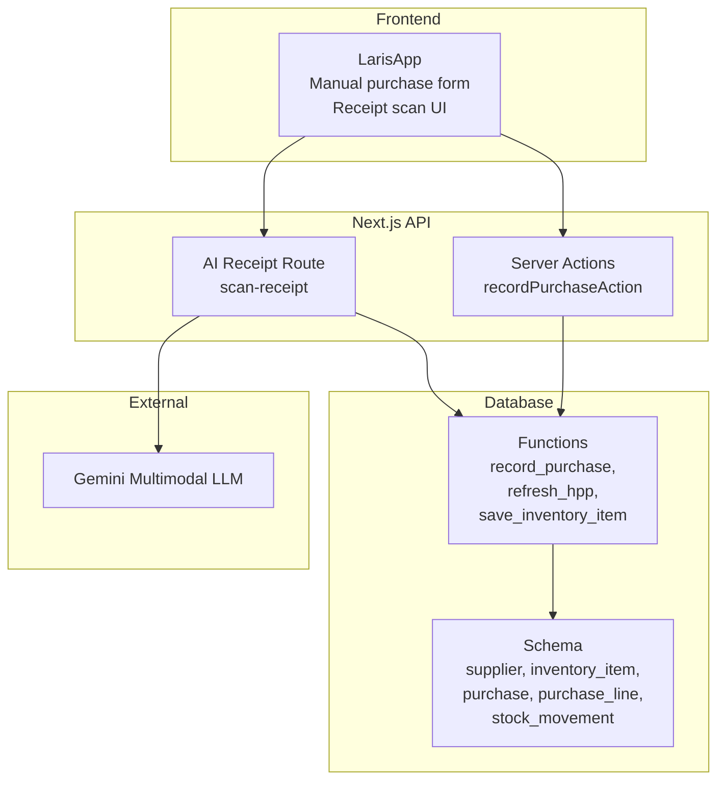
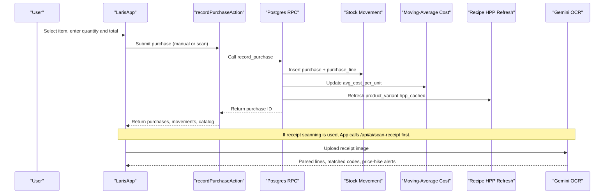
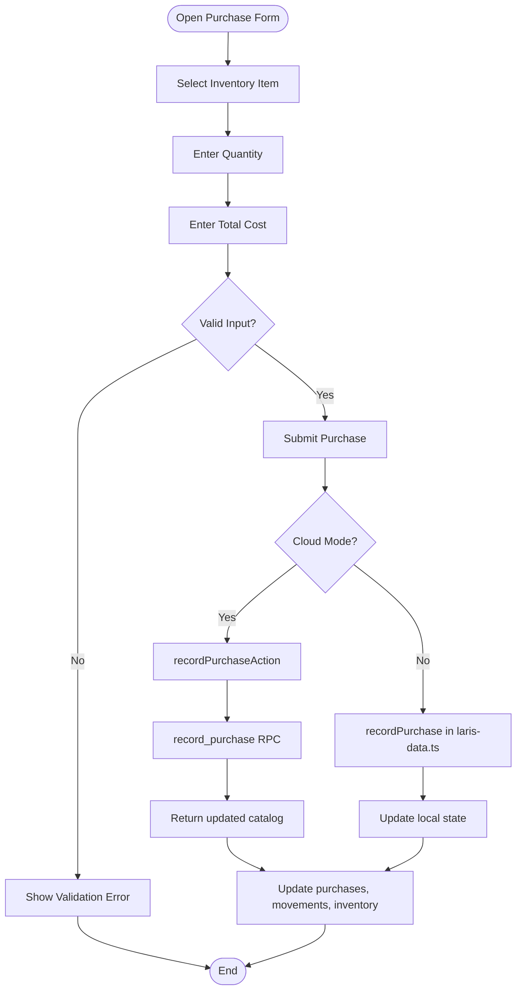
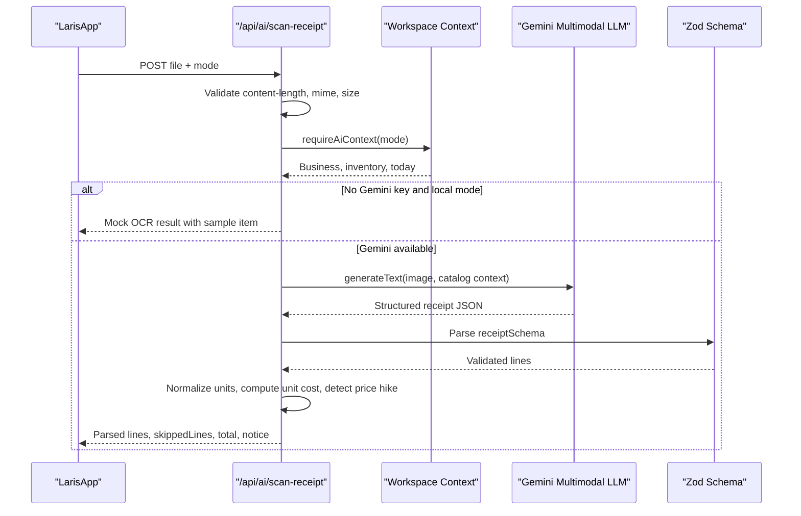
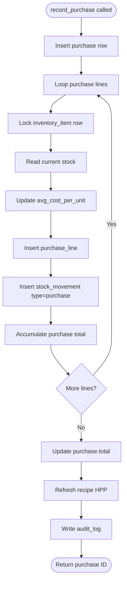
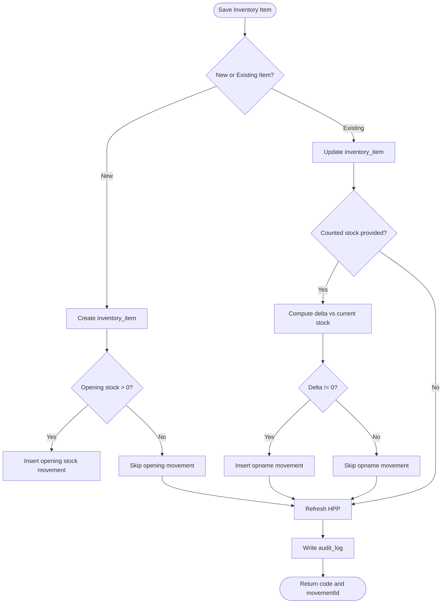
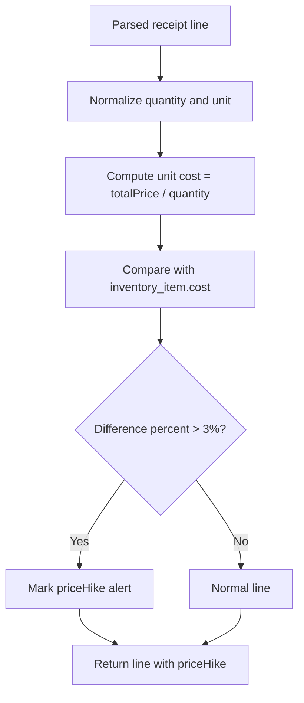
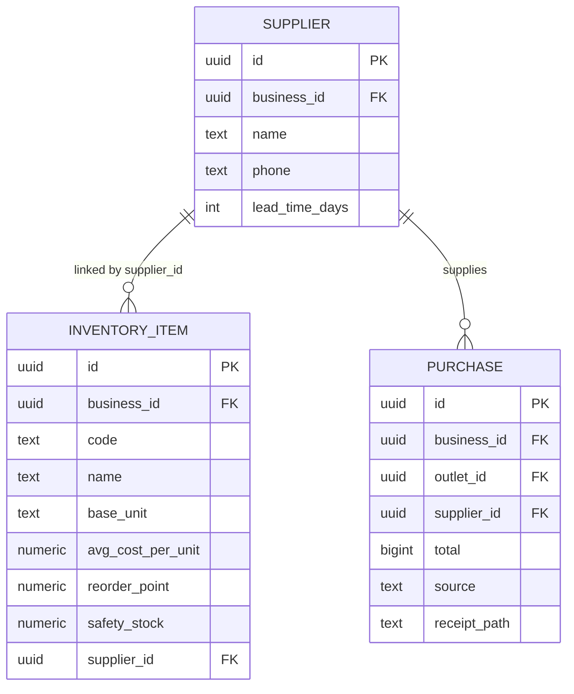
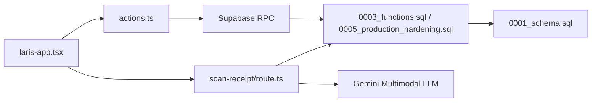

# Purchasing System

<cite>
**Referenced Files in This Document**
- [README.md](file://README.md)
- [PRD_Laris_GTNIC2026.md](file://PRD_Laris_GTNIC2026.md)
- [0001_schema.sql](file://supabase/migrations/0001_schema.sql)
- [0003_functions.sql](file://supabase/migrations/0003_functions.sql)
- [0005_production_hardening.sql](file://supabase/migrations/0005_production_hardening.sql)
- [laris-data.ts](file://src/lib/laris-data.ts)
- [laris-app.tsx](file://src/components/laris-app.tsx)
- [actions.ts](file://src/app/actions.ts)
- [route.ts](file://src/app/api/ai/scan-receipt/route.ts)
</cite>

## Table of Contents
1. [Introduction](#introduction)
2. [Project Structure](#project-structure)
3. [Core Components](#core-components)
4. [Architecture Overview](#architecture-overview)
5. [Detailed Component Analysis](#detailed-component-analysis)
6. [Dependency Analysis](#dependency-analysis)
7. [Performance Considerations](#performance-considerations)
8. [Troubleshooting Guide](#troubleshooting-guide)
9. [Conclusion](#conclusion)

## Introduction
This document explains the Laris purchasing system with a focus on:
- Manual purchase entry workflows, including item selection, quantity and cost entry, and date tracking.
- AI-powered receipt scanning, image upload handling, OCR processing, and user confirmation.
- Stock update mechanisms, moving-average cost recalculation, and inventory reconciliation.
- Price-hike alerting and supplier management features.
- Practical examples for purchase order creation, receipt processing, and automated stock updates.
- Integration between purchasing activities and inventory valuation systems.
- Handling partial deliveries, returns, and bulk purchases.

Laris is designed as an operational workspace for Indonesian micro and small F&B businesses. Purchasing is one of the core pillars that connects suppliers, inventory, recipes, pricing, and financial reporting. The system supports both manual data entry and multimodal AI-assisted receipt scanning, while keeping human confirmation central to every change.

**Section sources**
- [README.md:24-35](file://README.md#L24-L35)
- [PRD_Laris_GTNIC2026.md:187-194](file://PRD_Laris_GTNIC2026.md#L187-L194)

## Project Structure
The purchasing functionality spans several layers:
- Database schema defines suppliers, inventory items, purchases, purchase lines, and stock movements.
- Server functions enforce business rules, ledger integrity, and moving-average cost updates.
- Next.js server actions validate inputs and call database RPCs.
- The React application provides manual purchase forms, receipt scanning UI, and real-time state updates.
- The AI route handles receipt image parsing, unit normalization, price comparison, and mock fallback behavior.

**Diagram sources**
- [laris-app.tsx:393-435](file://src/components/laris-app.tsx#L393-L435)
- [actions.ts:91-124](file://src/app/actions.ts#L91-L124)
- [route.ts:54-215](file://src/app/api/ai/scan-receipt/route.ts#L54-L215)
- [0001_schema.sql:61-88](file://supabase/migrations/0001_schema.sql#L61-L88)
- [0001_schema.sql:218-237](file://supabase/migrations/0001_schema.sql#L218-L237)
- [0003_functions.sql:232-303](file://supabase/migrations/0003_functions.sql#L232-L303)

**Section sources**
- [README.md:97-110](file://README.md#L97-L110)
- [PRD_Laris_GTNIC2026.md:319-374](file://PRD_Laris_GTNIC2026.md#L319-L374)

## Core Components
The purchasing system is built around these core components:

| Component | Responsibility | Key Behavior |
|---|---|---|
| Supplier directory | Stores supplier identity and lead time | Used by inventory items and purchase records; created implicitly when saving inventory items with a supplier name. |
| Inventory item catalog | Defines raw materials, units, reorder points, and current average cost | Central reference for purchase matching, recipe costing, and stock movement valuation. |
| Purchase record | Captures a buying event with source, outlet, supplier, and total | Supports manual or scanned input; idempotent through `idempotency_key`. |
| Purchase line | Links each purchased item to quantity and total amount | Enables per-item auditability and stock movement generation. |
| Stock movement ledger | Records every stock change atomically | Never overwrites history; current stock is derived from deltas. |
| Moving-average cost function | Recalculates average unit cost after purchases | Ensures HPP and product cost roll up correctly. |
| AI receipt scanner | Extracts receipt data and maps it to inventory items | Provides unit normalization, price-hike detection, and mock fallback. |
| Frontend purchase workflow | Guides users through item selection, quantity, cost, and confirmation | Integrates with cloud RPCs and local demo logic. |

**Section sources**
- [0001_schema.sql:61-88](file://supabase/migrations/0001_schema.sql#L61-L88)
- [0001_schema.sql:218-237](file://supabase/migrations/0001_schema.sql#L218-L237)
- [0001_schema.sql:203-216](file://supabase/migrations/0001_schema.sql#L203-L216)
- [0003_functions.sql:48-61](file://supabase/migrations/0003_functions.sql#L48-L61)
- [0003_functions.sql:232-303](file://supabase/migrations/0003_functions.sql#L232-L303)
- [route.ts:14-26](file://src/app/api/ai/scan-receipt/route.ts#L14-L26)
- [laris-app.tsx:393-435](file://src/components/laris-app.tsx#L393-L435)

## Architecture Overview
The purchasing architecture separates concerns across client, API, database, and external AI services:

**Diagram sources**
- [laris-app.tsx:361-391](file://src/components/laris-app.tsx#L361-L391)
- [laris-app.tsx:393-435](file://src/components/laris-app.tsx#L393-L435)
- [actions.ts:91-124](file://src/app/actions.ts#L91-L124)
- [0003_functions.sql:232-303](file://supabase/migrations/0003_functions.sql#L232-L303)
- [route.ts:54-215](file://src/app/api/ai/scan-receipt/route.ts#L54-L215)

## Detailed Component Analysis

### Manual Purchase Entry Workflow
Manual purchasing allows users to select an inventory item, enter quantity and total cost, and confirm the purchase. In cloud mode, this triggers a server action that validates input, checks membership roles, and calls the database RPC. In local/demo mode, it updates in-memory state using deterministic logic.

Key behaviors:
- Item selection uses the active inventory catalog.
- Quantity must be positive and within system limits.
- Total must be a valid rupiah amount.
- Source is marked as manual unless populated by receipt scanning.
- On success, the UI updates purchases, stock movements, products, and inventory.

**Diagram sources**
- [laris-app.tsx:393-435](file://src/components/laris-app.tsx#L393-L435)
- [actions.ts:91-124](file://src/app/actions.ts#L91-L124)
- [laris-data.ts:307-334](file://src/lib/laris-data.ts#L307-L334)

**Section sources**
- [laris-app.tsx:393-435](file://src/components/laris-app.tsx#L393-L435)
- [actions.ts:91-124](file://src/app/actions.ts#L91-L124)
- [laris-data.ts:307-334](file://src/lib/laris-data.ts#L307-L334)

### AI-Powered Receipt Scanning
Receipt scanning accepts an image, validates its format and size, loads the workspace context, and either simulates OCR locally or sends the image to a multimodal LLM. The response includes supplier name, receipt date, parsed lines, matched inventory codes, normalized quantities, unit costs, totals, and optional price-hike alerts.

Important details:
- Supported formats: JPG, PNG, WebP.
- Maximum image size: 8 MB.
- Maximum request body: 12 MB.
- Mock OCR is used in local demo mode without the Gemini key.
- Real OCR uses structured output validation against a Zod schema.
- Unit normalization converts receipt units to base inventory units where possible.
- Skipped lines are returned so the user can review them.

**Diagram sources**
- [route.ts:54-215](file://src/app/api/ai/scan-receipt/route.ts#L54-L215)
- [laris-app.tsx:361-391](file://src/components/laris-app.tsx#L361-L391)

**Section sources**
- [route.ts:9-26](file://src/app/api/ai/scan-receipt/route.ts#L9-L26)
- [route.ts:54-107](file://src/app/api/ai/scan-receipt/route.ts#L54-L107)
- [route.ts:109-134](file://src/app/api/ai/scan-receipt/route.ts#L109-L134)
- [route.ts:136-215](file://src/app/api/ai/scan-receipt/route.ts#L136-L215)
- [laris-app.tsx:361-391](file://src/components/laris-app.tsx#L361-L391)

### Stock Update Mechanisms and Moving-Average Cost
When a purchase is recorded, the system:
1. Creates a purchase record.
2. Iterates purchase lines.
3. Locks each inventory item row.
4. Reads current stock.
5. Updates the moving-average cost.
6. Inserts a purchase line.
7. Inserts a stock movement with type `purchase`.
8. Updates the purchase total.
9. Refreshes recipe HPP for affected variants.
10. Writes an audit log.

The moving-average formula combines existing stock value with the new purchase total and divides by the new total quantity. This ensures future sales use a realistic unit cost based on recent supply prices.

**Diagram sources**
- [0003_functions.sql:232-303](file://supabase/migrations/0003_functions.sql#L232-L303)
- [0005_production_hardening.sql:242-305](file://supabase/migrations/0005_production_hardening.sql#L242-L305)

**Section sources**
- [0003_functions.sql:48-61](file://supabase/migrations/0003_functions.sql#L48-L61)
- [0003_functions.sql:232-303](file://supabase/migrations/0003_functions.sql#L232-L303)
- [0005_production_hardening.sql:242-305](file://supabase/migrations/0005_production_hardening.sql#L242-L305)

### Inventory Reconciliation and Opening Stock
Inventory reconciliation is supported through inventory item creation and stock opname flows:
- New inventory items can include opening stock, which creates an `opening` stock movement.
- Existing inventory items can be updated with counted stock; if the counted value differs from current stock, an `opname` movement is created.
- Base unit changes are restricted once the item has been used in recipes or ledger entries.
- Supplier names are upserted into the supplier table when provided.

**Diagram sources**
- [0005_production_hardening.sql:308-389](file://supabase/migrations/0005_production_hardening.sql#L308-L389)

**Section sources**
- [0005_production_hardening.sql:308-389](file://supabase/migrations/0005_production_hardening.sql#L308-L389)

### Price-Hike Alerting System
Price-hike alerts compare the newly computed unit cost from a receipt line with the current inventory item cost. If the percentage increase exceeds a threshold, the system marks the line with a price-hike object containing old price, new price, and difference percent.

In the frontend:
- After scanning, if a price-hike alert exists, the UI displays it alongside the scanned item.
- The alert helps owners decide whether to adjust menu prices or investigate supplier pricing changes.

**Diagram sources**
- [route.ts:157-182](file://src/app/api/ai/scan-receipt/route.ts#L157-L182)
- [laris-app.tsx:376-385](file://src/components/laris-app.tsx#L376-L385)

**Section sources**
- [route.ts:157-182](file://src/app/api/ai/scan-receipt/route.ts#L157-L182)
- [laris-app.tsx:376-385](file://src/components/laris-app.tsx#L376-L385)

### Supplier Management Features
Supplier management is integrated into inventory and purchase flows:
- Suppliers have a name, phone, lead time, and relationship to inventory items.
- When saving an inventory item with a supplier name, the system upserts the supplier.
- Purchase records can link to a supplier, and the database enforces referential integrity.
- The PRD describes a supplier directory and purchase orders sent via WhatsApp deep links.

**Diagram sources**
- [0001_schema.sql:61-71](file://supabase/migrations/0001_schema.sql#L61-L71)
- [0001_schema.sql:73-88](file://supabase/migrations/0001_schema.sql#L73-L88)
- [0001_schema.sql:218-228](file://supabase/migrations/0001_schema.sql#L218-L228)
- [0005_production_hardening.sql:342-346](file://supabase/migrations/0005_production_hardening.sql#L342-L346)

**Section sources**
- [0001_schema.sql:61-71](file://supabase/migrations/0001_schema.sql#L61-L71)
- [0001_schema.sql:73-88](file://supabase/migrations/0001_schema.sql#L73-L88)
- [0001_schema.sql:218-228](file://supabase/migrations/0001_schema.sql#L218-L228)
- [0005_production_hardening.sql:342-346](file://supabase/migrations/0005_production_hardening.sql#L342-L346)
- [PRD_Laris_GTNIC2026.md:187-194](file://PRD_Laris_GTNIC2026.md#L187-L194)

### Practical Examples

#### Example 1: Manual Purchase Order Creation
A user opens the purchase form, selects an inventory item such as milk, enters quantity and total cost, and confirms. In cloud mode, the frontend calls `recordPurchaseAction`, which validates the input, checks membership, and calls `record_purchase`. The database inserts purchase rows, updates moving-average cost, writes stock movements, refreshes HPP, and returns updated catalog data.

Expected outcomes:
- A purchase record is created.
- Purchase lines are recorded per item.
- Stock increases by the purchased quantity.
- Average unit cost reflects the new purchase price.
- Product HPP may be recalculated if the item is part of a recipe.

**Section sources**
- [laris-app.tsx:393-435](file://src/components/laris-app.tsx#L393-L435)
- [actions.ts:91-124](file://src/app/actions.ts#L91-L124)
- [0003_functions.sql:232-303](file://supabase/migrations/0003_functions.sql#L232-L303)

#### Example 2: Receipt Processing and Confirmation
A user uploads a receipt photo. The frontend validates the file type and size, then calls `/api/ai/scan-receipt`. The API parses the image, normalizes units, matches items to inventory, computes unit costs, detects price hikes, and returns structured results. The UI pre-fills the purchase form with the first matched item, quantity, and total. The user reviews and confirms before saving.

Expected outcomes:
- Parsed receipt lines are shown.
- Unmatched or unconvertible lines are reported.
- Price-hike alerts are highlighted.
- The user can edit quantity and total before submission.

**Section sources**
- [laris-app.tsx:361-391](file://src/components/laris-app.tsx#L361-L391)
- [route.ts:54-215](file://src/app/api/ai/scan-receipt/route.ts#L54-L215)

#### Example 3: Automated Stock Level Updates
After confirming a purchase, the system automatically updates stock levels through stock movements. Sales also deduct stock based on recipes. The ledger approach ensures historical accuracy and supports reconciliation.

Expected outcomes:
- Stock movements are appended rather than overwritten.
- Current stock is derived from deltas.
- Low-stock indicators can be calculated from reorder points.

**Section sources**
- [0001_schema.sql:203-216](file://supabase/migrations/0001_schema.sql#L203-L216)
- [0003_functions.sql:11-15](file://supabase/migrations/0003_functions.sql#L11-L15)
- [laris-app.tsx:195-196](file://src/components/laris-app.tsx#L195-L196)

### Common Scenarios

#### Partial Deliveries
Partial deliveries can be modeled by recording multiple purchase records for the same inventory item, each with its own quantity and total. Each purchase updates the moving-average cost independently, reflecting the actual cost of the delivered batch.

Recommendations:
- Use consistent item codes.
- Record receipts per delivery when possible.
- Track supplier lead times to plan partial replenishment.

**Section sources**
- [0003_functions.sql:232-303](file://supabase/migrations/0003_functions.sql#L232-L303)
- [0001_schema.sql:218-237](file://supabase/migrations/0001_schema.sql#L218-L237)

#### Return Processing
The current schema does not define a dedicated return entity. Returns should be modeled as negative stock adjustments or expense records depending on business policy:
- For inventory returns to suppliers, create an adjustment movement with a negative delta and link it to an audit note.
- For financial returns, record an expense reversal or refund entry in the finance module.

Caution:
- Do not delete original stock movements; always append corrective movements.
- Ensure audit logs capture the reason and actor.

**Section sources**
- [0001_schema.sql:203-216](file://supabase/migrations/0001_schema.sql#L203-L216)
- [0001_schema.sql:239-250](file://supabase/migrations/0001_schema.sql#L239-L250)
- [0001_schema.sql:255-265](file://supabase/migrations/0001_schema.sql#L255-L265)

#### Bulk Purchase Operations
Bulk purchases are supported through arrays of purchase lines:
- Server actions accept up to 50 lines.
- Database functions accept up to 50 lines per RPC call.
- Each line updates stock and average cost atomically.

Best practices:
- Group items by supplier when possible.
- Validate totals before submission.
- Use idempotency keys to prevent duplicate submissions.

**Section sources**
- [actions.ts:91-95](file://src/app/actions.ts#L91-L95)
- [0003_functions.sql:258-260](file://supabase/migrations/0003_functions.sql#L258-L260)
- [0005_production_hardening.sql:250-252](file://supabase/migrations/0005_production_hardening.sql#L250-L252)

## Dependency Analysis
The purchasing system depends on several tightly coupled components:

**Diagram sources**
- [laris-app.tsx:361-435](file://src/components/laris-app.tsx#L361-L435)
- [actions.ts:91-124](file://src/app/actions.ts#L91-L124)
- [route.ts:54-215](file://src/app/api/ai/scan-receipt/route.ts#L54-L215)
- [0003_functions.sql:232-303](file://supabase/migrations/0003_functions.sql#L232-L303)
- [0005_production_hardening.sql:242-305](file://supabase/migrations/0005_production_hardening.sql#L242-L305)
- [0001_schema.sql:218-237](file://supabase/migrations/0001_schema.sql#L218-L237)

**Section sources**
- [laris-app.tsx:361-435](file://src/components/laris-app.tsx#L361-L435)
- [actions.ts:91-124](file://src/app/actions.ts#L91-L124)
- [route.ts:54-215](file://src/app/api/ai/scan-receipt/route.ts#L54-L215)
- [0003_functions.sql:232-303](file://supabase/migrations/0003_functions.sql#L232-L303)
- [0005_production_hardening.sql:242-305](file://supabase/migrations/0005_production_hardening.sql#L242-L305)
- [0001_schema.sql:218-237](file://supabase/migrations/0001_schema.sql#L218-L237)

## Performance Considerations
- Receipt scanning involves image encoding, network requests, and LLM inference. Keep images under 8 MB and ensure readable lighting for better OCR accuracy.
- Bulk purchases are limited to 50 lines per call to keep database transactions manageable.
- Moving-average cost updates lock inventory rows during purchase processing to avoid race conditions.
- HPP refresh runs only for affected variants when possible, reducing unnecessary recomputation.
- Demo/mock OCR avoids external model calls, improving responsiveness when the Gemini key is unavailable.

[No sources needed since this section provides general guidance]

## Troubleshooting Guide
Common issues and resolutions:

| Issue | Likely Cause | Resolution |
|---|---|---|
| Receipt scan fails with invalid format | Unsupported MIME type or missing image | Upload JPG, PNG, or WebP; ensure the file is not empty. |
| Receipt scan returns no lines | Image unreadable or no matching inventory items | Improve image quality; add inventory items before scanning. |
| Purchase submission fails with role error | User lacks owner/manager/kasir role | Log in with an authorized role. |
| Purchase fails with unknown item | Item code not found in inventory | Verify inventory item code and ensure it is active. |
| Stock deduction fails during sale | Insufficient stock for recipe ingredients | Restock or reduce order quantity. |
| Price-hike alert appears unexpectedly | New unit cost significantly higher than previous cost | Review supplier pricing or adjust menu prices. |
| Mock OCR notice appears | Gemini key not configured in local mode | Configure `GOOGLE_GENERATIVE_AI_API_KEY` for real OCR. |

**Section sources**
- [route.ts:54-107](file://src/app/api/ai/scan-receipt/route.ts#L54-L107)
- [route.ts:109-134](file://src/app/api/ai/scan-receipt/route.ts#L109-L134)
- [actions.ts:21-28](file://src/app/actions.ts#L21-L28)
- [0003_functions.sql:254-282](file://supabase/migrations/0003_functions.sql#L254-L282)
- [README.md:51-57](file://README.md#L51-L57)

## Conclusion
The Laris purchasing system provides a robust foundation for manual and AI-assisted procurement. It integrates supplier management, inventory valuation, stock ledgers, and price-hike alerting into a cohesive workflow. The design emphasizes:
- Human-in-the-loop confirmation for all AI suggestions.
- Atomic, auditable stock movements.
- Moving-average cost updates that propagate to recipe HPP.
- Graceful degradation when AI services are unavailable.
- Clear boundaries between frontend, server actions, database functions, and external models.

For production readiness, ensure proper environment configuration, RLS policies, and testing of manual and scanned purchase flows. The system is well-suited for F&B operations where perishable inventory, recipe-driven stock deductions, and accurate costing are critical.

[No sources needed since this section summarizes without analyzing specific files]