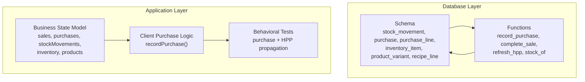
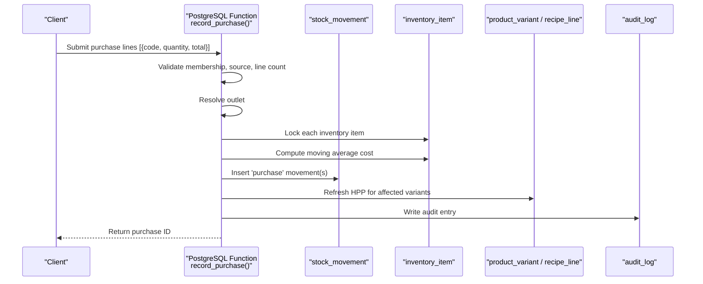
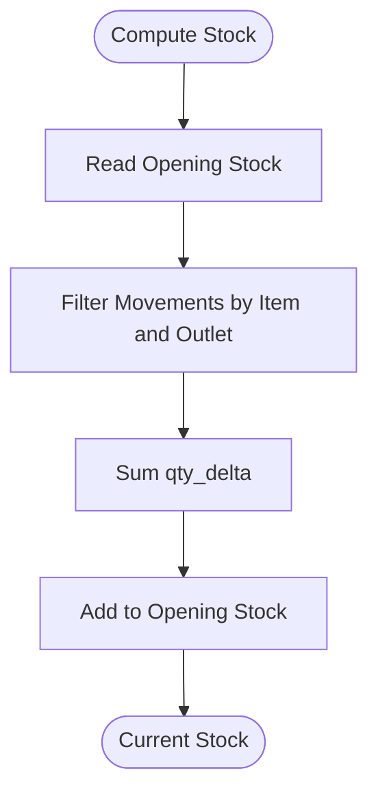
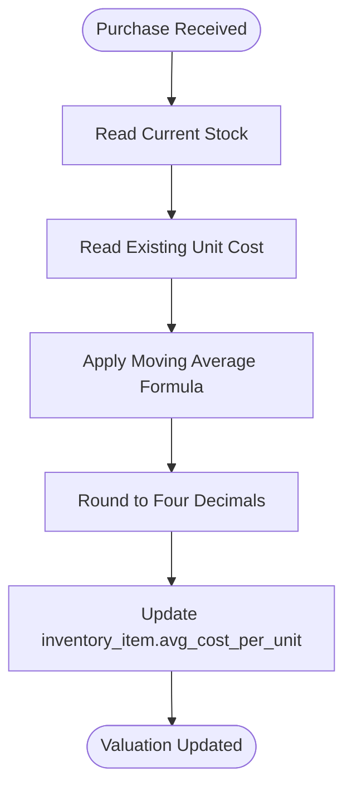
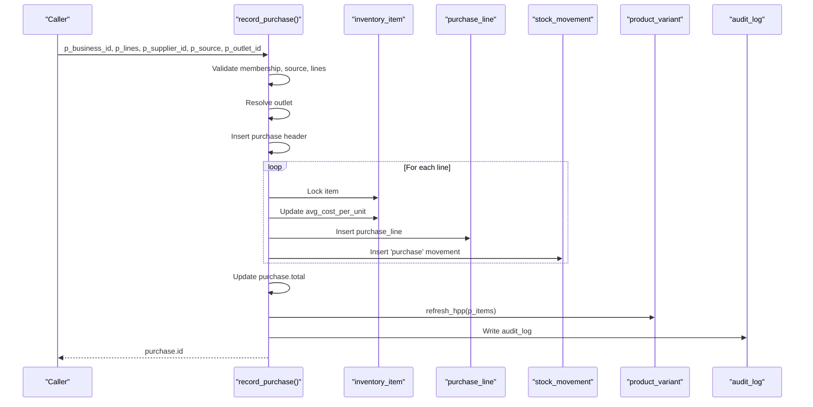
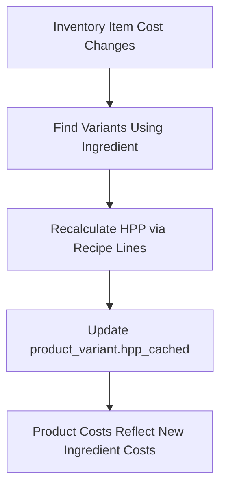
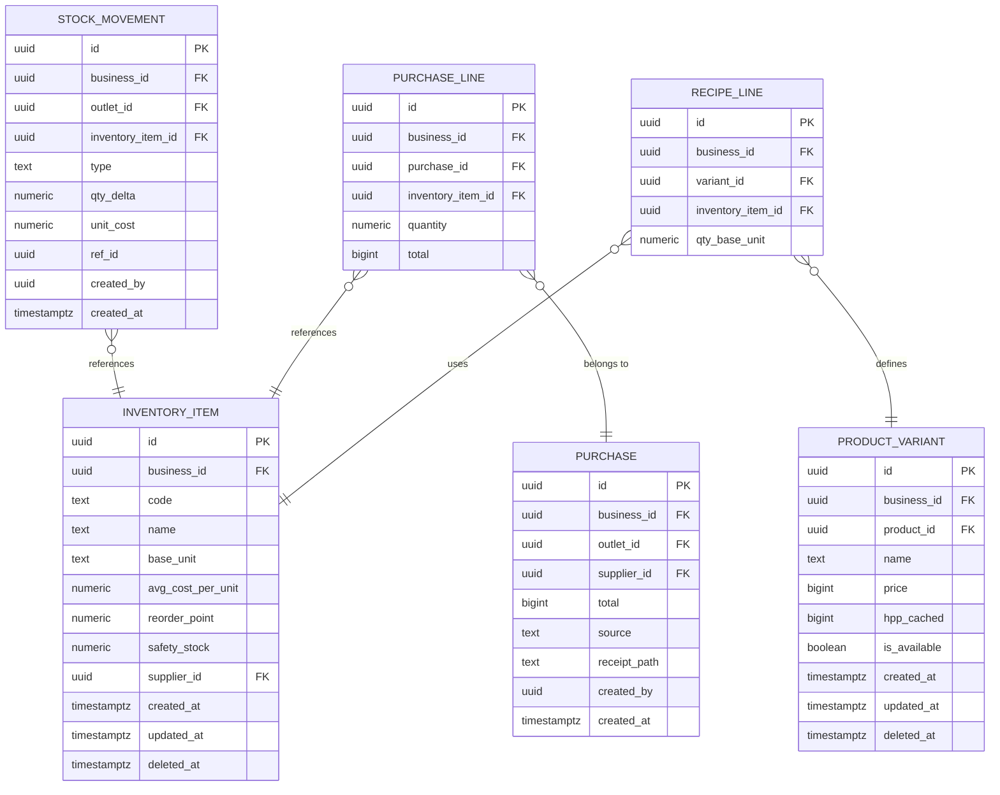
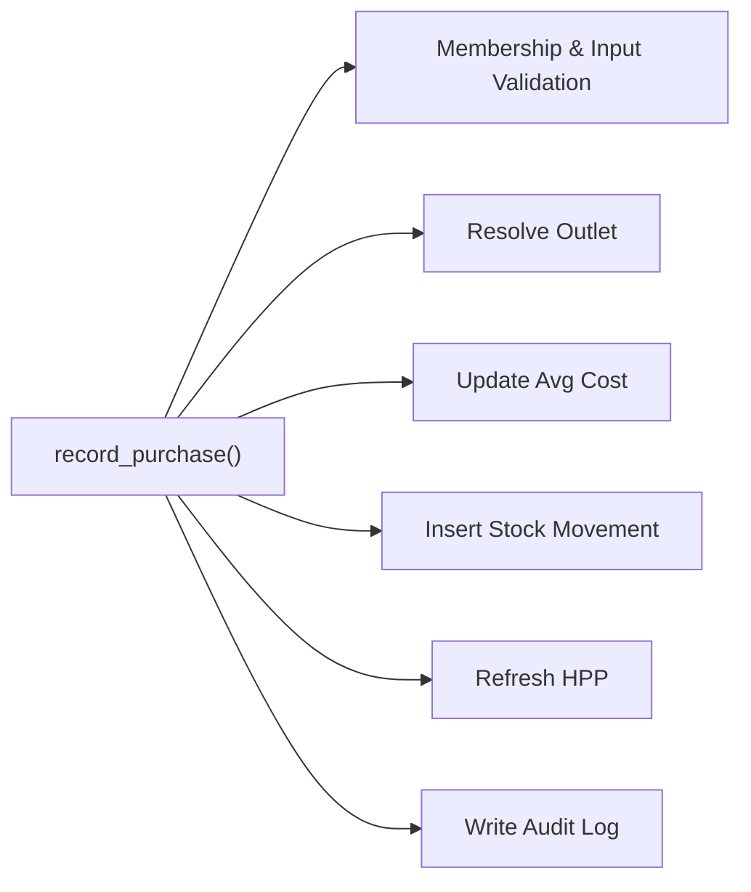

# Stock Update Mechanisms

<cite>
**Referenced Files in This Document**
- [laris-data.ts](file://src/lib/laris-data.ts)
- [laris-data.test.ts](file://src/lib/laris-data.test.ts)
- [0001_schema.sql](file://supabase/migrations/0001_schema.sql)
- [0003_functions.sql](file://supabase/migrations/0003_functions.sql)
</cite>

## Table of Contents
1. [Introduction](#introduction)
2. [Project Structure](#project-structure)
3. [Core Components](#core-components)
4. [Architecture Overview](#architecture-overview)
5. [Detailed Component Analysis](#detailed-component-analysis)
6. [Dependency Analysis](#dependency-analysis)
7. [Performance Considerations](#performance-considerations)
8. [Troubleshooting Guide](#troubleshooting-guide)
9. [Conclusion](#conclusion)
10. [Appendices](#appendices)

## Introduction
This document explains the automated stock update mechanisms triggered by purchasing activities. The system uses a ledger-based approach: stock quantities are never directly mutated. Instead, every change is recorded as an immutable stock movement, and current inventory levels are derived from those movements. Purchases also update the moving average cost of inventory items and propagate ingredient cost changes to product recipe costing.

The repository provides two complementary layers:
- A server-side transactional layer implemented as PostgreSQL functions that enforce business rules, maintain the stock ledger, and refresh product costs.
- A client-side state machine used for demonstration and testing, which mirrors the same ledger semantics and moving-average logic.

## Project Structure
The stock update mechanism spans schema definitions, database functions, and application-level data logic:

**Diagram sources**
- [0001_schema.sql:200-237](file://supabase/migrations/0001_schema.sql#L200-L237)
- [0003_functions.sql:232-303](file://supabase/migrations/0003_functions.sql#L232-L303)
- [laris-data.ts:97-110](file://src/lib/laris-data.ts#L97-L110)
- [laris-data.ts:307-334](file://src/lib/laris-data.ts#L307-L334)
- [laris-data.test.ts:307-340](file://src/lib/laris-data.test.ts#L307-L340)

**Section sources**
- [0001_schema.sql:1-10](file://supabase/migrations/0001_schema.sql#L1-L10)
- [0001_schema.sql:200-237](file://supabase/migrations/0001_schema.sql#L200-L237)
- [0003_functions.sql:1-7](file://supabase/migrations/0003_functions.sql#L1-L7)
- [laris-data.ts:97-110](file://src/lib/laris-data.ts#L97-L110)

## Core Components
- **Stock Ledger**: Current stock is computed as the sum of signed quantity deltas across all stock movements for an item at an outlet.
- **Purchase Entry**: A purchase creates one or more positive stock movements with type `purchase`, links them to a purchase record, and updates the item’s moving average unit cost.
- **Moving Average Cost**: Inventory valuation is updated using a weighted average of existing stock value and new purchase value.
- **Recipe Cost Propagation**: When ingredient costs change, product variant costs (HPP) are recalculated based on recipe lines.
- **Audit Trail**: Every significant operation writes an audit log entry.

Key responsibilities:
- Validate inputs and ownership before mutating state.
- Ensure idempotency where applicable.
- Keep stock mutations atomic and auditable.
- Reconcile inventory after purchases and sales.

**Section sources**
- [0001_schema.sql:200-237](file://supabase/migrations/0001_schema.sql#L200-L237)
- [0003_functions.sql:232-303](file://supabase/migrations/0003_functions.sql#L232-L303)
- [laris-data.ts:172-176](file://src/lib/laris-data.ts#L172-L176)
- [laris-data.ts:307-334](file://src/lib/laris-data.ts#L307-L334)

## Architecture Overview
The purchase flow integrates validation, ledger creation, cost recalculation, and audit logging.

**Diagram sources**
- [0003_functions.sql:232-303](file://supabase/migrations/0003_functions.sql#L232-L303)
- [0001_schema.sql:200-237](file://supabase/migrations/0001_schema.sql#L200-L237)

## Detailed Component Analysis

### Ledger-Based Stock Accounting
Stock is not stored as a single mutable number. Instead, it is derived from immutable stock movements:
- Each movement has a signed `qty_delta`.
- Current stock equals opening stock plus the sum of relevant movements.
- Sales create negative movements; purchases create positive movements.
- Adjustments, waste, and physical counts use other movement types.

**Diagram sources**
- [0001_schema.sql:200-216](file://supabase/migrations/0001_schema.sql#L200-L216)
- [laris-data.ts:172-176](file://src/lib/laris-data.ts#L172-L176)

**Section sources**
- [0001_schema.sql:200-216](file://supabase/migrations/0001_schema.sql#L200-L216)
- [laris-data.ts:172-176](file://src/lib/laris-data.ts#L172-L176)

### Moving Average Cost Calculation
When a purchase arrives, the system updates the inventory item’s average cost per unit using the formula:

`new_avg = ((current_stock × old_unit_cost) + purchase_total) / (current_stock + purchase_quantity)`

This ensures valuation reflects both existing inventory and the new purchase price.

**Diagram sources**
- [0003_functions.sql:283-287](file://supabase/migrations/0003_functions.sql#L283-L287)
- [laris-data.ts:321-322](file://src/lib/laris-data.ts#L321-L322)

**Section sources**
- [0003_functions.sql:283-287](file://supabase/migrations/0003_functions.sql#L283-L287)
- [laris-data.ts:321-322](file://src/lib/laris-data.ts#L321-L322)

### Stock Movement Types
The ledger supports multiple movement types:
- `opening`: Initial stock snapshot.
- `sale`: Negative delta when products consume ingredients.
- `purchase`: Positive delta when inventory is replenished.
- `adjustment`: Manual corrections.
- `waste`: Loss due to spoilage or damage.
- `opname`: Physical count reconciliation entries.

These types allow full traceability of inventory changes.

**Section sources**
- [0001_schema.sql:200-216](file://supabase/migrations/0001_schema.sql#L200-L216)

### Purchase Transaction Flow
A purchase operation performs several steps atomically:
1. Validate user role and input constraints.
2. Resolve the target outlet.
3. Create a purchase header.
4. For each purchase line:
   - Validate the inventory item exists.
   - Validate quantity and total are positive.
   - Lock the inventory row.
   - Compute and update the moving average cost.
   - Record a purchase line.
   - Append a `purchase` stock movement.
5. Update the purchase total.
6. Refresh product variant costs for affected recipes.
7. Write an audit log entry.

**Diagram sources**
- [0003_functions.sql:232-303](file://supabase/migrations/0003_functions.sql#L232-L303)

**Section sources**
- [0003_functions.sql:232-303](file://supabase/migrations/0003_functions.sql#L232-L303)

### Recipe Costing Integration
Ingredient cost changes propagate to product costing through recipe lines:
- Each product variant defines recipe lines linking to inventory items.
- When ingredient costs change, the system recalculates the cached cost (HPP) for affected variants.
- The client-side model recomputes product costs by summing ingredient quantities multiplied by their updated unit costs.

**Diagram sources**
- [0001_schema.sql:91-127](file://supabase/migrations/0001_schema.sql#L91-L127)
- [0003_functions.sql:48-61](file://supabase/migrations/0003_functions.sql#L48-L61)
- [laris-data.ts:323-326](file://src/lib/laris-data.ts#L323-L326)

**Section sources**
- [0001_schema.sql:91-127](file://supabase/migrations/0001_schema.sql#L91-L127)
- [0003_functions.sql:48-61](file://supabase/migrations/0003_functions.sql#L48-L61)
- [laris-data.ts:323-326](file://src/lib/laris-data.ts#L323-L326)

### Stock Level Examples Before and After Purchase
The tests demonstrate how stock reconciles after purchases:
- A purchase adds a positive movement and increases stock.
- Multiple purchases accumulate correctly.
- The original state remains unchanged due to immutability.

Example scenarios validated by tests:
- First purchase increases stock from the opening level.
- Second purchase further increases stock while preserving previous purchase records.
- Stock calculations remain consistent after persistence and reload.

**Section sources**
- [laris-data.test.ts:307-323](file://src/lib/laris-data.test.ts#L307-L323)

### Edge Cases

#### Partial Deliveries
The database function accepts multiple lines per purchase, allowing partial deliveries to be recorded as separate lines within one purchase. Each line updates the corresponding inventory item’s average cost and creates a linked stock movement.

**Section sources**
- [0003_functions.sql:272-294](file://supabase/migrations/0003_functions.sql#L272-L294)

#### Return Processing
The schema includes movement types such as `adjustment`, `waste`, and `opname`, which can represent returns or corrections. While dedicated return-specific logic is not shown in the examined files, the ledger design supports recording negative adjustments or specific return movements as needed.

**Section sources**
- [0001_schema.sql:200-216](file://supabase/migrations/0001_schema.sql#L200-L216)

#### Bulk Purchase Operations
The purchase function validates that the number of lines is between one and fifty, supporting bulk operations while preventing excessive payloads.

**Section sources**
- [0003_functions.sql:257-260](file://supabase/migrations/0003_functions.sql#L257-L260)

### Database Schema for Stock Movements and Related Entities
The core tables involved in stock updates are:

| Entity | Purpose | Key Fields |
| --- | --- | --- |
| `stock_movement` | Immutable ledger of inventory changes | `id`, `business_id`, `outlet_id`, `inventory_item_id`, `type`, `qty_delta`, `unit_cost`, `ref_id`, `created_by`, `created_at` |
| `purchase` | Purchase header | `id`, `business_id`, `outlet_id`, `supplier_id`, `total`, `source`, `receipt_path`, `created_by`, `created_at` |
| `purchase_line` | Per-item purchase details | `id`, `business_id`, `purchase_id`, `inventory_item_id`, `quantity`, `total` |
| `inventory_item` | Inventory catalog and valuation | `id`, `business_id`, `code`, `name`, `base_unit`, `avg_cost_per_unit`, `reorder_point`, `safety_stock`, `supplier_id` |
| `product_variant` | Sellable product with cached cost | `id`, `business_id`, `product_id`, `name`, `price`, `hpp_cached` |
| `recipe_line` | Ingredient mapping for products | `id`, `business_id`, `variant_id`, `inventory_item_id`, `qty_base_unit` |

Relationships:
- `stock_movement.inventory_item_id` references `inventory_item.id`.
- `purchase_line.purchase_id` references `purchase.id`.
- `purchase_line.inventory_item_id` references `inventory_item.id`.
- `recipe_line.variant_id` references `product_variant.id`.
- `recipe_line.inventory_item_id` references `inventory_item.id`.

**Diagram sources**
- [0001_schema.sql:73-127](file://supabase/migrations/0001_schema.sql#L73-L127)
- [0001_schema.sql:200-237](file://supabase/migrations/0001_schema.sql#L200-L237)

**Section sources**
- [0001_schema.sql:73-127](file://supabase/migrations/0001_schema.sql#L73-L127)
- [0001_schema.sql:200-237](file://supabase/migrations/0001_schema.sql#L200-L237)

## Dependency Analysis
The purchase mechanism depends on several components:

**Diagram sources**
- [0003_functions.sql:232-303](file://supabase/migrations/0003_functions.sql#L232-L303)

Coupling and cohesion:
- High cohesion within the purchase function: validation, ledger writing, cost updates, and auditing are centralized.
- Low coupling to external services: dependencies are primarily internal database tables and helper functions.
- Potential circular dependency risk is avoided by keeping helper functions read-only or narrowly scoped.

External integration points:
- Authentication and membership checks via `auth.uid()` and `private.is_member()`.
- Audit logging via `audit_log`.
- Recipe costing via `product_variant` and `recipe_line`.

**Section sources**
- [0003_functions.sql:232-303](file://supabase/migrations/0003_functions.sql#L232-L303)

## Performance Considerations
- **Row-Level Locking**: Inventory rows are locked during purchase processing to prevent race conditions when updating average cost.
- **Indexed Queries**: Stock queries benefit from indexes on `inventory_item_id` and `business_id` with descending timestamps.
- **Batch Limits**: Purchase lines are limited to 50 to control payload size and processing time.
- **Atomic Transactions**: All ledger writes occur in a single transaction, ensuring consistency.
- **Computed Stock**: Current stock is derived from movements; large ledgers may require efficient aggregation queries.

Recommendations:
- Monitor ledger growth and consider partitioning by business or date if volumes grow significantly.
- Use materialized views or summary tables for frequent stock reports if needed.
- Keep purchase lines concise and avoid unnecessary fields.

[No sources needed since this section provides general guidance]

## Troubleshooting Guide
Common issues and resolutions:
- **Access Denied**: Ensure the authenticated user has an allowed role (`owner`, `manager`, `kasir`) for the business.
- **Invalid Source**: Only `manual` and `scan` are accepted as purchase sources.
- **Empty or Excessive Lines**: Provide at least one line and no more than 50 lines.
- **Unknown Supplier**: Verify the supplier exists under the business.
- **Unknown Inventory Item**: Ensure the item code matches an active inventory item.
- **Non-Positive Quantity or Total**: Both must be greater than zero.
- **Insufficient Stock**: Sales validate aggregated ingredient needs before committing; ensure sufficient inventory before selling.

Audit trail inspection:
- Check `audit_log` for actions like `purchase.record` and `sale.complete`.
- Review `data` JSON for totals, sources, and line counts.

**Section sources**
- [0003_functions.sql:254-263](file://supabase/migrations/0003_functions.sql#L254-L263)
- [0003_functions.sql:278-282](file://supabase/migrations/0003_functions.sql#L278-L282)
- [0003_functions.sql:299-301](file://supabase/migrations/0003_functions.sql#L299-L301)

## Conclusion
The stock update mechanism is built around an immutable ledger and moving average cost accounting. Purchases create positive stock movements, update inventory valuation, and propagate cost changes to product recipes. The system enforces strong validation, auditability, and atomicity, ensuring reliable inventory reconciliation. Edge cases such as partial deliveries and bulk operations are supported through multi-line purchases, while returns and adjustments can be modeled using appropriate movement types.

[No sources needed since this section summarizes without analyzing specific files]

## Appendices

### Client-Side Purchase Logic Summary
The client-side `recordPurchase` function demonstrates the same principles:
- Validates inputs.
- Computes current stock.
- Creates a purchase record and a positive stock movement.
- Updates inventory cost using moving average.
- Recomputes product costs based on updated ingredient costs.

**Section sources**
- [laris-data.ts:307-334](file://src/lib/laris-data.ts#L307-L334)

### Test Coverage Highlights
Tests verify:
- Immutability of state and persistence compatibility.
- Correct stock accumulation across multiple purchases.
- Moving average cost updates.
- Recipe cost propagation to dependent products.
- Invalid input rejection without side effects.

**Section sources**
- [laris-data.test.ts:307-340](file://src/lib/laris-data.test.ts#L307-L340)