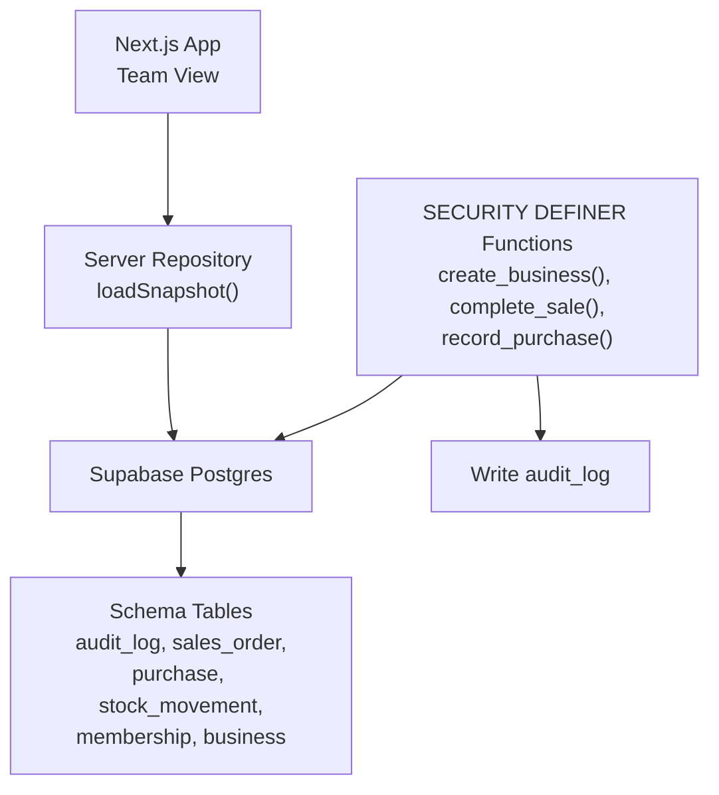
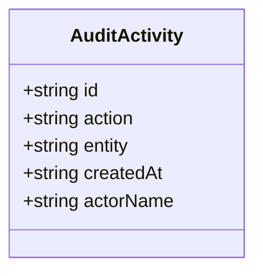
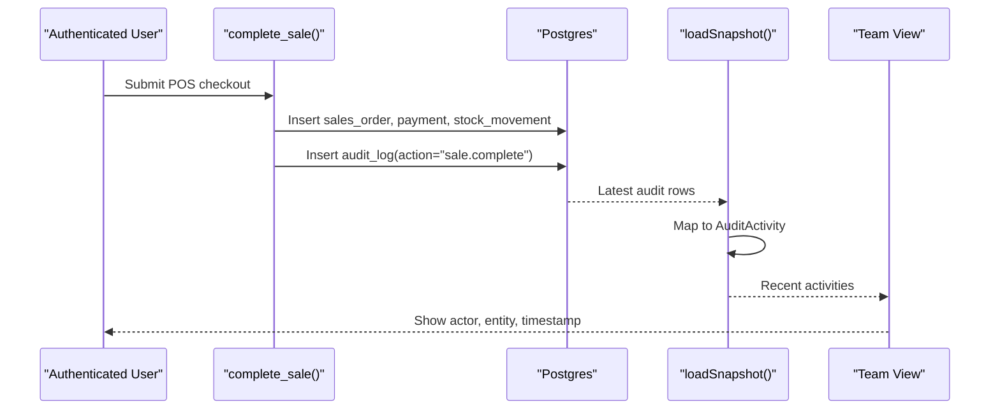
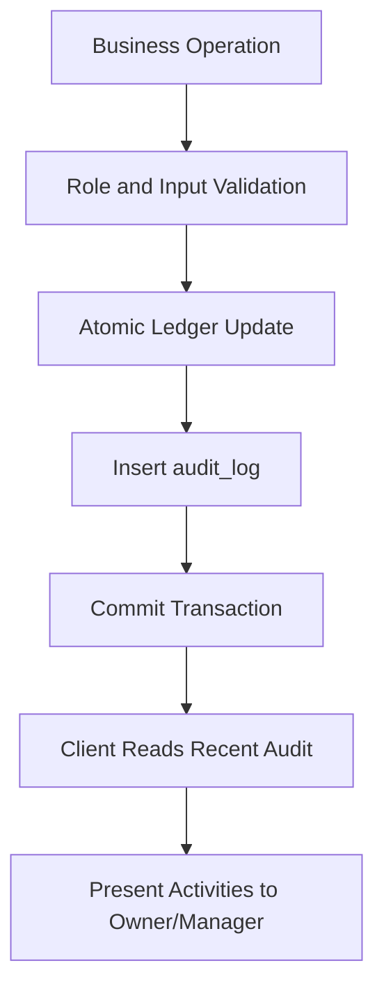
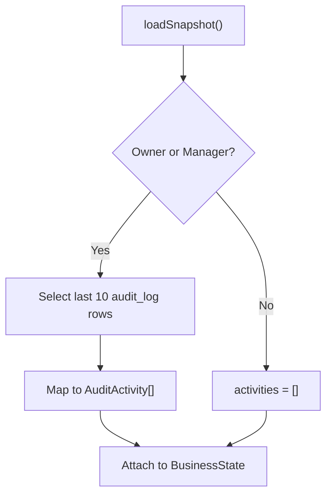
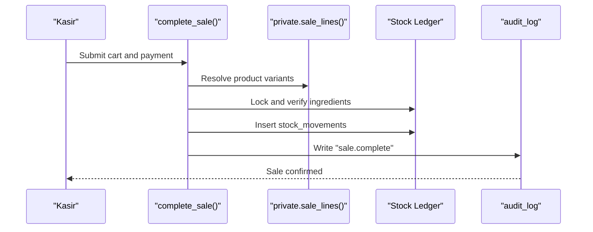
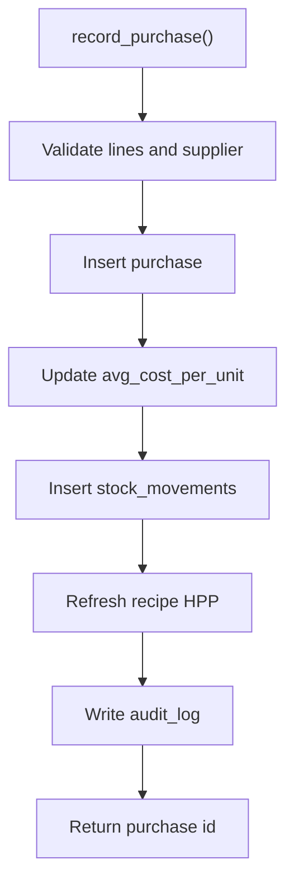
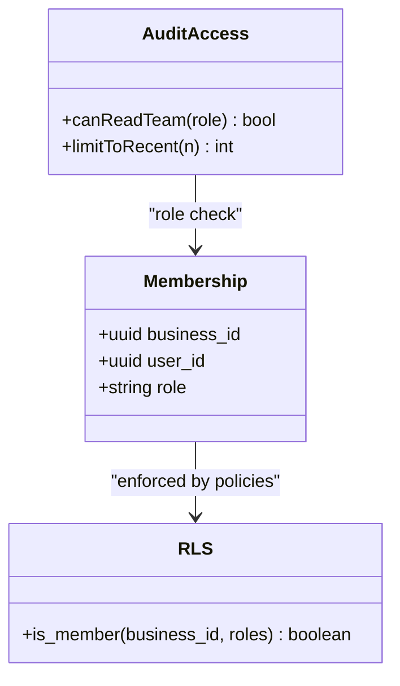
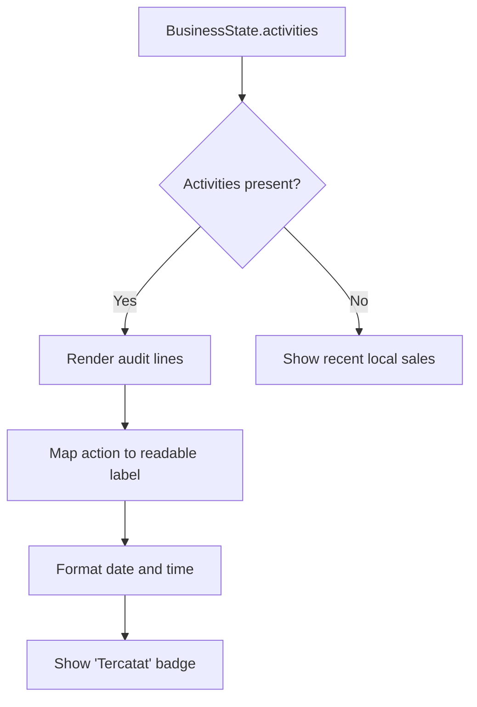
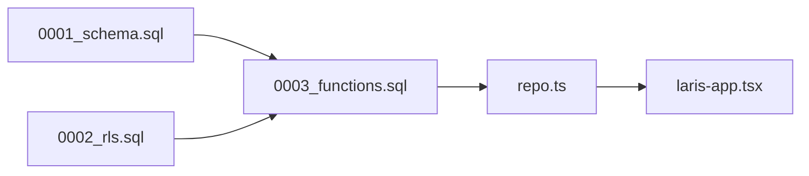

# Audit Logging and Compliance

<cite>
**Referenced Files in This Document**
- [README.md](file://README.md)
- [PRD_Laris_GTNIC2026.md](file://PRD_Laris_GTNIC2026.md)
- [0001_schema.sql](file://supabase/migrations/0001_schema.sql)
- [0002_rls.sql](file://supabase/migrations/0002_rls.sql)
- [0003_functions.sql](file://supabase/migrations/0003_functions.sql)
- [laris-data.ts](file://src/lib/laris-data.ts)
- [repo.ts](file://src/lib/repo.ts)
- [laris-app.tsx](file://src/components/laris-app.tsx)
</cite>

## Table of Contents
1. [Introduction](#introduction)
2. [Project Structure](#project-structure)
3. [Core Components](#core-components)
4. [Architecture Overview](#architecture-overview)
5. [Detailed Component Analysis](#detailed-component-analysis)
6. [Dependency Analysis](#dependency-analysis)
7. [Performance Considerations](#performance-considerations)
8. [Troubleshooting Guide](#troubleshooting-guide)
9. [Conclusion](#conclusion)
10. [Appendices](#appendices)

## Introduction
This document explains the audit logging and compliance tracking system implemented for Laris, an operational workspace for Indonesian micro and small F&B businesses. The system captures critical business actions such as sales completion, purchase recording, and workspace creation, stores them in a tenant-scoped audit table, and exposes a recent activity feed to authorized team members. It also documents how user actions are captured, stored, retrieved, and presented for compliance reporting and forensic analysis, while addressing privacy considerations and integration points with external systems.

The audit design follows the project’s broader principles: multi-tenant isolation through `business_id`, server-side validation via SECURITY DEFINER functions, immutable ledger-style stock movements, and role-based access control enforced by Row Level Security.

**Section sources**
- [README.md:24-35](file://README.md#L24-L35)
- [PRD_Laris_GTNIC2026.md:250-256](file://PRD_Laris_GTNIC2026.md#L250-L256)

## Project Structure
Audit-related functionality spans database schema, transactional functions, client-side data mapping, and UI presentation:

- Database schema defines the `audit_log` table and related tables such as `sales_order`, `purchase`, `stock_movement`, `membership`, and `business`.
- Transactional functions write audit records alongside business operations.
- Client-side repository code reads the latest audit entries and maps them into a typed `AuditActivity` model.
- The UI renders the most recent activities for owners and managers.



**Diagram sources**
- [0001_schema.sql:255-265](file://supabase/migrations/0001_schema.sql#L255-L265)
- [0003_functions.sql:71-88](file://supabase/migrations/0003_functions.sql#L71-L88)
- [0003_functions.sql:91-230](file://supabase/migrations/0003_functions.sql#L91-L230)
- [0003_functions.sql:232-303](file://supabase/migrations/0003_functions.sql#L232-L303)
- [repo.ts:129-193](file://src/lib/repo.ts#L129-L193)

**Section sources**
- [0001_schema.sql:255-265](file://supabase/migrations/0001_schema.sql#L255-L265)
- [0003_functions.sql:1-7](file://supabase/migrations/0003_functions.sql#L1-L7)
- [repo.ts:129-193](file://src/lib/repo.ts#L129-L193)
- [laris-app.tsx:1142-1142](file://src/components/laris-app.tsx#L1142-L1142)

## Core Components
### Audit Activity Interface
The application models audit events using a lightweight TypeScript interface:

| Field | Type | Meaning |
|---|---|---|
| `id` | string | Stable identifier for the audit entry. |
| `action` | string | Business action name, such as workspace creation, sale completion, or purchase recording. |
| `entity` | string | Domain entity affected, such as `business`, `sales_order`, or `purchase`. |
| `createdAt` | string | ISO timestamp adjusted to Jakarta time zone. |
| `actorName` | string | Display name of the user who performed the action; falls back to a system label when unavailable. |

The interface is used to render recent workspace activities and to support compliance dashboards.



**Diagram sources**
- [laris-data.ts:89-95](file://src/lib/laris-data.ts#L89-L95)

**Section sources**
- [laris-data.ts:89-95](file://src/lib/laris-data.ts#L89-L95)

### Database Audit Model
The persistent audit record includes:

| Column | Type | Purpose |
|---|---|---|
| `id` | bigint identity | Sequential audit row identifier. |
| `business_id` | uuid | Tenant isolation; references `business.id`. |
| `actor_id` | uuid | User who performed the action; nullable for system-originated rows. |
| `action` | text | Human-readable action identifier. |
| `entity` | text | Target domain entity. |
| `entity_id` | uuid | Identifier of the affected business entity. |
| `data` | jsonb | Structured payload with operation-specific details. |
| `created_at` | timestamptz | Server-side timestamp. |

An index on `business_id, created_at desc` supports efficient retrieval of recent tenant audit events.

```mermaid
erDiagram
AUDIT_LOG {
bigint id PK
uuid business_id FK
uuid actor_id
text action
text entity
uuid entity_id
jsonb data
timestamptz created_at
}
BUSINESS {
uuid id PK
}
AUTH_USERS {
uuid id PK
}
AUDIT_LOG ||--|| BUSINESS : "belongs to"
AUDIT_LOG o--|| AUTH_USERS : "performed by"
```

**Diagram sources**
- [0001_schema.sql:255-265](file://supabase/migrations/0001_schema.sql#L255-L265)

**Section sources**
- [0001_schema.sql:255-265](file://supabase/migrations/0001_schema.sql#L255-L265)

### Action Types and Entity References
Current implementation writes audit entries for:

| Action | Entity | Typical Use Case |
|---|---|---|
| `business.create` | `business` | Workspace registration. |
| `sale.complete` | `sales_order` | POS checkout completed. |
| `purchase.record` | `purchase` | Stock-in purchase recorded. |

Additional actions such as `product.save`, `inventory.save`, and `membership.create` are mapped in the UI, indicating planned or future audit coverage for catalog and membership changes.

**Section sources**
- [0003_functions.sql:86-87](file://supabase/migrations/0003_functions.sql#L86-L87)
- [0003_functions.sql:225-227](file://supabase/migrations/0003_functions.sql#L225-L227)
- [0003_functions.sql:299-301](file://supabase/migrations/0003_functions.sql#L299-L301)
- [laris-app.tsx:1142-1142](file://src/components/laris-app.tsx#L1142-L1142)

### Timestamps and Actor Attribution
- `created_at` is set automatically by the database.
- `actor_id` is populated from the authenticated user context inside SECURITY DEFINER functions.
- The client maps timestamps to Jakarta time zone using a helper that adds seven hours before formatting.
- `actorName` is resolved by joining audit rows with team members; if no match exists, it falls back to a system label.



**Diagram sources**
- [0003_functions.sql:91-230](file://supabase/migrations/0003_functions.sql#L91-L230)
- [repo.ts:12-16](file://src/lib/repo.ts#L12-L16)
- [repo.ts:160-168](file://src/lib/repo.ts#L160-L168)

**Section sources**
- [0003_functions.sql:107-125](file://supabase/migrations/0003_functions.sql#L107-L125)
- [0003_functions.sql:225-227](file://supabase/migrations/0003_functions.sql#L225-L227)
- [repo.ts:12-16](file://src/lib/repo.ts#L12-L16)
- [repo.ts:160-168](file://src/lib/repo.ts#L160-L168)

## Architecture Overview
The audit system is embedded in the transactional boundary rather than being an optional side effect. Every sensitive business mutation goes through a SECURITY DEFINER function that re-validates inputs, enforces roles, performs atomic ledger updates, and writes an audit record.



**Diagram sources**
- [0003_functions.sql:1-7](file://supabase/migrations/0003_functions.sql#L1-L7)
- [0003_functions.sql:91-230](file://supabase/migrations/0003_functions.sql#L91-L230)
- [0003_functions.sql:232-303](file://supabase/migrations/0003_functions.sql#L232-L303)
- [repo.ts:129-193](file://src/lib/repo.ts#L129-L193)

**Section sources**
- [0003_functions.sql:1-7](file://supabase/migrations/0003_functions.sql#L1-L7)
- [repo.ts:129-193](file://src/lib/repo.ts#L129-L193)

## Detailed Component Analysis

### Audit Log Storage and Retrieval
The audit log is a dedicated tenant-scoped table. Retrieval is limited to owners and managers, and only the ten most recent entries are loaded into the snapshot.

Key behaviors:
- Only `owner` and `manager` roles can read team activities.
- Audit rows are selected without the full `data` payload in the current UI path.
- Actor names are resolved from team member data.
- Local demo mode shows recent local sales instead of a verified server audit log.



**Diagram sources**
- [repo.ts:129-193](file://src/lib/repo.ts#L129-L193)

**Section sources**
- [repo.ts:129-193](file://src/lib/repo.ts#L129-L193)

### Sales Audit Trail
When a sale completes:
1. Membership and role are validated.
2. Idempotency prevents duplicate orders.
3. Catalog lines are resolved against the database.
4. Recipe-level stock is locked and checked.
5. Sales order, order items, payment, and stock movements are inserted atomically.
6. An audit entry records the sale with total, payment method, channel, and discount.



**Diagram sources**
- [0003_functions.sql:91-230](file://supabase/migrations/0003_functions.sql#L91-L230)

**Section sources**
- [0003_functions.sql:91-230](file://supabase/migrations/0003_functions.sql#L91-L230)

### Purchase Audit Trail
Purchase recording:
1. Validates source and line count.
2. Resolves inventory items and outlet.
3. Updates moving-average cost.
4. Inserts purchase lines and stock movements.
5. Refreshes recipe HPP where needed.
6. Writes an audit entry with total, source, and line count.



**Diagram sources**
- [0003_functions.sql:232-303](file://supabase/migrations/0003_functions.sql#L232-L303)

**Section sources**
- [0003_functions.sql:232-303](file://supabase/migrations/0003_functions.sql#L232-L303)

### Team and Access Control
Row Level Security ensures that audit logs are isolated per business and that only authorized roles can perform or view sensitive operations. The repository layer further restricts activity visibility to owners and managers.



**Diagram sources**
- [0002_rls.sql:12-25](file://supabase/migrations/0002_rls.sql#L12-L25)
- [repo.ts:129-133](file://src/lib/repo.ts#L129-L133)

**Section sources**
- [0002_rls.sql:12-25](file://supabase/migrations/0002_rls.sql#L12-L25)
- [repo.ts:129-133](file://src/lib/repo.ts#L129-L133)

### UI Presentation of Audit Activities
The team view displays recent activities for cloud mode and falls back to local demo transactions for non-cloud mode. It maps known action labels to human-readable strings and shows actor, entity, and formatted timestamp.



**Diagram sources**
- [laris-app.tsx:1142-1142](file://src/components/laris-app.tsx#L1142-L1142)

**Section sources**
- [laris-app.tsx:1142-1142](file://src/components/laris-app.tsx#L1142-L1142)

## Dependency Analysis
The audit system depends on several layers:

- **Database layer**: `audit_log` table, indexes, and foreign keys.
- **Security layer**: RLS policies and `private.is_member()` helper.
- **Transaction layer**: SECURITY DEFINER functions that enforce business rules and write audit entries.
- **Repository layer**: Supabase client calls that map rows to typed models.
- **Presentation layer**: React components that render activities for authorized users.



**Diagram sources**
- [0001_schema.sql:255-265](file://supabase/migrations/0001_schema.sql#L255-L265)
- [0002_rls.sql:12-25](file://supabase/migrations/0002_rls.sql#L12-L25)
- [0003_functions.sql:91-230](file://supabase/migrations/0003_functions.sql#L91-L230)
- [repo.ts:129-193](file://src/lib/repo.ts#L129-L193)
- [laris-app.tsx:1142-1142](file://src/components/laris-app.tsx#L1142-L1142)

**Section sources**
- [0001_schema.sql:255-265](file://supabase/migrations/0001_schema.sql#L255-L265)
- [0002_rls.sql:12-25](file://supabase/migrations/0002_rls.sql#L12-L25)
- [0003_functions.sql:91-230](file://supabase/migrations/0003_functions.sql#L91-L230)
- [repo.ts:129-193](file://src/lib/repo.ts#L129-L193)
- [laris-app.tsx:1142-1142](file://src/components/laris-app.tsx#L1142-L1142)

## Performance Considerations
- Audit writes occur within existing transactions, so they do not introduce separate network round-trips from the client perspective.
- The UI loads only the ten most recent audit entries, reducing payload size.
- The database index on `business_id, created_at desc` optimizes recent audit queries.
- For large-scale compliance exports, consider adding pagination, date-range filters, and server-side aggregation to avoid loading all audit history into memory.

[No sources needed since this section provides general guidance]

## Troubleshooting Guide
Common issues and resolutions:

| Symptom | Likely Cause | Resolution |
|---|---|---|
| No activities shown | User is not owner or manager | Verify role; only owners and managers can read team activities. |
| Activities show “Sistem” | `actor_id` not matched to a team member | Ensure team membership query returns the correct user; fallback label is expected when unmatched. |
| Local demo shows sales instead of audit log | Non-cloud mode | Cloud mode is required for verified server audit activities. |
| Audit entries missing after sale | Function error or transaction rollback | Check function validation errors and ensure atomic transaction succeeds. |
| Duplicate sale appears | Missing idempotency key | Provide a stable `idempotency_key` to prevent duplicate processing. |

**Section sources**
- [repo.ts:129-193](file://src/lib/repo.ts#L129-L193)
- [0003_functions.sql:127-132](file://supabase/migrations/0003_functions.sql#L127-L132)
- [laris-app.tsx:1142-1142](file://src/components/laris-app.tsx#L1142-L1142)

## Conclusion
Laris implements a focused audit logging and compliance foundation centered on secure, tenant-isolated storage of critical business actions. The system uses database-level security, transactional integrity, and role-based visibility to provide a reliable audit trail for sales, purchases, and workspace setup. While the current UI surface emphasizes recent activities, the underlying schema and function-driven approach make it straightforward to extend audit coverage, add richer payloads, and integrate with external compliance systems.

[No sources needed since this section summarizes without analyzing specific files]

## Appendices

### Audit Log Queries
Examples of practical queries for compliance and forensic analysis:

- Recent audit events for a business:
  - Select the latest N rows ordered by `created_at desc` filtered by `business_id`.
- Actions by a specific actor:
  - Filter by `actor_id` and `business_id`.
- Financial event timeline:
  - Filter by `action` values such as `sale.complete` and `purchase.record`.
- Entity-focused investigation:
  - Filter by `entity` and `entity_id` to trace changes to a specific order, purchase, or business.

These queries should be executed under RLS context or service-role access depending on deployment policy.

**Section sources**
- [0001_schema.sql:255-265](file://supabase/migrations/0001_schema.sql#L255-L265)
- [repo.ts:160-168](file://src/lib/repo.ts#L160-L168)

### Compliance Report Generation
Recommended report dimensions:

| Report | Dimensions | Output |
|---|---|---|
| Daily Sales Summary | Date, channel, payment method, total | CSV or PDF |
| Purchase Reconciliation | Supplier, item, quantity, unit cost, total | CSV |
| Staff Activity Report | Actor, action, entity, timestamp | CSV |
| Inventory Change Report | Item, movement type, delta, reference | CSV |
| Financial Event Timeline | Action, entity, amount, timestamp | Dashboard export |

Reports can be generated by aggregating `audit_log`, `sales_order`, `payment`, `purchase`, and `stock_movement` tables.

**Section sources**
- [0001_schema.sql:153-214](file://supabase/migrations/0001_schema.sql#L153-L214)
- [0001_schema.sql:255-265](file://supabase/migrations/0001_schema.sql#L255-L265)

### Data Retention Policies
Current implementation does not define explicit retention or archival logic for `audit_log`. Recommended policies include:

- Keep audit logs indefinitely for financial and compliance requirements unless legal constraints require deletion.
- Archive older partitions to cold storage while retaining searchable metadata.
- Implement soft delete or partitioning strategies for large datasets.
- Apply least-privilege access to audit data.

[No sources needed since this section provides general guidance]

### Privacy Considerations and Log Sanitization
Privacy requirements are explicitly stated in the product documentation:

- Customer marketing consent is tracked separately.
- Minimal PII is collected.
- Data export and deletion rights are part of the privacy model.

For audit logs:
- Avoid storing sensitive customer data in `audit_log.data` unless necessary.
- Redact or hash identifiers when exporting logs externally.
- Restrict audit log access to authorized roles.
- Treat audit logs as sensitive operational data.

**Section sources**
- [PRD_Laris_GTNIC2026.md:507-508](file://PRD_Laris_GTNIC2026.md#L507-L508)
- [0001_schema.sql:132-148](file://supabase/migrations/0001_schema.sql#L132-L148)

### Integration with External Compliance Systems
Potential integration patterns:

- Export audit logs to a compliance data lake via scheduled jobs.
- Forward critical events to an SIEM or audit aggregator.
- Generate regulatory reports (for example, SAK EMKM-related summaries) from aggregated audit and financial data.
- Enforce external retention policies through automated archival pipelines.

[No sources needed since this section provides general guidance]