# Role-Based Access Control

<cite>
**Referenced Files in This Document**
- [laris-data.ts](file://src/lib/laris-data.ts)
- [actions.ts](file://src/app/actions.ts)
- [0001_schema.sql](file://supabase/migrations/0001_schema.sql)
- [0002_rls.sql](file://supabase/migrations/0002_rls.sql)
- [0003_functions.sql](file://supabase/migrations/0003_functions.sql)
- [0004_workspaces.sql](file://supabase/migrations/0004_workspaces.sql)
- [rls.test.ts](file://scripts/rls.test.ts)
</cite>

## Table of Contents
1. [Introduction](#introduction)
2. [Project Structure](#project-structure)
3. [Core Components](#core-components)
4. [Architecture Overview](#architecture-overview)
5. [Detailed Component Analysis](#detailed-component-analysis)
6. [Dependency Analysis](#dependency-analysis)
7. [Performance Considerations](#performance-considerations)
8. [Troubleshooting Guide](#troubleshooting-guide)
9. [Conclusion](#conclusion)

## Introduction
This document explains the Laris role-based access control system and how it enforces security boundaries between four core roles: owner, manager, cashier (kasir), and kitchen (dapur). It covers how roles are modeled, how permissions are checked on both the application server and database layers, and how Row-Level Security isolates tenants while preventing privilege escalation.

Laris separates business logic into:
- A TypeScript domain model that defines the `TeamMember` role type.
- Server actions that enforce role checks before calling database functions or writing data.
- Supabase RLS policies that enforce tenant isolation and fine-grained read/write permissions.
- Transactional `SECURITY DEFINER` functions that re-validate membership and role before mutating ledger data.

The design ensures that even if a client is compromised, database-level policies and transactional functions remain the final authority for access control.

## Project Structure
The RBAC implementation spans three main areas:

| Area | Responsibility | Key Files |
|---|---|---|
| Domain model | Defines `TeamMember` and other business types | [laris-data.ts](file://src/lib/laris-data.ts) |
| Application enforcement | Validates roles before allowing mutations | [actions.ts](file://src/app/actions.ts) |
| Database enforcement | Defines schema, RLS policies, and transactional functions | [0001_schema.sql](file://supabase/migrations/0001_schema.sql), [0002_rls.sql](file://supabase/migrations/0002_rls.sql), [0003_functions.sql](file://supabase/migrations/0003_functions.sql), [0004_workspaces.sql](file://supabase/migrations/0004_workspaces.sql) |
| Security tests | Verifies tenant isolation and direct-write rejection | [rls.test.ts](file://scripts/rls.test.ts) |

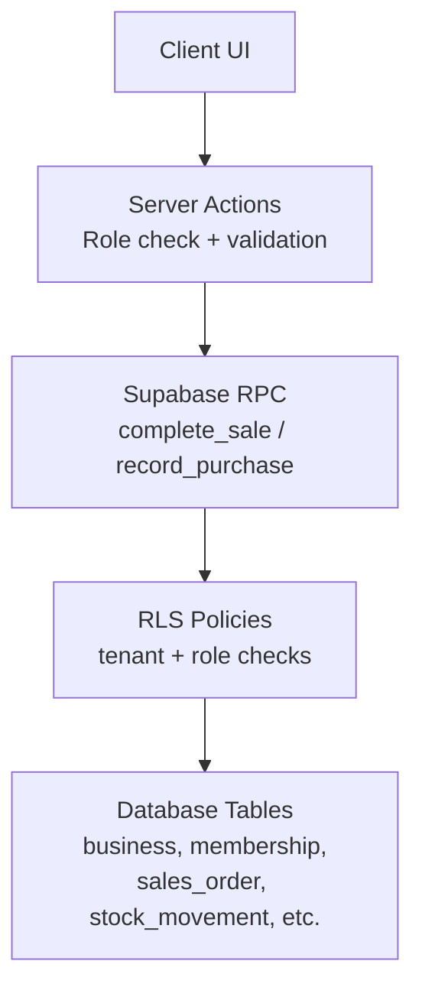

**Diagram sources**
- [actions.ts:21-28](file://src/app/actions.ts#L21-L28)
- [0003_functions.sql:94-125](file://supabase/migrations/0003_functions.sql#L94-L125)
- [0002_rls.sql:12-25](file://supabase/migrations/0002_rls.sql#L12-L25)

**Section sources**
- [laris-data.ts:82-87](file://src/lib/laris-data.ts#L82-L87)
- [actions.ts:21-28](file://src/app/actions.ts#L21-L28)
- [0001_schema.sql:49-56](file://supabase/migrations/0001_schema.sql#L49-L56)
- [0002_rls.sql:12-25](file://supabase/migrations/0002_rls.sql#L12-L25)

## Core Components
### Roles and Permission Model
The four roles are explicitly defined in two places:

1. **TypeScript domain model**: The `TeamMember` interface declares the allowed role values.
2. **Database schema**: The `membership` table stores each user’s role per business and constrains it to the same set of values.

| Role | Meaning | Typical Access |
|---|---|---|
| `owner` | Business owner | Full administrative control, team management, settings, catalog, inventory, financial reports, audit logs |
| `manager` | Store or operations manager | Catalog and inventory administration, expenses, reporting; cannot manage team ownership |
| `kasir` | Cashier | POS checkout, customer creation, expense entry, reading operational data |
| `dapur` | Kitchen staff | Intended for kitchen-facing workflows; current codebase does not grant write access to ledger tables through the documented server actions |

**Section sources**
- [laris-data.ts:82-87](file://src/lib/laris-data.ts#L82-L87)
- [0001_schema.sql:49-56](file://supabase/migrations/0001_schema.sql#L49-L56)

### Permission Matrix
The following matrix summarizes the effective permissions enforced by server actions and RLS policies.

| Feature | Owner | Manager | Kasir | Dapur |
|---|---:|---:|---:|---:|
| Read business/outlet | Yes | Yes | Yes | Yes |
| Update business settings | Yes | No | No | No |
| Manage outlet | Yes | No | No | No |
| Manage team membership | Yes | No | No | No |
| Read catalog and inventory | Yes | Yes | Yes | Yes |
| Write catalog and inventory | Yes | Yes | No | No |
| Create/update customers | Yes | Yes | Yes | No |
| Delete customers | Yes | Yes | No | No |
| Complete sale | Yes | Yes | Yes | No |
| Record purchase | Yes | Yes | Yes | No |
| Create expense | Yes | Yes | Yes | No |
| Modify/delete expense | Yes | Yes | No | No |
| Read audit log | Yes | Yes | No | No |
| Read AI event telemetry | Yes | Yes | No | No |

These permissions come from:
- Server-side role checks in `context(...)`.
- RLS policies for direct table access.
- Transactional function membership checks for ledger mutations.

**Section sources**
- [actions.ts:21-28](file://src/app/actions.ts#L21-L28)
- [actions.ts:52-89](file://src/app/actions.ts#L52-L89)
- [actions.ts:97-124](file://src/app/actions.ts#L97-L124)
- [actions.ts:132-143](file://src/app/actions.ts#L132-L143)
- [actions.ts:150-161](file://src/app/actions.ts#L150-L161)
- [actions.ts:171-189](file://src/app/actions.ts#L171-L189)
- [actions.ts:201-215](file://src/app/actions.ts#L201-L215)
- [actions.ts:228-251](file://src/app/actions.ts#L228-L251)
- [actions.ts:261-289](file://src/app/actions.ts#L261-L289)
- [0002_rls.sql:46-59](file://supabase/migrations/0002_rls.sql#L46-L59)
- [0002_rls.sql:64-75](file://supabase/migrations/0002_rls.sql#L64-L75)
- [0002_rls.sql:80-88](file://supabase/migrations/0002_rls.sql#L80-L88)
- [0002_rls.sql:93-101](file://supabase/migrations/0002_rls.sql#L93-L101)
- [0002_rls.sql:106-114](file://supabase/migrations/0002_rls.sql#L106-L114)
- [0002_rls.sql:119-125](file://supabase/migrations/0002_rls.sql#L119-L125)

## Architecture Overview
Laris uses layered authorization:

1. **Authentication layer**: Supabase Auth identifies the user.
2. **Membership layer**: `public.membership` maps a user to a business and role.
3. **Application layer**: Server actions call `context(allowedRoles)` to reject unauthorized requests early.
4. **Database layer**: RLS policies restrict reads/writes per tenant and role.
5. **Transactional layer**: Ledger mutations go through `SECURITY DEFINER` functions that re-check membership and role.

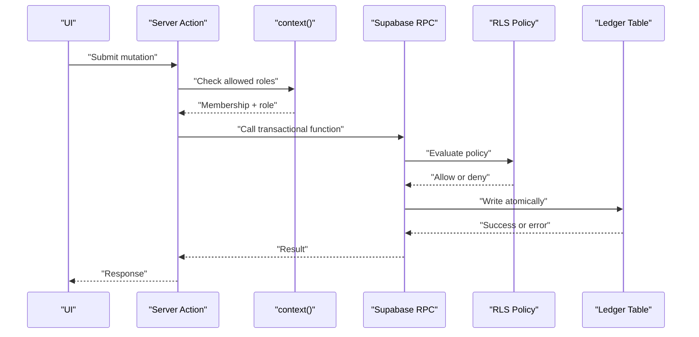

**Diagram sources**
- [actions.ts:21-28](file://src/app/actions.ts#L21-L28)
- [0003_functions.sql:94-125](file://supabase/migrations/0003_functions.sql#L94-L125)
- [0002_rls.sql:12-25](file://supabase/migrations/0002_rls.sql#L12-L25)

## Detailed Component Analysis

### TeamMember Interface and Role Definition
The `TeamMember` interface defines the role field as a union of four literal strings. This type is used throughout the frontend and server action return shapes to represent team members consistently.

Key points:
- Role values are constrained at the TypeScript level.
- The database schema mirrors this constraint with a `CHECK` on the `role` column.
- The seed/demo data may include sample members, but production membership is managed through the team invitation workflow.

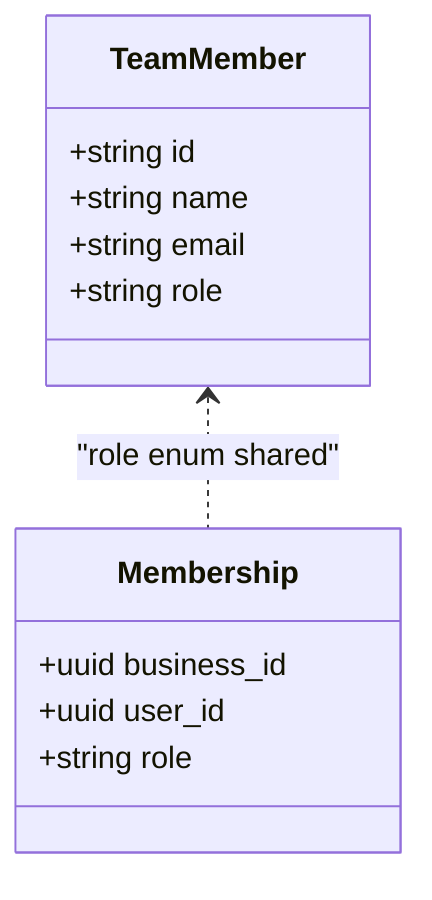

**Diagram sources**
- [laris-data.ts:82-87](file://src/lib/laris-data.ts#L82-L87)
- [0001_schema.sql:49-56](file://supabase/migrations/0001_schema.sql#L49-L56)

**Section sources**
- [laris-data.ts:82-87](file://src/lib/laris-data.ts#L82-L87)
- [0001_schema.sql:49-56](file://supabase/migrations/0001_schema.sql#L49-L56)

### Server-Side Permission Checking
The `context(...)` helper is the central permission gate for server actions:

- It requires cloud configuration.
- It retrieves the current membership.
- It rejects the request if the user’s role is not in the allowed list.
- It returns the Supabase client and membership context only after validation.

Examples of usage:
- POS checkout allows `owner`, `manager`, and `kasir`.
- Inventory and product management allow `owner` and `manager`.
- Settings updates allow only `owner`.
- Team invitations allow only `owner`.

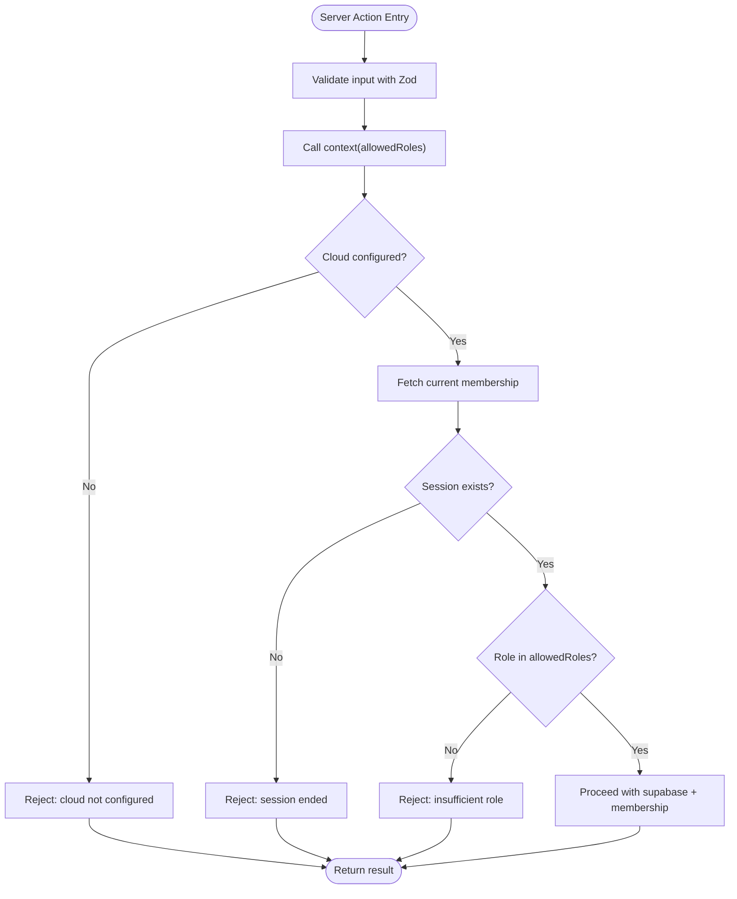

**Diagram sources**
- [actions.ts:21-28](file://src/app/actions.ts#L21-L28)
- [actions.ts:52-89](file://src/app/actions.ts#L52-L89)
- [actions.ts:97-124](file://src/app/actions.ts#L97-L124)
- [actions.ts:171-189](file://src/app/actions.ts#L171-L189)
- [actions.ts:261-289](file://src/app/actions.ts#L261-L289)

**Section sources**
- [actions.ts:21-28](file://src/app/actions.ts#L21-L28)
- [actions.ts:52-89](file://src/app/actions.ts#L52-L89)
- [actions.ts:97-124](file://src/app/actions.ts#L97-L124)
- [actions.ts:132-143](file://src/app/actions.ts#L132-L143)
- [actions.ts:150-161](file://src/app/actions.ts#L150-L161)
- [actions.ts:171-189](file://src/app/actions.ts#L171-L189)
- [actions.ts:201-215](file://src/app/actions.ts#L201-L215)
- [actions.ts:228-251](file://src/app/actions.ts#L228-L251)
- [actions.ts:261-289](file://src/app/actions.ts#L261-L289)

### Database-Level Enforcement
#### Membership Helper
The `private.is_member` function is a `SECURITY DEFINER` helper used by RLS policies. It checks whether the authenticated user belongs to a given business and optionally matches one or more roles.

Important behavior:
- It prevents policy recursion by running with elevated privileges.
- It supports optional role filtering so policies can allow reads for all members but writes only for specific roles.

**Section sources**
- [0002_rls.sql:12-25](file://supabase/migrations/0002_rls.sql#L12-L25)

#### RLS Policies
RLS policies define fine-grained access:

- **Business and outlet**: Select for members; update/write restricted to `owner`.
- **Membership**: Members can select themselves; only `owner`/`manager` can select other memberships; only `owner` can modify membership.
- **Catalog**: All members can read; only `owner`/`manager` can write.
- **Customers**: Members can read; `owner`/`manager`/`kasir` can create/update; only `owner`/`manager` can delete.
- **Ledger tables**: Members can read; direct client writes are blocked because ledger tables have no insert/update/delete policies for authenticated users.
- **Expenses**: Members can read; `owner`/`manager`/`kasir` can insert; only `owner`/`manager` can update/delete.
- **Audit and AI telemetry**: Only `owner`/`manager` can read; inserts are restricted to the authenticated user.

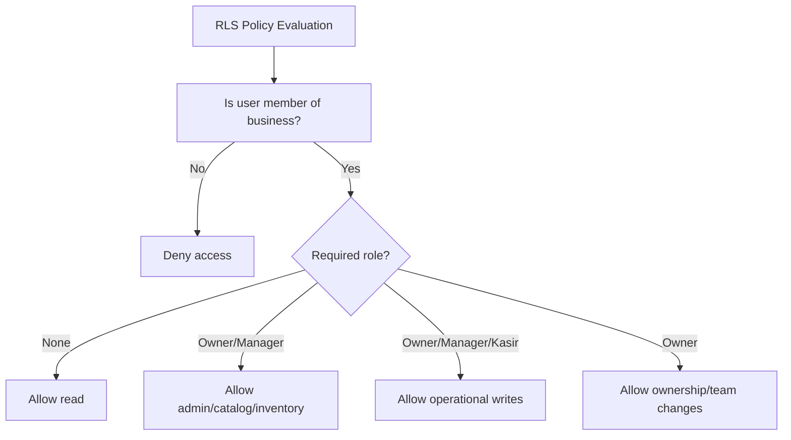

**Diagram sources**
- [0002_rls.sql:46-59](file://supabase/migrations/0002_rls.sql#L46-L59)
- [0002_rls.sql:64-75](file://supabase/migrations/0002_rls.sql#L64-L75)
- [0002_rls.sql:80-88](file://supabase/migrations/0002_rls.sql#L80-L88)
- [0002_rls.sql:93-101](file://supabase/migrations/0002_rls.sql#L93-L101)
- [0002_rls.sql:106-114](file://supabase/migrations/0002_rls.sql#L106-L114)
- [0002_rls.sql:119-125](file://supabase/migrations/0002_rls.sql#L119-L125)

**Section sources**
- [0002_rls.sql:46-59](file://supabase/migrations/0002_rls.sql#L46-L59)
- [0002_rls.sql:64-75](file://supabase/migrations/0002_rls.sql#L64-L75)
- [0002_rls.sql:80-88](file://supabase/migrations/0002_rls.sql#L80-L88)
- [0002_rls.sql:93-101](file://supabase/migrations/0002_rls.sql#L93-L101)
- [0002_rls.sql:106-114](file://supabase/migrations/0002_rls.sql#L106-L114)
- [0002_rls.sql:119-125](file://supabase/migrations/0002_rls.sql#L119-L125)

### Transactional Ledger Functions
Ledger mutations such as sales and purchases are executed through `SECURITY DEFINER` functions rather than direct client writes. This design provides:

- Re-validation of membership and role inside the database.
- Server-side price, discount, tax, and stock calculations.
- Atomic multi-table transactions.
- Audit logging.

#### Complete Sale Flow
The `complete_sale` function:
- Requires the caller to be an authenticated member with `owner`, `manager`, or `kasir`.
- Resolves the outlet.
- Validates cart items against the catalog.
- Computes totals server-side.
- Locks and validates stock.
- Inserts order, items, payment, stock movements, and audit log atomically.

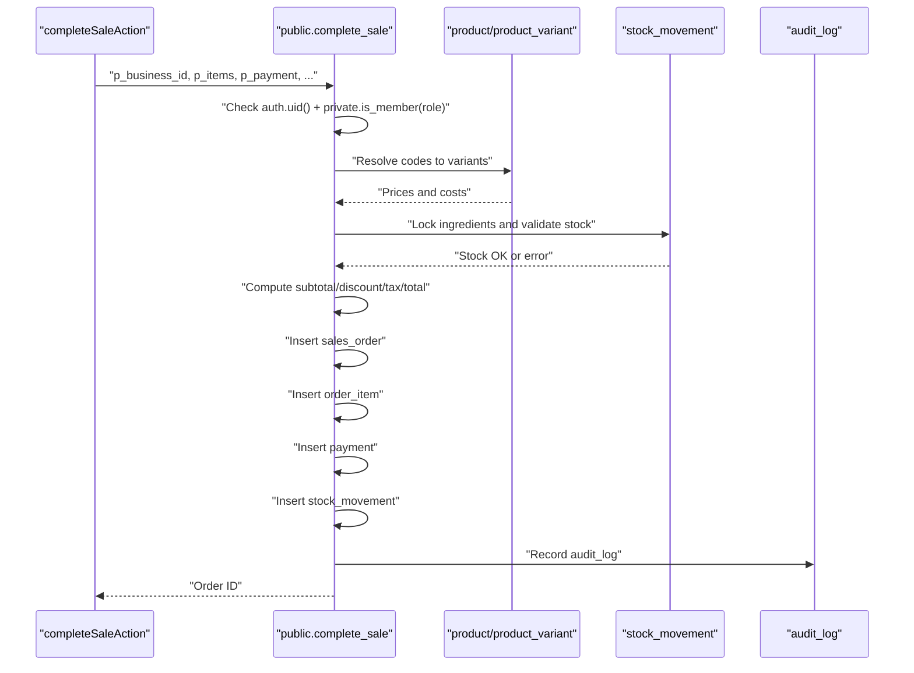

**Diagram sources**
- [actions.ts:52-89](file://src/app/actions.ts#L52-L89)
- [0003_functions.sql:94-230](file://supabase/migrations/0003_functions.sql#L94-L230)

**Section sources**
- [0003_functions.sql:94-230](file://supabase/migrations/0003_functions.sql#L94-L230)

#### Purchase Recording Flow
The `record_purchase` function:
- Requires `owner`, `manager`, or `kasir`.
- Validates purchase lines.
- Updates moving-average cost.
- Records purchase lines and stock movements.
- Refreshes HPP for affected product variants.
- Logs audit activity.

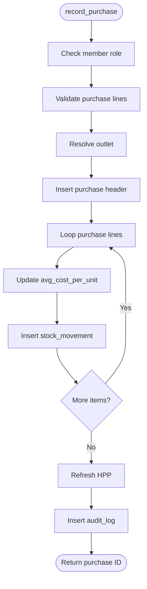

**Diagram sources**
- [actions.ts:97-124](file://src/app/actions.ts#L97-L124)
- [0003_functions.sql:236-303](file://supabase/migrations/0003_functions.sql#L236-L303)

**Section sources**
- [0003_functions.sql:236-303](file://supabase/migrations/0003_functions.sql#L236-L303)

### Team Administration and Role Assignment Workflow
Team membership is managed by the owner through a controlled workflow:

1. The owner calls the invite action with an email and a non-owner role (`manager`, `kasir`, or `dapur`).
2. The server action validates the role and calls the database function `add_team_member_by_email`.
3. If the user does not exist, the server invites them via Supabase Admin Auth.
4. After the user accepts the invitation, the database function assigns the requested role.
5. The response includes the assigned role and whether the user was newly invited.

Security constraints:
- Only `owner` can invite team members.
- The allowed roles for invitations exclude `owner`; owners must assign roles explicitly.
- The database function validates the role value.

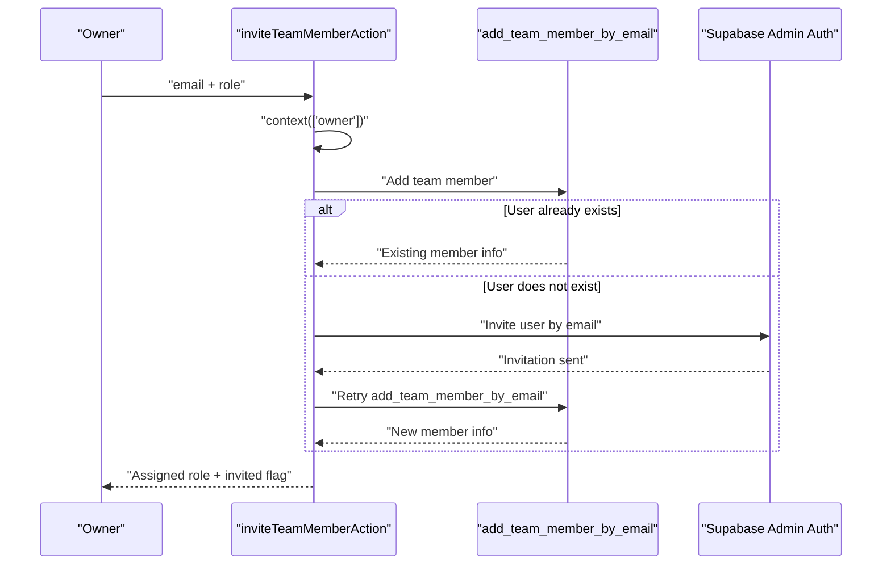

**Diagram sources**
- [actions.ts:253-289](file://src/app/actions.ts#L253-L289)
- [0004_workspaces.sql:302-322](file://supabase/migrations/0004_workspaces.sql#L302-L322)

**Section sources**
- [actions.ts:253-289](file://src/app/actions.ts#L253-L289)
- [0004_workspaces.sql:302-322](file://supabase/migrations/0004_workspaces.sql#L302-L322)

### Security Boundaries Between Roles
| Boundary | Enforcement Mechanism | Purpose |
|---|---|---|
| Owner-only settings | Server action requires `owner` | Prevent managers/cashiers from changing business identity or targets |
| Owner-only team management | Server action + database function require `owner` | Prevent privilege escalation through team invites |
| Catalog/inventory write | RLS policy requires `owner` or `manager` | Protect pricing, recipes, and stock definitions |
| Ledger mutation | Transactional function requires `owner`, `manager`, or `kasir` | Ensure only operational roles can complete sales or record purchases |
| Customer deletion | RLS policy requires `owner` or `manager` | Prevent cashiers from removing customer history |
| Expense modification/deletion | RLS policy requires `owner` or `manager` | Prevent cashiers from altering historical financial records |
| Audit and AI telemetry | RLS policy requires `owner` or `manager` | Restrict sensitive operational visibility |
| Direct ledger writes | No RLS insert/update/delete policies | Force all ledger mutations through transactional functions |

**Section sources**
- [actions.ts:171-189](file://src/app/actions.ts#L171-L189)
- [actions.ts:261-289](file://src/app/actions.ts#L261-L289)
- [0002_rls.sql:46-59](file://supabase/migrations/0002_rls.sql#L46-L59)
- [0002_rls.sql:64-75](file://supabase/migrations/0002_rls.sql#L64-L75)
- [0002_rls.sql:80-88](file://supabase/migrations/0002_rls.sql#L80-L88)
- [0002_rls.sql:106-114](file://supabase/migrations/0002_rls.sql#L106-L114)
- [0002_rls.sql:119-125](file://supabase/migrations/0002_rls.sql#L119-L125)

### Privilege Escalation Prevention
Laris prevents privilege escalation through multiple layers:

1. **Role validation in server actions**: Only `owner` can invite team members.
2. **Role validation in database functions**: `add_team_member_by_email` rejects invalid roles and non-owners.
3. **No direct ledger writes**: Clients cannot bypass transactional functions by inserting directly into `sales_order`, `payment`, or `stock_movement`.
4. **RLS denies cross-tenant access**: Policies ensure a user can only access rows belonging to their business.
5. **Test coverage**: Integration tests verify that tenant A cannot read tenant B data and that direct ledger inserts fail.

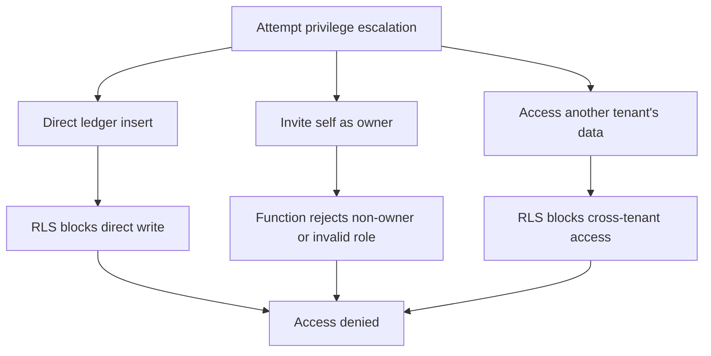

**Diagram sources**
- [actions.ts:261-289](file://src/app/actions.ts#L261-L289)
- [0004_workspaces.sql:302-322](file://supabase/migrations/0004_workspaces.sql#L302-L322)
- [0002_rls.sql:93-101](file://supabase/migrations/0002_rls.sql#L93-L101)
- [rls.test.ts:63-77](file://scripts/rls.test.ts#L63-L77)

**Section sources**
- [actions.ts:261-289](file://src/app/actions.ts#L261-L289)
- [0004_workspaces.sql:302-322](file://supabase/migrations/0004_workspaces.sql#L302-L322)
- [0002_rls.sql:93-101](file://supabase/migrations/0002_rls.sql#L93-L101)
- [rls.test.ts:63-77](file://scripts/rls.test.ts#L63-L77)

### Role Inheritance Patterns
Laris does not implement hierarchical role inheritance such as “owner implies manager.” Instead, it uses explicit role arrays in permission checks:

- Operations requiring broader access pass multiple allowed roles to `context(...)`.
- RLS policies use role arrays like `['owner', 'manager']` or `['owner', 'manager', 'kasir']`.
- This approach makes permissions explicit and easier to audit.

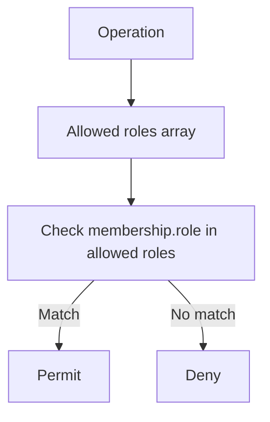

**Diagram sources**
- [actions.ts:21-28](file://src/app/actions.ts#L21-L28)
- [0002_rls.sql:46-59](file://supabase/migrations/0002_rls.sql#L46-L59)
- [0002_rls.sql:64-75](file://supabase/migrations/0002_rls.sql#L64-L75)
- [0002_rls.sql:80-88](file://supabase/migrations/0002_rls.sql#L80-L88)
- [0002_rls.sql:106-114](file://supabase/migrations/0002_rls.sql#L106-L114)

**Section sources**
- [actions.ts:21-28](file://src/app/actions.ts#L21-L28)
- [0002_rls.sql:46-59](file://supabase/migrations/0002_rls.sql#L46-L59)
- [0002_rls.sql:64-75](file://supabase/migrations/0002_rls.sql#L64-L75)
- [0002_rls.sql:80-88](file://supabase/migrations/0002_rls.sql#L80-L88)
- [0002_rls.sql:106-114](file://supabase/migrations/0002_rls.sql#L106-L114)

### Integration with Row-Level Security
Row-Level Security is the final enforcement boundary:

- Every relevant table has RLS enabled.
- Reads generally require membership in the business.
- Writes are either role-restricted or blocked entirely for clients.
- Transactional functions act as the only authorized path for ledger mutations.
- Integration tests assert tenant isolation and direct-write rejection.

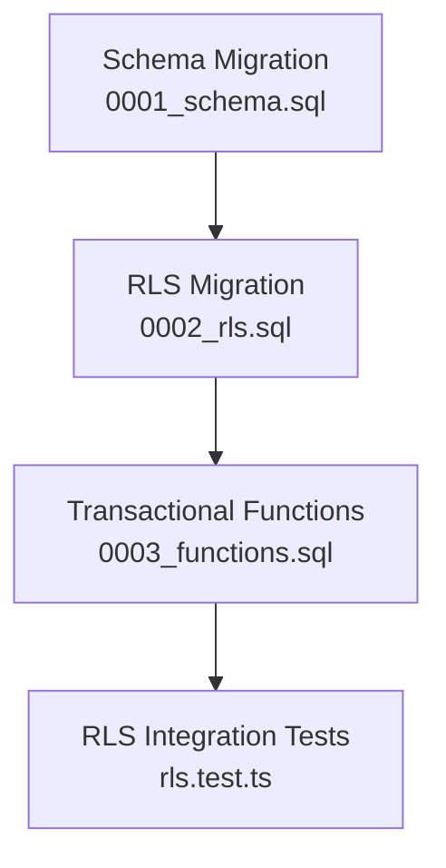

**Diagram sources**
- [0001_schema.sql:49-56](file://supabase/migrations/0001_schema.sql#L49-L56)
- [0002_rls.sql:28-41](file://supabase/migrations/0002_rls.sql#L28-L41)
- [0003_functions.sql:94-125](file://supabase/migrations/0003_functions.sql#L94-L125)
- [rls.test.ts:37-83](file://scripts/rls.test.ts#L37-L83)

**Section sources**
- [0002_rls.sql:28-41](file://supabase/migrations/0002_rls.sql#L28-L41)
- [0002_rls.sql:46-125](file://supabase/migrations/0002_rls.sql#L46-L125)
- [0003_functions.sql:94-230](file://supabase/migrations/0003_functions.sql#L94-L230)
- [rls.test.ts:37-83](file://scripts/rls.test.ts#L37-L83)

## Dependency Analysis
The RBAC system depends on coordinated layers:

| Layer | Dependency | Direction |
|---|---|---|
| Domain model | TypeScript `TeamMember` role type | Used by UI and server actions |
| Server actions | Supabase client and membership resolver | Calls RPCs and queries |
| Transactional functions | `private.is_member` and schema tables | Enforce business rules |
| RLS policies | `private.is_member` and membership table | Enforce tenant and role boundaries |
| Tests | Real Supabase project | Verify isolation and security |

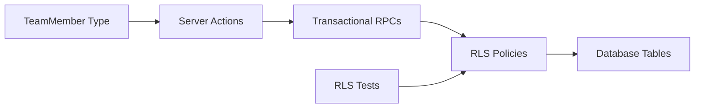

**Diagram sources**
- [laris-data.ts:82-87](file://src/lib/laris-data.ts#L82-L87)
- [actions.ts:21-28](file://src/app/actions.ts#L21-L28)
- [0002_rls.sql:12-25](file://supabase/migrations/0002_rls.sql#L12-L25)
- [rls.test.ts:37-83](file://scripts/rls.test.ts#L37-L83)

**Section sources**
- [laris-data.ts:82-87](file://src/lib/laris-data.ts#L82-L87)
- [actions.ts:21-28](file://src/app/actions.ts#L21-L28)
- [0002_rls.sql:12-25](file://supabase/migrations/0002_rls.sql#L12-L25)
- [rls.test.ts:37-83](file://scripts/rls.test.ts#L37-L83)

## Performance Considerations
- **Explicit role arrays**: Using small, explicit role arrays avoids complex inheritance evaluation and keeps permission checks fast.
- **Early rejection**: Server-side `context(...)` rejects unauthorized requests before expensive database work.
- **Atomic transactions**: Ledger mutations run in single transactions, reducing inconsistent state and retry complexity.
- **RLS helper caching**: `private.is_member` is marked stable and runs within the database engine, minimizing repeated membership lookups during policy evaluation.
- **Avoiding direct writes**: Forcing ledger mutations through functions reduces client-side computation and potential race conditions.

[No sources needed since this section provides general guidance]

## Troubleshooting Guide
Common RBAC-related issues and how to diagnose them:

| Symptom | Likely Cause | Resolution |
|---|---|---|
| “Peranmu tidak memiliki akses untuk tindakan ini” | Server action rejected the role | Check which roles are allowed for the action and verify the current membership role |
| “Akses ditolak” from RPC | Transactional function membership check failed | Confirm the user is a member of the business and has an allowed role |
| Direct insert into `sales_order` fails | RLS blocks direct ledger writes | Use `complete_sale` RPC instead of direct table insertion |
| Tenant A sees Tenant B data | RLS misconfiguration or missing migration | Apply all migrations in order and rerun RLS tests |
| Cannot invite team member | Not an owner or invalid role | Only `owner` can invite; valid roles are `manager`, `kasir`, `dapur` |
| Cannot edit expense | Insufficient role | Only `owner` and `manager` can update or delete expenses |
| Cannot view audit log | Insufficient role | Only `owner` and `manager` can read audit logs |

Useful verification steps:
- Run `npm test` to validate application logic.
- Run `npm run test:rls` to validate tenant isolation and direct-write rejection against Supabase.
- Review the role passed to `context(...)` in the failing server action.
- Review the RLS policy for the affected table.
- Review the transactional function’s membership check.

**Section sources**
- [actions.ts:21-28](file://src/app/actions.ts#L21-L28)
- [0003_functions.sql:123-125](file://supabase/migrations/0003_functions.sql#L123-L125)
- [rls.test.ts:63-77](file://scripts/rls.test.ts#L63-L77)

## Conclusion
Laris implements a robust, layered role-based access control system centered around four roles: owner, manager, cashier, and kitchen. The system combines TypeScript type safety, server-side role validation, database-level RLS policies, and transactional functions to enforce security boundaries.

Key takeaways:
- Roles are explicitly defined in both TypeScript and the database schema.
- Permission checking occurs at multiple layers to prevent bypasses.
- Ledger mutations are protected by transactional functions that re-validate membership and role.
- RLS ensures tenant isolation and restricts direct writes to sensitive tables.
- Team administration is restricted to owners, preventing privilege escalation.
- Integration tests provide confidence that the security model works against a real Supabase project.

For future enhancements, consider adding explicit feature flags or capability checks for kitchen-specific workflows, while preserving the existing principle that sensitive mutations always pass through transactional functions and RLS policies.

[No sources needed since this section summarizes without analyzing specific files]