# Team Collaboration Features

<cite>
**Referenced Files in This Document**
- [README.md](file://README.md)
- [PRD_Laris_GTNIC2026.md](file://PRD_Laris_GTNIC2026.md)
- [src/app/onboarding/page.tsx](file://src/app/onboarding/page.tsx)
- [src/app/onboarding/actions.ts](file://src/app/onboarding/actions.ts)
- [src/components/laris-app.tsx](file://src/components/laris-app.tsx)
- [src/app/actions.ts](file://src/app/actions.ts)
- [supabase/migrations/0001_schema.sql](file://supabase/migrations/0001_schema.sql)
- [supabase/migrations/0002_rls.sql](file://supabase/migrations/0002_rls.sql)
- [supabase/migrations/0004_workspaces.sql](file://supabase/migrations/0004_workspaces.sql)
</cite>

## Table of Contents
1. [Introduction](#introduction)
2. [Project Structure](#project-structure)
3. [Core Components](#core-components)
4. [Architecture Overview](#architecture-overview)
5. [Detailed Component Analysis](#detailed-component-analysis)
6. [Dependency Analysis](#dependency-analysis)
7. [Performance Considerations](#performance-considerations)
8. [Troubleshooting Guide](#troubleshooting-guide)
9. [Conclusion](#conclusion)

## Introduction
This document explains the team collaboration features implemented in Laris. It focuses on how workspace owners invite team members, assign roles during onboarding and membership management, and how shared workspace access is enforced. It also documents the activity logging system used for audit trails and compliance, and clarifies what real-time collaboration capabilities are currently available versus what would require additional implementation.

Laris is an operational workspace for small F&B businesses. The product connects business accounts, cashiers, voice-to-cart ordering, recipes, inventory, purchases, customers, financial reports, teams, and AI assistance. Team-related functionality includes customer and team member management, email invitations, role-based access, and audit logging.

**Section sources**
- [README.md:1-35](file://README.md#L1-L35)

## Project Structure
The team collaboration feature spans several layers:

- **Frontend UI**: The main application component renders the team interface, invitation modal, role labels, and user feedback.
- **Server Actions**: Next.js server actions validate input, enforce ownership, call Supabase RPC functions, and optionally send email invitations through Supabase Auth admin APIs.
- **Database Schema and Policies**: PostgreSQL tables define business, outlet, membership, audit logs, and related entities. Row Level Security policies restrict data access by tenant and role.
- **Supabase Functions**: SQL functions implement workspace creation, team listing, and adding team members by email, including audit log insertion.

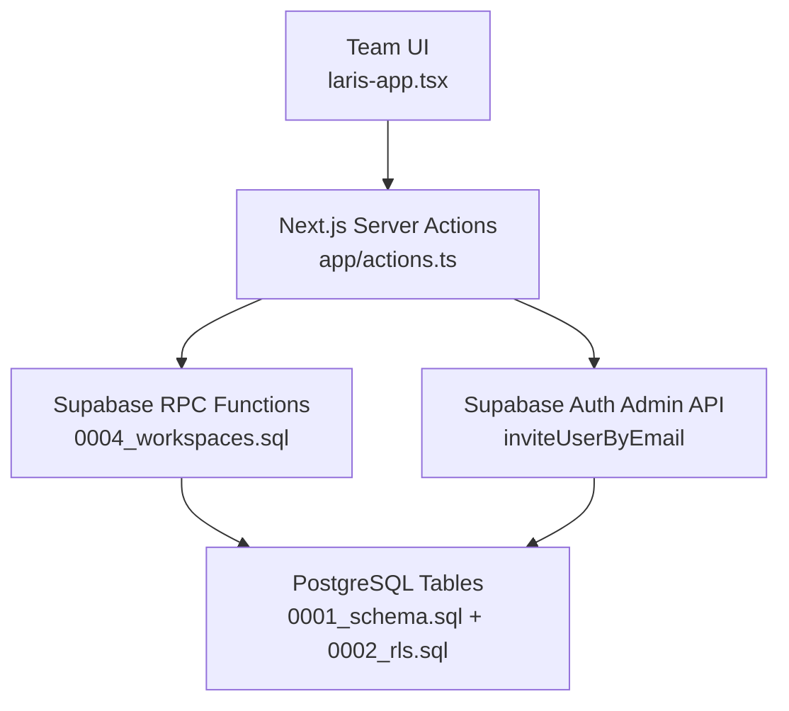

**Diagram sources**
- [src/components/laris-app.tsx:620-641](file://src/components/laris-app.tsx#L620-L641)
- [src/app/actions.ts:261-289](file://src/app/actions.ts#L261-L289)
- [supabase/migrations/0004_workspaces.sql:58-70](file://supabase/migrations/0004_workspaces.sql#L58-L70)
- [supabase/migrations/0004_workspaces.sql:302-333](file://supabase/migrations/0004_workspaces.sql#L302-L333)
- [supabase/migrations/0001_schema.sql:24-56](file://supabase/migrations/0001_schema.sql#L24-L56)
- [supabase/migrations/0001_schema.sql:255-265](file://supabase/migrations/0001_schema.sql#L255-L265)

**Section sources**
- [README.md:97-110](file://README.md#L97-L110)
- [src/components/laris-app.tsx:27-52](file://src/components/laris-app.tsx#L27-L52)
- [src/app/actions.ts:1-28](file://src/app/actions.ts#L1-L28)
- [supabase/migrations/0001_schema.sql:24-56](file://supabase/migrations/0001_schema.sql#L24-L56)
- [supabase/migrations/0002_rls.sql:12-25](file://supabase/migrations/0002_rls.sql#L12-L25)

## Core Components
The team collaboration system consists of these core components:

| Component | Responsibility | Key Implementation Details |
|---|---|---|
| Workspace Onboarding | Creates the first business, outlet, owner membership, and optional starter catalog | Server action validates inputs, calls `create_workspace`, inserts initial audit log |
| Team Membership Model | Stores which users belong to which business and their role | `membership` table with `owner`, `manager`, `kasir`, `dapur` roles |
| Team Listing | Returns visible team members for a business | `list_team_members` function enforces membership |
| Invitation Workflow | Adds existing users or invites new users by email | `add_team_member_by_email` RPC; server action uses Supabase Auth admin invite when needed |
| Role-Based Access Control | Restricts operations based on membership and role | RLS policies and `private.is_member` helper |
| Audit Logging | Records important business changes | `audit_log` table written by security-definer functions |

**Section sources**
- [src/app/onboarding/actions.ts:27-59](file://src/app/onboarding/actions.ts#L27-L59)
- [supabase/migrations/0001_schema.sql:49-56](file://supabase/migrations/0001_schema.sql#L49-L56)
- [supabase/migrations/0004_workspaces.sql:58-70](file://supabase/migrations/0004_workspaces.sql#L58-L70)
- [supabase/migrations/0004_workspaces.sql:302-333](file://supabase/migrations/0004_workspaces.sql#L302-L333)
- [supabase/migrations/0002_rls.sql:12-25](file://supabase/migrations/0002_rls.sql#L12-L25)
- [supabase/migrations/0001_schema.sql:255-265](file://supabase/migrations/0001_schema.sql#L255-L265)

## Architecture Overview
The team collaboration flow follows a layered architecture:

1. **UI Layer**: The team page and invitation modal collect email and role.
2. **Server Action Layer**: Validates input, checks that the current user is an owner, and calls database functions.
3. **Database Layer**: Enforces tenancy, role checks, and writes audit records.
4. **Auth Integration**: When the invited email does not exist, the server sends an invitation email through Supabase Auth admin APIs.

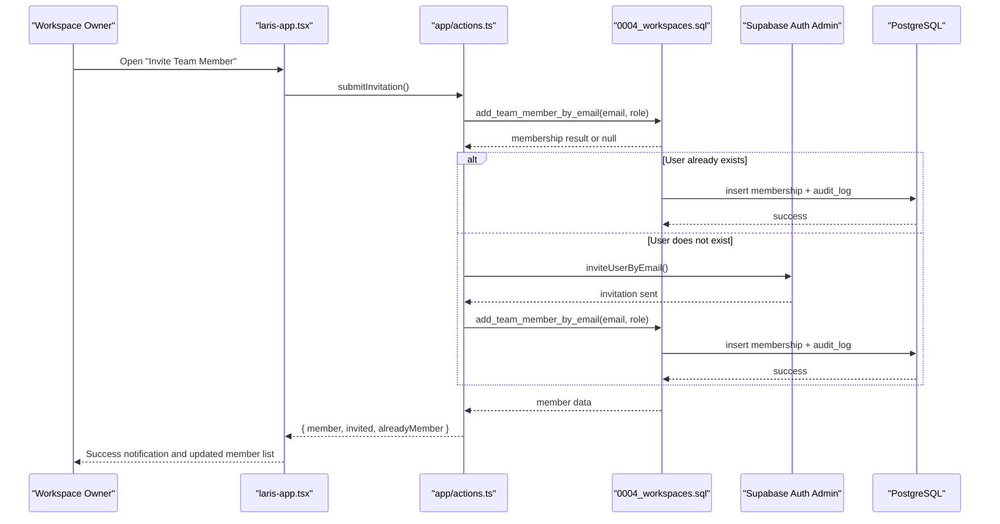

**Diagram sources**
- [src/components/laris-app.tsx:620-641](file://src/components/laris-app.tsx#L620-L641)
- [src/app/actions.ts:261-289](file://src/app/actions.ts#L261-L289)
- [supabase/migrations/0004_workspaces.sql:302-333](file://supabase/migrations/0004_workspaces.sql#L302-L333)

**Section sources**
- [src/components/laris-app.tsx:620-641](file://src/components/laris-app.tsx#L620-L641)
- [src/app/actions.ts:261-289](file://src/app/actions.ts#L261-L289)
- [supabase/migrations/0004_workspaces.sql:302-333](file://supabase/migrations/0004_workspaces.sql#L302-L333)

## Detailed Component Analysis

### Team Member Invitation Workflow
The invitation workflow supports both existing and new users:

- Existing users receive a direct membership assignment.
- New users receive an email invitation through Supabase Auth admin APIs, then receive the assigned role after accepting the invitation.
- Only workspace owners can manage team membership.
- Roles are restricted to `manager`, `kasir`, and `dapur`.

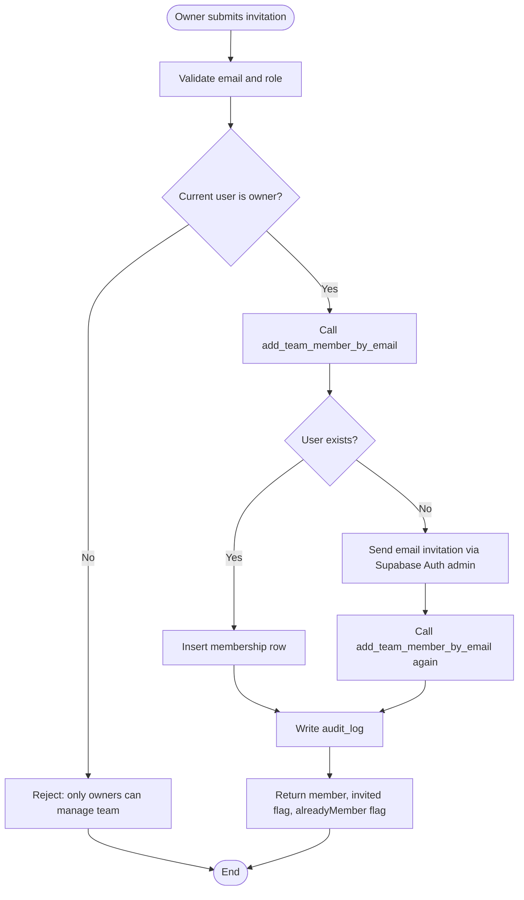

**Diagram sources**
- [src/app/actions.ts:261-289](file://src/app/actions.ts#L261-L289)
- [supabase/migrations/0004_workspaces.sql:302-333](file://supabase/migrations/0004_workspaces.sql#L302-L333)

**Section sources**
- [src/components/laris-app.tsx:620-641](file://src/components/laris-app.tsx#L620-L641)
- [src/app/actions.ts:253-289](file://src/app/actions.ts#L253-L289)
- [supabase/migrations/0004_workspaces.sql:302-333](file://supabase/migrations/0004_workspaces.sql#L302-L333)

### Role Assignment During Onboarding and Membership Management
Onboarding creates the workspace owner automatically. Later, team members are assigned one of three operational roles:

| Role | Meaning in Laris | Typical Access |
|---|---|---|
| Owner | Business owner | Full workspace control, team management, settings |
| Manager | Operational manager | Catalog, inventory, reports, some operational controls |
| Kasir | Cashier | Transactions, purchases, customer entry |
| Dapur | Kitchen staff | Read-only operational visibility |

The onboarding process assigns the creator as `owner`. Team invitations assign `manager`, `kasir`, or `dapur`.

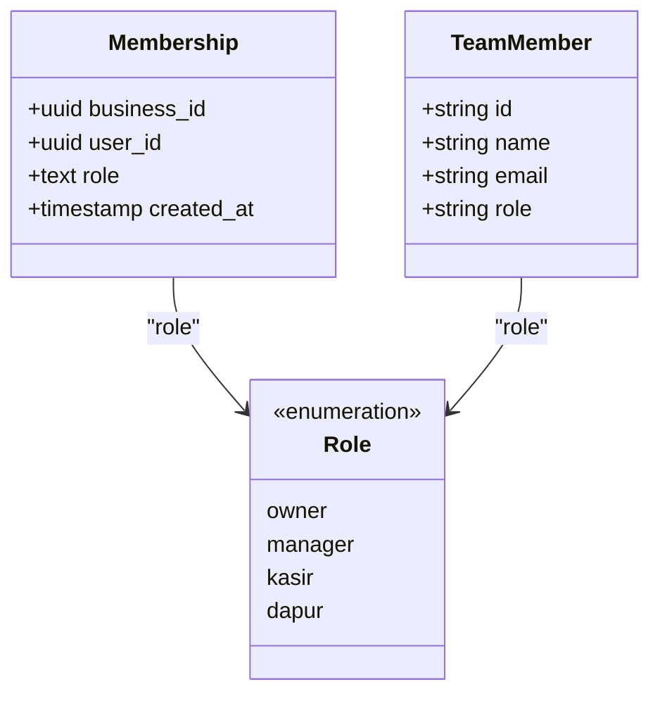

**Diagram sources**
- [supabase/migrations/0001_schema.sql:49-56](file://supabase/migrations/0001_schema.sql#L49-L56)
- [src/components/laris-app.tsx:51-52](file://src/components/laris-app.tsx#L51-L52)
- [src/app/actions.ts:253-259](file://src/app/actions.ts#L253-L259)

**Section sources**
- [src/app/onboarding/actions.ts:27-59](file://src/app/onboarding/actions.ts#L27-L59)
- [supabase/migrations/0004_workspaces.sql:107-111](file://supabase/migrations/0004_workspaces.sql#L107-L111)
- [supabase/migrations/0001_schema.sql:49-56](file://supabase/migrations/0001_schema.sql#L49-L56)
- [src/components/laris-app.tsx:51-52](file://src/components/laris-app.tsx#L51-L52)

### Workspace Membership Management Interface
The team interface provides:

- A navigation item labeled “Tim & akses”.
- An invitation modal where owners enter an email and select a role.
- Role descriptions explaining responsibilities.
- Toast notifications indicating whether the person was invited, already a member, or successfully added.
- Local state updates that reflect newly added members without requiring a full page reload.

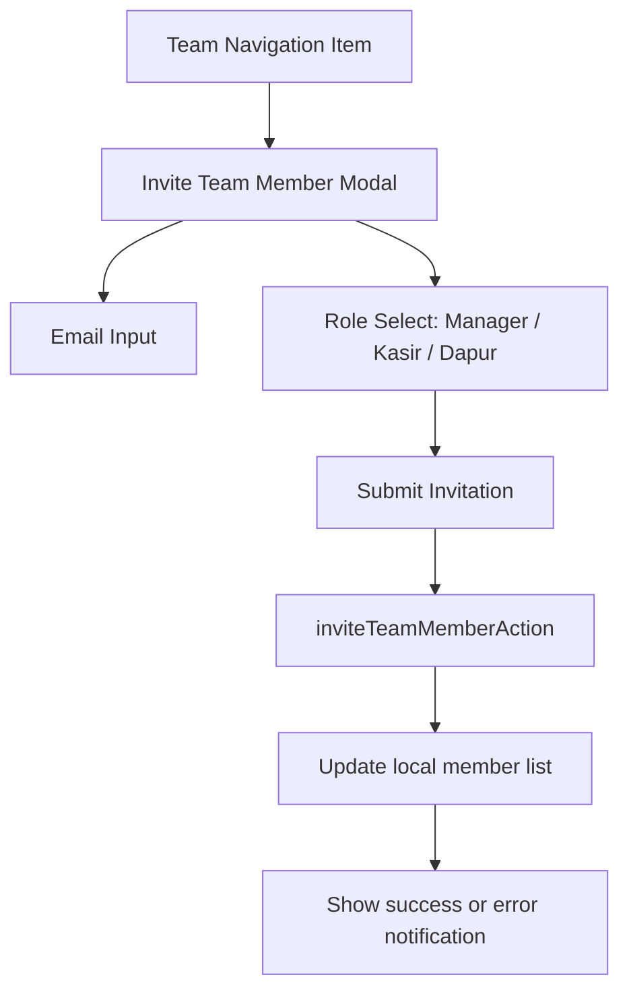

**Diagram sources**
- [src/components/laris-app.tsx:37-41](file://src/components/laris-app.tsx#L37-L41)
- [src/components/laris-app.tsx:620-641](file://src/components/laris-app.tsx#L620-L641)
- [src/app/actions.ts:261-289](file://src/app/actions.ts#L261-L289)

**Section sources**
- [src/components/laris-app.tsx:37-41](file://src/components/laris-app.tsx#L37-L41)
- [src/components/laris-app.tsx:620-641](file://src/components/laris-app.tsx#L620-L641)

### Shared Workspace Access and Security Model
Shared workspace access is enforced through:

- A `business` entity representing the workspace.
- An `outlet` entity representing physical locations under the workspace.
- A `membership` table linking users to businesses with roles.
- Row Level Security policies that allow reads for members and restrict writes based on roles.
- A `private.is_member` helper used by policies and functions.

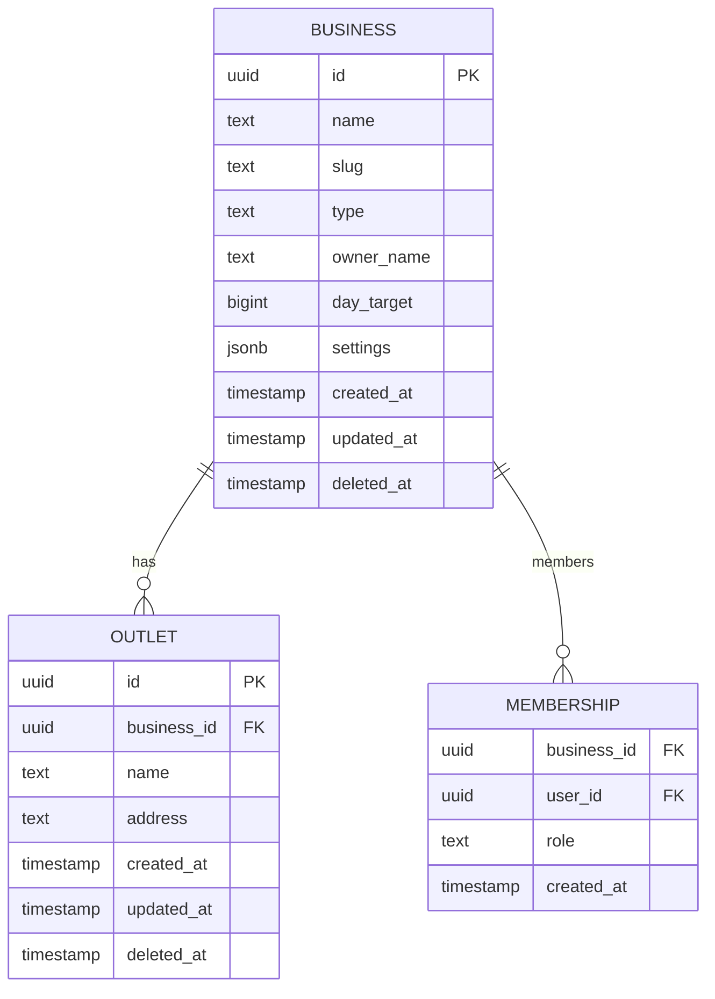

**Diagram sources**
- [supabase/migrations/0001_schema.sql:24-56](file://supabase/migrations/0001_schema.sql#L24-L56)
- [supabase/migrations/0002_rls.sql:46-59](file://supabase/migrations/0002_rls.sql#L46-L59)

**Section sources**
- [supabase/migrations/0001_schema.sql:24-56](file://supabase/migrations/0001_schema.sql#L24-L56)
- [supabase/migrations/0002_rls.sql:12-25](file://supabase/migrations/0002_rls.sql#L12-L25)
- [supabase/migrations/0002_rls.sql:46-59](file://supabase/migrations/0002_rls.sql#L46-L59)

### Activity Logging System
Laris uses an audit log table to record important system changes. The schema stores:

- `business_id`: the workspace.
- `actor_id`: the user who performed the action.
- `action`: a short identifier such as `business.create`, `product.save`, `inventory.save`, `membership.create`.
- `entity`: the affected resource type.
- `entity_id`: the affected resource identifier.
- `data`: structured JSON metadata.
- `created_at`: timestamp.

Audit entries are written by security-definer functions rather than direct client writes, ensuring that only validated server-side logic can create audit records.

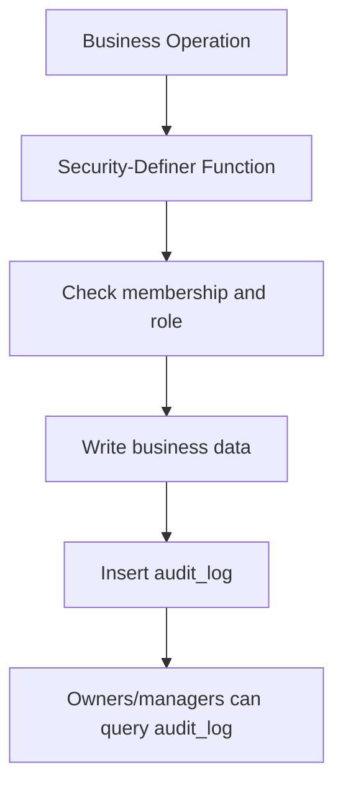

**Diagram sources**
- [supabase/migrations/0001_schema.sql:255-265](file://supabase/migrations/0001_schema.sql#L255-L265)
- [supabase/migrations/0004_workspaces.sql:150-152](file://supabase/migrations/0004_workspaces.sql#L150-L152)
- [supabase/migrations/0004_workspaces.sql:218-219](file://supabase/migrations/0004_workspaces.sql#L218-L219)
- [supabase/migrations/0004_workspaces.sql:296-298](file://supabase/migrations/0004_workspaces.sql#L296-L298)
- [supabase/migrations/0004_workspaces.sql:329-330](file://supabase/migrations/0004_workspaces.sql#L329-L330)
- [supabase/migrations/0002_rls.sql:117-125](file://supabase/migrations/0002_rls.sql#L117-L125)

**Section sources**
- [supabase/migrations/0001_schema.sql:255-265](file://supabase/migrations/0001_schema.sql#L255-L265)
- [supabase/migrations/0004_workspaces.sql:150-152](file://supabase/migrations/0004_workspaces.sql#L150-L152)
- [supabase/migrations/0004_workspaces.sql:218-219](file://supabase/migrations/0004_workspaces.sql#L218-L219)
- [supabase/migrations/0004_workspaces.sql:296-298](file://supabase/migrations/0004_workspaces.sql#L296-L298)
- [supabase/migrations/0004_workspaces.sql:329-330](file://supabase/migrations/0004_workspaces.sql#L329-L330)
- [supabase/migrations/0002_rls.sql:117-125](file://supabase/migrations/0002_rls.sql#L117-L125)

### Real-Time Collaboration Capabilities
Based on the current codebase:

- There is no WebSocket server, presence system, live cursor sharing, or collaborative editing layer.
- Data persistence and consistency are handled through Supabase and PostgreSQL.
- The frontend updates local state after successful server responses.
- Real-time synchronization across multiple concurrent users would require additional infrastructure such as Supabase Realtime channels, WebSockets, or a dedicated collaboration service.

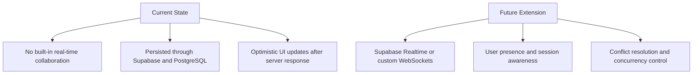

[No sources needed since this diagram shows conceptual workflow, not actual code structure]

**Section sources**
- [src/components/laris-app.tsx:213-260](file://src/components/laris-app.tsx#L213-L260)
- [src/components/laris-app.tsx:393-435](file://src/components/laris-app.tsx#L393-L435)
- [src/app/actions.ts:52-88](file://src/app/actions.ts#L52-L88)
- [src/app/actions.ts:97-123](file://src/app/actions.ts#L97-L123)

### Communication Tools Available to Team Members
Laris provides operational communication primarily through:

- The workspace UI for managing team members and viewing operational data.
- Email invitations for onboarding new team members.
- Internal AI assistance (“Tanya Laris”) that answers questions about revenue, products, stock, customers, and expenses using workspace data.
- Customer records and purchase/sale history for operational coordination.

There is no built-in chat, comments, or messaging system between team members in the analyzed code.

**Section sources**
- [src/components/laris-app.tsx:274-309](file://src/components/laris-app.tsx#L274-L309)
- [src/app/api/ai\ask/route.ts:77-92](file://src/app/api/ai/ask/route.ts#L77-L92)
- [src/app/actions.ts:261-289](file://src/app/actions.ts#L261-L289)

### Examples of Team Member Management Interfaces
Examples derived from the implementation:

- **Team navigation**: The app includes a “Tim & akses” navigation item.
- **Invitation modal**: Owners open a modal, enter an email, choose a role, and submit.
- **Role selection**: Roles include Manager, Kasir, and Dapur, each with a description.
- **Feedback**: The UI displays toast messages for success, already-member cases, and errors.
- **Member list update**: After a successful invitation, the local member list is updated.

These examples map directly to the UI component’s modal rendering and submission handler.

**Section sources**
- [src/components/laris-app.tsx:37-41](file://src/components/laris-app.tsx#L37-L41)
- [src/components/laris-app.tsx:620-641](file://src/components/laris-app.tsx#L620-L641)

### Examples of Activity Monitoring Dashboards
Activity monitoring is backed by the `audit_log` table. The repository maps recent audit rows into activities for team-capable views. Ownership and manager roles can read audit logs through RLS policies.

A conceptual dashboard could display:

- Recent actions such as workspace creation, product saves, inventory saves, and membership changes.
- Actor names resolved from team members.
- Timestamps in local timezone context.
- Filters by action, entity, or actor.

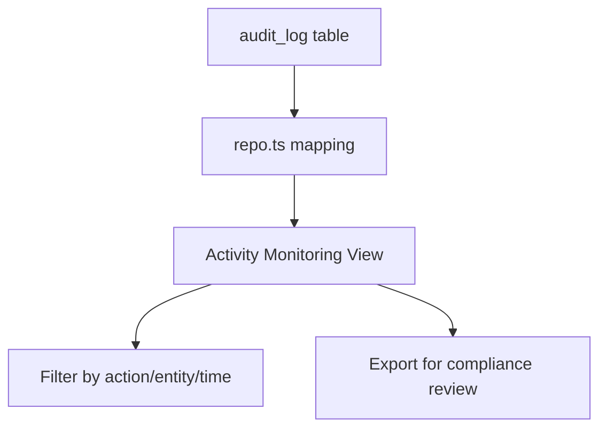

**Diagram sources**
- [supabase/migrations/0001_schema.sql:255-265](file://supabase/migrations/0001_schema.sql#L255-L265)
- [src/lib/repo.ts:150-168](file://src/lib/repo.ts#L150-L168)
- [supabase/migrations/0002_rls.sql:117-125](file://supabase/migrations/0002_rls.sql#L117-L125)

**Section sources**
- [supabase/migrations/0001_schema.sql:255-265](file://supabase/migrations/0001_schema.sql#L255-L265)
- [src/lib/repo.ts:150-168](file://src/lib/repo.ts#L150-L168)
- [supabase/migrations/0002_rls.sql:117-125](file://supabase/migrations/0002_rls.sql#L117-L125)

### Multi-User Concurrency Handling and Session Management
Concurrency handling is primarily server-side and database-driven:

- **Idempotency keys**: Checkout and purchase operations accept idempotency keys to prevent duplicate processing.
- **Atomic RPC functions**: Sales and purchases are processed through database functions that maintain consistency.
- **Row Level Security**: Ensures tenants cannot access other tenants’ data.
- **Session validation**: Server actions check authentication claims and membership before allowing operations.

Real-time multi-user concurrency (e.g., two cashiers updating the same inventory simultaneously) is not explicitly coordinated at the application level beyond database constraints and atomic operations.

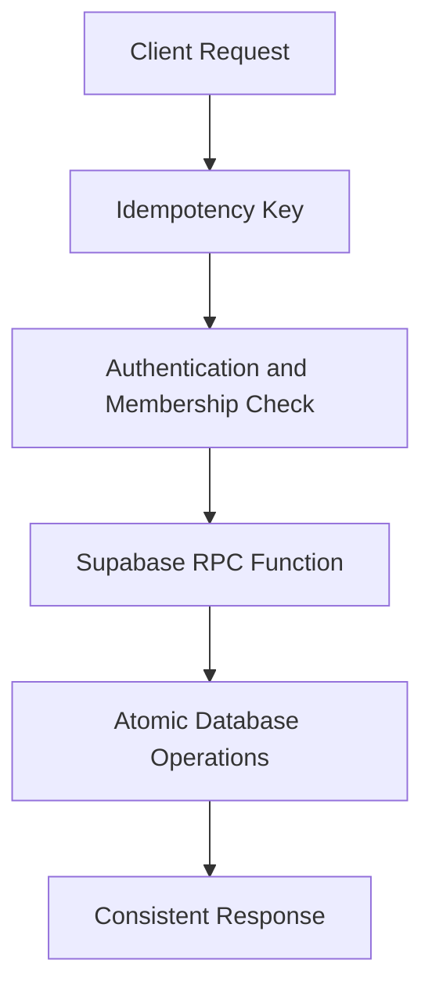

**Diagram sources**
- [src/app/actions.ts:40-50](file://src/app/actions.ts#L40-L50)
- [src/app/actions.ts:52-88](file://src/app/actions.ts#L52-L88)
- [src/app/actions.ts:91-106](file://src/app/actions.ts#L91-L106)
- [supabase/migrations/0002_rls.sql:12-25](file://supabase/migrations/0002_rls.sql#L12-L25)

**Section sources**
- [src/app/actions.ts:40-50](file://src/app/actions.ts#L40-L50)
- [src/app/actions.ts:52-88](file://src/app/actions.ts#L52-L88)
- [src/app/actions.ts:91-106](file://src/app/actions.ts#L91-L106)
- [supabase/migrations/0002_rls.sql:12-25](file://supabase/migrations/0002_rls.sql#L12-L25)

### Collaborative Workflow Optimization
Recommended optimizations for team collaboration workflows:

- Add Supabase Realtime channels for live team member presence and activity feeds.
- Introduce optimistic UI updates with conflict resolution for inventory and catalog edits.
- Add explicit team member status indicators such as online/offline and last active time.
- Extend audit logging to cover more sensitive operations like role changes and workspace settings updates.
- Provide exportable audit reports for compliance reviews.
- Add rate limiting and request throttling for invitation and team management endpoints.

[No sources needed since this section provides general guidance]

## Dependency Analysis
The team collaboration feature depends on:

- **Next.js App Router**: Pages and server actions.
- **Supabase Client**: For authenticated queries and RPC calls.
- **Supabase Admin Client**: For sending email invitations.
- **PostgreSQL**: For schema, functions, and RLS policies.
- **Zod**: For input validation.
- **React UI**: For modal, form, and state management.

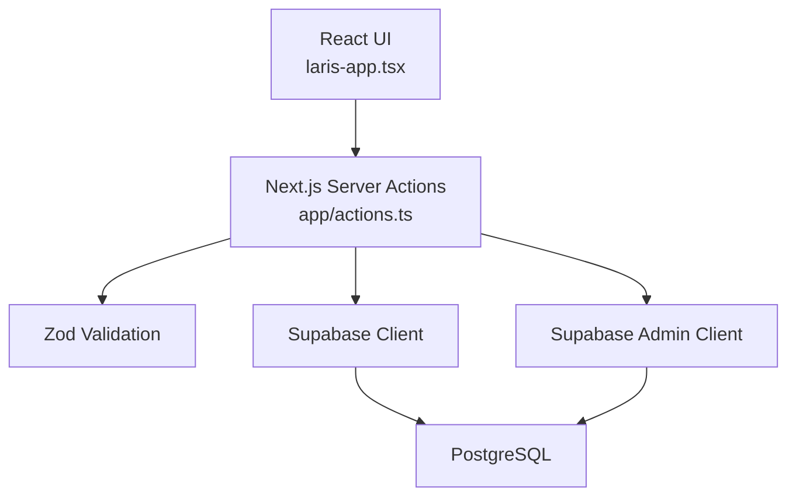

**Diagram sources**
- [src/components/laris-app.tsx:1-25](file://src/components/laris-app.tsx#L1-L25)
- [src/app/actions.ts:1-14](file://src/app/actions.ts#L1-L14)
- [src/app/actions.ts:253-289](file://src/app/actions.ts#L253-L289)
- [supabase/migrations/0001_schema.sql:24-56](file://supabase/migrations/0001_schema.sql#L24-L56)

**Section sources**
- [src/components/laris-app.tsx:1-25](file://src/components/laris-app.tsx#L1-L25)
- [src/app/actions.ts:1-14](file://src/app/actions.ts#L1-L14)
- [src/app/actions.ts:253-289](file://src/app/actions.ts#L253-L289)
- [supabase/migrations/0001_schema.sql:24-56](file://supabase/migrations/0001_schema.sql#L24-L56)

## Performance Considerations
- **Audit Log Growth**: Audit logs accumulate over time; consider partitioning or archival strategies for large workspaces.
- **Team List Queries**: `list_team_members` joins membership and auth users; ensure indexes remain efficient as memberships grow.
- **Invitation Flow**: Sending email invitations adds latency; cache or debounce repeated invitations for the same email.
- **UI State Updates**: Local state updates improve perceived performance but should be reconciled with server responses to avoid stale data.
- **RLS Overhead**: Row Level Security adds policy evaluation cost; keep queries scoped to `business_id` and use appropriate indexes.

[No sources needed since this section provides general guidance]

## Troubleshooting Guide
Common issues and resolutions:

| Issue | Likely Cause | Resolution |
|---|---|---|
| Invitation fails with access denied | Caller is not an owner | Ensure the current user has `owner` role for the business |
| Invitation returns null initially | User does not exist in Supabase Auth | Server action sends email invitation and retries membership assignment |
| Team member cannot see data | Missing membership or insufficient role | Verify `membership` row and role; check RLS policies |
| Audit log missing | Function did not write audit entry | Confirm operation goes through security-definer function that writes audit logs |
| Real-time updates not visible | No real-time subscription implemented | Implement Supabase Realtime or WebSocket-based sync |

**Section sources**
- [src/app/actions.ts:261-289](file://src/app/actions.ts#L261-L289)
- [supabase/migrations/0004_workspaces.sql:302-333](file://supabase/migrations/0004_workspaces.sql#L302-L333)
- [supabase/migrations/0002_rls.sql:46-59](file://supabase/migrations/0002_rls.sql#L46-L59)
- [supabase/migrations/0001_schema.sql:255-265](file://supabase/migrations/0001_schema.sql#L255-L265)

## Conclusion
Laris implements a solid foundation for team collaboration centered around workspace ownership, role-based membership, email invitations, and audit logging. The system ensures secure tenant isolation, clear role definitions, and compliance-friendly activity tracking. Real-time collaboration features such as live presence, collaborative editing, and instant multi-user synchronization are not present in the current implementation but can be added using Supabase Realtime or custom WebSocket infrastructure. For production environments, focus on audit log retention, role governance, invitation reliability, and extending real-time capabilities to support concurrent team workflows.

[No sources needed since this section summarizes without analyzing specific files]