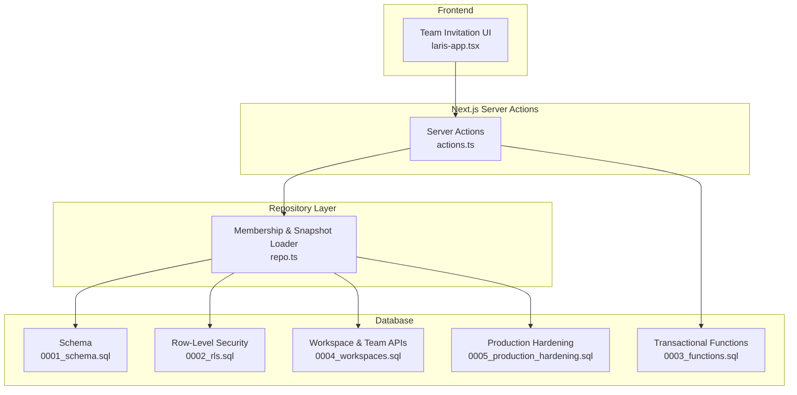
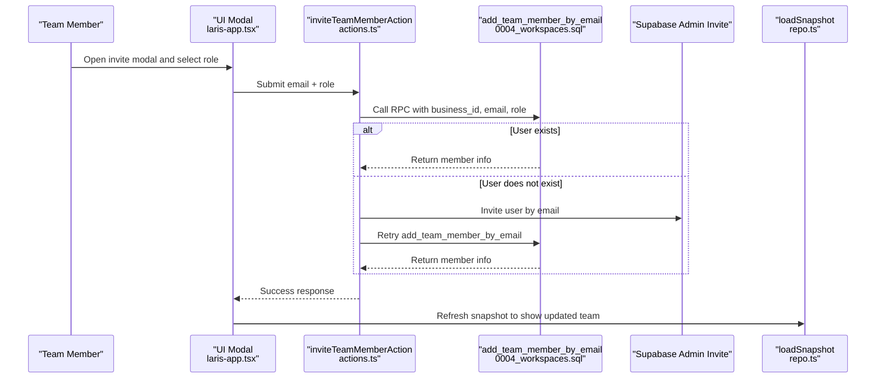
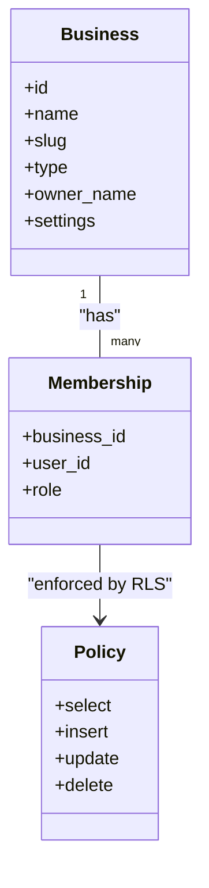
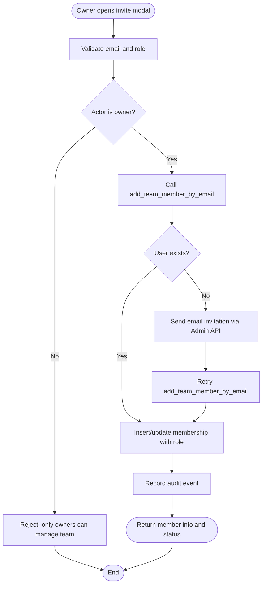
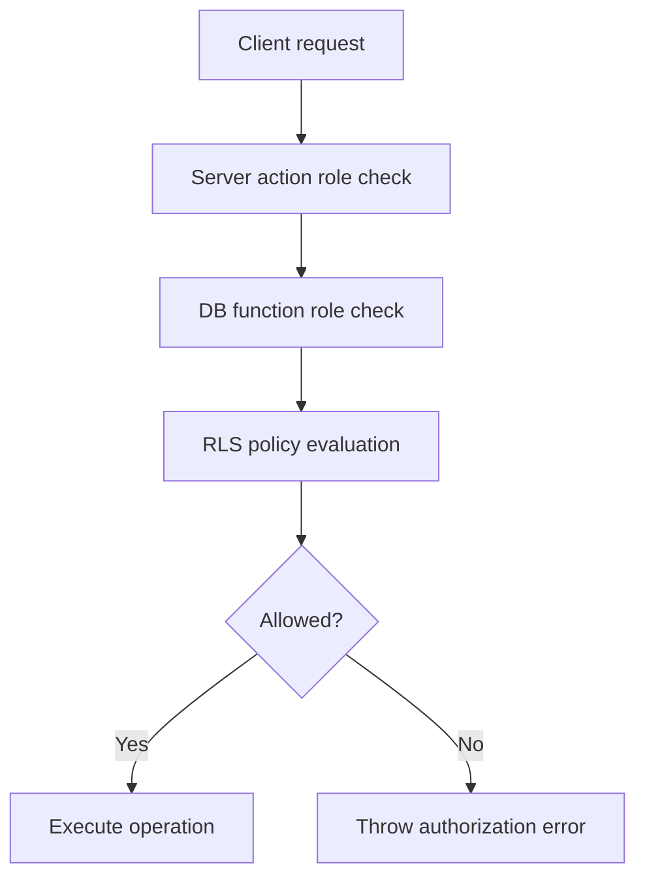
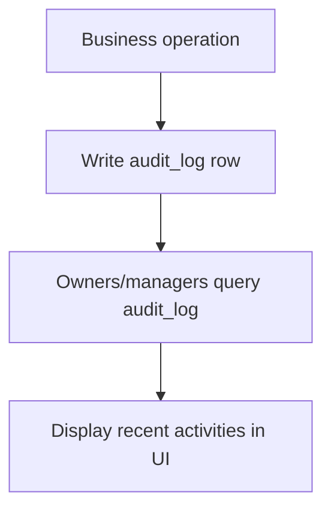
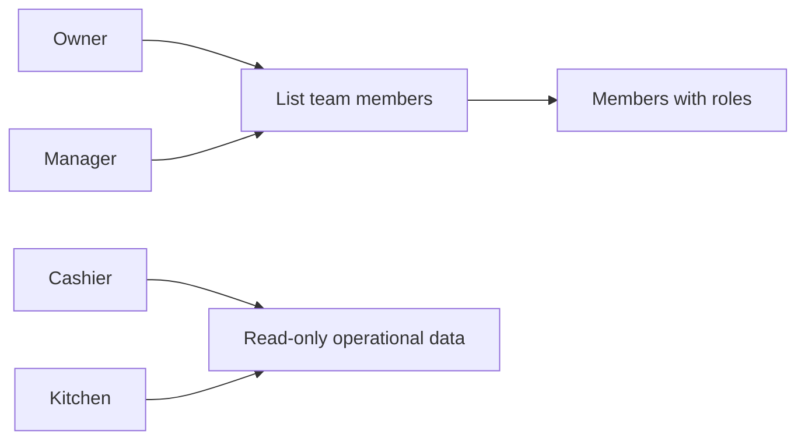
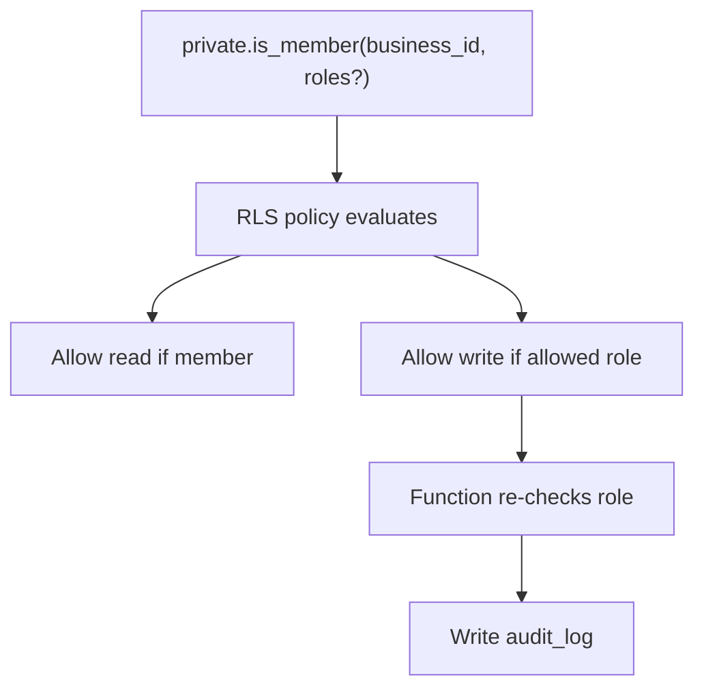
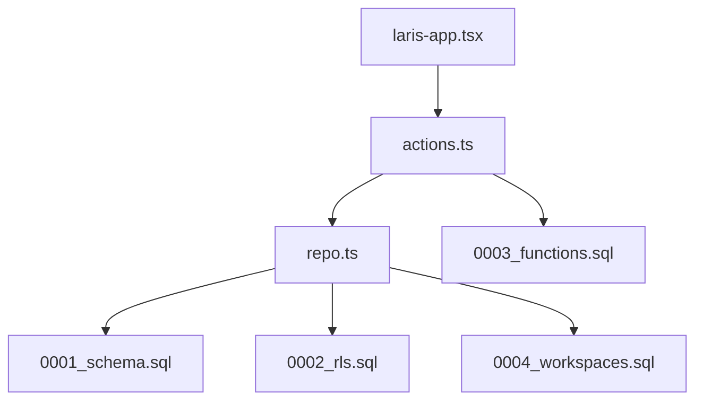

# Team Management

<cite>
**Referenced Files in This Document**
- [0001_schema.sql](file://supabase/migrations/0001_schema.sql)
- [0002_rls.sql](file://supabase/migrations/0002_rls.sql)
- [0003_functions.sql](file://supabase/migrations/0003_functions.sql)
- [0004_workspaces.sql](file://supabase/migrations/0004_workspaces.sql)
- [actions.ts](file://src/app/actions.ts)
- [repo.ts](file://src/lib/repo.ts)
- [laris-data.ts](file://src/lib/laris-data.ts)
- [laris-app.tsx](file://src/components/laris-app.tsx)
</cite>

## Update Summary
**Changes Made**
- Updated role-based access control model with comprehensive permission matrices
- Enhanced team member invitation workflow with email integration
- Expanded activity logging and audit trail mechanisms
- Added workspace collaboration features with role-scoped visibility
- Implemented security boundaries for privileged operations
- Added TeamMember interface and workspace membership management

## Table of Contents
1. [Introduction](#introduction)
2. [Project Structure](#project-structure)
3. [Core Components](#core-components)
4. [Architecture Overview](#architecture-overview)
5. [Detailed Component Analysis](#detailed-component-analysis)
6. [Dependency Analysis](#dependency-analysis)
7. [Performance Considerations](#performance-considerations)
8. [Troubleshooting Guide](#troubleshooting-guide)
9. [Conclusion](#conclusion)

## Introduction
This document explains the Laris team management system with a focus on role-based access control, team member invitations, activity logging and audit trails, workspace collaboration, and the relationship between permissions and Row-Level Security policies. It also provides concrete examples for role assignment, permission checking, and audit log queries, plus security considerations for multi-user environments and compliance requirements.

Laris models teams around a business (workspace), its members, and their roles. The supported roles are:
- **Owner**: Full administrative access including business settings, team management, and all operational controls
- **Manager**: Operational oversight including catalog management, expense modification/deletion, and team listing
- **Cashier (Kasir)**: POS operations, purchase recording, customer management, and daily transaction processing  
- **Kitchen (Dapur)**: Read-only access to operational data, recipes, and inventory without write privileges

The system enforces permissions through database-level Row-Level Security policies and transactional functions that re-check membership and roles before writing sensitive data.

## Project Structure
The team management features span database migrations, server actions, repository helpers, and UI components:
- Database schema defines core tables including `business`, `membership`, `audit_log`, and operational tables
- Row-Level Security policies restrict reads and writes by business and role
- Transactional functions enforce business rules, stock checks, idempotency, and audit logging
- Server actions validate inputs, enforce roles, and call database functions or direct table operations
- Repository helpers load snapshots, memberships, catalogs, and recent activities
- UI components provide invitation workflows and display team-related information

**Diagram sources**
- [laris-app.tsx](file://src/components/laris-app.tsx)
- [actions.ts](file://src/app/actions.ts)
- [repo.ts](file://src/lib/repo.ts)
- [0001_schema.sql](file://supabase/migrations/0001_schema.sql)
- [0002_rls.sql](file://supabase/migrations/0002_rls.sql)
- [0003_functions.sql](file://supabase/migrations/0003_functions.sql)
- [0004_workspaces.sql](file://supabase/migrations/0004_workspaces.sql)

**Section sources**
- [0001_schema.sql:24-56](file://supabase/migrations/0001_schema.sql#L24-L56)
- [0002_rls.sql:12-25](file://supabase/migrations/0002_rls.sql#L12-L25)
- [0003_functions.sql:73-88](file://supabase/migrations/0003_functions.sql#L73-L88)
- [0004_workspaces.sql:58-70](file://supabase/migrations/0004_workspaces.sql#L58-L70)
- [actions.ts:21-28](file://src/app/actions.ts#L21-L28)
- [repo.ts:114-124](file://src/lib/repo.ts#L114-L124)

## Core Components
- **Role model and membership**:
  - Roles: owner, manager, kasir, dapur
  - Membership links users to businesses and stores their role
- **Permission enforcement**:
  - `private.is_member` helper checks membership and optional role filters
  - RLS policies apply per-table restrictions based on business and role
- **Transactional operations**:
  - Functions like `complete_sale`, `record_purchase`, `save_product`, `save_inventory_item`, and `add_team_member_by_email` enforce authorization and write audit logs
- **Team invitation workflow**:
  - Owner-only action invites an existing user or sends an email invitation via Supabase Admin API, then assigns the requested role
- **Activity logging and audit trail**:
  - Audit events are recorded for key operations; owners and managers can read them
- **Workspace collaboration**:
  - Owners and managers can list team members; other roles see only themselves
  - Catalog and ledger operations are scoped to the current business

**Section sources**
- [0001_schema.sql:49-56](file://supabase/migrations/0001_schema.sql#L49-L56)
- [0002_rls.sql:12-25](file://supabase/migrations/0002_rls.sql#L12-L25)
- [0003_functions.sql:94-230](file://supabase/migrations/0003_functions.sql#L94-L230)
- [0004_workspaces.sql:302-333](file://supabase/migrations/0004_workspaces.sql#L302-L333)
- [actions.ts:253-289](file://src/app/actions.ts#L253-L289)
- [repo.ts:126-168](file://src/lib/repo.ts#L126-L168)

## Architecture Overview
The team management architecture combines frontend interactions, Next.js server actions, database functions, and RLS policies.

**Diagram sources**
- [laris-app.tsx](file://src/components/laris-app.tsx)
- [actions.ts:261-289](file://src/app/actions.ts#L261-L289)
- [0004_workspaces.sql:302-333](file://supabase/migrations/0004_workspaces.sql#L302-L333)
- [repo.ts:129-168](file://src/lib/repo.ts#L129-L168)

## Detailed Component Analysis

### Role-Based Access Control Model
Roles and permissions are defined at the database level:
- Membership table stores each user's role within a business
- `private.is_member` is used by RLS policies and functions to enforce access
- Policies allow:
  - All members to read most catalog and ledger data
  - Owner/manager to write catalog items and settings
  - Cashier to create/update customers and perform sales/purchases
  - Kitchen to read operational data without write access

**Diagram sources**
- [0001_schema.sql:24-56](file://supabase/migrations/0001_schema.sql#L24-L56)
- [0002_rls.sql:46-60](file://supabase/migrations/0002_rls.sql#L46-L60)

Permission matrix summary:
- **Owner**: full access to business settings, outlet management, catalog writes, team management, and all reads
- **Manager**: catalog writes, expense modification/deletion, customer deletion, team listing, and most reads
- **Cashier**: POS checkout, purchase recording, customer creation/update, expense insertion, and most reads
- **Kitchen**: read-only access to operational data; cannot write catalog or ledger

**Section sources**
- [0002_rls.sql:62-88](file://supabase/migrations/0002_rls.sql#L62-L88)
- [0002_rls.sql:106-114](file://supabase/migrations/0002_rls.sql#L106-L114)
- [0002_rls.sql:119-125](file://supabase/migrations/0002_rls.sql#L119-L125)

### Team Member Invitation Workflow
The invitation flow ensures only owners can manage team membership and that role assignment is validated:
- Frontend collects email and role
- Server action validates input and requires owner role
- Database function verifies actor is owner and role is valid, then inserts or updates membership
- If the user does not exist, the server action uses Supabase Admin API to send an email invitation, then retries adding the member

**Diagram sources**
- [actions.ts:253-289](file://src/app/actions.ts#L253-L289)
- [0004_workspaces.sql:302-333](file://supabase/migrations/0004_workspaces.sql#L302-L333)

Concrete example:
- An owner invites a cashier by submitting an email and selecting "Kasir"
- If the email belongs to an existing user, the system assigns the cashier role immediately
- If the email is new, the system sends an invitation link; after sign-up, the same function assigns the cashier role

**Section sources**
- [actions.ts:261-289](file://src/app/actions.ts#L261-L289)
- [0004_workspaces.sql:302-333](file://supabase/migrations/0004_workspaces.sql#L302-L333)

### Permission Checking and Role Enforcement
Permission checks occur at multiple layers:
- Server actions use a context helper to require specific roles before proceeding
- Database functions re-check membership and roles using `private.is_member`
- RLS policies restrict direct table access based on business and role

Examples:
- Complete sale requires owner, manager, or cashier
- Save product/inventory requires owner or manager
- Expense insert allows owner, manager, or cashier; update/delete requires owner or manager
- Audit log selection is restricted to owner and manager

**Diagram sources**
- [actions.ts:21-28](file://src/app/actions.ts#L21-L28)
- [0003_functions.sql:123-125](file://supabase/migrations/0003_functions.sql#L123-L125)
- [0002_rls.sql:46-60](file://supabase/migrations/0002_rls.sql#L46-L60)

**Section sources**
- [actions.ts:52-89](file://src/app/actions.ts#L52-L89)
- [actions.ts:97-124](file://src/app/actions.ts#L97-L124)
- [actions.ts:132-143](file://src/app/actions.ts#L132-L143)
- [0003_functions.sql:94-125](file://supabase/migrations/0003_functions.sql#L94-L125)
- [0002_rls.sql:106-125](file://supabase/migrations/0002_rls.sql#L106-L125)

### Activity Logging and Audit Trail Mechanisms
Audit logging captures important business actions:
- Sales completion records total, payment method, channel, and discount
- Purchase recording records total, source, and line count
- Product and inventory saves record changes and movement IDs
- Team membership creation records role assignment

Access to audit logs:
- Only owners and managers can read audit logs
- Recent activities are included in the snapshot for authorized roles

**Diagram sources**
- [0003_functions.sql:225-227](file://supabase/migrations/0003_functions.sql#L225-L227)
- [0003_functions.sql:299-301](file://supabase/migrations/0003_functions.sql#L299-L301)
- [0004_workspaces.sql:218-219](file://supabase/migrations/0004_workspaces.sql#L218-L219)
- [0004_workspaces.sql:296-298](file://supabase/migrations/0004_workspaces.sql#L296-L298)
- [0004_workspaces.sql:329-330](file://supabase/migrations/0004_workspaces.sql#L329-L330)
- [0002_rls.sql:119-120](file://supabase/migrations/0002_rls.sql#L119-L120)
- [repo.ts:160-168](file://src/lib/repo.ts#L160-L168)

Concrete example:
- After completing a sale, the system writes an audit entry with action `sale.complete`, entity `sales_order`, and relevant data
- A manager can view recent audit entries to track who performed key operations

**Section sources**
- [0001_schema.sql:255-265](file://supabase/migrations/0001_schema.sql#L255-L265)
- [0003_functions.sql:225-227](file://supabase/migrations/0003_functions.sql#L225-L227)
- [0004_workspaces.sql:329-330](file://supabase/migrations/0004_workspaces.sql#L329-L330)
- [repo.ts:160-168](file://src/lib/repo.ts#L160-L168)

### Workspace Collaboration Features and Communication Tools
Collaboration features include:
- Team listing for owners and managers
- Role-scoped visibility: non-team readers see only themselves
- Catalog and ledger operations scoped to the current business
- No built-in chat or messaging; communication is implicit through shared workspace data and audit trails

**Diagram sources**
- [0004_workspaces.sql:58-70](file://supabase/migrations/0004_workspaces.sql#L58-L70)
- [repo.ts:129-168](file://src/lib/repo.ts#L129-L168)

**Section sources**
- [0004_workspaces.sql:58-70](file://supabase/migrations/0004_workspaces.sql#L58-L70)
- [repo.ts:129-168](file://src/lib/repo.ts#L129-L168)

### Relationship Between Team Permissions and Row-Level Security Policies
Row-Level Security enforces:
- Tenancy isolation: all queries must match the current business
- Role-based writes: catalog writes require owner/manager; ledger writes go through functions
- Restricted audit access: only owners/managers can read audit logs
- Membership protection: only owners can modify membership

**Diagram sources**
- [0002_rls.sql:12-25](file://supabase/migrations/0002_rls.sql#L12-L25)
- [0002_rls.sql:46-60](file://supabase/migrations/0002_rls.sql#L46-L60)
- [0002_rls.sql:62-88](file://supabase/migrations/0002_rls.sql#L62-L88)
- [0002_rls.sql:106-125](file://supabase/migrations/0002_rls.sql#L106-L125)
- [0003_functions.sql:123-125](file://supabase/migrations/0003_functions.sql#L123-L125)

**Section sources**
- [0002_rls.sql:46-60](file://supabase/migrations/0002_rls.sql#L46-L60)
- [0002_rls.sql:62-88](file://supabase/migrations/0002_rls.sql#L62-L88)
- [0002_rls.sql:106-125](file://supabase/migrations/0002_rls.sql#L106-L125)
- [0003_functions.sql:123-125](file://supabase/migrations/0003_functions.sql#L123-L125)

## Dependency Analysis
Key dependencies:
- Server actions depend on repository helpers for membership and catalog loading
- Database functions depend on `private.is_member` for authorization
- RLS policies depend on the membership table and business scoping
- UI depends on server actions for team invitations and on repository for snapshot data

**Diagram sources**
- [actions.ts](file://src/app/actions.ts)
- [repo.ts](file://src/lib/repo.ts)
- [0001_schema.sql](file://supabase/migrations/0001_schema.sql)
- [0002_rls.sql](file://supabase/migrations/0002_rls.sql)
- [0003_functions.sql](file://supabase/migrations/0003_functions.sql)
- [0004_workspaces.sql](file://supabase/migrations/0004_workspaces.sql)
- [laris-app.tsx](file://src/components/laris-app.tsx)

**Section sources**
- [actions.ts:21-28](file://src/app/actions.ts#L21-L28)
- [repo.ts:114-124](file://src/lib/repo.ts#L114-L124)
- [0002_rls.sql:12-25](file://supabase/migrations/0002_rls.sql#L12-L25)

## Performance Considerations
- Use transactional functions for ledger operations to ensure atomicity and reduce client-side complexity
- Leverage RLS policies to minimize application-level filtering and prevent accidental cross-tenant access
- Avoid direct table writes for sensitive operations; prefer functions that re-check roles and write audit logs
- For large datasets, rely on indexed queries and pagination helpers already present in the repository layer

## Troubleshooting Guide
Common issues and resolutions:
- **Authorization errors when inviting team members**:
  - Ensure the actor has the owner role; only owners can manage team membership
  - Verify the requested role is one of manager, kasir, or dapur
- **Permission denied on catalog writes**:
  - Only owner and manager roles can write catalog items; cashiers and kitchen staff cannot
- **Audit log access denied**:
  - Only owners and managers can read audit logs; other roles will be blocked
- **Sale or purchase failures due to stock or validation**:
  - Check item availability, quantity constraints, and payment/cash received amounts

**Section sources**
- [0004_workspaces.sql:316-319](file://supabase/migrations/0004_workspaces.sql#L316-L319)
- [0003_functions.sql:123-125](file://supabase/migrations/0003_functions.sql#L123-L125)
- [0002_rls.sql:119-120](file://supabase/migrations/0002_rls.sql#L119-L120)

## Conclusion
Laris implements a robust team management system centered on clear roles, strict permission enforcement, and comprehensive auditability. The combination of server-side validation, database functions, and Row-Level Security ensures secure multi-user collaboration while maintaining operational integrity. Owners retain control over team composition and critical settings, managers oversee operations and catalog changes, cashiers handle day-to-day transactions, and kitchen staff gain necessary visibility without write privileges. Audit logs provide transparency for compliance and operational review.

The system's security boundaries prevent privilege escalation through multiple layers of verification, ensuring that role assignments and permissions are consistently enforced across all operations. The comprehensive audit trail mechanism provides detailed tracking of all significant business actions, supporting both operational monitoring and regulatory compliance requirements.