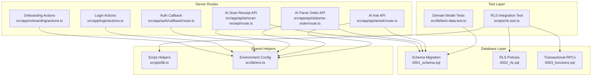
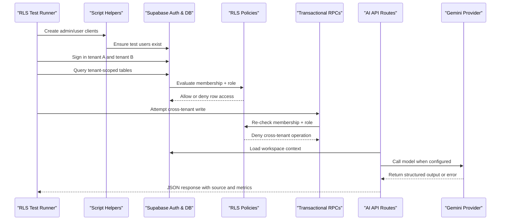
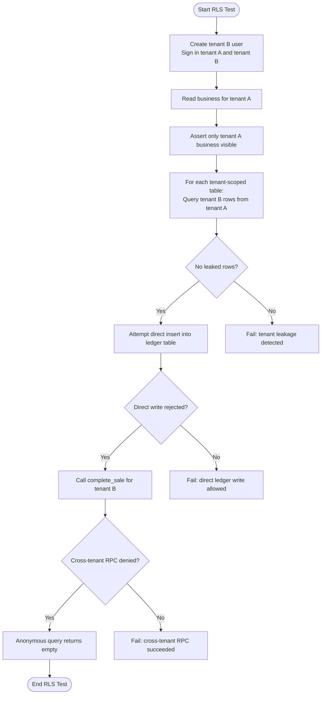
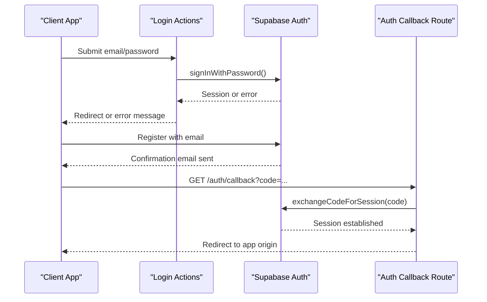
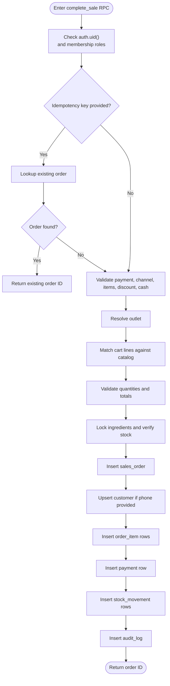
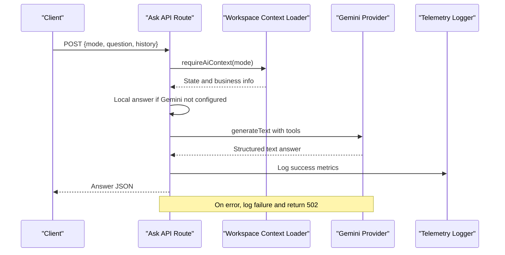
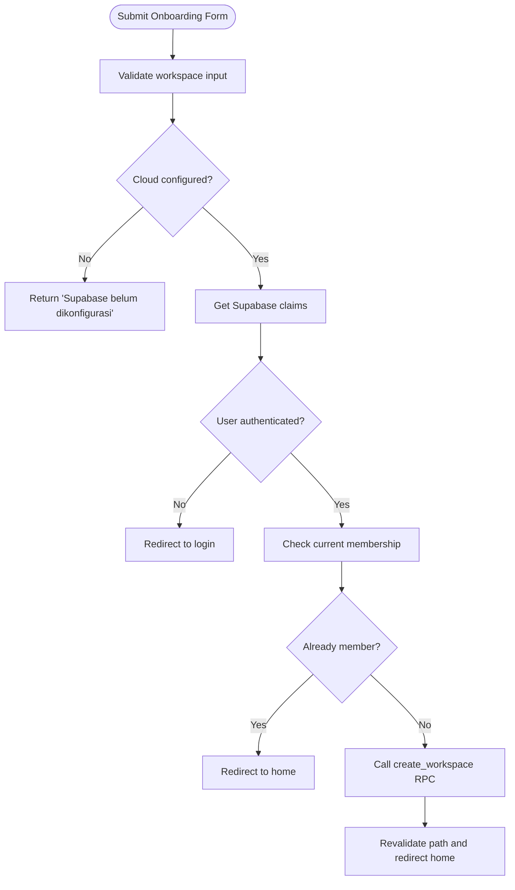
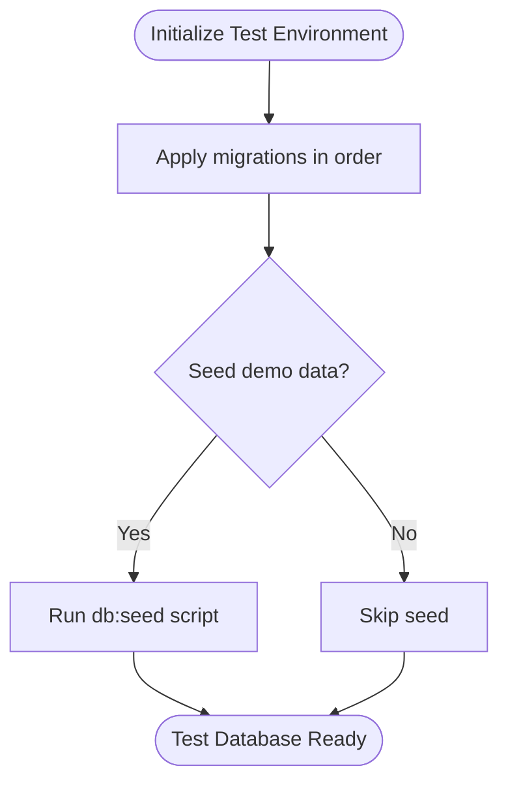
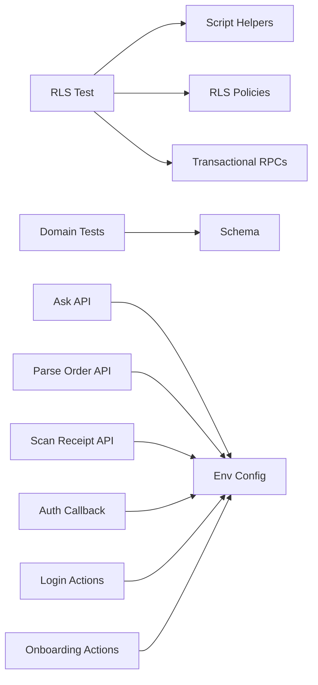

# Integration Testing

<cite>
**Referenced Files in This Document**
- [package.json](file://package.json)
- [README.md](file://README.md)
- [scripts/lib.ts](file://scripts/lib.ts)
- [scripts/rls.test.ts](file://scripts/rls.test.ts)
- [src/lib/laris-data.test.ts](file://src/lib/laris-data.test.ts)
- [src/app/api/ai/ask/route.ts](file://src/app/api/ai/ask/route.ts)
- [src/app/api/ai/parse-order/route.ts](file://src/app/api/ai/parse-order/route.ts)
- [src/app/api/ai/scan-receipt/route.ts](file://src/app/api/ai/scan-receipt/route.ts)
- [supabase/migrations/0001_schema.sql](file://supabase/migrations/0001_schema.sql)
- [supabase/migrations/0002_rls.sql](file://supabase/migrations/0002_rls.sql)
- [supabase/migrations/0003_functions.sql](file://supabase/migrations/0003_functions.sql)
- [src/app/auth/callback/route.ts](file://src/app/auth/callback/route.ts)
- [src/app/login/actions.ts](file://src/app/login/actions.ts)
- [src/app/onboarding/actions.ts](file://src/app/onboarding/actions.ts)
- [src/lib/env.ts](file://src/lib/env.ts)
</cite>

## Table of Contents
1. [Introduction](#introduction)
2. [Project Structure](#project-structure)
3. [Core Components](#core-components)
4. [Architecture Overview](#architecture-overview)
5. [Detailed Component Analysis](#detailed-component-analysis)
6. [Dependency Analysis](#dependency-analysis)
7. [Performance Considerations](#performance-considerations)
8. [Troubleshooting Guide](#troubleshooting-guide)
9. [Conclusion](#conclusion)

## Introduction
This document explains how to test the Laris application end-to-end, focusing on integration testing for API endpoints, database transactions, Row-Level Security isolation, Supabase authentication flows, server actions, and multi-service interactions with AI providers. It also provides guidance for mocking external services, setting up a test database, rolling back test state, and planning performance and stress tests for production readiness.

The repository already includes:
- A Node-based RLS integration test that signs in tenant users and asserts tenant isolation and role-based access control.
- Unit-style integration tests for the local business domain model, including checkout, stock ledger, purchases, CSV export, and parser behavior.
- Server-side API routes for AI features that integrate with Gemini or fall back to deterministic local logic.
- Database migrations defining schema, Row-Level Security policies, and transactional RPC functions.

## Project Structure
The integration testing surface spans several layers:

- Test runner and scripts: `scripts/rls.test.ts` and `scripts/lib.ts`.
- Domain model tests: `src/lib/laris-data.test.ts`.
- API route handlers: `src/app/api/ai/*`.
- Authentication callbacks and server actions: `src/app/auth/callback/route.ts`, `src/app/login/actions.ts`, `src/app/onboarding/actions.ts`.
- Environment configuration: `src/lib/env.ts`.
- Database layer: `supabase/migrations/0001_schema.sql`, `0002_rls.sql`, `0003_functions.sql`.
- Project metadata and scripts: `package.json`, `README.md`.

**Diagram sources**
- [scripts/rls.test.ts:1-89](file://scripts/rls.test.ts#L1-L89)
- [scripts/lib.ts:1-57](file://scripts/lib.ts#L1-L57)
- [src/lib/laris-data.test.ts:1-519](file://src/lib/laris-data.test.ts#L1-L519)
- [src/app/api/ai/ask/route.ts:1-218](file://src/app/api/ai/ask/route.ts#L1-L218)
- [src/app/api/ai/parse-order/route.ts:1-128](file://src/app/api/ai/parse-order/route.ts#L1-L128)
- [src/app/api/ai/scan-receipt/route.ts:1-216](file://src/app/api/ai/scan-receipt/route.ts#L1-L216)
- [supabase/migrations/0001_schema.sql:1-294](file://supabase/migrations/0001_schema.sql#L1-L294)
- [supabase/migrations/0002_rls.sql:1-131](file://supabase/migrations/0002_rls.sql#L1-L131)
- [supabase/migrations/0003_functions.sql:1-320](file://supabase/migrations/0003_functions.sql#L1-L320)
- [src/app/auth/callback/route.ts:1-18](file://src/app/auth/callback/route.ts#L1-L18)
- [src/app/login/actions.ts:1-108](file://src/app/login/actions.ts#L1-L108)
- [src/app/onboarding/actions.ts:1-60](file://src/app/onboarding/actions.ts#L1-L60)
- [src/lib/env.ts:1-29](file://src/lib/env.ts#L1-L29)

**Section sources**
- [package.json:1-39](file://package.json#L1-L39)
- [README.md:1-118](file://README.md#L1-L118)

## Core Components
This section summarizes the main integration testing components and their responsibilities.

- RLS integration test (`scripts/rls.test.ts`)
  - Signs in two tenants using Supabase client credentials.
  - Verifies tenant A cannot read tenant B rows across multiple tables.
  - Verifies ledger tables reject direct client writes.
  - Verifies cross-tenant writes fail through both direct inserts and RPC calls.
  - Verifies anonymous users see no data.

- Script helpers (`scripts/lib.ts`)
  - Provides admin and user Supabase clients.
  - Ensures required environment variables are present.
  - Creates or resets test users via Supabase Admin API.

- Domain model tests (`src/lib/laris-data.test.ts`)
  - Validates seed determinism, catalog integrity, stock calculations, checkout atomicity, purchase updates, moving-average cost, customer loyalty updates, parser behavior, and CSV safety.

- AI API routes
  - `/api/ai/ask`: Business Q&A with optional Gemini tools; falls back to local rules.
  - `/api/ai/parse-order`: Voice/text order parsing with Gemini or deterministic fallback.
  - `/api/ai/scan-receipt`: OCR receipt scanning with Gemini or mock/local fallback.

- Authentication and server actions
  - Auth callback exchanges code for session and redirects.
  - Login actions handle sign-in, sign-up, password reset, update password, and demo judge sign-in.
  - Onboarding actions create workspace and optionally seed starter catalog.

- Database migrations
  - Schema defines tenancy, catalog, inventory, sales, payments, stock movements, purchases, expenses, audit, and AI telemetry.
  - RLS enables row-level security and policies for membership, roles, and table operations.
  - Transactional RPCs enforce membership, validate inputs, compute prices/costs server-side, and write atomically.

**Section sources**
- [scripts/rls.test.ts:1-89](file://scripts/rls.test.ts#L1-L89)
- [scripts/lib.ts:1-57](file://scripts/lib.ts#L1-L57)
- [src/lib/laris-data.test.ts:1-519](file://src/lib/laris-data.test.ts#L1-L519)
- [src/app/api/ai/ask/route.ts:1-218](file://src/app/api/ai/ask/route.ts#L1-L218)
- [src/app/api/ai/parse-order/route.ts:1-128](file://src/app/api/ai/parse-order/route.ts#L1-L128)
- [src/app/api/ai/scan-receipt/route.ts:1-216](file://src/app/api/ai/scan-receipt/route.ts#L1-L216)
- [supabase/migrations/0001_schema.sql:1-294](file://supabase/migrations/0001_schema.sql#L1-L294)
- [supabase/migrations/0002_rls.sql:1-131](file://supabase/migrations/0002_rls.sql#L1-L131)
- [supabase/migrations/0003_functions.sql:1-320](file://supabase/migrations/0003_functions.sql#L1-L320)
- [src/app/auth/callback/route.ts:1-18](file://src/app/auth/callback/route.ts#L1-L18)
- [src/app/login/actions.ts:1-108](file://src/app/login/actions.ts#L1-L108)
- [src/app/onboarding/actions.ts:1-60](file://src/app/onboarding/actions.ts#L1-L60)

## Architecture Overview
The integration architecture connects test runners, Next.js server routes, Supabase authentication, database policies, and optional AI provider services.

**Diagram sources**
- [scripts/rls.test.ts:1-89](file://scripts/rls.test.ts#L1-L89)
- [scripts/lib.ts:1-57](file://scripts/lib.ts#L1-L57)
- [supabase/migrations/0002_rls.sql:1-131](file://supabase/migrations/0002_rls.sql#L1-L131)
- [supabase/migrations/0003_functions.sql:1-320](file://supabase/migrations/0003_functions.sql#L1-L320)
- [src/app/api/ai/ask/route.ts:1-218](file://src/app/api/ai/ask/route.ts#L1-L218)
- [src/app/api/ai/parse-order/route.ts:1-128](file://src/app/api/ai/parse-order/route.ts#L1-L128)
- [src/app/api/ai/scan-receipt/route.ts:1-216](file://src/app/api/ai/scan-receipt/route.ts#L1-L216)

## Detailed Component Analysis

### Row-Level Security Testing Methodology
The RLS test validates tenant isolation and role-based access by exercising real Supabase clients under policy enforcement.

Key testing strategies:
- Tenant isolation: Assert tenant A sees only its own business and cannot read tenant B rows across all relevant tables.
- Ledger protection: Assert direct client inserts into ledger tables fail; writes must go through RPCs.
- Cross-tenant RPC denial: Assert RPC calls targeting another tenant’s business are denied.
- Anonymous isolation: Assert unauthenticated requests return no data.

**Diagram sources**
- [scripts/rls.test.ts:1-89](file://scripts/rls.test.ts#L1-L89)
- [supabase/migrations/0002_rls.sql:1-131](file://supabase/migrations/0002_rls.sql#L1-L131)
- [supabase/migrations/0003_functions.sql:1-320](file://supabase/migrations/0003_functions.sql#L1-L320)

**Section sources**
- [scripts/rls.test.ts:1-89](file://scripts/rls.test.ts#L1-L89)
- [supabase/migrations/0002_rls.sql:1-131](file://supabase/migrations/0002_rls.sql#L1-L131)
- [supabase/migrations/0003_functions.sql:1-320](file://supabase/migrations/0003_functions.sql#L1-L320)

### Supabase Authentication Flow Testing
Authentication is handled by server actions and an auth callback route. Integration tests should cover:
- Successful sign-in and redirect.
- Registration with email confirmation flow.
- Password reset link generation and token-based password update.
- Demo judge sign-in when configured.
- Error mapping for invalid credentials, rate limits, network failures, and weak passwords.

**Diagram sources**
- [src/app/login/actions.ts:1-108](file://src/app/login/actions.ts#L1-L108)
- [src/app/auth/callback/route.ts:1-18](file://src/app/auth/callback/route.ts#L1-L18)

**Section sources**
- [src/app/login/actions.ts:1-108](file://src/app/login/actions.ts#L1-L108)
- [src/app/auth/callback/route.ts:1-18](file://src/app/auth/callback/route.ts#L1-L18)

### Database Transactions and RPC Testing
Transactional RPCs ensure atomicity for critical operations like sales and purchases. Integration tests should assert:
- Membership and role checks inside RPCs.
- Idempotency key behavior for concurrent retries.
- Stock validation before committing changes.
- Atomic insertion of orders, items, payments, and stock movements.
- Audit log creation after successful operations.

**Diagram sources**
- [supabase/migrations/0003_functions.sql:94-230](file://supabase/migrations/0003_functions.sql#L94-L230)

**Section sources**
- [supabase/migrations/0003_functions.sql:1-320](file://supabase/migrations/0003_functions.sql#L1-L320)

### AI API Route Integration Testing
The AI routes support cloud mode (Gemini) and local fallbacks. Integration tests should cover:
- Input validation and size limits.
- Workspace context loading.
- Gemini tool execution and structured outputs.
- Fallback behavior when Gemini is unavailable.
- Telemetry logging for success and failure paths.

**Diagram sources**
- [src/app/api/ai/ask/route.ts:1-218](file://src/app/api/ai/ask/route.ts#L1-L218)

**Section sources**
- [src/app/api/ai/ask/route.ts:1-218](file://src/app/api/ai/ask/route.ts#L1-L218)
- [src/app/api/ai/parse-order/route.ts:1-128](file://src/app/api/ai/parse-order/route.ts#L1-L128)
- [src/app/api/ai/scan-receipt/route.ts:1-216](file://src/app/api/ai/scan-receipt/route.ts#L1-L216)

### Server Action and Onboarding Testing
Server actions validate form data, interact with Supabase, and perform redirects. Integration tests should assert:
- Form validation errors are returned without side effects.
- Cloud configuration check prevents operations when Supabase is not configured.
- Onboarding creates workspace and optionally seeds starter catalog.
- Membership checks prevent duplicate onboarding.

**Diagram sources**
- [src/app/onboarding/actions.ts:1-60](file://src/app/onboarding/actions.ts#L1-L60)

**Section sources**
- [src/app/onboarding/actions.ts:1-60](file://src/app/onboarding/actions.ts#L1-L60)
- [src/app/login/actions.ts:1-108](file://src/app/login/actions.ts#L1-L108)

### Mock Strategies for External Services
Recommended strategies:
- Gemini provider
  - Use environment flags to toggle cloud vs local modes.
  - For offline tests, assert local parser and local answer behavior.
  - For online tests, use controlled fixtures and stubbed responses where possible.
- Supabase Admin API
  - Use service-role key only in server-side scripts.
  - Create and reset test users deterministically.
- File uploads
  - Validate MIME types and size limits.
  - Provide small base64 payloads for unit-style integration tests.

**Section sources**
- [src/app/api/ai/parse-order/route.ts:1-128](file://src/app/api/ai/parse-order/route.ts#L1-L128)
- [src/app/api/ai/scan-receipt/route.ts:1-216](file://src/app/api/ai/scan-receipt/route.ts#L1-L216)
- [scripts/lib.ts:1-57](file://scripts/lib.ts#L1-L57)

### Test Database Setup and Seed Strategy
Recommended setup:
- Apply migrations in order: schema, RLS, functions, workspaces, hardening.
- Seed demo data only in development environments.
- Use separate `.env` files for development and CI.
- Ensure service-role key is available only on the server.

**Diagram sources**
- [README.md:37-50](file://README.md#L37-L50)
- [package.json:1-39](file://package.json#L1-L39)

**Section sources**
- [README.md:37-50](file://README.md#L37-L50)
- [package.json:1-39](file://package.json#L1-L39)

### Transaction Rollback Procedures
Because the RLS test uses real Supabase clients and policies, rollback is enforced at the database level:
- Direct client writes to ledger tables are blocked by RLS.
- RPCs run in single transactions and raise exceptions on validation or stock shortage.
- Idempotency keys prevent duplicate commits under concurrency.

For future local integration tests:
- Wrap test cases in database transactions where supported.
- Use savepoints for nested operations.
- Always roll back or delete created test entities in teardown hooks.

**Section sources**
- [supabase/migrations/0002_rls.sql:1-131](file://supabase/migrations/0002_rls.sql#L1-L131)
- [supabase/migrations/0003_functions.sql:94-230](file://supabase/migrations/0003_functions.sql#L94-L230)

### Concurrent User Scenarios
Concurrency concerns include:
- Duplicate checkout retries with idempotency keys.
- Race conditions on stock reservations.
- Customer upserts during simultaneous sales.

Testing recommendations:
- Send concurrent requests with identical idempotency keys and assert only one order is created.
- Simulate competing stock consumption and assert stock never goes negative.
- Validate customer loyalty counters remain consistent after concurrent visits.

**Section sources**
- [supabase/migrations/0003_functions.sql:127-190](file://supabase/migrations/0003_functions.sql#L127-L190)

## Dependency Analysis
Integration dependencies connect tests, server routes, database policies, and optional AI providers.

**Diagram sources**
- [scripts/rls.test.ts:1-89](file://scripts/rls.test.ts#L1-L89)
- [scripts/lib.ts:1-57](file://scripts/lib.ts#L1-L57)
- [supabase/migrations/0002_rls.sql:1-131](file://supabase/migrations/0002_rls.sql#L1-L131)
- [supabase/migrations/0003_functions.sql:1-320](file://supabase/migrations/0003_functions.sql#L1-L320)
- [src/lib/laris-data.test.ts:1-519](file://src/lib/laris-data.test.ts#L1-L519)
- [src/app/api/ai/ask/route.ts:1-218](file://src/app/api/ai/ask/route.ts#L1-L218)
- [src/app/api/ai/parse-order/route.ts:1-128](file://src/app/api/ai/parse-order/route.ts#L1-L128)
- [src/app/api/ai/scan-receipt/route.ts:1-216](file://src/app/api/ai/scan-receipt/route.ts#L1-L216)
- [src/app/auth/callback/route.ts:1-18](file://src/app/auth/callback/route.ts#L1-L18)
- [src/app/login/actions.ts:1-108](file://src/app/login/actions.ts#L1-L108)
- [src/app/onboarding/actions.ts:1-60](file://src/app/onboarding/actions.ts#L1-L60)
- [src/lib/env.ts:1-29](file://src/lib/env.ts#L1-L29)

**Section sources**
- [scripts/rls.test.ts:1-89](file://scripts/rls.test.ts#L1-L89)
- [scripts/lib.ts:1-57](file://scripts/lib.ts#L1-L57)
- [src/lib/laris-data.test.ts:1-519](file://src/lib/laris-data.test.ts#L1-L519)
- [src/app/api/ai/ask/route.ts:1-218](file://src/app/api/ai/ask/route.ts#L1-L218)
- [src/app/api/ai/parse-order/route.ts:1-128](file://src/app/api/ai/parse-order/route.ts#L1-L128)
- [src/app/api/ai/scan-receipt/route.ts:1-216](file://src/app/api/ai/scan-receipt/route.ts#L1-L216)
- [src/app/auth/callback/route.ts:1-18](file://src/app/auth/callback/route.ts#L1-L18)
- [src/app/login/actions.ts:1-108](file://src/app/login/actions.ts#L1-L108)
- [src/app/onboarding/actions.ts:1-60](file://src/app/onboarding/actions.ts#L1-L60)
- [src/lib/env.ts:1-29](file://src/lib/env.ts#L1-L29)

## Performance Considerations
Guidance for performance and stress testing:
- Large datasets
  - Add indexes for frequently queried columns such as business_id, created_at, and foreign keys.
  - Partition large tables by time ranges if necessary.
  - Measure query latency for tenant-scoped reads and ledger aggregations.
- AI provider load
  - Rate-limit Gemini calls and implement retry/backoff.
  - Cache workspace context where safe.
  - Monitor telemetry for latency and error rates.
- Concurrency
  - Stress-test idempotent checkout with many concurrent retries.
  - Validate stock reservation under high contention.
- Observability
  - Track latency, throughput, and error rates for API routes.
  - Export metrics for database queries and AI provider calls.

[No sources needed since this section provides general guidance]

## Troubleshooting Guide
Common issues and resolutions:
- Missing environment variables
  - Ensure Supabase URL, publishable key, app origin, and service-role key are set.
  - For AI features, configure Gemini API key and model settings.
- RLS test failures
  - Confirm all migrations are applied.
  - Verify seed data exists for demo tenant.
  - Check that service-role key is available for admin operations.
- Authentication errors
  - Map Supabase error messages to user-friendly messages.
  - Verify site URL and redirect URLs in Supabase Auth.
- AI route errors
  - Validate request size and MIME type constraints.
  - Handle Gemini timeouts and fallback to local parsers.

**Section sources**
- [src/lib/env.ts:1-29](file://src/lib/env.ts#L1-L29)
- [scripts/rls.test.ts:1-89](file://scripts/rls.test.ts#L1-L89)
- [src/app/api/ai/parse-order/route.ts:1-128](file://src/app/api/ai/parse-order/route.ts#L1-L128)
- [src/app/api/ai/scan-receipt/route.ts:1-216](file://src/app/api/ai/scan-receipt/route.ts#L1-L216)
- [src/app/login/actions.ts:1-108](file://src/app/login/actions.ts#L1-L108)

## Conclusion
Laris integrates robust testing across RLS isolation, database transactions, authentication flows, server actions, and AI-powered APIs. The existing RLS test and domain model tests provide a strong foundation. Extending these with concurrency scenarios, performance benchmarks, and controlled mocks for external services will improve confidence for production deployments. Follow the migration order, secure environment variables, and rely on transactional RPCs to maintain data integrity under load.

[No sources needed since this section summarizes without analyzing specific files]