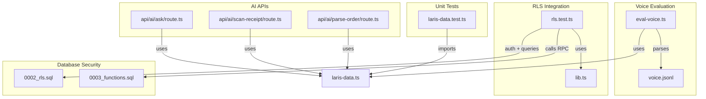
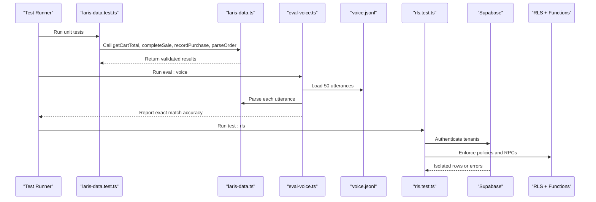
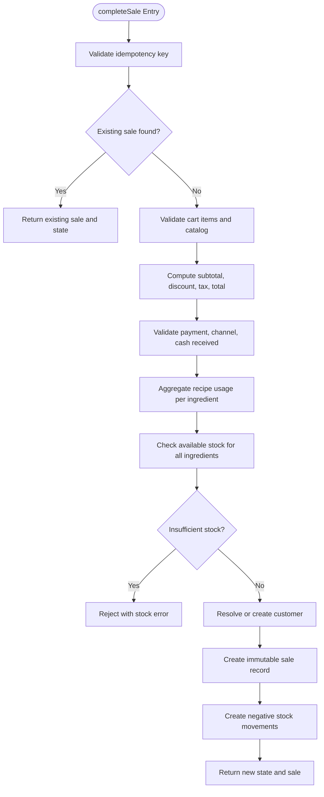
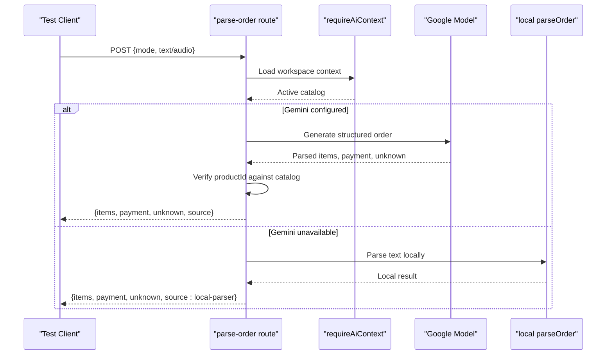
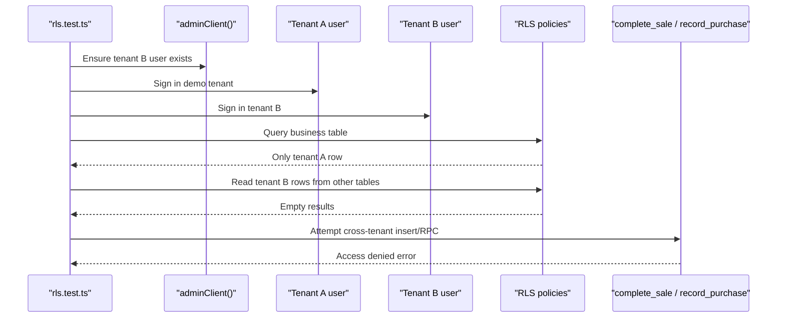
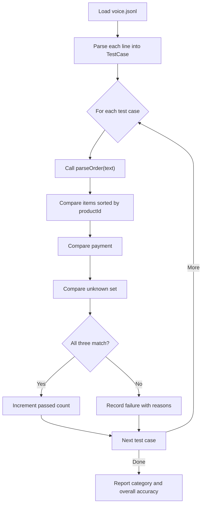
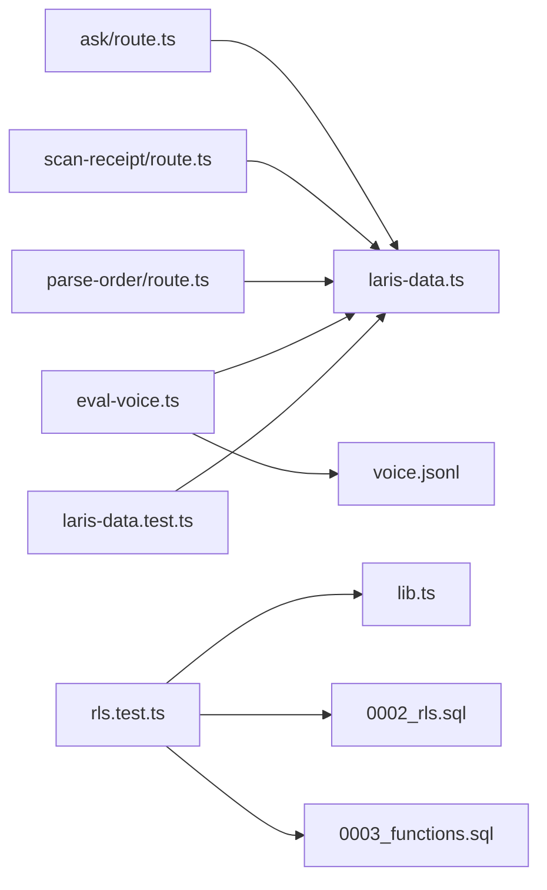

# Testing Strategy

<cite>
**Referenced Files in This Document**
- [README.md](file://README.md)
- [package.json](file://package.json)
- [src/lib/laris-data.ts](file://src/lib/laris-data.ts)
- [src/lib/laris-data.test.ts](file://src/lib/laris-data.test.ts)
- [scripts/rls.test.ts](file://scripts/rls.test.ts)
- [scripts/lib.ts](file://scripts/lib.ts)
- [supabase/migrations/0002_rls.sql](file://supabase/migrations/0002_rls.sql)
- [supabase/migrations/0003_functions.sql](file://supabase/migrations/0003_functions.sql)
- [evals/voice.jsonl](file://evals/voice.jsonl)
- [scripts/eval-voice.ts](file://scripts/eval-voice.ts)
- [src/app/api/ai/parse-order/route.ts](file://src/app/api/ai/parse-order/route.ts)
- [src/app/api/ai/scan-receipt/route.ts](file://src/app/api/ai/scan-receipt/route.ts)
- [src/app/api/ai/ask/route.ts](file://src/app/api/ai/ask/route.ts)
</cite>

## Table of Contents
1. [Introduction](#introduction)
2. [Project Structure](#project-structure)
3. [Core Components](#core-components)
4. [Architecture Overview](#architecture-overview)
5. [Detailed Component Analysis](#detailed-component-analysis)
6. [Dependency Analysis](#dependency-analysis)
7. [Performance Considerations](#performance-considerations)
8. [Troubleshooting Guide](#troubleshooting-guide)
9. [Conclusion](#conclusion)

## Introduction
This document explains the testing strategy for Laris, an Indonesian F&B operational workspace. It covers unit testing for business logic, integration testing for API endpoints and database transactions, voice recognition evaluation using a 50-utterance Indonesian dataset, Row-Level Security verification for tenant isolation and role-based access control, mock strategies for external AI services, continuous integration guidance, performance testing approaches, and debugging techniques for AI failures and database transaction issues.

The repository uses Node’s native test runner with TypeScript type stripping, Supabase migrations for schema and security, and deterministic seed data to keep tests reproducible. The README documents the full verification pipeline: type checking, linting, unit tests, voice evaluation, and build.

**Section sources**
- [README.md:75-87](file://README.md#L75-L87)
- [package.json:5-14](file://package.json#L5-L14)

## Project Structure
Testing-related code is organized by concern:

- Unit tests for domain logic live under `src/lib/laris-data.test.ts`.
- Voice benchmark evaluation lives under `scripts/eval-voice.ts` and reads `evals/voice.jsonl`.
- Row-Level Security integration tests live under `scripts/rls.test.ts`, using shared helpers in `scripts/lib.ts`.
- Database security and atomic operations are defined in `supabase/migrations/0002_rls.sql` and `supabase/migrations/0003_functions.sql`.
- AI service integrations are exposed through Next.js API routes under `src/app/api/ai`.

**Diagram sources**
- [src/lib/laris-data.test.ts:1-11](file://src/lib/laris-data.test.ts#L1-L11)
- [scripts/eval-voice.ts:10-13](file://scripts/eval-voice.ts#L10-L13)
- [scripts/rls.test.ts:3-10](file://scripts/rls.test.ts#L3-L10)
- [scripts/lib.ts:1-34](file://scripts/lib.ts#L1-L34)
- [supabase/migrations/0002_rls.sql:1-8](file://supabase/migrations/0002_rls.sql#L1-L8)
- [supabase/migrations/0003_functions.sql:1-7](file://supabase/migrations/0003_functions.sql#L1-L7)
- [src/app/api/ai/parse-order/route.ts:1-5](file://src/app/api/ai/parse-order/route.ts#L1-L5)
- [src/app/api/ai/scan-receipt/route.ts:1-5](file://src/app/api/ai/scan-receipt/route.ts#L1-L5)
- [src/app/api/ai/ask/route.ts:1-5](file://src/app/api/ai/ask/route.ts#L1-L5)

**Section sources**
- [README.md:97-109](file://README.md#L97-L109)
- [package.json:5-14](file://package.json#L5-L14)

## Core Components
The core business logic is implemented in `src/lib/laris-data.ts`. It defines domain models, deterministic seed generation, cart calculations, stock ledger updates, purchase recording with moving-average cost, customer segmentation, order parsing, CSV export, and currency formatting.

Key responsibilities:
- Deterministic seed state covering 90 days of sales, expenses, customers, and inventory.
- Cart validation and total calculation with discount rounding and optional tax.
- Atomic sale completion that validates inputs, aggregates recipe usage, checks stock, creates immutable sale records, updates stock movements, and optionally creates or updates customers.
- Purchase recording that updates inventory cost, product HPP, purchases, and stock movements.
- Indonesian order parser supporting number words, aliases, modifiers, payment detection, and unknown phrase handling.
- CSV export with formula injection neutralization and RFC 4180-safe quoting.

**Section sources**
- [src/lib/laris-data.ts:1-110](file://src/lib/laris-data.ts#L1-L110)
- [src/lib/laris-data.ts:135-194](file://src/lib/laris-data.ts#L135-L194)
- [src/lib/laris-data.ts:215-334](file://src/lib/laris-data.ts#L215-L334)
- [src/lib/laris-data.ts:336-404](file://src/lib/laris-data.ts#L336-L404)
- [src/lib/laris-data.ts:406-494](file://src/lib/laris-data.ts#L406-L494)

## Architecture Overview
Laris has three major testing layers:

1. **Unit tests**: Pure functions in `laris-data.ts` are tested directly without network or database dependencies.
2. **Integration tests**: RLS tests authenticate real users, query tables, and call server-side RPC functions to verify tenant isolation and write restrictions.
3. **Voice evaluation**: A deterministic benchmark evaluates the order parser against 50 Indonesian utterances with exact match scoring.

**Diagram sources**
- [src/lib/laris-data.test.ts:1-11](file://src/lib/laris-data.test.ts#L1-L11)
- [src/lib/laris-data.ts:135-494](file://src/lib/laris-data.ts#L135-L494)
- [scripts/eval-voice.ts:54-157](file://scripts/eval-voice.ts#L54-L157)
- [evals/voice.jsonl:1-51](file://evals/voice.jsonl#L1-L51)
- [scripts/rls.test.ts:12-88](file://scripts/rls.test.ts#L12-L88)
- [supabase/migrations/0002_rls.sql:1-131](file://supabase/migrations/0002_rls.sql#L1-L131)
- [supabase/migrations/0003_functions.sql:91-320](file://supabase/migrations/0003_functions.sql#L91-L320)

## Detailed Component Analysis

### Unit Testing Strategy for Business Logic
The unit test suite focuses on deterministic behavior, immutability, input validation, and financial correctness.

Coverage areas:
- Timestamp boundary behavior.
- Catalog integrity, image paths, ingredient costs, and recipe cost derivation.
- Seed determinism, serialization, date range, sales totals, and customer reconciliation.
- Stock computation from opening stock and signed movements.
- Currency formatting for Indonesian rupiah.
- Cart totals with discount rounding and tax after discount.
- Custom catalogs driving totals, sales, and stock.
- Shared recipe aggregation and duplicate line consolidation into one movement per ingredient.
- Input item copying and JSON persistence safety.
- Stock shortage rejection across aggregated recipes.
- Exact remaining stock sales and replenishment via purchases.
- Cash validation and rounding.
- Unsafe quantity validation.
- Unknown menu, empty cart, and overflow protection.
- Invalid discount, payment method, channel, and cash validation.
- Idempotency key deduplication across retries and persisted state.
- Purchase immutability, decimal preservation, and linked positive movement.
- Moving-average cost propagation to dependent recipes.
- Customer creation rules, phone normalization, loyalty updates, and segment transitions.
- Phone validation boundaries.
- Indonesian order parsing for aliases, number words, modifiers, payment detection, and unknown phrases.
- CSV round-trip safety, formula injection neutralization, and read-only guarantees.

**Diagram sources**
- [src/lib/laris-data.ts:215-305](file://src/lib/laris-data.ts#L215-L305)

**Section sources**
- [src/lib/laris-data.test.ts:32-116](file://src/lib/laris-data.test.ts#L32-L116)
- [src/lib/laris-data.test.ts:133-168](file://src/lib/laris-data.test.ts#L133-L168)
- [src/lib/laris-data.test.ts:170-246](file://src/lib/laris-data.test.ts#L170-L246)
- [src/lib/laris-data.test.ts:248-350](file://src/lib/laris-data.test.ts#L248-L350)
- [src/lib/laris-data.test.ts:352-410](file://src/lib/laris-data.test.ts#L352-L410)
- [src/lib/laris-data.test.ts:412-477](file://src/lib/laris-data.test.ts#L412-L477)
- [src/lib/laris-data.test.ts:479-518](file://src/lib/laris-data.test.ts#L479-L518)

### Integration Testing Approach for API Endpoints
The AI API layer provides three endpoints:

- `/api/ai/parse-order`: Parses text or audio orders, falls back to local parser when Gemini is unavailable, validates output against active catalog, and logs telemetry.
- `/api/ai/scan-receipt`: Accepts images, parses receipts via Gemini, normalizes units, maps to inventory codes, and returns processed lines with price change hints.
- `/api/ai/ask`: Provides business insights using tools over workspace data, with local rule-based answers when Gemini is unavailable.

Recommended integration test patterns:
- Validate request schemas using Zod-defined constraints.
- Assert correct fallback behavior when AI model is missing.
- Assert successful structured output when AI model is present.
- Assert telemetry logging for both success and failure paths.
- Assert catalog scoping so only active products are accepted.
- For receipt scanning, assert unit normalization, skipped lines, and safe numeric rounding.

**Diagram sources**
- [src/app/api/ai/parse-order/route.ts:31-127](file://src/app/api/ai/parse-order/route.ts#L31-L127)
- [src/lib/laris-data.ts:436-474](file://src/lib/laris-data.ts#L436-L474)

**Section sources**
- [src/app/api/ai/parse-order/route.ts:1-128](file://src/app/api/ai/parse-order/route.ts#L1-L128)
- [src/app/api/ai/scan-receipt/route.ts:1-216](file://src/app/api/ai/scan-receipt/route.ts#L1-L216)
- [src/app/api/ai/ask/route.ts:1-218](file://src/app/api/ai/ask/route.ts#L1-L218)

### Database Transaction and RLS Integration Testing
Row-Level Security ensures tenant isolation and role-based access. The migration enables RLS on all relevant tables, defines membership checks, restricts direct client writes to ledger tables, and exposes secure RPC functions for atomic operations.

Integration test responsibilities:
- Sign in as two tenants.
- Confirm tenant A sees only its own business.
- Confirm tenant A cannot read tenant B rows across all monitored tables.
- Confirm tenant B cannot read tenant A sales or customers.
- Confirm direct client writes to ledger tables fail.
- Confirm cross-tenant writes via RPC fail with access denied.
- Confirm anonymous users see nothing.

**Diagram sources**
- [scripts/rls.test.ts:12-88](file://scripts/rls.test.ts#L12-L88)
- [scripts/lib.ts:26-34](file://scripts/lib.ts#L26-L34)
- [supabase/migrations/0002_rls.sql:10-131](file://supabase/migrations/0002_rls.sql#L10-L131)
- [supabase/migrations/0003_functions.sql:91-230](file://supabase/migrations/0003_functions.sql#L91-L230)

**Section sources**
- [scripts/rls.test.ts:1-89](file://scripts/rls.test.ts#L1-L89)
- [scripts/lib.ts:1-57](file://scripts/lib.ts#L1-L57)
- [supabase/migrations/0002_rls.sql:1-131](file://supabase/migrations/0002_rls.sql#L1-L131)
- [supabase/migrations/0003_functions.sql:1-320](file://supabase/migrations/0003_functions.sql#L1-L320)

### Voice Recognition Evaluation Framework
The voice evaluation framework loads 50 Indonesian utterances from `evals/voice.jsonl`, runs each through `parseOrder`, and measures exact match accuracy across items, payment, and unknown phrases. The PRD target is at least 90% exact match.

Evaluation details:
- Loads JSONL lines and parses them into test cases.
- Sorts and compares items by productId, quantity, and note.
- Compares payment exactly.
- Compares unknown phrases case-insensitively and trims whitespace.
- Tracks category-level statistics.
- Reports overall exact match percentage and fails if below 90%.

**Diagram sources**
- [scripts/eval-voice.ts:54-157](file://scripts/eval-voice.ts#L54-L157)
- [evals/voice.jsonl:1-51](file://evals/voice.jsonl#L1-L51)
- [src/lib/laris-data.ts:436-474](file://src/lib/laris-data.ts#L436-L474)

**Section sources**
- [scripts/eval-voice.ts:1-164](file://scripts/eval-voice.ts#L1-L164)
- [evals/voice.jsonl:1-51](file://evals/voice.jsonl#L1-L51)
- [README.md:85-86](file://README.md#L85-L86)

### Practical Examples of Test Case Writing
When writing new tests:

- Use deterministic state where possible.
- Freeze input objects to ensure immutability is preserved.
- Assert both success paths and error paths.
- Validate financial rounding and currency formatting.
- Validate edge cases such as empty carts, unsafe quantities, invalid phones, and unknown menus.
- For API tests, validate request schemas, fallback behavior, and telemetry outcomes.
- For RLS tests, always test both allowed and denied operations.

Example patterns already present in the repository:
- Cart validation and totals.
- Sale completion with shared recipes and stock aggregation.
- Idempotency key deduplication.
- Purchase moving-average cost propagation.
- Customer phone normalization and loyalty updates.
- Order parser alias and modifier handling.
- CSV safety against formula injection.

**Section sources**
- [src/lib/laris-data.test.ts:146-168](file://src/lib/laris-data.test.ts#L146-L168)
- [src/lib/laris-data.test.ts:170-246](file://src/lib/laris-data.test.ts#L170-L246)
- [src/lib/laris-data.test.ts:290-350](file://src/lib/laris-data.test.ts#L290-L350)
- [src/lib/laris-data.test.ts:363-410](file://src/lib/laris-data.test.ts#L363-L410)
- [src/lib/laris-data.test.ts:412-477](file://src/lib/laris-data.test.ts#L412-L477)
- [src/lib/laris-data.test.ts:479-518](file://src/lib/laris-data.test.ts#L479-L518)

### Mock Strategies for External Services
External services include Google Gemini for voice parsing, OCR, and business Q&A.

Recommended strategies:
- Prefer deterministic local parser fallbacks for non-AI scenarios.
- For API tests, assert fallback responses when Gemini is unavailable.
- For AI-enabled tests, use environment variables to enable or disable Gemini.
- For receipt scanning, assert mock OCR output in local mode and structured parsed output in cloud mode.
- For ask endpoint, assert tool calls and local rule-based answers when Gemini is disabled.
- Avoid mocking HTTP clients unless necessary; instead, rely on environment configuration and response assertions.

Current implementation supports:
- Local parser fallback in parse-order.
- Mock OCR output in scan-receipt local mode.
- Local rule-based answers in ask when Gemini is unavailable.
- Telemetry logging for both success and failure paths.

**Section sources**
- [src/app/api/ai/parse-order/route.ts:64-68](file://src/app/api/ai/parse-order/route.ts#L64-L68)
- [src/app/api/ai/parse-order/route.ts:113-126](file://src/app/api/ai/parse-order/route.ts#L113-L126)
- [src/app/api/ai/scan-receipt/route.ts:109-134](file://src/app/api/ai/scan-receipt/route.ts#L109-L134)
- [src/app/api/ai/ask/route.ts:93-94](file://src/app/api/ai/ask/route.ts#L93-L94)

### Continuous Integration Setup
A practical CI pipeline should execute the same commands documented in the README:

1. Install dependencies.
2. Type-check with TypeScript.
3. Run linting.
4. Run unit tests.
5. Run voice evaluation.
6. Run RLS integration tests against a staging Supabase project.
7. Build the application.

CI recommendations:
- Store Supabase URL, publishable key, service-role key, and demo credentials securely.
- Run RLS tests only against a dedicated development or staging database.
- Restore database state before RLS tests using the seed script.
- Fail the pipeline if voice evaluation accuracy drops below 90%.
- Cache dependency installation to speed up builds.
- Parallelize unit tests and voice evaluation where possible.

**Section sources**
- [README.md:75-87](file://README.md#L75-L87)
- [package.json:5-14](file://package.json#L5-L14)

## Dependency Analysis
The testing system depends on several modules:

- Unit tests depend on `laris-data.ts`.
- Voice evaluation depends on `laris-data.ts` and `voice.jsonl`.
- RLS tests depend on Supabase clients, environment variables, and database policies.
- AI API routes depend on `laris-data.ts`, AI SDK, Zod, and environment configuration.

**Diagram sources**
- [src/lib/laris-data.test.ts:1-11](file://src/lib/laris-data.test.ts#L1-L11)
- [scripts/eval-voice.ts:10-13](file://scripts/eval-voice.ts#L10-L13)
- [scripts/rls.test.ts:3-10](file://scripts/rls.test.ts#L3-L10)
- [scripts/lib.ts:1-34](file://scripts/lib.ts#L1-L34)
- [supabase/migrations/0002_rls.sql:1-131](file://supabase/migrations/0002_rls.sql#L1-L131)
- [supabase/migrations/0003_functions.sql:1-320](file://supabase/migrations/0003_functions.sql#L1-L320)
- [src/app/api/ai/parse-order/route.ts:1-5](file://src/app/api/ai/parse-order/route.ts#L1-L5)
- [src/app/api/ai/scan-receipt/route.ts:1-5](file://src/app/api/ai/scan-receipt/route.ts#L1-L5)
- [src/app/api/ai/ask/route.ts:1-5](file://src/app/api/ai/ask/route.ts#L1-L5)

**Section sources**
- [src/lib/laris-data.ts:1-494](file://src/lib/laris-data.ts#L1-L494)
- [scripts/eval-voice.ts:1-164](file://scripts/eval-voice.ts#L1-L164)
- [scripts/rls.test.ts:1-89](file://scripts/rls.test.ts#L1-L89)
- [scripts/lib.ts:1-57](file://scripts/lib.ts#L1-L57)
- [supabase/migrations/0002_rls.sql:1-131](file://supabase/migrations/0002_rls.sql#L1-L131)
- [supabase/migrations/0003_functions.sql:1-320](file://supabase/migrations/0003_functions.sql#L1-L320)
- [src/app/api/ai/parse-order/route.ts:1-128](file://src/app/api/ai/parse-order/route.ts#L1-L128)
- [src/app/api/ai/scan-receipt/route.ts:1-216](file://src/app/api/ai/scan-receipt/route.ts#L1-L216)
- [src/app/api/ai/ask/route.ts:1-218](file://src/app/api/ai/ask/route.ts#L1-L218)

## Performance Considerations
Performance testing should cover:

- Large datasets: Validate CSV export and report generation against seeded historical data.
- Concurrent checkout: Verify idempotency keys prevent duplicate sales in both in-memory state and database RPC.
- Stock contention: Verify stock shortage validation prevents overselling when multiple ingredients are consumed together.
- AI latency: Measure parse-order, scan-receipt, and ask endpoint latency and fallback behavior under load.
- Voice evaluation throughput: Ensure the 50-utterance benchmark completes reliably and consistently.

Recommendations:
- Use deterministic seed data for repeatable performance baselines.
- Separate unit benchmarks from integration benchmarks.
- Monitor AI service timeouts and fallback durations.
- Add concurrency tests for RPC functions that update stock and audit logs.
- Track memory usage for large base64 audio and image payloads.

[No sources needed since this section provides general guidance]

## Troubleshooting Guide
Common issues and debugging techniques:

- AI model unavailable:
  - Verify environment variables for Gemini.
  - Assert fallback parser or mock OCR behavior.
  - Check telemetry logs for failed requests.

- Voice evaluation accuracy below target:
  - Review failing utterances in the evaluation output.
  - Check alias mapping, number word support, and modifier normalization.
  - Update parser rules or expected dataset entries carefully.

- RLS policy violations:
  - Confirm all migrations are applied.
  - Verify tenant users exist and are signed in.
  - Check membership roles and policy conditions.
  - Confirm direct client writes to ledger tables are blocked.

- Database transaction failures:
  - Inspect RPC error messages for stock shortages, invalid payments, or invalid channels.
  - Verify idempotency key uniqueness and concurrent retry behavior.
  - Confirm audit log insertion succeeds after successful operations.

- CSV export anomalies:
  - Validate formula injection neutralization.
  - Check quoted fields, commas, quotes, and newlines.
  - Ensure export remains read-only.

**Section sources**
- [src/app/api/ai/parse-order/route.ts:113-126](file://src/app/api/ai/parse-order/route.ts#L113-L126)
- [src/app/api/ai/scan-receipt/route.ts:203-214](file://src/app/api/ai/scan-receipt/route.ts#L203-L214)
- [src/app/api/ai/ask/route.ts:205-216](file://src/app/api/ai/ask/route.ts#L205-L216)
- [scripts/rls.test.ts:63-83](file://scripts/rls.test.ts#L63-L83)
- [supabase/migrations/0003_functions.sql:123-229](file://supabase/migrations/0003_functions.sql#L123-L229)
- [src/lib/laris-data.test.ts:479-518](file://src/lib/laris-data.test.ts#L479-L518)

## Conclusion
Laris’s testing strategy combines deterministic unit tests, strict integration tests for RLS and database transactions, and a focused voice evaluation benchmark. The architecture emphasizes safety: immutable state changes, validated inputs, atomic server-side operations, tenant isolation, and graceful fallbacks for AI services. By following the patterns shown here, teams can extend coverage confidently, maintain financial correctness, protect multi-tenant data, and keep AI-assisted features reliable under failure conditions.

[No sources needed since this section summarizes without analyzing specific files]