# Unit Testing

<cite>
**Referenced Files in This Document**
- [laris-data.ts](file://src/lib/laris-data.ts)
- [laris-data.test.ts](file://src/lib/laris-data.test.ts)
- [package.json](file://package.json)
- [ai.ts](file://src/lib/ai.ts)
- [server.ts](file://src/lib/supabase/server.ts)
- [lib.ts](file://scripts/lib.ts)
- [rls.test.ts](file://scripts/rls.test.ts)
</cite>

## Table of Contents
1. [Introduction](#introduction)
2. [Project Structure](#project-structure)
3. [Core Components](#core-components)
4. [Architecture Overview](#architecture-overview)
5. [Detailed Component Analysis](#detailed-component-analysis)
6. [Dependency Analysis](#dependency-analysis)
7. [Performance Considerations](#performance-considerations)
8. [Troubleshooting Guide](#troubleshooting-guide)
9. [Conclusion](#conclusion)
10. [Appendices](#appendices)

## Introduction
This document explains how to unit test the Laris business logic implemented in TypeScript, focusing on deterministic state operations such as cart calculations, stock movements, financial computations, customer segmentation, and CSV export. It also documents how to extend these tests for external dependencies like Supabase and AI services, including mocking strategies and best practices for maintaining coverage over critical business rules.

The core business logic is intentionally side-effect free where possible: functions receive a `BusinessState` and return a new state or derived values. This design makes it straightforward to write pure, deterministic tests that assert correctness without relying on databases, network calls, or global time.

## Project Structure
The testing setup for Laris uses Node’s built-in test runner with native TypeScript support. The main test file imports the business module through a dynamic URL so type checking remains active while avoiding project-wide configuration changes.

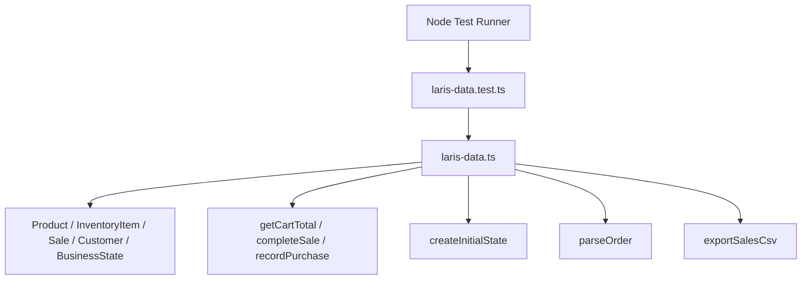

**Diagram sources**
- [laris-data.test.ts:1-10](file://src/lib/laris-data.test.ts#L1-L10)
- [laris-data.ts:97-110](file://src/lib/laris-data.ts#L97-L110)
- [laris-data.ts:172-194](file://src/lib/laris-data.ts#L172-L194)
- [laris-data.ts:215-305](file://src/lib/laris-data.ts#L215-L305)
- [laris-data.ts:307-334](file://src/lib/laris-data.ts#L307-L334)
- [laris-data.ts:336-404](file://src/lib/laris-data.ts#L336-L404)
- [laris-data.ts:436-474](file://src/lib/laris-data.ts#L436-L474)
- [laris-data.ts:483-493](file://src/lib/laris-data.ts#L483-L493)

**Section sources**
- [package.json:5-13](file://package.json#L5-L13)
- [laris-data.test.ts:1-10](file://src/lib/laris-data.test.ts#L1-L10)

## Core Components
The Laris business module exposes several key primitives used by both the application and its tests:

| Component | Responsibility | Test Focus |
|---|---|---|
| `DEMO_DATE` | Fixed demo date anchor | Deterministic seed generation |
| `currency` | Indonesian rupiah formatting | Locale formatting and rounding |
| `getStock` | Computes current inventory from opening stock and signed movements | Stock ledger math and movement filtering |
| `getCartTotal` | Calculates subtotal, discount, tax, and total | Cart validation, rounding, tax-after-discount rule |
| `completeSale` | Validates input, checks stock, creates sale, updates customers and stock movements | Idempotency, payment validation, cash handling, atomic failures |
| `recordPurchase` | Adds purchase, linked positive movement, moving-average cost, and product recipe cost | Cost propagation and immutability |
| `createInitialState` | Generates deterministic 90-day sales, expenses, and customer history | Seed reproducibility, serialization, segment assignment |
| `parseOrder` | Parses natural-language orders into structured carts | Aliases, number words, notes, payment clauses, unknown handling |
| `exportSalesCsv` | Exports sales rows with safe CSV escaping | Formula injection protection, quoting, newline handling |
| `timestamp` | Produces Jakarta-time timestamps anchored to a date | Timezone behavior and boundary stability |

**Section sources**
- [laris-data.ts:1-13](file://src/lib/laris-data.ts#L1-L13)
- [laris-data.ts:135-141](file://src/lib/laris-data.ts#L135-L141)
- [laris-data.ts:172-194](file://src/lib/laris-data.ts#L172-L194)
- [laris-data.ts:215-305](file://src/lib/laris-data.ts#L215-L305)
- [laris-data.ts:307-334](file://src/lib/laris-data.ts#L307-L334)
- [laris-data.ts:336-404](file://src/lib/laris-data.ts#L336-L404)
- [laris-data.ts:436-474](file://src/lib/laris-data.ts#L436-L474)
- [laris-data.ts:483-493](file://src/lib/laris-data.ts#L483-L493)
- [laris-data.ts:196-199](file://src/lib/laris-data.ts#L196-L199)

## Architecture Overview
At a high level, unit tests exercise pure business functions against an immutable `BusinessState`. External systems are not required for these tests because the module encapsulates all domain logic.

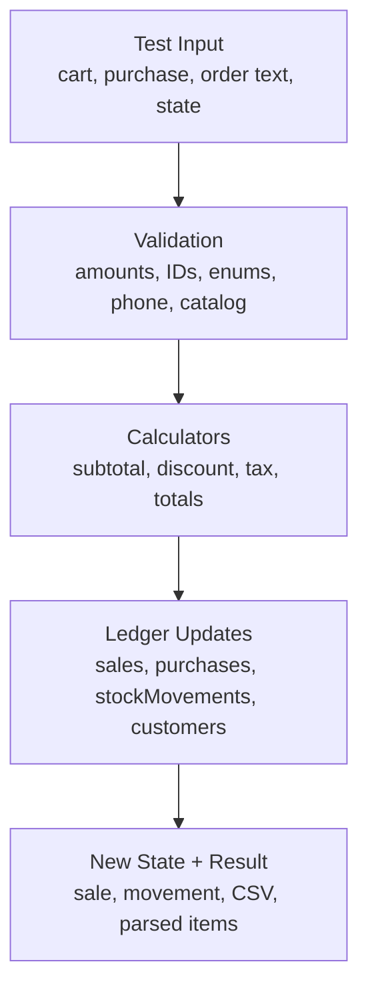

[No sources needed since this diagram shows conceptual workflow, not actual code structure]

## Detailed Component Analysis

### Cart Calculations and Financial Rules
Cart calculations enforce:
- Valid array inputs
- Safe integer quantities greater than zero
- Product existence in the provided catalog
- Non-negative amounts
- Discount not exceeding subtotal
- Tax applied after discount at 10% when enabled
- Whole-Rupiah rounding

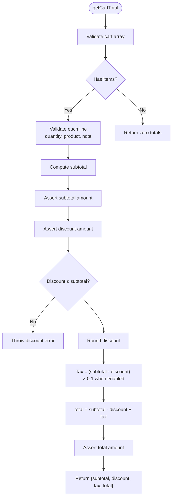

**Diagram sources**
- [laris-data.ts:178-194](file://src/lib/laris-data.ts#L178-L194)
- [laris-data.ts:155-170](file://src/lib/laris-data.ts#L155-L170)

**Section sources**
- [laris-data.ts:155-194](file://src/lib/laris-data.ts#L155-L194)
- [laris-data.test.ts:146-168](file://src/lib/laris-data.test.ts#L146-L168)

### Stock Movements and Inventory Calculations
Stock is computed from an item’s opening stock plus all signed movements for that item. Sales create negative movements; purchases create positive movements; adjustments can be used for audits or corrections.

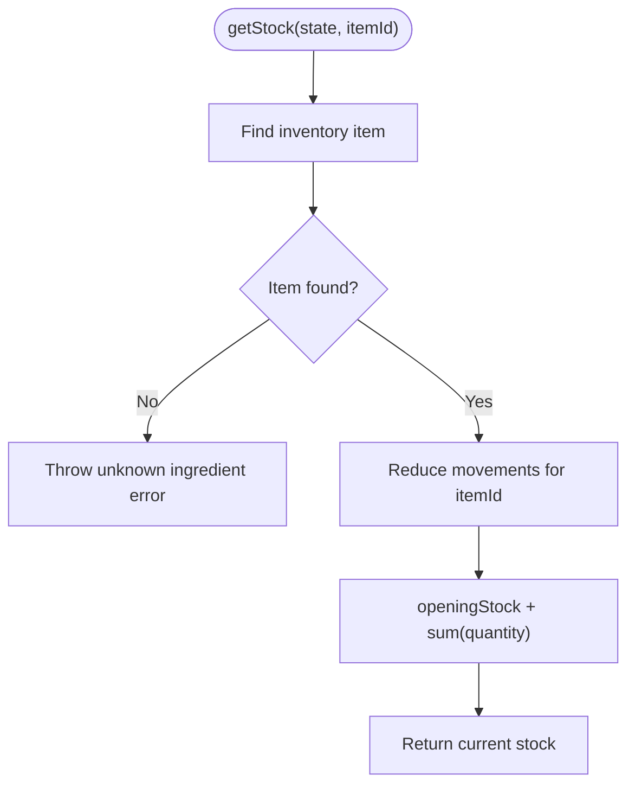

**Diagram sources**
- [laris-data.ts:149-153](file://src/lib/laris-data.ts#L149-L153)
- [laris-data.ts:172-176](file://src/lib/laris-data.ts#L172-L176)

**Section sources**
- [laris-data.ts:172-176](file://src/lib/laris-data.ts#L172-L176)
- [laris-data.test.ts:133-138](file://src/lib/laris-data.test.ts#L133-L138)
- [laris-data.test.ts:352-361](file://src/lib/laris-data.test.ts#L352-L361)

### Complete Sale Workflow
`completeSale` is the central transactional function. It validates inputs, computes totals, verifies stock availability atomically, creates a sale, optionally updates or creates a customer, and appends one aggregated stock movement per ingredient.

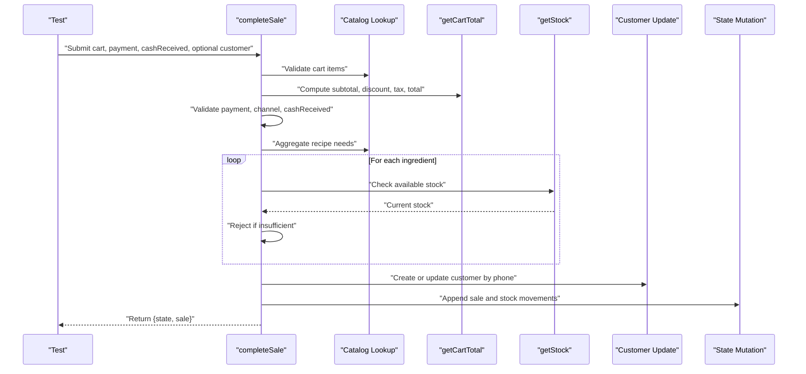

**Diagram sources**
- [laris-data.ts:215-305](file://src/lib/laris-data.ts#L215-L305)
- [laris-data.ts:178-194](file://src/lib/laris-data.ts#L178-L194)
- [laris-data.ts:172-176](file://src/lib/laris-data.ts#L172-L176)

**Section sources**
- [laris-data.ts:215-305](file://src/lib/laris-data.ts#L215-L305)
- [laris-data.test.ts:170-217](file://src/lib/laris-data.test.ts#L170-L217)
- [laris-data.test.ts:219-254](file://src/lib/laris-data.test.ts#L219-L254)
- [laris-data.test.ts:290-305](file://src/lib/laris-data.test.ts#L290-L305)

### Purchase Recording and Moving-Average Cost
Purchases increase stock, append a purchase record, create a positive stock movement, recalculate the inventory item’s average cost, and propagate updated costs to products whose recipes include the purchased ingredient.

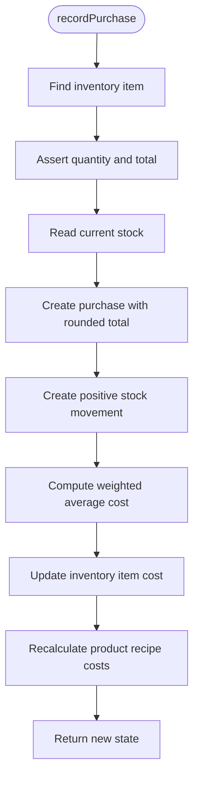

**Diagram sources**
- [laris-data.ts:307-334](file://src/lib/laris-data.ts#L307-L334)

**Section sources**
- [laris-data.ts:307-334](file://src/lib/laris-data.ts#L307-L334)
- [laris-data.test.ts:307-340](file://src/lib/laris-data.test.ts#L307-L340)

### Customer Segmentation Algorithm
Customer segments are determined by days since last visit and visit count:
- More than 60 days inactive: `Hilang`
- More than 30 days inactive: `Berisiko`
- 20+ visits: `Juara`
- 8+ visits: `Setia`
- Otherwise: `Potensial`

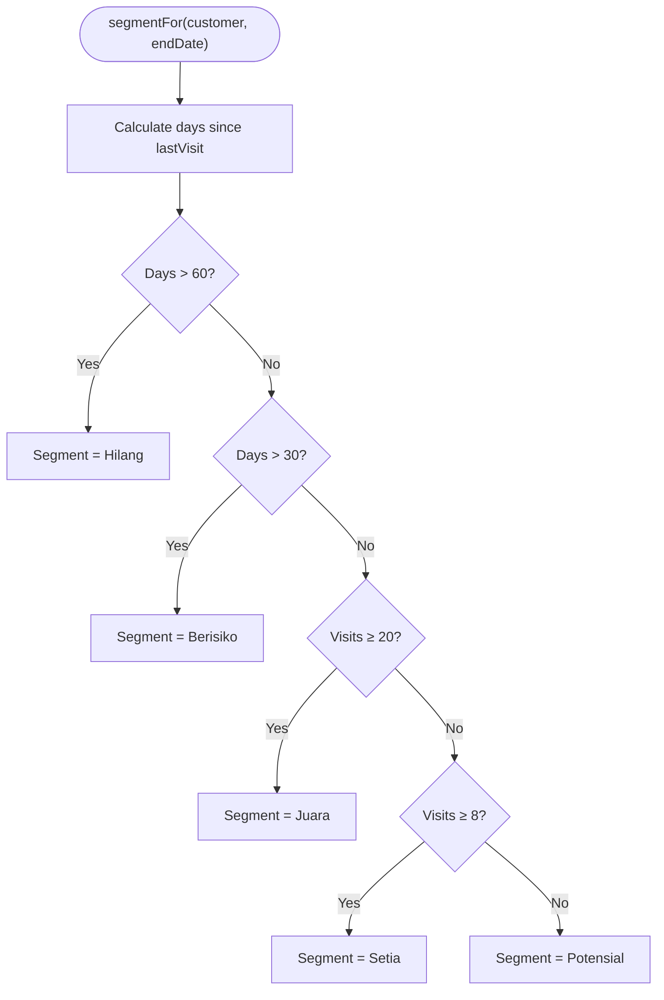

**Diagram sources**
- [laris-data.ts:208-213](file://src/lib/laris-data.ts#L208-L213)

**Section sources**
- [laris-data.ts:208-213](file://src/lib/laris-data.ts#L208-L213)
- [laris-data.test.ts:118-131](file://src/lib/laris-data.test.ts#L118-L131)
- [laris-data.test.ts:402-410](file://src/lib/laris-data.test.ts#L402-L410)

### Natural-Language Order Parsing
`parseOrder` supports:
- Indonesian menu aliases
- Number words from satu to sepuluh
- Optional quantity tokens before and after menu names
- Notes such as less sugar or tanpa es
- Payment selection via QRIS, Tunai, or Transfer
- Unknown phrases returned separately instead of failing silently

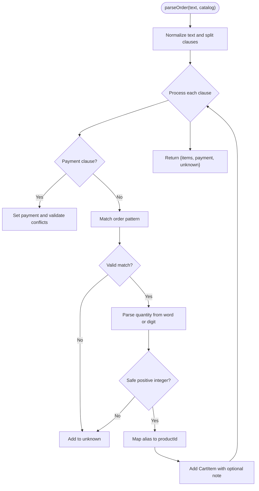

**Diagram sources**
- [laris-data.ts:406-434](file://src/lib/laris-data.ts#L406-L434)
- [laris-data.ts:436-474](file://src/lib/laris-data.ts#L436-L474)

**Section sources**
- [laris-data.ts:406-474](file://src/lib/laris-data.ts#L406-L474)
- [laris-data.test.ts:412-477](file://src/lib/laris-data.test.ts#L412-L477)

### CSV Export and Security
`exportSalesCsv` produces RFC-style CSV rows and escapes values to prevent spreadsheet formula injection. Tests verify balanced quotes, CRLF line endings, quoted fields, and neutralization of leading control characters and formula prefixes.

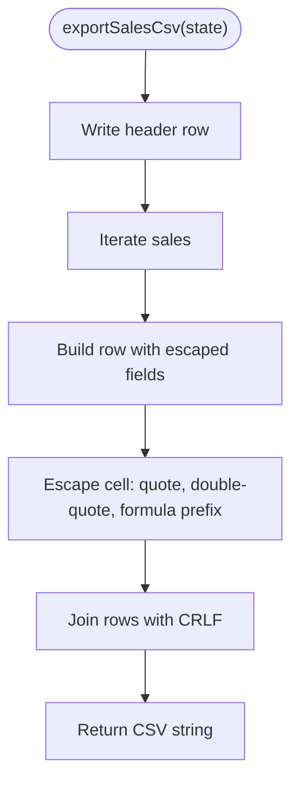

**Diagram sources**
- [laris-data.ts:476-493](file://src/lib/laris-data.ts#L476-L493)

**Section sources**
- [laris-data.ts:476-493](file://src/lib/laris-data.ts#L476-L493)
- [laris-data.test.ts:479-518](file://src/lib/laris-data.test.ts#L479-L518)

### Deterministic Seed and Test Data Generation
`createInitialState` generates:
- A fixed 90-day sales history ending on the demo date
- Expenses including daily supplies, monthly rent and salaries, utilities, and weekly operational costs
- 12 seeded customers with visits, spending, points, last visit, and segment
- Immutable copies of products and inventory

Tests assert determinism, JSON serializability, independence between seeds, and reconciliation between sales and customer metrics.

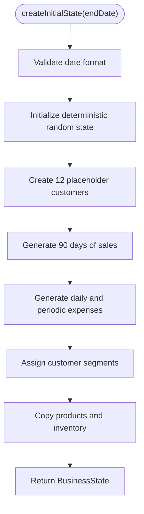

**Diagram sources**
- [laris-data.ts:336-404](file://src/lib/laris-data.ts#L336-L404)

**Section sources**
- [laris-data.ts:336-404](file://src/lib/laris-data.ts#L336-L404)
- [laris-data.test.ts:83-116](file://src/lib/laris-data.test.ts#L83-L116)
- [laris-data.test.ts:118-138](file://src/lib/laris-data.test.ts#L118-L138)

## Dependency Analysis
The unit tests depend only on Node’s built-in test runner and assertion library. They import the business module dynamically to preserve TypeScript types without requiring a full build pipeline.

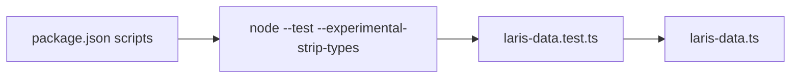

**Diagram sources**
- [package.json:5-13](file://package.json#L5-L13)
- [laris-data.test.ts:1-10](file://src/lib/laris-data.test.ts#L1-L10)

**Section sources**
- [package.json:5-13](file://package.json#L5-L13)
- [laris-data.test.ts:1-10](file://src/lib/laris-data.test.ts#L1-L10)

## Performance Considerations
- Prefer small, focused tests per business rule rather than large integration-style tests.
- Use frozen state objects to detect accidental mutation during tests.
- Reuse lightweight helper state builders instead of constructing full `BusinessState` objects repeatedly.
- Keep seed-based tests isolated from mutable global state; the existing seed is already deterministic and serializable.
- Avoid unnecessary deep cloning inside hot paths; tests should focus on correctness first and performance profiling later.

[No sources needed since this section provides general guidance]

## Troubleshooting Guide

### Common Assertion Failures
- **Invalid quantity**: Ensure cart quantities are safe positive integers. The implementation rejects zero, negative, fractional, unsafe, NaN, Infinity, and overflow values.
- **Unknown product or ingredient**: Verify that the catalog passed to functions matches the expected IDs. Custom catalogs must include all referenced IDs.
- **Discount exceeds subtotal**: Discounts are rounded but cannot exceed the subtotal.
- **Insufficient cash for cash payments**: Cash received must be rounded and at least equal to the total.
- **Phone validation errors**: Phone numbers must be 8–15 digits and may start with `+`.
- **Idempotency key issues**: Empty or whitespace-only keys are rejected; different encoded keys produce different sales.

**Section sources**
- [laris-data.ts:155-170](file://src/lib/laris-data.ts#L155-L170)
- [laris-data.ts:178-194](file://src/lib/laris-data.ts#L178-L194)
- [laris-data.ts:215-305](file://src/lib/laris-data.ts#L215-L305)
- [laris-data.test.ts:256-288](file://src/lib/laris-data.test.ts#L256-L288)
- [laris-data.test.ts:386-400](file://src/lib/laris-data.test.ts#L386-L400)
- [laris-data.test.ts:290-305](file://src/lib/laris-data.test.ts#L290-L305)

### Extending Tests for External Dependencies

#### Supabase Mocking Strategy
When testing route handlers or server-side logic that use Supabase:
- Prefer isolating business logic tests from database calls, as done in `laris-data.test.ts`.
- For integration-style tests, mock Supabase client methods using Node’s test context mocking API.
- Use separate test files for RLS and tenant isolation, as shown in the repository’s RLS test script.

Example approach:
- Replace real Supabase clients with mocked clients that return controlled data.
- Assert that queries use correct filters, tenant scoping, and RLS-enforced boundaries.
- Keep service-role and user-role clients distinct, mirroring the separation in the shared script helpers.

**Section sources**
- [rls.test.ts:1-23](file://scripts/rls.test.ts#L1-L23)
- [lib.ts:1-56](file://scripts/lib.ts#L1-L56)
- [server.ts:1-24](file://src/lib/supabase/server.ts#L1-L24)

#### AI Service Mocking Strategy
AI features are layered above business logic:
- Route handlers call AI SDK functions and log telemetry.
- Business logic itself does not depend on AI; it consumes structured outputs.
- For AI-related tests, mock the AI provider response and assert parsing, tool-calling, and fallback behavior.

Recommended patterns:
- Mock model creation and invocation at the AI SDK boundary.
- Assert prompt construction, context inclusion, and output schema compliance.
- Verify graceful degradation when AI is unavailable, ensuring manual workflows remain functional.

**Section sources**
- [ai.ts:1-28](file://src/lib/ai.ts#L1-L28)
- [ai.ts:97-125](file://src/lib/ai.ts#L97-L125)

### Best Practices for Test Data and Assertions
- Use helper functions like `emptyState` to construct minimal states.
- Freeze state objects before mutations to catch accidental in-place changes.
- Assert both success paths and failure paths, including edge cases and invalid inputs.
- Use regex assertions for timestamps and formatted currency strings.
- Treat CSV output as a contract: validate headers, row counts, quoting, and security-neutralized values.
- Keep seed data stable; any change should be accompanied by explicit expectations about dates, counts, and segments.

**Section sources**
- [laris-data.test.ts:14-27](file://src/lib/laris-data.test.ts#L14-L27)
- [laris-data.test.ts:32-35](file://src/lib/laris-data.test.ts#L32-L35)
- [laris-data.test.ts:140-144](file://src/lib/laris-data.test.ts#L140-L144)
- [laris-data.test.ts:479-518](file://src/lib/laris-data.test.ts#L479-L518)

## Conclusion
The Laris business logic is designed for testability: it uses immutable state, explicit validation, deterministic seeding, and clear separation between calculation, mutation, and I/O. The existing tests demonstrate strong coverage of cart math, stock ledger integrity, purchase cost propagation, customer segmentation, natural-language parsing, and secure CSV export. When extending coverage, follow the same patterns: isolate pure functions, freeze state, assert atomic failures, and mock external dependencies only at their integration boundaries.

[No sources needed since this section summarizes without analyzing specific files]

## Appendices

### Running Tests
Run the unit tests with the configured script:

```bash
npm test
```

This executes Node’s test runner with native TypeScript stripping against the Laris business test file.

**Section sources**
- [package.json:5-13](file://package.json#L5-L13)