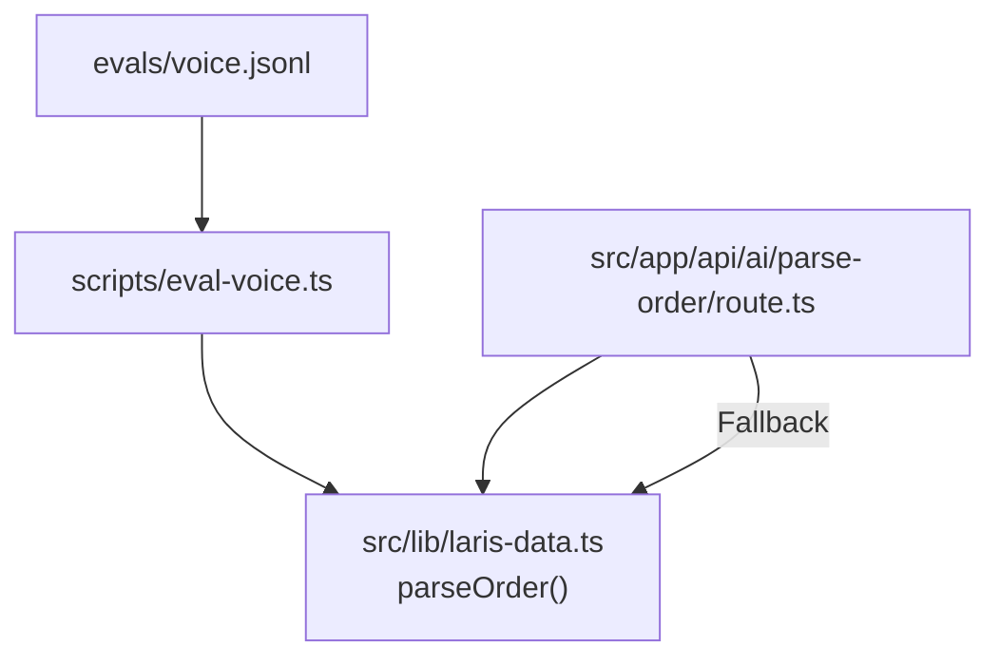
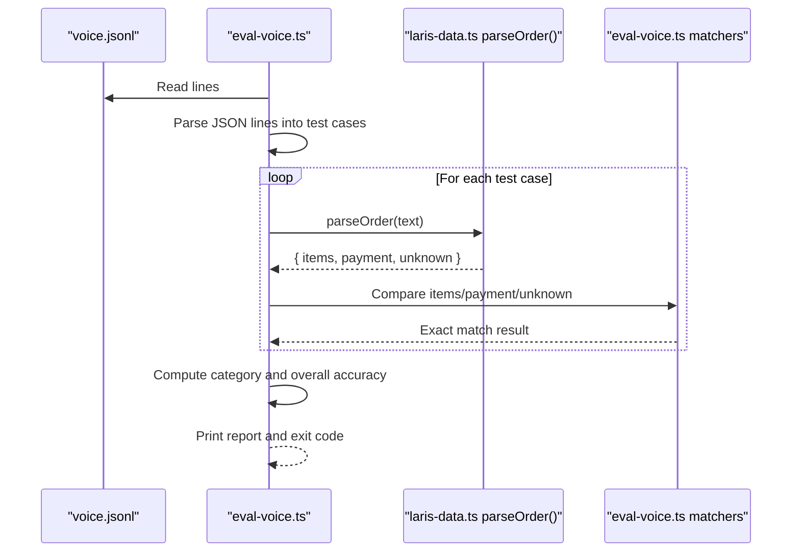
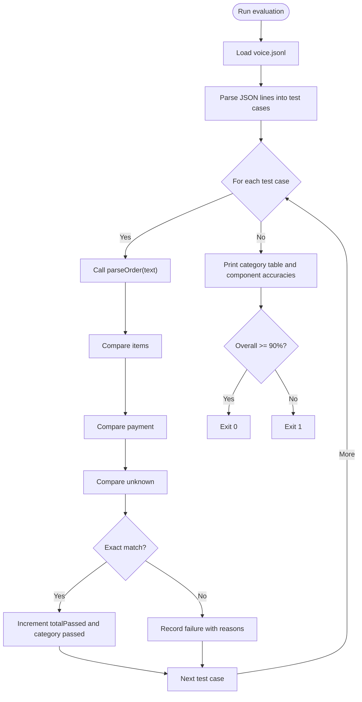
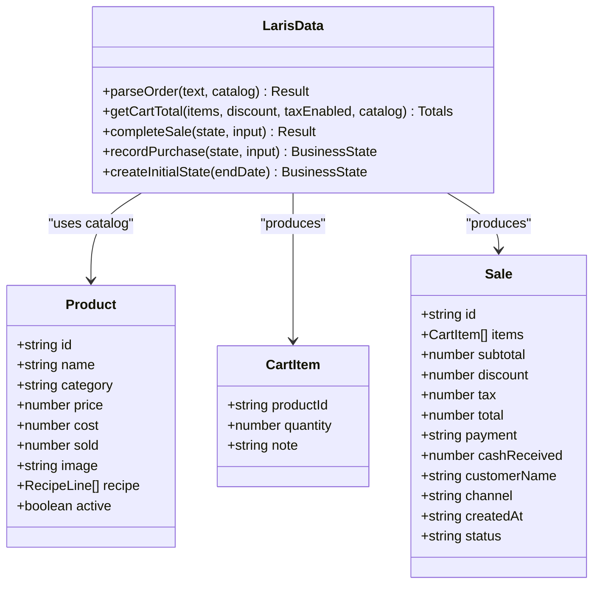
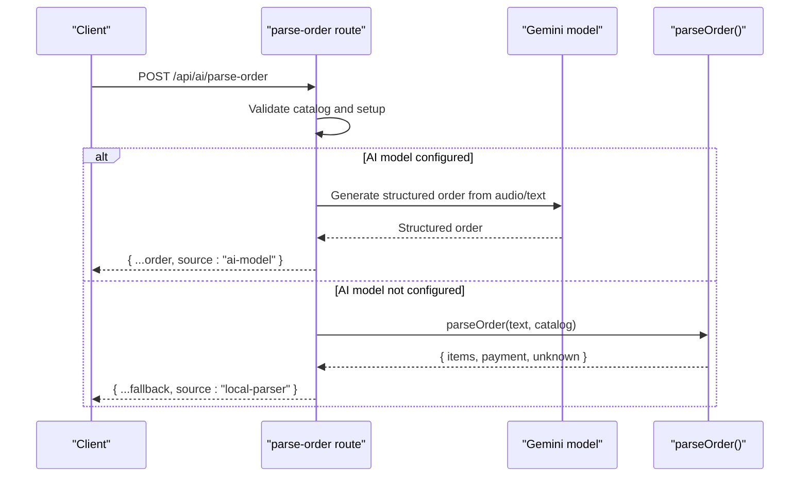
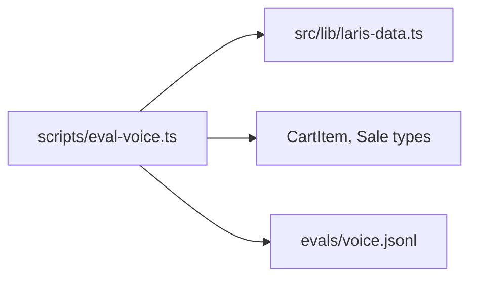

# Voice Recognition Evaluation

<cite>
**Referenced Files in This Document**
- [voice.jsonl](file://evals/voice.jsonl)
- [eval-voice.ts](file://scripts/eval-voice.ts)
- [laris-data.ts](file://src/lib/laris-data.ts)
- [route.ts](file://src/app/api/ai/parse-order/route.ts)
</cite>

## Table of Contents
1. [Introduction](#introduction)
2. [Project Structure](#project-structure)
3. [Core Components](#core-components)
4. [Architecture Overview](#architecture-overview)
5. [Detailed Component Analysis](#detailed-component-analysis)
6. [Dependency Analysis](#dependency-analysis)
7. [Performance Considerations](#performance-considerations)
8. [Troubleshooting Guide](#troubleshooting-guide)
9. [Conclusion](#conclusion)

## Introduction
This document explains the voice recognition evaluation framework used to measure Indonesian language order parsing accuracy. It covers:
- The structure and intent of the 50-utterance dataset in `evals/voice.jsonl`.
- How the benchmark script `scripts/eval-voice.ts` measures exact match accuracy between expected and parsed orders.
- Testing methodology for comparing voice commands against expected cart structures, handling unknown items, and validating quantity parsing.
- Guidance for adding new test cases, interpreting accuracy metrics, and debugging parsing failures.
- The relationship between voice recognition quality and AI parser performance, including fallback mechanisms and error handling strategies.

The framework targets a PRD goal of at least 90% exact-match accuracy across realistic Indonesian ordering utterances, including slang, numbers, modifiers, units, polite prefixes, punctuation, aliases, compound orders, conflict payment detection, quantity fallback, mixed case, and empty input.

## Project Structure
The evaluation system is centered around three main parts:
- Dataset: `evals/voice.jsonl` contains 50 ordered JSON Lines test cases.
- Benchmark runner: `scripts/eval-voice.ts` loads the dataset, parses each utterance through the deterministic parser, compares results with expected values, and reports category-wise and overall accuracy.
- Parser implementation: `src/lib/laris-data.ts` exports `parseOrder`, which implements Indonesian number words, menu aliases, modifier normalization, clause splitting, payment extraction, and unknown item rejection.
- Runtime integration: `src/app/api/ai/parse-order/route.ts` integrates the same parser into the API, using an AI model when available and falling back to the local parser otherwise.

**Diagram sources**
- [eval-voice.ts:54-87](file://scripts/eval-voice.ts#L54-L87)
- [laris-data.ts:436-474](file://src/lib/laris-data.ts#L436-L474)
- [route.ts:59-67](file://src/app/api/ai/parse-order/route.ts#L59-L67)

**Section sources**
- [voice.jsonl:1-50](file://evals/voice.jsonl#L1-L50)
- [eval-voice.ts:1-164](file://scripts/eval-voice.ts#L1-L164)
- [laris-data.ts:406-474](file://src/lib/laris-data.ts#L406-L474)
- [route.ts:59-84](file://src/app/api/ai/parse-order/route.ts#L59-L84)

## Core Components
- **Dataset schema**: Each line in `voice.jsonl` defines a test case with fields:
  - `id`: numeric identifier.
  - `category`: grouping such as slang, numbers, payment, modifiers, units, alias, punctuation, unknown_item, conflict_payment, quantity_fallback, mixed_case, empty.
  - `text`: the Indonesian voice command or transcription.
  - `expected`: object containing:
    - `items`: array of expected cart items with `productId`, `quantity`, and optional `note`.
    - `payment`: expected payment method (`Tunai`, `QRIS`, or `Transfer`).
    - `unknown`: array of unrecognized fragments that should be rejected.
- **Benchmark runner**: `eval-voice.ts` reads the dataset, calls `parseOrder(text)` for each test case, compares actual vs expected using strict matching rules, tracks per-category statistics, prints a summary table, and exits with success if overall accuracy meets the 90% target.
- **Parser**: `parseOrder` normalizes text, splits clauses by commas, semicolons, newline, and connectors like `dan`, `&`, `+`, strips polite prefixes, extracts payment, matches quantities and menu aliases, normalizes modifiers, and rejects invalid or unknown segments.

**Section sources**
- [voice.jsonl:1-50](file://evals/voice.jsonl#L1-L50)
- [eval-voice.ts:18-52](file://scripts/eval-voice.ts#L18-L52)
- [eval-voice.ts:54-157](file://scripts/eval-voice.ts#L54-L157)
- [laris-data.ts:406-474](file://src/lib/laris-data.ts#L406-L474)

## Architecture Overview
The evaluation pipeline connects the dataset to the parser and then to the benchmark comparator.

**Diagram sources**
- [eval-voice.ts:54-157](file://scripts/eval-voice.ts#L54-L157)
- [laris-data.ts:436-474](file://src/lib/laris-data.ts#L436-L474)

## Detailed Component Analysis

### Dataset Design: `evals/voice.jsonl`
The dataset is organized by categories that reflect real-world voice recognition challenges:
- Slang and polite prefixes: informal phrasing, honorifics, and conversational fillers.
- Numbers: Indonesian number words from one to ten.
- Payment: explicit payment methods including QRIS, transfer, and cash.
- Modifiers: sugar level and ice level variations normalized to canonical notes.
- Units: cup, glass, piece, fruit, portion, plate variants.
- Alias mapping: multiple product names mapped to canonical IDs.
- Punctuation: comma, semicolon, plus, ampersand, period separators.
- Unknown items: phrases not matching active catalog entries are moved to `unknown`.
- Conflict payment: conflicting payment instructions cause later clauses to be treated as unknown.
- Quantity fallback: missing quantity defaults to one.
- Mixed case: uppercase commands must parse correctly.
- Empty input: whitespace-only input yields no items and default payment.

Each test case’s `expected.unknown` captures what the parser should reject, enabling precise measurement of both inclusion and exclusion behavior.

**Section sources**
- [voice.jsonl:1-50](file://evals/voice.jsonl#L1-L50)

### Benchmark Script: `scripts/eval-voice.ts`
Key responsibilities:
- Load and validate JSON Lines.
- Call `parseOrder` for each utterance.
- Compare parsed output with expected output using:
  - `itemsMatch`: sorts by `productId`, checks length, productId, quantity, and note equality.
  - `unknownsMatch`: compares sets of normalized unknown strings.
  - Exact payment equality.
- Track per-category totals and passed counts.
- Report component-level accuracy (items, payment, unknown).
- Enforce PRD target: exit code 0 if overall accuracy >= 90%, else exit code 1.

**Diagram sources**
- [eval-voice.ts:29-52](file://scripts/eval-voice.ts#L29-L52)
- [eval-voice.ts:54-157](file://scripts/eval-voice.ts#L54-L157)

**Section sources**
- [eval-voice.ts:18-52](file://scripts/eval-voice.ts#L18-L52)
- [eval-voice.ts:54-157](file://scripts/eval-voice.ts#L54-L157)

### Parser Implementation: `src/lib/laris-data.ts`
The parser is deterministic and designed for robust Indonesian voice-to-cart conversion:
- Number words: maps Indonesian words to integers for quantity parsing.
- Menu aliases: maps slang, synonyms, and common misspellings to canonical product IDs.
- Clause splitting: supports commas, semicolons, newline, and connectors like `dan`, `&`, `+`.
- Polite prefix stripping: removes polite phrases before parsing.
- Payment extraction: recognizes QRIS, Transfer, and Tunai; handles conflicts by marking later clauses as unknown.
- Order pattern matching: validates quantity tokens, unit words, product aliases, and optional modifier notes.
- Modifier normalization: standardizes sugar and ice variations to canonical notes.
- Unknown handling: moves unrecognized clauses to `unknown` rather than failing the entire request.

**Diagram sources**
- [laris-data.ts:34-53](file://src/lib/laris-data.ts#L34-L53)
- [laris-data.ts:123-133](file://src/lib/laris-data.ts#L123-L133)
- [laris-data.ts:436-474](file://src/lib/laris-data.ts#L436-L474)

**Section sources**
- [laris-data.ts:406-474](file://src/lib/laris-data.ts#L406-L474)

### API Integration and Fallback Strategy: `src/app/api/ai/parse-order/route.ts`
The API route integrates voice recognition and AI parsing:
- If audio is provided, it sends audio and text to the AI model.
- If the AI model is unavailable, it falls back to the local deterministic parser.
- The fallback returns structured results marked with `source: "local-parser"`.
- Active product filtering ensures only valid catalog items are recognized.

**Diagram sources**
- [route.ts:59-84](file://src/app/api/ai/parse-order/route.ts#L59-L84)

**Section sources**
- [route.ts:59-84](file://src/app/api/ai/parse-order/route.ts#L59-L84)

## Dependency Analysis
The evaluation depends on:
- Dataset file I/O and JSON parsing.
- Parser function `parseOrder` exported from `laris-data.ts`.
- Type definitions for `CartItem` and `Sale` used in comparison logic.

**Diagram sources**
- [eval-voice.ts:10-13](file://scripts/eval-voice.ts#L10-L13)
- [laris-data.ts:34-53](file://src/lib/laris-data.ts#L34-L53)

**Section sources**
- [eval-voice.ts:10-13](file://scripts/eval-voice.ts#L10-L13)
- [laris-data.ts:34-53](file://src/lib/laris-data.ts#L34-L53)

## Performance Considerations
- The benchmark runs deterministically without network calls, making it fast and repeatable.
- Sorting items by `productId` avoids order sensitivity in comparisons.
- Unknown string comparison uses normalized sets to reduce false negatives due to casing or whitespace.
- Category-wise aggregation enables targeted optimization of weak areas.

[No sources needed since this section provides general guidance]

## Troubleshooting Guide
Common issues and how to diagnose them:
- Items mismatch: Check whether the parser matched the correct alias, quantity, or modifier. Verify that the product exists in the active catalog and that the utterance does not contain extra unknown fragments.
- Payment mismatch: Ensure payment keywords are correctly placed and not conflicting. Conflicting payment instructions move later clauses to `unknown`.
- Unknown mismatch: Confirm that unrecognized phrases are intentionally included in `expected.unknown`. Mixed-case and punctuation variations may affect normalization.
- Adding new test cases: Append a new JSON Line to `voice.jsonl` with a unique `id`, appropriate `category`, realistic `text`, and precise `expected` structure. Run the benchmark to see category impact and overall accuracy.
- Interpreting metrics: Focus on the “OVERALL (EXACT MATCH)” percentage. If below 90%, inspect the failures list to identify patterns such as alias gaps, modifier normalization issues, or payment conflict handling.
- Debugging parsing failures: Use the printed expected vs actual objects to pinpoint mismatches. Adjust either the utterance or the parser’s alias/modifier rules accordingly.

**Section sources**
- [eval-voice.ts:29-52](file://scripts/eval-voice.ts#L29-L52)
- [eval-voice.ts:100-147](file://scripts/eval-voice.ts#L100-L147)
- [laris-data.ts:436-474](file://src/lib/laris-data.ts#L436-L474)

## Conclusion
The voice recognition evaluation framework combines a carefully curated Indonesian dataset with a deterministic parser and a strict benchmark runner. It measures exact match accuracy across items, payment, and unknown handling, providing actionable insights for improving both voice recognition outputs and parser robustness. The API’s fallback mechanism ensures reliable operation even when AI models are unavailable, while the benchmark enforces a clear PRD target of 90% accuracy.

[No sources needed since this section summarizes without analyzing specific files]