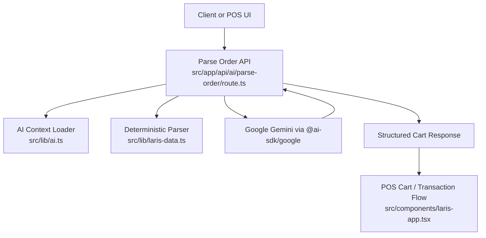
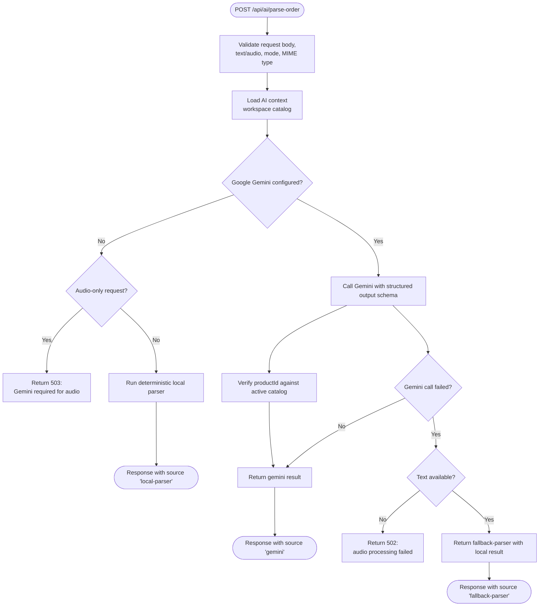
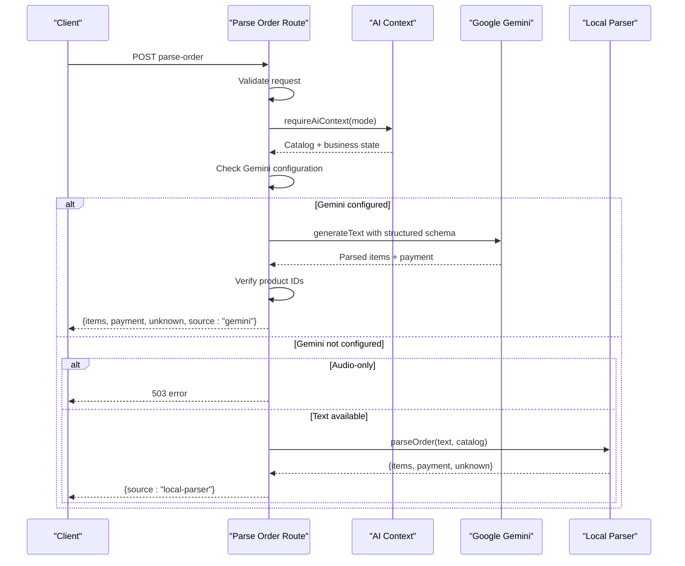
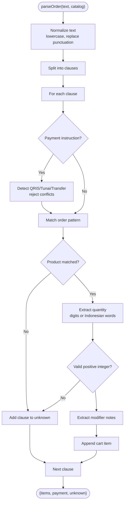
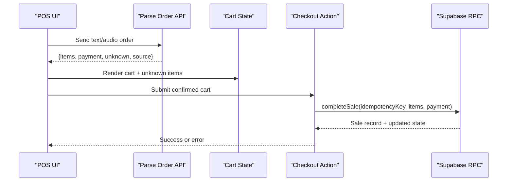
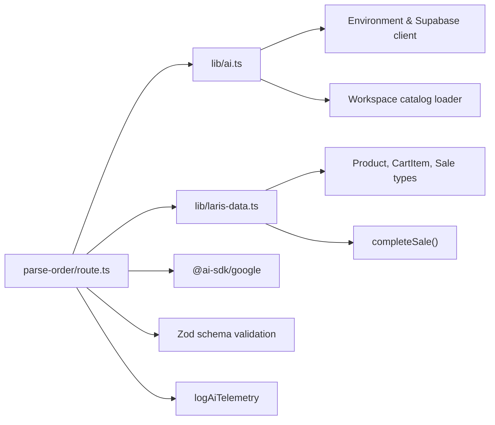

# AI Order Parsing Pipeline

<cite>
**Referenced Files in This Document**
- [route.ts](file://src/app/api/ai/parse-order/route.ts)
- [laris-data.ts](file://src/lib/laris-data.ts)
- [ai.ts](file://src/lib/ai.ts)
- [eval-voice.ts](file://scripts/eval-voice.ts)
- [voice.jsonl](file://evals/voice.jsonl)
- [laris-app.tsx](file://src/components/laris-app.tsx)
- [0003_functions.sql](file://supabase/migrations/0003_functions.sql)
- [0005_production_hardening.sql](file://supabase/migrations/0005_production_hardening.sql)
- [README.md](file://README.md)
</cite>

## Table of Contents
1. [Introduction](#introduction)
2. [Project Structure](#project-structure)
3. [Core Components](#core-components)
4. [Architecture Overview](#architecture-overview)
5. [Detailed Component Analysis](#detailed-component-analysis)
6. [Dependency Analysis](#dependency-analysis)
7. [Performance Considerations](#performance-considerations)
8. [Troubleshooting Guide](#troubleshooting-guide)
9. [Conclusion](#conclusion)

## Introduction
This document explains the AI order parsing system that turns Indonesian voice or text orders into structured POS cart items. The pipeline uses a dual-parser architecture:

- A deterministic local parser handles simple, well-formed orders quickly and reliably without external API calls.
- Google Gemini is used as a fallback for complex requests, audio input, or when richer natural-language understanding is needed.

The parsed result includes structured cart items, quantities, optional modifiers, payment method, unknown phrases, and a source tag indicating which parser produced the result. The system integrates with the Laris POS cart and transaction pipeline while preserving safety through validation, unknown-item reporting, and idempotent checkout behavior.

## Project Structure
The AI order parsing feature lives under the Next.js App Router API routes and shared library modules:

**Diagram sources**
- [route.ts:31-127](file://src/app/api/ai/parse-order/route.ts#L31-L127)
- [ai.ts:9-69](file://src/lib/ai.ts#L9-L69)
- [laris-data.ts:421-474](file://src/lib/laris-data.ts#L421-L474)
- [laris-app.tsx:213-243](file://src/components/laris-app.tsx#L213-L243)

**Section sources**
- [README.md:9-35](file://README.md#L9-L35)
- [README.md:51-85](file://README.md#L51-L85)

## Core Components
The system has four main parts:

| Component | Responsibility | Key Behaviors |
|---|---|---|
| Parse Order API route | Accepts text or audio, validates input, loads workspace context, selects parser, returns structured results | Enforces request size limits, supports `local` and `cloud` modes, logs telemetry |
| Deterministic local parser | Maps Indonesian text to catalog product IDs using aliases, numbers, units, and modifiers | Returns items, default payment, and unknown clauses |
| Google Gemini integration | Parses complex or audio-based orders with structured output schema | Validates returned product IDs against active catalog, reports unknowns |
| POS cart and transaction layer | Consumes parsed cart items and completes sales safely | Validates cart totals, stock, payment, and supports idempotency |

**Section sources**
- [route.ts:14-29](file://src/app/api/ai/parse-order/route.ts#L14-L29)
- [laris-data.ts:34-53](file://src/lib/laris-data.ts#L34-L53)
- [laris-data.ts:436-474](file://src/lib/laris-data.ts#L436-L474)
- [ai.ts:9-15](file://src/lib/ai.ts#L9-L15)

## Architecture Overview
The request flow follows a clear decision tree:

**Diagram sources**
- [route.ts:31-127](file://src/app/api/ai/parse-order/route.ts#L31-L127)
- [ai.ts:30-69](file://src/lib/ai.ts#L30-L69)

## Detailed Component Analysis

### Request and Response Schemas
The parse-order endpoint enforces strict schemas for both input and output.

#### Request Schema
| Field | Type | Required | Constraints | Description |
|---|---|---:|---|---|
| `mode` | `"local"` or `"cloud"` | Yes | Enum | Workspace mode; `local` uses demo state, `cloud` loads Supabase workspace data |
| `text` | String | No | Max 2000 characters | Indonesian order text |
| `audio` | Base64 string | No | Max 12 MB body, 8 MB decoded audio | Audio payload for Gemini transcription/parsing |
| `mimeType` | Audio MIME enum | No | WebM, OGG, MP4, MPEG, WAV, X-WAV | Audio media type |

#### Output Schema
| Field | Type | Description |
|---|---|---|
| `items` | Array of cart items | Structured menu lines with product ID, quantity, and optional note |
| `payment` | `"Tunai"`, `"QRIS"`, `"Transfer"` | Detected or defaulted payment method |
| `unknown` | Array of strings | Phrases or product names not found in the active catalog |
| `source` | `"local-parser"`, `"gemini"`, `"fallback-parser"` | Indicates which parser produced the result |
| `model` | String | Present only when Gemini is used; shows model identifier |
| `warning` | String | Present only on fallback; indicates Gemini was unavailable |

#### Cart Item Schema
| Field | Type | Constraints | Description |
|---|---|---|---|
| `productId` | String | Max 120 characters | Must match an active workspace product ID after verification |
| `quantity` | Integer | Minimum 1, maximum 999 | Number of portions |
| `note` | String | Optional, max 200 characters | Modifier such as less sugar, no ice, or other customization |

**Section sources**
- [route.ts:14-29](file://src/app/api/ai/parse-order/route.ts#L14-L29)
- [route.ts:95-112](file://src/app/api/ai/parse-order/route.ts#L95-L112)
- [laris-data.ts:34-38](file://src/lib/laris-data.ts#L34-L38)

### Dual-Parser Decision Logic
The route implements a layered fallback strategy:

1. **Input validation**: Rejects oversized payloads, invalid JSON, missing text/audio, and invalid audio encoding.
2. **Workspace context loading**: Loads either demo state or authenticated workspace catalog.
3. **Gemini availability check**: If no Gemini key is configured, audio-only requests fail with 503, while text-only requests fall back to the local parser.
4. **Gemini path**: Sends text or audio plus catalog context to Gemini with a structured Zod schema. Returned product IDs are verified against the active catalog; mismatches are moved to `unknown`.
5. **Fallback path**: On Gemini failure, if text is available, the local parser runs again and returns a warning indicating Gemini was busy.

**Diagram sources**
- [route.ts:31-127](file://src/app/api/ai/parse-order/route.ts#L31-L127)
- [ai.ts:30-69](file://src/lib/ai.ts#L30-L69)

**Section sources**
- [route.ts:31-68](file://src/app/api/ai/parse-order/route.ts#L31-L68)
- [route.ts:70-127](file://src/app/api/ai/parse-order/route.ts#L70-L127)

### Deterministic Local Parser
The local parser is designed for speed, predictability, and offline operation. It processes Indonesian utterances by:

- Normalizing punctuation and whitespace.
- Splitting input into clauses separated by commas, semicolons, newlines, or conjunctions like `dan`, `&`, `+`.
- Detecting payment instructions and rejecting conflicting payment declarations.
- Matching product names and aliases against the active catalog.
- Extracting quantities from digits or Indonesian number words.
- Capturing modifiers such as less sugar, no sugar, less ice, or no ice.
- Returning unrecognized clauses in the `unknown` array instead of guessing.

#### Fuzzy Matching Strategy
The parser does not use general-purpose fuzzy string matching libraries. Instead, it builds a deterministic alias map:

- Built-in demo aliases cover common slang and variations.
- Each active product contributes its ID, hyphen-to-space variant, and normalized lowercase name.
- Aliases are sorted by length so longer matches take priority.
- A single regular expression captures optional leading quantity, unit tokens, product alias, optional trailing quantity, and modifier notes.

This approach favors precision over recall: unmatched phrases become unknown rather than producing incorrect product mappings.

**Diagram sources**
- [laris-data.ts:406-474](file://src/lib/laris-data.ts#L406-L474)

**Section sources**
- [laris-data.ts:406-474](file://src/lib/laris-data.ts#L406-L474)

### Gemini Integration and Structured Output
When Gemini is available, the route constructs multimodal content:

- Audio is included as a base64-encoded file part with the provided MIME type.
- Text is included as a prompt instructing the model to extract items, quantities, notes, and payment method.
- The active catalog and inventory are injected as context so the model maps phrases to real product IDs.
- The response is constrained to a Zod schema with `items`, `payment`, and `unknown`.
- After Gemini returns, the route verifies every `productId` against the active catalog. Invalid IDs are moved to `unknown`.

This design reduces hallucination risk by enforcing catalog membership after generation.

**Section sources**
- [route.ts:62-112](file://src/app/api/ai/parse-order/route.ts#L62-L112)
- [ai.ts:76-95](file://src/lib/ai.ts#L76-L95)

### Unknown Item Handling Workflow
Unknown handling is consistent across both parsers:

| Scenario | Behavior |
|---|---|
| Product not in active catalog | Added to `unknown` |
| Non-active product | Ignored by local parser; Gemini instructed to avoid non-active products |
| Unrecognized phrase | Added to `unknown` |
| Conflicting payment methods | First valid payment is kept; later conflicting payment clause becomes unknown |
| Empty or malformed input | Returns empty items and default payment unless Gemini fails and audio-only |

The client should present the `unknown` list to the user for confirmation before finalizing the order.

**Section sources**
- [route.ts:96-101](file://src/app/api/ai/parse-order/route.ts#L96-L101)
- [laris-data.ts:443-473](file://src/lib/laris-data.ts#L443-L473)

### User Confirmation and POS Integration
Parsed orders do not directly post to the ledger. Instead, they populate the POS cart, where human confirmation remains essential:

1. The frontend receives structured items, payment, unknowns, and source metadata.
2. The UI can display uncertain or unknown items for operator review.
3. Once confirmed, the cart is submitted through the POS checkout flow.
4. The checkout action computes totals, validates payment, checks stock, and creates an idempotent sale.
5. In cloud mode, the database RPC enforces inventory locking, stock validation, and idempotency.

**Diagram sources**
- [laris-app.tsx:213-243](file://src/components/laris-app.tsx#L213-L243)
- [0003_functions.sql:127-190](file://supabase/migrations/0003_functions.sql#L127-L190)

**Section sources**
- [laris-app.tsx:213-243](file://src/components/laris-app.tsx#L213-L243)
- [laris-data.ts:215-305](file://src/lib/laris-data.ts#L215-L305)
- [0003_functions.sql:127-190](file://supabase/migrations/0003_functions.sql#L127-L190)

### Common Order Patterns and Edge Cases
The evaluation dataset covers realistic Indonesian ordering patterns:

| Pattern Category | Examples | Expected Behavior |
|---|---|---|
| Slang and aliases | `es kopsu`, `kapucino`, `cokelat pastry` | Map to canonical product IDs |
| Numbers | Digits and Indonesian words up to ten | Correct quantity extraction |
| Units | `cup`, `gelas`, `pcs`, `buah`, `porsi`, `piring` | Accepted as unit tokens |
| Modifiers | `less sugar`, `kurang gula`, `sedikit es`, `tanpa gula`, `tanpa es` | Stored as `note` |
| Payment | `qris`, `tunai`, `cash`, `transfer`, `via transfer` | Mapped to allowed enum values |
| Compound orders | Multiple items separated by commas, semicolons, `dan`, `&`, `+` | All clauses parsed independently |
| Unknown items | Pizza, burger, bakso | Placed in `unknown` |
| Conflicting payment | Two different payment methods | First valid payment wins; second becomes unknown |
| Missing quantity | Single item without explicit count | Defaults to quantity 1 |
| Empty input | Whitespace-only | Returns empty items and default payment |

**Section sources**
- [voice.jsonl:1-51](file://evals/voice.jsonl#L1-L51)
- [eval-voice.ts:29-52](file://scripts/eval-voice.ts#L29-L52)

### Parsing Accuracy Optimization Strategies
To improve accuracy without relying solely on LLMs:

1. **Expand alias coverage**: Add regional slang, brand-specific terms, and common misspellings to the local alias map.
2. **Prioritize long aliases**: Keep the longest-match-first rule to avoid partial matches.
3. **Normalize variants**: Support hyphens, spaces, uppercase, and common abbreviations.
4. **Separate payment detection**: Keep payment parsing independent from item parsing to reduce ambiguity.
5. **Use Gemini for disambiguation**: Reserve Gemini for complex phrasing, audio input, or ambiguous modifiers.
6. **Enforce catalog constraints**: Always verify generated product IDs against active products.
7. **Report unknowns explicitly**: Let operators confirm uncertain items instead of auto-mapping them.
8. **Benchmark continuously**: Run the voice evaluation suite to maintain at least 90% exact-match accuracy.

**Section sources**
- [laris-data.ts:421-433](file://src/lib/laris-data.ts#L421-L433)
- [laris-data.ts:436-474](file://src/lib/laris-data.ts#L436-L474)
- [eval-voice.ts:1-8](file://scripts/eval-voice.ts#L1-L8)
- [eval-voice.ts:150-157](file://scripts/eval-voice.ts#L150-L157)

## Dependency Analysis
The parsing pipeline depends on several layers:

**Diagram sources**
- [route.ts:1-5](file://src/app/api/ai/parse-order/route.ts#L1-L5)
- [ai.ts:1-8](file://src/lib/ai.ts#L1-L8)
- [laris-data.ts:1-53](file://src/lib/laris-data.ts#L1-L53)

### Coupling and Cohesion
- The API route is moderately coupled to both the AI helper and the data layer, but responsibilities remain clear: routing/validation vs. parsing logic vs. context loading.
- The local parser is highly cohesive: it encapsulates all deterministic mapping rules.
- Gemini integration is isolated behind a helper that returns null when unconfigured, enabling clean fallback behavior.
- POS integration is decoupled: the API returns structured data, while the UI and checkout layer handle confirmation and persistence.

**Section sources**
- [route.ts:1-127](file://src/app/api/ai/parse-order/route.ts#L1-L127)
- [ai.ts:9-15](file://src/lib/ai.ts#L9-L15)
- [laris-data.ts:421-474](file://src/lib/laris-data.ts#L421-L474)

## Performance Considerations
- **Local parser performance**: Runs in memory with regex-based matching; suitable for high-throughput simple orders.
- **Gemini latency**: Network-dependent and potentially slower; best reserved for complex or audio inputs.
- **Request size limits**: Body limited to 12 MB; audio limited to 8 MB decoded; text limited to 2000 characters.
- **Catalog filtering**: Only active products are considered, reducing false positives.
- **Telemetry logging**: Asynchronous event insertion is wrapped in a try/catch so failures do not block primary requests.
- **Rate limiting**: Not implemented in the current route; consider adding rate limiting at the API gateway or application level for production.
- **Offline fallback**: Without Gemini, text orders still work via the local parser; audio-only requests require Gemini configuration.

**Section sources**
- [route.ts:9-12](file://src/app/api/ai/parse-order/route.ts#L9-L12)
- [route.ts:31-50](file://src/app/api/ai/parse-order/route.ts#L31-L50)
- [ai.ts:97-125](file://src/lib/ai.ts#L97-L125)
- [README.md:51-57](file://README.md#L51-L57)

## Troubleshooting Guide

### Common Errors and Resolutions
| Symptom | Likely Cause | Resolution |
|---|---|---|
| 400 invalid request | Missing or malformed JSON, missing text/audio, invalid mode | Ensure `mode`, `text`, or `audio` is provided and properly formatted |
| 413 payload too large | Exceeds 12 MB body or 8 MB audio limit | Compress audio or send shorter text |
| 422 no active catalog | Workspace has no active products | Add active menu items before using voice orders |
| 503 Gemini required for audio | No Gemini key configured and request is audio-only | Configure `GOOGLE_GENERATIVE_AI_API_KEY` or send text |
| 502 audio processing failed | Gemini call failed and no text fallback available | Retry with text input or fix Gemini configuration |
| Fallback parser warning | Gemini call failed but text was available | Review unknown items and confirm manually |
| Unknown items appear | Phrase not mapped to active catalog | Expand aliases or confirm with operator |
| Payment mismatch | Conflicting payment clauses or unsupported value | Use one of `Tunai`, `QRIS`, `Transfer` |

### Debugging Tips
- Inspect the `source` field to determine whether the result came from the local parser, Gemini, or fallback parser.
- Compare `unknown` entries with the active catalog to identify missing aliases.
- Use the voice evaluation script to validate parsing accuracy against known test cases.
- Check telemetry events for latency, success status, and error messages when Gemini is involved.

**Section sources**
- [route.ts:31-127](file://src/app/api/ai/parse-order/route.ts#L31-L127)
- [eval-voice.ts:54-157](file://scripts/eval-voice.ts#L54-L157)
- [ai.ts:97-125](file://src/lib/ai.ts#L97-L125)

## Conclusion
The AI order parsing pipeline balances reliability and flexibility. The deterministic local parser provides fast, predictable results for straightforward orders, while Google Gemini handles complex language and audio inputs with structured output constraints. Unknown items are surfaced explicitly, preserving operator control. The system integrates cleanly with the POS cart and transaction pipeline, leveraging idempotency and server-side stock validation to protect financial integrity. For production deployments, expand alias coverage, monitor Gemini latency and errors, benchmark parsing accuracy regularly, and add rate limiting and observability around the parse-order endpoint.