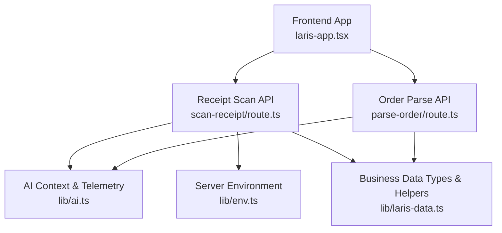
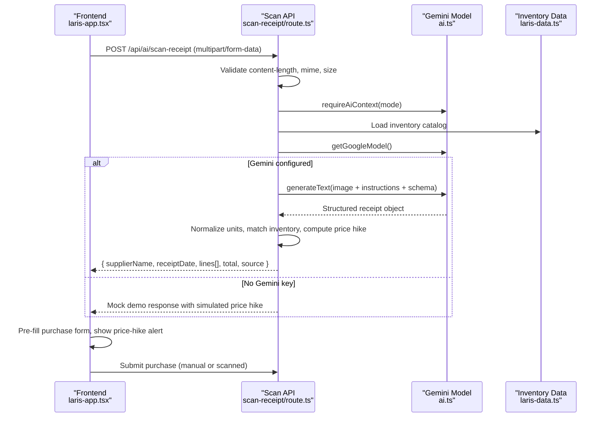
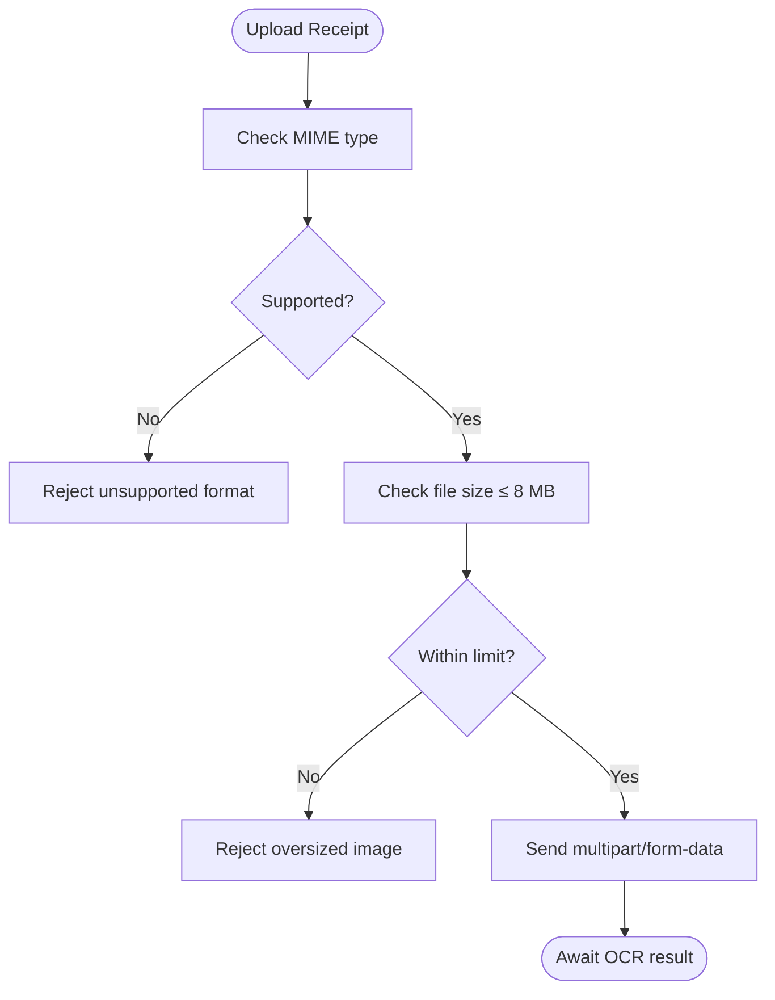
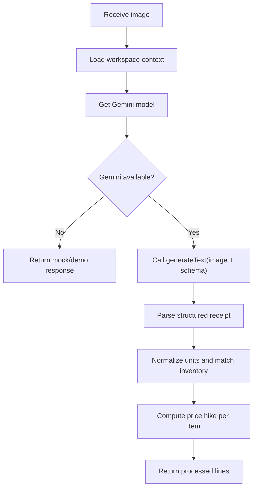
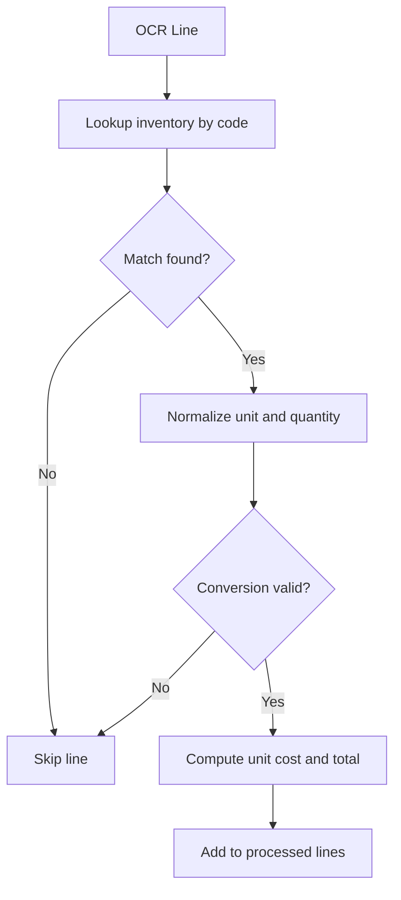
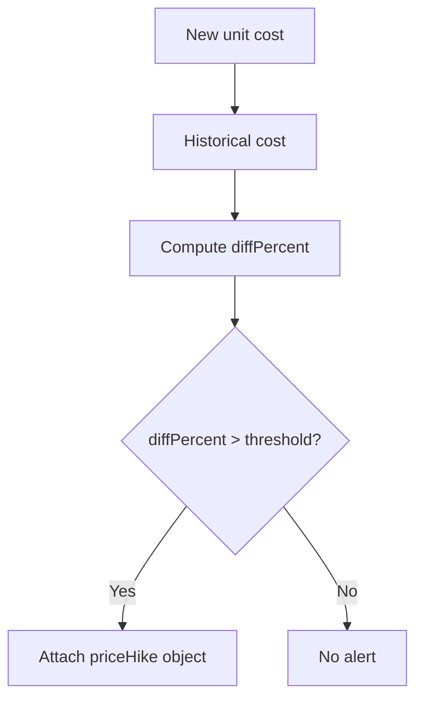
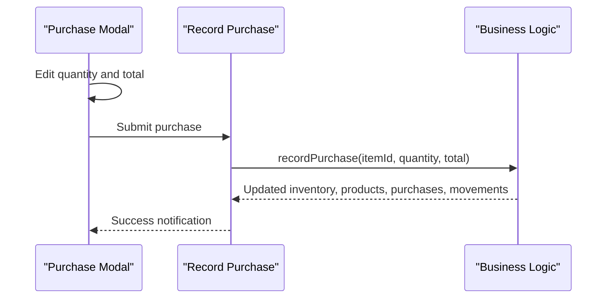
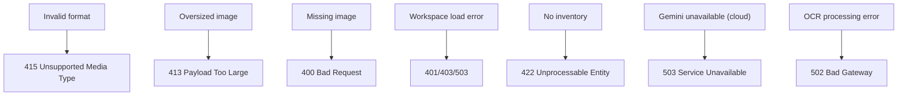
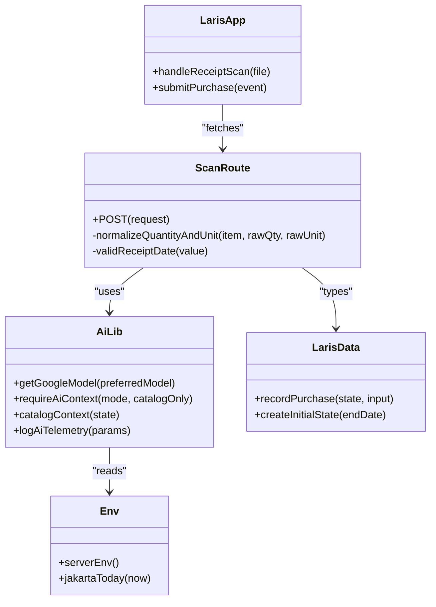

# Receipt Scanning & OCR

<cite>
**Referenced Files in This Document**
- [route.ts](file://src/app/api/ai/scan-receipt/route.ts)
- [route.ts](file://src/app/api/ai/parse-order/route.ts)
- [ai.ts](file://src/lib/ai.ts)
- [laris-data.ts](file://src/lib/laris-data.ts)
- [env.ts](file://src/lib/env.ts)
- [laris-app.tsx](file://src/components/laris-app.tsx)
</cite>

## Table of Contents
1. [Introduction](#introduction)
2. [Project Structure](#project-structure)
3. [Core Components](#core-components)
4. [Architecture Overview](#architecture-overview)
5. [Detailed Component Analysis](#detailed-component-analysis)
6. [Dependency Analysis](#dependency-analysis)
7. [Performance Considerations](#performance-considerations)
8. [Troubleshooting Guide](#troubleshooting-guide)
9. [Conclusion](#conclusion)

## Introduction
This document explains the receipt scanning and OCR functionality used to turn purchase receipts into structured inventory purchases. It covers:
- Image upload handling, supported formats, and size limits
- Multimodal OCR processing using Google Vision through a Gemini model
- Fuzzy matching between extracted line items and existing inventory
- Price-hike detection against historical unit costs
- User confirmation workflow for reviewing and editing extracted data
- Error handling for poor-quality images, partial receipts, and unsupported formats
- Performance considerations for large images and batch-like workflows

## Project Structure
The receipt scanning feature spans server API routes, shared AI utilities, business logic, environment configuration, and the frontend application:

**Diagram sources**
- [laris-app.tsx:361-390](file://src/components/laris-app.tsx#L361-L390)
- [route.ts:54-215](file://src/app/api/ai/scan-receipt/route.ts#L54-L215)
- [route.ts:31-127](file://src/app/api/ai/parse-order/route.ts#L31-L127)
- [ai.ts:9-15](file://src/lib/ai.ts#L9-L15)
- [env.ts:13-22](file://src/lib/env.ts#L13-L22)
- [laris-data.ts:15-23](file://src/lib/laris-data.ts#L15-L23)

**Section sources**
- [laris-app.tsx:361-390](file://src/components/laris-app.tsx#L361-L390)
- [route.ts:54-215](file://src/app/api/ai/scan-receipt/route.ts#L54-L215)
- [route.ts:31-127](file://src/app/api/ai/parse-order/route.ts#L31-L127)
- [ai.ts:9-15](file://src/lib/ai.ts#L9-L15)
- [env.ts:13-22](file://src/lib/env.ts#L13-L22)
- [laris-data.ts:15-23](file://src/lib/laris-data.ts#L15-L23)

## Core Components
- Frontend receipt scanner: validates file type and size, uploads via FormData, calls the scan API, and pre-fills the purchase form with OCR results.
- Receipt scan API: accepts multipart or JSON image payloads, enforces limits, loads workspace context, invokes Gemini multimodal OCR, normalizes units, matches inventory, computes price hikes, and returns structured lines.
- AI utility layer: provides Gemini model setup, workspace context loading, catalog context injection, and telemetry logging.
- Business data layer: defines inventory types, cost averaging on purchase, and deterministic helpers.
- Environment configuration: exposes Gemini API key and model selection.

**Section sources**
- [laris-app.tsx:361-390](file://src/components/laris-app.tsx#L361-L390)
- [route.ts:54-215](file://src/app/api/ai/scan-receipt/route.ts#L54-L215)
- [ai.ts:9-15](file://src/lib/ai.ts#L9-L15)
- [laris-data.ts:307-334](file://src/lib/laris-data.ts#L307-L334)
- [env.ts:13-22](file://src/lib/env.ts#L13-L22)

## Architecture Overview
The end-to-end flow from image upload to confirmed purchase is as follows:

**Diagram sources**
- [laris-app.tsx:361-390](file://src/components/laris-app.tsx#L361-L390)
- [route.ts:54-215](file://src/app/api/ai/scan-receipt/route.ts#L54-L215)
- [ai.ts:30-69](file://src/lib/ai.ts#L30-L69)
- [laris-data.ts:307-334](file://src/lib/laris-data.ts#L307-L334)

## Detailed Component Analysis

### Image Upload and Validation
- Supported formats: JPEG, PNG, WebP.
- Maximum image size: 8 MB.
- Maximum request body size: 12 MB.
- The frontend checks MIME type and size before uploading.
- The backend supports both multipart/form-data and JSON base64 payloads.

**Diagram sources**
- [laris-app.tsx:365-366](file://src/components/laris-app.tsx#L365-L366)
- [route.ts:9-11](file://src/app/api/ai/scan-receipt/route.ts#L9-L11)
- [route.ts:64-74](file://src/app/api/ai/scan-receipt/route.ts#L64-L74)

**Section sources**
- [laris-app.tsx:365-366](file://src/components/laris-app.tsx#L365-L366)
- [route.ts:9-11](file://src/app/api/ai/scan-receipt/route.ts#L9-L11)
- [route.ts:64-74](file://src/app/api/ai/scan-receipt/route.ts#L64-L74)

### Multimodal OCR Processing with Google Vision
- The backend uses a Gemini model configured via environment variables.
- If no Gemini key is present:
  - Cloud mode returns a 503 error instructing users to configure the key.
  - Local mode returns a mock OCR response with simulated data and a price-hike example.
- When configured, the backend sends the image as a multimodal input along with instructions and a strict output schema.
- The schema enforces extraction of supplier name, date, line items (raw name, matched inventory code, quantity, unit, unit price, total price), and receipt total.

**Diagram sources**
- [route.ts:107-134](file://src/app/api/ai/scan-receipt/route.ts#L107-L134)
- [route.ts:136-155](file://src/app/api/ai/scan-receipt/route.ts#L136-L155)
- [ai.ts:9-15](file://src/lib/ai.ts#L9-L15)

**Section sources**
- [route.ts:107-134](file://src/app/api/ai/scan-receipt/route.ts#L107-L134)
- [route.ts:136-155](file://src/app/api/ai/scan-receipt/route.ts#L136-L155)
- [ai.ts:9-15](file://src/lib/ai.ts#L9-L15)

### Fuzzy Matching Against Inventory
- The OCR output includes a matched inventory code when possible.
- The backend maps each matched code to an inventory item and normalizes quantities and units based on known conversion rules:
  - Grams to kilograms
  - Milliliters to liters
  - Pieces to dozens
- Lines without safe conversions are skipped and reported back to the client.

**Diagram sources**
- [route.ts:157-182](file://src/app/api/ai/scan-receipt/route.ts#L157-L182)

**Section sources**
- [route.ts:157-182](file://src/app/api/ai/scan-receipt/route.ts#L157-L182)

### Price-Hike Detection System
- For each processed line, the backend calculates the new unit cost and compares it to the historical cost stored in inventory.
- If the percentage difference exceeds a small threshold, a price-hike alert is attached to the line.
- The frontend displays this alert to prompt user review before finalizing the purchase.

**Diagram sources**
- [route.ts:168-181](file://src/app/api/ai/scan-receipt/route.ts#L168-L181)
- [laris-app.tsx:383-385](file://src/components/laris-app.tsx#L383-L385)

**Section sources**
- [route.ts:168-181](file://src/app/api/ai/scan-receipt/route.ts#L168-L181)
- [laris-app.tsx:383-385](file://src/components/laris-app.tsx#L383-L385)

### User Confirmation Workflow
- After OCR completes, the frontend pre-fills the purchase modal with:
  - Selected inventory item
  - Quantity and total price from OCR
  - Price-hike alert if applicable
- The user can edit fields before confirming the purchase.
- On submission, the system records the purchase, updates stock movements, recalculates average cost, and adjusts product costs accordingly.

**Diagram sources**
- [laris-app.tsx:393-435](file://src/components/laris-app.tsx#L393-L435)
- [laris-data.ts:307-334](file://src/lib/laris-data.ts#L307-L334)

**Section sources**
- [laris-app.tsx:393-435](file://src/components/laris-app.tsx#L393-L435)
- [laris-data.ts:307-334](file://src/lib/laris-data.ts#L307-L334)

### Error Handling
- Unsupported image formats: rejected early with a clear message.
- Oversized images: rejected with a maximum size notice.
- Missing image or invalid payload: validation errors returned.
- Workspace not loaded or missing inventory: appropriate status codes and messages.
- Gemini unavailable in cloud mode: 503 with guidance to set the API key.
- OCR failure: logs telemetry and returns a friendly error encouraging clearer images.

**Diagram sources**
- [route.ts:57-96](file://src/app/api/ai/scan-receipt/route.ts#L57-L96)
- [route.ts:100-110](file://src/app/api/ai/scan-receipt/route.ts#L100-L110)
- [route.ts:203-214](file://src/app/api/ai/scan-receipt/route.ts#L203-L214)

**Section sources**
- [route.ts:57-96](file://src/app/api/ai/scan-receipt/route.ts#L57-L96)
- [route.ts:100-110](file://src/app/api/ai/scan-receipt/route.ts#L100-L110)
- [route.ts:203-214](file://src/app/api/ai/scan-receipt/route.ts#L203-L214)

## Dependency Analysis
Key dependencies and relationships:

**Diagram sources**
- [laris-app.tsx:361-390](file://src/components/laris-app.tsx#L361-L390)
- [route.ts:28-52](file://src/app/api/ai/scan-receipt/route.ts#L28-L52)
- [ai.ts:9-15](file://src/lib/ai.ts#L9-L15)
- [laris-data.ts:307-334](file://src/lib/laris-data.ts#L307-L334)
- [env.ts:13-22](file://src/lib/env.ts#L13-L22)

**Section sources**
- [laris-app.tsx:361-390](file://src/components/laris-app.tsx#L361-L390)
- [route.ts:28-52](file://src/app/api/ai/scan-receipt/route.ts#L28-L52)
- [ai.ts:9-15](file://src/lib/ai.ts#L9-L15)
- [laris-data.ts:307-334](file://src/lib/laris-data.ts#L307-L334)
- [env.ts:13-22](file://src/lib/env.ts#L13-L22)

## Performance Considerations
- Image size limits:
  - Images capped at 8 MB to reduce bandwidth and processing time.
  - Request bodies capped at 12 MB to protect server resources.
- Base64 encoding overhead:
  - Backend converts uploaded files to base64 for Gemini; consider client-side compression for very large images to reduce payload size.
- Batch processing:
  - The current API processes one receipt per request. To support batch scanning, wrap multiple images in a single request and iterate over them server-side, returning aggregated results while preserving rate limits and timeouts.
- Telemetry:
  - All OCR requests log latency and outcomes, enabling performance monitoring and optimization.

[No sources needed since this section provides general guidance]

## Troubleshooting Guide
- “Unsupported format”: Ensure the image is JPG, PNG, or WebP.
- “Image too large”: Compress or resize the image to under 8 MB.
- “No ingredients added”: Add inventory items before scanning receipts.
- “Cloud requires Gemini key”: Set GOOGLE_GENERATIVE_AI_API_KEY in the server environment.
- “Poor quality image”: Re-take the photo with better lighting and focus; ensure text is legible.
- “Partial receipt”: Some lines may be skipped if units cannot be safely converted; review the skipped lines notice and manually adjust.

**Section sources**
- [route.ts:69-71](file://src/app/api/ai/scan-receipt/route.ts#L69-L71)
- [route.ts:92-96](file://src/app/api/ai/scan-receipt/route.ts#L92-L96)
- [route.ts:104-110](file://src/app/api/ai/scan-receipt/route.ts#L104-L110)
- [route.ts:203-214](file://src/app/api/ai/scan-receipt/route.ts#L203-L214)

## Conclusion
The receipt scanning and OCR pipeline integrates a robust frontend upload experience with a secure, validated backend that leverages Gemini multimodal OCR. It normalizes units, matches inventory, detects price hikes, and guides users through a confirmation workflow. With clear error handling, telemetry, and configurable fallback behavior, the system balances accuracy, usability, and operational safety. Future enhancements can include client-side image compression, batch scanning endpoints, and more sophisticated fuzzy matching strategies.